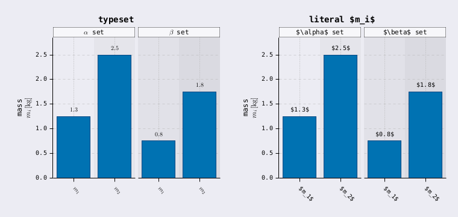
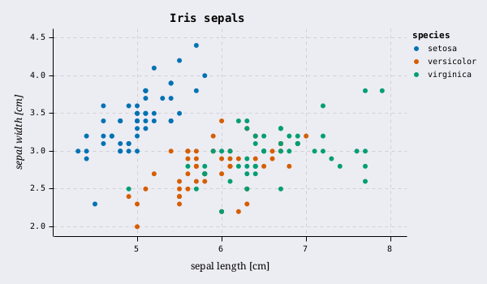

---
format:
  html:
    toc: true
    toc-location: right
    toc-depth: 4
    theme: cosmo
    include-in-header:
      text: |-
        <style>
        .data-table { width: fit-content; max-width: 100%; max-height: 15rem; overflow: auto; margin: 0 0 1rem 0; }
        .data-table .table-responsive { overflow: visible; }
        .data-table table { font-size: 0.75rem; width: auto; margin: 0; }
        .data-table th, .data-table td { padding: 0.1rem 0.45rem !important; white-space: nowrap; }
        .data-table thead th { position: sticky; top: 0; background: var(--bs-body-bg, #fff); }
        .options { margin: 0.5rem 0 1rem 0; }
        .options .option-card { margin: 0 0 0.9rem 0; border: 1px solid var(--bs-border-color, #dee2e6); border-radius: 0.375rem; overflow: hidden; }
        .options dt { display: flex; flex-wrap: wrap; align-items: baseline; gap: 0.1rem 1rem; margin: 0; padding: 0.4rem 0.75rem; background: #eef2f7; border-bottom: 1px solid var(--bs-border-color, #dee2e6); font-weight: normal; }
        .options dt > code { font-weight: 700; font-size: 1rem; background: none; padding: 0; }
        .options .option-default { font-size: 0.85rem; color: var(--bs-secondary-color, #6c757d); }
        .options dd { margin: 0; padding: 0.5rem 0.75rem; }
        .options .option-example { font-size: 0.85rem; padding: 0 0 0.45rem 0; margin-bottom: 0.45rem; border-bottom: 1px dashed var(--bs-border-color, #dee2e6); }
        .options .option-example code { background: none; padding: 0; }
        .options .option-text ul { margin: 0.3rem 0 0 0; padding-left: 1.25rem; }
        .options code, .mapping code { overflow-wrap: anywhere; }
        .options .option-default code, .options .option-example code { white-space: pre-wrap; }
        .mapping { margin: 0.5rem 0 1rem 0; padding: 0.5rem 0.75rem; border: 1px solid var(--bs-border-color, #dee2e6); border-left: 0.3rem solid #2780e3; border-radius: 0.375rem; background: #f5f8fc; }
        .mapping-title { font-weight: 700; margin-bottom: 0.25rem; }
        .mapping-hint { font-weight: normal; font-size: 0.85rem; color: var(--bs-secondary-color, #6c757d); }
        .mapping ul { margin: 0; padding-left: 1.25rem; }
        .mapping .required { font-size: 0.75rem; padding: 0 0.3rem; border: 1px solid currentColor; border-radius: 0.25rem; }
        .mapping-returns { margin-top: 0.25rem; }
        .mapping code { white-space: pre-wrap; }
        .shared { margin: 0.5rem 0 1rem 0; padding: 0.5rem 0.75rem; border: 1px solid var(--bs-border-color, #dee2e6); border-left: 0.3rem solid #6c757d; border-radius: 0.375rem; background: #f6f6f6; }
        .shared-title { font-weight: 700; margin-bottom: 0.25rem; }
        .shared-hint { font-weight: normal; font-size: 0.85rem; color: var(--bs-secondary-color, #6c757d); }
        .shared ul { margin: 0; padding-left: 1.25rem; }
        .shared code { overflow-wrap: anywhere; }
        p code, li code { white-space: pre-wrap; overflow-wrap: anywhere; }
        </style>
code-block-background: true

---
<style></style><style>.printedClojure .sourceCode {
  background-color: transparent;
  border-style: none;
}
</style><style>.clay-limit-image-width .clay-image {max-width: 100%}
.clay-side-by-side .sourceCode {margin: 0}
.clay-side-by-side {margin: 1em 0}
</style>
<script src="https://code.jquery.com/jquery-3.6.0.min.js" type="text/javascript"></script><script src="https://code.jquery.com/ui/1.13.1/jquery-ui.min.js" type="text/javascript"></script>

# Labels and text

A plot has a title, axis titles and legend titles (`:labels`), each a string or a label map with its own text
style. Text drawn by charts (the `text` chart, value labels, strip and legend texts) takes its style from a theme
text role.


::: {.sourceClojure}
```clojure
(ns reference.labels-text
  (:require [fastmath.core :as m]
            [cljplot2.chart :as chart]
            [cljplot2.content.label :as label]
            [cljplot2.core :as plot]
            [cljplot2.describe :as describe]
            [cljplot2.graphics.font :as font]
            [cljplot2.layout.plot-grid :as plot-grid]
            [notebook-utils :as nu]))
```
:::


The table below holds the iris flowers; most sections draw them:

Data: Edgar Anderson's iris measurements, R datasets package `iris` (Anderson 1935; Fisher 1936); licence: Part of R (GPL-2 | GPL-3).


::: {.sourceClojure}
```clojure
(def iris (nu/dataset :iris))
```
:::


```{=html}
<div class="data-table"><table class="table table-hover table-responsive clay-table"><thead><tr><th>sepal-length</th><th>sepal-width</th><th>petal-length</th><th>petal-width</th><th>species</th></tr></thead><tbody><tr><td>5.1</td><td>3.5</td><td>1.4</td><td>0.2</td><td>setosa</td></tr><tr><td>4.9</td><td>3</td><td>1.4</td><td>0.2</td><td>setosa</td></tr><tr><td>4.7</td><td>3.2</td><td>1.3</td><td>0.2</td><td>setosa</td></tr><tr><td>4.6</td><td>3.1</td><td>1.5</td><td>0.2</td><td>setosa</td></tr><tr><td>5</td><td>3.6</td><td>1.4</td><td>0.2</td><td>setosa</td></tr><tr><td>5.4</td><td>3.9</td><td>1.7</td><td>0.4</td><td>setosa</td></tr><tr><td>4.6</td><td>3.4</td><td>1.4</td><td>0.3</td><td>setosa</td></tr><tr><td>5</td><td>3.4</td><td>1.5</td><td>0.2</td><td>setosa</td></tr><tr><td>4.4</td><td>2.9</td><td>1.4</td><td>0.2</td><td>setosa</td></tr><tr><td>4.9</td><td>3.1</td><td>1.5</td><td>0.1</td><td>setosa</td></tr><tr><td>5.4</td><td>3.7</td><td>1.5</td><td>0.2</td><td>setosa</td></tr><tr><td>4.8</td><td>3.4</td><td>1.6</td><td>0.2</td><td>setosa</td></tr><tr><td>4.8</td><td>3</td><td>1.4</td><td>0.1</td><td>setosa</td></tr><tr><td>4.3</td><td>3</td><td>1.1</td><td>0.1</td><td>setosa</td></tr><tr><td>5.8</td><td>4</td><td>1.2</td><td>0.2</td><td>setosa</td></tr><tr><td>5.7</td><td>4.4</td><td>1.5</td><td>0.4</td><td>setosa</td></tr><tr><td>5.4</td><td>3.9</td><td>1.3</td><td>0.4</td><td>setosa</td></tr><tr><td>5.1</td><td>3.5</td><td>1.4</td><td>0.3</td><td>setosa</td></tr><tr><td>5.7</td><td>3.8</td><td>1.7</td><td>0.3</td><td>setosa</td></tr><tr><td>5.1</td><td>3.8</td><td>1.5</td><td>0.3</td><td>setosa</td></tr><tr><td>5.4</td><td>3.4</td><td>1.7</td><td>0.2</td><td>setosa</td></tr><tr><td>5.1</td><td>3.7</td><td>1.5</td><td>0.4</td><td>setosa</td></tr><tr><td>4.6</td><td>3.6</td><td>1</td><td>0.2</td><td>setosa</td></tr><tr><td>5.1</td><td>3.3</td><td>1.7</td><td>0.5</td><td>setosa</td></tr><tr><td>4.8</td><td>3.4</td><td>1.9</td><td>0.2</td><td>setosa</td></tr><tr><td>5</td><td>3</td><td>1.6</td><td>0.2</td><td>setosa</td></tr><tr><td>5</td><td>3.4</td><td>1.6</td><td>0.4</td><td>setosa</td></tr><tr><td>5.2</td><td>3.5</td><td>1.5</td><td>0.2</td><td>setosa</td></tr><tr><td>5.2</td><td>3.4</td><td>1.4</td><td>0.2</td><td>setosa</td></tr><tr><td>4.7</td><td>3.2</td><td>1.6</td><td>0.2</td><td>setosa</td></tr><tr><td>4.8</td><td>3.1</td><td>1.6</td><td>0.2</td><td>setosa</td></tr><tr><td>5.4</td><td>3.4</td><td>1.5</td><td>0.4</td><td>setosa</td></tr><tr><td>5.2</td><td>4.1</td><td>1.5</td><td>0.1</td><td>setosa</td></tr><tr><td>5.5</td><td>4.2</td><td>1.4</td><td>0.2</td><td>setosa</td></tr><tr><td>4.9</td><td>3.1</td><td>1.5</td><td>0.2</td><td>setosa</td></tr><tr><td>5</td><td>3.2</td><td>1.2</td><td>0.2</td><td>setosa</td></tr><tr><td>5.5</td><td>3.5</td><td>1.3</td><td>0.2</td><td>setosa</td></tr><tr><td>4.9</td><td>3.6</td><td>1.4</td><td>0.1</td><td>setosa</td></tr><tr><td>4.4</td><td>3</td><td>1.3</td><td>0.2</td><td>setosa</td></tr><tr><td>5.1</td><td>3.4</td><td>1.5</td><td>0.2</td><td>setosa</td></tr><tr><td>5</td><td>3.5</td><td>1.3</td><td>0.3</td><td>setosa</td></tr><tr><td>4.5</td><td>2.3</td><td>1.3</td><td>0.3</td><td>setosa</td></tr><tr><td>4.4</td><td>3.2</td><td>1.3</td><td>0.2</td><td>setosa</td></tr><tr><td>5</td><td>3.5</td><td>1.6</td><td>0.6</td><td>setosa</td></tr><tr><td>5.1</td><td>3.8</td><td>1.9</td><td>0.4</td><td>setosa</td></tr><tr><td>4.8</td><td>3</td><td>1.4</td><td>0.3</td><td>setosa</td></tr><tr><td>5.1</td><td>3.8</td><td>1.6</td><td>0.2</td><td>setosa</td></tr><tr><td>4.6</td><td>3.2</td><td>1.4</td><td>0.2</td><td>setosa</td></tr><tr><td>5.3</td><td>3.7</td><td>1.5</td><td>0.2</td><td>setosa</td></tr><tr><td>5</td><td>3.3</td><td>1.4</td><td>0.2</td><td>setosa</td></tr><tr><td>7</td><td>3.2</td><td>4.7</td><td>1.4</td><td>versicolor</td></tr><tr><td>6.4</td><td>3.2</td><td>4.5</td><td>1.5</td><td>versicolor</td></tr><tr><td>6.9</td><td>3.1</td><td>4.9</td><td>1.5</td><td>versicolor</td></tr><tr><td>5.5</td><td>2.3</td><td>4</td><td>1.3</td><td>versicolor</td></tr><tr><td>6.5</td><td>2.8</td><td>4.6</td><td>1.5</td><td>versicolor</td></tr><tr><td>5.7</td><td>2.8</td><td>4.5</td><td>1.3</td><td>versicolor</td></tr><tr><td>6.3</td><td>3.3</td><td>4.7</td><td>1.6</td><td>versicolor</td></tr><tr><td>4.9</td><td>2.4</td><td>3.3</td><td>1</td><td>versicolor</td></tr><tr><td>6.6</td><td>2.9</td><td>4.6</td><td>1.3</td><td>versicolor</td></tr><tr><td>5.2</td><td>2.7</td><td>3.9</td><td>1.4</td><td>versicolor</td></tr><tr><td>5</td><td>2</td><td>3.5</td><td>1</td><td>versicolor</td></tr><tr><td>5.9</td><td>3</td><td>4.2</td><td>1.5</td><td>versicolor</td></tr><tr><td>6</td><td>2.2</td><td>4</td><td>1</td><td>versicolor</td></tr><tr><td>6.1</td><td>2.9</td><td>4.7</td><td>1.4</td><td>versicolor</td></tr><tr><td>5.6</td><td>2.9</td><td>3.6</td><td>1.3</td><td>versicolor</td></tr><tr><td>6.7</td><td>3.1</td><td>4.4</td><td>1.4</td><td>versicolor</td></tr><tr><td>5.6</td><td>3</td><td>4.5</td><td>1.5</td><td>versicolor</td></tr><tr><td>5.8</td><td>2.7</td><td>4.1</td><td>1</td><td>versicolor</td></tr><tr><td>6.2</td><td>2.2</td><td>4.5</td><td>1.5</td><td>versicolor</td></tr><tr><td>5.6</td><td>2.5</td><td>3.9</td><td>1.1</td><td>versicolor</td></tr><tr><td>5.9</td><td>3.2</td><td>4.8</td><td>1.8</td><td>versicolor</td></tr><tr><td>6.1</td><td>2.8</td><td>4</td><td>1.3</td><td>versicolor</td></tr><tr><td>6.3</td><td>2.5</td><td>4.9</td><td>1.5</td><td>versicolor</td></tr><tr><td>6.1</td><td>2.8</td><td>4.7</td><td>1.2</td><td>versicolor</td></tr><tr><td>6.4</td><td>2.9</td><td>4.3</td><td>1.3</td><td>versicolor</td></tr><tr><td>6.6</td><td>3</td><td>4.4</td><td>1.4</td><td>versicolor</td></tr><tr><td>6.8</td><td>2.8</td><td>4.8</td><td>1.4</td><td>versicolor</td></tr><tr><td>6.7</td><td>3</td><td>5</td><td>1.7</td><td>versicolor</td></tr><tr><td>6</td><td>2.9</td><td>4.5</td><td>1.5</td><td>versicolor</td></tr><tr><td>5.7</td><td>2.6</td><td>3.5</td><td>1</td><td>versicolor</td></tr><tr><td>5.5</td><td>2.4</td><td>3.8</td><td>1.1</td><td>versicolor</td></tr><tr><td>5.5</td><td>2.4</td><td>3.7</td><td>1</td><td>versicolor</td></tr><tr><td>5.8</td><td>2.7</td><td>3.9</td><td>1.2</td><td>versicolor</td></tr><tr><td>6</td><td>2.7</td><td>5.1</td><td>1.6</td><td>versicolor</td></tr><tr><td>5.4</td><td>3</td><td>4.5</td><td>1.5</td><td>versicolor</td></tr><tr><td>6</td><td>3.4</td><td>4.5</td><td>1.6</td><td>versicolor</td></tr><tr><td>6.7</td><td>3.1</td><td>4.7</td><td>1.5</td><td>versicolor</td></tr><tr><td>6.3</td><td>2.3</td><td>4.4</td><td>1.3</td><td>versicolor</td></tr><tr><td>5.6</td><td>3</td><td>4.1</td><td>1.3</td><td>versicolor</td></tr><tr><td>5.5</td><td>2.5</td><td>4</td><td>1.3</td><td>versicolor</td></tr><tr><td>5.5</td><td>2.6</td><td>4.4</td><td>1.2</td><td>versicolor</td></tr><tr><td>6.1</td><td>3</td><td>4.6</td><td>1.4</td><td>versicolor</td></tr><tr><td>5.8</td><td>2.6</td><td>4</td><td>1.2</td><td>versicolor</td></tr><tr><td>5</td><td>2.3</td><td>3.3</td><td>1</td><td>versicolor</td></tr><tr><td>5.6</td><td>2.7</td><td>4.2</td><td>1.3</td><td>versicolor</td></tr><tr><td>5.7</td><td>3</td><td>4.2</td><td>1.2</td><td>versicolor</td></tr><tr><td>5.7</td><td>2.9</td><td>4.2</td><td>1.3</td><td>versicolor</td></tr><tr><td>6.2</td><td>2.9</td><td>4.3</td><td>1.3</td><td>versicolor</td></tr><tr><td>5.1</td><td>2.5</td><td>3</td><td>1.1</td><td>versicolor</td></tr><tr><td>5.7</td><td>2.8</td><td>4.1</td><td>1.3</td><td>versicolor</td></tr><tr><td>…</td><td>…</td><td>…</td><td>…</td><td>…</td></tr></tbody></table></div>
```


The table below holds three made-up series; the section on text in the panel draws them:


::: {.sourceClojure}
```clojure
(def series (for [[i g] (map-indexed vector ["alpha" "beta" "gamma"]) t (range 10)]
              {:g g :t t :v (+ (* t (inc i) 0.5) (* 3 i))}))
```
:::


```{=html}
<div class="data-table"><table class="table table-hover table-responsive clay-table"><thead><tr><th>g</th><th>t</th><th>v</th></tr></thead><tbody><tr><td>alpha</td><td>0</td><td>0.0</td></tr><tr><td>alpha</td><td>1</td><td>0.5</td></tr><tr><td>alpha</td><td>2</td><td>1.0</td></tr><tr><td>alpha</td><td>3</td><td>1.5</td></tr><tr><td>alpha</td><td>4</td><td>2.0</td></tr><tr><td>alpha</td><td>5</td><td>2.5</td></tr><tr><td>alpha</td><td>6</td><td>3.0</td></tr><tr><td>alpha</td><td>7</td><td>3.5</td></tr><tr><td>alpha</td><td>8</td><td>4.0</td></tr><tr><td>alpha</td><td>9</td><td>4.5</td></tr><tr><td>beta</td><td>0</td><td>3.0</td></tr><tr><td>beta</td><td>1</td><td>4.0</td></tr><tr><td>beta</td><td>2</td><td>5.0</td></tr><tr><td>beta</td><td>3</td><td>6.0</td></tr><tr><td>beta</td><td>4</td><td>7.0</td></tr><tr><td>beta</td><td>5</td><td>8.0</td></tr><tr><td>beta</td><td>6</td><td>9.0</td></tr><tr><td>beta</td><td>7</td><td>10.0</td></tr><tr><td>beta</td><td>8</td><td>11.0</td></tr><tr><td>beta</td><td>9</td><td>12.0</td></tr><tr><td>gamma</td><td>0</td><td>6.0</td></tr><tr><td>gamma</td><td>1</td><td>7.5</td></tr><tr><td>gamma</td><td>2</td><td>9.0</td></tr><tr><td>gamma</td><td>3</td><td>10.5</td></tr><tr><td>gamma</td><td>4</td><td>12.0</td></tr><tr><td>gamma</td><td>5</td><td>13.5</td></tr><tr><td>gamma</td><td>6</td><td>15.0</td></tr><tr><td>gamma</td><td>7</td><td>16.5</td></tr><tr><td>gamma</td><td>8</td><td>18.0</td></tr><tr><td>gamma</td><td>9</td><td>19.5</td></tr></tbody></table></div>
```


The table below holds made-up decays at two rates, the rates named by formulas; the formula section draws them:


::: {.sourceClojure}
```clojure
(def decay
  (vec (for [rate [0.5 1.0] t (range 0.0 10.5 0.5)]
         {:t t :n (* 1000.0 (m/exp (- (* rate t)))) :rate (str "$\\lambda = " rate "$")})))
```
:::


```{=html}
<div class="data-table"><table class="table table-hover table-responsive clay-table"><thead><tr><th>t</th><th>n</th><th>rate</th></tr></thead><tbody><tr><td>0.0</td><td>1000.0</td><td>$\lambda = 0.5$</td></tr><tr><td>0.5</td><td>778.8007830714049</td><td>$\lambda = 0.5$</td></tr><tr><td>1.0</td><td>606.5306597126335</td><td>$\lambda = 0.5$</td></tr><tr><td>1.5</td><td>472.3665527410147</td><td>$\lambda = 0.5$</td></tr><tr><td>2.0</td><td>367.87944117144235</td><td>$\lambda = 0.5$</td></tr><tr><td>2.5</td><td>286.5047968601901</td><td>$\lambda = 0.5$</td></tr><tr><td>3.0</td><td>223.13016014842984</td><td>$\lambda = 0.5$</td></tr><tr><td>3.5</td><td>173.77394345044513</td><td>$\lambda = 0.5$</td></tr><tr><td>4.0</td><td>135.3352832366127</td><td>$\lambda = 0.5$</td></tr><tr><td>4.5</td><td>105.39922456186434</td><td>$\lambda = 0.5$</td></tr><tr><td>5.0</td><td>82.0849986238988</td><td>$\lambda = 0.5$</td></tr><tr><td>5.5</td><td>63.92786120670757</td><td>$\lambda = 0.5$</td></tr><tr><td>6.0</td><td>49.787068367863945</td><td>$\lambda = 0.5$</td></tr><tr><td>6.5</td><td>38.77420783172201</td><td>$\lambda = 0.5$</td></tr><tr><td>7.0</td><td>30.197383422318502</td><td>$\lambda = 0.5$</td></tr><tr><td>7.5</td><td>23.517745856009107</td><td>$\lambda = 0.5$</td></tr><tr><td>8.0</td><td>18.315638888734178</td><td>$\lambda = 0.5$</td></tr><tr><td>8.5</td><td>14.264233908999254</td><td>$\lambda = 0.5$</td></tr><tr><td>9.0</td><td>11.108996538242305</td><td>$\lambda = 0.5$</td></tr><tr><td>9.5</td><td>8.651695203120632</td><td>$\lambda = 0.5$</td></tr><tr><td>10.0</td><td>6.737946999085467</td><td>$\lambda = 0.5$</td></tr><tr><td>0.0</td><td>1000.0</td><td>$\lambda = 1.0$</td></tr><tr><td>0.5</td><td>606.5306597126335</td><td>$\lambda = 1.0$</td></tr><tr><td>1.0</td><td>367.87944117144235</td><td>$\lambda = 1.0$</td></tr><tr><td>1.5</td><td>223.13016014842984</td><td>$\lambda = 1.0$</td></tr><tr><td>2.0</td><td>135.3352832366127</td><td>$\lambda = 1.0$</td></tr><tr><td>2.5</td><td>82.0849986238988</td><td>$\lambda = 1.0$</td></tr><tr><td>3.0</td><td>49.787068367863945</td><td>$\lambda = 1.0$</td></tr><tr><td>3.5</td><td>30.197383422318502</td><td>$\lambda = 1.0$</td></tr><tr><td>4.0</td><td>18.315638888734178</td><td>$\lambda = 1.0$</td></tr><tr><td>4.5</td><td>11.108996538242305</td><td>$\lambda = 1.0$</td></tr><tr><td>5.0</td><td>6.737946999085467</td><td>$\lambda = 1.0$</td></tr><tr><td>5.5</td><td>4.0867714384640665</td><td>$\lambda = 1.0$</td></tr><tr><td>6.0</td><td>2.4787521766663585</td><td>$\lambda = 1.0$</td></tr><tr><td>6.5</td><td>1.5034391929775726</td><td>$\lambda = 1.0$</td></tr><tr><td>7.0</td><td>0.9118819655545163</td><td>$\lambda = 1.0$</td></tr><tr><td>7.5</td><td>0.5530843701478336</td><td>$\lambda = 1.0$</td></tr><tr><td>8.0</td><td>0.33546262790251186</td><td>$\lambda = 1.0$</td></tr><tr><td>8.5</td><td>0.2034683690106442</td><td>$\lambda = 1.0$</td></tr><tr><td>9.0</td><td>0.12340980408667956</td><td>$\lambda = 1.0$</td></tr><tr><td>9.5</td><td>0.0748518298877006</td><td>$\lambda = 1.0$</td></tr><tr><td>10.0</td><td>0.045399929762484845</td><td>$\lambda = 1.0$</td></tr></tbody></table></div>
```


The table below holds made-up masses whose names hold formulas; the formula section draws them:


::: {.sourceClojure}
```clojure
(def masses
  [{:part "$m_1$" :group "$\\alpha$ set" :kg 1.25} {:part "$m_2$" :group "$\\alpha$ set" :kg 2.5}
   {:part "$m_1$" :group "$\\beta$ set" :kg 0.75} {:part "$m_2$" :group "$\\beta$ set" :kg 1.75}])
```
:::


```{=html}
<div class="data-table"><table class="table table-hover table-responsive clay-table"><thead><tr><th>part</th><th>group</th><th>kg</th></tr></thead><tbody><tr><td>$m_1$</td><td>$\alpha$ set</td><td>1.25</td></tr><tr><td>$m_2$</td><td>$\alpha$ set</td><td>2.5</td></tr><tr><td>$m_1$</td><td>$\beta$ set</td><td>0.75</td></tr><tr><td>$m_2$</td><td>$\beta$ set</td><td>1.75</td></tr></tbody></table></div>
```


## Plot labels

These keys of the plot's `:labels` map hold the plot title, the axis titles and the legend titles. A 3D plot draws
`:x`, `:y` and `:z` on its frame. The plot below names the title and both axes:


```{=html}
<dl class="options"><div class="option-card"><dt><code>:title</code><span class="option-default">Default: None.</span></dt><dd><div class="option-example"><code>{:labels {:title "Walks"}}</code></div><div class="option-text">The plot title above the panels, in the text role <code>:title</code>.<ul><li><code>:none</code> – No title, not even one a chart or a scale gives.</li><li><span>label map</span> – The text with its role, rotation and text style keys (Label maps).</li><li><span>any value</span> – A text: any value as <code>str</code>, or a <code>plot/math</code> or <code>plot/runs</code> value.</li></ul></div></dd></div><div class="option-card"><dt><code>:x</code><span class="option-default">Default: The title the first chart suggesting one gives (histogram, density, ecdf, qq, bar ...), else none; on a 3D plot the name of the first 3D chart's keyword accessor.</span></dt><dd><div class="option-example"><code>{:labels {:x "time"}}</code></div><div class="option-text">The x axis title, in the text role <code>:axis-title</code>; a title too long for its axis is wrapped, shrunk, then cut. A 3D plot draws it on its frame instead.<ul><li><code>:none</code> – No title, not even one a chart or a scale gives.</li><li><span>label map</span> – The text with its role, rotation and text style keys (Label maps).</li><li><span>any value</span> – A text: any value as <code>str</code>, or a <code>plot/math</code> or <code>plot/runs</code> value.</li></ul></div></dd></div><div class="option-card"><dt><code>:y</code><span class="option-default">Default: The title the first chart suggesting one gives (histogram, density, ecdf, qq, bar ...), else none; on a 3D plot the name of the first 3D chart's keyword accessor.</span></dt><dd><div class="option-example"><code>{:labels {:y "value"}}</code></div><div class="option-text">The y axis title, in the text role <code>:axis-title</code> turned 270 degrees; a title too long for the panels' height is wrapped, shrunk, then cut. A 3D plot draws it on its frame instead.<ul><li><code>:none</code> – No title, not even one a chart or a scale gives.</li><li><span>label map</span> – The text with its role, rotation and text style keys (Label maps).</li><li><span>any value</span> – A text: any value as <code>str</code>, or a <code>plot/math</code> or <code>plot/runs</code> value.</li></ul></div></dd></div><div class="option-card"><dt><code>:z</code><span class="option-default">Default: The first 3D chart's title: <code>Count</code> for a binned cloud, <code>Density</code> for a density surface, else the name of its keyword accessor.</span></dt><dd><div class="option-example"><code>{:labels {:z "height"}}</code></div><div class="option-text">The z axis title of a 3D plot, drawn on its frame in the text role <code>:axis-title</code>.<ul><li><code>:none</code> – No title, not even one a chart or a scale gives.</li><li><span>label map</span> – The text with its role, rotation and text style keys (Label maps).</li><li><span>any value</span> – A text: any value as <code>str</code>, or a <code>plot/math</code> or <code>plot/runs</code> value.</li></ul></div></dd></div><div class="option-card"><dt><code>:color</code><span class="option-default">Default: The <code>:color</code> scale's <code>:title</code>, else the title of a chart that computes <code>:color</code>, else the name of a keyword accessor; none for a function.</span></dt><dd><div class="option-example"><code>{:labels {:color "species"}}</code></div><div class="option-text">The title of the <code>:color</code> legend, in the text role <code>:legend-title</code>; it wins over the scale's <code>:title</code>.<ul><li><code>:none</code> – No title, not even one a chart or a scale gives.</li><li><span>label map</span> – The text with its role, rotation and text style keys (Label maps).</li><li><span>any value</span> – A text: any value as <code>str</code>, or a <code>plot/math</code> or <code>plot/runs</code> value.</li></ul></div></dd></div><div class="option-card"><dt><code>:shape</code><span class="option-default">Default: The <code>:shape</code> scale's <code>:title</code>, else the title of a chart that computes <code>:shape</code>, else the name of a keyword accessor; none for a function.</span></dt><dd><div class="option-example"><code>{:labels {:shape "kind"}}</code></div><div class="option-text">The title of the <code>:shape</code> legend, in the text role <code>:legend-title</code>; it wins over the scale's <code>:title</code>.<ul><li><code>:none</code> – No title, not even one a chart or a scale gives.</li><li><span>label map</span> – The text with its role, rotation and text style keys (Label maps).</li><li><span>any value</span> – A text: any value as <code>str</code>, or a <code>plot/math</code> or <code>plot/runs</code> value.</li></ul></div></dd></div><div class="option-card"><dt><code>:size</code><span class="option-default">Default: The <code>:size</code> scale's <code>:title</code>, else the title of a chart that computes <code>:size</code>, else the name of a keyword accessor; none for a function.</span></dt><dd><div class="option-example"><code>{:labels {:size "weight"}}</code></div><div class="option-text">The title of the <code>:size</code> legend, in the text role <code>:legend-title</code>; it wins over the scale's <code>:title</code>.<ul><li><code>:none</code> – No title, not even one a chart or a scale gives.</li><li><span>label map</span> – The text with its role, rotation and text style keys (Label maps).</li><li><span>any value</span> – A text: any value as <code>str</code>, or a <code>plot/math</code> or <code>plot/runs</code> value.</li></ul></div></dd></div><div class="option-card"><dt><code>:dash</code><span class="option-default">Default: The <code>:dash</code> scale's <code>:title</code>, else the title of a chart that computes <code>:dash</code>, else the name of a keyword accessor; none for a function.</span></dt><dd><div class="option-example"><code>{:labels {:dash "series"}}</code></div><div class="option-text">The title of the <code>:dash</code> legend, in the text role <code>:legend-title</code>; it wins over the scale's <code>:title</code>.<ul><li><code>:none</code> – No title, not even one a chart or a scale gives.</li><li><span>label map</span> – The text with its role, rotation and text style keys (Label maps).</li><li><span>any value</span> – A text: any value as <code>str</code>, or a <code>plot/math</code> or <code>plot/runs</code> value.</li></ul></div></dd></div><div class="option-card"><dt><code>:pattern</code><span class="option-default">Default: The <code>:pattern</code> scale's <code>:title</code>, else the title of a chart that computes <code>:pattern</code>, else the name of a keyword accessor; none for a function.</span></dt><dd><div class="option-example"><code>{:labels {:pattern "group"}}</code></div><div class="option-text">The title of the <code>:pattern</code> legend, in the text role <code>:legend-title</code>; it wins over the scale's <code>:title</code>.<ul><li><code>:none</code> – No title, not even one a chart or a scale gives.</li><li><span>label map</span> – The text with its role, rotation and text style keys (Label maps).</li><li><span>any value</span> – A text: any value as <code>str</code>, or a <code>plot/math</code> or <code>plot/runs</code> value.</li></ul></div></dd></div></dl>
```


::: {.sourceClojure}
```clojure
(plot/render-image {:data iris
                    :mapping {:x :sepal-length :y :sepal-width :color :species}
                    :charts [(chart/scatter)]
                    :labels {:title "Iris sepals" :x "sepal length [cm]" :y "sepal width [cm]"}}
                   {:width 600 :height 350})
```
:::


::: {.clay-image}

:::


The plot below titles the colour legend over its scale's `:title` and gives the size legend a label map with its
own role:


::: {.sourceClojure}
```clojure
(plot/render-image {:data iris
                    :mapping {:x :sepal-length :y :sepal-width :color :species :size :petal-width}
                    :charts [(chart/scatter)]
                    :scales {:color {:title "ignored"}}
                    :labels {:color "Species" :size {:text "petal width [cm]" :role :axis-title}}}
                   {:width 600 :height 350})
```
:::


::: {.clay-image}

:::


## Label maps

A label is a string or a label map. These keys of a label map give its text, its rotation and the theme text role it
takes its style from; a label in a custom grid
([Facets, multiplots and margins](reference.facets_arrange.html#custom-grid)) must name its role. In the plot below the y title is horizontal and styled as a tick label:


```{=html}
<dl class="options"><div class="option-card"><dt><code>:text</code><span class="option-default">Default: None: an empty label.</span></dt><dd><div class="option-example"><code>{:labels {:title {:text "Walks"}}}</code></div><div class="option-text">The text: any value as <code>str</code>, or a <code>plot/math</code> or <code>plot/runs</code> value; a newline breaks lines.<ul><li><span>any value</span></li></ul></div></dd></div><div class="option-card"><dt><code>:role</code><span class="option-default">Default: <code>:title</code> for the plot title, <code>:axis-title</code> for axis titles, <code>:legend-title</code> for legend titles; a custom grid's label has none and must give it.</span></dt><dd><div class="option-example"><code>{:labels {:title {:text "Walks", :role :tick-label}}}</code></div><div class="option-text">The theme text role whose style the label takes: <code>:title</code>, <code>:axis-title</code> ... or a role of your theme.<ul><li><span>keyword</span></li></ul></div></dd></div><div class="option-card"><dt><code>:rotation</code><span class="option-default">Default: <code>0</code>; <code>270</code> for the y axis title; along its edge for a 3D frame's axis title.</span></dt><dd><div class="option-example"><code>{:labels {:title {:text "Walks", :rotation 90}}}</code></div><div class="option-text">The label's clockwise turn in degrees.<ul><li><code>0</code> – Horizontal.</li><li><code>90</code> – Turned clockwise, reading top to bottom.</li><li><code>270</code> – Turned counter-clockwise, reading bottom to top.</li></ul></div></dd></div></dl>
```


::: {.sourceClojure}
```clojure
(plot/render-image {:data iris
                    :mapping {:x :petal-length :y :petal-width}
                    :charts [(chart/scatter)]
                    :labels {:x {:text "petal length\n[cm]"}
                             :y {:text "petal\nwidth" :rotation 0 :role :tick-label}}}
                   {:width 600 :height 350})
```
:::


::: {.clay-image}

:::


## Label style

The keys of the [Text style](reference.shared_options.html#text-style) group in a label map override its role's
style for this label only:


::: {.sourceClojure}
```clojure
(plot/render-image {:data iris
                    :mapping {:x :sepal-length :y :sepal-width :color :species}
                    :charts [(chart/scatter)]
                    :labels {:title {:text "Iris sepals" :size 18 :align [:left :middle] :color [40 40 120]
                                     :background [230 230 245] :inset 6}
                             :y {:text "sepal width [cm]" :font-style :italic}}}
                   {:width 600 :height 350})
```
:::


::: {.clay-image}

:::


## Long axis titles

An axis title longer than its panels - the width under them, the height beside them; one title spans all facet
panels - is fitted to them: wrapped at word boundaries (a line into at most three, the title's row or column
grows), then drawn smaller down to the `:axis-title` text role's `:min-size` (8 points by default, theme
`[:text :axis-title :min-size]` - every text role takes one, see the Theme chapter), then cut with an ellipsis.
Line breaks you give are kept, and a title that fits is drawn as given. Fitting is always on: earlier versions
clipped such titles. A title rotated across its own track (a y title with `:rotation 0`) isn't fitted.

Wrapped titles beside a small panel; on the right a word too long for the panel shrinks to the least size and is
cut (`:min-size 10`):


::: {.sourceClojure}
```clojure
(plot/render-image (plot/arrange [{:data iris
                                   :mapping {:x :sepal-length :y :sepal-width}
                                   :charts [(chart/scatter)]
                                   :labels {:title "wrapped"
                                            :x "sepal length of the iris flowers, measured in centimetres"
                                            :y "sepal width of the flowers in centimetres"}}
                                  {:data iris
                                   :mapping {:x :sepal-length :y :sepal-width}
                                   :charts [(chart/scatter)]
                                   :labels {:title "shrunk and cut"
                                            :x "sepal_length_in_centimetres_of_the_flowers_of_three_iris_species"
                                            :y "sepal width"}
                                   :theme {:text {:axis-title {:min-size 10}}}}]
                                 {:columns 2})
                   {:width 700 :height 300})
```
:::


::: {.clay-image}

:::


## Text in the panel

The `text` chart writes literal text or a mapped `:label`; `:anchor`, `:offset` and `:rotation` place it,
`:select :last` labels the end of each group (e.g. line ends). Its full table is on the chart's page
([text](reference.charts_annotations.html#text-labels)). The plot below labels each line's end and writes a note
in panel units:


::: {.sourceClojure}
```clojure
(plot/render-image {:data series
                    :mapping {:x :t :y :v :color :g}
                    :charts [(chart/line)
                             (chart/text {:mapping {:x :t :y :v :label :g} :select :last :anchor [:left :middle]})
                             (chart/text {:x [:panel 0.02] :y [:panel 0.95] :text "literal text in panel units"
                                          :anchor [:left :middle] :font-style :italic})]
                    :legend false}
                   {:width 600 :height 350})
```
:::


::: {.clay-image}

:::


## Formulas

Any text can hold LaTeX formulas, typeset at the text's size and colour (bold in a bold role): `plot/math` is one
formula, `plot/runs` puts text and formulas on one baseline, and in strings `$...$` is a formula. The scale
formatter `:power-math` writes log ticks as typeset powers.

The plot below puts formulas in the title, the axis titles, the tick labels, the legend and a text chart:


::: {.sourceClojure}
```clojure
(plot/render-image {:data decay
                    :mapping {:x :t :y :n :color :rate}
                    :charts [(chart/line)
                             (chart/text {:x 5.5 :y 200.0 :anchor [:left :middle]
                                          :text (plot/runs "half-life " (plot/math "t_{1/2} = \\frac{\\ln 2}{\\lambda}"))})]
                    :scales {:y {:kind :log :formatter :power-math}}
                    :labels {:title (plot/runs "Exponential decay " (plot/math "N(t) = N_0 e^{-\\lambda t}"))
                             :x (plot/math "t")
                             :y (plot/math "N(t)")}}
                   {:width 600 :height 380})
```
:::


::: {.clay-image}

:::


A dollar pair has no space inside and its closing dollar isn't followed by a digit, so `cost $5 to $10` stays
text; `\$` is always a literal dollar. `:dollar-math false` (a text role, a label map or a text chart) keeps every
dollar literal, as on the right - strips, value labels, a rotated two-line title and turned tick labels:


::: {.sourceClojure}
```clojure
(let [masses-plot (fn [title theme]
                    {:data masses
                     :mapping {:x :part :y :kg :facet-col :group}
                     :charts [(chart/bar {:value-label true :value-format "$%.1f$"})]
                     :labels {:title title :y (plot/runs "mass\n" (plot/math "m_i\\,[\\mathrm{kg}]"))}
                     :theme (merge {:axis {:x {:label-rotation 45}}} theme)})]
  (plot/render-image (plot/arrange [(masses-plot "typeset" nil)
                                    (masses-plot {:text "literal $m_i$" :dollar-math false}
                                                 {:text {:strip {:dollar-math false} :tick-label {:dollar-math false}
                                                         :bar-value {:dollar-math false}}})]
                                   {:columns 2})
                     {:width 760 :height 360}))
```
:::


::: {.clay-image}

:::


## Fonts

`font/resolve-font` turns a family name, a style (`:plain`, `:bold`, `:italic`, `:bold-italic`) and a size in points
into the `java.awt.Font` drawn; use it to see which font a name gives or to hand a text style a font object, since
a style's `:font` takes a family name or a `java.awt.Font`. Bundled families
(`"DejaVu Sans Mono"` - the default theme's font, `"Noto Emoji"`) win over installed ones, so plots render alike on
every platform; installed and logical families (`"Serif"`, `"SansSerif"` ...) work too, an unknown name throws
`{:key :font}`.


```{=html}
<div class="mapping"><div class="mapping-title">Arguments<span class="mapping-hint"> – what the call takes</span></div><ul><li><code>font</code> – A bundled font family name as written, an installed or logical (<code>SansSerif</code>) family name in any case, or a <code>java.awt.Font</code>, whose size and style are replaced.</li><li><code>font-style</code> – A font style: <code>:plain</code>, <code>:bold</code>, <code>:italic</code> or <code>:bold-italic</code>.</li><li><code>size</code> – The size in points, a positive number.</li></ul><div class="mapping-returns"><strong>Returns</strong> – The font, a <code>java.awt.Font</code>.</div></div>
```


::: {.sourceClojure}
```clojure
(font/resolve-font "DejaVu Sans Mono" :bold 14)
```
:::


::: {.printedClojure}
```clojure
#object[java.awt.Font 0x35eb4664 "java.awt.Font[family=DejaVu Sans Mono,name=DejaVu Sans Mono Bold,style=plain,size=14]"]

```
:::


::: {.sourceClojure}
```clojure
(font/resolve-font "Serif" :italic 12)
```
:::


::: {.printedClojure}
```clojure
#object[java.awt.Font 0x24151a6d "java.awt.Font[family=Serif,name=Serif,style=italic,size=12]"]

```
:::


A resolved font (here a bundled bold face) in a label, and a logical family by name for the axis titles:


::: {.sourceClojure}
```clojure
(plot/render-image {:data iris
                    :mapping {:x :sepal-length :y :sepal-width :color :species}
                    :charts [(chart/scatter)]
                    :labels {:title {:text "Iris sepals" :font (font/resolve-font "DejaVu Sans Mono" :bold 18)}
                             :x {:text "sepal length [cm]" :font "Serif"}
                             :y {:text "sepal width [cm]" :font "Serif" :font-style :italic}}}
                   {:width 600 :height 350})
```
:::


::: {.clay-image}

:::


```{=html}
<div style="background-color:grey;height:2px;width:100%;"></div>
```


```{=html}
<div><pre><small><small>source: notebooks/reference/labels_text.clj</small></small></pre></div>
```