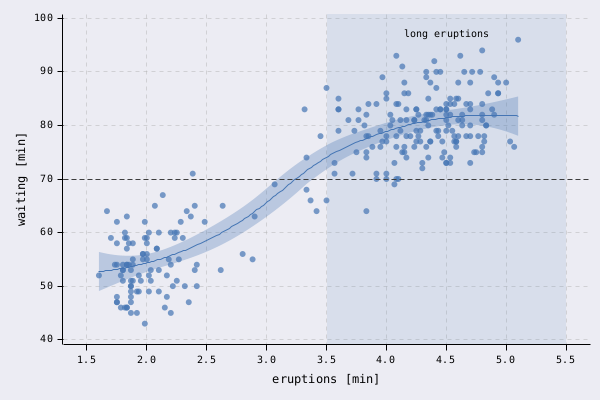
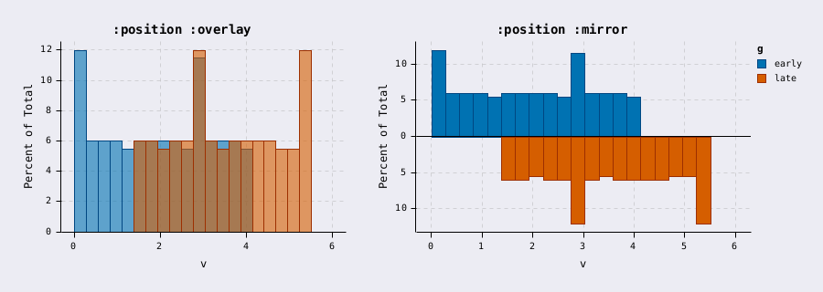

---
format:
  html:
    toc: true
    toc-location: right
    toc-depth: 4
    theme: cosmo
    include-in-header:
      text: |-
        <style>
        .data-table { width: fit-content; max-width: 100%; max-height: 15rem; overflow: auto; margin: 0 0 1rem 0; }
        .data-table .table-responsive { overflow: visible; }
        .data-table table { font-size: 0.75rem; width: auto; margin: 0; }
        .data-table th, .data-table td { padding: 0.1rem 0.45rem !important; white-space: nowrap; }
        .data-table thead th { position: sticky; top: 0; background: var(--bs-body-bg, #fff); }
        .options { margin: 0.5rem 0 1rem 0; }
        .options .option-card { margin: 0 0 0.9rem 0; border: 1px solid var(--bs-border-color, #dee2e6); border-radius: 0.375rem; overflow: hidden; }
        .options dt { display: flex; flex-wrap: wrap; align-items: baseline; gap: 0.1rem 1rem; margin: 0; padding: 0.4rem 0.75rem; background: #eef2f7; border-bottom: 1px solid var(--bs-border-color, #dee2e6); font-weight: normal; }
        .options dt > code { font-weight: 700; font-size: 1rem; background: none; padding: 0; }
        .options .option-default { font-size: 0.85rem; color: var(--bs-secondary-color, #6c757d); }
        .options dd { margin: 0; padding: 0.5rem 0.75rem; }
        .options .option-example { font-size: 0.85rem; padding: 0 0 0.45rem 0; margin-bottom: 0.45rem; border-bottom: 1px dashed var(--bs-border-color, #dee2e6); }
        .options .option-example code { background: none; padding: 0; }
        .options .option-text ul { margin: 0.3rem 0 0 0; padding-left: 1.25rem; }
        .options code, .mapping code { overflow-wrap: anywhere; }
        .mapping { margin: 0.5rem 0 1rem 0; padding: 0.5rem 0.75rem; border: 1px solid var(--bs-border-color, #dee2e6); border-left: 0.3rem solid #2780e3; border-radius: 0.375rem; background: #f5f8fc; }
        .mapping-title { font-weight: 700; margin-bottom: 0.25rem; }
        .mapping-hint { font-weight: normal; font-size: 0.85rem; color: var(--bs-secondary-color, #6c757d); }
        .mapping ul { margin: 0; padding-left: 1.25rem; }
        .mapping .required { font-size: 0.75rem; padding: 0 0.3rem; border: 1px solid currentColor; border-radius: 0.25rem; }
        .shared { margin: 0.5rem 0 1rem 0; padding: 0.5rem 0.75rem; border: 1px solid var(--bs-border-color, #dee2e6); border-left: 0.3rem solid #6c757d; border-radius: 0.375rem; background: #f6f6f6; }
        .shared-title { font-weight: 700; margin-bottom: 0.25rem; }
        .shared-hint { font-weight: normal; font-size: 0.85rem; color: var(--bs-secondary-color, #6c757d); }
        .shared ul { margin: 0; padding-left: 1.25rem; }
        .shared code { overflow-wrap: anywhere; }
        </style>
code-block-background: true

---
<style></style><style>.printedClojure .sourceCode {
  background-color: transparent;
  border-style: none;
}
</style><style>.clay-limit-image-width .clay-image {max-width: 100%}
.clay-side-by-side .sourceCode {margin: 0}
.clay-side-by-side {margin: 1em 0}
</style>
<script src="https://code.jquery.com/jquery-3.6.0.min.js" type="text/javascript"></script><script src="https://code.jquery.com/ui/1.13.1/jquery-ui.min.js" type="text/javascript"></script>

# Layering and position

Charts are drawn in the order of `:charts`, each over the previous ones, and all of them share the plot's scales.
Grouped marks of one chart are placed by its `:position` option: side by side, stacked, normalized or overlaid.


::: {.sourceClojure}
```clojure
(ns reference.layering-position
  (:require [fastmath.core :as m]
            [cljplot2.chart :as chart]
            [cljplot2.core :as plot]
            [cljplot2.describe :as describe]
            [notebook-utils :as nu]))
```
:::


## Layers

A layer is any chart; annotation charts (`rule`, `rect`, `text`, `function`, `image`) take literal positions or
a function instead of data and inherit only the plot's facet keys. The positions of `rule`, `rect` and `text`
count for the scales unless `:extent false` (the Annotation options group, shown at work in
[Shared options](reference.shared_options.html#annotation-options)):

::: {.clay-table}

```{=html}
<table class="table table-hover table-responsive clay-table"><thead><tr><th>Option</th><th>Type</th><th>Default</th><th>Description</th></tr></thead><tbody><tr><td>:extent</td><td>true or false or nil</td><td>true</td><td>include the positions in the scale extents</td></tr></tbody></table>
```

:::


Data: Old Faithful geyser eruptions, R datasets package `faithful` (Härdle 1991; Azzalini & Bowman 1990); licence: Part of R (GPL-2 | GPL-3).


::: {.sourceClojure}
```clojure
(def faithful (nu/dataset :faithful))
```
:::


```{=html}
<div class="data-table"><table class="table table-hover table-responsive clay-table"><thead><tr><th>eruptions</th><th>waiting</th></tr></thead><tbody><tr><td>3.6</td><td>79</td></tr><tr><td>1.8</td><td>54</td></tr><tr><td>3.333</td><td>74</td></tr><tr><td>2.283</td><td>62</td></tr><tr><td>4.533</td><td>85</td></tr><tr><td>2.883</td><td>55</td></tr><tr><td>4.7</td><td>88</td></tr><tr><td>3.6</td><td>85</td></tr><tr><td>1.95</td><td>51</td></tr><tr><td>4.35</td><td>85</td></tr><tr><td>1.833</td><td>54</td></tr><tr><td>3.917</td><td>84</td></tr><tr><td>4.2</td><td>78</td></tr><tr><td>1.75</td><td>47</td></tr><tr><td>4.7</td><td>83</td></tr><tr><td>2.167</td><td>52</td></tr><tr><td>1.75</td><td>62</td></tr><tr><td>4.8</td><td>84</td></tr><tr><td>1.6</td><td>52</td></tr><tr><td>4.25</td><td>79</td></tr><tr><td>1.8</td><td>51</td></tr><tr><td>1.75</td><td>47</td></tr><tr><td>3.45</td><td>78</td></tr><tr><td>3.067</td><td>69</td></tr><tr><td>4.533</td><td>74</td></tr><tr><td>3.6</td><td>83</td></tr><tr><td>1.967</td><td>55</td></tr><tr><td>4.083</td><td>76</td></tr><tr><td>3.85</td><td>78</td></tr><tr><td>4.433</td><td>79</td></tr><tr><td>4.3</td><td>73</td></tr><tr><td>4.467</td><td>77</td></tr><tr><td>3.367</td><td>66</td></tr><tr><td>4.033</td><td>80</td></tr><tr><td>3.833</td><td>74</td></tr><tr><td>2.017</td><td>52</td></tr><tr><td>1.867</td><td>48</td></tr><tr><td>4.833</td><td>80</td></tr><tr><td>1.833</td><td>59</td></tr><tr><td>4.783</td><td>90</td></tr><tr><td>4.35</td><td>80</td></tr><tr><td>1.883</td><td>58</td></tr><tr><td>4.567</td><td>84</td></tr><tr><td>1.75</td><td>58</td></tr><tr><td>4.533</td><td>73</td></tr><tr><td>3.317</td><td>83</td></tr><tr><td>3.833</td><td>64</td></tr><tr><td>2.1</td><td>53</td></tr><tr><td>4.633</td><td>82</td></tr><tr><td>2</td><td>59</td></tr><tr><td>4.8</td><td>75</td></tr><tr><td>4.716</td><td>90</td></tr><tr><td>1.833</td><td>54</td></tr><tr><td>4.833</td><td>80</td></tr><tr><td>1.733</td><td>54</td></tr><tr><td>4.883</td><td>83</td></tr><tr><td>3.717</td><td>71</td></tr><tr><td>1.667</td><td>64</td></tr><tr><td>4.567</td><td>77</td></tr><tr><td>4.317</td><td>81</td></tr><tr><td>2.233</td><td>59</td></tr><tr><td>4.5</td><td>84</td></tr><tr><td>1.75</td><td>48</td></tr><tr><td>4.8</td><td>82</td></tr><tr><td>1.817</td><td>60</td></tr><tr><td>4.4</td><td>92</td></tr><tr><td>4.167</td><td>78</td></tr><tr><td>4.7</td><td>78</td></tr><tr><td>2.067</td><td>65</td></tr><tr><td>4.7</td><td>73</td></tr><tr><td>4.033</td><td>82</td></tr><tr><td>1.967</td><td>56</td></tr><tr><td>4.5</td><td>79</td></tr><tr><td>4</td><td>71</td></tr><tr><td>1.983</td><td>62</td></tr><tr><td>5.067</td><td>76</td></tr><tr><td>2.017</td><td>60</td></tr><tr><td>4.567</td><td>78</td></tr><tr><td>3.883</td><td>76</td></tr><tr><td>3.6</td><td>83</td></tr><tr><td>4.133</td><td>75</td></tr><tr><td>4.333</td><td>82</td></tr><tr><td>4.1</td><td>70</td></tr><tr><td>2.633</td><td>65</td></tr><tr><td>4.067</td><td>73</td></tr><tr><td>4.933</td><td>88</td></tr><tr><td>3.95</td><td>76</td></tr><tr><td>4.517</td><td>80</td></tr><tr><td>2.167</td><td>48</td></tr><tr><td>4</td><td>86</td></tr><tr><td>2.2</td><td>60</td></tr><tr><td>4.333</td><td>90</td></tr><tr><td>1.867</td><td>50</td></tr><tr><td>4.817</td><td>78</td></tr><tr><td>1.833</td><td>63</td></tr><tr><td>4.3</td><td>72</td></tr><tr><td>4.667</td><td>84</td></tr><tr><td>3.75</td><td>75</td></tr><tr><td>1.867</td><td>51</td></tr><tr><td>4.9</td><td>82</td></tr><tr><td>…</td><td>…</td></tr></tbody></table></div>
```


The layers bottom to top: a shaded x range ([rect](reference.charts_annotations.html#rectangles) `:x [lo hi]`,
`:fill`), the points, a smooth curve, a dashed [rule](reference.charts_annotations.html#reference-lines) at 70 minutes and
a [text](reference.charts_annotations.html#text-labels) note at a literal position:


::: {.sourceClojure}
```clojure
(plot/render-image {:data faithful
                    :mapping {:x :eruptions :y :waiting}
                    :charts [(chart/rect {:x [3.5 5.5] :fill [0 114 178 30]})
                             (chart/scatter)
                             (chart/smooth)
                             (chart/rule {:y 70 :dash :dashed})
                             (chart/text {:x 4.5 :y 97 :text "long eruptions"})]
                    :labels {:x "eruptions [min]" :y "waiting [min]"}}
                   {:width 600 :height 400})
```
:::


::: {.clay-image}

:::


## Position of groups

Bars, histograms, densities and lines combine groups through `:position` (each chart's page lists the values it
takes): `:dodge`, `:stack`, `:normalize`, `:overlay`, and for densities and lines the streamgraph `:silhouette` /
`:wiggle`; histograms and densities also `:mirror`.


::: {.sourceClojure}
```clojure
(def sales (for [[qi q] (map-indexed vector ["Q1" "Q2" "Q3" "Q4"]) [i product] (map-indexed vector ["apples" "pears" "plums"])]
             {:quarter q :product product :amount (+ 10 (* 7 i) (* 5 qi) (* 4 (mod (+ qi (* 2 i)) 3)))}))
```
:::


```{=html}
<div class="data-table"><table class="table table-hover table-responsive clay-table"><thead><tr><th>quarter</th><th>product</th><th>amount</th></tr></thead><tbody><tr><td>Q1</td><td>apples</td><td>10</td></tr><tr><td>Q1</td><td>pears</td><td>25</td></tr><tr><td>Q1</td><td>plums</td><td>28</td></tr><tr><td>Q2</td><td>apples</td><td>19</td></tr><tr><td>Q2</td><td>pears</td><td>22</td></tr><tr><td>Q2</td><td>plums</td><td>37</td></tr><tr><td>Q3</td><td>apples</td><td>28</td></tr><tr><td>Q3</td><td>pears</td><td>31</td></tr><tr><td>Q3</td><td>plums</td><td>34</td></tr><tr><td>Q4</td><td>apples</td><td>25</td></tr><tr><td>Q4</td><td>pears</td><td>40</td></tr><tr><td>Q4</td><td>plums</td><td>43</td></tr></tbody></table></div>
```


::: {.sourceClojure}
```clojure
(plot/render-image (plot/arrange (for [position [:dodge :stack :normalize]]
                                   {:data sales
                                    :mapping {:x :quarter :y :amount :color :product}
                                    :charts [(chart/bar {:position position})]
                                    :labels {:title (str ":position " position)}
                                    :legend (= position :normalize)})
                                 {:columns 3 :widths [1 1 1.4]})
                   {:width 1000 :height 350})
```
:::


::: {.clay-image}

:::


`:overlay` draws the groups over each other, here translucent histograms; `:mirror` draws the second of two
groups downward:


::: {.sourceClojure}
```clojure
(def two-groups (for [i (range 400)]
                  {:g (if (even? i) "early" "late") :v (+ (if (even? i) 2.0 3.5) (* 0.25 (- (mod (* i 37) 17) 8)))}))
```
:::


```{=html}
<div class="data-table"><table class="table table-hover table-responsive clay-table"><thead><tr><th>g</th><th>v</th></tr></thead><tbody><tr><td>early</td><td>0.0</td></tr><tr><td>late</td><td>2.25</td></tr><tr><td>early</td><td>1.5</td></tr><tr><td>late</td><td>3.75</td></tr><tr><td>early</td><td>3.0</td></tr><tr><td>late</td><td>5.25</td></tr><tr><td>early</td><td>0.25</td></tr><tr><td>late</td><td>2.5</td></tr><tr><td>early</td><td>1.75</td></tr><tr><td>late</td><td>4.0</td></tr><tr><td>early</td><td>3.25</td></tr><tr><td>late</td><td>5.5</td></tr><tr><td>early</td><td>0.5</td></tr><tr><td>late</td><td>2.75</td></tr><tr><td>early</td><td>2.0</td></tr><tr><td>late</td><td>4.25</td></tr><tr><td>early</td><td>3.5</td></tr><tr><td>late</td><td>1.5</td></tr><tr><td>early</td><td>0.75</td></tr><tr><td>late</td><td>3.0</td></tr><tr><td>early</td><td>2.25</td></tr><tr><td>late</td><td>4.5</td></tr><tr><td>early</td><td>3.75</td></tr><tr><td>late</td><td>1.75</td></tr><tr><td>early</td><td>1.0</td></tr><tr><td>late</td><td>3.25</td></tr><tr><td>early</td><td>2.5</td></tr><tr><td>late</td><td>4.75</td></tr><tr><td>early</td><td>4.0</td></tr><tr><td>late</td><td>2.0</td></tr><tr><td>early</td><td>1.25</td></tr><tr><td>late</td><td>3.5</td></tr><tr><td>early</td><td>2.75</td></tr><tr><td>late</td><td>5.0</td></tr><tr><td>early</td><td>0.0</td></tr><tr><td>late</td><td>2.25</td></tr><tr><td>early</td><td>1.5</td></tr><tr><td>late</td><td>3.75</td></tr><tr><td>early</td><td>3.0</td></tr><tr><td>late</td><td>5.25</td></tr><tr><td>early</td><td>0.25</td></tr><tr><td>late</td><td>2.5</td></tr><tr><td>early</td><td>1.75</td></tr><tr><td>late</td><td>4.0</td></tr><tr><td>early</td><td>3.25</td></tr><tr><td>late</td><td>5.5</td></tr><tr><td>early</td><td>0.5</td></tr><tr><td>late</td><td>2.75</td></tr><tr><td>early</td><td>2.0</td></tr><tr><td>late</td><td>4.25</td></tr><tr><td>early</td><td>3.5</td></tr><tr><td>late</td><td>1.5</td></tr><tr><td>early</td><td>0.75</td></tr><tr><td>late</td><td>3.0</td></tr><tr><td>early</td><td>2.25</td></tr><tr><td>late</td><td>4.5</td></tr><tr><td>early</td><td>3.75</td></tr><tr><td>late</td><td>1.75</td></tr><tr><td>early</td><td>1.0</td></tr><tr><td>late</td><td>3.25</td></tr><tr><td>early</td><td>2.5</td></tr><tr><td>late</td><td>4.75</td></tr><tr><td>early</td><td>4.0</td></tr><tr><td>late</td><td>2.0</td></tr><tr><td>early</td><td>1.25</td></tr><tr><td>late</td><td>3.5</td></tr><tr><td>early</td><td>2.75</td></tr><tr><td>late</td><td>5.0</td></tr><tr><td>early</td><td>0.0</td></tr><tr><td>late</td><td>2.25</td></tr><tr><td>early</td><td>1.5</td></tr><tr><td>late</td><td>3.75</td></tr><tr><td>early</td><td>3.0</td></tr><tr><td>late</td><td>5.25</td></tr><tr><td>early</td><td>0.25</td></tr><tr><td>late</td><td>2.5</td></tr><tr><td>early</td><td>1.75</td></tr><tr><td>late</td><td>4.0</td></tr><tr><td>early</td><td>3.25</td></tr><tr><td>late</td><td>5.5</td></tr><tr><td>early</td><td>0.5</td></tr><tr><td>late</td><td>2.75</td></tr><tr><td>early</td><td>2.0</td></tr><tr><td>late</td><td>4.25</td></tr><tr><td>early</td><td>3.5</td></tr><tr><td>late</td><td>1.5</td></tr><tr><td>early</td><td>0.75</td></tr><tr><td>late</td><td>3.0</td></tr><tr><td>early</td><td>2.25</td></tr><tr><td>late</td><td>4.5</td></tr><tr><td>early</td><td>3.75</td></tr><tr><td>late</td><td>1.75</td></tr><tr><td>early</td><td>1.0</td></tr><tr><td>late</td><td>3.25</td></tr><tr><td>early</td><td>2.5</td></tr><tr><td>late</td><td>4.75</td></tr><tr><td>early</td><td>4.0</td></tr><tr><td>late</td><td>2.0</td></tr><tr><td>early</td><td>1.25</td></tr><tr><td>late</td><td>3.5</td></tr><tr><td>…</td><td>…</td></tr></tbody></table></div>
```


::: {.sourceClojure}
```clojure
(plot/render-image (plot/arrange (for [position [:overlay :mirror]]
                                   {:data two-groups
                                    :mapping {:x :v :color :g}
                                    :charts [(chart/histogram {:position position :bins 20})]
                                    :labels {:title (str ":position " position)}
                                    :legend (= position :mirror)})
                                 {:columns 2 :widths [1 1.3]})
                   {:width 900 :height 320})
```
:::


::: {.clay-image}

:::


Streamgraphs: the stack shifted around a centre line - `:silhouette` symmetric, `:wiggle` with the least
movement (lines filled in their colour, [line](reference.charts_points_lines.html#line-charts) `:fill :color`):


::: {.sourceClojure}
```clojure
(def streams (for [series ["a" "b" "c" "d"] t (range 30)]
               {:series series :t t :v (+ 2 (m/sin (+ (* 0.3 t) (count series) (* 1.7 (int (first series))))))}))
```
:::


```{=html}
<div class="data-table"><table class="table table-hover table-responsive clay-table"><thead><tr><th>series</th><th>t</th><th>v</th></tr></thead><tbody><tr><td>a</td><td>0</td><td>2.568277227885458</td></tr><tr><td>a</td><td>1</td><td>2.299730964096259</td></tr><tr><td>a</td><td>2</td><td>2.0044106259584753</td></tr><tr><td>a</td><td>3</td><td>1.7086962997397457</td></tr><tr><td>a</td><td>4</td><td>1.4390032654896916</td></tr><tr><td>a</td><td>5</td><td>1.2194223987442154</td></tr><tr><td>a</td><td>6</td><td>1.0695682043627368</td></tr><tr><td>a</td><td>7</td><td>1.0028267112259202</td></tr><tr><td>a</td><td>8</td><td>1.0251597381427326</td></tr><tr><td>a</td><td>9</td><td>1.1345723423320555</td></tr><tr><td>a</td><td>10</td><td>1.3212910217198974</td></tr><tr><td>a</td><td>11</td><td>1.5686367527716687</td></tr><tr><td>a</td><td>12</td><td>1.8545148779902074</td></tr><tr><td>a</td><td>13</td><td>2.1533887558666667</td></tr><tr><td>a</td><td>14</td><td>2.4385608730117783</td></tr><tr><td>a</td><td>15</td><td>2.684557653515224</td></tr><tr><td>a</td><td>16</td><td>2.869404937614812</td></tr><tr><td>a</td><td>17</td><td>2.9765908679435658</td></tr><tr><td>a</td><td>18</td><td>2.9965408445718644</td></tr><tr><td>a</td><td>19</td><td>2.9274727955035407</td></tr><tr><td>a</td><td>20</td><td>2.775556363859854</td></tr><tr><td>a</td><td>21</td><td>2.5543617920342427</td></tr><tr><td>a</td><td>22</td><td>2.2836477323549147</td></tr><tr><td>a</td><td>23</td><td>1.987596265518499</td></tr><tr><td>a</td><td>24</td><td>1.6926527873419062</td></tr><tr><td>a</td><td>25</td><td>1.4251637203148255</td></tr><tr><td>a</td><td>26</td><td>1.2090230661451788</td></tr><tr><td>a</td><td>27</td><td>1.0635380257487868</td></tr><tr><td>a</td><td>28</td><td>1.0017043444932345</td></tr><tr><td>a</td><td>29</td><td>1.0290454409688556</td></tr><tr><td>b</td><td>0</td><td>1.1108019514138114</td></tr><tr><td>b</td><td>1</td><td>1.0153095168336712</td></tr><tr><td>b</td><td>2</td><td>1.0077765504591571</td></tr><tr><td>b</td><td>3</td><td>1.0888759497414373</td></tr><tr><td>b</td><td>4</td><td>1.251363346876995</td></tr><tr><td>b</td><td>5</td><td>1.4807242266080278</td></tr><tr><td>b</td><td>6</td><td>1.7564704646424676</td></tr><tr><td>b</td><td>7</td><td>2.053970470778235</td></tr><tr><td>b</td><td>8</td><td>2.3466494554970305</td></tr><tr><td>b</td><td>9</td><td>2.6083632767654117</td></tr><tr><td>b</td><td>10</td><td>2.815733818379028</td></tr><tr><td>b</td><td>11</td><td>2.9502372874570733</td></tr><tr><td>b</td><td>12</td><td>2.9998588896919247</td></tr><tr><td>b</td><td>13</td><td>2.960166075141548</td></tr><tr><td>b</td><td>14</td><td>2.834704484714564</td></tr><tr><td>b</td><td>15</td><td>2.6346812286276573</td></tr><tr><td>b</td><td>16</td><td>2.3779637886275764</td></tr><tr><td>b</td><td>17</td><td>2.087483969060531</td></tr><tr><td>b</td><td>18</td><td>1.7891894670865187</td></tr><tr><td>b</td><td>19</td><td>1.5097260421709686</td></tr><tr><td>b</td><td>20</td><td>1.2740573297492523</td></tr><tr><td>b</td><td>21</td><td>1.1032349140214026</td></tr><tr><td>b</td><td>22</td><td>1.0125178526323273</td></tr><tr><td>b</td><td>23</td><td>1.0100096304976978</td></tr><tr><td>b</td><td>24</td><td>1.0959342996306858</td></tr><tr><td>b</td><td>25</td><td>1.2626164652429068</td></tr><tr><td>b</td><td>26</td><td>1.4951669059015777</td></tr><tr><td>b</td><td>27</td><td>1.772812583336262</td></tr><tr><td>b</td><td>28</td><td>2.070752236080345</td></tr><tr><td>b</td><td>29</td><td>2.3623718022932767</td></tr><tr><td>c</td><td>0</td><td>1.6608593179118316</td></tr><tr><td>c</td><td>1</td><td>1.9540129305860816</td></tr><tr><td>c</td><td>2</td><td>2.251274431210004</td></tr><tr><td>c</td><td>3</td><td>2.526090335252343</td></tr><tr><td>c</td><td>4</td><td>2.753912156475747</td></tr><tr><td>c</td><td>5</td><td>2.914389250100985</td></tr><tr><td>c</td><td>6</td><td>2.9931866752955885</td></tr><tr><td>c</td><td>7</td><td>2.983265692745455</td></tr><tr><td>c</td><td>8</td><td>2.8855125142746076</td></tr><tr><td>c</td><td>9</td><td>2.708659140182343</td></tr><tr><td>c</td><td>10</td><td>2.468503355662514</td></tr><tr><td>c</td><td>11</td><td>2.1864975617020375</td></tr><tr><td>c</td><td>12</td><td>1.8878324959913335</td></tr><tr><td>c</td><td>13</td><td>1.5991870193506919</td></tr><tr><td>c</td><td>14</td><td>1.3463449725497316</td></tr><tr><td>c</td><td>15</td><td>1.1518919826020046</td></tr><tr><td>c</td><td>16</td><td>1.0331979559697153</td></tr><tr><td>c</td><td>17</td><td>1.0008654765512972</td></tr><tr><td>c</td><td>18</td><td>1.057782708438946</td></tr><tr><td>c</td><td>19</td><td>1.1988654048219423</td></tr><tr><td>c</td><td>20</td><td>1.4115110686121302</td></tr><tr><td>c</td><td>21</td><td>1.6767246959753275</td></tr><tr><td>c</td><td>22</td><td>1.9708155434519563</td></tr><tr><td>c</td><td>23</td><td>2.267513351513406</td></tr><tr><td>c</td><td>24</td><td>2.5403149886061005</td></tr><tr><td>c</td><td>25</td><td>2.764851896960406</td></tr><tr><td>c</td><td>26</td><td>2.921066863280322</td></tr><tr><td>c</td><td>27</td><td>2.9950056698719</td></tr><tr><td>c</td><td>28</td><td>2.9800635833506677</td></tr><tr><td>c</td><td>29</td><td>2.8775753358042824</td></tr><tr><td>d</td><td>0</td><td>2.9765908679435658</td></tr><tr><td>d</td><td>1</td><td>2.9965408445718644</td></tr><tr><td>d</td><td>2</td><td>2.9274727955035407</td></tr><tr><td>d</td><td>3</td><td>2.775556363859854</td></tr><tr><td>d</td><td>4</td><td>2.5543617920342663</td></tr><tr><td>d</td><td>5</td><td>2.2836477323549147</td></tr><tr><td>d</td><td>6</td><td>1.987596265518499</td></tr><tr><td>d</td><td>7</td><td>1.6926527873419062</td></tr><tr><td>d</td><td>8</td><td>1.4251637203148255</td></tr><tr><td>d</td><td>9</td><td>1.2090230661451962</td></tr><tr><td>…</td><td>…</td><td>…</td></tr></tbody></table></div>
```


::: {.sourceClojure}
```clojure
(plot/render-image (plot/arrange (for [position [:stack :silhouette :wiggle]]
                                   {:data streams
                                    :mapping {:x :t :y :v :color :series}
                                    :charts [(chart/line {:position position :fill :color})]
                                    :labels {:title (str ":position " position)}
                                    :legend (= position :wiggle)})
                                 {:columns 3 :widths [1 1 1.3]})
                   {:width 1000 :height 320})
```
:::


::: {.clay-image}

:::


```{=html}
<div style="background-color:grey;height:2px;width:100%;"></div>
```


```{=html}
<div><pre><small><small>source: notebooks/reference/layering_position.clj</small></small></pre></div>
```