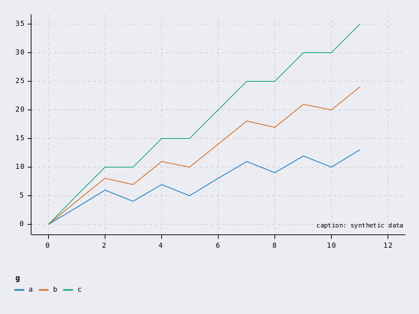

---
format:
  html:
    toc: true
    toc-location: right
    toc-depth: 4
    theme: cosmo
    include-in-header:
      text: |-
        <style>
        .data-table { width: fit-content; max-width: 100%; max-height: 15rem; overflow: auto; margin: 0 0 1rem 0; }
        .data-table .table-responsive { overflow: visible; }
        .data-table table { font-size: 0.75rem; width: auto; margin: 0; }
        .data-table th, .data-table td { padding: 0.1rem 0.45rem !important; white-space: nowrap; }
        .data-table thead th { position: sticky; top: 0; background: var(--bs-body-bg, #fff); }
        .options { margin: 0.5rem 0 1rem 0; }
        .options .option-card { margin: 0 0 0.9rem 0; border: 1px solid var(--bs-border-color, #dee2e6); border-radius: 0.375rem; overflow: hidden; }
        .options dt { display: flex; flex-wrap: wrap; align-items: baseline; gap: 0.1rem 1rem; margin: 0; padding: 0.4rem 0.75rem; background: #eef2f7; border-bottom: 1px solid var(--bs-border-color, #dee2e6); font-weight: normal; }
        .options dt > code { font-weight: 700; font-size: 1rem; background: none; padding: 0; }
        .options .option-default { font-size: 0.85rem; color: var(--bs-secondary-color, #6c757d); }
        .options dd { margin: 0; padding: 0.5rem 0.75rem; }
        .options .option-example { font-size: 0.85rem; padding: 0 0 0.45rem 0; margin-bottom: 0.45rem; border-bottom: 1px dashed var(--bs-border-color, #dee2e6); }
        .options .option-example code { background: none; padding: 0; }
        .options .option-text ul { margin: 0.3rem 0 0 0; padding-left: 1.25rem; }
        .options code, .mapping code { overflow-wrap: anywhere; }
        .mapping { margin: 0.5rem 0 1rem 0; padding: 0.5rem 0.75rem; border: 1px solid var(--bs-border-color, #dee2e6); border-left: 0.3rem solid #2780e3; border-radius: 0.375rem; background: #f5f8fc; }
        .mapping-title { font-weight: 700; margin-bottom: 0.25rem; }
        .mapping-hint { font-weight: normal; font-size: 0.85rem; color: var(--bs-secondary-color, #6c757d); }
        .mapping ul { margin: 0; padding-left: 1.25rem; }
        .mapping .required { font-size: 0.75rem; padding: 0 0.3rem; border: 1px solid currentColor; border-radius: 0.25rem; }
        .mapping-returns { margin-top: 0.25rem; }
        .mapping code { white-space: pre-wrap; }
        .shared { margin: 0.5rem 0 1rem 0; padding: 0.5rem 0.75rem; border: 1px solid var(--bs-border-color, #dee2e6); border-left: 0.3rem solid #6c757d; border-radius: 0.375rem; background: #f6f6f6; }
        .shared-title { font-weight: 700; margin-bottom: 0.25rem; }
        .shared-hint { font-weight: normal; font-size: 0.85rem; color: var(--bs-secondary-color, #6c757d); }
        .shared ul { margin: 0; padding-left: 1.25rem; }
        .shared code { overflow-wrap: anywhere; }
        </style>
code-block-background: true

---
<style></style><style>.printedClojure .sourceCode {
  background-color: transparent;
  border-style: none;
}
</style><style>.clay-limit-image-width .clay-image {max-width: 100%}
.clay-side-by-side .sourceCode {margin: 0}
.clay-side-by-side {margin: 1em 0}
</style>
<script src="https://code.jquery.com/jquery-3.6.0.min.js" type="text/javascript"></script><script src="https://code.jquery.com/ui/1.13.1/jquery-ui.min.js" type="text/javascript"></script>

# Limits

What cljplot2 doesn't do, and the nearest way around it.


::: {.sourceClojure}
```clojure
(ns reference.limits
  (:require [cljplot2.chart :as chart]
            [cljplot2.core :as plot]
            [notebook-utils :as nu]))
```
:::


## Output


* Static raster images only (`BufferedImage`, a clojure2d raster canvas) - no interactivity, no SVG or PDF;
  `plot/save` writes the formats Java's ImageIO knows (png, jpg, bmp, gif, tiff ...; Render chapter).


## Layout


* Legends sit right of the panels; there is no placement option. A legend can go elsewhere as its own plot:
  `:legend-only true` in an `:arrange` cell (and `:legend false` on the plot beside it).

* No subtitle or caption: write them with the `text` chart in panel units, or as a title of an `:arrange`.
* `:margins` need a single panel (no facets, `:arrange` or `:custom-grid`); `:aspect :iso` and `:flip` need the
  generated grid; free or sliced facet scales don't combine with explicit domains or `:aspect :iso`.

A caption written by a `text` chart, a legend moved below by `:legend-only`:


::: {.sourceClojure}
```clojure
(def rows (for [[i g] (map-indexed vector ["a" "b" "c"]) x (range 12)]
            {:g g :x x :y (+ (* x (inc i)) (mod (* x 7) 5))}))
```
:::


```{=html}
<div class="data-table"><table class="table table-hover table-responsive clay-table"><thead><tr><th>g</th><th>x</th><th>y</th></tr></thead><tbody><tr><td>a</td><td>0</td><td>0</td></tr><tr><td>a</td><td>1</td><td>3</td></tr><tr><td>a</td><td>2</td><td>6</td></tr><tr><td>a</td><td>3</td><td>4</td></tr><tr><td>a</td><td>4</td><td>7</td></tr><tr><td>a</td><td>5</td><td>5</td></tr><tr><td>a</td><td>6</td><td>8</td></tr><tr><td>a</td><td>7</td><td>11</td></tr><tr><td>a</td><td>8</td><td>9</td></tr><tr><td>a</td><td>9</td><td>12</td></tr><tr><td>a</td><td>10</td><td>10</td></tr><tr><td>a</td><td>11</td><td>13</td></tr><tr><td>b</td><td>0</td><td>0</td></tr><tr><td>b</td><td>1</td><td>4</td></tr><tr><td>b</td><td>2</td><td>8</td></tr><tr><td>b</td><td>3</td><td>7</td></tr><tr><td>b</td><td>4</td><td>11</td></tr><tr><td>b</td><td>5</td><td>10</td></tr><tr><td>b</td><td>6</td><td>14</td></tr><tr><td>b</td><td>7</td><td>18</td></tr><tr><td>b</td><td>8</td><td>17</td></tr><tr><td>b</td><td>9</td><td>21</td></tr><tr><td>b</td><td>10</td><td>20</td></tr><tr><td>b</td><td>11</td><td>24</td></tr><tr><td>c</td><td>0</td><td>0</td></tr><tr><td>c</td><td>1</td><td>5</td></tr><tr><td>c</td><td>2</td><td>10</td></tr><tr><td>c</td><td>3</td><td>10</td></tr><tr><td>c</td><td>4</td><td>15</td></tr><tr><td>c</td><td>5</td><td>15</td></tr><tr><td>c</td><td>6</td><td>20</td></tr><tr><td>c</td><td>7</td><td>25</td></tr><tr><td>c</td><td>8</td><td>25</td></tr><tr><td>c</td><td>9</td><td>30</td></tr><tr><td>c</td><td>10</td><td>30</td></tr><tr><td>c</td><td>11</td><td>35</td></tr></tbody></table></div>
```


::: {.sourceClojure}
```clojure
(plot/render-image (plot/arrange [{:data rows
                                   :mapping {:x :x :y :y :color :g}
                                   :charts [(chart/line)
                                            (chart/text {:x [:panel 1.0] :y [:panel 0.02] :anchor [:right :bottom]
                                                         :text "caption: synthetic data" :size 9 :extent false})]
                                   :legend false}
                                  {:data rows
                                   :mapping {:x :x :y :y :color :g}
                                   :charts [(chart/line)]
                                   :legend-only true}]
                                 {:rows 2 :heights [6 1]})
                   {:width 600 :height 450})
```
:::


::: {.clay-image}

:::


## Coordinates


* Polar coordinates only with the charts declaring them (Scales, axes and coordinates chapter); no polar
  `:aspect :iso`, `:margins` or `:custom-grid`.

* 3D charts (`cloud`, `surface`) only with other 3D charts, without `:flip`, `:aspect :iso`, `:margins`, polar
  coordinates or free facet scales.

* No map projections or geographic shapes.


## Data


* Data is rows (maps) or columns (equal-length sequences); other tables are converted by the caller.
* Dates are `java.time` values; date strings stay levels.


```{=html}
<div style="background-color:grey;height:2px;width:100%;"></div>
```


```{=html}
<div><pre><small><small>source: notebooks/reference/limits.clj</small></small></pre></div>
```