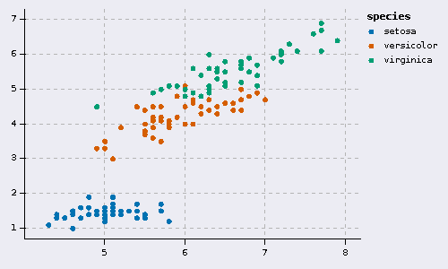
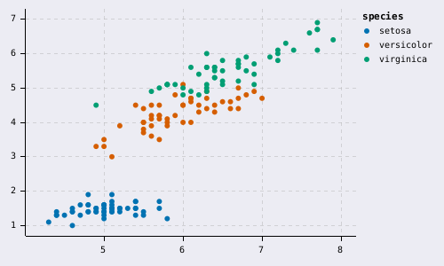
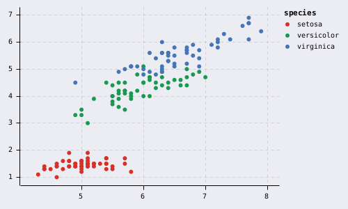

---
format:
  html: {toc: true, toc-location: right, toc-depth: 4, theme: cosmo}
code-block-background: true

---
<style></style><style>.printedClojure .sourceCode {
  background-color: transparent;
  border-style: none;
}
</style><style>.clay-limit-image-width .clay-image {max-width: 100%}
.clay-side-by-side .sourceCode {margin: 0}
.clay-side-by-side {margin: 1em 0}
</style>
<script src="https://code.jquery.com/jquery-3.6.0.min.js" type="text/javascript"></script><script src="https://code.jquery.com/ui/1.13.1/jquery-ui.min.js" type="text/javascript"></script>

# Render

Building and drawing a plot: `plot/build` (the built plot, data only), `plot/render` (a clojure2d canvas),
`plot/render-image` (a `java.awt.image.BufferedImage`), `plot/cvd-image` (an image as seen with a colour vision
deficiency) and `plot/save` (an image or canvas to a file). The first three take the same render options, as
their second argument or under the plot's `:options` (merged under the argument).


::: {.sourceClojure}
```clojure
(ns reference.render
  (:require [cljplot2.chart :as chart]
            [cljplot2.core :as plot]
            [cljplot2.describe :as describe]
            [cljplot2.pipeline :as pipeline]
            [notebook-utils :as nu]))
```
:::


Data: Edgar Anderson's iris measurements, R datasets package `iris` (Anderson 1935; Fisher 1936); licence: Part of R (GPL-2 | GPL-3).


::: {.sourceClojure}
```clojure
(def iris (nu/dataset :iris))
```
:::


::: {.sourceClojure}
```clojure
(def iris-plot
  {:data iris
   :mapping {:x :sepal-length :y :petal-length :color :species}
   :charts [(chart/scatter)]})
```
:::


## Size and quality

The image size in pixels - the whole image, legends and titles included - and the rendering quality (clojure2d
hints): `:low` draws without antialiasing (faster, jagged edges), `:mid` antialiased for speed, `:high`
antialiased for quality, `:highest` adds exact stroke geometry (lines can look softer).

::: {.clay-table}

```{=html}
<table class="table table-hover table-responsive clay-table"><thead><tr><th>Option</th><th>Type</th><th>Default</th><th>Description</th></tr></thead><tbody><tr><td>:width</td><td>a positive integer</td><td>600</td><td>target width in pixels</td></tr><tr><td>:height</td><td>a positive integer</td><td>600</td><td>target height in pixels</td></tr><tr><td>:hint</td><td>one of :high :highest :low :mid</td><td>:high</td><td>rendering quality hint (antialiasing and text metrics)</td></tr></tbody></table>
```

:::


::: {.sourceClojure}
```clojure
(plot/render-image iris-plot {:width 500 :height 300 :hint :low})
```
:::


::: {.clay-image}

:::


## Inspection

Two aids for finding out why a plot looks as it does. `:debug true` paints every layout item's box under its
content - panel, axes, axis titles, legend:

::: {.clay-table}

```{=html}
<table class="table table-hover table-responsive clay-table"><thead><tr><th>Option</th><th>Type</th><th>Default</th><th>Description</th></tr></thead><tbody><tr><td>:debug</td><td>true or false or nil</td><td>false</td><td>paint every layout item's box (a distinct colour, its outline and id) under its content</td></tr><tr><td>:until</td><td>one of :split :stats :extents :scale-specs :grid :layout :finalized-scales :subplots</td><td></td><td>build stops after this pipeline stage (inspect the intermediate data)</td></tr></tbody></table>
```

:::


::: {.sourceClojure}
```clojure
(plot/render-image iris-plot {:width 500 :height 300 :debug true})
```
:::


::: {.clay-image}

:::


`:until` stops the build after a stage; the built plot is data. Here the build stops after `:extents` - the
extent of each mapped dimension:


::: {.sourceClojure}
```clojure
(:extents (plot/build iris-plot {:until :extents}))
```
:::


::: {.printedClojure}
```clojure
{:color
 {:extent
  {:kind :categorical, :values ["setosa" "versicolor" "virginica"]},
  :na? false},
 :y
 {:extent {:kind :numeric, :min 1.0, :max 6.9},
  :padding [0.05 0.05],
  :padding-px [0.0 0.0]},
 :x
 {:extent {:kind :numeric, :min 4.3, :max 7.9},
  :padding [0.05 0.05],
  :padding-px [0.0 0.0]}}

```
:::


## Colour vision

`:cvd` renders the plot as seen with a colour vision deficiency - a keyword, or `[keyword severity]` for the
partial ones; `plot/cvd-image` converts any image. Red and green species, as rendered:

::: {.clay-table}

```{=html}
<table class="table table-hover table-responsive clay-table"><thead><tr><th>Option</th><th>Type</th><th>Default</th><th>Description</th></tr></thead><tbody><tr><td>:cvd</td><td>a clojure2d color vision deficiency: a keyword (:protanopia, :deuteranopia, :tritanopia, :achromatopsia) or [keyword severity] (:protanomaly, :deuteranomaly, :tritanomaly, :achromatomaly; severity in [0 1]) or nil</td><td></td><td>render as seen with a colour vision deficiency</td></tr></tbody></table>
```

:::


::: {.sourceClojure}
```clojure
(def red-green-plot (assoc iris-plot :scales {:color {:range [[215 48 39] [26 152 80] [69 117 180]]}}))
```
:::


::: {.sourceClojure}
```clojure
(plot/render-image red-green-plot {:width 500 :height 300})
```
:::


::: {.clay-image}

:::


... and as seen with deuteranopia - setosa and versicolor turn into similar olive tones, virginica stays blue:


::: {.sourceClojure}
```clojure
(plot/render-image red-green-plot {:width 500 :height 300 :cvd :deuteranopia})
```
:::


::: {.clay-image}

:::


## Saving

`plot/save` writes an image (or the canvas of `plot/render`) to a file - the format from the extension (png,
jpg, bmp, tiff ...) - and returns it, so it ends a pipeline:

```clojure
(-> iris-plot
    (plot/render-image {:width 800 :height 500})
    (plot/save "iris.png"))
```


```{=html}
<div style="background-color:grey;height:2px;width:100%;"></div>
```


```{=html}
<div><pre><small><small>source: notebooks/reference/render.clj</small></small></pre></div>
```