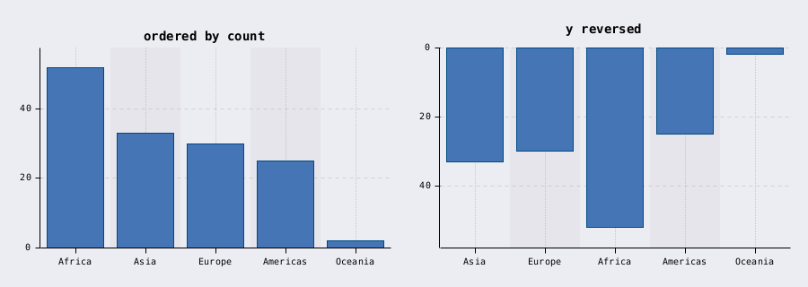
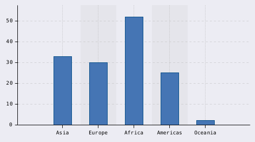
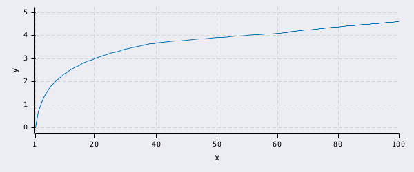
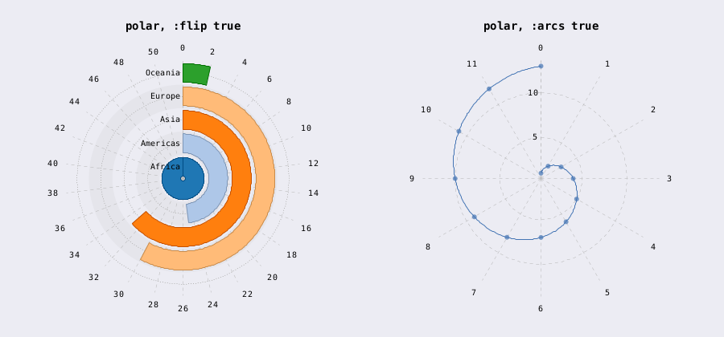

---
format:
  html: {toc: true, toc-location: right, toc-depth: 4, theme: cosmo}
code-block-background: true

---
<style></style><style>.printedClojure .sourceCode {
  background-color: transparent;
  border-style: none;
}
</style><style>.clay-limit-image-width .clay-image {max-width: 100%}
.clay-side-by-side .sourceCode {margin: 0}
.clay-side-by-side {margin: 1em 0}
</style>
<script src="https://code.jquery.com/jquery-3.6.0.min.js" type="text/javascript"></script><script src="https://code.jquery.com/ui/1.13.1/jquery-ui.min.js" type="text/javascript"></script>

# Scales, axes and coordinates

Position scales map `:x` and `:y` data to the panel; their kind follows the data (numbers, levels, dates) unless
set. Each position scale draws an axis and grid lines. A plot is cartesian unless `:coord` is polar; `:flip`
swaps the directions and `:aspect :iso` keeps data units square.


::: {.sourceClojure}
```clojure
(ns reference.scales-axes-coords
  (:require [cljplot2.chart :as chart]
            [cljplot2.core :as plot]
            [cljplot2.describe :as describe]
            [cljplot2.scale.coord :as coord]
            [cljplot2.scale.position :as position]
            [cljplot2.schema :as schema]
            [notebook-utils :as nu])
  (:import [java.time LocalDate]))
```
:::


Data: Gapminder 2007: life expectancy, population and GDP per capita, data-to-viz example dataset `4_ThreeNum` (Yan Holtz; Gapminder via the R gapminder package); licence: MIT (data_to_viz repository).


::: {.sourceClojure}
```clojure
(def gapminder (nu/dataset :gapminder-2007))
```
:::


::: {.clay-table}

```{=html}
<table class="table table-hover table-responsive clay-table"><thead><tr><th>country</th><th>continent</th><th>life-exp</th><th>pop</th><th>gdp-per-cap</th></tr></thead><tbody><tr><td>Afghanistan</td><td>Asia</td><td>43.828</td><td>31889923</td><td>974.5803384</td></tr><tr><td>Albania</td><td>Europe</td><td>76.423</td><td>3600523</td><td>5937.029526</td></tr><tr><td>Algeria</td><td>Africa</td><td>72.301</td><td>33333216</td><td>6223.367465</td></tr><tr><td>Angola</td><td>Africa</td><td>42.731</td><td>12420476</td><td>4797.231267</td></tr><tr><td>Argentina</td><td>Americas</td><td>75.32</td><td>40301927</td><td>12779.37964</td></tr><tr><td>Australia</td><td>Oceania</td><td>81.235</td><td>20434176</td><td>34435.36744</td></tr><tr><td>Austria</td><td>Europe</td><td>79.829</td><td>8199783</td><td>36126.4927</td></tr><tr><td>Bahrain</td><td>Asia</td><td>75.635</td><td>708573</td><td>29796.04834</td></tr><tr><td>Bangladesh</td><td>Asia</td><td>64.062</td><td>150448339</td><td>1391.253792</td></tr><tr><td>Belgium</td><td>Europe</td><td>79.441</td><td>10392226</td><td>33692.60508</td></tr><tr><td>Benin</td><td>Africa</td><td>56.728</td><td>8078314</td><td>1441.284873</td></tr><tr><td>Bolivia</td><td>Americas</td><td>65.554</td><td>9119152</td><td>3822.137084</td></tr><tr><td>Bosnia and Herzegovina</td><td>Europe</td><td>74.852</td><td>4552198</td><td>7446.298803</td></tr><tr><td>Botswana</td><td>Africa</td><td>50.728</td><td>1639131</td><td>12569.85177</td></tr><tr><td>Brazil</td><td>Americas</td><td>72.39</td><td>190010647</td><td>9065.800825</td></tr><tr><td>Bulgaria</td><td>Europe</td><td>73.005</td><td>7322858</td><td>10680.79282</td></tr><tr><td>Burkina Faso</td><td>Africa</td><td>52.295</td><td>14326203</td><td>1217.032994</td></tr><tr><td>Burundi</td><td>Africa</td><td>49.58</td><td>8390505</td><td>430.0706916</td></tr><tr><td>Cambodia</td><td>Asia</td><td>59.723</td><td>14131858</td><td>1713.778686</td></tr><tr><td>Cameroon</td><td>Africa</td><td>50.43</td><td>17696293</td><td>2042.09524</td></tr></tbody></table>
```

:::


::: {.sourceClojure}
```clojure
(def counts (for [[continent rs] (group-by :continent gapminder)] {:continent continent :n (count rs)}))
```
:::


::: {.clay-table}

```{=html}
<table class="table table-hover table-responsive clay-table"><thead><tr><th>continent</th><th>n</th></tr></thead><tbody><tr><td>Asia</td><td>33</td></tr><tr><td>Europe</td><td>30</td></tr><tr><td>Africa</td><td>52</td></tr><tr><td>Americas</td><td>25</td></tr><tr><td>Oceania</td><td>2</td></tr></tbody></table>
```

:::


## Kind and domain

The scale kind (see Scale kinds below) and the data range it covers: the charts' data extent unless `:domain`
is given - `[lo hi]` for continuous kinds, the levels in order for `:bands` - padded (`:expand`) and extended to
nice tick values (`:nice`). `:type :categorical` makes numbers levels (left: cylinder counts as three bands);
right: fixed domains, x without padding.

::: {.clay-table}

```{=html}
<table class="table table-hover table-responsive clay-table"><thead><tr><th>Option</th><th>Type</th><th>Default</th><th>Description</th></tr></thead><tbody><tr><td>:kind</td><td>one of :bands :datetime :interpolated :linear :log :pow :radial :symlog</td><td>from the data: :linear for numbers, :bands for levels, :datetime for java.time values</td><td>scale kind: :linear, :log, :pow, :symlog, :radial, :interpolated, :datetime or :bands</td></tr><tr><td>:type</td><td>one of :categorical :numeric</td><td></td><td>declare numbers categorical (one band per value) or force a numeric scale</td></tr><tr><td>:domain</td><td>sequential of any value (at least 1) or nil</td><td>the charts' data extent</td><td>explicit domain: [lo hi] for continuous kinds, the levels in order for :bands</td></tr><tr><td>:nice</td><td>true or false or a finite number, a non-negative number or nil</td><td>true (false for :interpolated)</td><td>extend a continuous domain to nice tick values (a number - the most it may grow, a fraction of the span)</td></tr><tr><td>:expand</td><td>[lo hi], non-negative numbers</td><td>the charts' padding</td><td>padding [lo hi] of a continuous domain, fractions of the span (wins over the charts')</td></tr></tbody></table>
```

:::


Data: Motor Trend car road tests (1974), R datasets package `mtcars` (Henderson & Velleman 1981); licence: Part of R (GPL-2 | GPL-3).


::: {.sourceClojure}
```clojure
(def mtcars (nu/dataset :mtcars))
```
:::


::: {.clay-table}

```{=html}
<table class="table table-hover table-responsive clay-table"><thead><tr><th>model</th><th>mpg</th><th>cyl</th><th>disp</th><th>hp</th><th>drat</th><th>wt</th><th>qsec</th><th>vs</th><th>am</th><th>gear</th><th>carb</th></tr></thead><tbody><tr><td>Mazda RX4</td><td>21</td><td>6</td><td>160</td><td>110</td><td>3.9</td><td>2.62</td><td>16.46</td><td>0</td><td>1</td><td>4</td><td>4</td></tr><tr><td>Mazda RX4 Wag</td><td>21</td><td>6</td><td>160</td><td>110</td><td>3.9</td><td>2.875</td><td>17.02</td><td>0</td><td>1</td><td>4</td><td>4</td></tr><tr><td>Datsun 710</td><td>22.8</td><td>4</td><td>108</td><td>93</td><td>3.85</td><td>2.32</td><td>18.61</td><td>1</td><td>1</td><td>4</td><td>1</td></tr><tr><td>Hornet 4 Drive</td><td>21.4</td><td>6</td><td>258</td><td>110</td><td>3.08</td><td>3.215</td><td>19.44</td><td>1</td><td>0</td><td>3</td><td>1</td></tr><tr><td>Hornet Sportabout</td><td>18.7</td><td>8</td><td>360</td><td>175</td><td>3.15</td><td>3.44</td><td>17.02</td><td>0</td><td>0</td><td>3</td><td>2</td></tr><tr><td>Valiant</td><td>18.1</td><td>6</td><td>225</td><td>105</td><td>2.76</td><td>3.46</td><td>20.22</td><td>1</td><td>0</td><td>3</td><td>1</td></tr><tr><td>Duster 360</td><td>14.3</td><td>8</td><td>360</td><td>245</td><td>3.21</td><td>3.57</td><td>15.84</td><td>0</td><td>0</td><td>3</td><td>4</td></tr><tr><td>Merc 240D</td><td>24.4</td><td>4</td><td>146.7</td><td>62</td><td>3.69</td><td>3.19</td><td>20</td><td>1</td><td>0</td><td>4</td><td>2</td></tr><tr><td>Merc 230</td><td>22.8</td><td>4</td><td>140.8</td><td>95</td><td>3.92</td><td>3.15</td><td>22.9</td><td>1</td><td>0</td><td>4</td><td>2</td></tr><tr><td>Merc 280</td><td>19.2</td><td>6</td><td>167.6</td><td>123</td><td>3.92</td><td>3.44</td><td>18.3</td><td>1</td><td>0</td><td>4</td><td>4</td></tr><tr><td>Merc 280C</td><td>17.8</td><td>6</td><td>167.6</td><td>123</td><td>3.92</td><td>3.44</td><td>18.9</td><td>1</td><td>0</td><td>4</td><td>4</td></tr><tr><td>Merc 450SE</td><td>16.4</td><td>8</td><td>275.8</td><td>180</td><td>3.07</td><td>4.07</td><td>17.4</td><td>0</td><td>0</td><td>3</td><td>3</td></tr><tr><td>Merc 450SL</td><td>17.3</td><td>8</td><td>275.8</td><td>180</td><td>3.07</td><td>3.73</td><td>17.6</td><td>0</td><td>0</td><td>3</td><td>3</td></tr><tr><td>Merc 450SLC</td><td>15.2</td><td>8</td><td>275.8</td><td>180</td><td>3.07</td><td>3.78</td><td>18</td><td>0</td><td>0</td><td>3</td><td>3</td></tr><tr><td>Cadillac Fleetwood</td><td>10.4</td><td>8</td><td>472</td><td>205</td><td>2.93</td><td>5.25</td><td>17.98</td><td>0</td><td>0</td><td>3</td><td>4</td></tr><tr><td>Lincoln Continental</td><td>10.4</td><td>8</td><td>460</td><td>215</td><td>3</td><td>5.424</td><td>17.82</td><td>0</td><td>0</td><td>3</td><td>4</td></tr><tr><td>Chrysler Imperial</td><td>14.7</td><td>8</td><td>440</td><td>230</td><td>3.23</td><td>5.345</td><td>17.42</td><td>0</td><td>0</td><td>3</td><td>4</td></tr><tr><td>Fiat 128</td><td>32.4</td><td>4</td><td>78.7</td><td>66</td><td>4.08</td><td>2.2</td><td>19.47</td><td>1</td><td>1</td><td>4</td><td>1</td></tr><tr><td>Honda Civic</td><td>30.4</td><td>4</td><td>75.7</td><td>52</td><td>4.93</td><td>1.615</td><td>18.52</td><td>1</td><td>1</td><td>4</td><td>2</td></tr><tr><td>Toyota Corolla</td><td>33.9</td><td>4</td><td>71.1</td><td>65</td><td>4.22</td><td>1.835</td><td>19.9</td><td>1</td><td>1</td><td>4</td><td>1</td></tr></tbody></table>
```

:::


::: {.sourceClojure}
```clojure
(plot/render-image (plot/arrange [{:data mtcars
                                   :mapping {:x :cyl :y :mpg}
                                   :charts [(chart/box)]
                                   :scales {:x {:type :categorical}}}
                                  {:data mtcars
                                   :mapping {:x :wt :y :mpg}
                                   :charts [(chart/scatter)]
                                   :scales {:x {:domain [1.5 5.5] :expand [0 0] :nice false} :y {:domain [0 40]}}}]
                                 {:columns 2})
                   {:width 800 :height 320})
```
:::


::: {.clay-image}

:::


Which kind a plot's scales get - from the data and what the charts compute - is in the built plot's
`:scale-specs`: here a bar chart's levels on x, a histogram's bins and counts:


::: {.sourceClojure}
```clojure
(into {} (for [[title p] {"bar" {:data mtcars :mapping {:x #(str (:cyl %) " cyl") :y :mpg} :charts [(chart/bar)]}
                          "histogram" {:data mtcars :mapping {:x :mpg} :charts [(chart/histogram)]}}]
           [title (update-vals (select-keys (:scale-specs (plot/build p)) [:x :y]) :kind)]))
```
:::


::: {.printedClojure}
```clojure
{"bar" {:x :bands, :y :linear}, "histogram" {:x :linear, :y :linear}}

```
:::


## Ticks and labels

Where ticks go and how they read: a tick count hint or the tick values, a formatter (a function, a date
pattern, `:power` for powers of ten), minor ticks and the tick algorithm. Minor ticks get grid lines only when
the theme draws them (`[:panel :grid :minor]`, `:none` by default) - turned on here:

::: {.clay-table}

```{=html}
<table class="table table-hover table-responsive clay-table"><thead><tr><th>Option</th><th>Type</th><th>Default</th><th>Description</th></tr></thead><tbody><tr><td>:ticks</td><td>sequential of any value or a positive integer or nil</td><td>a count from the panel size and theme :tick-spacing</td><td>a tick count hint, or the tick values themselves</td></tr><tr><td>:formatter</td><td>string or one of :power or a function</td><td>the charts' suggested format, else plain numbers, levels or dates</td><td>tick label text: a function of the value, a java.time pattern (:datetime) or :power (:log)</td></tr><tr><td>:minor-ticks</td><td>a positive integer or nil</td><td></td><td>unlabelled ticks between two major ticks (continuous numeric kinds)</td></tr><tr><td>:ticks-method</td><td>one of :default :pretty</td><td>:pretty for :datetime, else :default</td><td>tick algorithm of continuous kinds: :default (d3) or :pretty (R pretty())</td></tr><tr><td>:ticks-params</td><td>map</td><td></td><td>tick algorithm parameters: {:min-n n}, calendar ticks {:unit u :step s}</td></tr><tr><td>:ticks-params :min-n</td><td>integer, >= 0</td><td></td><td>the fewest ticks (clamped to the tick count)</td></tr><tr><td>:ticks-params :unit</td><td>one of :days :hours :minutes :months :seconds :weeks :years</td><td></td><td>calendar tick unit (:datetime with :pretty ticks)</td></tr><tr><td>:ticks-params :step</td><td>a positive integer</td><td>1</td><td>a calendar tick every :step units</td></tr></tbody></table>
```

:::


::: {.sourceClojure}
```clojure
(plot/render-image {:data gapminder
                    :mapping {:x :gdp-per-cap :y :life-exp}
                    :charts [(chart/scatter)]
                    :scales {:x {:kind :log :formatter :power :minor-ticks 9}
                             :y {:ticks [40 50 60 70 80] :formatter #(str % " y")}}
                    :theme {:panel {:grid {:minor {:color [200 200 215] :width 0.5 :dash :none}}}}}
                   {:width 600 :height 350})
```
:::


::: {.clay-image}

:::


## Order and direction

The order of bands - by a function of each level's rows, optionally descending - and the axis direction.

::: {.clay-table}

```{=html}
<table class="table table-hover table-responsive clay-table"><thead><tr><th>Option</th><th>Type</th><th>Default</th><th>Description</th></tr></thead><tbody><tr><td>:order-by</td><td>a function or nil</td><td></td><td>bands ordered by a function of each level's rows (not with :domain)</td></tr><tr><td>:descending</td><td>true or false or nil</td><td>false</td><td>reverse the :order-by order (needs :order-by)</td></tr><tr><td>:reverse</td><td>true or false or nil</td><td>false</td><td>the axis runs the other way (the final domain reversed)</td></tr></tbody></table>
```

:::


::: {.sourceClojure}
```clojure
(plot/render-image (plot/arrange [{:data counts
                                   :mapping {:x :continent :y :n}
                                   :charts [(chart/bar)]
                                   :scales {:x {:order-by #(reduce + (map :n %)) :descending true}}
                                   :labels {:title "ordered by count"}}
                                  {:data counts
                                   :mapping {:x :continent :y :n}
                                   :charts [(chart/bar)]
                                   :scales {:y {:reverse true}}
                                   :labels {:title "y reversed"}}]
                                 {:columns 2})
                   {:width 900 :height 320})
```
:::


::: {.clay-image}

:::


## Axis

What the axis draws (`:grid` - grid lines only, `:no-grid` - the axis only, `false` - nothing), a display-only
domain for its ticks, and whether tick labels overlapping a drawn one are dropped (`:drop`, the default for
computed ticks) or all drawn (`:keep`, the default for an explicit `:ticks` vector; builders naming data items on
an axis, such as dendrogram leaves, set it).

::: {.clay-table}

```{=html}
<table class="table table-hover table-responsive clay-table"><thead><tr><th>Option</th><th>Type</th><th>Default</th><th>Description</th></tr></thead><tbody><tr><td>:axis-domain</td><td>[a finite number, a finite number] or nil</td><td></td><td>display only: axis and grid show the ticks of this linear domain over the panel</td></tr><tr><td>:overlapping-labels</td><td>one of :drop :keep</td><td>:keep with an explicit :ticks vector (the values asked for), else :drop</td><td>tick labels overlapping a drawn one: :drop (not drawn) or :keep (all drawn - axes naming data items)</td></tr><tr><td>:axis</td><td>true or false or one of :grid :no-grid</td><td>true</td><td>true - axis and grid, false - neither, :grid - grid lines only, :no-grid - axis only</td></tr></tbody></table>
```

:::


::: {.sourceClojure}
```clojure
(plot/render-image (plot/arrange [{:data mtcars
                                   :mapping {:x :wt :y :mpg}
                                   :charts [(chart/scatter)]
                                   :scales {:x {:axis :no-grid} :y {:axis :grid}}
                                   :labels {:title "x :no-grid; y :grid"}}
                                  {:data mtcars
                                   :mapping {:x :wt :y :mpg}
                                   :charts [(chart/scatter)]
                                   :scales {:y {:axis-domain [0 1]}}
                                   :labels {:title "y ticks of [0 1] over the panel"}}]
                                 {:columns 2})
                   {:width 900 :height 320})
```
:::


::: {.clay-image}

:::


## wadogo attributes

Options passed to the [wadogo](https://github.com/scicloj/wadogo) scale of the kind; each kind below lists the
ones it reads.

::: {.clay-table}

```{=html}
<table class="table table-hover table-responsive clay-table"><thead><tr><th>Option</th><th>Type</th><th>Default</th><th>Description</th></tr></thead><tbody><tr><td>:clamp</td><td>any value</td><td></td><td>wadogo: clamp values outside the domain to its ends</td></tr><tr><td>:unknown</td><td>any value</td><td></td><td>wadogo: the value returned for values outside a bands domain</td></tr><tr><td>:round</td><td>any value</td><td></td><td>wadogo: round band starts and widths to whole pixels</td></tr><tr><td>:base</td><td>any value</td><td></td><td>wadogo: logarithm base of a :log scale (ticks and nice only)</td></tr><tr><td>:exponent</td><td>any value</td><td></td><td>wadogo: exponent of a :pow scale</td></tr><tr><td>:padding-in</td><td>any value</td><td></td><td>wadogo: space between bands, a fraction of the step</td></tr><tr><td>:padding-out</td><td>any value</td><td></td><td>wadogo: space before the first and after the last band, a fraction of the step</td></tr><tr><td>:align-outer</td><td>any value</td><td></td><td>wadogo: how the outer band space is split, 0 - all after the last band, 1 - all before the first</td></tr><tr><td>:align</td><td>any value</td><td></td><td>wadogo: position of a point inside its band, 0 - band start, 1 - band end</td></tr><tr><td>:interpolator-params</td><td>any value</td><td></td><td>wadogo: parameters of the :interpolated scale's :interpolator</td></tr></tbody></table>
```

:::


::: {.sourceClojure}
```clojure
(plot/render-image {:data counts
                    :mapping {:x :continent :y :n}
                    :charts [(chart/bar {:width 1.0})]
                    :scales {:x {:padding-in 0.5 :padding-out 1.0}}}
                   {:width 500 :height 280})
```
:::


::: {.clay-image}

:::


## Scale kinds

Each kind below is described by wadogo (`wadogo.scale/kind-info`). cljplot2 sets a kind's `:domain` (the data
extent or the spec's `:domain`), its `:range` (the panel's pixels), ticks and tick format itself - through the
options above; the remaining attributes of a kind are the "wadogo:" options.


### Linear

`:linear` kind: continuous numerical domain mapped linearly to a continuous numerical range (d3 `scaleLinear`).

  Attributes:


  - `:domain` (default `[0.0 1.0]`): two numbers in any order; a longer sequence is reduced to its minimum and maximum (use the `:interpolated` kind for piecewise mappings).
  - `:range` (default `[0.0 1.0]`): two numbers, reduced the same way.
  - `:clamp` (default `false`): when truthy, values outside the domain are constrained to it, and the inverse returns values inside the domain.
  - `:unknown` (default `nil`): returned for `nil` and `NaN` input.
  - `:round` (default `false`): when truthy, the result is rounded half up (d3 `rangeRound`).

  Forward maps the domain ends to the range ends and extrapolates outside; inverse maps back.

  Ticks are d3 style (`:ticks-method :default`, 10 ticks) or R `pretty()` style (`:pretty`, 5 ticks); `nice` extends the domain to multiples of the tick step.

  A degenerate domain (equal ends) maps values below it to the range start, above it to the range end and the value itself to the middle of the range (d3 maps every value to the middle). A degenerate range behaves the same way in the inverse.


::: {.sourceClojure}
```clojure
(plot/render-image {:data mtcars
                    :mapping {:x :hp :y :mpg}
                    :charts [(chart/scatter)]}
                   {:width 500 :height 250})
```
:::


::: {.clay-image}

:::


### Log

Positive values only; `:base` changes the tick values (here powers of two).

`:log` kind: logarithmic mapping of a positive or negative numerical domain to a continuous numerical range (d3 `scaleLog`).

  Attributes:


  - `:domain` (default `[1.0 10.0]`): two numbers of the same sign; a longer sequence is reduced to its minimum and maximum. A one-value domain `[x]` together with `:base` becomes `[x base]`.
  - `:range` (default `[0.0 1.0]`).
  - `:base` (default `10.0`): base of the logarithm, greater than `1.0`, used only by ticks and `nice` (the mapping doesn't depend on it).
  - `:clamp`, `:unknown`, `:round`: as for the `:linear` kind.

  Forward is linear in the logarithm of the absolute value; values of the other sign than the domain (and zero) give `NaN`.

  Ticks are powers of the base and their subdivisions (d3 style, one tick per power by default) or, with `:ticks-method :pretty`, the grid with the tick count closest to the requested one (5 by default). `nice` extends the domain to the outer ticks.

  A domain containing or crossing zero throws `ex-info` with `{:domain domain}`. A degenerate domain behaves as for the `:linear` kind.


::: {.sourceClojure}
```clojure
(plot/render-image {:data (for [i (range 1 11)] {:x (Math/pow 2 i) :y i})
                    :mapping {:x :x :y :y}
                    :charts [(chart/line) (chart/scatter)]
                    :scales {:x {:kind :log :base 2}}}
                   {:width 500 :height 250})
```
:::


::: {.clay-image}

:::


### Pow

`:pow` kind: power mapping of a continuous numerical domain to a continuous numerical range (d3 `scalePow`).

  Attributes:


  - `:domain` (default `[0.0 1.0]`), `:range` (default `[0.0 1.0]`): as for the `:linear` kind.
  - `:exponent` (default `0.5`, square root).
  - `:clamp`, `:unknown`, `:round`: as for the `:linear` kind.

  Forward is linear in `sign(x) * |x|^exponent`, so negative values are mirrored. A negative exponent gives a decreasing transform, normalised back to the range ends. Exponent `0.0` maps every value, zero included, to `1.0`, so the transformed domain is degenerate and every value maps to the middle of the range. Ticks and `nice` are linear in the domain. A degenerate domain behaves as for the `:linear` kind.


::: {.sourceClojure}
```clojure
(plot/render-image {:data mtcars
                    :mapping {:x :hp :y :mpg}
                    :charts [(chart/scatter)]
                    :scales {:x {:kind :pow :exponent 0.5}}}
                   {:width 500 :height 250})
```
:::


::: {.clay-image}

:::


### Symlog

For data of both signs over many magnitudes. The constant `:C` isn't passed through (wadogo's default 1.0).

`:symlog` kind: bi-symmetric logarithmic mapping of a continuous numerical domain (any sign, zero included) to a continuous numerical range (d3 `scaleSymlog`).

  Attributes:


  - `:domain` (default `[0.0 1.0]`), `:range` (default `[0.0 1.0]`): as for the `:linear` kind.
  - `:C` (default `1.0`, also for `nil`): the positive constant of the transform `sign(x) * log(1 + |x|/C)`; values with `|x|` much smaller than `C` are mapped almost linearly. `0.0` gives `NaN` for every value, a negative `C` isn't meaningful.
  - `:base`: deprecated and ignored (the base of the logarithm cancels in the mapping); kept for compatibility.
  - `:clamp`, `:unknown`, `:round`: as for the `:linear` kind.

  Ticks and `nice` are linear in the domain. A degenerate domain behaves as for the `:linear` kind.

  See: Webber, A bi-symmetric log transformation for wide-range data, Measurement Science and Technology (2013).


::: {.sourceClojure}
```clojure
(plot/render-image {:data (for [i (range -40 41)] {:x (* i i i) :y i})
                    :mapping {:x :x :y :y}
                    :charts [(chart/scatter)]
                    :scales {:x {:kind :symlog}}}
                   {:width 500 :height 250})
```
:::


::: {.clay-image}

:::


### Bands

Levels; the default kind for strings and keywords.

`:bands` kind: discrete values mapped to evenly distributed bands (intervals) of a continuous numerical range (d3 `scaleBand`).

  Attributes:


  - `:domain` (default `1`): the domain values (repeated values removed, first occurrences kept) or their count `n` (values `0..n-1`).
  - `:range` (default `[0.0 1.0]`): two numbers in any order; a longer sequence is reduced to its minimum and maximum.
  - `:padding-in` (default `0.0`): space between bands as a proportion of the step, constrained to `[0, 1]` (d3 `paddingInner`).
  - `:padding-out` (default `0.0`): space before the first and after the last band as a proportion of the step (d3 `paddingOuter`), non-negative.
  - `:align-outer` (default `0.5`): how the outer space is distributed: `0.0` all after the last band, `1.0` all before the first band (d3 `align`).
  - `:align` (default `0.5`): position of the point inside every band, from `0.0` (band start) to `1.0` (band end); also `:spread` (positions spread from `0.0` to `1.0` over the bands) or a sequence of positions (cycled).
  - `:round` (default `false`): when truthy, the step is floored and the band start and width are rounded, as d3 `round`.
  - `:unknown` (default `nil`): returned for values outside the domain.

  Forward returns the point of a band; with a second truthy argument it returns the band map:


  - `:value`: the domain value.
  - `:rstart`, `:rend`: the band ends; `:rstart` is the end nearer the range start, so for a reversed range `:rstart` is larger than `:rend`.
  - `:point`: the point at `:align` from `:rstart` to `:rend`.

  The band width and the step (distance between band starts) are stored under `:bandwidth` and `:step`, the band maps under `:bands` in [[data]]. The inverse returns the domain value of the band containing a number (ends included), `:unknown` for padding and values outside the range. `:padding-in` is constrained to `[0, 1]`; `1.0` gives bands of zero width (as the `:point` kind). An empty domain gives no bands.

  Ticks are the domain values; `nice` returns the scale unchanged.


::: {.sourceClojure}
```clojure
(plot/render-image {:data counts
                    :mapping {:x :continent :y :n}
                    :charts [(chart/bar)]
                    :scales {:x {:align-outer 0.0 :padding-out 2.0}}}
                   {:width 500 :height 250})
```
:::


::: {.clay-image}

:::


### Datetime

`java.time` values; `:formatter` takes a date pattern.

`:datetime` kind: a datetime domain mapped linearly to a continuous numerical range (d3 `scaleUtc`).

  Attributes:


  - `:domain` (default: the year before the moment `wadogo.config` was loaded): two datetimes in any order, a map with `:start` and `:end`, or a longer sequence (reduced to its earliest and latest value). Accepted types: `LocalDateTime`, `LocalDate` (start of the day), `LocalTime` (today), `java.util.Date`, and `Instant`, `ZonedDateTime` and `OffsetDateTime` (converted to the UTC local datetime).
  - `:range` (default `[0.0 1.0]`): as for the `:linear` kind.
  - `:clamp`, `:unknown`, `:round`: as for the `:linear` kind.

  A degenerate domain (equal ends) maps earlier datetimes to the range start, later ones to the range end and the domain datetime to the middle; it has no default ticks. A degenerate range behaves the same way in the inverse. `LocalTime` values are placed on the current date at each conversion, so a scale built from times shouldn't outlive the day.

  The domain is stored as `LocalDateTime` values. Forward accepts the same types as the domain and is linear in the elapsed time (millisecond precision with the nanosecond fraction); the inverse returns a `LocalDateTime` rounded to the millisecond. The domain length in milliseconds (`BigDecimal`, negative for a reversed domain) is stored under `:millis` in [[data]].

  Default ticks (`:ticks-method :default`, 10 ticks) are spaced by a whole number of the time unit nearest to the tick step, starting at the domain start truncated to that unit, strictly inside the domain (not aligned to calendar units); `:pretty` ticks (5 ticks) follow R's `pretty()` for date-times. Ticks of a reversed domain are reversed. Values outside the domain are extrapolated (unless clamped). `nice` extends the domain to whole time units (`:default`) or to the outer pretty ticks (`:pretty`).


::: {.sourceClojure}
```clojure
(plot/render-image {:data (for [m (range 24)]
                            {:date (.plusMonths (LocalDate/of 2020 1 1) m) :v (+ 10 (mod (* m 7) 9))})
                    :mapping {:x :date :y :v}
                    :charts [(chart/line) (chart/scatter)]
                    :scales {:x {:formatter "MMM yyyy"}}}
                   {:width 600 :height 250})
```
:::


::: {.clay-image}

:::


### Interpolated

A piecewise mapping of the domain values onto evenly spaced (or given) `:stops` of the panel, through an
`:interpolator`:

::: {.clay-table}

```{=html}
<table class="table table-hover table-responsive clay-table"><thead><tr><th>Option</th><th>Type</th><th>Default</th><th>Description</th></tr></thead><tbody><tr><td>:stops</td><td>sequential of a finite number (at least 2)</td><td>evenly spaced</td><td>panel fractions the :interpolated domain values map to (increasing, or decreasing - reversed)</td></tr><tr><td>:interpolator</td><td>a fastmath 1D interpolation method keyword or a function (fn [xs ys & params] f)</td><td>:linear</td><td>interpolation between the :stops of an :interpolated scale (only there)</td></tr></tbody></table>
```

:::


`:interpolated` kind: piecewise mapping through `(domain, range)` pairs with an interpolation method.

  Attributes:


  - `:domain` (default `[0.0 0.5 1.0]`), `:range` (default `[0.0 0.5 1.0]`): sequences of numbers of equal length, paired by position; the pairs are sorted by the domain value. Extra values of the longer sequence are dropped (also from the stored domain and range). Repeated domain values are rejected by most `fastmath` interpolators with `ex-info` when the scale is created.
  - `:interpolator` (default `:linear`): a `fastmath.interpolation/interpolation` method keyword (as `:linear`, `:pchip`, `:monotone`, `:step`) or a function of `xs`, `ys` and the parameters returning a function of one number.
  - `:interpolator-params` (default `nil`): a sequence of extra arguments of the interpolator, as `[{:bandwidth 0.7}]` for `:loess`.
  - `:clamp`, `:unknown`, `:round`: as for the `:linear` kind; the clamping interval is spanned by the smallest and the largest domain value.

  A scale should be monotone: use monotone data with a monotonicity preserving method (`:linear`, `:pchip`, `:monotone`, step methods). `:cubic`, `:loess`, `:shepard` and similar can overshoot between the points.

  The inverse solves `forward(x) = y` by bisection, so it's the inverse of the forward curve for any monotone method. The direction (increasing or decreasing) is given by the forward values at the smallest and the largest domain value. The inverse returns the smallest domain value when `forward` gives `y` there, otherwise the smallest `x` with `forward(x)` at or beyond `y` (in the direction of the curve), so a plateau of a step method gives its start, and a value inside a jump gives the jump position.

  Values beyond the forward values at the domain ends are searched outside the domain with growing steps, as long as the extrapolated curve keeps moving toward the value; `NaN` when it turns back (smooth methods extrapolate with turning polynomials), stays constant (step methods), gives `NaN`, or doesn't reach the value. With `:clamp` such values give the nearer domain end instead.

  Ticks and `nice` use the first and last domain value; `nice` replaces only these two.

The interpolators - fastmath 1D interpolation methods (or a function):


::: {.sourceClojure}
```clojure
(sort schema/interpolation-methods)
```
:::


::: {.printedClojure}
```clojure
(:akima
 :b-spline
 :barycentric
 :cir
 :cubic
 :cubic-smoothing
 :divided-difference
 :gp
 :kriging
 :linear
 :loess
 :microsphere-projection
 :monotone
 :neville
 :pava
 :pchip
 :polynomial
 :rbf
 :shepard
 :sprague
 :step
 :step-after
 :step-before)

```
:::


Here the middle of the domain, 40 to 60, gets half of the axis:


::: {.sourceClojure}
```clojure
(plot/render-image {:data (for [i (range 1 101)] {:x i :y (Math/log i)})
                    :mapping {:x :x :y :y}
                    :charts [(chart/line)]
                    :scales {:x {:kind :interpolated :domain [1 40 60 100] :ticks [1 20 40 50 60 80 100]}}}
                   {:width 600 :height 250})
```
:::


::: {.clay-image}

:::


### Radial

Radii of areas proportional to the values - for polar charts whose bar areas should read as values.

`:radial` kind: linear mapping of a continuous numerical domain to the squared range, so that the range values are radii of areas proportional to the domain values (d3 `scaleRadial`).

  Attributes:


  - `:domain` (default `[0.0 1.0]`), `:range` (default `[0.0 1.0]`): as for the `:linear` kind.
  - `:clamp`, `:unknown`, `:round`: as for the `:linear` kind (rounding is applied to the radius).

  Forward is `sign(y) * sqrt(|y|)` of the linear mapping of the domain to the signed squares of the range ends; inverse is its inverse. Ticks and `nice` are linear in the domain. Range ends of different signs are allowed (squares keep the sign). A degenerate domain maps values below it to the range start, above it to the range end and the value itself to the signed square root of the middle of the squared range.


::: {.sourceClojure}
```clojure
(plot/render-image {:data counts
                    :mapping {:x :continent :y :n :color :continent}
                    :charts [(chart/bar {:width 1.0})]
                    :scales {:y {:kind :radial}}
                    :coord {:kind :polar}
                    :legend false}
                   {:width 400 :height 400})
```
:::


::: {.clay-image}

:::


## Coordinates

`:flip true` draws `:x` vertically; scales, labels and theme keys keep their names. `:aspect :iso` gives both
linear axes the same pixels per data unit (the panel shrinks to fit). Polar coordinates map the horizontal scale
to angles and the vertical one to radii.

::: {.clay-table}

```{=html}
<table class="table table-hover table-responsive clay-table"><thead><tr><th>Option</th><th>Type</th><th>Default</th><th>Description</th></tr></thead><tbody><tr><td>:kind (required)</td><td>:polar</td><td></td><td>polar coordinates: the horizontal scale maps to angles, the vertical one to radii</td></tr><tr><td>:start</td><td>a finite number</td><td>0.0</td><td>angle of the horizontal scale's range start, degrees (0 - 12 o'clock)</td></tr><tr><td>:direction</td><td>one of :clockwise :counter-clockwise</td><td>:clockwise</td><td>direction of growing angles</td></tr><tr><td>:span</td><td>a finite number, > 0, <= 360</td><td>360.0</td><td>degrees covered (e.g. 180 for a half circle)</td></tr><tr><td>:inner</td><td>a finite number, >= 0, < 1</td><td>0.0</td><td>inner radius as a fraction of the outer one (a hole for donuts)</td></tr><tr><td>:arcs</td><td>true or false or nil</td><td>false</td><td>data lines between points follow the circle instead of chords</td></tr></tbody></table>
```

:::


Polar coordinates work with these charts:


::: {.sourceClojure}
```clojure
(sort (for [[kind constructor] (describe/chart-constructors)
            :when (contains? (:coords (constructor)) :polar)]
        kind))
```
:::


::: {.printedClojure}
```clojure
(:bar :line :parallel :partition :rect :rule :scatter :segment :text)

```
:::


::: {.sourceClojure}
```clojure
(plot/render-image (plot/arrange [{:data counts
                                   :mapping {:x :continent :y :n}
                                   :charts [(chart/bar)]
                                   :flip true
                                   :scales {:x {:reverse true}}
                                   :labels {:title ":flip true"}}
                                  {:data counts
                                   :mapping {:x :continent :y :n :color :continent}
                                   :charts [(chart/bar {:width 1.0})]
                                   :coord {:kind :polar :inner 0.2 :span 270 :start -135}
                                   :labels {:title "polar, 270 degrees"}
                                   :legend false}]
                                 {:columns 2})
                   {:width 900 :height 400})
```
:::


::: {.clay-image}

:::


In polar coordinates `:flip true` swaps the roles - the vertical scale on angles, the horizontal on radii
(left); `:arcs true` makes data lines between points follow the circle instead of chords (right):


::: {.sourceClojure}
```clojure
(def spiral (for [t (range 0 13)] {:t t :r (+ 1 t)}))
```
:::


::: {.clay-table}

```{=html}
<table class="table table-hover table-responsive clay-table"><thead><tr><th>t</th><th>r</th></tr></thead><tbody><tr><td>0</td><td>1</td></tr><tr><td>1</td><td>2</td></tr><tr><td>2</td><td>3</td></tr><tr><td>3</td><td>4</td></tr><tr><td>4</td><td>5</td></tr><tr><td>5</td><td>6</td></tr><tr><td>6</td><td>7</td></tr><tr><td>7</td><td>8</td></tr><tr><td>8</td><td>9</td></tr><tr><td>9</td><td>10</td></tr><tr><td>10</td><td>11</td></tr><tr><td>11</td><td>12</td></tr><tr><td>12</td><td>13</td></tr></tbody></table>
```

:::


::: {.sourceClojure}
```clojure
(plot/render-image (plot/arrange [{:data counts
                                   :mapping {:x :continent :y :n :color :continent}
                                   :charts [(chart/bar {:width 0.8})]
                                   :coord {:kind :polar}
                                   :flip true
                                   :labels {:title "polar, :flip true"}
                                   :legend false}
                                  {:data spiral
                                   :mapping {:x :t :y :r}
                                   :charts [(chart/line) (chart/scatter)]
                                   :coord {:kind :polar :arcs true}
                                   :labels {:title "polar, :arcs true"}}]
                                 {:columns 2})
                   {:width 900 :height 420})
```
:::


::: {.clay-image}

:::


`:aspect :iso` - the same pixels per data unit on both axes, so an ellipse twice as wide as high looks it:


::: {.sourceClojure}
```clojure
(plot/render-image {:data (for [t (range 0 63)] {:x (Math/cos (* 0.1 t)) :y (* 0.5 (Math/sin (* 0.1 t)))})
                    :mapping {:x :x :y :y}
                    :charts [(chart/line)]
                    :aspect :iso
                    :labels {:title ":aspect :iso"}}
                   {:width 500 :height 400})
```
:::


::: {.clay-image}

:::


```{=html}
<div style="background-color:grey;height:2px;width:100%;"></div>
```


```{=html}
<div><pre><small><small>source: notebooks/reference/scales_axes_coords.clj</small></small></pre></div>
```