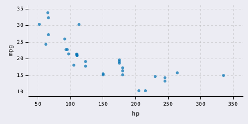
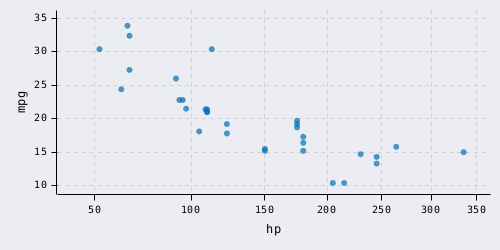
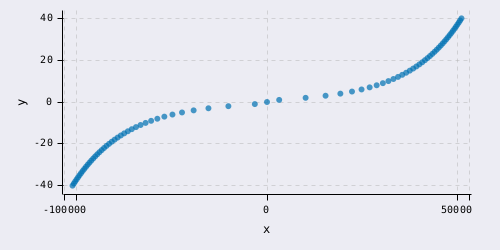
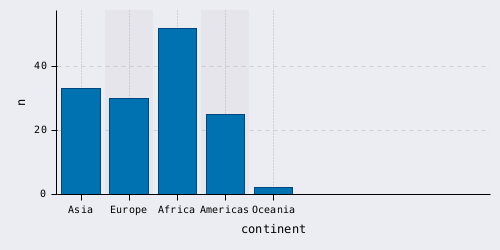
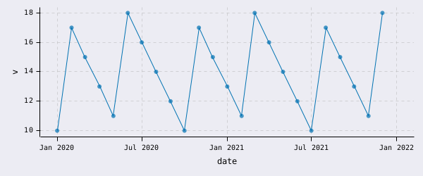
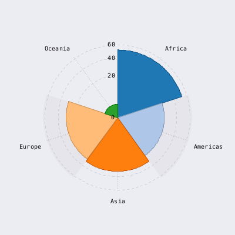
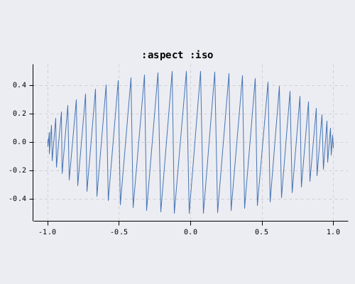
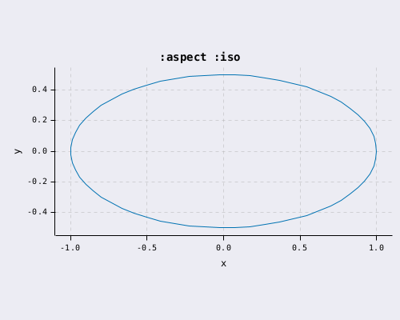

---
format:
  html:
    toc: true
    toc-location: right
    toc-depth: 4
    theme: cosmo
    include-in-header:
      text: |-
        <style>
        .data-table { width: fit-content; max-width: 100%; max-height: 15rem; overflow: auto; margin: 0 0 1rem 0; }
        .data-table .table-responsive { overflow: visible; }
        .data-table table { font-size: 0.75rem; width: auto; margin: 0; }
        .data-table th, .data-table td { padding: 0.1rem 0.45rem !important; white-space: nowrap; }
        .data-table thead th { position: sticky; top: 0; background: var(--bs-body-bg, #fff); }
        .options { margin: 0.5rem 0 1rem 0; }
        .options .option-card { margin: 0 0 0.9rem 0; border: 1px solid var(--bs-border-color, #dee2e6); border-radius: 0.375rem; overflow: hidden; }
        .options dt { display: flex; flex-wrap: wrap; align-items: baseline; gap: 0.1rem 1rem; margin: 0; padding: 0.4rem 0.75rem; background: #eef2f7; border-bottom: 1px solid var(--bs-border-color, #dee2e6); font-weight: normal; }
        .options dt > code { font-weight: 700; font-size: 1rem; background: none; padding: 0; }
        .options .option-default { font-size: 0.85rem; color: var(--bs-secondary-color, #6c757d); }
        .options dd { margin: 0; padding: 0.5rem 0.75rem; }
        .options .option-example { font-size: 0.85rem; padding: 0 0 0.45rem 0; margin-bottom: 0.45rem; border-bottom: 1px dashed var(--bs-border-color, #dee2e6); }
        .options .option-example code { background: none; padding: 0; }
        .options .option-text ul { margin: 0.3rem 0 0 0; padding-left: 1.25rem; }
        .options code, .mapping code { overflow-wrap: anywhere; }
        .options .option-default code, .options .option-example code { white-space: pre-wrap; }
        .mapping { margin: 0.5rem 0 1rem 0; padding: 0.5rem 0.75rem; border: 1px solid var(--bs-border-color, #dee2e6); border-left: 0.3rem solid #2780e3; border-radius: 0.375rem; background: #f5f8fc; }
        .mapping-title { font-weight: 700; margin-bottom: 0.25rem; }
        .mapping-hint { font-weight: normal; font-size: 0.85rem; color: var(--bs-secondary-color, #6c757d); }
        .mapping ul { margin: 0; padding-left: 1.25rem; }
        .mapping .required { font-size: 0.75rem; padding: 0 0.3rem; border: 1px solid currentColor; border-radius: 0.25rem; }
        .mapping-returns { margin-top: 0.25rem; }
        .mapping code { white-space: pre-wrap; }
        .shared { margin: 0.5rem 0 1rem 0; padding: 0.5rem 0.75rem; border: 1px solid var(--bs-border-color, #dee2e6); border-left: 0.3rem solid #6c757d; border-radius: 0.375rem; background: #f6f6f6; }
        .shared-title { font-weight: 700; margin-bottom: 0.25rem; }
        .shared-hint { font-weight: normal; font-size: 0.85rem; color: var(--bs-secondary-color, #6c757d); }
        .shared ul { margin: 0; padding-left: 1.25rem; }
        .shared code { overflow-wrap: anywhere; }
        p code, li code { white-space: pre-wrap; overflow-wrap: anywhere; }
        </style>
code-block-background: true

---
<style></style><style>.printedClojure .sourceCode {
  background-color: transparent;
  border-style: none;
}
</style><style>.clay-limit-image-width .clay-image {max-width: 100%}
.clay-side-by-side .sourceCode {margin: 0}
.clay-side-by-side {margin: 1em 0}
</style>
<script src="https://code.jquery.com/jquery-3.6.0.min.js" type="text/javascript"></script><script src="https://code.jquery.com/ui/1.13.1/jquery-ui.min.js" type="text/javascript"></script>

# Scales, axes and coordinates

Every mapped dimension goes through a scale: the position scales `:x` and `:y` place marks on the panel, the
aesthetic scales style them ([Aesthetics and legends](reference.aesthetics_legends.html)). This chapter covers the
position scales, set under the plot's `:scales` key (`{:scales {:x {...} :y {...}}}`), and the coordinates, set by
the plot keys `:coord`, `:flip` and `:aspect`. A position scale's kind follows the data (numbers, levels, dates)
unless set, and each one draws an axis and grid lines.


::: {.sourceClojure}
```clojure
(ns reference.scales-axes-coords
  (:require [fastmath.core :as m]
            [cljplot2.chart :as chart]
            [cljplot2.core :as plot]
            [cljplot2.describe :as describe]
            [cljplot2.pipeline :as pipeline]
            [cljplot2.scale.coord :as coord]
            [cljplot2.scale.position :as position]
            [cljplot2.schema :as schema]
            [notebook-utils :as nu])
  (:import [java.time LocalDate]))
```
:::


The table below holds the Gapminder countries of 2007; the partial domain and the ticks plots draw them:

Data: Gapminder 2007: life expectancy, population and GDP per capita, data-to-viz example dataset `4_ThreeNum` (Yan Holtz; Gapminder via the R gapminder package); licence: MIT (data_to_viz repository).


::: {.sourceClojure}
```clojure
(def gapminder (nu/dataset :gapminder-2007))
```
:::


```{=html}
<div class="data-table"><table class="table table-hover table-responsive clay-table"><thead><tr><th>country</th><th>continent</th><th>life-exp</th><th>pop</th><th>gdp-per-cap</th></tr></thead><tbody><tr><td>Afghanistan</td><td>Asia</td><td>43.828</td><td>31889923</td><td>974.5803384</td></tr><tr><td>Albania</td><td>Europe</td><td>76.423</td><td>3600523</td><td>5937.029526</td></tr><tr><td>Algeria</td><td>Africa</td><td>72.301</td><td>33333216</td><td>6223.367465</td></tr><tr><td>Angola</td><td>Africa</td><td>42.731</td><td>12420476</td><td>4797.231267</td></tr><tr><td>Argentina</td><td>Americas</td><td>75.32</td><td>40301927</td><td>12779.37964</td></tr><tr><td>Australia</td><td>Oceania</td><td>81.235</td><td>20434176</td><td>34435.36744</td></tr><tr><td>Austria</td><td>Europe</td><td>79.829</td><td>8199783</td><td>36126.4927</td></tr><tr><td>Bahrain</td><td>Asia</td><td>75.635</td><td>708573</td><td>29796.04834</td></tr><tr><td>Bangladesh</td><td>Asia</td><td>64.062</td><td>150448339</td><td>1391.253792</td></tr><tr><td>Belgium</td><td>Europe</td><td>79.441</td><td>10392226</td><td>33692.60508</td></tr><tr><td>Benin</td><td>Africa</td><td>56.728</td><td>8078314</td><td>1441.284873</td></tr><tr><td>Bolivia</td><td>Americas</td><td>65.554</td><td>9119152</td><td>3822.137084</td></tr><tr><td>Bosnia and Herzegovina</td><td>Europe</td><td>74.852</td><td>4552198</td><td>7446.298803</td></tr><tr><td>Botswana</td><td>Africa</td><td>50.728</td><td>1639131</td><td>12569.85177</td></tr><tr><td>Brazil</td><td>Americas</td><td>72.39</td><td>190010647</td><td>9065.800825</td></tr><tr><td>Bulgaria</td><td>Europe</td><td>73.005</td><td>7322858</td><td>10680.79282</td></tr><tr><td>Burkina Faso</td><td>Africa</td><td>52.295</td><td>14326203</td><td>1217.032994</td></tr><tr><td>Burundi</td><td>Africa</td><td>49.58</td><td>8390505</td><td>430.0706916</td></tr><tr><td>Cambodia</td><td>Asia</td><td>59.723</td><td>14131858</td><td>1713.778686</td></tr><tr><td>Cameroon</td><td>Africa</td><td>50.43</td><td>17696293</td><td>2042.09524</td></tr><tr><td>Canada</td><td>Americas</td><td>80.653</td><td>33390141</td><td>36319.23501</td></tr><tr><td>Central African Republic</td><td>Africa</td><td>44.741</td><td>4369038</td><td>706.016537</td></tr><tr><td>Chad</td><td>Africa</td><td>50.651</td><td>10238807</td><td>1704.063724</td></tr><tr><td>Chile</td><td>Americas</td><td>78.553</td><td>16284741</td><td>13171.63885</td></tr><tr><td>China</td><td>Asia</td><td>72.961</td><td>1318683096</td><td>4959.114854</td></tr><tr><td>Colombia</td><td>Americas</td><td>72.889</td><td>44227550</td><td>7006.580419</td></tr><tr><td>Comoros</td><td>Africa</td><td>65.152</td><td>710960</td><td>986.1478792</td></tr><tr><td>Congo, Dem. Rep.</td><td>Africa</td><td>46.462</td><td>64606759</td><td>277.5518587</td></tr><tr><td>Congo, Rep.</td><td>Africa</td><td>55.322</td><td>3800610</td><td>3632.557798</td></tr><tr><td>Costa Rica</td><td>Americas</td><td>78.782</td><td>4133884</td><td>9645.06142</td></tr><tr><td>Cote d'Ivoire</td><td>Africa</td><td>48.328</td><td>18013409</td><td>1544.750112</td></tr><tr><td>Croatia</td><td>Europe</td><td>75.748</td><td>4493312</td><td>14619.22272</td></tr><tr><td>Cuba</td><td>Americas</td><td>78.273</td><td>11416987</td><td>8948.102923</td></tr><tr><td>Czech Republic</td><td>Europe</td><td>76.486</td><td>10228744</td><td>22833.30851</td></tr><tr><td>Denmark</td><td>Europe</td><td>78.332</td><td>5468120</td><td>35278.41874</td></tr><tr><td>Djibouti</td><td>Africa</td><td>54.791</td><td>496374</td><td>2082.481567</td></tr><tr><td>Dominican Republic</td><td>Americas</td><td>72.235</td><td>9319622</td><td>6025.374752</td></tr><tr><td>Ecuador</td><td>Americas</td><td>74.994</td><td>13755680</td><td>6873.262326</td></tr><tr><td>Egypt</td><td>Africa</td><td>71.338</td><td>80264543</td><td>5581.180998</td></tr><tr><td>El Salvador</td><td>Americas</td><td>71.878</td><td>6939688</td><td>5728.353514</td></tr><tr><td>Equatorial Guinea</td><td>Africa</td><td>51.579</td><td>551201</td><td>12154.08975</td></tr><tr><td>Eritrea</td><td>Africa</td><td>58.04</td><td>4906585</td><td>641.3695236</td></tr><tr><td>Ethiopia</td><td>Africa</td><td>52.947</td><td>76511887</td><td>690.8055759</td></tr><tr><td>Finland</td><td>Europe</td><td>79.313</td><td>5238460</td><td>33207.0844</td></tr><tr><td>France</td><td>Europe</td><td>80.657</td><td>61083916</td><td>30470.0167</td></tr><tr><td>Gabon</td><td>Africa</td><td>56.735</td><td>1454867</td><td>13206.48452</td></tr><tr><td>Gambia</td><td>Africa</td><td>59.448</td><td>1688359</td><td>752.7497265</td></tr><tr><td>Germany</td><td>Europe</td><td>79.406</td><td>82400996</td><td>32170.37442</td></tr><tr><td>Ghana</td><td>Africa</td><td>60.022</td><td>22873338</td><td>1327.60891</td></tr><tr><td>Greece</td><td>Europe</td><td>79.483</td><td>10706290</td><td>27538.41188</td></tr><tr><td>Guatemala</td><td>Americas</td><td>70.259</td><td>12572928</td><td>5186.050003</td></tr><tr><td>Guinea</td><td>Africa</td><td>56.007</td><td>9947814</td><td>942.6542111</td></tr><tr><td>Guinea-Bissau</td><td>Africa</td><td>46.388</td><td>1472041</td><td>579.231743</td></tr><tr><td>Haiti</td><td>Americas</td><td>60.916</td><td>8502814</td><td>1201.637154</td></tr><tr><td>Honduras</td><td>Americas</td><td>70.198</td><td>7483763</td><td>3548.330846</td></tr><tr><td>Hong Kong, China</td><td>Asia</td><td>82.208</td><td>6980412</td><td>39724.97867</td></tr><tr><td>Hungary</td><td>Europe</td><td>73.338</td><td>9956108</td><td>18008.94444</td></tr><tr><td>Iceland</td><td>Europe</td><td>81.757</td><td>301931</td><td>36180.78919</td></tr><tr><td>India</td><td>Asia</td><td>64.698</td><td>1110396331</td><td>2452.210407</td></tr><tr><td>Indonesia</td><td>Asia</td><td>70.65</td><td>223547000</td><td>3540.651564</td></tr><tr><td>Iran</td><td>Asia</td><td>70.964</td><td>69453570</td><td>11605.71449</td></tr><tr><td>Iraq</td><td>Asia</td><td>59.545</td><td>27499638</td><td>4471.061906</td></tr><tr><td>Ireland</td><td>Europe</td><td>78.885</td><td>4109086</td><td>40675.99635</td></tr><tr><td>Israel</td><td>Asia</td><td>80.745</td><td>6426679</td><td>25523.2771</td></tr><tr><td>Italy</td><td>Europe</td><td>80.546</td><td>58147733</td><td>28569.7197</td></tr><tr><td>Jamaica</td><td>Americas</td><td>72.567</td><td>2780132</td><td>7320.880262</td></tr><tr><td>Japan</td><td>Asia</td><td>82.603</td><td>127467972</td><td>31656.06806</td></tr><tr><td>Jordan</td><td>Asia</td><td>72.535</td><td>6053193</td><td>4519.461171</td></tr><tr><td>Kenya</td><td>Africa</td><td>54.11</td><td>35610177</td><td>1463.249282</td></tr><tr><td>Korea, Dem. Rep.</td><td>Asia</td><td>67.297</td><td>23301725</td><td>1593.06548</td></tr><tr><td>Korea, Rep.</td><td>Asia</td><td>78.623</td><td>49044790</td><td>23348.13973</td></tr><tr><td>Kuwait</td><td>Asia</td><td>77.588</td><td>2505559</td><td>47306.98978</td></tr><tr><td>Lebanon</td><td>Asia</td><td>71.993</td><td>3921278</td><td>10461.05868</td></tr><tr><td>Lesotho</td><td>Africa</td><td>42.592</td><td>2012649</td><td>1569.331442</td></tr><tr><td>Liberia</td><td>Africa</td><td>45.678</td><td>3193942</td><td>414.5073415</td></tr><tr><td>Libya</td><td>Africa</td><td>73.952</td><td>6036914</td><td>12057.49928</td></tr><tr><td>Madagascar</td><td>Africa</td><td>59.443</td><td>19167654</td><td>1044.770126</td></tr><tr><td>Malawi</td><td>Africa</td><td>48.303</td><td>13327079</td><td>759.3499101</td></tr><tr><td>Malaysia</td><td>Asia</td><td>74.241</td><td>24821286</td><td>12451.6558</td></tr><tr><td>Mali</td><td>Africa</td><td>54.467</td><td>12031795</td><td>1042.581557</td></tr><tr><td>Mauritania</td><td>Africa</td><td>64.164</td><td>3270065</td><td>1803.151496</td></tr><tr><td>Mauritius</td><td>Africa</td><td>72.801</td><td>1250882</td><td>10956.99112</td></tr><tr><td>Mexico</td><td>Americas</td><td>76.195</td><td>108700891</td><td>11977.57496</td></tr><tr><td>Mongolia</td><td>Asia</td><td>66.803</td><td>2874127</td><td>3095.772271</td></tr><tr><td>Montenegro</td><td>Europe</td><td>74.543</td><td>684736</td><td>9253.896111</td></tr><tr><td>Morocco</td><td>Africa</td><td>71.164</td><td>33757175</td><td>3820.17523</td></tr><tr><td>Mozambique</td><td>Africa</td><td>42.082</td><td>19951656</td><td>823.6856205</td></tr><tr><td>Myanmar</td><td>Asia</td><td>62.069</td><td>47761980</td><td>944</td></tr><tr><td>Namibia</td><td>Africa</td><td>52.906</td><td>2055080</td><td>4811.060429</td></tr><tr><td>Nepal</td><td>Asia</td><td>63.785</td><td>28901790</td><td>1091.359778</td></tr><tr><td>Netherlands</td><td>Europe</td><td>79.762</td><td>16570613</td><td>36797.93332</td></tr><tr><td>New Zealand</td><td>Oceania</td><td>80.204</td><td>4115771</td><td>25185.00911</td></tr><tr><td>Nicaragua</td><td>Americas</td><td>72.899</td><td>5675356</td><td>2749.320965</td></tr><tr><td>Niger</td><td>Africa</td><td>56.867</td><td>12894865</td><td>619.6768924</td></tr><tr><td>Nigeria</td><td>Africa</td><td>46.859</td><td>135031164</td><td>2013.977305</td></tr><tr><td>Norway</td><td>Europe</td><td>80.196</td><td>4627926</td><td>49357.19017</td></tr><tr><td>Oman</td><td>Asia</td><td>75.64</td><td>3204897</td><td>22316.19287</td></tr><tr><td>Pakistan</td><td>Asia</td><td>65.483</td><td>169270617</td><td>2605.94758</td></tr><tr><td>Panama</td><td>Americas</td><td>75.537</td><td>3242173</td><td>9809.185636</td></tr><tr><td>Paraguay</td><td>Americas</td><td>71.752</td><td>6667147</td><td>4172.838464</td></tr><tr><td>…</td><td>…</td><td>…</td><td>…</td><td>…</td></tr></tbody></table></div>
```


The table below counts the countries per continent; the bar plots draw it:


::: {.sourceClojure}
```clojure
(def counts (for [[continent rs] (group-by :continent gapminder)] {:continent continent :n (count rs)}))
```
:::


```{=html}
<div class="data-table"><table class="table table-hover table-responsive clay-table"><thead><tr><th>continent</th><th>n</th></tr></thead><tbody><tr><td>Asia</td><td>33</td></tr><tr><td>Europe</td><td>30</td></tr><tr><td>Africa</td><td>52</td></tr><tr><td>Americas</td><td>25</td></tr><tr><td>Oceania</td><td>2</td></tr></tbody></table></div>
```


The table below holds the mtcars cars; the domain and axis sections and two scale kinds draw them:

Data: Motor Trend car road tests (1974), R datasets package `mtcars` (Henderson & Velleman 1981); licence: Part of R (GPL-2 | GPL-3).


::: {.sourceClojure}
```clojure
(def mtcars (nu/dataset :mtcars))
```
:::


```{=html}
<div class="data-table"><table class="table table-hover table-responsive clay-table"><thead><tr><th>model</th><th>mpg</th><th>cyl</th><th>disp</th><th>hp</th><th>drat</th><th>wt</th><th>qsec</th><th>vs</th><th>am</th><th>gear</th><th>carb</th></tr></thead><tbody><tr><td>Mazda RX4</td><td>21</td><td>6</td><td>160</td><td>110</td><td>3.9</td><td>2.62</td><td>16.46</td><td>0</td><td>1</td><td>4</td><td>4</td></tr><tr><td>Mazda RX4 Wag</td><td>21</td><td>6</td><td>160</td><td>110</td><td>3.9</td><td>2.875</td><td>17.02</td><td>0</td><td>1</td><td>4</td><td>4</td></tr><tr><td>Datsun 710</td><td>22.8</td><td>4</td><td>108</td><td>93</td><td>3.85</td><td>2.32</td><td>18.61</td><td>1</td><td>1</td><td>4</td><td>1</td></tr><tr><td>Hornet 4 Drive</td><td>21.4</td><td>6</td><td>258</td><td>110</td><td>3.08</td><td>3.215</td><td>19.44</td><td>1</td><td>0</td><td>3</td><td>1</td></tr><tr><td>Hornet Sportabout</td><td>18.7</td><td>8</td><td>360</td><td>175</td><td>3.15</td><td>3.44</td><td>17.02</td><td>0</td><td>0</td><td>3</td><td>2</td></tr><tr><td>Valiant</td><td>18.1</td><td>6</td><td>225</td><td>105</td><td>2.76</td><td>3.46</td><td>20.22</td><td>1</td><td>0</td><td>3</td><td>1</td></tr><tr><td>Duster 360</td><td>14.3</td><td>8</td><td>360</td><td>245</td><td>3.21</td><td>3.57</td><td>15.84</td><td>0</td><td>0</td><td>3</td><td>4</td></tr><tr><td>Merc 240D</td><td>24.4</td><td>4</td><td>146.7</td><td>62</td><td>3.69</td><td>3.19</td><td>20</td><td>1</td><td>0</td><td>4</td><td>2</td></tr><tr><td>Merc 230</td><td>22.8</td><td>4</td><td>140.8</td><td>95</td><td>3.92</td><td>3.15</td><td>22.9</td><td>1</td><td>0</td><td>4</td><td>2</td></tr><tr><td>Merc 280</td><td>19.2</td><td>6</td><td>167.6</td><td>123</td><td>3.92</td><td>3.44</td><td>18.3</td><td>1</td><td>0</td><td>4</td><td>4</td></tr><tr><td>Merc 280C</td><td>17.8</td><td>6</td><td>167.6</td><td>123</td><td>3.92</td><td>3.44</td><td>18.9</td><td>1</td><td>0</td><td>4</td><td>4</td></tr><tr><td>Merc 450SE</td><td>16.4</td><td>8</td><td>275.8</td><td>180</td><td>3.07</td><td>4.07</td><td>17.4</td><td>0</td><td>0</td><td>3</td><td>3</td></tr><tr><td>Merc 450SL</td><td>17.3</td><td>8</td><td>275.8</td><td>180</td><td>3.07</td><td>3.73</td><td>17.6</td><td>0</td><td>0</td><td>3</td><td>3</td></tr><tr><td>Merc 450SLC</td><td>15.2</td><td>8</td><td>275.8</td><td>180</td><td>3.07</td><td>3.78</td><td>18</td><td>0</td><td>0</td><td>3</td><td>3</td></tr><tr><td>Cadillac Fleetwood</td><td>10.4</td><td>8</td><td>472</td><td>205</td><td>2.93</td><td>5.25</td><td>17.98</td><td>0</td><td>0</td><td>3</td><td>4</td></tr><tr><td>Lincoln Continental</td><td>10.4</td><td>8</td><td>460</td><td>215</td><td>3</td><td>5.424</td><td>17.82</td><td>0</td><td>0</td><td>3</td><td>4</td></tr><tr><td>Chrysler Imperial</td><td>14.7</td><td>8</td><td>440</td><td>230</td><td>3.23</td><td>5.345</td><td>17.42</td><td>0</td><td>0</td><td>3</td><td>4</td></tr><tr><td>Fiat 128</td><td>32.4</td><td>4</td><td>78.7</td><td>66</td><td>4.08</td><td>2.2</td><td>19.47</td><td>1</td><td>1</td><td>4</td><td>1</td></tr><tr><td>Honda Civic</td><td>30.4</td><td>4</td><td>75.7</td><td>52</td><td>4.93</td><td>1.615</td><td>18.52</td><td>1</td><td>1</td><td>4</td><td>2</td></tr><tr><td>Toyota Corolla</td><td>33.9</td><td>4</td><td>71.1</td><td>65</td><td>4.22</td><td>1.835</td><td>19.9</td><td>1</td><td>1</td><td>4</td><td>1</td></tr><tr><td>Toyota Corona</td><td>21.5</td><td>4</td><td>120.1</td><td>97</td><td>3.7</td><td>2.465</td><td>20.01</td><td>1</td><td>0</td><td>3</td><td>1</td></tr><tr><td>Dodge Challenger</td><td>15.5</td><td>8</td><td>318</td><td>150</td><td>2.76</td><td>3.52</td><td>16.87</td><td>0</td><td>0</td><td>3</td><td>2</td></tr><tr><td>AMC Javelin</td><td>15.2</td><td>8</td><td>304</td><td>150</td><td>3.15</td><td>3.435</td><td>17.3</td><td>0</td><td>0</td><td>3</td><td>2</td></tr><tr><td>Camaro Z28</td><td>13.3</td><td>8</td><td>350</td><td>245</td><td>3.73</td><td>3.84</td><td>15.41</td><td>0</td><td>0</td><td>3</td><td>4</td></tr><tr><td>Pontiac Firebird</td><td>19.2</td><td>8</td><td>400</td><td>175</td><td>3.08</td><td>3.845</td><td>17.05</td><td>0</td><td>0</td><td>3</td><td>2</td></tr><tr><td>Fiat X1-9</td><td>27.3</td><td>4</td><td>79</td><td>66</td><td>4.08</td><td>1.935</td><td>18.9</td><td>1</td><td>1</td><td>4</td><td>1</td></tr><tr><td>Porsche 914-2</td><td>26</td><td>4</td><td>120.3</td><td>91</td><td>4.43</td><td>2.14</td><td>16.7</td><td>0</td><td>1</td><td>5</td><td>2</td></tr><tr><td>Lotus Europa</td><td>30.4</td><td>4</td><td>95.1</td><td>113</td><td>3.77</td><td>1.513</td><td>16.9</td><td>1</td><td>1</td><td>5</td><td>2</td></tr><tr><td>Ford Pantera L</td><td>15.8</td><td>8</td><td>351</td><td>264</td><td>4.22</td><td>3.17</td><td>14.5</td><td>0</td><td>1</td><td>5</td><td>4</td></tr><tr><td>Ferrari Dino</td><td>19.7</td><td>6</td><td>145</td><td>175</td><td>3.62</td><td>2.77</td><td>15.5</td><td>0</td><td>1</td><td>5</td><td>6</td></tr><tr><td>Maserati Bora</td><td>15</td><td>8</td><td>301</td><td>335</td><td>3.54</td><td>3.57</td><td>14.6</td><td>0</td><td>1</td><td>5</td><td>8</td></tr><tr><td>Volvo 142E</td><td>21.4</td><td>4</td><td>121</td><td>109</td><td>4.11</td><td>2.78</td><td>18.6</td><td>1</td><td>1</td><td>4</td><td>2</td></tr></tbody></table></div>
```


The tables below hold a made-up spiral and points on an ellipse; the coordinates section draws them:


::: {.sourceClojure}
```clojure
(def spiral (for [t (range 0 13)] {:t t :r (+ 1 t)}))
```
:::


```{=html}
<div class="data-table"><table class="table table-hover table-responsive clay-table"><thead><tr><th>t</th><th>r</th></tr></thead><tbody><tr><td>0</td><td>1</td></tr><tr><td>1</td><td>2</td></tr><tr><td>2</td><td>3</td></tr><tr><td>3</td><td>4</td></tr><tr><td>4</td><td>5</td></tr><tr><td>5</td><td>6</td></tr><tr><td>6</td><td>7</td></tr><tr><td>7</td><td>8</td></tr><tr><td>8</td><td>9</td></tr><tr><td>9</td><td>10</td></tr><tr><td>10</td><td>11</td></tr><tr><td>11</td><td>12</td></tr><tr><td>12</td><td>13</td></tr></tbody></table></div>
```


::: {.sourceClojure}
```clojure
(def ellipse (for [t (m/slice-range 0 m/TWO_PI 64)] {:x (m/cos t) :y (m/* 0.5 (m/sin t))}))
```
:::


```{=html}
<div class="data-table"><table class="table table-hover table-responsive clay-table"><thead><tr><th>x</th><th>y</th></tr></thead><tbody><tr><td>1.0</td><td>0.0</td></tr><tr><td>0.9950307753654014</td><td>0.049783923297908324</td></tr><tr><td>0.9801724878485438</td><td>0.09907307159969878</td></tr><tr><td>0.9555728057861408</td><td>0.14737758720545208</td></tr><tr><td>0.9214762118704076</td><td>0.19421739813734734</td></tr><tr><td>0.8782215733702285</td><td>0.2391269893106591</td></tr><tr><td>0.8262387743159949</td><td>0.281660029031811</td></tr><tr><td>0.766044443118978</td><td>0.3213938048432696</td></tr><tr><td>0.6982368180860729</td><td>0.35793342462985916</td></tr><tr><td>0.6234898018587336</td><td>0.3909157412340149</td></tr><tr><td>0.5425462638657594</td><td>0.4200129615753857</td></tr><tr><td>0.4562106573531631</td><td>0.4449359044057343</td></tr><tr><td>0.3653410243663952</td><td>0.46543687432210207</td></tr><tr><td>0.27084046814300516</td><td>0.481312123475006</td></tr><tr><td>0.17364817766693041</td><td>0.492403876506104</td></tr><tr><td>0.07473009358642439</td><td>0.49860189859059006</td></tr><tr><td>-0.02493069173807269</td><td>0.4998445910004081</td></tr><tr><td>-0.12434370464748494</td><td>0.49611960330008603</td></tr><tr><td>-0.22252093395631434</td><td>0.4874639560909118</td></tr><tr><td>-0.3184866502516843</td><td>0.4739636730835659</td></tr><tr><td>-0.4112871031306114</td><td>0.4557529261558366</td></tr><tr><td>-0.4999999999999998</td><td>0.43301270189221935</td></tr><tr><td>-0.5837436722347896</td><td>0.4059690028579283</td></tr><tr><td>-0.6616858375968592</td><td>0.3748906014838672</td></tr><tr><td>-0.7330518718298261</td><td>0.34008636888545984</td></tr><tr><td>-0.7971325072229222</td><td>0.30190220516273886</td></tr><tr><td>-0.8532908816321556</td><td>0.26071760168974906</td></tr><tr><td>-0.900968867902419</td><td>0.21694186955877912</td></tr><tr><td>-0.9396926207859083</td><td>0.17101007166283444</td></tr><tr><td>-0.9690772862290778</td><td>0.12337869884514692</td></tr><tr><td>-0.9888308262251285</td><td>0.07452113308808736</td></tr><tr><td>-0.9987569212189223</td><td>0.02492294283034874</td></tr><tr><td>-0.9987569212189223</td><td>-0.024922942830348398</td></tr><tr><td>-0.9888308262251285</td><td>-0.07452113308808724</td></tr><tr><td>-0.9690772862290781</td><td>-0.12337869884514659</td></tr><tr><td>-0.9396926207859084</td><td>-0.17101007166283433</td></tr><tr><td>-0.9009688679024191</td><td>-0.216941869558779</td></tr><tr><td>-0.8532908816321557</td><td>-0.26071760168974895</td></tr><tr><td>-0.7971325072229226</td><td>-0.3019022051627386</td></tr><tr><td>-0.7330518718298262</td><td>-0.34008636888545973</td></tr><tr><td>-0.6616858375968597</td><td>-0.374890601483867</td></tr><tr><td>-0.5837436722347898</td><td>-0.40596900285792825</td></tr><tr><td>-0.5000000000000004</td><td>-0.4330127018922192</td></tr><tr><td>-0.4112871031306116</td><td>-0.45575292615583657</td></tr><tr><td>-0.318486650251685</td><td>-0.4739636730835658</td></tr><tr><td>-0.2225209339563146</td><td>-0.4874639560909118</td></tr><tr><td>-0.12434370464748584</td><td>-0.496119603300086</td></tr><tr><td>-0.024930691738073156</td><td>-0.4998445910004081</td></tr><tr><td>0.07473009358642348</td><td>-0.4986018985905901</td></tr><tr><td>0.17364817766692997</td><td>-0.49240387650610407</td></tr><tr><td>0.2708404681430043</td><td>-0.4813121234750062</td></tr><tr><td>0.36534102436639454</td><td>-0.46543687432210223</td></tr><tr><td>0.45621065735316285</td><td>-0.44493590440573433</td></tr><tr><td>0.5425462638657597</td><td>-0.42001296157538565</td></tr><tr><td>0.6234898018587334</td><td>-0.39091574123401496</td></tr><tr><td>0.698236818086073</td><td>-0.35793342462985916</td></tr><tr><td>0.7660444431189778</td><td>-0.3213938048432698</td></tr><tr><td>0.8262387743159949</td><td>-0.281660029031811</td></tr><tr><td>0.8782215733702283</td><td>-0.2391269893106593</td></tr><tr><td>0.9214762118704076</td><td>-0.19421739813734737</td></tr><tr><td>0.9555728057861406</td><td>-0.14737758720545235</td></tr><tr><td>0.9801724878485438</td><td>-0.09907307159969886</td></tr><tr><td>0.9950307753654013</td><td>-0.04978392329790864</td></tr><tr><td>1.0</td><td>-1.2246467991473532E-16</td></tr></tbody></table></div>
```


## Kind and domain

These options set the scale kind (Scale kinds below) and the data range it covers. The scale extends the domain to
nice tick values (`:nice`), then pads it (the charts' padding, or `:expand`). The plots below read cylinder counts
as three bands (left) and fix both domains, x without padding (right):


```{=html}
<dl class="options"><div class="option-card"><dt><code>:kind</code><span class="option-default">Default: From the data: <code>:linear</code> for numbers, <code>:bands</code> for levels, <code>:datetime</code> for <code>java.time</code> values.</span></dt><dd><div class="option-example"><code>{:scales {:x {:kind :log}}}</code></div><div class="option-text">The scale kind: how data values map to positions along the axis.<ul><li><code>:bands</code> – Levels, one band each.</li><li><code>:datetime</code> – <code>java.time</code> values on a time axis.</li><li><code>:interpolated</code> – The domain values pinned to <code>:stops</code> of the panel, interpolated between them.</li><li><code>:linear</code> – Numbers, evenly spaced.</li><li><code>:log</code> – Positive numbers by their logarithm.</li><li><code>:pow</code> – Numbers by a power, the <code>:exponent</code>.</li><li><code>:radial</code> – Radii whose circle areas grow linearly with the values, for polar plots.</li><li><code>:symlog</code> – Numbers of both signs over many magnitudes, by a logarithm symmetric around 0.</li></ul></div></dd></div><div class="option-card"><dt><code>:type</code><span class="option-default">Default: The data's kind.</span></dt><dd><div class="option-example"><code>{:scales {:x {:domain [1 4 7 10], :type :categorical}}}</code></div><div class="option-text">Declares how the scale reads its values.<ul><li><code>:categorical</code> – As levels, one band per value; numbers need a <code>:domain</code> unless the charts give their levels (strip charts do).</li><li><code>:numeric</code> – As numbers, the data's default; it rejects <code>:kind :bands</code> and a <code>levels/categorical</code> marker.</li></ul></div></dd></div><div class="option-card"><dt><code>:domain</code><span class="option-default">Default: The charts' data extent.</span></dt><dd><div class="option-example"><code>{:scales {:x {:domain [0 20]}}}</code></div><div class="option-text">The data range the scale covers: <code>[lo hi]</code> for continuous kinds (<code>nil</code> at an end takes the data's, e.g. <code>[0 nil]</code>), the levels in order for <code>:bands</code>.<ul><li><span>sequence of any values</span></li></ul></div></dd></div><div class="option-card"><dt><code>:nice</code><span class="option-default">Default: <code>true</code> (<code>false</code> for <code>:interpolated</code>).</span></dt><dd><div class="option-example"><code>{:scales {:x {:domain [1.3 9.7], :nice false}}}</code></div><div class="option-text">Whether a continuous domain grows to nice tick values.<ul><li><code>true</code> – It grows to nice tick values, by at most a tenth of its span.</li><li><code>false</code> – It stays as computed.</li><li><span>finite number, non-negative number</span> – It grows by at most this fraction of its span.</li></ul></div></dd></div><div class="option-card"><dt><code>:expand</code><span class="option-default">Default: The charts' padding.</span></dt><dd><div class="option-example"><code>{:scales {:x {:expand [0 0]}}}</code></div><div class="option-text">The room added at the ends of a continuous domain, fractions of its span; it wins over the charts' padding.<ul><li><a href="reference.types.html#padding">padding</a></li></ul></div></dd></div></dl>
```


::: {.sourceClojure}
```clojure
(plot/render-image (plot/arrange [{:data mtcars
                                   :mapping {:x :cyl :y :mpg}
                                   :charts [(chart/box)]
                                   :scales {:x {:type :categorical}}}
                                  {:data mtcars
                                   :mapping {:x :wt :y :mpg}
                                   :charts [(chart/scatter)]
                                   :scales {:x {:domain [1.5 5.5] :expand [0 0] :nice false} :y {:domain [0 40]}}}]
                                 {:columns 2})
                   {:width 800 :height 320})
```
:::


::: {.clay-image}

:::


A partial domain such as `[0 nil]` fixes one end; the charts' padding and nice rounding still apply at the other.
Only continuous kinds other than `:interpolated` take one, and the data must reach past the fixed end. The left
plot covers the data's range; the right one starts life expectancy at zero:


::: {.sourceClojure}
```clojure
(plot/render-image (plot/arrange (for [[title y-scale] [["the data's range" {}] [":domain [0 nil]" {:domain [0 nil]}]]]
                                   {:data gapminder
                                    :mapping {:x :gdp-per-cap :y :life-exp}
                                    :charts [(chart/scatter)]
                                    :scales {:x {:kind :log} :y y-scale}
                                    :labels {:title title}})
                                 {:columns 2})
                   {:width 800 :height 320})
```
:::


::: {.clay-image}

:::


The built plot's `:scale-specs` hold the kind each scale gets from the data and the charts' statistics. Below, a
bar chart puts levels on x and a histogram puts bins and counts on its axes:


::: {.sourceClojure}
```clojure
(into {} (for [[title p] {"bar" {:data mtcars :mapping {:x #(str (:cyl %) " cyl") :y :mpg} :charts [(chart/bar)]}
                          "histogram" {:data mtcars :mapping {:x :mpg} :charts [(chart/histogram)]}}]
           [title (update-vals (select-keys (:scale-specs (plot/build p)) [:x :y]) :kind)]))
```
:::


::: {.printedClojure}
```clojure
{"bar" {:x :bands, :y :linear}, "histogram" {:x :linear, :y :linear}}

```
:::


## Ticks and labels

These options set where ticks go and how their labels read. Minor ticks get grid lines only when the theme draws
them (`[:panel :grid :minor]`, `:none` by default). The plot below writes powers of ten on a log x axis with minor
ticks and their grid lines, and gives y its tick values and a formatter:


```{=html}
<dl class="options"><div class="option-card"><dt><code>:ticks</code><span class="option-default">Default: A count from the panel size and the theme's <code>:tick-spacing</code>; a bands scale ticks every band.</span></dt><dd><div class="option-example"><code>{:scales {:x {:ticks [2 5 8]}}}</code></div><div class="option-text">Where the ticks go: a count the scale aims for, or the tick values.<ul><li><span>sequence of any values</span> – These tick values.</li><li><a href="reference.types.html#positive-integer">positive integer</a> – About this many ticks.</li></ul></div></dd></div><div class="option-card"><dt><code>:formatter</code><span class="option-default">Default: The charts' suggested format, else plain numbers, levels or dates.</span></dt><dd><div class="option-example"><code>{:scales {:x {:formatter (fn [v] (str v " u"))}}}</code></div><div class="option-text">The text of the tick labels.<ul><li><code>:power</code> – For <code>:log</code>: powers of the base, the exponent in superscript digits.</li><li><code>:power-math</code> – For <code>:log</code>: powers of the base typeset as formulas.</li><li><span>string</span> – For <code>:datetime</code>: a <code>java.time</code> pattern, e.g. <code>MMM yyyy</code>.</li><li><a href="reference.types.html#function">function</a> – A function of the tick value that returns its label.</li></ul></div></dd></div><div class="option-card"><dt><code>:minor-ticks</code><span class="option-default">Default: No minor ticks.</span></dt><dd><div class="option-example"><code>{:scales {:x {:minor-ticks 4}}}</code></div><div class="option-text">The number of unlabelled ticks between two major ticks, on continuous numeric kinds.<ul><li><a href="reference.types.html#positive-integer">positive integer</a></li></ul></div></dd></div><div class="option-card"><dt><code>:ticks-method</code><span class="option-default">Default: <code>:pretty</code> for <code>:datetime</code>, else <code>:default</code>.</span></dt><dd><div class="option-example"><code>{:scales {:x {:ticks 5, :domain [0 13], :ticks-method :pretty}}}</code></div><div class="option-text">The tick algorithm of continuous kinds.<ul><li><code>:default</code> – d3's ticks.</li><li><code>:pretty</code> – R's <code>pretty()</code> ticks.</li></ul></div></dd></div><div class="option-card"><dt><code>:ticks-params</code></dt><dd><div class="option-text">Parameters of the tick algorithm: the fewest ticks and calendar ticks.</div></dd></div><div class="option-card"><dt><code>:ticks-params :min-n</code><span class="option-default">Default: The algorithm's own.</span></dt><dd><div class="option-example"><code>{:scales {:x {:ticks-method :pretty, :ticks 8, :domain [0 13], :ticks-params {:min-n 8}}}}</code></div><div class="option-text">The fewest ticks the algorithm gives, at most the tick count.<ul><li><span>integer at least 0</span></li></ul></div></dd></div><div class="option-card"><dt><code>:ticks-params :unit</code><span class="option-default">Default: Chosen from the domain's span.</span></dt><dd><div class="option-example"><code>{:scales {:x {:ticks-method :pretty, :ticks-params {:unit :months}}}}</code></div><div class="option-text">The calendar unit of <code>:datetime</code> ticks with <code>:ticks-method :pretty</code>.<ul><li class="option-other">A tick at every <code>:step</code> of this unit. <code>:days</code>, <code>:hours</code>, <code>:minutes</code>, <code>:months</code>, <code>:seconds</code>, <code>:weeks</code>, <code>:years</code></li></ul></div></dd></div><div class="option-card"><dt><code>:ticks-params :step</code><span class="option-default">Default: <code>1</code></span></dt><dd><div class="option-example"><code>{:scales {:x {:ticks-method :pretty, :ticks-params {:unit :months, :step 3}}}}</code></div><div class="option-text">A calendar tick every this many <code>:unit</code>s.<ul><li><a href="reference.types.html#positive-integer">positive integer</a></li></ul></div></dd></div></dl>
```


::: {.sourceClojure}
```clojure
(plot/render-image {:data gapminder
                    :mapping {:x :gdp-per-cap :y :life-exp}
                    :charts [(chart/scatter)]
                    :scales {:x {:kind :log :formatter :power :minor-ticks 9}
                             :y {:ticks [40 50 60 70 80] :formatter #(str % " y")}}
                    :theme {:panel {:grid {:minor {:color [200 200 215] :line-width 0.5 :dash :none}}}}}
                   {:width 600 :height 350})
```
:::


::: {.clay-image}

:::


## Order and direction

These options order the bands and set the axis direction. The plots below order the continents by their count,
largest first (left), and reverse the y axis (right):


```{=html}
<dl class="options"><div class="option-card"><dt><code>:order-by</code><span class="option-default">Default: The levels in the order they first appear in the data; numbers, dates and intervals sorted.</span></dt><dd><div class="option-example"><code>{:scales {:x {:order-by (fn [rows] (reduce + (map :y rows)))}}}</code></div><div class="option-text">Orders the bands by a function of each level's rows, smallest first; it can't be combined with <code>:domain</code>.<ul><li><a href="reference.types.html#function">function</a></li></ul></div></dd></div><div class="option-card"><dt><code>:descending</code><span class="option-default">Default: <code>false</code></span></dt><dd><div class="option-example"><code>{:scales {:x {:order-by (fn [rows] (reduce + (map :y rows))), :descending true}}}</code></div><div class="option-text">Whether <code>:order-by</code> puts the largest result first.<ul><li><code>false</code> – Smallest first.</li><li><code>true</code> – Largest first.</li></ul></div></dd></div><div class="option-card"><dt><code>:reverse</code><span class="option-default">Default: <code>false</code></span></dt><dd><div class="option-example"><code>{:scales {:x {:reverse true}}}</code></div><div class="option-text">Whether the axis runs the other way: the final domain reversed.<ul><li><code>false</code> – In domain order.</li><li><code>true</code> – Reversed.</li></ul></div></dd></div></dl>
```


::: {.sourceClojure}
```clojure
(plot/render-image (plot/arrange [{:data counts
                                   :mapping {:x :continent :y :n}
                                   :charts [(chart/bar)]
                                   :scales {:x {:order-by #(reduce + (map :n %)) :descending true}}
                                   :labels {:title "ordered by count"}}
                                  {:data counts
                                   :mapping {:x :continent :y :n}
                                   :charts [(chart/bar)]
                                   :scales {:y {:reverse true}}
                                   :labels {:title "y reversed"}}]
                                 {:columns 2})
                   {:width 900 :height 320})
```
:::


::: {.clay-image}

:::


## Axis

These options set what the scale's axis draws. Builders naming data items on an axis, such as dendrogram leaves,
set `:overlapping-labels :keep`. The plots below draw the x axis without grid lines and y grid lines without an
axis (left), and y ticks of a display domain (right):


```{=html}
<dl class="options"><div class="option-card"><dt><code>:axis-domain</code><span class="option-default">Default: The scale's own ticks.</span></dt><dd><div class="option-example"><code>{:scales {:x {:axis-domain [0 1]}}}</code></div><div class="option-text">A linear domain whose ticks the axis and grid lines show over the panel, for display only.<ul><li><span>pair of finite numbers</span></li></ul></div></dd></div><div class="option-card"><dt><code>:overlapping-labels</code><span class="option-default">Default: <code>:keep</code> with an explicit <code>:ticks</code> vector (the values asked for), else <code>:drop</code>.</span></dt><dd><div class="option-example"><code>{:scales {:x {:ticks 30, :overlapping-labels :keep}}}</code></div><div class="option-text">What the axis does with a tick label overlapping one drawn before it.<ul><li><code>:drop</code> – It skips the label.</li><li><code>:keep</code> – It draws every label, e.g. on axes naming data items.</li></ul></div></dd></div><div class="option-card"><dt><code>:axis</code><span class="option-default">Default: <code>true</code></span></dt><dd><div class="option-example"><code>{:scales {:x {:axis false}}}</code></div><div class="option-text">What the scale draws: its axis, its grid lines, both or neither. An axis not drawn takes no title from the mapping.<ul><li><code>true</code> – The axis and the grid lines.</li><li><code>false</code> – Neither.</li><li><code>:grid</code> – The grid lines only.</li><li><code>:no-grid</code> – The axis only.</li></ul></div></dd></div></dl>
```


::: {.sourceClojure}
```clojure
(plot/render-image (plot/arrange [{:data mtcars
                                   :mapping {:x :wt :y :mpg}
                                   :charts [(chart/scatter)]
                                   :scales {:x {:axis :no-grid} :y {:axis :grid}}
                                   :labels {:title "x :no-grid; y :grid"}}
                                  {:data mtcars
                                   :mapping {:x :wt :y :mpg}
                                   :charts [(chart/scatter)]
                                   :scales {:y {:axis-domain [0 1]}}
                                   :labels {:title "y ticks of [0 1] over the panel"}}]
                                 {:columns 2})
                   {:width 900 :height 320})
```
:::


::: {.clay-image}

:::


## wadogo attributes

cljplot2 passes these options to the [wadogo](https://github.com/scicloj/wadogo) scale of the kind; each kind below
lists the ones it reads. The plot below widens the space between and around the bands:


```{=html}
<dl class="options"><div class="option-card"><dt><code>:clamp</code><span class="option-default">Default: <code>false</code>.</span></dt><dd><div class="option-example"><code>{:scales {:x {:domain [2 5], :clamp true}}}</code></div><div class="option-text">Whether wadogo clamps a value outside the finalized domain - the panel's span after nice rounding and padding - to the nearer end.<ul><li><code>true</code> – Values past an end sit at the panel's edge.</li><li><code>false</code> – Values past an end lie outside the panel, which clips them.</li></ul></div></dd></div><div class="option-card"><dt><code>:unknown</code><span class="option-default">Default: None: such values aren't drawn.</span></dt><dd><div class="option-example"><code>{:scales {:x {:domain ["a" "b"], :unknown 0}}}</code></div><div class="option-text">The pixel position, along the panel from its range start, wadogo gives a value outside a bands domain.<ul><li><a href="reference.types.html#finite-number">finite number</a></li></ul></div></dd></div><div class="option-card"><dt><code>:round</code><span class="option-default">Default: <code>false</code>.</span></dt><dd><div class="option-example"><code>{:scales {:x {:round true}}}</code></div><div class="option-text">Whether wadogo rounds mapped positions, and band starts and widths, to whole pixels.<ul><li><code>true</code> – Whole pixels.</li><li><code>false</code> – Exact positions.</li></ul></div></dd></div><div class="option-card"><dt><code>:base</code><span class="option-default">Default: <code>10</code>.</span></dt><dd><div class="option-example"><code>{:scales {:x {:kind :log, :base 2}}}</code></div><div class="option-text">The logarithm base of a <code>:log</code> scale; it changes the ticks and the nice domain.<ul><li><span>finite number above 1</span></li></ul></div></dd></div><div class="option-card"><dt><code>:exponent</code><span class="option-default">Default: <code>0.5</code>, a square root.</span></dt><dd><div class="option-example"><code>{:scales {:x {:kind :pow, :exponent 2}}}</code></div><div class="option-text">The exponent of a <code>:pow</code> scale; 0 is rejected (every value would map to one place).<ul><li><span>finite number, [:not= 0]</span></li></ul></div></dd></div><div class="option-card"><dt><code>:padding-in</code><span class="option-default">Default: <code>0</code>: bands touch.</span></dt><dd><div class="option-example"><code>{:scales {:x {:padding-in 0.5}}}</code></div><div class="option-text">The space between bands, a fraction of the step.<ul><li><a href="reference.types.html#fraction">fraction</a></li></ul></div></dd></div><div class="option-card"><dt><code>:padding-out</code><span class="option-default">Default: <code>0</code>; ridgelines and tiles set their own room.</span></dt><dd><div class="option-example"><code>{:scales {:x {:padding-out 1.0}}}</code></div><div class="option-text">The space before the first and after the last band, a fraction of the step.<ul><li><a href="reference.types.html#non-negative-number">non-negative number</a></li></ul></div></dd></div><div class="option-card"><dt><code>:align-outer</code><span class="option-default">Default: <code>0.5</code>: evenly; ridgelines and tiles set their own.</span></dt><dd><div class="option-example"><code>{:scales {:x {:padding-out 2.0, :align-outer 0.0}}}</code></div><div class="option-text">How the outer band space is split: 0 puts it all after the last band, 1 all before the first.<ul><li><a href="reference.types.html#fraction">fraction</a></li></ul></div></dd></div><div class="option-card"><dt><code>:align</code><span class="option-default">Default: <code>0.5</code>: the band's middle.</span></dt><dd><div class="option-example"><code>{:scales {:x {:align 0.0}}}</code></div><div class="option-text">Where a point sits inside its band: 0 at the band's start, 1 at its end.<ul><li><code>:spread</code> – Places spread over the bands: the first band's point at its start, the last band's at its end.</li><li><a href="reference.types.html#fraction">fraction</a> – This place in every band.</li><li><span>sequence of fractions</span> – A place per band, in band order, cycled (at least one).</li></ul></div></dd></div><div class="option-card"><dt><code>:interpolator-params</code><span class="option-default">Default: None.</span></dt><dd><div class="option-example"><code>{:scales {:x {:kind :interpolated, :domain [1 2 3 4 5 6 7 8 9 10], :interpolator :loess, :interpolator-params [{:bandwidth 0.9}]}}}</code></div><div class="option-text">Extra arguments an <code>:interpolated</code> scale's <code>:interpolator</code> takes after the points, e.g. its options map.<ul><li><span>sequence of any values</span></li></ul></div></dd></div></dl>
```


::: {.sourceClojure}
```clojure
(plot/render-image {:data counts
                    :mapping {:x :continent :y :n}
                    :charts [(chart/bar {:width 1.0})]
                    :scales {:x {:padding-in 0.5 :padding-out 1.0}}}
                   {:width 500 :height 280})
```
:::


::: {.clay-image}

:::


## Scale kinds

Each kind below is described by wadogo (`wadogo.scale/kind-info`). cljplot2 sets a kind's `:domain` (the data
extent or the spec's `:domain`), its `:range` (the panel's pixels), ticks and tick format itself - through the
options above; the remaining attributes of a kind are the options under wadogo attributes.


### Linear

`:linear` kind: continuous numerical domain mapped linearly to a continuous numerical range (d3 `scaleLinear`).

  Attributes:


  - `:domain` (default `[0.0 1.0]`): two numbers in any order; a longer sequence is reduced to its minimum and maximum (use the `:interpolated` kind for piecewise mappings).
  - `:range` (default `[0.0 1.0]`): two numbers, reduced the same way.
  - `:clamp` (default `false`): when truthy, values outside the domain are constrained to it, and the inverse returns values inside the domain.
  - `:unknown` (default `nil`): returned for `nil` and `NaN` input.
  - `:round` (default `false`): when truthy, the result is rounded half up (d3 `rangeRound`).

  Forward maps the domain ends to the range ends and extrapolates outside; inverse maps back.

  Ticks are d3 style (`:ticks-method :default`, 10 ticks) or R `pretty()` style (`:pretty`, 5 ticks); `nice` extends the domain to multiples of the tick step.

  A degenerate domain (equal ends) maps values below it to the range start, above it to the range end and the value itself to the middle of the range (d3 maps every value to the middle). A degenerate range behaves the same way in the inverse.


::: {.sourceClojure}
```clojure
(plot/render-image {:data mtcars
                    :mapping {:x :hp :y :mpg}
                    :charts [(chart/scatter)]}
                   {:width 500 :height 250})
```
:::


::: {.clay-image}

:::


### Log

The scale takes positive values only; `:base` sets the tick values (here powers of two).

`:log` kind: logarithmic mapping of a positive or negative numerical domain to a continuous numerical range (d3 `scaleLog`).

  Attributes:


  - `:domain` (default `[1.0 10.0]`): two numbers of the same sign; a longer sequence is reduced to its minimum and maximum. A one-value domain `[x]` together with `:base` becomes `[x base]`.
  - `:range` (default `[0.0 1.0]`).
  - `:base` (default `10.0`): base of the logarithm, greater than `1.0`, used only by ticks and `nice` (the mapping doesn't depend on it).
  - `:clamp`, `:unknown`, `:round`: as for the `:linear` kind.

  Forward is linear in the logarithm of the absolute value; values of the other sign than the domain (and zero) give `NaN`.

  Ticks are powers of the base and their subdivisions (d3 style, one tick per power by default) or, with `:ticks-method :pretty`, the grid with the tick count closest to the requested one (5 by default). `nice` extends the domain to the outer ticks.

  A domain containing or crossing zero throws `ex-info` with `{:domain domain}`. A degenerate domain behaves as for the `:linear` kind.


::: {.sourceClojure}
```clojure
(plot/render-image {:data (for [i (range 1 11)] {:x (m/pow 2 i) :y i})
                    :mapping {:x :x :y :y}
                    :charts [(chart/line) (chart/scatter)]
                    :scales {:x {:kind :log :base 2}}}
                   {:width 500 :height 250})
```
:::


::: {.clay-image}

:::


### Pow

`:pow` kind: power mapping of a continuous numerical domain to a continuous numerical range (d3 `scalePow`).

  Attributes:


  - `:domain` (default `[0.0 1.0]`), `:range` (default `[0.0 1.0]`): as for the `:linear` kind.
  - `:exponent` (default `0.5`, square root).
  - `:clamp`, `:unknown`, `:round`: as for the `:linear` kind.

  Forward is linear in `sign(x) * |x|^exponent`, so negative values are mirrored. A negative exponent gives a decreasing transform, normalised back to the range ends. Exponent `0.0` maps every value, zero included, to `1.0`, so the transformed domain is degenerate and every value maps to the middle of the range. Ticks and `nice` are linear in the domain. A degenerate domain behaves as for the `:linear` kind.


::: {.sourceClojure}
```clojure
(plot/render-image {:data mtcars
                    :mapping {:x :hp :y :mpg}
                    :charts [(chart/scatter)]
                    :scales {:x {:kind :pow :exponent 0.5}}}
                   {:width 500 :height 250})
```
:::


::: {.clay-image}

:::


### Symlog

For data of both signs over many magnitudes. cljplot2 doesn't pass the constant `:C`, so wadogo uses its default
1.0.

`:symlog` kind: bi-symmetric logarithmic mapping of a continuous numerical domain (any sign, zero included) to a continuous numerical range (d3 `scaleSymlog`).

  Attributes:


  - `:domain` (default `[0.0 1.0]`), `:range` (default `[0.0 1.0]`): as for the `:linear` kind.
  - `:C` (default `1.0`, also for `nil`): the positive constant of the transform `sign(x) * log(1 + |x|/C)`; values with `|x|` much smaller than `C` are mapped almost linearly. `0.0` gives `NaN` for every value, a negative `C` isn't meaningful.
  - `:base`: deprecated and ignored (the base of the logarithm cancels in the mapping); kept for compatibility.
  - `:clamp`, `:unknown`, `:round`: as for the `:linear` kind.

  Ticks and `nice` are linear in the domain. A degenerate domain behaves as for the `:linear` kind.

  See: Webber, A bi-symmetric log transformation for wide-range data, Measurement Science and Technology (2013).


::: {.sourceClojure}
```clojure
(plot/render-image {:data (for [i (range -40 41)] {:x (* i i i) :y i})
                    :mapping {:x :x :y :y}
                    :charts [(chart/scatter)]
                    :scales {:x {:kind :symlog}}}
                   {:width 500 :height 250})
```
:::


::: {.clay-image}

:::


### Bands

Bands is the default kind for strings and keywords.

`:bands` kind: discrete values mapped to evenly distributed bands (intervals) of a continuous numerical range (d3 `scaleBand`).

  Attributes:


  - `:domain` (default `1`): the domain values (repeated values removed, first occurrences kept) or their count `n` (values `0..n-1`).
  - `:range` (default `[0.0 1.0]`): two numbers in any order; a longer sequence is reduced to its minimum and maximum.
  - `:padding-in` (default `0.0`): space between bands as a proportion of the step, constrained to `[0, 1]` (d3 `paddingInner`).
  - `:padding-out` (default `0.0`): space before the first and after the last band as a proportion of the step (d3 `paddingOuter`), non-negative.
  - `:align-outer` (default `0.5`): how the outer space is distributed: `0.0` all after the last band, `1.0` all before the first band (d3 `align`).
  - `:align` (default `0.5`): position of the point inside every band, from `0.0` (band start) to `1.0` (band end); also `:spread` (positions spread from `0.0` to `1.0` over the bands) or a sequence of positions (cycled).
  - `:round` (default `false`): when truthy, the step is floored and the band start and width are rounded, as d3 `round`.
  - `:unknown` (default `nil`): returned for values outside the domain.

  Forward returns the point of a band; with a second truthy argument it returns the band map:


  - `:value`: the domain value.
  - `:rstart`, `:rend`: the band ends; `:rstart` is the end nearer the range start, so for a reversed range `:rstart` is larger than `:rend`.
  - `:point`: the point at `:align` from `:rstart` to `:rend`.

  The band width and the step (distance between band starts) are stored under `:bandwidth` and `:step`, the band maps under `:bands` in [[data]]. The inverse returns the domain value of the band containing a number (ends included), `:unknown` for padding and values outside the range. `:padding-in` is constrained to `[0, 1]`; `1.0` gives bands of zero width (as the `:point` kind). An empty domain gives no bands.

  Ticks are the domain values; `nice` returns the scale unchanged.


::: {.sourceClojure}
```clojure
(plot/render-image {:data counts
                    :mapping {:x :continent :y :n}
                    :charts [(chart/bar)]
                    :scales {:x {:align-outer 0.0 :padding-out 2.0}}}
                   {:width 500 :height 250})
```
:::


::: {.clay-image}

:::


### Datetime

The plot below formats dates with a pattern:

`:datetime` kind: a datetime domain mapped linearly to a continuous numerical range (d3 `scaleUtc`).

  Attributes:


  - `:domain` (default: the year before the moment `wadogo.config` was loaded): two datetimes in any order, a map with `:start` and `:end`, or a longer sequence (reduced to its earliest and latest value). Accepted types: `LocalDateTime`, `LocalDate` (start of the day), `LocalTime` (today), `java.util.Date`, and `Instant`, `ZonedDateTime` and `OffsetDateTime` (converted to the UTC local datetime).
  - `:range` (default `[0.0 1.0]`): as for the `:linear` kind.
  - `:clamp`, `:unknown`, `:round`: as for the `:linear` kind.

  A degenerate domain (equal ends) maps earlier datetimes to the range start, later ones to the range end and the domain datetime to the middle; it has no default ticks. A degenerate range behaves the same way in the inverse. `LocalTime` values are placed on the current date at each conversion, so a scale built from times shouldn't outlive the day.

  The domain is stored as `LocalDateTime` values. Forward accepts the same types as the domain and is linear in the elapsed time (millisecond precision with the nanosecond fraction); the inverse returns a `LocalDateTime` rounded to the millisecond. The domain length in milliseconds (`BigDecimal`, negative for a reversed domain) is stored under `:millis` in [[data]].

  Default ticks (`:ticks-method :default`, 10 ticks) are spaced by a whole number of the time unit nearest to the tick step, starting at the domain start truncated to that unit, strictly inside the domain (not aligned to calendar units); `:pretty` ticks (5 ticks) follow R's `pretty()` for date-times. Ticks of a reversed domain are reversed. Values outside the domain are extrapolated (unless clamped). `nice` extends the domain to whole time units (`:default`) or to the outer pretty ticks (`:pretty`).


::: {.sourceClojure}
```clojure
(plot/render-image {:data (for [m (range 24)]
                            {:date (.plusMonths (LocalDate/of 2020 1 1) m) :v (+ 10 (mod (* m 7) 9))})
                    :mapping {:x :date :y :v}
                    :charts [(chart/line) (chart/scatter)]
                    :scales {:x {:formatter "MMM yyyy"}}}
                   {:width 600 :height 250})
```
:::


::: {.clay-image}

:::


### Interpolated

The scale maps the domain values piecewise onto evenly spaced or given `:stops` of the panel through an
`:interpolator`; these options set both:


```{=html}
<dl class="options"><div class="option-card"><dt><code>:stops</code><span class="option-default">Default: Evenly spaced.</span></dt><dd><div class="option-example"><code>{:scales {:x {:kind :interpolated, :domain [1 3 5 7], :stops [0 0.6 0.8 1]}}}</code></div><div class="option-text">The panel fractions the <code>:interpolated</code> domain values map to, one per value: increasing, or decreasing for a reversed axis.<ul><li><span>sequence of finite numbers</span></li></ul></div></dd></div><div class="option-card"><dt><code>:interpolator</code><span class="option-default">Default: <code>:linear</code>.</span></dt><dd><div class="option-example"><code>{:scales {:x {:kind :interpolated, :domain [1 3 5 7], :stops [0 0.6 0.8 1], :interpolator :cubic}}}</code></div><div class="option-text">How an <code>:interpolated</code> scale places values between its <code>:stops</code>.<ul><li><a href="reference.types.html#interpolator">interpolator</a></li></ul></div></dd></div></dl>
```


`:interpolated` kind: piecewise mapping through `(domain, range)` pairs with an interpolation method.

  Attributes:


  - `:domain` (default `[0.0 0.5 1.0]`), `:range` (default `[0.0 0.5 1.0]`): sequences of numbers of equal length, paired by position; the pairs are sorted by the domain value. Extra values of the longer sequence are dropped (also from the stored domain and range). Repeated domain values are rejected by most `fastmath` interpolators with `ex-info` when the scale is created.
  - `:interpolator` (default `:linear`): a `fastmath.interpolation/interpolation` method keyword (as `:linear`, `:pchip`, `:monotone`, `:step`) or a function of `xs`, `ys` and the parameters returning a function of one number.
  - `:interpolator-params` (default `nil`): a sequence of extra arguments of the interpolator, as `[{:bandwidth 0.7}]` for `:loess`.
  - `:clamp`, `:unknown`, `:round`: as for the `:linear` kind; the clamping interval is spanned by the smallest and the largest domain value.

  A scale should be monotone: use monotone data with a monotonicity preserving method (`:linear`, `:pchip`, `:monotone`, step methods). `:cubic`, `:loess`, `:shepard` and similar can overshoot between the points.

  The inverse solves `forward(x) = y` by bisection, so it's the inverse of the forward curve for any monotone method. The direction (increasing or decreasing) is given by the forward values at the smallest and the largest domain value. The inverse returns the smallest domain value when `forward` gives `y` there, otherwise the smallest `x` with `forward(x)` at or beyond `y` (in the direction of the curve), so a plateau of a step method gives its start, and a value inside a jump gives the jump position.

  Values beyond the forward values at the domain ends are searched outside the domain with growing steps, as long as the extrapolated curve keeps moving toward the value; `NaN` when it turns back (smooth methods extrapolate with turning polynomials), stays constant (step methods), gives `NaN`, or doesn't reach the value. With `:clamp` such values give the nearer domain end instead.

  Ticks and `nice` use the first and last domain value; `nice` replaces only these two.

The `:interpolator` takes a fastmath 1D interpolation method or a function:


::: {.sourceClojure}
```clojure
(sort schema/interpolation-methods)
```
:::


::: {.printedClojure}
```clojure
(:akima
 :b-spline
 :barycentric
 :cir
 :cubic
 :cubic-smoothing
 :divided-difference
 :gp
 :kriging
 :linear
 :loess
 :microsphere-projection
 :monotone
 :neville
 :pava
 :pchip
 :polynomial
 :rbf
 :shepard
 :sprague
 :step
 :step-after
 :step-before)

```
:::


Here the domain values 1, 40, 60 and 100 sit at evenly spaced stops, so each of the three segments gets a third
of the axis - 40 to 60 is stretched, 1 to 40 and 60 to 100 are squeezed:


::: {.sourceClojure}
```clojure
(plot/render-image {:data (for [i (range 1 101)] {:x i :y (m/log i)})
                    :mapping {:x :x :y :y}
                    :charts [(chart/line)]
                    :scales {:x {:kind :interpolated :domain [1 40 60 100] :ticks [1 20 40 50 60 80 100]}}}
                   {:width 600 :height 250})
```
:::


::: {.clay-image}

:::


### Radial

The plot below draws polar bars whose areas read as values:

`:radial` kind: linear mapping of a continuous numerical domain to the squared range, so that the range values are radii of areas proportional to the domain values (d3 `scaleRadial`).

  Attributes:


  - `:domain` (default `[0.0 1.0]`), `:range` (default `[0.0 1.0]`): as for the `:linear` kind.
  - `:clamp`, `:unknown`, `:round`: as for the `:linear` kind (rounding is applied to the radius).

  Forward is `sign(y) * sqrt(|y|)` of the linear mapping of the domain to the signed squares of the range ends; inverse is its inverse. Ticks and `nice` are linear in the domain. Range ends of different signs are allowed (squares keep the sign). A degenerate domain maps values below it to the range start, above it to the range end and the value itself to the signed square root of the middle of the squared range.


::: {.sourceClojure}
```clojure
(plot/render-image {:data counts
                    :mapping {:x :continent :y :n :color :continent}
                    :charts [(chart/bar {:width 1.0})]
                    :scales {:y {:kind :radial}}
                    :coord {:kind :polar}
                    :legend false}
                   {:width 400 :height 400})
```
:::


::: {.clay-image}

:::


## Coordinates

These plot keys set the coordinate system. They sit at the top of the plot map, beside `:scales`:


```{=html}
<dl class="options"><div class="option-card"><dt><code>:flip</code><span class="option-default">Default: <code>false</code></span></dt><dd><div class="option-example"><code>{:flip true}</code></div><div class="option-text">Whether the <code>:x</code> scale is drawn vertically and the <code>:y</code> scale horizontally; scales, labels and theme keys keep their names.<ul><li><code>false</code> – <code>:x</code> horizontal, <code>:y</code> vertical.</li><li><code>true</code> – Flipped.</li></ul></div></dd></div><div class="option-card"><dt><code>:coord</code><span class="option-default">Default: Cartesian.</span></dt><dd><div class="option-example"><code>{:coord {:kind :polar}}</code></div><div class="option-text">The coordinate system the panels map the position scales to.<ul><li><span><code>{:kind :cartesian}</code></span> – Cartesian <code>{:kind :cartesian}</code>, or a polar coord whose keys the cards below list.</li><li><span>polar coord</span> – Cartesian <code>{:kind :cartesian}</code>, or a polar coord whose keys the cards below list.</li></ul></div></dd></div></dl>
```


The plots below flip a bar chart (left) and lay bars over 270 degrees of a ring with a hole (right):


::: {.sourceClojure}
```clojure
(plot/render-image (plot/arrange [{:data counts
                                   :mapping {:x :continent :y :n}
                                   :charts [(chart/bar)]
                                   :flip true
                                   :scales {:x {:reverse true}}
                                   :labels {:title ":flip true"}}
                                  {:data counts
                                   :mapping {:x :continent :y :n :color :continent}
                                   :charts [(chart/bar {:width 1.0})]
                                   :coord {:kind :polar :inner 0.2 :span 270 :start -135}
                                   :labels {:title "polar, 270 degrees"}
                                   :legend false}]
                                 {:columns 2})
                   {:width 900 :height 400})
```
:::


::: {.clay-image}

:::


A polar `:coord` takes these keys beside its `:kind :polar`:


```{=html}
<dl class="options"><div class="option-card"><dt><code>:kind</code></dt><dd><div class="option-example"><code>{:coord {:kind :polar}}</code></div><div class="option-text">The kind of coordinates; a plot without <code>:coord</code> is cartesian.<ul><li><code>:polar</code> – The <code>:x</code> scale maps to angles, the <code>:y</code> scale to radii (<code>:flip</code> swaps them).</li></ul></div></dd></div><div class="option-card"><dt><code>:start</code><span class="option-default">Default: <code>0.0</code></span></dt><dd><div class="option-example"><code>{:coord {:kind :polar, :start 90}}</code></div><div class="option-text">The angle in degrees where the <code>:x</code> scale's range starts; 0 is 12 o'clock.<ul><li><a href="reference.types.html#finite-number">finite number</a></li></ul></div></dd></div><div class="option-card"><dt><code>:direction</code><span class="option-default">Default: <code>:clockwise</code></span></dt><dd><div class="option-example"><code>{:coord {:kind :polar, :direction :counter-clockwise}}</code></div><div class="option-text">The direction in which angles grow.<ul><li><code>:clockwise</code> – Clockwise.</li><li><code>:counter-clockwise</code> – Counter-clockwise.</li></ul></div></dd></div><div class="option-card"><dt><code>:span</code><span class="option-default">Default: <code>360.0</code></span></dt><dd><div class="option-example"><code>{:coord {:kind :polar, :span 180}}</code></div><div class="option-text">The degrees the circle covers, e.g. 180 for a half circle.<ul><li><span>finite number above 0 and at most 360</span></li></ul></div></dd></div><div class="option-card"><dt><code>:inner</code><span class="option-default">Default: <code>0.0</code></span></dt><dd><div class="option-example"><code>{:coord {:kind :polar, :inner 0.3}}</code></div><div class="option-text">The inner radius as a fraction of the outer one: a hole, as in a donut.<ul><li><span>finite number at least 0 and below 1</span></li></ul></div></dd></div><div class="option-card"><dt><code>:arcs</code><span class="option-default">Default: <code>false</code></span></dt><dd><div class="option-example"><code>{:coord {:kind :polar, :arcs true}}</code></div><div class="option-text">Whether data lines between points follow the circle instead of straight chords.<ul><li><code>false</code> – Straight chords.</li><li><code>true</code> – Arcs along the circle.</li></ul></div></dd></div></dl>
```


Polar coordinates work with these charts:


::: {.sourceClojure}
```clojure
(sort (for [[kind constructor] (describe/chart-constructors)
            :when (contains? (:coords (constructor)) :polar)]
        kind))
```
:::


::: {.printedClojure}
```clojure
(:bar :line :parallel :partition :rect :rule :scatter :segment :text)

```
:::


In polar coordinates `:flip true` swaps the roles - the `:y` scale on angles, the `:x` scale on radii (left);
`:arcs true` makes data lines between points follow the circle instead of chords (right):


::: {.sourceClojure}
```clojure
(plot/render-image (plot/arrange [{:data counts
                                   :mapping {:x :continent :y :n :color :continent}
                                   :charts [(chart/bar {:width 0.8})]
                                   :coord {:kind :polar}
                                   :flip true
                                   :labels {:title "polar, :flip true"}
                                   :legend false}
                                  {:data spiral
                                   :mapping {:x :t :y :r}
                                   :charts [(chart/line) (chart/scatter)]
                                   :coord {:kind :polar :arcs true}
                                   :labels {:title "polar, :arcs true"}}]
                                 {:columns 2})
                   {:width 900 :height 420})
```
:::


::: {.clay-image}

:::


## Aspect

This plot key fixes the ratio of the panel's axes in data units:


```{=html}
<dl class="options"><div class="option-card"><dt><code>:aspect</code><span class="option-default">Default: Free: the panel takes the space it gets.</span></dt><dd><div class="option-example"><code>{:aspect :iso}</code></div><div class="option-text">The ratio of the panel's axes in data units.<ul><li><code>:iso</code> – Equal pixels per data unit on both linear axes; the panel shrinks to fit.</li></ul></div></dd></div></dl>
```


In the plot below `:aspect :iso` keeps an ellipse twice as wide as high (the line joins the points in data order,
[line](reference.charts_points_lines.html#line-charts) `:order :data`):


::: {.sourceClojure}
```clojure
(plot/render-image {:data ellipse
                    :mapping {:x :x :y :y}
                    :charts [(chart/line {:order :data})]
                    :aspect :iso
                    :labels {:title ":aspect :iso"}}
                   {:width 500 :height 400})
```
:::


::: {.clay-image}

:::


```{=html}
<div style="background-color:grey;height:2px;width:100%;"></div>
```


```{=html}
<div><pre><small><small>source: notebooks/reference/scales_axes_coords.clj</small></small></pre></div>
```