---
format:
  html:
    toc: true
    toc-location: right
    toc-depth: 4
    theme: cosmo
    include-in-header:
      text: |-
        <style>
        .data-table { width: fit-content; max-width: 100%; max-height: 15rem; overflow: auto; margin: 0 0 1rem 0; }
        .data-table .table-responsive { overflow: visible; }
        .data-table table { font-size: 0.75rem; width: auto; margin: 0; }
        .data-table th, .data-table td { padding: 0.1rem 0.45rem !important; white-space: nowrap; }
        .data-table thead th { position: sticky; top: 0; background: var(--bs-body-bg, #fff); }
        .options { margin: 0.5rem 0 1rem 0; }
        .options .option-card { margin: 0 0 0.9rem 0; border: 1px solid var(--bs-border-color, #dee2e6); border-radius: 0.375rem; overflow: hidden; }
        .options dt { display: flex; flex-wrap: wrap; align-items: baseline; gap: 0.1rem 1rem; margin: 0; padding: 0.4rem 0.75rem; background: #eef2f7; border-bottom: 1px solid var(--bs-border-color, #dee2e6); font-weight: normal; }
        .options dt > code { font-weight: 700; font-size: 1rem; background: none; padding: 0; }
        .options .option-default { font-size: 0.85rem; color: var(--bs-secondary-color, #6c757d); }
        .options dd { margin: 0; padding: 0.5rem 0.75rem; }
        .options .option-example { font-size: 0.85rem; padding: 0 0 0.45rem 0; margin-bottom: 0.45rem; border-bottom: 1px dashed var(--bs-border-color, #dee2e6); }
        .options .option-example code { background: none; padding: 0; }
        .options .option-text ul { margin: 0.3rem 0 0 0; padding-left: 1.25rem; }
        .options code, .mapping code { overflow-wrap: anywhere; }
        .options .option-default code, .options .option-example code { white-space: pre-wrap; }
        .mapping { margin: 0.5rem 0 1rem 0; padding: 0.5rem 0.75rem; border: 1px solid var(--bs-border-color, #dee2e6); border-left: 0.3rem solid #2780e3; border-radius: 0.375rem; background: #f5f8fc; }
        .mapping-title { font-weight: 700; margin-bottom: 0.25rem; }
        .mapping-hint { font-weight: normal; font-size: 0.85rem; color: var(--bs-secondary-color, #6c757d); }
        .mapping ul { margin: 0; padding-left: 1.25rem; }
        .mapping .required { font-size: 0.75rem; padding: 0 0.3rem; border: 1px solid currentColor; border-radius: 0.25rem; }
        .mapping-returns { margin-top: 0.25rem; }
        .mapping code { white-space: pre-wrap; }
        .shared { margin: 0.5rem 0 1rem 0; padding: 0.5rem 0.75rem; border: 1px solid var(--bs-border-color, #dee2e6); border-left: 0.3rem solid #6c757d; border-radius: 0.375rem; background: #f6f6f6; }
        .shared-title { font-weight: 700; margin-bottom: 0.25rem; }
        .shared-hint { font-weight: normal; font-size: 0.85rem; color: var(--bs-secondary-color, #6c757d); }
        .shared ul { margin: 0; padding-left: 1.25rem; }
        .shared code { overflow-wrap: anywhere; }
        p code, li code { white-space: pre-wrap; overflow-wrap: anywhere; }
        </style>
code-block-background: true

---
<style></style><style>.printedClojure .sourceCode {
  background-color: transparent;
  border-style: none;
}
</style><style>.clay-limit-image-width .clay-image {max-width: 100%}
.clay-side-by-side .sourceCode {margin: 0}
.clay-side-by-side {margin: 1em 0}
</style>
<script src="https://code.jquery.com/jquery-3.6.0.min.js" type="text/javascript"></script><script src="https://code.jquery.com/ui/1.13.1/jquery-ui.min.js" type="text/javascript"></script>

# Shared options

These groups hold options that several charts or builders take. A chart's or builder's section lists the groups it
takes with their keys and links here. Use this chapter to see what each option does and how it looks; each card's
example draws one chart that takes the group. Each data function's section documents the options it owns, and the
last section here links them.


::: {.sourceClojure}
```clojure
(ns reference.shared-options
  (:require [fastmath.core :as m]
            [fastmath.kernel :as k]
            [fastmath.random :as r]
            [cljplot2.chart :as chart]
            [cljplot2.core :as plot]
            [cljplot2.data.levels :as levels]
            [cljplot2.data.tree :as tree]
            [cljplot2.describe :as describe]
            [cljplot2.schema :as schema]
            [notebook-utils :as nu]))
```
:::


The table below holds a made-up wave in two halves; the common, annotation, line style, text style and multiplot
sections use it:


::: {.sourceClojure}
```clojure
(def wave (for [t (range 30)] {:t t :v (m/sin (m/* 0.3 t)) :g (if (< t 15) "early" "late")}))
```
:::


```{=html}
<div class="data-table"><table class="table table-hover table-responsive clay-table"><thead><tr><th>t</th><th>v</th><th>g</th></tr></thead><tbody><tr><td>0</td><td>0.0</td><td>early</td></tr><tr><td>1</td><td>0.29552020666133955</td><td>early</td></tr><tr><td>2</td><td>0.5646424733950354</td><td>early</td></tr><tr><td>3</td><td>0.7833269096274833</td><td>early</td></tr><tr><td>4</td><td>0.9320390859672263</td><td>early</td></tr><tr><td>5</td><td>0.9974949866040544</td><td>early</td></tr><tr><td>6</td><td>0.9738476308781953</td><td>early</td></tr><tr><td>7</td><td>0.8632093666488737</td><td>early</td></tr><tr><td>8</td><td>0.675463180551151</td><td>early</td></tr><tr><td>9</td><td>0.42737988023383017</td><td>early</td></tr><tr><td>10</td><td>0.1411200080598672</td><td>early</td></tr><tr><td>11</td><td>-0.1577456941432482</td><td>early</td></tr><tr><td>12</td><td>-0.4425204432948521</td><td>early</td></tr><tr><td>13</td><td>-0.6877661591839738</td><td>early</td></tr><tr><td>14</td><td>-0.8715757724135882</td><td>early</td></tr><tr><td>15</td><td>-0.977530117665097</td><td>late</td></tr><tr><td>16</td><td>-0.9961646088358407</td><td>late</td></tr><tr><td>17</td><td>-0.9258146823277325</td><td>late</td></tr><tr><td>18</td><td>-0.7727644875559877</td><td>late</td></tr><tr><td>19</td><td>-0.5506855425976376</td><td>late</td></tr><tr><td>20</td><td>-0.27941549819892586</td><td>late</td></tr><tr><td>21</td><td>0.016813900484349713</td><td>late</td></tr><tr><td>22</td><td>0.31154136351337786</td><td>late</td></tr><tr><td>23</td><td>0.5784397643881994</td><td>late</td></tr><tr><td>24</td><td>0.7936678638491527</td><td>late</td></tr><tr><td>25</td><td>0.9379999767747389</td><td>late</td></tr><tr><td>26</td><td>0.998543345374605</td><td>late</td></tr><tr><td>27</td><td>0.9698898108450863</td><td>late</td></tr><tr><td>28</td><td>0.8545989080882804</td><td>late</td></tr><tr><td>29</td><td>0.6629692300821833</td><td>late</td></tr></tbody></table></div>
```


The table below holds made-up counts of three levels in two groups; the bar sections use it:


::: {.sourceClojure}
```clojure
(def counts [{:k "a" :g "x" :v 3} {:k "a" :g "y" :v 2} {:k "b" :g "x" :v 5}
             {:k "b" :g "y" :v 4} {:k "c" :g "x" :v 4} {:k "c" :g "y" :v 1}])
```
:::


```{=html}
<div class="data-table"><table class="table table-hover table-responsive clay-table"><thead><tr><th>k</th><th>g</th><th>v</th></tr></thead><tbody><tr><td>a</td><td>x</td><td>3</td></tr><tr><td>a</td><td>y</td><td>2</td></tr><tr><td>b</td><td>x</td><td>5</td></tr><tr><td>b</td><td>y</td><td>4</td></tr><tr><td>c</td><td>x</td><td>4</td></tr><tr><td>c</td><td>y</td><td>1</td></tr></tbody></table></div>
```


The table below holds eight made-up points; the curve and theme style sections use them:


::: {.sourceClojure}
```clojure
(def points (for [x (range 8)] {:x x :y (nth [1 3 2 5 4 4.5 2 3] x)}))
```
:::


```{=html}
<div class="data-table"><table class="table table-hover table-responsive clay-table"><thead><tr><th>x</th><th>y</th></tr></thead><tbody><tr><td>0</td><td>1</td></tr><tr><td>1</td><td>3</td></tr><tr><td>2</td><td>2</td></tr><tr><td>3</td><td>5</td></tr><tr><td>4</td><td>4</td></tr><tr><td>5</td><td>4.5</td></tr><tr><td>6</td><td>2</td></tr><tr><td>7</td><td>3</td></tr></tbody></table></div>
```


The table below holds a made-up budget of departments and teams; the hierarchy label section uses it:


::: {.sourceClojure}
```clojure
(def budget [{:dept "science" :team "physics" :cost 40} {:dept "science" :team "biology" :cost 25}
             {:dept "arts" :team "music" :cost 15} {:dept "arts" :team "theatre" :cost 10}
             {:dept "sport" :team "football" :cost 20}])
```
:::


```{=html}
<div class="data-table"><table class="table table-hover table-responsive clay-table"><thead><tr><th>dept</th><th>team</th><th>cost</th></tr></thead><tbody><tr><td>science</td><td>physics</td><td>40</td></tr><tr><td>science</td><td>biology</td><td>25</td></tr><tr><td>arts</td><td>music</td><td>15</td></tr><tr><td>arts</td><td>theatre</td><td>10</td></tr><tr><td>sport</td><td>football</td><td>20</td></tr></tbody></table></div>
```


The table below holds made-up energy flows; the builder section uses it:


::: {.sourceClojure}
```clojure
(def flows [{:from "coal" :to "power" :value 30} {:from "gas" :to "power" :value 20} {:from "gas" :to "homes" :value 15}
            {:from "power" :to "homes" :value 25} {:from "power" :to "industry" :value 25}])
```
:::


```{=html}
<div class="data-table"><table class="table table-hover table-responsive clay-table"><thead><tr><th>from</th><th>to</th><th>value</th></tr></thead><tbody><tr><td>coal</td><td>power</td><td>30</td></tr><tr><td>gas</td><td>power</td><td>20</td></tr><tr><td>gas</td><td>homes</td><td>15</td></tr><tr><td>power</td><td>homes</td><td>25</td></tr><tr><td>power</td><td>industry</td><td>25</td></tr></tbody></table></div>
```


The tables below hold the iris flowers and the Old Faithful eruptions; the strip, mirror, ridgeline, cell, field
and 3D sections use them:

Data: Edgar Anderson's iris measurements, R datasets package `iris` (Anderson 1935; Fisher 1936); licence: Part of R (GPL-2 | GPL-3).


::: {.sourceClojure}
```clojure
(def iris (nu/dataset :iris))
```
:::


```{=html}
<div class="data-table"><table class="table table-hover table-responsive clay-table"><thead><tr><th>sepal-length</th><th>sepal-width</th><th>petal-length</th><th>petal-width</th><th>species</th></tr></thead><tbody><tr><td>5.1</td><td>3.5</td><td>1.4</td><td>0.2</td><td>setosa</td></tr><tr><td>4.9</td><td>3</td><td>1.4</td><td>0.2</td><td>setosa</td></tr><tr><td>4.7</td><td>3.2</td><td>1.3</td><td>0.2</td><td>setosa</td></tr><tr><td>4.6</td><td>3.1</td><td>1.5</td><td>0.2</td><td>setosa</td></tr><tr><td>5</td><td>3.6</td><td>1.4</td><td>0.2</td><td>setosa</td></tr><tr><td>5.4</td><td>3.9</td><td>1.7</td><td>0.4</td><td>setosa</td></tr><tr><td>4.6</td><td>3.4</td><td>1.4</td><td>0.3</td><td>setosa</td></tr><tr><td>5</td><td>3.4</td><td>1.5</td><td>0.2</td><td>setosa</td></tr><tr><td>4.4</td><td>2.9</td><td>1.4</td><td>0.2</td><td>setosa</td></tr><tr><td>4.9</td><td>3.1</td><td>1.5</td><td>0.1</td><td>setosa</td></tr><tr><td>5.4</td><td>3.7</td><td>1.5</td><td>0.2</td><td>setosa</td></tr><tr><td>4.8</td><td>3.4</td><td>1.6</td><td>0.2</td><td>setosa</td></tr><tr><td>4.8</td><td>3</td><td>1.4</td><td>0.1</td><td>setosa</td></tr><tr><td>4.3</td><td>3</td><td>1.1</td><td>0.1</td><td>setosa</td></tr><tr><td>5.8</td><td>4</td><td>1.2</td><td>0.2</td><td>setosa</td></tr><tr><td>5.7</td><td>4.4</td><td>1.5</td><td>0.4</td><td>setosa</td></tr><tr><td>5.4</td><td>3.9</td><td>1.3</td><td>0.4</td><td>setosa</td></tr><tr><td>5.1</td><td>3.5</td><td>1.4</td><td>0.3</td><td>setosa</td></tr><tr><td>5.7</td><td>3.8</td><td>1.7</td><td>0.3</td><td>setosa</td></tr><tr><td>5.1</td><td>3.8</td><td>1.5</td><td>0.3</td><td>setosa</td></tr><tr><td>5.4</td><td>3.4</td><td>1.7</td><td>0.2</td><td>setosa</td></tr><tr><td>5.1</td><td>3.7</td><td>1.5</td><td>0.4</td><td>setosa</td></tr><tr><td>4.6</td><td>3.6</td><td>1</td><td>0.2</td><td>setosa</td></tr><tr><td>5.1</td><td>3.3</td><td>1.7</td><td>0.5</td><td>setosa</td></tr><tr><td>4.8</td><td>3.4</td><td>1.9</td><td>0.2</td><td>setosa</td></tr><tr><td>5</td><td>3</td><td>1.6</td><td>0.2</td><td>setosa</td></tr><tr><td>5</td><td>3.4</td><td>1.6</td><td>0.4</td><td>setosa</td></tr><tr><td>5.2</td><td>3.5</td><td>1.5</td><td>0.2</td><td>setosa</td></tr><tr><td>5.2</td><td>3.4</td><td>1.4</td><td>0.2</td><td>setosa</td></tr><tr><td>4.7</td><td>3.2</td><td>1.6</td><td>0.2</td><td>setosa</td></tr><tr><td>4.8</td><td>3.1</td><td>1.6</td><td>0.2</td><td>setosa</td></tr><tr><td>5.4</td><td>3.4</td><td>1.5</td><td>0.4</td><td>setosa</td></tr><tr><td>5.2</td><td>4.1</td><td>1.5</td><td>0.1</td><td>setosa</td></tr><tr><td>5.5</td><td>4.2</td><td>1.4</td><td>0.2</td><td>setosa</td></tr><tr><td>4.9</td><td>3.1</td><td>1.5</td><td>0.2</td><td>setosa</td></tr><tr><td>5</td><td>3.2</td><td>1.2</td><td>0.2</td><td>setosa</td></tr><tr><td>5.5</td><td>3.5</td><td>1.3</td><td>0.2</td><td>setosa</td></tr><tr><td>4.9</td><td>3.6</td><td>1.4</td><td>0.1</td><td>setosa</td></tr><tr><td>4.4</td><td>3</td><td>1.3</td><td>0.2</td><td>setosa</td></tr><tr><td>5.1</td><td>3.4</td><td>1.5</td><td>0.2</td><td>setosa</td></tr><tr><td>5</td><td>3.5</td><td>1.3</td><td>0.3</td><td>setosa</td></tr><tr><td>4.5</td><td>2.3</td><td>1.3</td><td>0.3</td><td>setosa</td></tr><tr><td>4.4</td><td>3.2</td><td>1.3</td><td>0.2</td><td>setosa</td></tr><tr><td>5</td><td>3.5</td><td>1.6</td><td>0.6</td><td>setosa</td></tr><tr><td>5.1</td><td>3.8</td><td>1.9</td><td>0.4</td><td>setosa</td></tr><tr><td>4.8</td><td>3</td><td>1.4</td><td>0.3</td><td>setosa</td></tr><tr><td>5.1</td><td>3.8</td><td>1.6</td><td>0.2</td><td>setosa</td></tr><tr><td>4.6</td><td>3.2</td><td>1.4</td><td>0.2</td><td>setosa</td></tr><tr><td>5.3</td><td>3.7</td><td>1.5</td><td>0.2</td><td>setosa</td></tr><tr><td>5</td><td>3.3</td><td>1.4</td><td>0.2</td><td>setosa</td></tr><tr><td>7</td><td>3.2</td><td>4.7</td><td>1.4</td><td>versicolor</td></tr><tr><td>6.4</td><td>3.2</td><td>4.5</td><td>1.5</td><td>versicolor</td></tr><tr><td>6.9</td><td>3.1</td><td>4.9</td><td>1.5</td><td>versicolor</td></tr><tr><td>5.5</td><td>2.3</td><td>4</td><td>1.3</td><td>versicolor</td></tr><tr><td>6.5</td><td>2.8</td><td>4.6</td><td>1.5</td><td>versicolor</td></tr><tr><td>5.7</td><td>2.8</td><td>4.5</td><td>1.3</td><td>versicolor</td></tr><tr><td>6.3</td><td>3.3</td><td>4.7</td><td>1.6</td><td>versicolor</td></tr><tr><td>4.9</td><td>2.4</td><td>3.3</td><td>1</td><td>versicolor</td></tr><tr><td>6.6</td><td>2.9</td><td>4.6</td><td>1.3</td><td>versicolor</td></tr><tr><td>5.2</td><td>2.7</td><td>3.9</td><td>1.4</td><td>versicolor</td></tr><tr><td>5</td><td>2</td><td>3.5</td><td>1</td><td>versicolor</td></tr><tr><td>5.9</td><td>3</td><td>4.2</td><td>1.5</td><td>versicolor</td></tr><tr><td>6</td><td>2.2</td><td>4</td><td>1</td><td>versicolor</td></tr><tr><td>6.1</td><td>2.9</td><td>4.7</td><td>1.4</td><td>versicolor</td></tr><tr><td>5.6</td><td>2.9</td><td>3.6</td><td>1.3</td><td>versicolor</td></tr><tr><td>6.7</td><td>3.1</td><td>4.4</td><td>1.4</td><td>versicolor</td></tr><tr><td>5.6</td><td>3</td><td>4.5</td><td>1.5</td><td>versicolor</td></tr><tr><td>5.8</td><td>2.7</td><td>4.1</td><td>1</td><td>versicolor</td></tr><tr><td>6.2</td><td>2.2</td><td>4.5</td><td>1.5</td><td>versicolor</td></tr><tr><td>5.6</td><td>2.5</td><td>3.9</td><td>1.1</td><td>versicolor</td></tr><tr><td>5.9</td><td>3.2</td><td>4.8</td><td>1.8</td><td>versicolor</td></tr><tr><td>6.1</td><td>2.8</td><td>4</td><td>1.3</td><td>versicolor</td></tr><tr><td>6.3</td><td>2.5</td><td>4.9</td><td>1.5</td><td>versicolor</td></tr><tr><td>6.1</td><td>2.8</td><td>4.7</td><td>1.2</td><td>versicolor</td></tr><tr><td>6.4</td><td>2.9</td><td>4.3</td><td>1.3</td><td>versicolor</td></tr><tr><td>6.6</td><td>3</td><td>4.4</td><td>1.4</td><td>versicolor</td></tr><tr><td>6.8</td><td>2.8</td><td>4.8</td><td>1.4</td><td>versicolor</td></tr><tr><td>6.7</td><td>3</td><td>5</td><td>1.7</td><td>versicolor</td></tr><tr><td>6</td><td>2.9</td><td>4.5</td><td>1.5</td><td>versicolor</td></tr><tr><td>5.7</td><td>2.6</td><td>3.5</td><td>1</td><td>versicolor</td></tr><tr><td>5.5</td><td>2.4</td><td>3.8</td><td>1.1</td><td>versicolor</td></tr><tr><td>5.5</td><td>2.4</td><td>3.7</td><td>1</td><td>versicolor</td></tr><tr><td>5.8</td><td>2.7</td><td>3.9</td><td>1.2</td><td>versicolor</td></tr><tr><td>6</td><td>2.7</td><td>5.1</td><td>1.6</td><td>versicolor</td></tr><tr><td>5.4</td><td>3</td><td>4.5</td><td>1.5</td><td>versicolor</td></tr><tr><td>6</td><td>3.4</td><td>4.5</td><td>1.6</td><td>versicolor</td></tr><tr><td>6.7</td><td>3.1</td><td>4.7</td><td>1.5</td><td>versicolor</td></tr><tr><td>6.3</td><td>2.3</td><td>4.4</td><td>1.3</td><td>versicolor</td></tr><tr><td>5.6</td><td>3</td><td>4.1</td><td>1.3</td><td>versicolor</td></tr><tr><td>5.5</td><td>2.5</td><td>4</td><td>1.3</td><td>versicolor</td></tr><tr><td>5.5</td><td>2.6</td><td>4.4</td><td>1.2</td><td>versicolor</td></tr><tr><td>6.1</td><td>3</td><td>4.6</td><td>1.4</td><td>versicolor</td></tr><tr><td>5.8</td><td>2.6</td><td>4</td><td>1.2</td><td>versicolor</td></tr><tr><td>5</td><td>2.3</td><td>3.3</td><td>1</td><td>versicolor</td></tr><tr><td>5.6</td><td>2.7</td><td>4.2</td><td>1.3</td><td>versicolor</td></tr><tr><td>5.7</td><td>3</td><td>4.2</td><td>1.2</td><td>versicolor</td></tr><tr><td>5.7</td><td>2.9</td><td>4.2</td><td>1.3</td><td>versicolor</td></tr><tr><td>6.2</td><td>2.9</td><td>4.3</td><td>1.3</td><td>versicolor</td></tr><tr><td>5.1</td><td>2.5</td><td>3</td><td>1.1</td><td>versicolor</td></tr><tr><td>5.7</td><td>2.8</td><td>4.1</td><td>1.3</td><td>versicolor</td></tr><tr><td>…</td><td>…</td><td>…</td><td>…</td><td>…</td></tr></tbody></table></div>
```


Data: Old Faithful geyser eruptions, R datasets package `faithful` (Härdle 1991; Azzalini & Bowman 1990); licence: Part of R (GPL-2 | GPL-3).


::: {.sourceClojure}
```clojure
(def faithful (nu/dataset :faithful))
```
:::


```{=html}
<div class="data-table"><table class="table table-hover table-responsive clay-table"><thead><tr><th>eruptions</th><th>waiting</th></tr></thead><tbody><tr><td>3.6</td><td>79</td></tr><tr><td>1.8</td><td>54</td></tr><tr><td>3.333</td><td>74</td></tr><tr><td>2.283</td><td>62</td></tr><tr><td>4.533</td><td>85</td></tr><tr><td>2.883</td><td>55</td></tr><tr><td>4.7</td><td>88</td></tr><tr><td>3.6</td><td>85</td></tr><tr><td>1.95</td><td>51</td></tr><tr><td>4.35</td><td>85</td></tr><tr><td>1.833</td><td>54</td></tr><tr><td>3.917</td><td>84</td></tr><tr><td>4.2</td><td>78</td></tr><tr><td>1.75</td><td>47</td></tr><tr><td>4.7</td><td>83</td></tr><tr><td>2.167</td><td>52</td></tr><tr><td>1.75</td><td>62</td></tr><tr><td>4.8</td><td>84</td></tr><tr><td>1.6</td><td>52</td></tr><tr><td>4.25</td><td>79</td></tr><tr><td>1.8</td><td>51</td></tr><tr><td>1.75</td><td>47</td></tr><tr><td>3.45</td><td>78</td></tr><tr><td>3.067</td><td>69</td></tr><tr><td>4.533</td><td>74</td></tr><tr><td>3.6</td><td>83</td></tr><tr><td>1.967</td><td>55</td></tr><tr><td>4.083</td><td>76</td></tr><tr><td>3.85</td><td>78</td></tr><tr><td>4.433</td><td>79</td></tr><tr><td>4.3</td><td>73</td></tr><tr><td>4.467</td><td>77</td></tr><tr><td>3.367</td><td>66</td></tr><tr><td>4.033</td><td>80</td></tr><tr><td>3.833</td><td>74</td></tr><tr><td>2.017</td><td>52</td></tr><tr><td>1.867</td><td>48</td></tr><tr><td>4.833</td><td>80</td></tr><tr><td>1.833</td><td>59</td></tr><tr><td>4.783</td><td>90</td></tr><tr><td>4.35</td><td>80</td></tr><tr><td>1.883</td><td>58</td></tr><tr><td>4.567</td><td>84</td></tr><tr><td>1.75</td><td>58</td></tr><tr><td>4.533</td><td>73</td></tr><tr><td>3.317</td><td>83</td></tr><tr><td>3.833</td><td>64</td></tr><tr><td>2.1</td><td>53</td></tr><tr><td>4.633</td><td>82</td></tr><tr><td>2</td><td>59</td></tr><tr><td>4.8</td><td>75</td></tr><tr><td>4.716</td><td>90</td></tr><tr><td>1.833</td><td>54</td></tr><tr><td>4.833</td><td>80</td></tr><tr><td>1.733</td><td>54</td></tr><tr><td>4.883</td><td>83</td></tr><tr><td>3.717</td><td>71</td></tr><tr><td>1.667</td><td>64</td></tr><tr><td>4.567</td><td>77</td></tr><tr><td>4.317</td><td>81</td></tr><tr><td>2.233</td><td>59</td></tr><tr><td>4.5</td><td>84</td></tr><tr><td>1.75</td><td>48</td></tr><tr><td>4.8</td><td>82</td></tr><tr><td>1.817</td><td>60</td></tr><tr><td>4.4</td><td>92</td></tr><tr><td>4.167</td><td>78</td></tr><tr><td>4.7</td><td>78</td></tr><tr><td>2.067</td><td>65</td></tr><tr><td>4.7</td><td>73</td></tr><tr><td>4.033</td><td>82</td></tr><tr><td>1.967</td><td>56</td></tr><tr><td>4.5</td><td>79</td></tr><tr><td>4</td><td>71</td></tr><tr><td>1.983</td><td>62</td></tr><tr><td>5.067</td><td>76</td></tr><tr><td>2.017</td><td>60</td></tr><tr><td>4.567</td><td>78</td></tr><tr><td>3.883</td><td>76</td></tr><tr><td>3.6</td><td>83</td></tr><tr><td>4.133</td><td>75</td></tr><tr><td>4.333</td><td>82</td></tr><tr><td>4.1</td><td>70</td></tr><tr><td>2.633</td><td>65</td></tr><tr><td>4.067</td><td>73</td></tr><tr><td>4.933</td><td>88</td></tr><tr><td>3.95</td><td>76</td></tr><tr><td>4.517</td><td>80</td></tr><tr><td>2.167</td><td>48</td></tr><tr><td>4</td><td>86</td></tr><tr><td>2.2</td><td>60</td></tr><tr><td>4.333</td><td>90</td></tr><tr><td>1.867</td><td>50</td></tr><tr><td>4.817</td><td>78</td></tr><tr><td>1.833</td><td>63</td></tr><tr><td>4.3</td><td>72</td></tr><tr><td>4.667</td><td>84</td></tr><tr><td>3.75</td><td>75</td></tr><tr><td>1.867</td><td>51</td></tr><tr><td>4.9</td><td>82</td></tr><tr><td>…</td><td>…</td></tr></tbody></table></div>
```


## Charts


### Common options

These options give a chart its own rows and mapping and switch its legend glyph off; every chart takes them, but
the function chart takes only `:legend` and the image chart none. The plot below draws a line from its own rows
beside the plot's points:


```{=html}
<dl class="options"><div class="option-card"><dt><code>:data</code><span class="option-default">Default: The plot's <code>:data</code>.</span></dt><dd><div class="option-example"><code>(chart/line {:data (for [t (range 0 6 0.5)] {:x t, :y (m/sin t), :g "a"})})</code></div><div class="option-text">The chart's own data instead of the plot's.<ul><li><a href="reference.types.html#data">data</a></li></ul></div></dd></div><div class="option-card"><dt><code>:mapping</code><span class="option-default">Default: The plot's <code>:mapping</code>.</span></dt><dd><div class="option-example"><code>(chart/line {:mapping {:y :x}})</code></div><div class="option-text">The chart's mapping, merged over the plot's; a key set to <code>nil</code> removes it.<ul><li><span>mapping</span></li></ul></div></dd></div><div class="option-card"><dt><code>:legend</code><span class="option-default">Default: <code>true</code></span></dt><dd><div class="option-example"><code>(chart/line {:legend false})</code></div><div class="option-text">Whether the chart draws its key glyph in the legends; its aesthetics take their scales either way.<ul><li><code>true</code> – The chart's glyph in every legend of its aesthetics.</li><li><code>false</code> – No glyph; a legend no chart draws a key into is dropped.</li></ul></div></dd></div></dl>
```


::: {.sourceClojure}
```clojure
(plot/render-image {:data wave
                    :mapping {:x :t :y :v}
                    :charts [(chart/scatter)
                             (chart/line {:data (for [t (range 0 30 0.5)] {:t t :v (m/sin (m/* 0.3 t))})})]}
                   {:width 500 :height 250})
```
:::


::: {.clay-image}

:::


In the right plot below `:legend false` keeps the rug's glyph out of the legend. On the left the rug's ticks cover
the scatter's dots in every key:


::: {.sourceClojure}
```clojure
(plot/render-image (plot/arrange (for [legend [true false]]
                                   {:data wave
                                    :mapping {:x :t :y :v :color #(if (m/pos? (double (:v %))) "up" "down")}
                                    :charts [(chart/scatter) (chart/rug {:mapping {:y nil} :legend legend})]
                                    :labels {:title (str "rug :legend " legend)}})
                                 {:columns 2})
                   {:width 800 :height 250})
```
:::


::: {.clay-image}
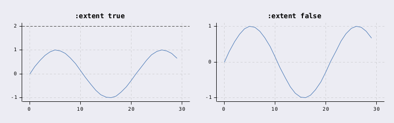
:::


### Annotation options

This option decides whether the literal positions of an annotation chart widen the scales; the rule, rect and text
charts take it. In the right panel below the rule at y = 2 lies off the panel:


```{=html}
<dl class="options"><div class="option-card"><dt><code>:extent</code><span class="option-default">Default: <code>true</code></span></dt><dd><div class="option-example"><code>(chart/rule {:extent false})</code></div><div class="option-text">Whether the chart's positions widen the scales.<ul><li><code>true</code> – The scales reach the positions.</li><li><code>false</code> – The positions don't change the scales; a position outside them lies off the panel.</li></ul></div></dd></div></dl>
```


::: {.sourceClojure}
```clojure
(plot/render-image (plot/arrange (for [extent [true false]]
                                   {:data wave
                                    :mapping {:x :t :y :v}
                                    :charts [(chart/line) (chart/rule {:y 2 :extent extent :dash :dashed})]
                                    :labels {:title (str ":extent " extent)}})
                                 {:columns 2})
                   {:width 800 :height 250})
```
:::


::: {.clay-image}
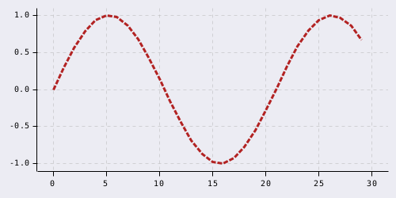
:::


### Line style

These options set the colour, width and dash of a line; the line, rule, segment, smooth, density, ecdf, function,
contour and parallel charts take them. The plot below draws a thick red dashed line:


```{=html}
<dl class="options"><div class="option-card"><dt><code>:color</code><span class="option-default">Default: The chart's theme style.</span></dt><dd><div class="option-example"><code>(chart/line {:color :black})</code></div><div class="option-text">The colour of the line; a mapped <code>:color</code> wins.<ul><li><code>:none</code> – Draws nothing.</li><li><a href="reference.types.html#solid-colour">solid colour</a> – This colour, e.g. <code>:black</code>.</li></ul></div></dd></div><div class="option-card"><dt><code>:line-width</code><span class="option-default">Default: The chart's theme style.</span></dt><dd><div class="option-example"><code>(chart/line {:line-width 4})</code></div><div class="option-text">The width of the line in pixels.<ul><li><a href="reference.types.html#non-negative-number">non-negative number</a></li></ul></div></dd></div><div class="option-card"><dt><code>:dash</code><span class="option-default">Default: The chart's theme style.</span></dt><dd><div class="option-example"><code>(chart/line {:dash :dashed})</code></div><div class="option-text">The dash style of the line; a mapped <code>:dash</code> wins.<ul><li><a href="reference.types.html#dash">dash</a></li></ul></div></dd></div></dl>
```


::: {.sourceClojure}
```clojure
(plot/render-image {:data wave
                    :mapping {:x :t :y :v}
                    :charts [(chart/line {:color [178 34 34] :line-width 3 :dash [6 2]})]}
                   {:width 500 :height 250})
```
:::


::: {.clay-image}

:::


The plot below draws every built-in dash style; a dash may also be a vector of dash and gap lengths, as above:


::: {.sourceClojure}
```clojure
(plot/render-image {:charts (vec (mapcat (fn [i d]
                                           [(chart/rule {:y i :dash d :line-width 2})
                                            (chart/text {:x 0 :y i :text (str d) :anchor [:left :bottom]})])
                                         (range 1 100) (:dash describe/attribute-values)))
                    :scales {:x {:domain [0 1] :axis false} :y {:domain [0 9] :reverse true :axis false}}}
                   {:width 500 :height 320})
```
:::


::: {.clay-image}

:::


### Curves

These options shape the line between data points, straight or interpolated, and set how densely the chart samples
it; the line chart takes them, the ribbon all but `:curve`. The panels below draw four interpolators through the
points:


```{=html}
<dl class="options"><div class="option-card"><dt><code>:interpolator</code><span class="option-default">Default: None: straight segments.</span></dt><dd><div class="option-example"><code>(chart/line {:interpolator :cubic})</code></div><div class="option-text">The curve the line follows between its data points, fitted as a function of x.<ul><li><a href="reference.types.html#interpolator">interpolator</a></li></ul></div></dd></div><div class="option-card"><dt><code>:interpolator-params</code><span class="option-default">Default: None.</span></dt><dd><div class="option-example"><code>(chart/line {:interpolator :loess, :interpolator-params [{:bandwidth 0.9}]})</code></div><div class="option-text">Extra arguments the interpolation method takes after the points, e.g. its options map or a kernel.<ul><li><span>vector of any values</span></li></ul></div></dd></div><div class="option-card"><dt><code>:curve</code><span class="option-default">Default: None: the line is a function of x.</span></dt><dd><div class="option-example"><code>(chart/line {:curve :parametric})</code></div><div class="option-text">A path curve through the points in their order instead of a function of x, for loops and connected scatters.<ul><li><code>:parametric</code> – Both coordinates interpolated by <code>:interpolator</code> (default <code>:cubic</code>) over the path's length, so the curve passes through every point.</li><li><code>:bezier</code> – A Bezier path through the points; it can't take <code>:interpolator</code>.</li></ul></div></dd></div><div class="option-card"><dt><code>:sample-step</code><span class="option-default">Default: <code>1.0</code></span></dt><dd><div class="option-example"><code>(chart/line {:interpolator :cubic, :sample-step {:count 4}})</code></div><div class="option-text">How densely the chart samples an interpolated curve.<ul><li><a href="reference.types.html#sample-step">sample step</a></li></ul></div></dd></div></dl>
```


::: {.sourceClojure}
```clojure
(plot/render-image (plot/arrange (for [interpolator [:linear :monotone :cubic :step]]
                                   {:data points
                                    :mapping {:x :x :y :y}
                                    :charts [(chart/line {:interpolator interpolator}) (chart/scatter)]
                                    :labels {:title (str ":interpolator " interpolator)}})
                                 {:columns 4})
                   {:width 1000 :height 260})
```
:::


::: {.clay-image}
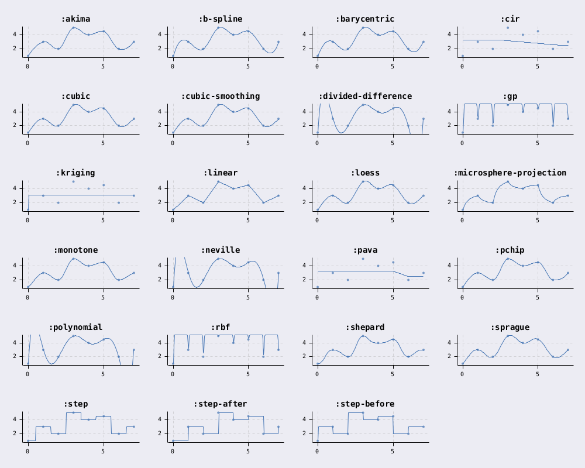
:::


The panels below draw every interpolation method (`schema/interpolation-methods`) through the same points with
default parameters. Most pass through the points or smooth them. `:pava` and `:cir` fit a monotone curve: `:pava`
joins flat runs by steps, `:cir` slopes between them. `:kriging` stays near a constant; a seeded search fits its
variogram to the points, so every render draws the same curve. `:gp` and `:rbf` use a kernel too narrow for points
this far apart:


::: {.sourceClojure}
```clojure
(plot/render-image (plot/arrange (for [interpolator (sort schema/interpolation-methods)]
                                   {:data points
                                    :mapping {:x :x :y :y}
                                    :charts [(chart/line {:interpolator interpolator}) (chart/scatter {:size 4})]
                                    :labels {:title (str interpolator)}})
                                 {:columns 4})
                   {:width 1000 :height 800})
```
:::


::: {.clay-image}
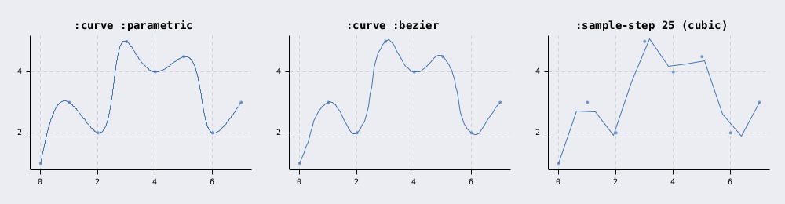
:::


`:gp` and `:rbf` take a fastmath kernel in `:interpolator-params`. The chart fits a curve in pixels along the
line's horizontal axis, so the kernel's width is in pixels. The panels below take 60, a bit more than the gap
between the points:


::: {.sourceClojure}
```clojure
(plot/render-image (plot/arrange [{:data points
                                   :mapping {:x :x :y :y}
                                   :charts [(chart/line {:interpolator :gp :interpolator-params [(k/kernel :gaussian {:sigma 60.0})]})
                                            (chart/scatter {:size 4})]
                                   :labels {:title ":gp, gaussian kernel sigma 60"}}
                                  {:data points
                                   :mapping {:x :x :y :y}
                                   :charts [(chart/line {:interpolator :rbf :interpolator-params [(k/rbf :gaussian {:scale 60.0})]})
                                            (chart/scatter {:size 4})]
                                   :labels {:title ":rbf, gaussian scale 60"}}]
                                 {:columns 2})
                   {:width 800 :height 280})
```
:::


::: {.clay-image}
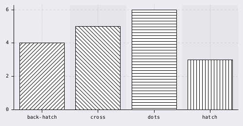
:::


The panels below draw both `:curve` kinds, then a coarse `:sample-step` that shows the samples:


::: {.sourceClojure}
```clojure
(plot/render-image (plot/arrange (for [[title opts] [[":curve :parametric" {:curve :parametric}]
                                                     [":curve :bezier" {:curve :bezier}]
                                                     [":sample-step 25 (cubic)" {:interpolator :cubic :sample-step 25}]]]
                                   {:data points
                                    :mapping {:x :x :y :y}
                                    :charts [(chart/line opts) (chart/scatter {:size 4})]
                                    :labels {:title title}})
                                 {:columns 3})
                   {:width 1000 :height 260})
```
:::


::: {.clay-image}
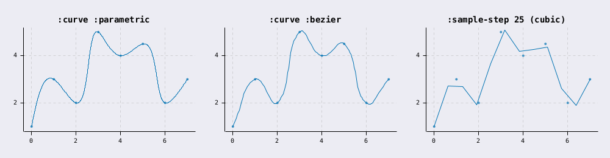
:::


### Fill patterns

These options draw a pattern over a filled mark; bars, areas, boxes and the hierarchy charts take them. The plot
below draws a bar per pattern:


```{=html}
<dl class="options"><div class="option-card"><dt><code>:pattern</code><span class="option-default">Default: The chart's theme style.</span></dt><dd><div class="option-example"><code>(chart/bar {:pattern :hatch})</code></div><div class="option-text">The pattern drawn over the fill; a mapped <code>:pattern</code> wins.<ul><li><a href="reference.types.html#fill-pattern">fill pattern</a></li></ul></div></dd></div><div class="option-card"><dt><code>:pattern-color</code><span class="option-default">Default: The chart's theme style.</span></dt><dd><div class="option-example"><code>(chart/bar {:pattern :hatch, :pattern-color :black})</code></div><div class="option-text">The colour of the pattern's ink.<ul><li><code>:darker</code> – The fill colour, darkened.</li><li><code>:none</code> – No pattern.</li><li><a href="reference.types.html#solid-colour">solid colour</a> – This colour, e.g. <code>:white</code>.</li></ul></div></dd></div></dl>
```


::: {.sourceClojure}
```clojure
(plot/render-image {:data (for [[i p] (map-indexed vector [:hatch :back-hatch :cross :dots])] {:p (name p) :v (+ 3 i)})
                    :mapping {:x :p :y :v :pattern :p}
                    :charts [(chart/bar {:color :white :stroke-color :black :pattern-color :black})]
                    :legend false}
                   {:width 500 :height 260})
```
:::


::: {.clay-image}
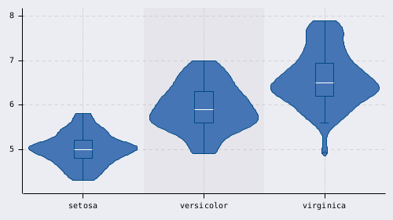
:::


### Rounded corners

These options round the corners of bars and rectangles: all of them, or only those at a bar's value end; the bar,
histogram and rect charts take them. The plot below rounds the value ends:


```{=html}
<dl class="options"><div class="option-card"><dt><code>:corner-radius</code><span class="option-default">Default: <code>0</code></span></dt><dd><div class="option-example"><code>(chart/bar {:corner-radius 6})</code></div><div class="option-text">The radius in pixels of every corner of a bar or rectangle; 0 keeps the corners square.<ul><li><a href="reference.types.html#non-negative-number">non-negative number</a></li></ul></div></dd></div><div class="option-card"><dt><code>:corner-radius-end</code><span class="option-default">Default: The corners of <code>:corner-radius</code>.</span></dt><dd><div class="option-example"><code>(chart/bar {:corner-radius-end 6})</code></div><div class="option-text">The radius in pixels of only the corners at a bar's value end; it wins over <code>:corner-radius</code>.<ul><li><a href="reference.types.html#non-negative-number">non-negative number</a></li></ul></div></dd></div></dl>
```


::: {.sourceClojure}
```clojure
(plot/render-image {:data counts
                    :mapping {:x :k :y :v :color :g}
                    :charts [(chart/bar {:corner-radius-end 8})]}
                   {:width 500 :height 260})
```
:::


::: {.clay-image}
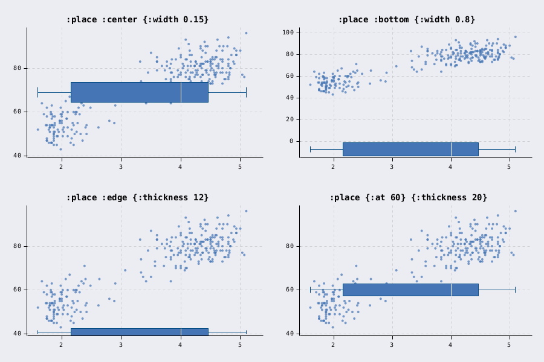
:::


### Strip options

These options place the items of strip charts, which draw one item per level of a categorical axis: bar, box,
violin, stripplot, beeswarm, dotplot, rug, bullet and extent.


#### Placement

These options set where the items sit across the value axis, how wide they are and which axis holds the levels.
The plot below draws narrow boxes over wide violins:


```{=html}
<dl class="options"><div class="option-card"><dt><code>:place</code><span class="option-default">Default: <code>:band</code> with a level mapping, else the chart's own: <code>:center</code> for most, <code>:edge</code> for the rug.</span></dt><dd><div class="option-example"><code>(chart/box {:place :bottom})</code></div><div class="option-text">Where the items sit across the value axis.<ul><li><code>:band</code> – A band per level of the level axis.</li><li><code>:bottom</code> – Between the panel's edge and 0, below the data.</li><li><code>:center</code> – Across the middle of the panel.</li><li><code>:edge</code> – Along the panel's edge, <code>:thickness</code> pixels thick.</li><li><span><code>{:at v}</code></span> – Centred on v of the numeric scale across the value axis, <code>:thickness</code> pixels thick.</li></ul></div></dd></div><div class="option-card"><dt><code>:width</code><span class="option-default">Default: <code>0.8</code></span></dt><dd><div class="option-example"><code>(chart/box {:width 0.3})</code></div><div class="option-text">The fraction an item spans across the value axis: of the level's band, of the panel for <code>:center</code>, of the room between the panel's edge and 0 for <code>:bottom</code>.<ul><li><a href="reference.types.html#non-negative-number">non-negative number</a></li></ul></div></dd></div><div class="option-card"><dt><code>:thickness</code><span class="option-default">Default: <code>20</code> pixels for <code>{:at v}</code>, <code>8</code> for <code>:edge</code>.</span></dt><dd><div class="option-example"><code>(chart/box {:place {:at 1}, :thickness 40})</code></div><div class="option-text">The thickness of an item in pixels with <code>:place {:at v}</code> or <code>:edge</code>.<ul><li><a href="reference.types.html#non-negative-number">non-negative number</a></li></ul></div></dd></div><div class="option-card"><dt><code>:bottom-share</code><span class="option-default">Default: <code>0.15</code> with <code>:place :bottom</code>.</span></dt><dd><div class="option-example"><code>(chart/box {:place :bottom, :bottom-share 0.5})</code></div><div class="option-text">The room below the data with <code>:place :bottom</code>, a fraction of the y data span.<ul><li><a href="reference.types.html#fraction">fraction</a></li></ul></div></dd></div><div class="option-card"><dt><code>:level-axis</code><span class="option-default">Default: The mapping's categorical axis; with neither, <code>:x</code> when only <code>:y</code> is mapped, else <code>:y</code>.</span></dt><dd><div class="option-text">The mapping axis that holds the levels; it decides when both or neither of <code>:x</code> and <code>:y</code> are categorical.<ul><li><code>:x</code> – The levels along x, values along y.</li><li><code>:y</code> – The levels along y, values along x.</li></ul></div></dd></div></dl>
```


::: {.sourceClojure}
```clojure
(plot/render-image {:data iris
                    :mapping {:x :species :y :sepal-length}
                    :charts [(chart/violin {:width 0.9}) (chart/box {:width 0.15})]}
                   {:width 500 :height 280})
```
:::


::: {.clay-image}

:::


Without levels an item sits where `:place` puts it. The panels below draw a box of the eruption times over the
scatter in each place:


::: {.sourceClojure}
```clojure
(plot/render-image (plot/arrange (for [[place opts] [[:center {:width 0.15}] [:bottom {:width 0.8}]
                                                     [:edge {:thickness 12}] [{:at 60} {:thickness 20}]]]
                                   {:data faithful
                                    :mapping {:x :eruptions :y :waiting}
                                    :charts [(chart/scatter {:size 4}) (chart/box (merge {:place place :mapping {:y nil}} opts))]
                                    :labels {:title (str ":place " place " " opts)}})
                                 {:columns 2})
                   {:width 900 :height 600})
```
:::


::: {.clay-image}

:::


In the plot below the rounded petal widths on y are declared categorical, so they hold the levels, with a strip of
sepal lengths at each; `:level-axis :y` only states the default. The
[stripplot](reference.charts_per_level.html#strip-plots)'s seeded `:jitter` spreads the points across the band:


::: {.sourceClojure}
```clojure
(plot/render-image {:data iris
                    :mapping {:x :sepal-length :y (levels/categorical #(m/round (:petal-width %)))}
                    :charts [(chart/stripplot {:level-axis :y :jitter 0.3 :rng (r/rng :mersenne 5)})]
                    :labels {:x "sepal length" :y "petal width, rounded"}}
                   {:width 500 :height 280})
```
:::


::: {.clay-image}

:::


#### Groups

These options set how the groups of one level share its band. The plot below dodges the boxes of narrow and wide
petals with a wide gap:


```{=html}
<dl class="options"><div class="option-card"><dt><code>:position</code><span class="option-default">Default: <code>:dodge</code> when a level holds two or more groups, else <code>:overlay</code>; a dotplot defaults to <code>:overlay</code>.</span></dt><dd><div class="option-example"><code>(chart/box {:mapping {:color :g}, :position :overlay})</code></div><div class="option-text">How the groups of one level share its band.<ul><li><code>:dodge</code> – Side by side.</li><li><code>:mirror</code> – Two groups, one half of the band each.</li><li><code>:overlay</code> – On top of each other.</li></ul></div></dd></div><div class="option-card"><dt><code>:dodge-gap</code><span class="option-default">Default: <code>0.1</code></span></dt><dd><div class="option-example"><code>(chart/box {:mapping {:color :g}, :position :dodge, :dodge-gap 0.5})</code></div><div class="option-text">The gap between dodged groups, a fraction of a group's part of the band.<ul><li><a href="reference.types.html#fraction">fraction</a></li></ul></div></dd></div></dl>
```


::: {.sourceClojure}
```clojure
(plot/render-image {:data iris
                    :mapping {:x :species :y :sepal-length :color #(if (< (:petal-width %) 1.3) "narrow" "wide")}
                    :charts [(chart/box {:position :dodge :dodge-gap 0.3})]}
                   {:width 500 :height 260})
```
:::


::: {.clay-image}

:::


#### Counts

These options write each item's row count past its largest value. The plot below counts the flowers per species:


```{=html}
<dl class="options"><div class="option-card"><dt><code>:n-label</code><span class="option-default">Default: <code>false</code></span></dt><dd><div class="option-example"><code>(chart/box {:n-label true})</code></div><div class="option-text">Whether each item shows its row count just past its largest value.<ul><li><code>false</code> – No count labels.</li><li><code>true</code> – A count label per item.</li></ul></div></dd></div><div class="option-card"><dt><code>:n-format</code><span class="option-default">Default: <code>"n=%d"</code></span></dt><dd><div class="option-example"><code>(chart/box {:n-label true, :n-format "%d rows"})</code></div><div class="option-text">The text of the count labels: a format string or a function of the count.<ul><li><a href="reference.types.html#count-format">count format</a></li></ul></div></dd></div></dl>
```


::: {.sourceClojure}
```clojure
(plot/render-image {:data iris
                    :mapping {:x :species :y :petal-length}
                    :charts [(chart/box {:n-label true :n-format "%d flowers"})]}
                   {:width 500 :height 280})
```
:::


::: {.clay-image}

:::


### Mirrored strips

This option draws two groups on the two sides of the value axis, as in a population pyramid; the bar and extent
charts take it. The plot below mirrors flipped bars:


```{=html}
<dl class="options"><div class="option-card"><dt><code>:mirror</code><span class="option-default">Default: None: no group is mirrored.</span></dt><dd><div class="option-example"><code>(chart/bar {:position :dodge, :mirror :group})</code></div><div class="option-text">A grouping dimension with exactly two levels: the chart draws the second level's items on the negative side.<ul><li><code>:color</code> – The mapped <code>:color</code>.</li><li><code>:shape</code> – The mapped <code>:shape</code>.</li><li><code>:size</code> – The mapped <code>:size</code>.</li><li><code>:dash</code> – The mapped <code>:dash</code>.</li><li><code>:pattern</code> – The mapped <code>:pattern</code>.</li><li><code>:group</code> – The mapped <code>:group</code>.</li></ul></div></dd></div></dl>
```


::: {.sourceClojure}
```clojure
(plot/render-image {:data counts
                    :mapping {:x :k :y :v :color :g}
                    :charts [(chart/bar {:mirror :color})]
                    :flip true
                    :scales {:x {:reverse true}}}
                   {:width 500 :height 260})
```
:::


::: {.clay-image}

:::


The panels below mirror upright bars and the intervals of a range chart; the second group's items lie below the
axis:


::: {.sourceClojure}
```clojure
(plot/render-image (plot/arrange [{:data counts
                                   :mapping {:x :k :y :v :color :g}
                                   :charts [(chart/bar {:mirror :color})]
                                   :labels {:title "bar, :mirror :color"}}
                                  {:data iris
                                   :mapping {:x :species :y :sepal-length :color #(if (< (:petal-width %) 1.3) "narrow" "wide")}
                                   :charts [(chart/extent {:mirror :color})]
                                   :labels {:title "extent, :mirror :color"}}]
                                 {:columns 2})
                   {:width 900 :height 300})
```
:::


::: {.clay-image}

:::


### Ridgelines

This option sets how far ridgelines overlap, the rows of histograms or densities drawn per level of a categorical
axis; the histogram and density charts take it. The plot below overlaps the species' densities:


```{=html}
<dl class="options"><div class="option-card"><dt><code>:overlap</code><span class="option-default">Default: <code>0.9</code></span></dt><dd><div class="option-example"><code>(chart/density {:mapping {:y :level}, :overlap 2})</code></div><div class="option-text">The height of the tallest ridge in band steps; above 1 the ridges overlap the next level.<ul><li><a href="reference.types.html#non-negative-number">non-negative number</a></li></ul></div></dd></div></dl>
```


::: {.sourceClojure}
```clojure
(plot/render-image {:data iris
                    :mapping {:x :sepal-length :y :species :color :species}
                    :charts [(chart/density {:overlap 1.8 :fill :color :alpha 0.7})]
                    :scales {:y {:reverse true}}
                    :legend false}
                   {:width 500 :height 300})
```
:::


::: {.clay-image}
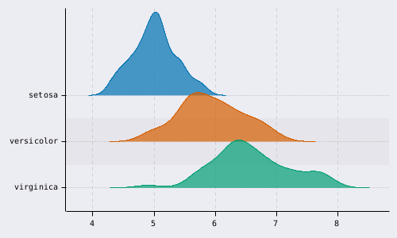
:::


### Cell style

These options set the shape, size and outline of the cells of grid-cell charts; the tile and bin2d charts take
them. The panels below bin the same points in every cell type:


```{=html}
<dl class="options"><div class="option-card"><dt><code>:cell</code><span class="option-default">Default: The chart's theme style.</span></dt><dd><div class="option-example"><code>(chart/tile {:cell :pointy-hex})</code></div><div class="option-text">The shape of the grid cells, a fastmath grid cell type.<ul><li><code>:square</code> – Squares.</li><li><code>:shifted-square</code> – Squares, every second row shifted half a cell.</li><li><code>:triangle</code> – Triangles.</li><li><code>:rhombus</code> – Rhombi.</li><li><code>:flat-hex</code> – Hexagons with a flat top.</li><li><code>:pointy-hex</code> – Hexagons with a pointed top.</li></ul></div></dd></div><div class="option-card"><dt><code>:cell-scale</code><span class="option-default">Default: The chart's theme style.</span></dt><dd><div class="option-example"><code>(chart/tile {:cell-scale 0.7})</code></div><div class="option-text">The size of a cell's polygon relative to its grid cell; smaller values leave gaps.<ul><li><span>finite number above 0 and at most 1</span></li></ul></div></dd></div><div class="option-card"><dt><code>:stroke-color</code><span class="option-default">Default: The chart's theme style.</span></dt><dd><div class="option-example"><code>(chart/tile {:stroke-width 2, :stroke-color :black})</code></div><div class="option-text">The colour of the cell outlines.<ul><li><code>:darker</code> – The cell's fill colour, darkened.</li><li><code>:none</code> – No outline.</li><li><a href="reference.types.html#solid-colour">solid colour</a> – This colour, e.g. <code>:white</code>.</li></ul></div></dd></div><div class="option-card"><dt><code>:stroke-width</code><span class="option-default">Default: The chart's theme style.</span></dt><dd><div class="option-example"><code>(chart/tile {:stroke-color :black, :stroke-width 3})</code></div><div class="option-text">The width of the cell outlines in pixels; 0 draws none.<ul><li><a href="reference.types.html#non-negative-number">non-negative number</a></li></ul></div></dd></div><div class="option-card"><dt><code>:alpha-factor</code><span class="option-default">Default: The chart's theme style.</span></dt><dd><div class="option-example"><code>(chart/tile {:alpha-factor 0.4})</code></div><div class="option-text">A factor multiplying the alpha of the fill colours: 1 keeps them, smaller values fade them.<ul><li><a href="reference.types.html#fraction">fraction</a></li></ul></div></dd></div></dl>
```


::: {.sourceClojure}
```clojure
(plot/render-image (plot/arrange (for [cell (:cell describe/attribute-values)]
                                   {:data iris
                                    :mapping {:x :sepal-length :y :sepal-width}
                                    :charts [(chart/bin2d {:cell cell :stroke-color :white})]
                                    :labels {:title (str ":cell " cell)}
                                    :legend false})
                                 {:columns 3})
                   {:width 900 :height 560})
```
:::


::: {.clay-image}
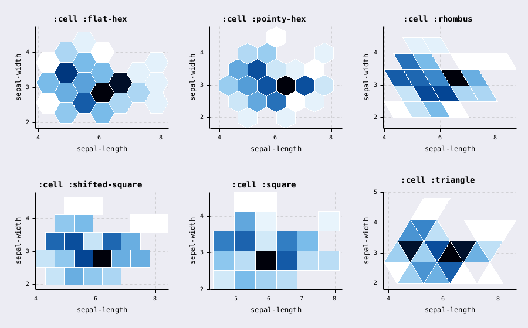
:::


### Fields

These options give the scalar field that the field and contour charts draw: a function, a kernel density estimate
of mapped points, or gridded data.


#### A function

These options give the field as a function of a point over a domain. The plot below draws contours of a function:


```{=html}
<dl class="options"><div class="option-card"><dt><code>:f</code><span class="option-default">Default: None: the field comes from the mapped data.</span></dt><dd><div class="option-example"><code>(chart/field {:domain {:x [-2 2], :y [-2 2]}, :f (fn [[x y]] (m/sin (m/* x y)))})</code></div><div class="option-text">The field as a function of a point <code>[x y]</code> that returns a number, instead of mapped data.<ul><li><a href="reference.types.html#function">function</a></li></ul></div></dd></div><div class="option-card"><dt><code>:domain</code><span class="option-default">Default: The plot's explicit <code>:x</code> and <code>:y</code> scale domains.</span></dt><dd><div class="option-text">The domain over which the chart samples a function field.</div></dd></div><div class="option-card"><dt><code>:domain :x</code></dt><dd><div class="option-example"><code>(chart/field {:f (fn [[x y]] (m/sin (m/* x y))), :domain {:x [-1 1], :y [-2 2]}})</code></div><div class="option-text">The x domain <code>[lo hi]</code>.<ul><li><span>pair of finite numbers</span></li></ul></div></dd></div><div class="option-card"><dt><code>:domain :y</code></dt><dd><div class="option-example"><code>(chart/field {:f (fn [[x y]] (m/sin (m/* x y))), :domain {:x [-2 2], :y [-1 1]}})</code></div><div class="option-text">The y domain <code>[lo hi]</code>.<ul><li><span>pair of finite numbers</span></li></ul></div></dd></div></dl>
```


::: {.sourceClojure}
```clojure
(plot/render-image {:charts [(chart/contour {:f (fn [[x y]] (+ (* x x) (* 2 y y))) :domain {:x [-2 2] :y [-2 2]}})]}
                   {:width 450 :height 350})
```
:::


::: {.clay-image}

:::


#### A density estimate

These options set the kernel density estimate of mapped points. The plot below draws the estimate of the iris
sepals:


```{=html}
<dl class="options"><div class="option-card"><dt><code>:kernel</code><span class="option-default">Default: <code>:gaussian</code></span></dt><dd><div class="option-example"><code>(chart/field {:kernel :epanechnikov})</code></div><div class="option-text">The kernel of the 2D density estimate of mapped points.<ul><li><code>:gaussian</code> – The normal curve; smooth, with long tails.</li><li><code>:epanechnikov</code> – A parabola, the most efficient kernel in theory.</li><li><code>:triangular</code> – A triangle.</li><li><code>:uniform</code> – A flat step: a moving count.</li><li class="option-other">Other fastmath kernels. <code>:cauchy</code>, <code>:cosine</code>, <code>:laplace</code>, <code>:logistic</code>, <code>:quartic</code>, <code>:sigmoid</code>, <code>:silverman</code>, <code>:tricube</code>, <code>:triweight</code>, <code>:wigner</code></li></ul></div></dd></div><div class="option-card"><dt><code>:bandwidth</code><span class="option-default">Default: <code>:nrd</code> on each axis, as R <code>MASS::kde2d</code> and ggplot2.</span></dt><dd><div class="option-example"><code>(chart/field {:bandwidth 0.3})</code></div><div class="option-text">The bandwidth of the density estimate: how far each point's kernel spreads.<ul><li><code>:nrd0</code> – Silverman's rule of thumb, R's default.</li><li><code>:nrd</code> – Scott's rule of thumb, wider than <code>:nrd0</code>.</li><li><code>:sj</code> – Sheather and Jones' plug-in selector, good for multimodal data.</li><li><code>:scott</code> – Scott's rule for two dimensions.</li><li class="option-other">Other fastmath selectors: rule-of-thumb, plug-in and cross-validation variants. <code>:nrd-adjust</code>, <code>:sj-dpi</code>, <code>:lscv</code>, <code>:lcv</code>, <code>:rlcv</code></li><li><a href="reference.types.html#positive-finite-number">positive finite number</a> – A bandwidth in data units on both axes, e.g. <code>0.3</code>; in log10 units on a <code>:log</code> axis.</li><li><span>pair of (positive finite number or bandwidth rule or :scott)</span> – A bandwidth for x and one for y, each a number or a selector.</li></ul></div></dd></div><div class="option-card"><dt><code>:binned</code><span class="option-default">Default: <code>false</code></span></dt><dd><div class="option-example"><code>(chart/field {:binned true})</code></div><div class="option-text">Whether the estimate uses binned points, faster for many points.<ul><li><code>false</code> – Every point.</li><li><code>true</code> – The binned points, an approximation.</li></ul></div></dd></div><div class="option-card"><dt><code>:cut</code><span class="option-default">Default: <code>3</code></span></dt><dd><div class="option-example"><code>(chart/field {:cut 0})</code></div><div class="option-text">How far the density's domain reaches past the points on each side, in bandwidths.<ul><li><a href="reference.types.html#non-negative-finite-number">non-negative finite number</a></li></ul></div></dd></div></dl>
```


::: {.sourceClojure}
```clojure
(plot/render-image {:data iris
                    :mapping {:x :sepal-length :y :sepal-width}
                    :charts [(chart/field {:kernel :epanechnikov :bandwidth 0.4}) (chart/scatter {:size 3})]}
                   {:width 450 :height 350})
```
:::


::: {.clay-image}

:::


#### The grid

These options set the grid the chart samples and how it interpolates gridded data. The plot below samples a
function on a coarse grid:


```{=html}
<dl class="options"><div class="option-card"><dt><code>:interpolation</code><span class="option-default">Default: <code>:bilinear</code></span></dt><dd><div class="option-example"><code>(chart/field {:interpolation :bicubic})</code></div><div class="option-text">How the chart interpolates gridded data: mapped <code>:x</code>, <code>:y</code> and <code>:value</code> on a full lattice.<ul><li><code>:bilinear</code> – Bilinear within each lattice cell: continuous and fast, with creases at the cell edges.</li><li><code>:bicubic</code> – Cubic along each axis; smooth.</li><li><code>:cubic-2d</code> – A smooth 2D cubic spline.</li></ul></div></dd></div><div class="option-card"><dt><code>:n</code><span class="option-default">Default: <code>100</code></span></dt><dd><div class="option-example"><code>(chart/field {:n 8})</code></div><div class="option-text">The number of values the chart samples along each axis.<ul><li><span>integer at least 2 and at most 2000</span> – The same count along both axes.</li><li><span>pair of (integer at least 2 and at most 2000)</span> – The counts <code>[nx ny]</code> along x and y.</li></ul></div></dd></div></dl>
```


::: {.sourceClojure}
```clojure
(plot/render-image {:charts [(chart/field {:f (fn [[x y]] (m/sin (m/* x y))) :domain {:x [0 3] :y [0 3]} :n 12})]}
                   {:width 450 :height 350})
```
:::


::: {.clay-image}

:::


### Hierarchy labels

These options switch the group and leaf labels on or off, or write them with a function; the treemap, partition
and pack charts take them. The plot below drops the group labels and writes each leaf's value:


```{=html}
<dl class="options"><div class="option-card"><dt><code>:group-labels</code><span class="option-default">Default: <code>true</code></span></dt><dd><div class="option-example"><code>(chart/treemap {:group-labels false})</code></div><div class="option-text">The labels of the groups.<ul><li><code>true</code> – The group's name.</li><li><code>false</code> – No group labels.</li><li><a href="reference.types.html#function">function</a> – A function of the node <code>{:name :value :depth :path :share :parent-share}</code> that returns the label text.</li></ul></div></dd></div><div class="option-card"><dt><code>:leaf-labels</code><span class="option-default">Default: <code>true</code></span></dt><dd><div class="option-example"><code>(chart/treemap {:leaf-labels false})</code></div><div class="option-text">The labels of the leaves, as <code>:group-labels</code> for groups.<ul><li><code>true</code> – The leaf's name.</li><li><code>false</code> – No leaf labels.</li><li><a href="reference.types.html#function">function</a> – A function of the node <code>{:name :value :depth :path :share :parent-share}</code> that returns the label text.</li></ul></div></dd></div></dl>
```


::: {.sourceClojure}
```clojure
(plot/render-image {:data budget
                    :mapping {:hierarchy [:dept :team] :value :cost}
                    :charts [(chart/treemap {:group-labels false :leaf-labels #(str (:name %) " " (:value %))})]}
                   {:width 500 :height 300})
```
:::


::: {.clay-image}
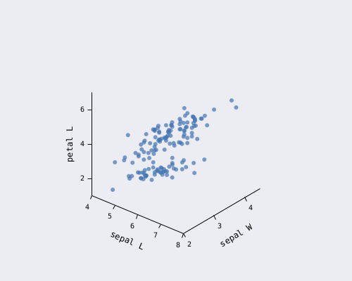
:::


### 3D frame

These options set the box in which the 3D charts, cloud and surface, draw their data.


#### View

These options place the eye and shape the box. The plot below turns the cloud and flattens its box:


```{=html}
<dl class="options"><div class="option-card"><dt><code>:view</code></dt><dd><div class="option-text">The eye's position: its azimuth, elevation and perspective distance.</div></dd></div><div class="option-card"><dt><code>:view :azimuth</code><span class="option-default">Default: <code>40.0</code></span></dt><dd><div class="option-example"><code>(chart/surface {:view {:azimuth 120}})</code></div><div class="option-text">The rotation around the vertical axis in degrees.<ul><li><a href="reference.types.html#finite-number">finite number</a></li></ul></div></dd></div><div class="option-card"><dt><code>:view :elevation</code><span class="option-default">Default: <code>30.0</code></span></dt><dd><div class="option-example"><code>(chart/surface {:view {:elevation 70}})</code></div><div class="option-text">The angle of the eye above the floor in degrees.<ul><li><span>finite number at least -90 and at most 90</span></li></ul></div></dd></div><div class="option-card"><dt><code>:view :distance</code><span class="option-default">Default: <code>0.0</code></span></dt><dd><div class="option-example"><code>(chart/surface {:view {:distance 0.8}})</code></div><div class="option-text">The perspective, as lattice's distance: 0 projects in parallel, larger values strengthen the perspective.<ul><li><a href="reference.types.html#non-negative-finite-number">non-negative finite number</a></li></ul></div></dd></div><div class="option-card"><dt><code>:aspect</code><span class="option-default">Default: <code>[1 1 1]</code></span></dt><dd><div class="option-example"><code>(chart/surface {:aspect [2 1 1]})</code></div><div class="option-text">The box's proportions <code>[ax ay az]</code>.<ul><li><span>[positive number, positive number, positive number]</span></li></ul></div></dd></div><div class="option-card"><dt><code>:reverse</code><span class="option-default">Default: None.</span></dt><dd><div class="option-example"><code>(chart/surface {:reverse #{:x}})</code></div><div class="option-text">The axes that run the other way, mirroring the scene.<ul><li><span>set of (<code>:x</code> or <code>:y</code> or <code>:z</code>)</span></li></ul></div></dd></div></dl>
```


::: {.sourceClojure}
```clojure
(plot/render-image {:data iris
                    :mapping {:x :sepal-length :y :sepal-width :z :petal-length :color :species}
                    :charts [(chart/cloud {:view {:azimuth 60 :elevation 20 :distance 0.3} :aspect [1 1 0.6]})]}
                   {:width 500 :height 400})
```
:::


::: {.clay-image}

:::


#### Axes

These options draw the box, the ticks and the axis titles. The plot below drops the box and names the axes:


```{=html}
<dl class="options"><div class="option-card"><dt><code>:box</code><span class="option-default">Default: <code>true</code></span></dt><dd><div class="option-example"><code>(chart/surface {:box false})</code></div><div class="option-text">Whether the chart draws the box: hidden edges dashed and a floor grid behind the data, visible edges over it.<ul><li><code>true</code> – The box and the floor grid.</li><li><code>false</code> – No box.</li></ul></div></dd></div><div class="option-card"><dt><code>:axes</code><span class="option-default">Default: <code>true</code></span></dt><dd><div class="option-example"><code>(chart/surface {:axes false})</code></div><div class="option-text">Whether the chart draws the ticks, tick labels and axis titles.<ul><li><code>true</code> – Ticks, labels and titles.</li><li><code>false</code> – None of them.</li></ul></div></dd></div><div class="option-card"><dt><code>:axis-titles</code><span class="option-default">Default: The mapped column names; a binned cloud's z reads <code>Count</code>, a density surface's <code>Density</code>.</span></dt><dd><div class="option-text">The axis titles; <code>nil</code> draws none.</div></dd></div><div class="option-card"><dt><code>:axis-titles :x</code><span class="option-default">Default: None when the map leaves it out; without <code>:axis-titles</code>, the mapped column's name.</span></dt><dd><div class="option-example"><code>(chart/surface {:axis-titles {:x "east"}})</code></div><div class="option-text">The x axis title.<ul><li><span>any value</span></li></ul></div></dd></div><div class="option-card"><dt><code>:axis-titles :y</code><span class="option-default">Default: None when the map leaves it out; without <code>:axis-titles</code>, the mapped column's name.</span></dt><dd><div class="option-example"><code>(chart/surface {:axis-titles {:y "north"}})</code></div><div class="option-text">The y axis title.<ul><li><span>any value</span></li></ul></div></dd></div><div class="option-card"><dt><code>:axis-titles :z</code><span class="option-default">Default: None when the map leaves it out; without <code>:axis-titles</code>, the mapped column's name.</span></dt><dd><div class="option-example"><code>(chart/surface {:axis-titles {:z "height"}})</code></div><div class="option-text">The z axis title.<ul><li><span>any value</span></li></ul></div></dd></div></dl>
```


::: {.sourceClojure}
```clojure
(plot/render-image {:data iris
                    :mapping {:x :sepal-length :y :sepal-width :z :petal-length}
                    :charts [(chart/cloud {:box false :axis-titles {:x "sepal L" :y "sepal W" :z "petal L"}})]}
                   {:width 500 :height 400})
```
:::


::: {.clay-image}
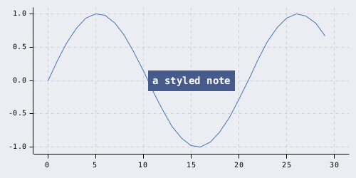
:::


#### Domains

This option fixes the domains. The plot below fixes all three:


```{=html}
<dl class="options"><div class="option-card"><dt><code>:domain</code><span class="option-default">Default: The data's ranges, rounded to nice values.</span></dt><dd><div class="option-text">Explicit data domains, needed by each of several 3D charts in one plot and by a surface of <code>:f</code> (<code>:x</code> and <code>:y</code>).</div></dd></div><div class="option-card"><dt><code>:domain :x</code><span class="option-default">Default: The data's range, rounded to nice values.</span></dt><dd><div class="option-example"><code>(chart/surface {:domain {:x [5 -5]}})</code></div><div class="option-text">The x domain <code>[a b]</code>; a above b reverses the axis.<ul><li><span>pair of finite numbers</span></li></ul></div></dd></div><div class="option-card"><dt><code>:domain :y</code><span class="option-default">Default: The data's range, rounded to nice values.</span></dt><dd><div class="option-example"><code>(chart/surface {:domain {:y [5 -5]}})</code></div><div class="option-text">The y domain <code>[a b]</code>; a above b reverses the axis.<ul><li><span>pair of finite numbers</span></li></ul></div></dd></div><div class="option-card"><dt><code>:domain :z</code><span class="option-default">Default: The data's range, rounded to nice values.</span></dt><dd><div class="option-example"><code>(chart/surface {:domain {:z [5 -5]}})</code></div><div class="option-text">The z domain <code>[a b]</code>; a above b reverses the axis.<ul><li><span>pair of finite numbers</span></li></ul></div></dd></div></dl>
```


::: {.sourceClojure}
```clojure
(plot/render-image {:data iris
                    :mapping {:x :sepal-length :y :sepal-width :z :petal-length}
                    :charts [(chart/cloud {:domain {:x [4 8] :y [2 4.5] :z [0 7]}})]}
                   {:width 500 :height 400})
```
:::


::: {.clay-image}

:::


### 3D shading

These options light the shaded faces of 3D charts by Lambert's law: an ambient share of the colour plus the rest by
the face's angle to the light. The surface chart takes them for its quads and the cloud chart for its bars. The
panels below draw the default shading beside a smaller ambient share lit from the upper right, on the surface
$z = \sin(xy)$:


```{=html}
<dl class="options"><div class="option-card"><dt><code>:ambient</code><span class="option-default">Default: <code>0.4</code></span></dt><dd><div class="option-example"><code>(chart/surface {:ambient 0.9})</code></div><div class="option-text">The share of a shaded face's colour that doesn't depend on the light: 0 is light only, 1 no shading.<ul><li><a href="reference.types.html#fraction">fraction</a></li></ul></div></dd></div><div class="option-card"><dt><code>:light</code><span class="option-default">Default: <code>[-0.5 0.6 -1.0]</code></span></dt><dd><div class="option-example"><code>(chart/surface {:light [1 0 0]})</code></div><div class="option-text">The direction toward the light <code>[x y z]</code> in view coordinates: x right, y up, z away from the eye.<ul><li><span>[finite number, finite number, finite number]</span></li></ul></div></dd></div></dl>
```


::: {.sourceClojure}
```clojure
(plot/render-image (plot/arrange [{:charts [(chart/surface {:f (fn [[x y]] (m/sin (m/* x y)))
                                                            :domain {:x [-2 2] :y [-2 2]} :color [120 160 220]})]
                                   :labels {:title "default shading"}}
                                  {:charts [(chart/surface {:f (fn [[x y]] (m/sin (m/* x y)))
                                                            :domain {:x [-2 2] :y [-2 2]} :color [120 160 220]
                                                            :ambient 0.2 :light [1.0 1.0 -0.5]})]
                                   :labels {:title ":ambient 0.2 :light [1 1 -0.5]"}}]
                                 {:columns 2 :title "$z = \\sin(xy)$"})
                   {:width 800 :height 400})
```
:::


::: {.clay-image}

:::


### Text style

These options set the font, size, colour, inset, background, alignment and formula switch of a text, over its text
role (Theme chapter); label maps take them all, the text chart all but `:align`. The plot below writes a styled
note:


```{=html}
<dl class="options"><div class="option-card"><dt><code>:font</code><span class="option-default">Default: The text role's value.</span></dt><dd><div class="option-example"><code>(chart/text {:font "Serif"})</code></div><div class="option-text">The font: a bundled, installed or logical family name, or a <code>java.awt.Font</code>.<ul><li><a href="reference.types.html#font">font</a></li></ul></div></dd></div><div class="option-card"><dt><code>:size</code><span class="option-default">Default: The text role's value.</span></dt><dd><div class="option-example"><code>(chart/text {:size 20})</code></div><div class="option-text">The font size in points.<ul><li><a href="reference.types.html#positive-number">positive number</a></li></ul></div></dd></div><div class="option-card"><dt><code>:font-style</code><span class="option-default">Default: The text role's value.</span></dt><dd><div class="option-example"><code>(chart/text {:font-style :bold})</code></div><div class="option-text">The font style.<ul><li><code>:bold</code> – Bold.</li><li><code>:bold-italic</code> – Bold and italic.</li><li><code>:italic</code> – Italic.</li><li><code>:plain</code> – Upright, regular weight.</li></ul></div></dd></div><div class="option-card"><dt><code>:color</code><span class="option-default">Default: The text role's value.</span></dt><dd><div class="option-example"><code>(chart/text {:color :red})</code></div><div class="option-text">The text colour.<ul><li><code>:contrast</code> – Black or white, whichever reads better on what is behind: the text's own <code>:background</code> box, a chart's fill under its labels, else the plot background.</li><li><a href="reference.types.html#solid-colour">solid colour</a> – This colour, e.g. <code>:black</code>.</li></ul></div></dd></div><div class="option-card"><dt><code>:inset</code><span class="option-default">Default: The text role's value.</span></dt><dd><div class="option-example"><code>(chart/text {:background :yellow, :inset 8})</code></div><div class="option-text">The space in pixels between the text and its box's edge on every side.<ul><li><a href="reference.types.html#non-negative-number">non-negative number</a></li></ul></div></dd></div><div class="option-card"><dt><code>:align</code><span class="option-default">Default: The text role's value.</span></dt><dd><div class="option-text">The placement <code>[horizontal vertical]</code> of the text in its box; the horizontal part also aligns its lines. Label maps take it, the text chart doesn't.<ul><li><a href="reference.types.html#alignment">alignment</a></li></ul></div></dd></div><div class="option-card"><dt><code>:background</code><span class="option-default">Default: The text role's value.</span></dt><dd><div class="option-example"><code>(chart/text {:background :yellow})</code></div><div class="option-text">The colour of a box behind the text.<ul><li><code>:none</code> – No box.</li><li><a href="reference.types.html#solid-colour">solid colour</a> – This colour, e.g. <code>:white</code>.</li></ul></div></dd></div><div class="option-card"><dt><code>:dollar-math</code><span class="option-default">Default: The text role's value.</span></dt><dd><div class="option-example"><code>(chart/text {:text ["$x^2$ costs $5"], :dollar-math false})</code></div><div class="option-text">Whether text between two dollar signs draws as a LaTeX formula; a dollar after a backslash stays literal.<ul><li><code>true</code> – Formulas between dollars.</li><li><code>false</code> – Every dollar literal.</li></ul></div></dd></div></dl>
```


::: {.sourceClojure}
```clojure
(plot/render-image {:data wave
                    :mapping {:x :t :y :v}
                    :charts [(chart/line)
                             (chart/text {:x 15 :y 0 :text "a styled note" :size 14 :font-style :bold
                                          :color :white :background [70 90 140] :inset 6})]}
                   {:width 500 :height 250})
```
:::


::: {.clay-image}

:::


### Named theme styles

This option names a theme style `[:chart name]`, a partial style a theme defines once, merged over the chart's own
`[:chart kind]`; every chart with a theme style takes it. Builders draw with styles of their own. `build` checks the
merged style against the chart's style keys and rejects a name the theme doesn't have. The plot below draws the
highlighted points in a style named `:highlight`:


```{=html}
<dl class="options"><div class="option-card"><dt><code>:theme-style</code><span class="option-default">Default: None: the kind's style.</span></dt><dd><div class="option-example"><code>(chart/scatter {:theme-style :network-node})</code></div><div class="option-text">The name of a theme style <code>[:chart name]</code>, a builder's or one the theme adds, merged over the kind's style.<ul><li><span>keyword</span></li></ul></div></dd></div></dl>
```


::: {.sourceClojure}
```clojure
(plot/render-image {:data points
                    :mapping {:x :x :y :y}
                    :charts [(chart/scatter)
                             (chart/scatter {:data (filter #(> (:y %) 4) points) :theme-style :highlight})]
                    :theme {:chart {:highlight {:size 14 :color [215 48 39] :shape \s}}}}
                   {:width 500 :height 300})
```
:::


::: {.clay-image}

:::


## Builders


### Builder options

These options give the plot a builder returns its title, scales and theme; every builder takes the ones it uses
(`plot/arrange` no `:scales`, `plot/pairs` only `:title`). The plot below titles a sankey diagram and sets its
background:


```{=html}
<dl class="options"><div class="option-card"><dt><code>:title</code><span class="option-default">Default: No title.</span></dt><dd><div class="option-example"><code>(plot/network edges {:title "Friends"})</code></div><div class="option-text">The plot's title: a text or a label options map.<ul><li><span>any value</span></li></ul></div></dd></div><div class="option-card"><dt><code>:scales</code><span class="option-default">Default: The builder's scales.</span></dt><dd><div class="option-example"><code>(plot/network edges {:mapping {:size :degree}, :scales {:size {:range [2 20]}}})</code></div><div class="option-text">Scale specs merged at every depth into the builder's own; the built plot checks them.<ul><li><span>any value</span></li></ul></div></dd></div><div class="option-card"><dt><code>:theme</code><span class="option-default">Default: The default theme.</span></dt><dd><div class="option-example"><code>(plot/network edges {:theme {:chart {:network-node {:color :black}}}})</code></div><div class="option-text">A theme merged over the builder's own theme settings and the default theme for the built plot.<ul><li><span>any value</span></li></ul></div></dd></div></dl>
```


::: {.sourceClojure}
```clojure
(plot/render-image (plot/sankey flows {:title "Energy flows" :theme {:plot {:background :white}}})
                   {:width 500 :height 300})
```
:::


::: {.clay-image}

:::


### Multiplot layout

These options lay out the grid of `plot/arrange` and of a plot's `:arrange`: its shape, its weights and the panels'
alignment. The plot below gives a line three times the width of a box:


```{=html}
<dl class="options"><div class="option-card"><dt><code>:plots</code></dt><dd><div class="option-text">The sub-plots, filling the grid row by row; <code>plot/arrange</code> takes them as its first argument.<ul><li><span>sequence of maps</span></li></ul></div></dd></div><div class="option-card"><dt><code>:columns</code><span class="option-default">Default: One column, or as many as <code>:rows</code> needs.</span></dt><dd><div class="option-example"><code>(plot/arrange plots {:columns 2})</code></div><div class="option-text">The number of grid columns.<ul><li><a href="reference.types.html#positive-integer">positive integer</a></li></ul></div></dd></div><div class="option-card"><dt><code>:rows</code><span class="option-default">Default: As many as the plots need in <code>:columns</code>.</span></dt><dd><div class="option-example"><code>(plot/arrange plots {:rows 1})</code></div><div class="option-text">The number of grid rows.<ul><li><a href="reference.types.html#positive-integer">positive integer</a></li></ul></div></dd></div><div class="option-card"><dt><code>:widths</code><span class="option-default">Default: Equal widths.</span></dt><dd><div class="option-example"><code>(plot/arrange plots {:columns 2, :widths [3 2]})</code></div><div class="option-text">The columns' relative widths, one per column.<ul><li><span>sequence of (positive number or :measured or [:fixed, non-negative number])</span> – Per column a weight, <code>:measured</code> - the width of its legend-only plots - or <code>[:fixed px]</code>, a width in pixels.</li></ul></div></dd></div><div class="option-card"><dt><code>:heights</code><span class="option-default">Default: Equal heights.</span></dt><dd><div class="option-example"><code>(plot/arrange plots {:heights [3 1]})</code></div><div class="option-text">The rows' relative heights, one per row.<ul><li><span>sequence of (positive number or :measured or [:fixed, non-negative number])</span> – Per row a weight, <code>:measured</code> - the height of its legend-only plots, scaled down to fit - or <code>[:fixed px]</code>, a height in pixels.</li></ul></div></dd></div><div class="option-card"><dt><code>:row-spans</code><span class="option-default">Default: Every plot spans one row.</span></dt><dd><div class="option-example"><code>(plot/arrange plots {:columns 2, :row-spans {0 2}})</code></div><div class="option-text">A map from a plot's index (not its cell's) to the number of rows the plot spans from its own row down; later plots skip the covered cells.<ul><li><span>map of integer at least 0 to positive integer</span></li></ul></div></dd></div><div class="option-card"><dt><code>:align</code><span class="option-default">Default: <code>true</code></span></dt><dd><div class="option-example"><code>(plot/arrange plots {:align false})</code></div><div class="option-text">Whether the sub-plots' panels line up in rows and columns.<ul><li><code>true</code> – Panels line up.</li><li><code>false</code> – Each sub-plot fills its cell on its own.</li></ul></div></dd></div><div class="option-card"><dt><code>:equal-panels</code><span class="option-default">Default: <code>false</code></span></dt><dd><div class="option-example"><code>(plot/arrange plots {:columns 2, :equal-panels true})</code></div><div class="option-text">Whether every aligned panel gets the same size and the gaps between panels are even; the plot builds twice.<ul><li><code>false</code> – Panels as the tracks fall.</li><li><code>true</code> – Equal panels and gaps.</li></ul></div></dd></div></dl>
```


::: {.sourceClojure}
```clojure
(plot/render-image (plot/arrange [{:data wave :mapping {:x :t :y :v} :charts [(chart/line)]}
                                  {:data wave :mapping {:x :g :y :v} :charts [(chart/box)]}]
                                 {:columns 2 :widths [3 1]})
                   {:width 700 :height 250})
```
:::


::: {.clay-image}

:::


## Builders and data functions

The groups below are the options of data functions, which builders forward; each function's section documents
them:


```{=html}
<ul><li><a href="reference.data_graphs_trees.html#alluvial-graphs">Alluvial graph</a> – <code>graph/alluvial-graph</code>: <code>:variables</code> <code>:value</code> <code>:strand-color</code></li><li><a href="reference.data_graphs_trees.html#arc-layouts">Arc layout</a> – <code>graph/arc-layout</code>: <code>:order</code></li><li><a href="reference.data_sets_series.html#autocorrelation">Autocorrelation rows</a> – <code>series/acf-rows</code>: <code>:lags</code> <code>:level</code> <code>:partial</code></li><li><a href="reference.data_graphs_trees.html#chord-layouts">Chord layout</a> – <code>graph/chord-layout</code>: <code>:order</code> <code>:gap-angle</code> <code>:inner-radius</code> <code>:min-value</code></li><li><a href="reference.data_graphs_trees.html#dendrogram-layouts">Dendrogram layout</a> – <code>tree/layout</code>: <code>:k</code> <code>:circular</code> <code>:span</code></li><li><a href="reference.data_graphs_trees.html#edge-bundling">Edge bundling</a> – <code>tree/bundle-paths</code>: <code>:from</code> <code>:to</code> <code>:beta</code></li><li><a href="reference.data_graphs_trees.html#graphs">Graph</a> – <code>graph/graph</code>: <code>:from</code> <code>:to</code> <code>:value</code> <code>:nodes</code> <code>:id</code> <code>:directed</code></li><li><a href="reference.data_graphs_trees.html#network-layouts">Graph layout</a> – <code>graph/layout</code>: <code>:layout</code> <code>:iterations</code> <code>:gravity</code> <code>:rng</code></li><li><a href="reference.data_sets_series.html#horizon-bands">Horizon rows</a> – <code>series/horizon-rows</code>: <code>:x</code> <code>:y</code> <code>:series</code> <code>:bands</code> <code>:band-height</code> <code>:interpolator</code> <code>:steps-per-gap</code></li><li><a href="reference.data_graphs_trees.html#node-link-layouts">Node-link tree layout</a> – <code>tree/node-link-layout</code>: <code>:layout</code> <code>:links</code> <code>:circular</code> <code>:span</code></li><li><a href="reference.data_graphs_trees.html#sankey-layouts">Sankey layout</a> – <code>graph/sankey-layout</code>: <code>:align</code> <code>:layer</code> <code>:node-width</code> <code>:gap</code> <code>:iterations</code> <code>:order</code></li><li><a href="reference.data_graphs_trees.html#sequence-levels">Sequences</a> – <code>hierarchy/sequence-levels</code>: <code>:sequence</code> <code>:value</code> <code>:separator</code> <code>:end</code> <code>:keep-end</code></li></ul>
```


```{=html}
<div style="background-color:grey;height:2px;width:100%;"></div>
```


```{=html}
<div><pre><small><small>source: notebooks/reference/shared_options.clj</small></small></pre></div>
```