---
format:
  html:
    toc: true
    toc-location: right
    toc-depth: 4
    theme: cosmo
    include-in-header:
      text: |-
        <style>
        .data-table { width: fit-content; max-width: 100%; max-height: 15rem; overflow: auto; margin: 0 0 1rem 0; }
        .data-table .table-responsive { overflow: visible; }
        .data-table table { font-size: 0.75rem; width: auto; margin: 0; }
        .data-table th, .data-table td { padding: 0.1rem 0.45rem !important; white-space: nowrap; }
        .data-table thead th { position: sticky; top: 0; background: var(--bs-body-bg, #fff); }
        .options { margin: 0.5rem 0 1rem 0; }
        .options .option-card { margin: 0 0 0.9rem 0; border: 1px solid var(--bs-border-color, #dee2e6); border-radius: 0.375rem; overflow: hidden; }
        .options dt { display: flex; flex-wrap: wrap; align-items: baseline; gap: 0.1rem 1rem; margin: 0; padding: 0.4rem 0.75rem; background: #eef2f7; border-bottom: 1px solid var(--bs-border-color, #dee2e6); font-weight: normal; }
        .options dt > code { font-weight: 700; font-size: 1rem; background: none; padding: 0; }
        .options .option-default { font-size: 0.85rem; color: var(--bs-secondary-color, #6c757d); }
        .options dd { margin: 0; padding: 0.5rem 0.75rem; }
        .options .option-example { font-size: 0.85rem; padding: 0 0 0.45rem 0; margin-bottom: 0.45rem; border-bottom: 1px dashed var(--bs-border-color, #dee2e6); }
        .options .option-example code { background: none; padding: 0; }
        .options .option-text ul { margin: 0.3rem 0 0 0; padding-left: 1.25rem; }
        .options code, .mapping code { overflow-wrap: anywhere; }
        .mapping { margin: 0.5rem 0 1rem 0; padding: 0.5rem 0.75rem; border: 1px solid var(--bs-border-color, #dee2e6); border-left: 0.3rem solid #2780e3; border-radius: 0.375rem; background: #f5f8fc; }
        .mapping-title { font-weight: 700; margin-bottom: 0.25rem; }
        .mapping-hint { font-weight: normal; font-size: 0.85rem; color: var(--bs-secondary-color, #6c757d); }
        .mapping ul { margin: 0; padding-left: 1.25rem; }
        .mapping .required { font-size: 0.75rem; padding: 0 0.3rem; border: 1px solid currentColor; border-radius: 0.25rem; }
        .shared { margin: 0.5rem 0 1rem 0; padding: 0.5rem 0.75rem; border: 1px solid var(--bs-border-color, #dee2e6); border-left: 0.3rem solid #6c757d; border-radius: 0.375rem; background: #f6f6f6; }
        .shared-title { font-weight: 700; margin-bottom: 0.25rem; }
        .shared-hint { font-weight: normal; font-size: 0.85rem; color: var(--bs-secondary-color, #6c757d); }
        .shared ul { margin: 0; padding-left: 1.25rem; }
        .shared code { overflow-wrap: anywhere; }
        </style>
code-block-background: true

---
<style></style><style>.printedClojure .sourceCode {
  background-color: transparent;
  border-style: none;
}
</style><style>.clay-limit-image-width .clay-image {max-width: 100%}
.clay-side-by-side .sourceCode {margin: 0}
.clay-side-by-side {margin: 1em 0}
</style>
<script src="https://code.jquery.com/jquery-3.6.0.min.js" type="text/javascript"></script><script src="https://code.jquery.com/ui/1.13.1/jquery-ui.min.js" type="text/javascript"></script>

# Shared options

Option groups taken by several charts, builders or data functions, documented once here. A chart's page lists the
groups it takes and which of their keys (a chart may take only part of a group); builder tables mark the rows of a
group with its title.


::: {.sourceClojure}
```clojure
(ns reference.shared-options
  (:require [fastmath.core :as m]
            [fastmath.kernel :as k]
            [fastmath.random :as r]
            [cljplot2.chart :as chart]
            [cljplot2.core :as plot]
            [cljplot2.data.levels :as levels]
            [cljplot2.data.tree :as tree]
            [cljplot2.describe :as describe]
            [cljplot2.schema :as schema]
            [notebook-utils :as nu]))
```
:::


::: {.sourceClojure}
```clojure
(def wave (for [t (range 30)] {:t t :v (m/sin (m/* 0.3 t)) :g (if (< t 15) "early" "late")}))
```
:::


```{=html}
<div class="data-table"><table class="table table-hover table-responsive clay-table"><thead><tr><th>t</th><th>v</th><th>g</th></tr></thead><tbody><tr><td>0</td><td>0.0</td><td>early</td></tr><tr><td>1</td><td>0.29552020666133955</td><td>early</td></tr><tr><td>2</td><td>0.5646424733950354</td><td>early</td></tr><tr><td>3</td><td>0.7833269096274833</td><td>early</td></tr><tr><td>4</td><td>0.9320390859672263</td><td>early</td></tr><tr><td>5</td><td>0.9974949866040544</td><td>early</td></tr><tr><td>6</td><td>0.9738476308781953</td><td>early</td></tr><tr><td>7</td><td>0.8632093666488737</td><td>early</td></tr><tr><td>8</td><td>0.675463180551151</td><td>early</td></tr><tr><td>9</td><td>0.42737988023383017</td><td>early</td></tr><tr><td>10</td><td>0.1411200080598672</td><td>early</td></tr><tr><td>11</td><td>-0.1577456941432482</td><td>early</td></tr><tr><td>12</td><td>-0.4425204432948521</td><td>early</td></tr><tr><td>13</td><td>-0.6877661591839738</td><td>early</td></tr><tr><td>14</td><td>-0.8715757724135882</td><td>early</td></tr><tr><td>15</td><td>-0.977530117665097</td><td>late</td></tr><tr><td>16</td><td>-0.9961646088358407</td><td>late</td></tr><tr><td>17</td><td>-0.9258146823277325</td><td>late</td></tr><tr><td>18</td><td>-0.7727644875559877</td><td>late</td></tr><tr><td>19</td><td>-0.5506855425976376</td><td>late</td></tr><tr><td>20</td><td>-0.27941549819892586</td><td>late</td></tr><tr><td>21</td><td>0.016813900484349713</td><td>late</td></tr><tr><td>22</td><td>0.31154136351337786</td><td>late</td></tr><tr><td>23</td><td>0.5784397643881994</td><td>late</td></tr><tr><td>24</td><td>0.7936678638491527</td><td>late</td></tr><tr><td>25</td><td>0.9379999767747389</td><td>late</td></tr><tr><td>26</td><td>0.998543345374605</td><td>late</td></tr><tr><td>27</td><td>0.9698898108450863</td><td>late</td></tr><tr><td>28</td><td>0.8545989080882804</td><td>late</td></tr><tr><td>29</td><td>0.6629692300821833</td><td>late</td></tr></tbody></table></div>
```


::: {.sourceClojure}
```clojure
(def counts [{:k "a" :g "x" :v 3} {:k "a" :g "y" :v 2} {:k "b" :g "x" :v 5}
             {:k "b" :g "y" :v 4} {:k "c" :g "x" :v 4} {:k "c" :g "y" :v 1}])
```
:::


```{=html}
<div class="data-table"><table class="table table-hover table-responsive clay-table"><thead><tr><th>k</th><th>g</th><th>v</th></tr></thead><tbody><tr><td>a</td><td>x</td><td>3</td></tr><tr><td>a</td><td>y</td><td>2</td></tr><tr><td>b</td><td>x</td><td>5</td></tr><tr><td>b</td><td>y</td><td>4</td></tr><tr><td>c</td><td>x</td><td>4</td></tr><tr><td>c</td><td>y</td><td>1</td></tr></tbody></table></div>
```


Data: Edgar Anderson's iris measurements, R datasets package `iris` (Anderson 1935; Fisher 1936); licence: Part of R (GPL-2 | GPL-3).


::: {.sourceClojure}
```clojure
(def iris (nu/dataset :iris))
```
:::


```{=html}
<div class="data-table"><table class="table table-hover table-responsive clay-table"><thead><tr><th>sepal-length</th><th>sepal-width</th><th>petal-length</th><th>petal-width</th><th>species</th></tr></thead><tbody><tr><td>5.1</td><td>3.5</td><td>1.4</td><td>0.2</td><td>setosa</td></tr><tr><td>4.9</td><td>3</td><td>1.4</td><td>0.2</td><td>setosa</td></tr><tr><td>4.7</td><td>3.2</td><td>1.3</td><td>0.2</td><td>setosa</td></tr><tr><td>4.6</td><td>3.1</td><td>1.5</td><td>0.2</td><td>setosa</td></tr><tr><td>5</td><td>3.6</td><td>1.4</td><td>0.2</td><td>setosa</td></tr><tr><td>5.4</td><td>3.9</td><td>1.7</td><td>0.4</td><td>setosa</td></tr><tr><td>4.6</td><td>3.4</td><td>1.4</td><td>0.3</td><td>setosa</td></tr><tr><td>5</td><td>3.4</td><td>1.5</td><td>0.2</td><td>setosa</td></tr><tr><td>4.4</td><td>2.9</td><td>1.4</td><td>0.2</td><td>setosa</td></tr><tr><td>4.9</td><td>3.1</td><td>1.5</td><td>0.1</td><td>setosa</td></tr><tr><td>5.4</td><td>3.7</td><td>1.5</td><td>0.2</td><td>setosa</td></tr><tr><td>4.8</td><td>3.4</td><td>1.6</td><td>0.2</td><td>setosa</td></tr><tr><td>4.8</td><td>3</td><td>1.4</td><td>0.1</td><td>setosa</td></tr><tr><td>4.3</td><td>3</td><td>1.1</td><td>0.1</td><td>setosa</td></tr><tr><td>5.8</td><td>4</td><td>1.2</td><td>0.2</td><td>setosa</td></tr><tr><td>5.7</td><td>4.4</td><td>1.5</td><td>0.4</td><td>setosa</td></tr><tr><td>5.4</td><td>3.9</td><td>1.3</td><td>0.4</td><td>setosa</td></tr><tr><td>5.1</td><td>3.5</td><td>1.4</td><td>0.3</td><td>setosa</td></tr><tr><td>5.7</td><td>3.8</td><td>1.7</td><td>0.3</td><td>setosa</td></tr><tr><td>5.1</td><td>3.8</td><td>1.5</td><td>0.3</td><td>setosa</td></tr><tr><td>5.4</td><td>3.4</td><td>1.7</td><td>0.2</td><td>setosa</td></tr><tr><td>5.1</td><td>3.7</td><td>1.5</td><td>0.4</td><td>setosa</td></tr><tr><td>4.6</td><td>3.6</td><td>1</td><td>0.2</td><td>setosa</td></tr><tr><td>5.1</td><td>3.3</td><td>1.7</td><td>0.5</td><td>setosa</td></tr><tr><td>4.8</td><td>3.4</td><td>1.9</td><td>0.2</td><td>setosa</td></tr><tr><td>5</td><td>3</td><td>1.6</td><td>0.2</td><td>setosa</td></tr><tr><td>5</td><td>3.4</td><td>1.6</td><td>0.4</td><td>setosa</td></tr><tr><td>5.2</td><td>3.5</td><td>1.5</td><td>0.2</td><td>setosa</td></tr><tr><td>5.2</td><td>3.4</td><td>1.4</td><td>0.2</td><td>setosa</td></tr><tr><td>4.7</td><td>3.2</td><td>1.6</td><td>0.2</td><td>setosa</td></tr><tr><td>4.8</td><td>3.1</td><td>1.6</td><td>0.2</td><td>setosa</td></tr><tr><td>5.4</td><td>3.4</td><td>1.5</td><td>0.4</td><td>setosa</td></tr><tr><td>5.2</td><td>4.1</td><td>1.5</td><td>0.1</td><td>setosa</td></tr><tr><td>5.5</td><td>4.2</td><td>1.4</td><td>0.2</td><td>setosa</td></tr><tr><td>4.9</td><td>3.1</td><td>1.5</td><td>0.2</td><td>setosa</td></tr><tr><td>5</td><td>3.2</td><td>1.2</td><td>0.2</td><td>setosa</td></tr><tr><td>5.5</td><td>3.5</td><td>1.3</td><td>0.2</td><td>setosa</td></tr><tr><td>4.9</td><td>3.6</td><td>1.4</td><td>0.1</td><td>setosa</td></tr><tr><td>4.4</td><td>3</td><td>1.3</td><td>0.2</td><td>setosa</td></tr><tr><td>5.1</td><td>3.4</td><td>1.5</td><td>0.2</td><td>setosa</td></tr><tr><td>5</td><td>3.5</td><td>1.3</td><td>0.3</td><td>setosa</td></tr><tr><td>4.5</td><td>2.3</td><td>1.3</td><td>0.3</td><td>setosa</td></tr><tr><td>4.4</td><td>3.2</td><td>1.3</td><td>0.2</td><td>setosa</td></tr><tr><td>5</td><td>3.5</td><td>1.6</td><td>0.6</td><td>setosa</td></tr><tr><td>5.1</td><td>3.8</td><td>1.9</td><td>0.4</td><td>setosa</td></tr><tr><td>4.8</td><td>3</td><td>1.4</td><td>0.3</td><td>setosa</td></tr><tr><td>5.1</td><td>3.8</td><td>1.6</td><td>0.2</td><td>setosa</td></tr><tr><td>4.6</td><td>3.2</td><td>1.4</td><td>0.2</td><td>setosa</td></tr><tr><td>5.3</td><td>3.7</td><td>1.5</td><td>0.2</td><td>setosa</td></tr><tr><td>5</td><td>3.3</td><td>1.4</td><td>0.2</td><td>setosa</td></tr><tr><td>7</td><td>3.2</td><td>4.7</td><td>1.4</td><td>versicolor</td></tr><tr><td>6.4</td><td>3.2</td><td>4.5</td><td>1.5</td><td>versicolor</td></tr><tr><td>6.9</td><td>3.1</td><td>4.9</td><td>1.5</td><td>versicolor</td></tr><tr><td>5.5</td><td>2.3</td><td>4</td><td>1.3</td><td>versicolor</td></tr><tr><td>6.5</td><td>2.8</td><td>4.6</td><td>1.5</td><td>versicolor</td></tr><tr><td>5.7</td><td>2.8</td><td>4.5</td><td>1.3</td><td>versicolor</td></tr><tr><td>6.3</td><td>3.3</td><td>4.7</td><td>1.6</td><td>versicolor</td></tr><tr><td>4.9</td><td>2.4</td><td>3.3</td><td>1</td><td>versicolor</td></tr><tr><td>6.6</td><td>2.9</td><td>4.6</td><td>1.3</td><td>versicolor</td></tr><tr><td>5.2</td><td>2.7</td><td>3.9</td><td>1.4</td><td>versicolor</td></tr><tr><td>5</td><td>2</td><td>3.5</td><td>1</td><td>versicolor</td></tr><tr><td>5.9</td><td>3</td><td>4.2</td><td>1.5</td><td>versicolor</td></tr><tr><td>6</td><td>2.2</td><td>4</td><td>1</td><td>versicolor</td></tr><tr><td>6.1</td><td>2.9</td><td>4.7</td><td>1.4</td><td>versicolor</td></tr><tr><td>5.6</td><td>2.9</td><td>3.6</td><td>1.3</td><td>versicolor</td></tr><tr><td>6.7</td><td>3.1</td><td>4.4</td><td>1.4</td><td>versicolor</td></tr><tr><td>5.6</td><td>3</td><td>4.5</td><td>1.5</td><td>versicolor</td></tr><tr><td>5.8</td><td>2.7</td><td>4.1</td><td>1</td><td>versicolor</td></tr><tr><td>6.2</td><td>2.2</td><td>4.5</td><td>1.5</td><td>versicolor</td></tr><tr><td>5.6</td><td>2.5</td><td>3.9</td><td>1.1</td><td>versicolor</td></tr><tr><td>5.9</td><td>3.2</td><td>4.8</td><td>1.8</td><td>versicolor</td></tr><tr><td>6.1</td><td>2.8</td><td>4</td><td>1.3</td><td>versicolor</td></tr><tr><td>6.3</td><td>2.5</td><td>4.9</td><td>1.5</td><td>versicolor</td></tr><tr><td>6.1</td><td>2.8</td><td>4.7</td><td>1.2</td><td>versicolor</td></tr><tr><td>6.4</td><td>2.9</td><td>4.3</td><td>1.3</td><td>versicolor</td></tr><tr><td>6.6</td><td>3</td><td>4.4</td><td>1.4</td><td>versicolor</td></tr><tr><td>6.8</td><td>2.8</td><td>4.8</td><td>1.4</td><td>versicolor</td></tr><tr><td>6.7</td><td>3</td><td>5</td><td>1.7</td><td>versicolor</td></tr><tr><td>6</td><td>2.9</td><td>4.5</td><td>1.5</td><td>versicolor</td></tr><tr><td>5.7</td><td>2.6</td><td>3.5</td><td>1</td><td>versicolor</td></tr><tr><td>5.5</td><td>2.4</td><td>3.8</td><td>1.1</td><td>versicolor</td></tr><tr><td>5.5</td><td>2.4</td><td>3.7</td><td>1</td><td>versicolor</td></tr><tr><td>5.8</td><td>2.7</td><td>3.9</td><td>1.2</td><td>versicolor</td></tr><tr><td>6</td><td>2.7</td><td>5.1</td><td>1.6</td><td>versicolor</td></tr><tr><td>5.4</td><td>3</td><td>4.5</td><td>1.5</td><td>versicolor</td></tr><tr><td>6</td><td>3.4</td><td>4.5</td><td>1.6</td><td>versicolor</td></tr><tr><td>6.7</td><td>3.1</td><td>4.7</td><td>1.5</td><td>versicolor</td></tr><tr><td>6.3</td><td>2.3</td><td>4.4</td><td>1.3</td><td>versicolor</td></tr><tr><td>5.6</td><td>3</td><td>4.1</td><td>1.3</td><td>versicolor</td></tr><tr><td>5.5</td><td>2.5</td><td>4</td><td>1.3</td><td>versicolor</td></tr><tr><td>5.5</td><td>2.6</td><td>4.4</td><td>1.2</td><td>versicolor</td></tr><tr><td>6.1</td><td>3</td><td>4.6</td><td>1.4</td><td>versicolor</td></tr><tr><td>5.8</td><td>2.6</td><td>4</td><td>1.2</td><td>versicolor</td></tr><tr><td>5</td><td>2.3</td><td>3.3</td><td>1</td><td>versicolor</td></tr><tr><td>5.6</td><td>2.7</td><td>4.2</td><td>1.3</td><td>versicolor</td></tr><tr><td>5.7</td><td>3</td><td>4.2</td><td>1.2</td><td>versicolor</td></tr><tr><td>5.7</td><td>2.9</td><td>4.2</td><td>1.3</td><td>versicolor</td></tr><tr><td>6.2</td><td>2.9</td><td>4.3</td><td>1.3</td><td>versicolor</td></tr><tr><td>5.1</td><td>2.5</td><td>3</td><td>1.1</td><td>versicolor</td></tr><tr><td>5.7</td><td>2.8</td><td>4.1</td><td>1.3</td><td>versicolor</td></tr><tr><td>…</td><td>…</td><td>…</td><td>…</td><td>…</td></tr></tbody></table></div>
```


Data: Old Faithful geyser eruptions, R datasets package `faithful` (Härdle 1991; Azzalini & Bowman 1990); licence: Part of R (GPL-2 | GPL-3).


::: {.sourceClojure}
```clojure
(def faithful (nu/dataset :faithful))
```
:::


```{=html}
<div class="data-table"><table class="table table-hover table-responsive clay-table"><thead><tr><th>eruptions</th><th>waiting</th></tr></thead><tbody><tr><td>3.6</td><td>79</td></tr><tr><td>1.8</td><td>54</td></tr><tr><td>3.333</td><td>74</td></tr><tr><td>2.283</td><td>62</td></tr><tr><td>4.533</td><td>85</td></tr><tr><td>2.883</td><td>55</td></tr><tr><td>4.7</td><td>88</td></tr><tr><td>3.6</td><td>85</td></tr><tr><td>1.95</td><td>51</td></tr><tr><td>4.35</td><td>85</td></tr><tr><td>1.833</td><td>54</td></tr><tr><td>3.917</td><td>84</td></tr><tr><td>4.2</td><td>78</td></tr><tr><td>1.75</td><td>47</td></tr><tr><td>4.7</td><td>83</td></tr><tr><td>2.167</td><td>52</td></tr><tr><td>1.75</td><td>62</td></tr><tr><td>4.8</td><td>84</td></tr><tr><td>1.6</td><td>52</td></tr><tr><td>4.25</td><td>79</td></tr><tr><td>1.8</td><td>51</td></tr><tr><td>1.75</td><td>47</td></tr><tr><td>3.45</td><td>78</td></tr><tr><td>3.067</td><td>69</td></tr><tr><td>4.533</td><td>74</td></tr><tr><td>3.6</td><td>83</td></tr><tr><td>1.967</td><td>55</td></tr><tr><td>4.083</td><td>76</td></tr><tr><td>3.85</td><td>78</td></tr><tr><td>4.433</td><td>79</td></tr><tr><td>4.3</td><td>73</td></tr><tr><td>4.467</td><td>77</td></tr><tr><td>3.367</td><td>66</td></tr><tr><td>4.033</td><td>80</td></tr><tr><td>3.833</td><td>74</td></tr><tr><td>2.017</td><td>52</td></tr><tr><td>1.867</td><td>48</td></tr><tr><td>4.833</td><td>80</td></tr><tr><td>1.833</td><td>59</td></tr><tr><td>4.783</td><td>90</td></tr><tr><td>4.35</td><td>80</td></tr><tr><td>1.883</td><td>58</td></tr><tr><td>4.567</td><td>84</td></tr><tr><td>1.75</td><td>58</td></tr><tr><td>4.533</td><td>73</td></tr><tr><td>3.317</td><td>83</td></tr><tr><td>3.833</td><td>64</td></tr><tr><td>2.1</td><td>53</td></tr><tr><td>4.633</td><td>82</td></tr><tr><td>2</td><td>59</td></tr><tr><td>4.8</td><td>75</td></tr><tr><td>4.716</td><td>90</td></tr><tr><td>1.833</td><td>54</td></tr><tr><td>4.833</td><td>80</td></tr><tr><td>1.733</td><td>54</td></tr><tr><td>4.883</td><td>83</td></tr><tr><td>3.717</td><td>71</td></tr><tr><td>1.667</td><td>64</td></tr><tr><td>4.567</td><td>77</td></tr><tr><td>4.317</td><td>81</td></tr><tr><td>2.233</td><td>59</td></tr><tr><td>4.5</td><td>84</td></tr><tr><td>1.75</td><td>48</td></tr><tr><td>4.8</td><td>82</td></tr><tr><td>1.817</td><td>60</td></tr><tr><td>4.4</td><td>92</td></tr><tr><td>4.167</td><td>78</td></tr><tr><td>4.7</td><td>78</td></tr><tr><td>2.067</td><td>65</td></tr><tr><td>4.7</td><td>73</td></tr><tr><td>4.033</td><td>82</td></tr><tr><td>1.967</td><td>56</td></tr><tr><td>4.5</td><td>79</td></tr><tr><td>4</td><td>71</td></tr><tr><td>1.983</td><td>62</td></tr><tr><td>5.067</td><td>76</td></tr><tr><td>2.017</td><td>60</td></tr><tr><td>4.567</td><td>78</td></tr><tr><td>3.883</td><td>76</td></tr><tr><td>3.6</td><td>83</td></tr><tr><td>4.133</td><td>75</td></tr><tr><td>4.333</td><td>82</td></tr><tr><td>4.1</td><td>70</td></tr><tr><td>2.633</td><td>65</td></tr><tr><td>4.067</td><td>73</td></tr><tr><td>4.933</td><td>88</td></tr><tr><td>3.95</td><td>76</td></tr><tr><td>4.517</td><td>80</td></tr><tr><td>2.167</td><td>48</td></tr><tr><td>4</td><td>86</td></tr><tr><td>2.2</td><td>60</td></tr><tr><td>4.333</td><td>90</td></tr><tr><td>1.867</td><td>50</td></tr><tr><td>4.817</td><td>78</td></tr><tr><td>1.833</td><td>63</td></tr><tr><td>4.3</td><td>72</td></tr><tr><td>4.667</td><td>84</td></tr><tr><td>3.75</td><td>75</td></tr><tr><td>1.867</td><td>51</td></tr><tr><td>4.9</td><td>82</td></tr><tr><td>…</td><td>…</td></tr></tbody></table></div>
```


## Charts


### Common options

Every chart may read its own rows and merge its own mapping over the plot's - e.g. a reference curve beside the
data (Data and mapping chapter) - and leave its key glyph out of the legends.

::: {.clay-table}

```{=html}
<table class="table table-hover table-responsive clay-table"><thead><tr><th>Option</th><th>Type</th><th>Default</th><th>Description</th></tr></thead><tbody><tr><td>:data</td><td>a sequence of rows (maps) or a map of columns (sequences) or nil</td><td>the plot's :data</td><td>the chart's own data instead of the plot's</td></tr><tr><td>:mapping</td><td>a mapping: key -> accessor (a keyword or a function of a row)</td><td></td><td>the chart's mapping, merged over the plot's mapping (a key set to nil removes it)</td></tr><tr><td>:legend</td><td>true or false or nil</td><td>true</td><td>draw the chart's key glyph in the legends (false - the chart adds none, a legend no chart keys is dropped; its aesthetics still scale)</td></tr></tbody></table>
```

:::


::: {.sourceClojure}
```clojure
(plot/render-image {:data wave
                    :mapping {:x :t :y :v}
                    :charts [(chart/scatter)
                             (chart/line {:data (for [t (range 0 30 0.5)] {:t t :v (m/sin (m/* 0.3 t))})})]}
                   {:width 500 :height 250})
```
:::


::: {.clay-image}

:::


`:legend false` keeps a chart's glyph out of the legend while its colours still follow the scale: the rug's
ticks would otherwise be drawn over the scatter's dots in every key (left). A legend no chart draws a key into is
dropped.


::: {.sourceClojure}
```clojure
(plot/render-image (plot/arrange (for [legend [true false]]
                                   {:data wave
                                    :mapping {:x :t :y :v :color #(if (m/pos? (double (:v %))) "up" "down")}
                                    :charts [(chart/scatter) (chart/rug {:mapping {:y nil} :legend legend})]
                                    :labels {:title (str "rug :legend " legend)}})
                                 {:columns 2})
                   {:width 800 :height 250})
```
:::


::: {.clay-image}

:::


### Annotation options

The rule, rect and text charts mark literal positions. By default their positions count for the scales (the axis
reaches them); `:extent false` leaves them out - the rule at y = 2 is then off the panel (right).

::: {.clay-table}

```{=html}
<table class="table table-hover table-responsive clay-table"><thead><tr><th>Option</th><th>Type</th><th>Default</th><th>Description</th></tr></thead><tbody><tr><td>:extent</td><td>true or false or nil</td><td>true</td><td>include the positions in the scale extents</td></tr></tbody></table>
```

:::


::: {.sourceClojure}
```clojure
(plot/render-image (plot/arrange (for [extent [true false]]
                                   {:data wave
                                    :mapping {:x :t :y :v}
                                    :charts [(chart/line) (chart/rule {:y 2 :extent extent :dash :dashed})]
                                    :labels {:title (str ":extent " extent)}})
                                 {:columns 2})
                   {:width 800 :height 250})
```
:::


::: {.clay-image}

:::


### Line style

Colour, width and dash of the lines of line-like charts (line, rule, segment, smooth, density, ecdf ...); a
mapped aesthetic wins over the fixed value.

::: {.clay-table}

```{=html}
<table class="table table-hover table-responsive clay-table"><thead><tr><th>Option</th><th>Type</th><th>Default</th><th>Description</th></tr></thead><tbody><tr><td>:color</td><td>a clojure2d color or :none</td><td></td><td>line colour (a mapped :color wins)</td></tr><tr><td>:line-width</td><td>a non-negative number</td><td></td><td>line width in pixels</td></tr><tr><td>:dash</td><td>:none, a dash style (:dashed :dot-dash :dot-dot-dash :dotted :long-dash :loose-dot :solid :two-dash) or a sequence of positive numbers or nil</td><td></td><td>dash style of the line (a mapped :dash wins)</td></tr></tbody></table>
```

:::


::: {.sourceClojure}
```clojure
(plot/render-image {:data wave
                    :mapping {:x :t :y :v}
                    :charts [(chart/line {:color [178 34 34] :line-width 3 :dash [6 2]})]}
                   {:width 500 :height 250})
```
:::


::: {.clay-image}
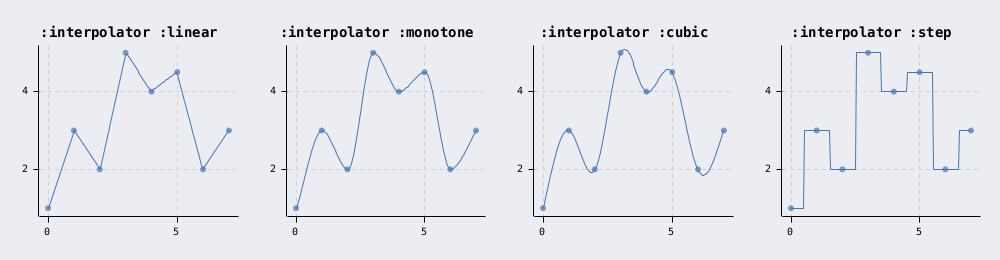
:::


Every built-in dash style (a dash may also be a vector of dash and gap lengths, as above):


::: {.sourceClojure}
```clojure
(plot/render-image {:charts (vec (mapcat (fn [i d]
                                           [(chart/rule {:y i :dash d :line-width 2})
                                            (chart/text {:x 0 :y i :text (str d) :anchor [:left :bottom]})])
                                         (range 1 100) (:dash describe/attribute-values)))
                    :scales {:x {:domain [0 1] :axis false} :y {:domain [0 9] :reverse true :axis false}}}
                   {:width 500 :height 320})
```
:::


::: {.clay-image}

:::


### Curves

The line between data points of lines and ribbons: straight, a fastmath interpolation or a step, sampled for
drawing.

::: {.clay-table}

```{=html}
<table class="table table-hover table-responsive clay-table"><thead><tr><th>Option</th><th>Type</th><th>Default</th><th>Description</th></tr></thead><tbody><tr><td>:interpolator</td><td>a fastmath 1D interpolation method keyword or a function (fn [xs ys & params] f)</td><td></td><td>interpolation of the line between data points (none - straight segments)</td></tr><tr><td>:interpolator-params</td><td>vector of any value</td><td></td><td>extra parameters passed to the interpolation method</td></tr><tr><td>:curve</td><td>one of :parametric :bezier</td><td></td><td>path curve instead of a function of x: :parametric (x(t), y(t) over the chord length) or :bezier</td></tr><tr><td>:sample-step</td><td>a positive number of pixels or {:count n}, n >= 2</td><td>1.0</td><td>distance between evaluated positions: pixels or {:count n} per run</td></tr></tbody></table>
```

:::


::: {.sourceClojure}
```clojure
(def points (for [x (range 8)] {:x x :y (nth [1 3 2 5 4 4.5 2 3] x)}))
```
:::


```{=html}
<div class="data-table"><table class="table table-hover table-responsive clay-table"><thead><tr><th>x</th><th>y</th></tr></thead><tbody><tr><td>0</td><td>1</td></tr><tr><td>1</td><td>3</td></tr><tr><td>2</td><td>2</td></tr><tr><td>3</td><td>5</td></tr><tr><td>4</td><td>4</td></tr><tr><td>5</td><td>4.5</td></tr><tr><td>6</td><td>2</td></tr><tr><td>7</td><td>3</td></tr></tbody></table></div>
```


::: {.sourceClojure}
```clojure
(plot/render-image (plot/arrange (for [interpolator [:linear :monotone :cubic :step]]
                                   {:data points
                                    :mapping {:x :x :y :y}
                                    :charts [(chart/line {:interpolator interpolator}) (chart/scatter)]
                                    :labels {:title (str ":interpolator " interpolator)}})
                                 {:columns 4})
                   {:width 1000 :height 260})
```
:::


::: {.clay-image}

:::


Every interpolation method (`schema/interpolation-methods`) through the same points, with default parameters -
most pass through them or smooth them; `:pava` and `:cir` fit a monotone curve - `:pava` flat runs joined by a
step, `:cir` flat, then sloping; `:kriging` stays near a constant (its variogram is fitted to the points, by a
seeded search, so every render draws the same curve), and `:gp` / `:rbf` use a kernel too narrow for points this
far apart:


::: {.sourceClojure}
```clojure
(plot/render-image (plot/arrange (for [interpolator (sort schema/interpolation-methods)]
                                   {:data points
                                    :mapping {:x :x :y :y}
                                    :charts [(chart/line {:interpolator interpolator}) (chart/scatter {:size 4})]
                                    :labels {:title (str interpolator)}})
                                 {:columns 4})
                   {:width 1000 :height 800})
```
:::


::: {.clay-image}

:::


`:interpolator-params` are the method's arguments after the points - for `:gp` and `:rbf` a fastmath kernel. A
curve is fitted in pixels along the line's horizontal axis, so the kernel's width is in pixels: here 60, a bit
more than the gap between the points:


::: {.sourceClojure}
```clojure
(plot/render-image (plot/arrange [{:data points
                                   :mapping {:x :x :y :y}
                                   :charts [(chart/line {:interpolator :gp :interpolator-params [(k/kernel :gaussian {:sigma 60.0})]})
                                            (chart/scatter {:size 4})]
                                   :labels {:title ":gp, gaussian kernel sigma 60"}}
                                  {:data points
                                   :mapping {:x :x :y :y}
                                   :charts [(chart/line {:interpolator :rbf :interpolator-params [(k/rbf :gaussian {:scale 60.0})]})
                                            (chart/scatter {:size 4})]
                                   :labels {:title ":rbf, gaussian scale 60"}}]
                                 {:columns 2})
                   {:width 800 :height 280})
```
:::


::: {.clay-image}

:::


Without an interpolator, `:curve` draws a smooth path through the points in their order - also a closed or
looping one (`:parametric`, a Catmull-Rom curve; `:bezier`, bezier pieces); `:sample-step` sets how densely a
curve is sampled (here coarse, to show the samples):


::: {.sourceClojure}
```clojure
(plot/render-image (plot/arrange (for [[title opts] [[":curve :parametric" {:curve :parametric}]
                                                     [":curve :bezier" {:curve :bezier}]
                                                     [":sample-step 25 (cubic)" {:interpolator :cubic :sample-step 25}]]]
                                   {:data points
                                    :mapping {:x :x :y :y}
                                    :charts [(chart/line opts) (chart/scatter {:size 4})]
                                    :labels {:title title}})
                                 {:columns 3})
                   {:width 1000 :height 260})
```
:::


::: {.clay-image}

:::


### Fill patterns

A pattern drawn over filled marks (bars, areas, boxes, tiles of hierarchies ...), in its own colour.

::: {.clay-table}

```{=html}
<table class="table table-hover table-responsive clay-table"><thead><tr><th>Option</th><th>Type</th><th>Default</th><th>Description</th></tr></thead><tbody><tr><td>:pattern</td><td>a pattern name (:back-hatch :cross :dense-dots :diagonal-cross :dots :hatch :horizontal :solid :vertical) or a pattern map</td><td></td><td>pattern drawn over the fill (a mapped :pattern wins)</td></tr><tr><td>:pattern-color</td><td>:darker or a clojure2d color or :none</td><td></td><td>pattern ink: a colour, :none or :darker (the darkened fill)</td></tr></tbody></table>
```

:::


::: {.sourceClojure}
```clojure
(plot/render-image {:data (for [[i p] (map-indexed vector [:hatch :back-hatch :cross :dots])] {:p (name p) :v (+ 3 i)})
                    :mapping {:x :p :y :v :pattern :p}
                    :charts [(chart/bar {:color :white :stroke-color :black :pattern-color :black})]
                    :legend false}
                   {:width 500 :height 260})
```
:::


::: {.clay-image}

:::


### Rounded corners

Rounded bar corners: all of them, or only the end away from the baseline.

::: {.clay-table}

```{=html}
<table class="table table-hover table-responsive clay-table"><thead><tr><th>Option</th><th>Type</th><th>Default</th><th>Description</th></tr></thead><tbody><tr><td>:corner-radius</td><td>a non-negative number</td><td>0</td><td>radius in pixels of every corner of a bar or rect</td></tr><tr><td>:corner-radius-end</td><td>a non-negative number</td><td></td><td>radius in pixels of the corners at the bar's value end only (wins over :corner-radius)</td></tr></tbody></table>
```

:::


::: {.sourceClojure}
```clojure
(plot/render-image {:data counts
                    :mapping {:x :k :y :v :color :g}
                    :charts [(chart/bar {:corner-radius-end 8})]}
                   {:width 500 :height 260})
```
:::


::: {.clay-image}

:::


### Strip options

Strip charts (bar, box, violin, stripplot, beeswarm, dotplot, rug, bullet, extent) draw one item per level of a
categorical axis.


#### Placement

Where the items sit across the value axis, how wide, and which axis holds the levels:

::: {.clay-table}

```{=html}
<table class="table table-hover table-responsive clay-table"><thead><tr><th>Option</th><th>Type</th><th>Default</th><th>Description</th></tr></thead><tbody><tr><td>:place</td><td>{:at a finite number} or one of :band :bottom :center :edge</td><td>:band with a level mapping, else the chart's own (:center for most, :edge for the rug)</td><td>where the items sit across the value axis: :band (one band per level), {:at v} (centred on v of a numeric scale), :center, :edge or :bottom (between the panel edge and 0)</td></tr><tr><td>:width</td><td>a non-negative number</td><td>0.8</td><td>fraction an item spans across the value axis: of the level's band, of the panel for :center, of the room between the panel edge and 0 for :bottom</td></tr><tr><td>:thickness</td><td>a non-negative number</td><td>20 pixels for {:at v}, 8 for :edge</td><td>item thickness in pixels for :place {:at v} and :edge</td></tr><tr><td>:bottom-share</td><td>a number in [0 1]</td><td>0.15 with :place :bottom</td><td>padding below the data asked for with :place :bottom (only there), a fraction of the y data span</td></tr><tr><td>:level-axis</td><td>one of :x :y</td><td>the categorical axis of the mapping; with neither, :x when only :y is mapped, else :y</td><td>the mapping axis holding the levels (decides when both or neither of :x and :y are categorical)</td></tr></tbody></table>
```

:::


::: {.sourceClojure}
```clojure
(plot/render-image {:data iris
                    :mapping {:x :species :y :sepal-length}
                    :charts [(chart/violin {:width 0.9}) (chart/box {:width 0.15})]}
                   {:width 500 :height 280})
```
:::


::: {.clay-image}
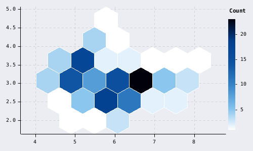
:::


Without levels an item sits by `:place`: across the panel's middle (`:width` a fraction of the panel), below the
data (`:bottom` - the y axis reaches below zero, `:width` a fraction of the room under zero), at the panel's edge
or at a value of the other axis (`{:at v}`) - those two `:thickness` pixels thick. Here a box of the eruption
times over the scatter:


::: {.sourceClojure}
```clojure
(plot/render-image (plot/arrange (for [[place opts] [[:center {:width 0.15}] [:bottom {:width 0.8}]
                                                     [:edge {:thickness 12}] [{:at 60} {:thickness 20}]]]
                                   {:data faithful
                                    :mapping {:x :eruptions :y :waiting}
                                    :charts [(chart/scatter {:size 4}) (chart/box (merge {:place place :mapping {:y nil}} opts))]
                                    :labels {:title (str ":place " place " " opts)}})
                                 {:columns 2})
                   {:width 900 :height 600})
```
:::


::: {.clay-image}
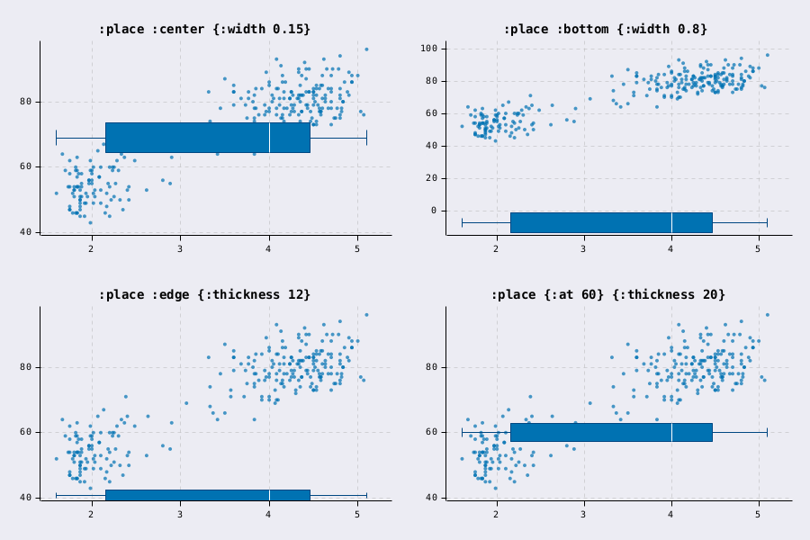
:::


`:level-axis` names the axis of the levels - needed when both axes or neither are categorical; here the rounded
petal widths on y (0 to 3), declared categorical, are the levels, a strip of sepal lengths at each (points spread
across the band by the [stripplot](reference.charts_per_level.html#strip-plots)'s seeded `:jitter`):


::: {.sourceClojure}
```clojure
(plot/render-image {:data iris
                    :mapping {:x :sepal-length :y (levels/categorical #(m/round (:petal-width %)))}
                    :charts [(chart/stripplot {:level-axis :y :jitter 0.3 :rng (r/rng :mersenne 5)})]
                    :labels {:x "sepal length" :y "petal width, rounded"}}
                   {:width 500 :height 280})
```
:::


::: {.clay-image}
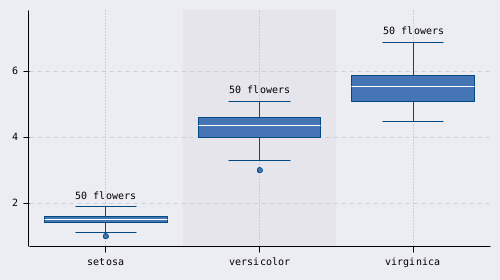
:::


#### Groups

Groups of one level share its band: side by side (`:dodge`, with a gap), on top of each other, or one half each
(`:mirror`).

::: {.clay-table}

```{=html}
<table class="table table-hover table-responsive clay-table"><thead><tr><th>Option</th><th>Type</th><th>Default</th><th>Description</th></tr></thead><tbody><tr><td>:position</td><td>one of :dodge :mirror :overlay</td><td>:dodge when a level holds two or more groups, else :overlay (dotplot: always :overlay)</td><td>how groups of one level share its band: :dodge (side by side), :overlay (on top of each other) or :mirror (two groups, one half each)</td></tr><tr><td>:dodge-gap</td><td>a number in [0 1]</td><td>0.1</td><td>gap between dodged groups, a fraction of a group's part of the band</td></tr></tbody></table>
```

:::


::: {.sourceClojure}
```clojure
(plot/render-image {:data counts
                    :mapping {:x :k :y :v :color :g}
                    :charts [(chart/bar {:position :dodge :dodge-gap 0.3})]}
                   {:width 500 :height 260})
```
:::


::: {.clay-image}
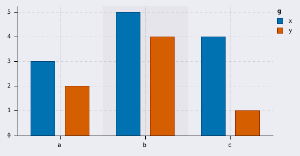
:::


#### Counts

Each item's row count written past its largest value.

::: {.clay-table}

```{=html}
<table class="table table-hover table-responsive clay-table"><thead><tr><th>Option</th><th>Type</th><th>Default</th><th>Description</th></tr></thead><tbody><tr><td>:n-label</td><td>true or false or nil</td><td>false</td><td>draw each item's row count just past its largest value</td></tr><tr><td>:n-format</td><td>a count format string or a function</td><td>"n=%d"</td><td>text of the n labels: a format string or a function of the count</td></tr></tbody></table>
```

:::


::: {.sourceClojure}
```clojure
(plot/render-image {:data iris
                    :mapping {:x :species :y :petal-length}
                    :charts [(chart/box {:n-label true :n-format "%d flowers"})]}
                   {:width 500 :height 280})
```
:::


::: {.clay-image}

:::


### Mirrored strips

Two groups on the two sides of the value axis, e.g. a population pyramid.

::: {.clay-table}

```{=html}
<table class="table table-hover table-responsive clay-table"><thead><tr><th>Option</th><th>Type</th><th>Default</th><th>Description</th></tr></thead><tbody><tr><td>:mirror</td><td>one of :color :shape :size :dash :pattern :group</td><td></td><td>a grouping dimension with exactly two levels; the second level's items are drawn on the negative side</td></tr></tbody></table>
```

:::


::: {.sourceClojure}
```clojure
(plot/render-image {:data counts
                    :mapping {:x :k :y :v :color :g}
                    :charts [(chart/bar {:mirror :color})]
                    :flip true
                    :scales {:x {:reverse true}}}
                   {:width 500 :height 260})
```
:::


::: {.clay-image}
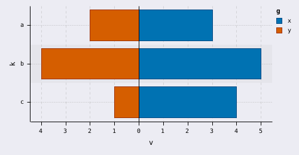
:::


The same mirroring upright, and on a range chart (the second group's intervals below the axis):


::: {.sourceClojure}
```clojure
(plot/render-image (plot/arrange [{:data counts
                                   :mapping {:x :k :y :v :color :g}
                                   :charts [(chart/bar {:mirror :color})]
                                   :labels {:title "bar, :mirror :color"}}
                                  {:data iris
                                   :mapping {:x :species :y :sepal-length :color #(if (< (:petal-width %) 1.3) "narrow" "wide")}
                                   :charts [(chart/extent {:mirror :color})]
                                   :labels {:title "extent, :mirror :color"}}]
                                 {:columns 2})
                   {:width 900 :height 300})
```
:::


::: {.clay-image}

:::


### Ridgelines

Histograms and densities over a categorical axis - one row per level, overlapping by `:overlap` rows.

::: {.clay-table}

```{=html}
<table class="table table-hover table-responsive clay-table"><thead><tr><th>Option</th><th>Type</th><th>Default</th><th>Description</th></tr></thead><tbody><tr><td>:overlap</td><td>a non-negative number</td><td>0.9</td><td>height of the tallest ridge in band steps (above 1 - ridges overlap the next level)</td></tr></tbody></table>
```

:::


::: {.sourceClojure}
```clojure
(plot/render-image {:data iris
                    :mapping {:x :sepal-length :y :species :color :species}
                    :charts [(chart/density {:overlap 1.8 :fill :color :alpha 0.7})]
                    :scales {:y {:reverse true}}
                    :legend false}
                   {:width 500 :height 300})
```
:::


::: {.clay-image}

:::


### Cell style

The cell shape and outline of grid-cell charts (tile, bin2d): any fastmath grid type, scaled. Every cell type
binning the same points:

::: {.clay-table}

```{=html}
<table class="table table-hover table-responsive clay-table"><thead><tr><th>Option</th><th>Type</th><th>Default</th><th>Description</th></tr></thead><tbody><tr><td>:cell</td><td>one of :square :shifted-square :triangle :rhombus :flat-hex :pointy-hex</td><td></td><td>cell shape of the grid (a fastmath grid cell type)</td></tr><tr><td>:cell-scale</td><td>a finite number, > 0, <= 1</td><td></td><td>cell polygon size relative to its grid cell, in (0 1]</td></tr><tr><td>:stroke-color</td><td>:darker or a clojure2d color or :none</td><td></td><td>cell outline: a colour, :none or :darker (the darkened fill)</td></tr><tr><td>:stroke-width</td><td>a non-negative number</td><td></td><td>cell outline width in pixels</td></tr><tr><td>:alpha-factor</td><td>a number in [0 1]</td><td></td><td>factor multiplying the fill colours' alpha</td></tr></tbody></table>
```

:::


::: {.sourceClojure}
```clojure
(plot/render-image (plot/arrange (for [cell (:cell describe/attribute-values)]
                                   {:data iris
                                    :mapping {:x :sepal-length :y :sepal-width}
                                    :charts [(chart/bin2d {:cell cell :stroke-color :white})]
                                    :labels {:title (str ":cell " cell)}
                                    :legend false})
                                 {:columns 3})
                   {:width 900 :height 560})
```
:::


::: {.clay-image}

:::


### Fields

Raster and contour charts draw a scalar field.


#### A function

The field as a function of a point over a domain ...

::: {.clay-table}

```{=html}
<table class="table table-hover table-responsive clay-table"><thead><tr><th>Option</th><th>Type</th><th>Default</th><th>Description</th><th>Group</th></tr></thead><tbody><tr><td>:f</td><td>a function</td><td></td><td>the field as a function of a point [x y] returning a number (instead of mapped data)</td><td>Fields</td></tr><tr><td>:domain</td><td>map</td><td>the plot's explicit :x and :y scale domains</td><td>the domain of a function field</td><td>Fields</td></tr><tr><td>:domain :x (required)</td><td>[a finite number, a finite number]</td><td></td><td>x domain [lo hi]</td><td></td></tr><tr><td>:domain :y (required)</td><td>[a finite number, a finite number]</td><td></td><td>y domain [lo hi]</td><td></td></tr></tbody></table>
```

:::


::: {.sourceClojure}
```clojure
(plot/render-image {:charts [(chart/contour {:f (fn [[x y]] (+ (* x x) (* 2 y y))) :domain {:x [-2 2] :y [-2 2]}})]}
                   {:width 450 :height 350})
```
:::


::: {.clay-image}
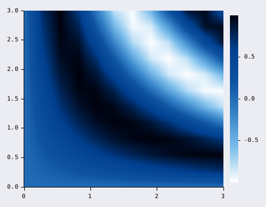
:::


#### A density estimate

... or the kernel density estimate of mapped points ...

::: {.clay-table}

```{=html}
<table class="table table-hover table-responsive clay-table"><thead><tr><th>Option</th><th>Type</th><th>Default</th><th>Description</th></tr></thead><tbody><tr><td>:kernel</td><td>a fastmath KDE kernel keyword</td><td>:gaussian</td><td>fastmath kernel of the 2D density estimate of mapped points</td></tr><tr><td>:bandwidth</td><td>a positive finite number or a fastmath bandwidth selector keyword or :scott or [a positive finite number or a fastmath bandwidth selector keyword or :scott, a positive finite number or a fastmath bandwidth selector keyword or :scott]</td><td>:nrd per axis (MASS::kde2d, as ggplot2)</td><td>bandwidth of the density estimate: a number, a fastmath selector or :scott, or a pair [hx hy] of them</td></tr><tr><td>:binned</td><td>true or false</td><td>false</td><td>estimate the density from binned points (faster for many points)</td></tr><tr><td>:cut</td><td>a non-negative finite number</td><td>3</td><td>how many bandwidths the density domain extends past the points on each side</td></tr></tbody></table>
```

:::


::: {.sourceClojure}
```clojure
(plot/render-image {:data iris
                    :mapping {:x :sepal-length :y :sepal-width}
                    :charts [(chart/field {:kernel :epanechnikov :bandwidth 0.4}) (chart/scatter {:size 3})]}
                   {:width 450 :height 350})
```
:::


::: {.clay-image}
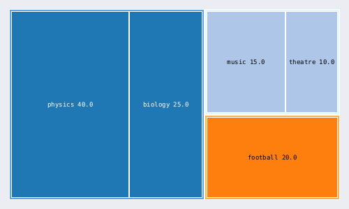
:::


#### The grid

... sampled on a grid of `:n` points per axis (interpolating gridded data with `:interpolation`).

::: {.clay-table}

```{=html}
<table class="table table-hover table-responsive clay-table"><thead><tr><th>Option</th><th>Type</th><th>Default</th><th>Description</th></tr></thead><tbody><tr><td>:interpolation</td><td>one of :bilinear :bicubic :cubic-2d</td><td>:bilinear</td><td>interpolation of gridded data (mapped :x, :y, :value on a full lattice)</td></tr><tr><td>:n</td><td>integer (2..2000) or [integer (2..2000), integer (2..2000)]</td><td>100</td><td>grid size: values sampled along each axis, or [nx ny]</td></tr></tbody></table>
```

:::


::: {.sourceClojure}
```clojure
(plot/render-image {:charts [(chart/field {:f (fn [[x y]] (m/sin (m/* x y))) :domain {:x [0 3] :y [0 3]} :n 12})]}
                   {:width 450 :height 350})
```
:::


::: {.clay-image}
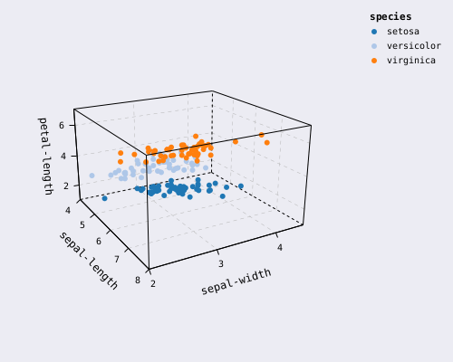
:::


### Hierarchy labels

Group and leaf labels of treemaps, partitions and circle packings: off, on, or a function writing them.

::: {.clay-table}

```{=html}
<table class="table table-hover table-responsive clay-table"><thead><tr><th>Option</th><th>Type</th><th>Default</th><th>Description</th></tr></thead><tbody><tr><td>:group-labels</td><td>true or false or a function or nil</td><td>true</td><td>group labels: true - the node's name, false - none, or a function of the node info {:name :value :depth :path :share :parent-share} returning the text</td></tr><tr><td>:leaf-labels</td><td>true or false or a function or nil</td><td>true</td><td>leaf labels: as :group-labels, for the leaves</td></tr></tbody></table>
```

:::


::: {.sourceClojure}
```clojure
(def budget [{:dept "science" :team "physics" :cost 40} {:dept "science" :team "biology" :cost 25}
             {:dept "arts" :team "music" :cost 15} {:dept "arts" :team "theatre" :cost 10}
             {:dept "sport" :team "football" :cost 20}])
```
:::


```{=html}
<div class="data-table"><table class="table table-hover table-responsive clay-table"><thead><tr><th>dept</th><th>team</th><th>cost</th></tr></thead><tbody><tr><td>science</td><td>physics</td><td>40</td></tr><tr><td>science</td><td>biology</td><td>25</td></tr><tr><td>arts</td><td>music</td><td>15</td></tr><tr><td>arts</td><td>theatre</td><td>10</td></tr><tr><td>sport</td><td>football</td><td>20</td></tr></tbody></table></div>
```


::: {.sourceClojure}
```clojure
(plot/render-image {:data budget
                    :mapping {:hierarchy [:dept :team] :value :cost}
                    :charts [(chart/treemap {:group-labels false :leaf-labels #(str (:name %) " " (:value %))})]}
                   {:width 500 :height 300})
```
:::


::: {.clay-image}

:::


### 3D frame

3D charts (cloud, surface) draw their data in a box seen in perspective.


#### View

The eye sits at an azimuth and elevation, at a perspective distance; the box has proportions and may mirror axes.

::: {.clay-table}

```{=html}
<table class="table table-hover table-responsive clay-table"><thead><tr><th>Option</th><th>Type</th><th>Default</th><th>Description</th><th>Group</th></tr></thead><tbody><tr><td>:view</td><td>map</td><td></td><td>the eye's position: azimuth, elevation and perspective distance</td><td>3D frame</td></tr><tr><td>:view :azimuth</td><td>a finite number</td><td>40.0</td><td>rotation around the vertical axis, degrees</td><td></td></tr><tr><td>:view :elevation</td><td>a finite number, >= -90, <= 90</td><td>30.0</td><td>angle of the eye above the floor, degrees</td><td></td></tr><tr><td>:view :distance</td><td>a non-negative finite number</td><td>0.0</td><td>perspective: 0 - parallel projection, larger - stronger perspective (lattice distance)</td><td></td></tr><tr><td>:aspect</td><td>[a positive number, a positive number, a positive number]</td><td>[1 1 1]</td><td>box proportions [ax ay az]</td><td>3D frame</td></tr><tr><td>:reverse</td><td>set of one of :x :y :z</td><td></td><td>axes running the other way (mirrors the scene)</td><td>3D frame</td></tr></tbody></table>
```

:::


::: {.sourceClojure}
```clojure
(plot/render-image {:data iris
                    :mapping {:x :sepal-length :y :sepal-width :z :petal-length :color :species}
                    :charts [(chart/cloud {:view {:azimuth 60 :elevation 20 :distance 0.3} :aspect [1 1 0.6]})]}
                   {:width 500 :height 400})
```
:::


::: {.clay-image}
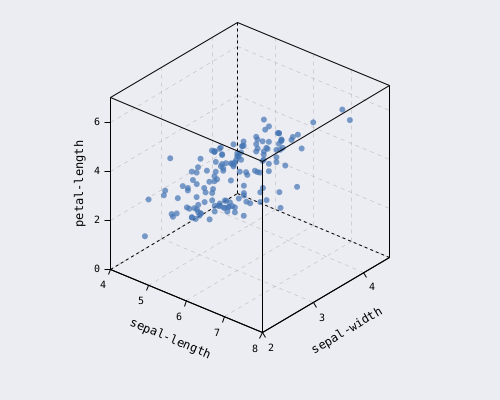
:::


#### Axes

The box, the ticks and the axis titles.

::: {.clay-table}

```{=html}
<table class="table table-hover table-responsive clay-table"><thead><tr><th>Option</th><th>Type</th><th>Default</th><th>Description</th><th>Group</th></tr></thead><tbody><tr><td>:box</td><td>true or false or nil</td><td>true</td><td>draw the box: hidden edges dashed and a floor grid behind the data, visible edges over it</td><td>3D frame</td></tr><tr><td>:axes</td><td>true or false or nil</td><td>true</td><td>draw ticks, tick labels and axis titles</td><td>3D frame</td></tr><tr><td>:axis-titles</td><td>map</td><td>the mapped column names</td><td>axis titles (nil - none)</td><td>3D frame</td></tr><tr><td>:axis-titles :x</td><td>any value</td><td></td><td>x axis title</td><td></td></tr><tr><td>:axis-titles :y</td><td>any value</td><td></td><td>y axis title</td><td></td></tr><tr><td>:axis-titles :z</td><td>any value</td><td></td><td>z axis title</td><td></td></tr></tbody></table>
```

:::


::: {.sourceClojure}
```clojure
(plot/render-image {:data iris
                    :mapping {:x :sepal-length :y :sepal-width :z :petal-length}
                    :charts [(chart/cloud {:box false :axis-titles {:x "sepal L" :y "sepal W" :z "petal L"}})]}
                   {:width 500 :height 400})
```
:::


::: {.clay-image}

:::


#### Domains

Explicit domains - needed when several 3D charts share a plot.

::: {.clay-table}

```{=html}
<table class="table table-hover table-responsive clay-table"><thead><tr><th>Option</th><th>Type</th><th>Default</th><th>Description</th><th>Group</th></tr></thead><tbody><tr><td>:domain</td><td>map</td><td>the data's domains</td><td>explicit data domains (needed for each of several 3D charts in one plot)</td><td>3D frame</td></tr><tr><td>:domain :x</td><td>[a finite number, a finite number]</td><td></td><td>explicit x domain [a b] (a > b reverses the axis)</td><td></td></tr><tr><td>:domain :y</td><td>[a finite number, a finite number]</td><td></td><td>explicit y domain [a b] (a > b reverses the axis)</td><td></td></tr><tr><td>:domain :z</td><td>[a finite number, a finite number]</td><td></td><td>explicit z domain [a b] (a > b reverses the axis)</td><td></td></tr></tbody></table>
```

:::


::: {.sourceClojure}
```clojure
(plot/render-image {:data iris
                    :mapping {:x :sepal-length :y :sepal-width :z :petal-length}
                    :charts [(chart/cloud {:domain {:x [4 8] :y [2 4.5] :z [0 7]}})]}
                   {:width 500 :height 400})
```
:::


::: {.clay-image}
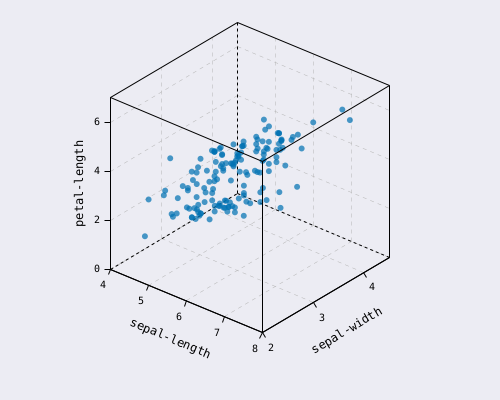
:::


### 3D shading

Shaded 3D faces (surface quads, cloud bars) are lit by Lambert's law: an ambient share of the colour plus the rest
by the face's angle to the light, whose direction is given in view coordinates (x right, y up, z away from the eye).

::: {.clay-table}

```{=html}
<table class="table table-hover table-responsive clay-table"><thead><tr><th>Option</th><th>Type</th><th>Default</th><th>Description</th></tr></thead><tbody><tr><td>:ambient</td><td>a number in [0 1]</td><td>0.4</td><td>share of a shaded face's colour independent of the light (0 - light only, 1 - no shading)</td></tr><tr><td>:light</td><td>[a finite number, a finite number, a finite number]</td><td>[-0.5 0.6 -1.0]</td><td>direction toward the light [x y z] in view coordinates (x right, y up, z away from the eye), normalized</td></tr></tbody></table>
```

:::


The default shading beside a darker ambient share lit from the right, on the surface $z = \sin(xy)$.


::: {.sourceClojure}
```clojure
(plot/render-image (plot/arrange [{:charts [(chart/surface {:f (fn [[x y]] (m/sin (m/* x y)))
                                                            :domain {:x [-2 2] :y [-2 2]} :color [120 160 220]})]
                                   :labels {:title "default shading"}}
                                  {:charts [(chart/surface {:f (fn [[x y]] (m/sin (m/* x y)))
                                                            :domain {:x [-2 2] :y [-2 2]} :color [120 160 220]
                                                            :ambient 0.2 :light [1.0 1.0 -0.5]})]
                                   :labels {:title ":ambient 0.2 :light [1 1 -0.5]"}}]
                                 {:columns 2 :title "$z = \\sin(xy)$"})
                   {:width 800 :height 400})
```
:::


::: {.clay-image}
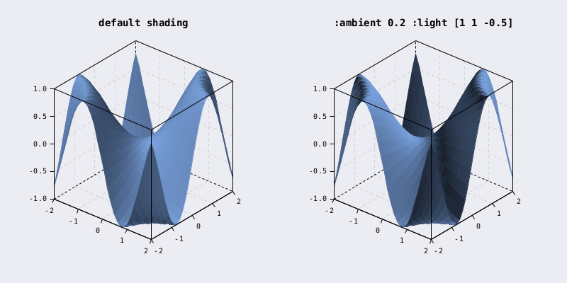
:::


### Text style

Font, size, colour, padding, alignment and background of the `text` chart - also the style of every theme text
role (Theme chapter).

::: {.clay-table}

```{=html}
<table class="table table-hover table-responsive clay-table"><thead><tr><th>Option</th><th>Type</th><th>Default</th><th>Description</th></tr></thead><tbody><tr><td>:font</td><td>a bundled, installed or logical font name, or a java.awt.Font</td><td></td><td>font name (bundled, installed or logical) or a java.awt.Font</td></tr><tr><td>:size</td><td>a positive number</td><td></td><td>font size in points</td></tr><tr><td>:font-style</td><td>one of :bold :bold-italic :italic :plain</td><td></td><td>font style</td></tr><tr><td>:color</td><td>a clojure2d color or :contrast</td><td></td><td>text colour; :contrast - black or white by what is behind (a chart's fill under its labels, else the plot background)</td></tr><tr><td>:inset</td><td>a non-negative number</td><td></td><td>space between the text and its box edge on every side, in pixels</td></tr><tr><td>:align</td><td>[h v], h one of :left :center :right, v one of :top :middle :bottom</td><td></td><td>alignment [horizontal vertical] of the text at its anchor</td></tr><tr><td>:background</td><td>a clojure2d color or :none</td><td></td><td>box colour behind the text (:none - no box)</td></tr><tr><td>:dollar-math</td><td>true or false or nil</td><td></td><td>true draws text between two dollar signs as a LaTeX formula (a dollar after a backslash stays literal), false keeps every dollar literal; default true</td></tr></tbody></table>
```

:::


::: {.sourceClojure}
```clojure
(plot/render-image {:data wave
                    :mapping {:x :t :y :v}
                    :charts [(chart/line)
                             (chart/text {:x 15 :y 0 :text "a styled note" :size 14 :font-style :bold
                                          :color :white :background [70 90 140] :inset 6})]}
                   {:width 500 :height 250})
```
:::


::: {.clay-image}

:::


## Builders


### Builder options

Title, scales and theme of the plot a builder returns.

::: {.clay-table}

```{=html}
<table class="table table-hover table-responsive clay-table"><thead><tr><th>Option</th><th>Type</th><th>Default</th><th>Description</th></tr></thead><tbody><tr><td>:title</td><td>any value</td><td></td><td>plot title (a text or label options)</td></tr><tr><td>:scales</td><td>any value</td><td></td><td>scale specs deep-merged into the builder's (validated with the plot)</td></tr><tr><td>:theme</td><td>any value</td><td></td><td>theme overrides of the built plot</td></tr></tbody></table>
```

:::


::: {.sourceClojure}
```clojure
(def flows [{:from "coal" :to "power" :value 30} {:from "gas" :to "power" :value 20} {:from "gas" :to "homes" :value 15}
            {:from "power" :to "homes" :value 25} {:from "power" :to "industry" :value 25}])
```
:::


```{=html}
<div class="data-table"><table class="table table-hover table-responsive clay-table"><thead><tr><th>from</th><th>to</th><th>value</th></tr></thead><tbody><tr><td>coal</td><td>power</td><td>30</td></tr><tr><td>gas</td><td>power</td><td>20</td></tr><tr><td>gas</td><td>homes</td><td>15</td></tr><tr><td>power</td><td>homes</td><td>25</td></tr><tr><td>power</td><td>industry</td><td>25</td></tr></tbody></table></div>
```


::: {.sourceClojure}
```clojure
(plot/render-image (plot/sankey flows {:title "Energy flows" :theme {:plot {:background :white}}})
                   {:width 500 :height 300})
```
:::


::: {.clay-image}

:::


### Multiplot layout

The grid of `plot/arrange` (and of a plot's `:arrange`): shape, weights, panel alignment.

::: {.clay-table}

```{=html}
<table class="table table-hover table-responsive clay-table"><thead><tr><th>Option</th><th>Type</th><th>Default</th><th>Description</th></tr></thead><tbody><tr><td>:plots (required)</td><td>sequential of map (at least 1)</td><td></td><td>the sub-plots, filling the grid row by row</td></tr><tr><td>:columns</td><td>a positive integer or nil</td><td>one column (from :rows when given)</td><td>grid columns</td></tr><tr><td>:rows</td><td>a positive integer or nil</td><td>from the plot count and :columns</td><td>grid rows</td></tr><tr><td>:widths</td><td>sequential of a positive number or :measured or [:fixed, a non-negative number] or nil</td><td>equal</td><td>relative column weights; :measured sizes a column of legend-only plots, [:fixed px] a fixed width</td></tr><tr><td>:heights</td><td>sequential of a positive number or :measured or [:fixed, a non-negative number] or nil</td><td>equal</td><td>relative row weights; :measured sizes a row of legend-only plots to their legends (scaled down to fit), [:fixed px] a fixed height</td></tr><tr><td>:row-spans</td><td>map of integer (at least 0) to a positive integer or nil</td><td>every plot one row</td><td>plot index (not cell) -> the rows that plot spans from its own row down (later plots skip the covered cells; rows are added when not given)</td></tr><tr><td>:align</td><td>true or false or nil</td><td>true</td><td>align the sub-plots' panels in rows and columns</td></tr><tr><td>:equal-panels</td><td>true or false or nil</td><td>false</td><td>resize columns and rows so every aligned panel has the same size and the gaps between panels are even (builds twice)</td></tr></tbody></table>
```

:::


::: {.sourceClojure}
```clojure
(plot/render-image (plot/arrange [{:data wave :mapping {:x :t :y :v} :charts [(chart/line)]}
                                  {:data wave :mapping {:x :g :y :v} :charts [(chart/box)]}]
                                 {:columns 2 :widths [3 1]})
                   {:width 700 :height 250})
```
:::


::: {.clay-image}
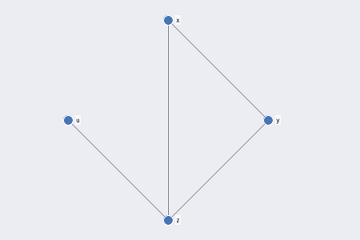
:::


## Builders and data functions

The options a builder forwards to the data function computing its layout; the function takes them directly too.


### Graph

The edge rows' ends, weight and node ids, optional node rows, directedness. A directed
[network](reference.builders_graphs.html#network) with node labels (`:labels`) and a seeded layout (`:rng`):

::: {.clay-table}

```{=html}
<table class="table table-hover table-responsive clay-table"><thead><tr><th>Option</th><th>Type</th><th>Default</th><th>Description</th></tr></thead><tbody><tr><td>:from</td><td>a keyword, a function or a categorical marker of one</td><td>:from</td><td>accessor of an edge row's source node id</td></tr><tr><td>:to</td><td>a keyword, a function or a categorical marker of one</td><td>:to</td><td>accessor of an edge row's target node id</td></tr><tr><td>:value</td><td>a keyword, a function or a categorical marker of one</td><td>:value</td><td>accessor of an edge row's weight, a finite number >= 0 (nil - 1)</td></tr><tr><td>:nodes</td><td>sequential of map or nil</td><td></td><td>node rows (each with an id), placed first in their order; ids seen only in edges follow</td></tr><tr><td>:id</td><td>a keyword, a function or a categorical marker of one</td><td>:id</td><td>accessor of a node row's id</td></tr><tr><td>:directed</td><td>true or false or nil</td><td>false</td><td>a directed graph: degrees split into :in and :out</td></tr></tbody></table>
```

:::


::: {.sourceClojure}
```clojure
(def edges [{:a "x" :b "y" :w 3} {:a "y" :b "z" :w 1} {:a "z" :b "x" :w 2} {:a "z" :b "u" :w 2}])
```
:::


```{=html}
<div class="data-table"><table class="table table-hover table-responsive clay-table"><thead><tr><th>a</th><th>b</th><th>w</th></tr></thead><tbody><tr><td>x</td><td>y</td><td>3</td></tr><tr><td>y</td><td>z</td><td>1</td></tr><tr><td>z</td><td>x</td><td>2</td></tr><tr><td>z</td><td>u</td><td>2</td></tr></tbody></table></div>
```


::: {.sourceClojure}
```clojure
(plot/render-image (plot/network edges {:from :a :to :b :value :w :directed true :labels true :rng (r/rng :mersenne 1)})
                   {:width 450 :height 300})
```
:::


::: {.clay-image}
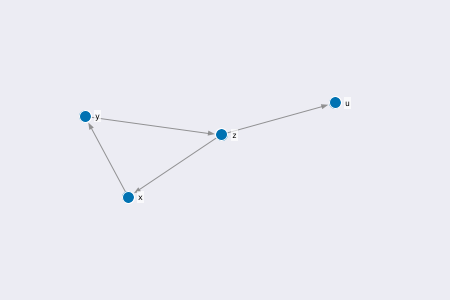
:::


### Graph layout

Node positions of a network: force-directed, a circle, or random.

::: {.clay-table}

```{=html}
<table class="table table-hover table-responsive clay-table"><thead><tr><th>Option</th><th>Type</th><th>Default</th><th>Description</th></tr></thead><tbody><tr><td>:layout</td><td>one of :circle :force :random</td><td>:force</td><td>node placement: :force (Fruchterman-Reingold), :circle or :random</td></tr><tr><td>:iterations</td><td>integer (at least 0)</td><td>500</td><td>steps of the force layout</td></tr><tr><td>:gravity</td><td>a non-negative finite number</td><td>1.0</td><td>pull of the force layout to each component's centroid, in units of the ideal edge length (0 - none)</td></tr><tr><td>:rng</td><td>a fastmath random generator or nil</td><td>a fresh unseeded generator every call</td><td>fastmath random generator of the force and random layouts, copied per call (seeded - the same layout every time)</td></tr></tbody></table>
```

:::


::: {.sourceClojure}
```clojure
(plot/render-image (plot/network edges {:from :a :to :b :layout :circle :labels true}) {:width 450 :height 300})
```
:::


::: {.clay-image}

:::


### Chord layout

Node order, gaps between sectors, the ring's inner radius and the smallest drawn flow.

::: {.clay-table}

```{=html}
<table class="table table-hover table-responsive clay-table"><thead><tr><th>Option</th><th>Type</th><th>Default</th><th>Description</th></tr></thead><tbody><tr><td>:order</td><td>:cluster or sequential of any value or nil</td><td>the nodes' input order</td><td>node order: a sequence of ids (those first, the rest after them in input order) or :cluster (nodes linked to the same others side by side)</td></tr><tr><td>:gap-angle</td><td>a non-negative finite number</td><td>2.0</td><td>gap after every ring sector in degrees (must leave room for the sectors)</td></tr><tr><td>:inner-radius</td><td>a number in (0 1)</td><td>0.92</td><td>inner radius of the ring, where the ribbons end (the outer one is 1)</td></tr><tr><td>:min-value</td><td>a non-negative finite number or nil</td><td></td><td>flows of a pair (summed) below it are left out and counted in :dropped (nil - none)</td></tr></tbody></table>
```

:::


::: {.sourceClojure}
```clojure
(plot/render-image (plot/chord flows {:gap-angle 6 :inner-radius 0.8}) {:width 450 :height 450})
```
:::


::: {.clay-image}

:::


### Arc layout

Node order along the line.

::: {.clay-table}

```{=html}
<table class="table table-hover table-responsive clay-table"><thead><tr><th>Option</th><th>Type</th><th>Default</th><th>Description</th></tr></thead><tbody><tr><td>:order</td><td>:cluster or sequential of any value or nil</td><td>the nodes' input order</td><td>node order: a sequence of ids (those first, the rest after them in input order) or :cluster (nodes linked to the same others side by side)</td></tr></tbody></table>
```

:::


::: {.sourceClojure}
```clojure
(plot/render-image (plot/arc edges {:from :a :to :b :order :cluster}) {:width 450 :height 250})
```
:::


::: {.clay-image}
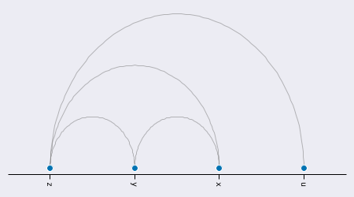
:::


### Sankey layout

Columns, node width, gaps and relaxation of a sankey diagram.

::: {.clay-table}

```{=html}
<table class="table table-hover table-responsive clay-table"><thead><tr><th>Option</th><th>Type</th><th>Default</th><th>Description</th></tr></thead><tbody><tr><td>:align</td><td>one of :center :justify :left :right</td><td>:justify</td><td>the column of a node: :justify (sinks in the last column), :left, :right (by the longest path to a sink) or :center</td></tr><tr><td>:layer</td><td>a keyword, a function or a categorical marker of one or nil</td><td>columns from :align</td><td>accessor of the node rows giving the column (integers >= 0, every edge to a later one; wins over :align)</td></tr><tr><td>:node-width</td><td>a number in (0 1)</td><td>0.03</td><td>node width, a fraction of the unit square's width</td></tr><tr><td>:gap</td><td>a non-negative finite number</td><td>0.02</td><td>least gap between the nodes of a column, a fraction of the unit square's height</td></tr><tr><td>:iterations</td><td>integer (at least 0)</td><td>6</td><td>relaxation sweeps moving the nodes towards their links' ends (0 - spread in the start order)</td></tr><tr><td>:order</td><td>one of :relaxed :input or nil</td><td>:relaxed</td><td>node order in a column: :relaxed - relaxation reorders it, :input - the input order kept</td></tr></tbody></table>
```

:::


::: {.sourceClojure}
```clojure
(plot/render-image (plot/sankey flows {:align :left :node-width 0.06 :gap 0.08}) {:width 500 :height 300})
```
:::


::: {.clay-image}
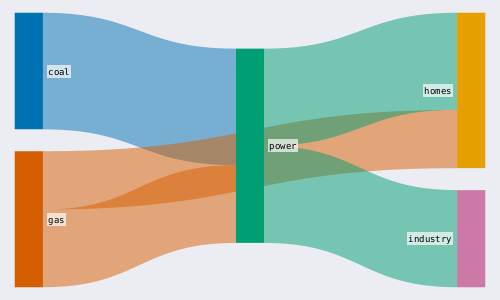
:::


### Alluvial graph

The axes (categorical columns) the strands cross, their weights and which axis colours them.

::: {.clay-table}

```{=html}
<table class="table table-hover table-responsive clay-table"><thead><tr><th>Option</th><th>Type</th><th>Default</th><th>Description</th></tr></thead><tbody><tr><td>:variables (required)</td><td>sequential of a keyword, a function or a categorical marker of one (at least 2)</td><td></td><td>accessors of the categorical variables (one column each), in order (at least 2)</td></tr><tr><td>:value</td><td>a keyword, a function or a categorical marker of one or nil</td><td>1 per row</td><td>accessor of a row's weight, a finite number >= 0 (nil - 1)</td></tr><tr><td>:strand-color</td><td>a keyword, a function or a categorical marker of one or nil</td><td>the first column</td><td>accessor of the level the strands are grouped (and coloured) by</td></tr></tbody></table>
```

:::


::: {.sourceClojure}
```clojure
(plot/render-image (plot/alluvial [{:class "1st" :sex "f" :n 140} {:class "1st" :sex "m" :n 180}
                                   {:class "3rd" :sex "f" :n 190} {:class "3rd" :sex "m" :n 510}]
                                  {:variables [:class :sex] :value :n :strand-color :sex})
                   {:width 500 :height 300})
```
:::


::: {.clay-image}

:::


### Dendrogram layout

A cut into `:k` clusters and a circular layout.

::: {.clay-table}

```{=html}
<table class="table table-hover table-responsive clay-table"><thead><tr><th>Option</th><th>Type</th><th>Default</th><th>Description</th></tr></thead><tbody><tr><td>:k</td><td>a positive integer or nil</td><td>no clusters (every :cluster nil)</td><td>cluster count: cutting the k - 1 highest groups leaves k subtrees, clusters 1..k in leaf order (at most the leaf count)</td></tr><tr><td>:circular</td><td>true or false or nil</td><td>false</td><td>radial: breadth as the angle over :span degrees, height (or depth) as the radius; points in [-1, 1]</td></tr><tr><td>:span</td><td>a positive finite number</td><td>360.0</td><td>degrees a circular layout covers, clockwise from the top</td></tr></tbody></table>
```

:::


::: {.sourceClojure}
```clojure
(def org (tree/from-levels [{:div "north" :team "a"} {:div "north" :team "b"} {:div "south" :team "c"}
                            {:div "south" :team "d"} {:div "south" :team "e"}]
                           {:hierarchy [:div :team]}))
```
:::


::: {.sourceClojure}
```clojure
(plot/render-image (plot/dendrogram org {:k 2}) {:width 450 :height 300})
```
:::


::: {.clay-image}
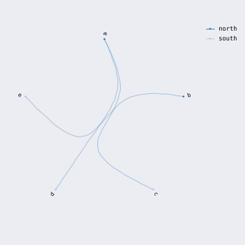
:::


### Node-link tree layout

Tidy or cluster placement, diagonal or straight (`:line`) links, circular.

::: {.clay-table}

```{=html}
<table class="table table-hover table-responsive clay-table"><thead><tr><th>Option</th><th>Type</th><th>Default</th><th>Description</th></tr></thead><tbody><tr><td>:layout</td><td>one of :tidy :cluster</td><td>:tidy</td><td>node placement: :tidy (every node at its depth, d3 tree) or :cluster (leaves at the deepest depth, d3 cluster)</td></tr><tr><td>:links</td><td>one of :diagonal :line</td><td>:diagonal</td><td>link shape: :diagonal (curves along the depth axis) or :line</td></tr><tr><td>:circular</td><td>true or false or nil</td><td>false</td><td>radial: breadth as the angle over :span degrees, height (or depth) as the radius; points in [-1, 1]</td></tr><tr><td>:span</td><td>a positive finite number</td><td>360.0</td><td>degrees a circular layout covers, clockwise from the top</td></tr></tbody></table>
```

:::


::: {.sourceClojure}
```clojure
(plot/render-image (plot/tree org {:layout :cluster :links :line}) {:width 450 :height 300})
```
:::


::: {.clay-image}
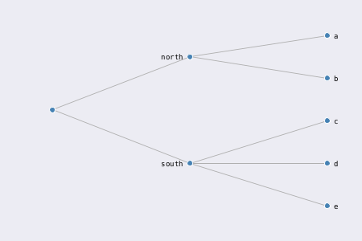
:::


### Edge bundling

Edges between the tree's leaves, bent along the tree with strength `:beta`.

::: {.clay-table}

```{=html}
<table class="table table-hover table-responsive clay-table"><thead><tr><th>Option</th><th>Type</th><th>Default</th><th>Description</th></tr></thead><tbody><tr><td>:from</td><td>a keyword, a function or a categorical marker of one</td><td>:from</td><td>accessor of an edge row's source leaf id</td></tr><tr><td>:to</td><td>a keyword, a function or a categorical marker of one</td><td>:to</td><td>accessor of an edge row's target leaf id</td></tr><tr><td>:beta</td><td>a number in [0 1]</td><td>0.85</td><td>bundling strength: 1 - along the tree path, 0 - a straight line</td></tr></tbody></table>
```

:::


::: {.sourceClojure}
```clojure
(plot/render-image (plot/bundle [{:from "a" :to "d"} {:from "b" :to "e"} {:from "a" :to "c"}] org {:beta 0.9})
                   {:width 400 :height 400})
```
:::


::: {.clay-image}
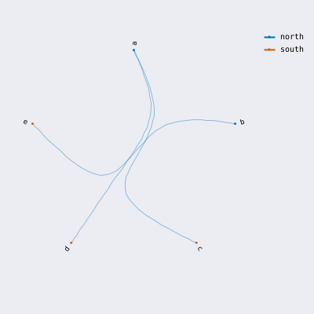
:::


### Sequences

Step sequences as text (`"home-search-end"`) split into rings of a flow sunburst.

::: {.clay-table}

```{=html}
<table class="table table-hover table-responsive clay-table"><thead><tr><th>Option</th><th>Type</th><th>Default</th><th>Description</th></tr></thead><tbody><tr><td>:sequence</td><td>a keyword, a function or a categorical marker of one</td><td>:sequence</td><td>accessor of a row's sequence: a string split at :separator or a sequence of steps</td></tr><tr><td>:value</td><td>a keyword, a function or a categorical marker of one or nil</td><td>1 per row</td><td>accessor of a row's weight, a finite number >= 0 (nil - 1; identical sequences summed)</td></tr><tr><td>:separator</td><td>string</td><td>"-"</td><td>literal text splitting a string sequence into steps</td></tr><tr><td>:end</td><td>any value</td><td>"end"</td><td>the end marker (nil - none): a final step equal to it is removed unless :keep-end</td></tr><tr><td>:keep-end</td><td>true or false or nil</td><td>true</td><td>keep a final end marker as a step of its own (false - a sequence ending before others continue is its group's unnamed leaf)</td></tr></tbody></table>
```

:::


::: {.sourceClojure}
```clojure
(plot/render-image (plot/sequences [{:sequence "home-search-product" :n 5} {:sequence "home-product" :n 3}
                                    {:sequence "search-product-cart" :n 2}]
                                   {:value :n})
                   {:width 400 :height 400})
```
:::


::: {.clay-image}
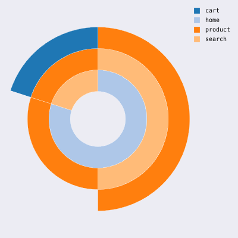
:::


### Autocorrelation rows

The lags of the correlogram, the confidence level of its bands and whether the rows are the partial autocorrelation (`plot/acf` forwards `:lags` and `:level`; it picks the correlograms with its own `:correlograms`).

::: {.clay-table}

```{=html}
<table class="table table-hover table-responsive clay-table"><thead><tr><th>Option</th><th>Type</th><th>Default</th><th>Description</th></tr></thead><tbody><tr><td>:lags</td><td>a positive integer or nil</td><td>floor(10 log10 n), at most n - 1 (R acf)</td><td>the largest lag, from 1 to n - 1 for n values</td></tr><tr><td>:level</td><td>a number in (0 1) or nil</td><td>0.95</td><td>confidence level of the band (0.95 - a 95% band)</td></tr><tr><td>:partial</td><td>true or false or nil</td><td>false</td><td>the partial autocorrelation (lags from 1, a constant band) instead of the autocorrelation</td></tr></tbody></table>
```

:::


::: {.sourceClojure}
```clojure
(plot/render-image (plot/acf (map #(m/sin (m/* 0.5 %)) (range 100)) {:lags 30 :correlograms :pacf})
                   {:width 600 :height 300})
```
:::


::: {.clay-image}
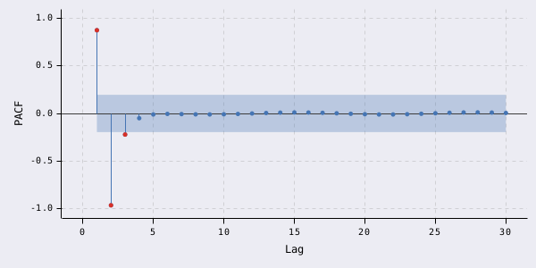
:::


### Horizon rows

The keys of the series rows, the number and height of the bands and resampling between points.

::: {.clay-table}

```{=html}
<table class="table table-hover table-responsive clay-table"><thead><tr><th>Option</th><th>Type</th><th>Default</th><th>Description</th></tr></thead><tbody><tr><td>:x</td><td>keyword or string</td><td>:x</td><td>row key of the x values (numbers)</td></tr><tr><td>:y</td><td>keyword or string</td><td>:y</td><td>row key of the y values (finite numbers, nil breaks the bands)</td></tr><tr><td>:series</td><td>keyword or string or nil</td><td>none - one series</td><td>row key of the series, one horizon per value in first-appearance order</td></tr><tr><td>:bands</td><td>a positive integer</td><td>2</td><td>number of bands each sign of the values is folded into</td></tr><tr><td>:band-height</td><td>a positive finite number or nil</td><td>the largest |y| of all series / :bands (1 when it is 0)</td><td>height of one band in y units</td></tr><tr><td>:interpolator</td><td>a fastmath 1D interpolation method keyword or a function (fn [xs ys & params] f) or nil</td><td>none - straight segments</td><td>a curve the valid points of every run are resampled on before folding</td></tr><tr><td>:steps-per-gap</td><td>a positive integer</td><td>10</td><td>resampled points per gap between consecutive x (with :interpolator)</td></tr></tbody></table>
```

:::


::: {.sourceClojure}
```clojure
(plot/render-image (plot/horizon (for [s ["a" "b"] t (range 60)]
                                   {:x t :y (* (if (= s "a") 1 -1) (m/sin (m/* 0.2 t)) t) :series s})
                                 {:series :series :bands 3})
                   {:width 600 :height 250})
```
:::


::: {.clay-image}
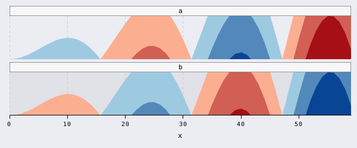
:::


### Named theme styles

A chart's style comes from the theme `[:chart kind]`; `:theme-style` names a `[:chart name]` entry merged over
it - a partial style a theme defines once and charts pick by name (builders draw with their own, see each
builder's page). `build` checks the merged style against the chart's style keys; a name the theme hasn't is an
error.

::: {.clay-table}

```{=html}
<table class="table table-hover table-responsive clay-table"><thead><tr><th>Option</th><th>Type</th><th>Default</th><th>Description</th></tr></thead><tbody><tr><td>:theme-style</td><td>keyword</td><td></td><td>name of a theme [:chart name] style (a builder's, or one the theme adds) merged over the kind's style</td></tr></tbody></table>
```

:::


Highlighted points in a style named `:highlight`, the rest in the scatter style:


::: {.sourceClojure}
```clojure
(plot/render-image {:data points
                    :mapping {:x :x :y :y}
                    :charts [(chart/scatter)
                             (chart/scatter {:data (filter #(> (:y %) 4) points) :theme-style :highlight})]
                    :theme {:chart {:highlight {:size 14 :color [215 48 39] :shape \s}}}}
                   {:width 500 :height 300})
```
:::


::: {.clay-image}
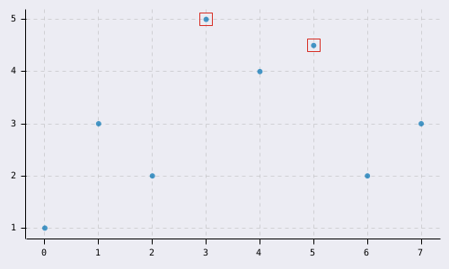
:::


```{=html}
<div style="background-color:grey;height:2px;width:100%;"></div>
```


```{=html}
<div><pre><small><small>source: notebooks/reference/shared_options.clj</small></small></pre></div>
```