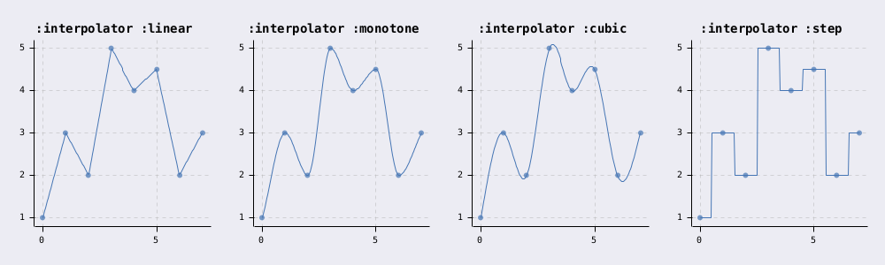

---
format:
  html: {toc: true, toc-location: right, toc-depth: 4, theme: cosmo}
code-block-background: true

---
<style></style><style>.printedClojure .sourceCode {
  background-color: transparent;
  border-style: none;
}
</style><style>.clay-limit-image-width .clay-image {max-width: 100%}
.clay-side-by-side .sourceCode {margin: 0}
.clay-side-by-side {margin: 1em 0}
</style>
<script src="https://code.jquery.com/jquery-3.6.0.min.js" type="text/javascript"></script><script src="https://code.jquery.com/ui/1.13.1/jquery-ui.min.js" type="text/javascript"></script>

# Shared options

Option groups taken by several charts, builders or data functions, documented once here; other tables mark their
rows with the group's title. A chart may take only part of a group - its own table lists what it accepts.


::: {.sourceClojure}
```clojure
(ns reference.shared-options
  (:require [cljplot2.chart :as chart]
            [cljplot2.core :as plot]
            [cljplot2.describe :as describe]
            [notebook-utils :as nu]))
```
:::


## Charts


### Data and mapping

Every chart's own data and mapping (merged over the plot's, Data and mapping chapter).


::: {.sourceClojure}
```clojure
(nu/options-table (describe/fragment-rows :common))
```
:::


::: {.clay-table}

```{=html}
<table class="table table-hover table-responsive clay-table"><thead><tr><th>Option</th><th>Type</th><th>Default</th><th>Description</th><th>Group</th></tr></thead><tbody><tr><td>:data</td><td>a sequence of rows (maps) or a map of columns (sequences) or nil</td><td>the plot's :data</td><td>the chart's own data instead of the plot's</td><td>Data and mapping</td></tr><tr><td>:mapping</td><td>a mapping: key -> accessor (a keyword or a function of a row)</td><td></td><td>the chart's mapping, merged over the plot's mapping (a key set to nil removes it)</td><td>Data and mapping</td></tr></tbody></table>
```

:::


### Annotation options


::: {.sourceClojure}
```clojure
(nu/options-table (describe/fragment-rows :annotation))
```
:::


::: {.clay-table}

```{=html}
<table class="table table-hover table-responsive clay-table"><thead><tr><th>Option</th><th>Type</th><th>Default</th><th>Description</th><th>Group</th></tr></thead><tbody><tr><td>:extent</td><td>true or false or nil</td><td>true</td><td>include the positions in the scale extents</td><td>Annotation options</td></tr></tbody></table>
```

:::


### Line style


::: {.sourceClojure}
```clojure
(nu/options-table (describe/fragment-rows :line-style))
```
:::


::: {.clay-table}

```{=html}
<table class="table table-hover table-responsive clay-table"><thead><tr><th>Option</th><th>Type</th><th>Default</th><th>Description</th><th>Group</th></tr></thead><tbody><tr><td>:color</td><td>a clojure2d color or :none</td><td></td><td>line colour (a mapped :color wins)</td><td>Line style</td></tr><tr><td>:width</td><td>a non-negative number</td><td></td><td>line width in pixels</td><td>Line style</td></tr><tr><td>:dash</td><td>:none, a dash style (:dashed :dot-dash :dot-dot-dash :dotted :long-dash :loose-dot :solid :two-dash) or a sequence of positive numbers or nil</td><td></td><td>dash style of the line (a mapped :dash wins)</td><td>Line style</td></tr></tbody></table>
```

:::


### Curves

The line between data points: straight, a fastmath interpolation or a step, sampled for drawing.


::: {.sourceClojure}
```clojure
(nu/options-table (describe/fragment-rows :curve))
```
:::


::: {.clay-table}

```{=html}
<table class="table table-hover table-responsive clay-table"><thead><tr><th>Option</th><th>Type</th><th>Default</th><th>Description</th><th>Group</th></tr></thead><tbody><tr><td>:interpolator</td><td>a fastmath 1D interpolation method keyword or a function (fn [xs ys & params] f)</td><td></td><td>interpolation of the line between data points (none - straight segments)</td><td>Curves</td></tr><tr><td>:interpolator-params</td><td>vector of any value</td><td></td><td>extra parameters passed to the interpolation method</td><td>Curves</td></tr><tr><td>:curve</td><td>one of :parametric :bezier</td><td></td><td>path curve instead of a function of x: :parametric (x(t), y(t) over the chord length) or :bezier</td><td>Curves</td></tr><tr><td>:sample-step</td><td>a positive number of pixels or {:count n}, n >= 2</td><td>1.0</td><td>distance between evaluated positions: pixels or {:count n} per run</td><td>Curves</td></tr></tbody></table>
```

:::


::: {.sourceClojure}
```clojure
(def points (for [x (range 8)] {:x x :y (nth [1 3 2 5 4 4.5 2 3] x)}))
```
:::


::: {.sourceClojure}
```clojure
(plot/render-image (plot/arrange (for [interpolator [:linear :monotone :cubic :step]]
                                   {:data points
                                    :mapping {:x :x :y :y}
                                    :charts [(chart/line {:interpolator interpolator}) (chart/scatter)]
                                    :labels {:title (str ":interpolator " interpolator)}})
                                 {:columns 4})
                   {:width 1000 :height 300})
```
:::


::: {.clay-image}

:::


### Fill patterns


::: {.sourceClojure}
```clojure
(nu/options-table (describe/fragment-rows :pattern))
```
:::


::: {.clay-table}

```{=html}
<table class="table table-hover table-responsive clay-table"><thead><tr><th>Option</th><th>Type</th><th>Default</th><th>Description</th><th>Group</th></tr></thead><tbody><tr><td>:pattern</td><td>a pattern name (:back-hatch :cross :dense-dots :diagonal-cross :dots :hatch :horizontal :solid :vertical) or a pattern map</td><td></td><td>pattern drawn over the fill (a mapped :pattern wins)</td><td>Fill patterns</td></tr><tr><td>:pattern-color</td><td>:darker or a clojure2d color or :none</td><td></td><td>pattern ink: a colour, :none or :darker (the darkened fill)</td><td>Fill patterns</td></tr></tbody></table>
```

:::


::: {.sourceClojure}
```clojure
(plot/render-image {:data (for [[i p] (map-indexed vector [:hatch :back-hatch :cross :dots])] {:p (name p) :v (+ 3 i)})
                    :mapping {:x :p :y :v :pattern :p}
                    :charts [(chart/bar {:color :white :stroke-color :black :pattern-color :black})]
                    :legend false}
                   {:width 500 :height 300})
```
:::


::: {.clay-image}

:::


### Rounded corners


::: {.sourceClojure}
```clojure
(nu/options-table (describe/fragment-rows :corner-radius))
```
:::


::: {.clay-table}

```{=html}
<table class="table table-hover table-responsive clay-table"><thead><tr><th>Option</th><th>Type</th><th>Default</th><th>Description</th><th>Group</th></tr></thead><tbody><tr><td>:corner-radius</td><td>a non-negative number</td><td>0</td><td>radius in pixels of every bar corner</td><td>Rounded corners</td></tr><tr><td>:corner-radius-end</td><td>a non-negative number</td><td></td><td>radius in pixels of the corners at the bar's value end only (wins over :corner-radius)</td><td>Rounded corners</td></tr></tbody></table>
```

:::


### Strip options

Strip charts (box, violin, stripplot, beeswarm, dotplot, bar, error bars ...) draw one item per level of a
categorical axis.


::: {.sourceClojure}
```clojure
(nu/options-table (describe/fragment-rows :strip))
```
:::


::: {.clay-table}

```{=html}
<table class="table table-hover table-responsive clay-table"><thead><tr><th>Option</th><th>Type</th><th>Default</th><th>Description</th><th>Group</th></tr></thead><tbody><tr><td>:place</td><td>{:at a finite number} or one of :band :bottom :center :edge</td><td>:band with a level mapping, else the chart's own (:center for most, :edge for the rug)</td><td>where the items sit across the value axis: :band (one band per level), {:at v} (centred on v of a numeric scale), :center, :edge or :bottom (between the panel edge and 0)</td><td>Strip options</td></tr><tr><td>:width</td><td>a non-negative number</td><td>0.8</td><td>fraction of the level's band (or of the panel for :center and :bottom) an item spans across the value axis</td><td>Strip options</td></tr><tr><td>:thickness</td><td>a non-negative number</td><td>20 pixels for {:at v}, 8 for :edge</td><td>item thickness in pixels for :place {:at v} and :edge</td><td>Strip options</td></tr><tr><td>:position</td><td>one of :dodge :mirror :overlay</td><td>:dodge when a level holds two or more groups, else :overlay (dotplot: always :overlay)</td><td>how groups of one level share its band: :dodge (side by side), :overlay (on top of each other) or :mirror (two groups, one half each)</td><td>Strip options</td></tr><tr><td>:dodge-gap</td><td>a number in [0 1]</td><td>0.1</td><td>gap between dodged groups, a fraction of a group's part of the band</td><td>Strip options</td></tr><tr><td>:bottom-share</td><td>a number in [0 1]</td><td>0.15 with :place :bottom</td><td>padding below the data asked for with :place :bottom (only there), a fraction of the y data span</td><td>Strip options</td></tr><tr><td>:n-label</td><td>true or false or nil</td><td>false</td><td>draw each item's row count just past its largest value</td><td>Strip options</td></tr><tr><td>:n-format</td><td>string</td><td>"n=%d"</td><td>format string of the n labels</td><td>Strip options</td></tr><tr><td>:level-axis</td><td>one of :x :y</td><td>the categorical axis of the mapping; with neither, :x when only :y is mapped, else :y</td><td>the mapping axis holding the levels (decides when both or neither of :x and :y are categorical)</td><td>Strip options</td></tr></tbody></table>
```

:::


### Mirrored strips


::: {.sourceClojure}
```clojure
(nu/options-table (describe/fragment-rows :mirror))
```
:::


::: {.clay-table}

```{=html}
<table class="table table-hover table-responsive clay-table"><thead><tr><th>Option</th><th>Type</th><th>Default</th><th>Description</th><th>Group</th></tr></thead><tbody><tr><td>:mirror</td><td>one of :color :shape :size :dash :pattern :group</td><td></td><td>a grouping dimension with exactly two levels; the second level's items are drawn on the negative side</td><td>Mirrored strips</td></tr></tbody></table>
```

:::


### Ridgelines


::: {.sourceClojure}
```clojure
(nu/options-table (describe/fragment-rows :ridge))
```
:::


::: {.clay-table}

```{=html}
<table class="table table-hover table-responsive clay-table"><thead><tr><th>Option</th><th>Type</th><th>Default</th><th>Description</th><th>Group</th></tr></thead><tbody><tr><td>:overlap</td><td>a non-negative number</td><td>0.9</td><td>height of the tallest ridge in band steps (above 1 - ridges overlap the next level)</td><td>Ridgelines</td></tr></tbody></table>
```

:::


### Cell style


::: {.sourceClojure}
```clojure
(nu/options-table (describe/fragment-rows :cell))
```
:::


::: {.clay-table}

```{=html}
<table class="table table-hover table-responsive clay-table"><thead><tr><th>Option</th><th>Type</th><th>Default</th><th>Description</th><th>Group</th></tr></thead><tbody><tr><td>:cell</td><td>one of :square :shifted-square :triangle :rhombus :flat-hex :pointy-hex</td><td></td><td>cell shape of the grid (a fastmath grid cell type)</td><td>Cell style</td></tr><tr><td>:cell-scale</td><td>a finite number, > 0, <= 1</td><td></td><td>cell polygon size relative to its grid cell, in (0 1]</td><td>Cell style</td></tr><tr><td>:stroke-color</td><td>:darker or a clojure2d color or :none</td><td></td><td>cell outline: a colour, :none or :darker (the darkened fill)</td><td>Cell style</td></tr><tr><td>:stroke-width</td><td>a non-negative number</td><td></td><td>cell outline width in pixels</td><td>Cell style</td></tr><tr><td>:alpha</td><td>a number in [0 1]</td><td></td><td>fill opacity multiplier</td><td>Cell style</td></tr></tbody></table>
```

:::


### Fields


::: {.sourceClojure}
```clojure
(nu/options-table (describe/fragment-rows :field))
```
:::


::: {.clay-table}

```{=html}
<table class="table table-hover table-responsive clay-table"><thead><tr><th>Option</th><th>Type</th><th>Default</th><th>Description</th><th>Group</th></tr></thead><tbody><tr><td>:f</td><td>a function</td><td></td><td>the field as a function of a point [x y] returning a number (instead of mapped data)</td><td>Fields</td></tr><tr><td>:domain</td><td>map</td><td>the plot's explicit :x and :y scale domains</td><td>the domain of a function field</td><td>Fields</td></tr><tr><td>:domain :x (required)</td><td>[a finite number, a finite number]</td><td></td><td>x domain [lo hi]</td><td></td></tr><tr><td>:domain :y (required)</td><td>[a finite number, a finite number]</td><td></td><td>y domain [lo hi]</td><td></td></tr><tr><td>:kernel</td><td>keyword</td><td>:gaussian</td><td>fastmath kernel of the 2D density estimate of mapped points</td><td>Fields</td></tr><tr><td>:bandwidth</td><td>a positive finite number or one of :nrd :nrd0 :nrd-adjust :sj :sj-dpi :rlcv :lcv :lscv :scott or [a positive finite number or one of :nrd :nrd0 :nrd-adjust :sj :sj-dpi :rlcv :lcv :lscv :scott, a positive finite number or one of :nrd :nrd0 :nrd-adjust :sj :sj-dpi :rlcv :lcv :lscv :scott]</td><td>:nrd per axis (MASS::kde2d, as ggplot2)</td><td>bandwidth of the density estimate: a number, a fastmath selector or :scott, or a pair [hx hy] of them</td><td>Fields</td></tr><tr><td>:binned?</td><td>true or false</td><td>false</td><td>estimate the density from binned points (faster for many points)</td><td>Fields</td></tr><tr><td>:cut</td><td>a non-negative finite number</td><td>3</td><td>how many bandwidths the density domain extends past the points on each side</td><td>Fields</td></tr><tr><td>:interpolation</td><td>one of :bilinear :bicubic :cubic-2d</td><td>:bilinear</td><td>interpolation of gridded data (mapped :x, :y, :value on a full lattice)</td><td>Fields</td></tr><tr><td>:n</td><td>integer (2..2000) or [integer (2..2000), integer (2..2000)]</td><td>100</td><td>grid size: values sampled along each axis, or [nx ny]</td><td>Fields</td></tr></tbody></table>
```

:::


### Hierarchy labels


::: {.sourceClojure}
```clojure
(nu/options-table (describe/fragment-rows :hierarchy-labels))
```
:::


::: {.clay-table}

```{=html}
<table class="table table-hover table-responsive clay-table"><thead><tr><th>Option</th><th>Type</th><th>Default</th><th>Description</th><th>Group</th></tr></thead><tbody><tr><td>:group-labels</td><td>true or false or a function or nil</td><td>true</td><td>group labels: true - the node's name, false - none, or a function of the node info {:name :value :depth :path :share :parent-share} returning the text</td><td>Hierarchy labels</td></tr><tr><td>:leaf-labels</td><td>true or false or a function or nil</td><td>true</td><td>leaf labels: as :group-labels, for the leaves</td><td>Hierarchy labels</td></tr></tbody></table>
```

:::


### 3D frame


::: {.sourceClojure}
```clojure
(nu/options-table (describe/fragment-rows :frame-3d))
```
:::


::: {.clay-table}

```{=html}
<table class="table table-hover table-responsive clay-table"><thead><tr><th>Option</th><th>Type</th><th>Default</th><th>Description</th><th>Group</th></tr></thead><tbody><tr><td>:view</td><td>map</td><td></td><td>the eye's position: azimuth, elevation and perspective distance</td><td>3D frame</td></tr><tr><td>:view :azimuth</td><td>a finite number</td><td>40.0</td><td>rotation around the vertical axis, degrees</td><td></td></tr><tr><td>:view :elevation</td><td>a finite number, >= -90, <= 90</td><td>30.0</td><td>angle of the eye above the floor, degrees</td><td></td></tr><tr><td>:view :distance</td><td>a non-negative finite number</td><td>0.0</td><td>perspective: 0 - parallel projection, larger - stronger perspective (lattice distance)</td><td></td></tr><tr><td>:aspect</td><td>[a positive number, a positive number, a positive number]</td><td>[1 1 1]</td><td>box proportions [ax ay az]</td><td>3D frame</td></tr><tr><td>:box</td><td>true or false or nil</td><td>true</td><td>draw the box: hidden edges dashed and a floor grid behind the data, visible edges over it</td><td>3D frame</td></tr><tr><td>:axes</td><td>true or false or nil</td><td>true</td><td>draw ticks, tick labels and axis titles</td><td>3D frame</td></tr><tr><td>:axis-titles</td><td>map</td><td>the mapped column names</td><td>axis titles (nil - none)</td><td>3D frame</td></tr><tr><td>:axis-titles :x</td><td>any value</td><td></td><td>x axis title</td><td></td></tr><tr><td>:axis-titles :y</td><td>any value</td><td></td><td>y axis title</td><td></td></tr><tr><td>:axis-titles :z</td><td>any value</td><td></td><td>z axis title</td><td></td></tr><tr><td>:domain</td><td>map</td><td>the data's domains</td><td>explicit data domains (needed for each of several 3D charts in one plot)</td><td>3D frame</td></tr><tr><td>:domain :x</td><td>[a finite number, a finite number]</td><td></td><td>explicit x domain [a b] (a > b reverses the axis)</td><td></td></tr><tr><td>:domain :y</td><td>[a finite number, a finite number]</td><td></td><td>explicit y domain [a b] (a > b reverses the axis)</td><td></td></tr><tr><td>:domain :z</td><td>[a finite number, a finite number]</td><td></td><td>explicit z domain [a b] (a > b reverses the axis)</td><td></td></tr><tr><td>:reverse</td><td>set of one of :x :y :z</td><td></td><td>axes running the other way (mirrors the scene)</td><td>3D frame</td></tr></tbody></table>
```

:::


### Text style

Also the style of every theme text role (Theme chapter).


::: {.sourceClojure}
```clojure
(nu/options-table (describe/fragment-rows :text-style))
```
:::


::: {.clay-table}

```{=html}
<table class="table table-hover table-responsive clay-table"><thead><tr><th>Option</th><th>Type</th><th>Default</th><th>Description</th><th>Group</th></tr></thead><tbody><tr><td>:font</td><td>a bundled, installed or logical font name, or a java.awt.Font</td><td></td><td>font name (bundled, installed or logical) or a java.awt.Font</td><td>Text style</td></tr><tr><td>:size</td><td>a positive number</td><td></td><td>font size in points</td><td>Text style</td></tr><tr><td>:font-style</td><td>one of :bold :bold-italic :italic :plain</td><td></td><td>font style</td><td>Text style</td></tr><tr><td>:color</td><td>a clojure2d color</td><td></td><td>text colour</td><td>Text style</td></tr><tr><td>:padding</td><td>a non-negative number</td><td></td><td>space around the text in pixels</td><td>Text style</td></tr><tr><td>:align</td><td>[h v], h one of :left :center :right, v one of :top :middle :bottom</td><td></td><td>alignment [horizontal vertical] of the text at its anchor</td><td>Text style</td></tr><tr><td>:background</td><td>a clojure2d color or :none</td><td></td><td>box colour behind the text (:none - no box)</td><td>Text style</td></tr></tbody></table>
```

:::


## Builders


### Builder options


::: {.sourceClojure}
```clojure
(nu/options-table (describe/fragment-rows :builder))
```
:::


::: {.clay-table}

```{=html}
<table class="table table-hover table-responsive clay-table"><thead><tr><th>Option</th><th>Type</th><th>Default</th><th>Description</th><th>Group</th></tr></thead><tbody><tr><td>:title</td><td>any value</td><td></td><td>plot title (a text or label options)</td><td>Builder options</td></tr><tr><td>:scales</td><td>any value</td><td></td><td>scale specs deep-merged into the builder's (validated with the plot)</td><td>Builder options</td></tr><tr><td>:theme</td><td>any value</td><td></td><td>theme overrides of the built plot</td><td>Builder options</td></tr></tbody></table>
```

:::


### Multiplot layout


::: {.sourceClojure}
```clojure
(nu/options-table (describe/fragment-rows :arrange))
```
:::


::: {.clay-table}

```{=html}
<table class="table table-hover table-responsive clay-table"><thead><tr><th>Option</th><th>Type</th><th>Default</th><th>Description</th><th>Group</th></tr></thead><tbody><tr><td>:plots (required)</td><td>sequential of map (at least 1)</td><td></td><td>the sub-plots, filling the grid row by row</td><td>Multiplot layout</td></tr><tr><td>:columns</td><td>a positive integer or nil</td><td>one column (from :rows when given)</td><td>grid columns</td><td>Multiplot layout</td></tr><tr><td>:rows</td><td>a positive integer or nil</td><td>from the plot count and :columns</td><td>grid rows</td><td>Multiplot layout</td></tr><tr><td>:widths</td><td>sequential of a positive number or :measured or [:fixed, a non-negative number] or nil</td><td>equal</td><td>relative column weights; :measured sizes a column of legend-only plots, [:fixed px] a fixed width</td><td>Multiplot layout</td></tr><tr><td>:heights</td><td>sequential of a positive number or [:fixed, a non-negative number] or nil</td><td>equal</td><td>relative row weights; [:fixed px] a fixed height</td><td>Multiplot layout</td></tr><tr><td>:align</td><td>true or false or nil</td><td>true</td><td>align the sub-plots' panels in rows and columns</td><td>Multiplot layout</td></tr><tr><td>:equal-panels</td><td>true or false or nil</td><td>false</td><td>resize columns and rows so every aligned panel has the same size (builds twice)</td><td>Multiplot layout</td></tr></tbody></table>
```

:::


## Builders and data functions

The options a builder forwards to the data function computing its layout; the function takes them directly too.


### Graph


::: {.sourceClojure}
```clojure
(nu/options-table (describe/fragment-rows :graph/graph))
```
:::


::: {.clay-table}

```{=html}
<table class="table table-hover table-responsive clay-table"><thead><tr><th>Option</th><th>Type</th><th>Default</th><th>Description</th><th>Group</th></tr></thead><tbody><tr><td>:from</td><td>a keyword, a function or a categorical marker of one</td><td>:from</td><td>accessor of an edge row's source node id</td><td>Graph</td></tr><tr><td>:to</td><td>a keyword, a function or a categorical marker of one</td><td>:to</td><td>accessor of an edge row's target node id</td><td>Graph</td></tr><tr><td>:value</td><td>a keyword, a function or a categorical marker of one</td><td>:value</td><td>accessor of an edge row's weight, a finite number >= 0 (nil - 1)</td><td>Graph</td></tr><tr><td>:nodes</td><td>sequential of map or nil</td><td></td><td>node rows (each with an id), placed first in their order; ids seen only in edges follow</td><td>Graph</td></tr><tr><td>:id</td><td>a keyword, a function or a categorical marker of one</td><td>:id</td><td>accessor of a node row's id</td><td>Graph</td></tr><tr><td>:directed?</td><td>true or false or nil</td><td>false</td><td>a directed graph: degrees split into :in and :out</td><td>Graph</td></tr></tbody></table>
```

:::


### Graph layout


::: {.sourceClojure}
```clojure
(nu/options-table (describe/fragment-rows :graph/layout))
```
:::


::: {.clay-table}

```{=html}
<table class="table table-hover table-responsive clay-table"><thead><tr><th>Option</th><th>Type</th><th>Default</th><th>Description</th><th>Group</th></tr></thead><tbody><tr><td>:layout</td><td>one of :circle :force :random</td><td>:force</td><td>node placement: :force (Fruchterman-Reingold), :circle or :random</td><td>Graph layout</td></tr><tr><td>:iterations</td><td>integer (at least 0)</td><td>500</td><td>steps of the force layout</td><td>Graph layout</td></tr><tr><td>:gravity</td><td>a non-negative finite number</td><td>1.0</td><td>pull of the force layout to each component's centroid, in units of the ideal edge length (0 - none)</td><td>Graph layout</td></tr><tr><td>:rng</td><td>a fastmath random generator or nil</td><td>a fresh unseeded generator every call</td><td>fastmath random generator of the force and random layouts, copied per call (seeded - the same layout every time)</td><td>Graph layout</td></tr></tbody></table>
```

:::


### Chord layout


::: {.sourceClojure}
```clojure
(nu/options-table (describe/fragment-rows :graph/chord-layout))
```
:::


::: {.clay-table}

```{=html}
<table class="table table-hover table-responsive clay-table"><thead><tr><th>Option</th><th>Type</th><th>Default</th><th>Description</th><th>Group</th></tr></thead><tbody><tr><td>:order</td><td>:cluster or sequential of any value or nil</td><td>the nodes' input order</td><td>node order: a sequence of ids (those first, the rest after them in input order) or :cluster (nodes linked to the same others side by side)</td><td>Chord layout</td></tr><tr><td>:pad</td><td>a non-negative finite number</td><td>2.0</td><td>gap after every ring sector in degrees (must leave room for the sectors)</td><td>Chord layout</td></tr><tr><td>:inner</td><td>a number in (0 1)</td><td>0.92</td><td>inner radius of the ring, where the ribbons end (the outer one is 1)</td><td>Chord layout</td></tr><tr><td>:min-value</td><td>a non-negative finite number or nil</td><td></td><td>flows of a pair (summed) below it are left out and counted in :dropped (nil - none)</td><td>Chord layout</td></tr></tbody></table>
```

:::


### Arc layout


::: {.sourceClojure}
```clojure
(nu/options-table (describe/fragment-rows :graph/arc-layout))
```
:::


::: {.clay-table}

```{=html}
<table class="table table-hover table-responsive clay-table"><thead><tr><th>Option</th><th>Type</th><th>Default</th><th>Description</th><th>Group</th></tr></thead><tbody><tr><td>:order</td><td>:cluster or sequential of any value or nil</td><td>the nodes' input order</td><td>node order: a sequence of ids (those first, the rest after them in input order) or :cluster (nodes linked to the same others side by side)</td><td>Arc layout</td></tr></tbody></table>
```

:::


### Sankey layout


::: {.sourceClojure}
```clojure
(nu/options-table (describe/fragment-rows :graph/sankey-layout))
```
:::


::: {.clay-table}

```{=html}
<table class="table table-hover table-responsive clay-table"><thead><tr><th>Option</th><th>Type</th><th>Default</th><th>Description</th><th>Group</th></tr></thead><tbody><tr><td>:align</td><td>one of :center :justify :left :right</td><td>:justify</td><td>the column of a node: :justify (sinks in the last column), :left, :right (by the longest path to a sink) or :center</td><td>Sankey layout</td></tr><tr><td>:layer</td><td>a keyword, a function or a categorical marker of one or nil</td><td>columns from :align</td><td>accessor of the node rows giving the column (integers >= 0, every edge to a later one; wins over :align)</td><td>Sankey layout</td></tr><tr><td>:node-width</td><td>a number in (0 1)</td><td>0.03</td><td>node width, a fraction of the unit square's width</td><td>Sankey layout</td></tr><tr><td>:pad</td><td>a non-negative finite number</td><td>0.02</td><td>least gap between the nodes of a column, a fraction of the unit square's height</td><td>Sankey layout</td></tr><tr><td>:iterations</td><td>integer (at least 0)</td><td>6</td><td>relaxation sweeps moving the nodes towards their links' ends (0 - spread in the start order)</td><td>Sankey layout</td></tr><tr><td>:node-sort</td><td>one of :input or nil</td><td></td><td>nil - relaxation reorders a column, :input - the input order kept</td><td>Sankey layout</td></tr></tbody></table>
```

:::


### Alluvial graph


::: {.sourceClojure}
```clojure
(nu/options-table (describe/fragment-rows :graph/alluvial-graph))
```
:::


::: {.clay-table}

```{=html}
<table class="table table-hover table-responsive clay-table"><thead><tr><th>Option</th><th>Type</th><th>Default</th><th>Description</th><th>Group</th></tr></thead><tbody><tr><td>:axes (required)</td><td>sequential of a keyword, a function or a categorical marker of one (at least 2)</td><td></td><td>accessors of the axes, in column order (at least 2)</td><td>Alluvial graph</td></tr><tr><td>:value</td><td>a keyword, a function or a categorical marker of one or nil</td><td>1 per row</td><td>accessor of a row's weight, a finite number >= 0 (nil - 1)</td><td>Alluvial graph</td></tr><tr><td>:fill</td><td>a keyword, a function or a categorical marker of one or nil</td><td>the first axis</td><td>accessor of the level the strands are grouped (and coloured) by</td><td>Alluvial graph</td></tr></tbody></table>
```

:::


### Dendrogram layout


::: {.sourceClojure}
```clojure
(nu/options-table (describe/fragment-rows :tree/layout))
```
:::


::: {.clay-table}

```{=html}
<table class="table table-hover table-responsive clay-table"><thead><tr><th>Option</th><th>Type</th><th>Default</th><th>Description</th><th>Group</th></tr></thead><tbody><tr><td>:k</td><td>a positive integer or nil</td><td>no clusters (every :cluster nil)</td><td>cluster count: cutting the k - 1 highest groups leaves k subtrees, clusters 1..k in leaf order (at most the leaf count)</td><td>Dendrogram layout</td></tr><tr><td>:circular</td><td>true or false or nil</td><td>false</td><td>radial: breadth as the angle over :span degrees, height (or depth) as the radius; points in [-1, 1]</td><td>Dendrogram layout</td></tr><tr><td>:span</td><td>a positive finite number</td><td>360.0</td><td>degrees a circular layout covers, clockwise from the top</td><td>Dendrogram layout</td></tr></tbody></table>
```

:::


### Node-link tree layout


::: {.sourceClojure}
```clojure
(nu/options-table (describe/fragment-rows :tree/node-link-layout))
```
:::


::: {.clay-table}

```{=html}
<table class="table table-hover table-responsive clay-table"><thead><tr><th>Option</th><th>Type</th><th>Default</th><th>Description</th><th>Group</th></tr></thead><tbody><tr><td>:layout</td><td>one of :tidy :cluster</td><td>:tidy</td><td>node placement: :tidy (every node at its depth, d3 tree) or :cluster (leaves at the deepest depth, d3 cluster)</td><td>Node-link tree layout</td></tr><tr><td>:links</td><td>one of :diagonal :line</td><td>:diagonal</td><td>link shape: :diagonal (curves along the depth axis) or :line</td><td>Node-link tree layout</td></tr><tr><td>:circular</td><td>true or false or nil</td><td>false</td><td>radial: breadth as the angle over :span degrees, height (or depth) as the radius; points in [-1, 1]</td><td>Node-link tree layout</td></tr><tr><td>:span</td><td>a positive finite number</td><td>360.0</td><td>degrees a circular layout covers, clockwise from the top</td><td>Node-link tree layout</td></tr></tbody></table>
```

:::


### Edge bundling


::: {.sourceClojure}
```clojure
(nu/options-table (describe/fragment-rows :tree/bundle-paths))
```
:::


::: {.clay-table}

```{=html}
<table class="table table-hover table-responsive clay-table"><thead><tr><th>Option</th><th>Type</th><th>Default</th><th>Description</th><th>Group</th></tr></thead><tbody><tr><td>:from</td><td>a keyword, a function or a categorical marker of one</td><td>:from</td><td>accessor of an edge row's source leaf id</td><td>Edge bundling</td></tr><tr><td>:to</td><td>a keyword, a function or a categorical marker of one</td><td>:to</td><td>accessor of an edge row's target leaf id</td><td>Edge bundling</td></tr><tr><td>:beta</td><td>a number in [0 1]</td><td>0.85</td><td>bundling strength: 1 - along the tree path, 0 - a straight line</td><td>Edge bundling</td></tr></tbody></table>
```

:::


### Sequences


::: {.sourceClojure}
```clojure
(nu/options-table (describe/fragment-rows :hierarchy/sequence-levels))
```
:::


::: {.clay-table}

```{=html}
<table class="table table-hover table-responsive clay-table"><thead><tr><th>Option</th><th>Type</th><th>Default</th><th>Description</th><th>Group</th></tr></thead><tbody><tr><td>:sequence</td><td>a keyword, a function or a categorical marker of one</td><td>:sequence</td><td>accessor of a row's sequence: a string split at :separator or a sequence of steps</td><td>Sequences</td></tr><tr><td>:value</td><td>a keyword, a function or a categorical marker of one or nil</td><td>1 per row</td><td>accessor of a row's weight, a finite number >= 0 (nil - 1; identical sequences summed)</td><td>Sequences</td></tr><tr><td>:separator</td><td>string</td><td>"-"</td><td>literal text splitting a string sequence into steps</td><td>Sequences</td></tr><tr><td>:end</td><td>any value</td><td>"end"</td><td>the end marker (nil - none): a final step equal to it is removed unless :keep-end?</td><td>Sequences</td></tr><tr><td>:keep-end?</td><td>true or false or nil</td><td>false</td><td>keep a final end marker as a step of its own (false - a sequence ending before others continue is its group's unnamed leaf)</td><td>Sequences</td></tr></tbody></table>
```

:::


### Autocorrelation rows


::: {.sourceClojure}
```clojure
(nu/options-table (describe/fragment-rows :series/acf-rows))
```
:::


::: {.clay-table}

```{=html}
<table class="table table-hover table-responsive clay-table"><thead><tr><th>Option</th><th>Type</th><th>Default</th><th>Description</th><th>Group</th></tr></thead><tbody><tr><td>:lags</td><td>a positive integer or nil</td><td>floor(10 log10 n), at most n - 1 (R acf)</td><td>the largest lag, from 1 to n - 1 for n values</td><td>Autocorrelation rows</td></tr><tr><td>:alpha</td><td>a number in (0 1) or nil</td><td>0.05</td><td>significance level of the band (0.05 - a 95% band)</td><td>Autocorrelation rows</td></tr><tr><td>:partial?</td><td>true or false or nil</td><td>false</td><td>the partial autocorrelation (lags from 1, a constant band) instead of the autocorrelation</td><td>Autocorrelation rows</td></tr></tbody></table>
```

:::


### Horizon rows


::: {.sourceClojure}
```clojure
(nu/options-table (describe/fragment-rows :series/horizon-rows))
```
:::


::: {.clay-table}

```{=html}
<table class="table table-hover table-responsive clay-table"><thead><tr><th>Option</th><th>Type</th><th>Default</th><th>Description</th><th>Group</th></tr></thead><tbody><tr><td>:x</td><td>keyword or string</td><td>:x</td><td>row key of the x values (numbers)</td><td>Horizon rows</td></tr><tr><td>:y</td><td>keyword or string</td><td>:y</td><td>row key of the y values (finite numbers, nil breaks the bands)</td><td>Horizon rows</td></tr><tr><td>:series</td><td>keyword or string or nil</td><td>none - one series</td><td>row key of the series, one horizon per value in first-appearance order</td><td>Horizon rows</td></tr><tr><td>:bands</td><td>a positive integer</td><td>2</td><td>number of bands each sign of the values is folded into</td><td>Horizon rows</td></tr><tr><td>:band-height</td><td>a positive finite number or nil</td><td>the largest |y| of all series / :bands (1 when it is 0)</td><td>height of one band in y units</td><td>Horizon rows</td></tr><tr><td>:interpolator</td><td>a fastmath 1D interpolation method keyword or a function (fn [xs ys & params] f) or nil</td><td>none - straight segments</td><td>a curve the valid points of every run are resampled on before folding</td><td>Horizon rows</td></tr><tr><td>:steps-per-gap</td><td>a positive integer</td><td>10</td><td>resampled points per gap between consecutive x (with :interpolator)</td><td>Horizon rows</td></tr></tbody></table>
```

:::


```{=html}
<div style="background-color:grey;height:2px;width:100%;"></div>
```


```{=html}
<div><pre><small><small>source: notebooks/reference/shared_options.clj</small></small></pre></div>
```