---
format:
  html:
    toc: true
    toc-location: right
    toc-depth: 4
    theme: cosmo
    include-in-header:
      text: |-
        <style>
        .data-table { width: fit-content; max-width: 100%; max-height: 15rem; overflow: auto; margin: 0 0 1rem 0; }
        .data-table .table-responsive { overflow: visible; }
        .data-table table { font-size: 0.75rem; width: auto; margin: 0; }
        .data-table th, .data-table td { padding: 0.1rem 0.45rem !important; white-space: nowrap; }
        .data-table thead th { position: sticky; top: 0; background: var(--bs-body-bg, #fff); }
        .options { margin: 0.5rem 0 1rem 0; }
        .options .option-card { margin: 0 0 0.9rem 0; border: 1px solid var(--bs-border-color, #dee2e6); border-radius: 0.375rem; overflow: hidden; }
        .options dt { display: flex; flex-wrap: wrap; align-items: baseline; gap: 0.1rem 1rem; margin: 0; padding: 0.4rem 0.75rem; background: #eef2f7; border-bottom: 1px solid var(--bs-border-color, #dee2e6); font-weight: normal; }
        .options dt > code { font-weight: 700; font-size: 1rem; background: none; padding: 0; }
        .options .option-default { font-size: 0.85rem; color: var(--bs-secondary-color, #6c757d); }
        .options dd { margin: 0; padding: 0.5rem 0.75rem; }
        .options .option-example { font-size: 0.85rem; padding: 0 0 0.45rem 0; margin-bottom: 0.45rem; border-bottom: 1px dashed var(--bs-border-color, #dee2e6); }
        .options .option-example code { background: none; padding: 0; }
        .options .option-text ul { margin: 0.3rem 0 0 0; padding-left: 1.25rem; }
        .options code, .mapping code { overflow-wrap: anywhere; }
        .mapping { margin: 0.5rem 0 1rem 0; padding: 0.5rem 0.75rem; border: 1px solid var(--bs-border-color, #dee2e6); border-left: 0.3rem solid #2780e3; border-radius: 0.375rem; background: #f5f8fc; }
        .mapping-title { font-weight: 700; margin-bottom: 0.25rem; }
        .mapping-hint { font-weight: normal; font-size: 0.85rem; color: var(--bs-secondary-color, #6c757d); }
        .mapping ul { margin: 0; padding-left: 1.25rem; }
        .mapping .required { font-size: 0.75rem; padding: 0 0.3rem; border: 1px solid currentColor; border-radius: 0.25rem; }
        .shared { margin: 0.5rem 0 1rem 0; padding: 0.5rem 0.75rem; border: 1px solid var(--bs-border-color, #dee2e6); border-left: 0.3rem solid #6c757d; border-radius: 0.375rem; background: #f6f6f6; }
        .shared-title { font-weight: 700; margin-bottom: 0.25rem; }
        .shared-hint { font-weight: normal; font-size: 0.85rem; color: var(--bs-secondary-color, #6c757d); }
        .shared ul { margin: 0; padding-left: 1.25rem; }
        .shared code { overflow-wrap: anywhere; }
        </style>
code-block-background: true

---
<style></style><style>.printedClojure .sourceCode {
  background-color: transparent;
  border-style: none;
}
</style><style>.clay-limit-image-width .clay-image {max-width: 100%}
.clay-side-by-side .sourceCode {margin: 0}
.clay-side-by-side {margin: 1em 0}
</style>
<script src="https://code.jquery.com/jquery-3.6.0.min.js" type="text/javascript"></script><script src="https://code.jquery.com/ui/1.13.1/jquery-ui.min.js" type="text/javascript"></script>

# Specific cases

The functions behind some charts are ordinary public functions in internal namespaces: probability plot pairs,
kernel density curves, smoothing fits, dot plot bins, circle packing, treemap rectangles and Venn circles. They
are not part of the documented API - no option tables, no validation, and they may change - but they return
plain data, so a computation a chart doesn't offer can start from them and draw with ordinary charts. Each
section shows the data and a chart drawn from it; then the lists of fastmath distributions and kernels the charts
accept, a few recipes and links to the use cases and galleries.


::: {.sourceClojure}
```clojure
(ns reference.specific-cases
  (:require [fastmath.core :as m]
            [fastmath.kernel :as kernel]
            [fastmath.random :as r]
            [fastmath.stats :as stats]
            [cljplot2.chart :as chart]
            [cljplot2.core :as plot]
            [cljplot2.data.dots :as dots]
            [cljplot2.data.kde :as kde]
            [cljplot2.data.probability :as probability]
            [cljplot2.data.smooth :as smooth]
            [cljplot2.layout.pack :as pack]
            [cljplot2.layout.treemap :as treemap]
            [cljplot2.layout.venn :as venn]
            [notebook-utils :as nu]))
```
:::


Data: Old Faithful geyser eruptions, R datasets package `faithful` (Härdle 1991; Azzalini & Bowman 1990); licence: Part of R (GPL-2 | GPL-3).


::: {.sourceClojure}
```clojure
(def faithful (nu/dataset :faithful))
```
:::


```{=html}
<div class="data-table"><table class="table table-hover table-responsive clay-table"><thead><tr><th>eruptions</th><th>waiting</th></tr></thead><tbody><tr><td>3.6</td><td>79</td></tr><tr><td>1.8</td><td>54</td></tr><tr><td>3.333</td><td>74</td></tr><tr><td>2.283</td><td>62</td></tr><tr><td>4.533</td><td>85</td></tr><tr><td>2.883</td><td>55</td></tr><tr><td>4.7</td><td>88</td></tr><tr><td>3.6</td><td>85</td></tr><tr><td>1.95</td><td>51</td></tr><tr><td>4.35</td><td>85</td></tr><tr><td>1.833</td><td>54</td></tr><tr><td>3.917</td><td>84</td></tr><tr><td>4.2</td><td>78</td></tr><tr><td>1.75</td><td>47</td></tr><tr><td>4.7</td><td>83</td></tr><tr><td>2.167</td><td>52</td></tr><tr><td>1.75</td><td>62</td></tr><tr><td>4.8</td><td>84</td></tr><tr><td>1.6</td><td>52</td></tr><tr><td>4.25</td><td>79</td></tr><tr><td>1.8</td><td>51</td></tr><tr><td>1.75</td><td>47</td></tr><tr><td>3.45</td><td>78</td></tr><tr><td>3.067</td><td>69</td></tr><tr><td>4.533</td><td>74</td></tr><tr><td>3.6</td><td>83</td></tr><tr><td>1.967</td><td>55</td></tr><tr><td>4.083</td><td>76</td></tr><tr><td>3.85</td><td>78</td></tr><tr><td>4.433</td><td>79</td></tr><tr><td>4.3</td><td>73</td></tr><tr><td>4.467</td><td>77</td></tr><tr><td>3.367</td><td>66</td></tr><tr><td>4.033</td><td>80</td></tr><tr><td>3.833</td><td>74</td></tr><tr><td>2.017</td><td>52</td></tr><tr><td>1.867</td><td>48</td></tr><tr><td>4.833</td><td>80</td></tr><tr><td>1.833</td><td>59</td></tr><tr><td>4.783</td><td>90</td></tr><tr><td>4.35</td><td>80</td></tr><tr><td>1.883</td><td>58</td></tr><tr><td>4.567</td><td>84</td></tr><tr><td>1.75</td><td>58</td></tr><tr><td>4.533</td><td>73</td></tr><tr><td>3.317</td><td>83</td></tr><tr><td>3.833</td><td>64</td></tr><tr><td>2.1</td><td>53</td></tr><tr><td>4.633</td><td>82</td></tr><tr><td>2</td><td>59</td></tr><tr><td>4.8</td><td>75</td></tr><tr><td>4.716</td><td>90</td></tr><tr><td>1.833</td><td>54</td></tr><tr><td>4.833</td><td>80</td></tr><tr><td>1.733</td><td>54</td></tr><tr><td>4.883</td><td>83</td></tr><tr><td>3.717</td><td>71</td></tr><tr><td>1.667</td><td>64</td></tr><tr><td>4.567</td><td>77</td></tr><tr><td>4.317</td><td>81</td></tr><tr><td>2.233</td><td>59</td></tr><tr><td>4.5</td><td>84</td></tr><tr><td>1.75</td><td>48</td></tr><tr><td>4.8</td><td>82</td></tr><tr><td>1.817</td><td>60</td></tr><tr><td>4.4</td><td>92</td></tr><tr><td>4.167</td><td>78</td></tr><tr><td>4.7</td><td>78</td></tr><tr><td>2.067</td><td>65</td></tr><tr><td>4.7</td><td>73</td></tr><tr><td>4.033</td><td>82</td></tr><tr><td>1.967</td><td>56</td></tr><tr><td>4.5</td><td>79</td></tr><tr><td>4</td><td>71</td></tr><tr><td>1.983</td><td>62</td></tr><tr><td>5.067</td><td>76</td></tr><tr><td>2.017</td><td>60</td></tr><tr><td>4.567</td><td>78</td></tr><tr><td>3.883</td><td>76</td></tr><tr><td>3.6</td><td>83</td></tr><tr><td>4.133</td><td>75</td></tr><tr><td>4.333</td><td>82</td></tr><tr><td>4.1</td><td>70</td></tr><tr><td>2.633</td><td>65</td></tr><tr><td>4.067</td><td>73</td></tr><tr><td>4.933</td><td>88</td></tr><tr><td>3.95</td><td>76</td></tr><tr><td>4.517</td><td>80</td></tr><tr><td>2.167</td><td>48</td></tr><tr><td>4</td><td>86</td></tr><tr><td>2.2</td><td>60</td></tr><tr><td>4.333</td><td>90</td></tr><tr><td>1.867</td><td>50</td></tr><tr><td>4.817</td><td>78</td></tr><tr><td>1.833</td><td>63</td></tr><tr><td>4.3</td><td>72</td></tr><tr><td>4.667</td><td>84</td></tr><tr><td>3.75</td><td>75</td></tr><tr><td>1.867</td><td>51</td></tr><tr><td>4.9</td><td>82</td></tr><tr><td>…</td><td>…</td></tr></tbody></table></div>
```


::: {.sourceClojure}
```clojure
(def sample
  "40 values from a seeded exponential distribution - a skewed sample."
  (let [d (r/distribution :exponential {:rate 0.5 :rng (r/rng :mersenne 11)})]
    (vec (repeatedly 40 #(r/sample d)))))
```
:::


```{=html}
<div class="data-table"><table class="table table-hover table-responsive clay-table"><thead><tr><th>value</th></tr></thead><tbody><tr><td>0.1497567044236594</td></tr><tr><td>2.5942250020658597</td></tr><tr><td>2.4886030125127454</td></tr><tr><td>0.32892321441300965</td></tr><tr><td>0.8145141585957986</td></tr><tr><td>0.09181218840170091</td></tr><tr><td>0.09321567668515893</td></tr><tr><td>1.9567011162122048</td></tr><tr><td>0.13657079338091627</td></tr><tr><td>0.8869711064284997</td></tr><tr><td>0.9947997578224809</td></tr><tr><td>0.26514289990465967</td></tr><tr><td>0.17350615126957036</td></tr><tr><td>0.5666668685120131</td></tr><tr><td>0.797386984314813</td></tr><tr><td>1.6155252902699375</td></tr><tr><td>0.6500685216958413</td></tr><tr><td>0.32806682828151423</td></tr><tr><td>0.05785166071306092</td></tr><tr><td>3.978810356549308</td></tr><tr><td>0.023772727123748005</td></tr><tr><td>0.43457038267432546</td></tr><tr><td>0.7352265619936964</td></tr><tr><td>2.6476376775142625</td></tr><tr><td>0.34587334859519414</td></tr><tr><td>0.9074394557528639</td></tr><tr><td>0.038760348694201086</td></tr><tr><td>0.3402796564918549</td></tr><tr><td>0.2315976321786044</td></tr><tr><td>0.4348956527072234</td></tr><tr><td>5.4932376860778485</td></tr><tr><td>4.417883617060812</td></tr><tr><td>1.278944501053319</td></tr><tr><td>0.0019934171316617223</td></tr><tr><td>0.8318649412438556</td></tr><tr><td>0.6911444521586239</td></tr><tr><td>0.2996812466240364</td></tr><tr><td>2.345270714154534</td></tr><tr><td>1.2349942148617181</td></tr><tr><td>1.8172747823304574</td></tr></tbody></table></div>
```


## cljplot2.data.probability

Q-Q and P-P statistics (the `qq` and `pp` charts). The plotting positions `(i - 0.5) / n` of a data side:


::: {.sourceClojure}
```clojure
(probability/plotting-positions 5)
```
:::


::: {.printedClojure}
```clojure
[0.1 0.3 0.5 0.7 0.9]

```
:::


The Q-Q pairs of a normal distribution (x side) and the sample (y side) - the normal quantiles at the sample's
plotting positions against its sorted values - and the quartile line through the first and third quartile
pairs, `[slope intercept]`:


::: {.sourceClojure}
```clojure
(def normal-side {:distribution (probability/distribution [:normal])})
```
:::


::: {.sourceClojure}
```clojure
(def qq-pairs (probability/quantile-pairs normal-side {:values sample} 100))
```
:::


```{=html}
<div class="data-table"><table class="table table-hover table-responsive clay-table"><thead><tr><th>x</th><th>y</th></tr></thead><tbody><tr><td>-2.241402727604945</td><td>0.0019934171316617223</td></tr><tr><td>-1.7804643416920256</td><td>0.023772727123748005</td></tr><tr><td>-1.534120544352546</td><td>0.038760348694201086</td></tr><tr><td>-1.356311745335247</td><td>0.05785166071306092</td></tr><tr><td>-1.213339622488518</td><td>0.09181218840170091</td></tr><tr><td>-1.0916203674341678</td><td>0.09321567668515893</td></tr><tr><td>-0.9842349604463247</td><td>0.13657079338091627</td></tr><tr><td>-0.8871465590188761</td><td>0.1497567044236594</td></tr><tr><td>-0.7977768461252382</td><td>0.17350615126957036</td></tr><tr><td>-0.7143674402801875</td><td>0.2315976321786044</td></tr><tr><td>-0.6356570136975824</td><td>0.26514289990465967</td></tr><tr><td>-0.5607030318750833</td><td>0.2996812466240364</td></tr><tr><td>-0.48877641111466946</td><td>0.32806682828151423</td></tr><tr><td>-0.41929575304139605</td><td>0.32892321441300965</td></tr><tr><td>-0.35178434493515626</td><td>0.3402796564918549</td></tr><tr><td>-0.28584087488116555</td><td>0.34587334859519414</td></tr><tr><td>-0.22111871299757052</td><td>0.43457038267432546</td></tr><tr><td>-0.1573106846101707</td><td>0.4348956527072234</td></tr><tr><td>-0.09413741432353637</td><td>0.5666668685120131</td></tr><tr><td>-0.03133798202142661</td><td>0.6500685216958413</td></tr><tr><td>0.03133798202142648</td><td>0.6911444521586239</td></tr><tr><td>0.09413741432353637</td><td>0.7352265619936964</td></tr><tr><td>0.1573106846101707</td><td>0.797386984314813</td></tr><tr><td>0.22111871299757052</td><td>0.8145141585957986</td></tr><tr><td>0.2858408748811657</td><td>0.8318649412438556</td></tr><tr><td>0.3517843449351561</td><td>0.8869711064284997</td></tr><tr><td>0.41929575304139605</td><td>0.9074394557528639</td></tr><tr><td>0.48877641111466946</td><td>0.9947997578224809</td></tr><tr><td>0.5607030318750833</td><td>1.2349942148617181</td></tr><tr><td>0.6356570136975825</td><td>1.278944501053319</td></tr><tr><td>0.7143674402801874</td><td>1.6155252902699375</td></tr><tr><td>0.7977768461252382</td><td>1.8172747823304574</td></tr><tr><td>0.8871465590188761</td><td>1.9567011162122048</td></tr><tr><td>0.9842349604463247</td><td>2.345270714154534</td></tr><tr><td>1.0916203674341682</td><td>2.4886030125127454</td></tr><tr><td>1.213339622488518</td><td>2.5942250020658597</td></tr><tr><td>1.356311745335247</td><td>2.6476376775142625</td></tr><tr><td>1.534120544352546</td><td>3.978810356549308</td></tr><tr><td>1.7804643416920256</td><td>4.417883617060812</td></tr><tr><td>2.2414027276049464</td><td>5.4932376860778485</td></tr></tbody></table></div>
```


::: {.sourceClojure}
```clojure
(probability/quartile-line normal-side {:values sample})
```
:::


::: {.printedClojure}
```clojure
[0.8201259656375093 0.8099231406653097]

```
:::


The pairs drawn by hand - points and the quartile line (a [rule](reference.charts_annotations.html#reference-lines) by
`:slope` and `:intercept`) - match the [qq](reference.charts_one_variable.html#q-q-plots) chart; the skewed sample
bends away from the line at both ends:


::: {.sourceClojure}
```clojure
(plot/render-image (let [[slope intercept] (probability/quartile-line normal-side {:values sample})]
                     (plot/arrange [{:data qq-pairs
                                     :mapping {:x :x :y :y}
                                     :charts [(chart/scatter) (chart/rule {:slope slope :intercept intercept})]
                                     :labels {:title "quantile-pairs, quartile-line" :x "normal" :y "sample"}}
                                    {:data {:v sample}
                                     :mapping {:y :v}
                                     :charts [(chart/qq {:x-distribution [:normal]})]
                                     :labels {:title "the qq chart" :x "normal" :y "sample"}}]
                                   {:columns 2}))
                   {:width 800 :height 320})
```
:::


::: {.clay-image}
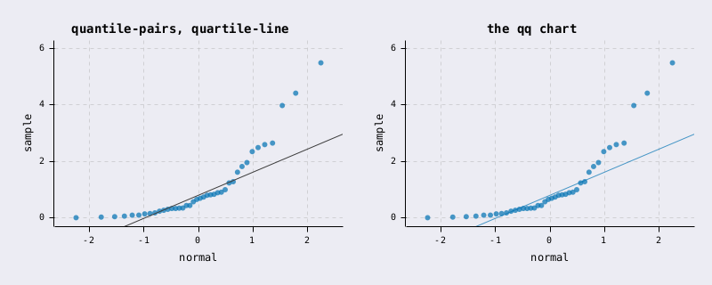
:::


### Distributions

Any fastmath distribution (`fastmath.random/distributions-list`) is a side of a `qq` / `pp` chart, as `[:name]` or
`[:name params]`:


::: {.sourceClojure}
```clojure
(count r/distributions-list)
```
:::


::: {.printedClojure}
```clojure
129

```
:::


::: {.sourceClojure}
```clojure
(sort r/distributions-list)
```
:::


::: {.printedClojure}
```clojure
(:anderson-darling
 :anderson-darling-quick
 :bb
 :bernoulli
 :beta
 :beta-binomial
 :beta-noncentral
 :beta-symmetrical
 :binomial
 :categorical
 :categorical-distribution
 :cauchy
 :chi
 :chi-squared
 :chi-squared-noncentral
 :constant
 :continuous-distribution
 :cramer-von-mises
 :dirichlet
 :empirical
 :enumerated-int
 :enumerated-real
 :erlang
 :ex-gaussian
 :exgaus
 :exponential
 :f
 :f-noncentral
 :fatigue-life
 :fishers-noncentral-hypergeometric
 :folded-normal
 :frechet
 :gamma
 :ge
 :generalized-exponential
 :generalized-extreme-value
 :generalized-gamma
 :generalized-half-logistic
 :generalized-hyperbolic
 :generalized-inverse-gaussian
 :generalized-logistic
 :generalized-normal
 :generalized-pareto
 :geometric
 :gev
 :gg
 :gh
 :ghl
 :gig
 :gnd
 :gpd
 :gumbel
 :half-cauchy
 :half-logistic
 :half-normal
 :hyperbolic-secant
 :hypergeometric
 :hypoexponential
 :hypoexponential-equal
 :integer-discrete
 :integer-discrete-distribution
 :inverse-gamma
 :inverse-gaussian
 :johnson-sb
 :johnson-sl
 :johnson-su
 :kde
 :kolmogorov
 :kolmogorov-smirnov
 :kolmogorov-smirnov+
 :kolmogorov-smirnov-quick
 :laplace
 :levy
 :log-logistic
 :log-normal
 :logarithmic
 :logistic
 :mixture
 :multi-normal
 :multinomial
 :nakagami
 :nbi
 :nbii
 :negative-binomial
 :normal
 :normal-inverse-gaussian
 :pareto
 :pascal
 :pearson-6
 :poisson
 :power
 :rayleigh
 :real-discrete
 :real-discrete-distribution
 :reciprocal
 :t
 :t-noncentral
 :triangular
 :truncated
 :uniform-int
 :uniform-real
 :von-mises
 :wallenius-noncentral-hypergeometric
 :watson-g
 :watson-u
 :weibull
 :zabb
 :zabi
 :zaga
 :zaig
 :zanbi
 :zap
 :zero-adjusted-beta-binomial
 :zero-adjusted-binomial
 :zero-adjusted-gamma
 :zero-adjusted-inverse-gaussian
 :zero-adjusted-negative-binomial
 :zero-adjusted-poisson
 :zero-inflated-beta-binomial
 :zero-inflated-binomial
 :zero-inflated-negative-binomial
 :zero-inflated-poisson
 :zero-inflated-poisson2
 :zibb
 :zibi
 :zinbi
 :zip
 :zip2
 :zipf)

```
:::


The sample against three of them - the exponential (the sample's own distribution) comes closest to a straight
line; 40 values leave its upper tail scattered:


::: {.sourceClojure}
```clojure
(plot/render-image (plot/arrange [{:data {:v sample} :mapping {:y :v}
                                   :charts [(chart/qq {:x-distribution [:normal]})]
                                   :labels {:title "[:normal]"}}
                                  {:data {:v sample} :mapping {:y :v}
                                   :charts [(chart/qq {:x-distribution [:uniform-real {:lower 0 :upper 1}]})]
                                   :labels {:title "[:uniform-real {:lower 0 :upper 1}]"}}
                                  {:data {:v sample} :mapping {:y :v}
                                   :charts [(chart/qq {:x-distribution [:exponential {:rate 0.5}]})]
                                   :labels {:title "[:exponential {:rate 0.5}]"}}]
                                 {:columns 3})
                   {:width 1000 :height 300})
```
:::


::: {.clay-image}
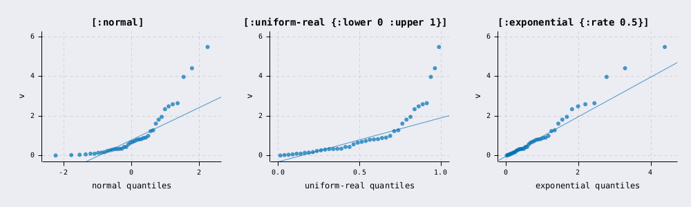
:::


## cljplot2.data.kde

Kernel density estimates (the `density`, `violin` charts): `estimate` gives the density function and the span the
curve covers (`:cut` bandwidths past the data), `curve` evaluates it at given points:


::: {.sourceClojure}
```clojure
(def eruption-kde (kde/estimate (map :eruptions faithful) {:kernel :epanechnikov :bandwidth 0.3}))
```
:::


::: {.sourceClojure}
```clojure
(dissoc eruption-kde :kde)
```
:::


::: {.printedClojure}
```clojure
{:lo 0.7000000000000002, :hi 6.0}

```
:::


::: {.sourceClojure}
```clojure
(def eruption-curve (kde/curve eruption-kde (kde/grid-points (:lo eruption-kde) (:hi eruption-kde) 200)))
```
:::


```{=html}
<div class="data-table"><table class="table table-hover table-responsive clay-table"><thead><tr><th>x</th><th>y</th></tr></thead><tbody><tr><td>0.7000000000000002</td><td>0.0</td></tr><tr><td>0.7266331658291459</td><td>0.0</td></tr><tr><td>0.7532663316582916</td><td>0.0</td></tr><tr><td>0.7798994974874374</td><td>0.0</td></tr><tr><td>0.8065326633165831</td><td>0.0</td></tr><tr><td>0.8331658291457288</td><td>0.0</td></tr><tr><td>0.8597989949748746</td><td>0.0</td></tr><tr><td>0.8864321608040202</td><td>0.0</td></tr><tr><td>0.913065326633166</td><td>0.0</td></tr><tr><td>0.9396984924623117</td><td>0.0</td></tr><tr><td>0.9663316582914574</td><td>0.0</td></tr><tr><td>0.9929648241206033</td><td>0.0</td></tr><tr><td>1.019597989949749</td><td>0.0</td></tr><tr><td>1.0462311557788946</td><td>0.0</td></tr><tr><td>1.0728643216080402</td><td>0.0</td></tr><tr><td>1.0994974874371861</td><td>0.0</td></tr><tr><td>1.1261306532663318</td><td>0.0</td></tr><tr><td>1.1527638190954774</td><td>0.0</td></tr><tr><td>1.1793969849246233</td><td>0.0</td></tr><tr><td>1.206030150753769</td><td>0.0</td></tr><tr><td>1.2326633165829146</td><td>0.0</td></tr><tr><td>1.2592964824120605</td><td>0.0</td></tr><tr><td>1.2859296482412064</td><td>0.0</td></tr><tr><td>1.3125628140703518</td><td>7.536625964915022E-4</td></tr><tr><td>1.3391959798994977</td><td>0.0022448185354796506</td></tr><tr><td>1.3658291457286433</td><td>0.0035910958956110084</td></tr><tr><td>1.392462311557789</td><td>0.006286475234974588</td></tr><tr><td>1.4190954773869349</td><td>0.009896808674596939</td></tr><tr><td>1.4457286432160805</td><td>0.014303572286952893</td></tr><tr><td>1.4723618090452262</td><td>0.026917408476967903</td></tr><tr><td>1.498994974874372</td><td>0.041571903604880354</td></tr><tr><td>1.525628140703518</td><td>0.06339102383128355</td></tr><tr><td>1.5522613065326634</td><td>0.09438571202503972</td></tr><tr><td>1.5788944723618092</td><td>0.13334770370495566</td></tr><tr><td>1.605527638190955</td><td>0.1798105611388224</td></tr><tr><td>1.6321608040201006</td><td>0.22330241273739884</td></tr><tr><td>1.6587939698492464</td><td>0.2656982547923301</td></tr><tr><td>1.685427135678392</td><td>0.30653080422888285</td></tr><tr><td>1.7120603015075377</td><td>0.34902932975796297</td></tr><tr><td>1.7386934673366834</td><td>0.39175276253122837</td></tr><tr><td>1.7653266331658293</td><td>0.42935468556562084</td></tr><tr><td>1.791959798994975</td><td>0.46081128874493676</td></tr><tr><td>1.8185929648241208</td><td>0.4887849244126836</td></tr><tr><td>1.8452261306532665</td><td>0.509428242220129</td></tr><tr><td>1.8718592964824123</td><td>0.5231499753778626</td></tr><tr><td>1.898492462311558</td><td>0.5307150342435402</td></tr><tr><td>1.9251256281407036</td><td>0.5352094821472252</td></tr><tr><td>1.9517587939698493</td><td>0.5329637997609694</td></tr><tr><td>1.978391959798995</td><td>0.5249660282194176</td></tr><tr><td>2.0050251256281406</td><td>0.5094513843088897</td></tr><tr><td>2.0316582914572865</td><td>0.48630013738295613</td></tr><tr><td>2.0582914572864324</td><td>0.4589979355318276</td></tr><tr><td>2.084924623115578</td><td>0.4301093176262262</td></tr><tr><td>2.1115577889447237</td><td>0.3996522975560919</td></tr><tr><td>2.1381909547738696</td><td>0.37289910199573656</td></tr><tr><td>2.164824120603015</td><td>0.3491230366425314</td></tr><tr><td>2.191457286432161</td><td>0.3327288762648019</td></tr><tr><td>2.2180904522613067</td><td>0.31546502251502856</td></tr><tr><td>2.244723618090452</td><td>0.29541900697921747</td></tr><tr><td>2.271356783919598</td><td>0.27236246818602583</td></tr><tr><td>2.297989949748744</td><td>0.25001897312126353</td></tr><tr><td>2.3246231155778894</td><td>0.23199724812706937</td></tr><tr><td>2.3512562814070357</td><td>0.21737126739089632</td></tr><tr><td>2.377889447236181</td><td>0.20003147258899337</td></tr><tr><td>2.4045226130653266</td><td>0.1824198772409607</td></tr><tr><td>2.431155778894473</td><td>0.1652873019016236</td></tr><tr><td>2.4577889447236183</td><td>0.14616327066687496</td></tr><tr><td>2.4844221105527637</td><td>0.12678786214693372</td></tr><tr><td>2.5110552763819096</td><td>0.10940619777356744</td></tr><tr><td>2.5376884422110555</td><td>0.09464106649541999</td></tr><tr><td>2.564321608040201</td><td>0.08201670816981502</td></tr><tr><td>2.590954773869347</td><td>0.07105337189135646</td></tr><tr><td>2.6175879396984927</td><td>0.06256070587556542</td></tr><tr><td>2.644221105527638</td><td>0.055375282010357255</td></tr><tr><td>2.670854271356784</td><td>0.048786480150221474</td></tr><tr><td>2.69748743718593</td><td>0.04320662297698128</td></tr><tr><td>2.7241206030150753</td><td>0.04086490593960708</td></tr><tr><td>2.750753768844221</td><td>0.04027402002251876</td></tr><tr><td>2.7773869346733666</td><td>0.03943929894684363</td></tr><tr><td>2.8040201005025125</td><td>0.03994598170467736</td></tr><tr><td>2.8306532663316584</td><td>0.03992411323994425</td></tr><tr><td>2.8572864321608042</td><td>0.03903297330207049</td></tr><tr><td>2.8839195979899497</td><td>0.0372725618910561</td></tr><tr><td>2.9105527638190956</td><td>0.03464287900690101</td></tr><tr><td>2.9371859296482414</td><td>0.032680700521814564</td></tr><tr><td>2.9638190954773873</td><td>0.03185379919909428</td></tr><tr><td>2.9904522613065327</td><td>0.030447383560946905</td></tr><tr><td>3.0170854271356786</td><td>0.02846668736795365</td></tr><tr><td>3.0437185929648245</td><td>0.02875036061046766</td></tr><tr><td>3.07035175879397</td><td>0.030226159912653195</td></tr><tr><td>3.096984924623116</td><td>0.032024841136950526</td></tr><tr><td>3.1236180904522612</td><td>0.03456969426328688</td></tr><tr><td>3.150251256281407</td><td>0.03742205201593822</td></tr><tr><td>3.176884422110553</td><td>0.04065812009156121</td></tr><tr><td>3.2035175879396984</td><td>0.0445358292668304</td></tr><tr><td>3.2301507537688443</td><td>0.05178429591610137</td></tr><tr><td>3.2567839195979897</td><td>0.05772885535566124</td></tr><tr><td>3.2834170854271356</td><td>0.06432635614808363</td></tr><tr><td>3.3100502512562815</td><td>0.07302551588739842</td></tr><tr><td>3.3366834170854274</td><td>0.08372827055474771</td></tr><tr><td>…</td><td>…</td></tr></tbody></table></div>
```


The curve as a filled line, the data as a rug:


::: {.sourceClojure}
```clojure
(plot/render-image {:data eruption-curve
                    :mapping {:x :x :y :y}
                    :charts [(chart/line {:fill :color})
                             (chart/rug {:data faithful :mapping {:x :eruptions :y nil}})]
                    :labels {:x "eruptions [min]" :y "density"}}
                   {:width 600 :height 300})
```
:::


::: {.clay-image}
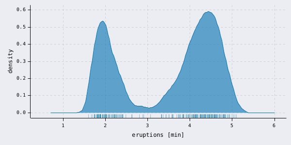
:::


### Kernels

The kernels `density` and `violin` take as `:kernel` (`(:kde fastmath.kernel/kernel-list)`):


::: {.sourceClojure}
```clojure
(sort (:kde kernel/kernel-list))
```
:::


::: {.printedClojure}
```clojure
(:cauchy
 :cosine
 :epanechnikov
 :gaussian
 :laplace
 :logistic
 :quartic
 :sigmoid
 :silverman
 :triangular
 :tricube
 :triweight
 :uniform
 :wigner)

```
:::


Four of them with the same `:bandwidth` ([density](reference.charts_one_variable.html#density-curves)) - the
curves differ in smoothness: the gaussian is the smoothest here, the uniform kernel's box shape makes its curve
ragged:


::: {.sourceClojure}
```clojure
(plot/render-image (plot/arrange [{:data faithful :mapping {:x :eruptions}
                                   :charts [(chart/density {:kernel :gaussian :bandwidth 0.4})]
                                   :labels {:title ":gaussian"}}
                                  {:data faithful :mapping {:x :eruptions}
                                   :charts [(chart/density {:kernel :epanechnikov :bandwidth 0.4})]
                                   :labels {:title ":epanechnikov"}}
                                  {:data faithful :mapping {:x :eruptions}
                                   :charts [(chart/density {:kernel :uniform :bandwidth 0.4})]
                                   :labels {:title ":uniform"}}
                                  {:data faithful :mapping {:x :eruptions}
                                   :charts [(chart/density {:kernel :triangular :bandwidth 0.4})]
                                   :labels {:title ":triangular"}}]
                                 {:columns 4})
                   {:width 1000 :height 260})
```
:::


::: {.clay-image}
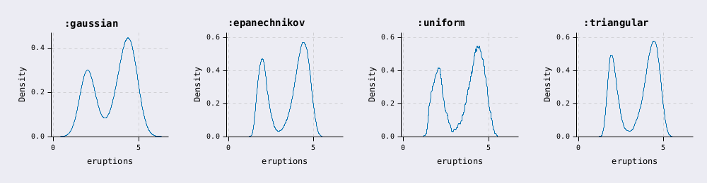
:::


## cljplot2.data.smooth

The fits of the `smooth` chart: `fit-curve` fits ys on xs by a method and evaluates the fit and its bands at the
given points - `{:fit [..] :bands [{:level :lo :hi}]}`:


::: {.sourceClojure}
```clojure
(def eruption-xs (mapv :eruptions faithful))
```
:::


```{=html}
<div class="data-table"><table class="table table-hover table-responsive clay-table"><thead><tr><th>value</th></tr></thead><tbody><tr><td>3.6</td></tr><tr><td>1.8</td></tr><tr><td>3.333</td></tr><tr><td>2.283</td></tr><tr><td>4.533</td></tr><tr><td>2.883</td></tr><tr><td>4.7</td></tr><tr><td>3.6</td></tr><tr><td>1.95</td></tr><tr><td>4.35</td></tr><tr><td>1.833</td></tr><tr><td>3.917</td></tr><tr><td>4.2</td></tr><tr><td>1.75</td></tr><tr><td>4.7</td></tr><tr><td>2.167</td></tr><tr><td>1.75</td></tr><tr><td>4.8</td></tr><tr><td>1.6</td></tr><tr><td>4.25</td></tr><tr><td>1.8</td></tr><tr><td>1.75</td></tr><tr><td>3.45</td></tr><tr><td>3.067</td></tr><tr><td>4.533</td></tr><tr><td>3.6</td></tr><tr><td>1.967</td></tr><tr><td>4.083</td></tr><tr><td>3.85</td></tr><tr><td>4.433</td></tr><tr><td>4.3</td></tr><tr><td>4.467</td></tr><tr><td>3.367</td></tr><tr><td>4.033</td></tr><tr><td>3.833</td></tr><tr><td>2.017</td></tr><tr><td>1.867</td></tr><tr><td>4.833</td></tr><tr><td>1.833</td></tr><tr><td>4.783</td></tr><tr><td>4.35</td></tr><tr><td>1.883</td></tr><tr><td>4.567</td></tr><tr><td>1.75</td></tr><tr><td>4.533</td></tr><tr><td>3.317</td></tr><tr><td>3.833</td></tr><tr><td>2.1</td></tr><tr><td>4.633</td></tr><tr><td>2</td></tr><tr><td>4.8</td></tr><tr><td>4.716</td></tr><tr><td>1.833</td></tr><tr><td>4.833</td></tr><tr><td>1.733</td></tr><tr><td>4.883</td></tr><tr><td>3.717</td></tr><tr><td>1.667</td></tr><tr><td>4.567</td></tr><tr><td>4.317</td></tr><tr><td>2.233</td></tr><tr><td>4.5</td></tr><tr><td>1.75</td></tr><tr><td>4.8</td></tr><tr><td>1.817</td></tr><tr><td>4.4</td></tr><tr><td>4.167</td></tr><tr><td>4.7</td></tr><tr><td>2.067</td></tr><tr><td>4.7</td></tr><tr><td>4.033</td></tr><tr><td>1.967</td></tr><tr><td>4.5</td></tr><tr><td>4</td></tr><tr><td>1.983</td></tr><tr><td>5.067</td></tr><tr><td>2.017</td></tr><tr><td>4.567</td></tr><tr><td>3.883</td></tr><tr><td>3.6</td></tr><tr><td>4.133</td></tr><tr><td>4.333</td></tr><tr><td>4.1</td></tr><tr><td>2.633</td></tr><tr><td>4.067</td></tr><tr><td>4.933</td></tr><tr><td>3.95</td></tr><tr><td>4.517</td></tr><tr><td>2.167</td></tr><tr><td>4</td></tr><tr><td>2.2</td></tr><tr><td>4.333</td></tr><tr><td>1.867</td></tr><tr><td>4.817</td></tr><tr><td>1.833</td></tr><tr><td>4.3</td></tr><tr><td>4.667</td></tr><tr><td>3.75</td></tr><tr><td>1.867</td></tr><tr><td>4.9</td></tr><tr><td>…</td></tr></tbody></table></div>
```


::: {.sourceClojure}
```clojure
(def waiting-ys (mapv :waiting faithful))
```
:::


```{=html}
<div class="data-table"><table class="table table-hover table-responsive clay-table"><thead><tr><th>value</th></tr></thead><tbody><tr><td>79</td></tr><tr><td>54</td></tr><tr><td>74</td></tr><tr><td>62</td></tr><tr><td>85</td></tr><tr><td>55</td></tr><tr><td>88</td></tr><tr><td>85</td></tr><tr><td>51</td></tr><tr><td>85</td></tr><tr><td>54</td></tr><tr><td>84</td></tr><tr><td>78</td></tr><tr><td>47</td></tr><tr><td>83</td></tr><tr><td>52</td></tr><tr><td>62</td></tr><tr><td>84</td></tr><tr><td>52</td></tr><tr><td>79</td></tr><tr><td>51</td></tr><tr><td>47</td></tr><tr><td>78</td></tr><tr><td>69</td></tr><tr><td>74</td></tr><tr><td>83</td></tr><tr><td>55</td></tr><tr><td>76</td></tr><tr><td>78</td></tr><tr><td>79</td></tr><tr><td>73</td></tr><tr><td>77</td></tr><tr><td>66</td></tr><tr><td>80</td></tr><tr><td>74</td></tr><tr><td>52</td></tr><tr><td>48</td></tr><tr><td>80</td></tr><tr><td>59</td></tr><tr><td>90</td></tr><tr><td>80</td></tr><tr><td>58</td></tr><tr><td>84</td></tr><tr><td>58</td></tr><tr><td>73</td></tr><tr><td>83</td></tr><tr><td>64</td></tr><tr><td>53</td></tr><tr><td>82</td></tr><tr><td>59</td></tr><tr><td>75</td></tr><tr><td>90</td></tr><tr><td>54</td></tr><tr><td>80</td></tr><tr><td>54</td></tr><tr><td>83</td></tr><tr><td>71</td></tr><tr><td>64</td></tr><tr><td>77</td></tr><tr><td>81</td></tr><tr><td>59</td></tr><tr><td>84</td></tr><tr><td>48</td></tr><tr><td>82</td></tr><tr><td>60</td></tr><tr><td>92</td></tr><tr><td>78</td></tr><tr><td>78</td></tr><tr><td>65</td></tr><tr><td>73</td></tr><tr><td>82</td></tr><tr><td>56</td></tr><tr><td>79</td></tr><tr><td>71</td></tr><tr><td>62</td></tr><tr><td>76</td></tr><tr><td>60</td></tr><tr><td>78</td></tr><tr><td>76</td></tr><tr><td>83</td></tr><tr><td>75</td></tr><tr><td>82</td></tr><tr><td>70</td></tr><tr><td>65</td></tr><tr><td>73</td></tr><tr><td>88</td></tr><tr><td>76</td></tr><tr><td>80</td></tr><tr><td>48</td></tr><tr><td>86</td></tr><tr><td>60</td></tr><tr><td>90</td></tr><tr><td>50</td></tr><tr><td>78</td></tr><tr><td>63</td></tr><tr><td>72</td></tr><tr><td>84</td></tr><tr><td>75</td></tr><tr><td>51</td></tr><tr><td>82</td></tr><tr><td>…</td></tr></tbody></table></div>
```


::: {.sourceClojure}
```clojure
(def fit-xs (vec (range 1.6 5.2 0.1)))
```
:::


```{=html}
<div class="data-table"><table class="table table-hover table-responsive clay-table"><thead><tr><th>value</th></tr></thead><tbody><tr><td>1.6</td></tr><tr><td>1.7000000000000002</td></tr><tr><td>1.8000000000000003</td></tr><tr><td>1.9000000000000004</td></tr><tr><td>2.0000000000000004</td></tr><tr><td>2.1000000000000005</td></tr><tr><td>2.2000000000000006</td></tr><tr><td>2.3000000000000007</td></tr><tr><td>2.400000000000001</td></tr><tr><td>2.500000000000001</td></tr><tr><td>2.600000000000001</td></tr><tr><td>2.700000000000001</td></tr><tr><td>2.800000000000001</td></tr><tr><td>2.9000000000000012</td></tr><tr><td>3.0000000000000013</td></tr><tr><td>3.1000000000000014</td></tr><tr><td>3.2000000000000015</td></tr><tr><td>3.3000000000000016</td></tr><tr><td>3.4000000000000017</td></tr><tr><td>3.5000000000000018</td></tr><tr><td>3.600000000000002</td></tr><tr><td>3.700000000000002</td></tr><tr><td>3.800000000000002</td></tr><tr><td>3.900000000000002</td></tr><tr><td>4.000000000000002</td></tr><tr><td>4.100000000000001</td></tr><tr><td>4.200000000000001</td></tr><tr><td>4.300000000000001</td></tr><tr><td>4.4</td></tr><tr><td>4.5</td></tr><tr><td>4.6</td></tr><tr><td>4.699999999999999</td></tr><tr><td>4.799999999999999</td></tr><tr><td>4.899999999999999</td></tr><tr><td>4.999999999999998</td></tr><tr><td>5.099999999999998</td></tr><tr><td>5.1999999999999975</td></tr></tbody></table></div>
```


::: {.sourceClojure}
```clojure
(def quadratic (smooth/fit-curve {:method :lm :params {:degree 2} :band :prediction :levels [0.5 0.95]}
                                 eruption-xs waiting-ys fit-xs))
```
:::


```{=html}
<div class="data-table"><table class="table table-hover table-responsive clay-table"><thead><tr><th>x</th><th>fit</th><th>lo-95</th><th>hi-95</th></tr></thead><tbody><tr><td>1.6</td><td>48.21958649723071</td><td>36.69738543056889</td><td>59.74178756389252</td></tr><tr><td>1.7000000000000002</td><td>49.85805500896073</td><td>38.37085689594542</td><td>61.34525312197604</td></tr><tr><td>1.8000000000000003</td><td>51.46119948366555</td><td>39.99993570116254</td><td>62.92246326616856</td></tr><tr><td>1.9000000000000004</td><td>53.02901992134517</td><td>41.58592105853596</td><td>64.47211878415438</td></tr><tr><td>2.0000000000000004</td><td>54.561516321999584</td><td>43.130047426108845</td><td>65.99298521789032</td></tr><tr><td>2.1000000000000005</td><td>56.058688685628795</td><td>44.63347623019693</td><td>67.48390114106066</td></tr><tr><td>2.2000000000000006</td><td>57.52053701223281</td><td>46.097289402689185</td><td>68.94378462177643</td></tr><tr><td>2.3000000000000007</td><td>58.94706130181161</td><td>47.52248454919933</td><td>70.37163805442388</td></tr><tr><td>2.400000000000001</td><td>60.33826155436522</td><td>48.909971528941725</td><td>71.76655157978871</td></tr><tr><td>2.500000000000001</td><td>61.69413776989362</td><td>50.26057021155623</td><td>73.12770532823102</td></tr><tr><td>2.600000000000001</td><td>63.01468994839683</td><td>51.575009176027876</td><td>74.45437072076578</td></tr><tr><td>2.700000000000001</td><td>64.29991808987482</td><td>52.85392512826911</td><td>75.74591105148053</td></tr><tr><td>2.800000000000001</td><td>65.54982219432762</td><td>54.097862833171575</td><td>77.00178155548366</td></tr><tr><td>2.9000000000000012</td><td>66.76440226175522</td><td>55.3072753809216</td><td>78.22152914258884</td></tr><tr><td>3.0000000000000013</td><td>67.94365829215762</td><td>56.48252463375779</td><td>79.40479195055745</td></tr><tr><td>3.1000000000000014</td><td>69.08759028553482</td><td>57.623881726473684</td><td>80.55129884459595</td></tr><tr><td>3.2000000000000015</td><td>70.1961982418868</td><td>58.73152752080263</td><td>81.66086896297098</td></tr><tr><td>3.3000000000000016</td><td>71.26948216121359</td><td>59.80555293984573</td><td>82.73341138258145</td></tr><tr><td>3.4000000000000017</td><td>72.30744204351518</td><td>60.84595913379885</td><td>83.7689249532315</td></tr><tr><td>3.5000000000000018</td><td>73.31007788879157</td><td>61.85265745256882</td><td>84.76749832501432</td></tr><tr><td>3.600000000000002</td><td>74.27738969704275</td><td>62.825469224795995</td><td>85.7293101692895</td></tr><tr><td>3.700000000000002</td><td>75.20937746826873</td><td>63.76412536676411</td><td>86.65462956977333</td></tr><tr><td>3.800000000000002</td><td>76.1060412024695</td><td>64.66826586912707</td><td>87.54381653581193</td></tr><tr><td>3.900000000000002</td><td>76.96738089964508</td><td>65.5374392346752</td><td>88.39732256461495</td></tr><tr><td>4.000000000000002</td><td>77.79339655979545</td><td>66.3711019666799</td><td>89.215691152911</td></tr><tr><td>4.100000000000001</td><td>78.58408818292062</td><td>67.16861823458773</td><td>89.99955813125352</td></tr><tr><td>4.200000000000001</td><td>79.33945576902059</td><td>67.92925987147584</td><td>90.74965166656534</td></tr><tr><td>4.300000000000001</td><td>80.05949931809536</td><td>68.65220688470295</td><td>91.46679175148778</td></tr><tr><td>4.4</td><td>80.74421883014493</td><td>69.33654868593345</td><td>92.15188897435641</td></tr><tr><td>4.5</td><td>81.3936143051693</td><td>69.98128626680295</td><td>92.80594234353563</td></tr><tr><td>4.6</td><td>82.00768574316845</td><td>70.58533555881735</td><td>93.43003592751955</td></tr><tr><td>4.699999999999999</td><td>82.5864331441424</td><td>71.1475322168709</td><td>94.02533407141391</td></tr><tr><td>4.799999999999999</td><td>83.12985650809117</td><td>71.66663805085616</td><td>94.59307496532617</td></tr><tr><td>4.899999999999999</td><td>83.63795583501472</td><td>72.1413492950693</td><td>95.13456237496014</td></tr><tr><td>4.999999999999998</td><td>84.11073112491309</td><td>72.57030684703099</td><td>95.65115540279518</td></tr><tr><td>5.099999999999998</td><td>84.54818237778623</td><td>72.9521085240327</td><td>96.14425623153977</td></tr><tr><td>5.1999999999999975</td><td>84.95030959363419</td><td>73.28532327778906</td><td>96.61529590947931</td></tr></tbody></table></div>
```


Drawn as ribbons (the 95% and 50% prediction bands) under the fitted line and the points:


::: {.sourceClojure}
```clojure
(plot/render-image (let [[wide narrow] (:bands quadratic)]
                     {:charts [(chart/ribbon {:data {:x fit-xs :ymin (:lo wide) :ymax (:hi wide)} :mapping {:x :x :ymin :ymin :ymax :ymax}
                                              :alpha 0.2})
                               (chart/ribbon {:data {:x fit-xs :ymin (:lo narrow) :ymax (:hi narrow)} :mapping {:x :x :ymin :ymin :ymax :ymax}
                                              :alpha 0.35})
                               (chart/scatter {:data faithful :mapping {:x :eruptions :y :waiting} :size 4})
                               (chart/line {:data {:x fit-xs :y (:fit quadratic)} :mapping {:x :x :y :y} :line-width 2})]
                      :labels {:x "eruptions [min]" :y "waiting [min]"}})
                   {:width 600 :height 350})
```
:::


::: {.clay-image}
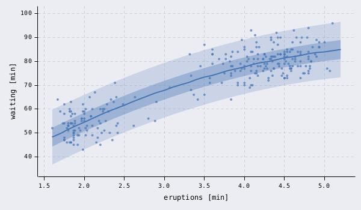
:::


## cljplot2.data.dots

Dot plot bins (the `dotplot` chart) of sorted values - here the first 40 waiting times: Wilkinson's dot density
bins - each starts at the first value not yet binned and is centred on its values - or fixed bins from an origin:


::: {.sourceClojure}
```clojure
(def waits (sort (map :waiting (take 40 faithful))))
```
:::


```{=html}
<div class="data-table"><table class="table table-hover table-responsive clay-table"><thead><tr><th>value</th></tr></thead><tbody><tr><td>47</td></tr><tr><td>47</td></tr><tr><td>48</td></tr><tr><td>51</td></tr><tr><td>51</td></tr><tr><td>52</td></tr><tr><td>52</td></tr><tr><td>52</td></tr><tr><td>54</td></tr><tr><td>54</td></tr><tr><td>55</td></tr><tr><td>55</td></tr><tr><td>59</td></tr><tr><td>62</td></tr><tr><td>62</td></tr><tr><td>66</td></tr><tr><td>69</td></tr><tr><td>73</td></tr><tr><td>74</td></tr><tr><td>74</td></tr><tr><td>74</td></tr><tr><td>76</td></tr><tr><td>77</td></tr><tr><td>78</td></tr><tr><td>78</td></tr><tr><td>78</td></tr><tr><td>79</td></tr><tr><td>79</td></tr><tr><td>79</td></tr><tr><td>80</td></tr><tr><td>80</td></tr><tr><td>83</td></tr><tr><td>83</td></tr><tr><td>84</td></tr><tr><td>84</td></tr><tr><td>85</td></tr><tr><td>85</td></tr><tr><td>85</td></tr><tr><td>88</td></tr><tr><td>90</td></tr></tbody></table></div>
```


::: {.sourceClojure}
```clojure
(dots/dot-density-bins waits 4.0)
```
:::


::: {.printedClojure}
```clojure
[{:center 47.5, :values [47 47 48]}
 {:center 52.5, :values [51 51 52 52 52 54 54]}
 {:center 55.0, :values [55 55]}
 {:center 60.5, :values [59 62 62]}
 {:center 67.5, :values [66 69]}
 {:center 74.5, :values [73 74 74 74 76]}
 {:center 78.5, :values [77 78 78 78 79 79 79 80 80]}
 {:center 84.0, :values [83 83 84 84 85 85 85]}
 {:center 89.0, :values [88 90]}]

```
:::


::: {.sourceClojure}
```clojure
(dots/fixed-bins waits 4.0 40.0)
```
:::


::: {.printedClojure}
```clojure
[{:center 46.0, :values [47 47]}
 {:center 50.0, :values [48 51 51]}
 {:center 54.0, :values [52 52 52 54 54 55 55]}
 {:center 58.0, :values [59]}
 {:center 62.0, :values [62 62]}
 {:center 66.0, :values [66]}
 {:center 70.0, :values [69]}
 {:center 74.0, :values [73 74 74 74]}
 {:center 78.0, :values [76 77 78 78 78 79 79 79]}
 {:center 82.0, :values [80 80 83 83]}
 {:center 86.0, :values [84 84 85 85 85]}
 {:center 90.0, :values [88 90]}]

```
:::


The dot density bins stacked by hand - one point per value, centred on its bin:


::: {.sourceClojure}
```clojure
(def dot-rows (for [{:keys [center values]} (dots/dot-density-bins waits 4.0)
                    i (range (count values))]
                {:x center :y (inc i)}))
```
:::


```{=html}
<div class="data-table"><table class="table table-hover table-responsive clay-table"><thead><tr><th>x</th><th>y</th></tr></thead><tbody><tr><td>47.5</td><td>1</td></tr><tr><td>47.5</td><td>2</td></tr><tr><td>47.5</td><td>3</td></tr><tr><td>52.5</td><td>1</td></tr><tr><td>52.5</td><td>2</td></tr><tr><td>52.5</td><td>3</td></tr><tr><td>52.5</td><td>4</td></tr><tr><td>52.5</td><td>5</td></tr><tr><td>52.5</td><td>6</td></tr><tr><td>52.5</td><td>7</td></tr><tr><td>55.0</td><td>1</td></tr><tr><td>55.0</td><td>2</td></tr><tr><td>60.5</td><td>1</td></tr><tr><td>60.5</td><td>2</td></tr><tr><td>60.5</td><td>3</td></tr><tr><td>67.5</td><td>1</td></tr><tr><td>67.5</td><td>2</td></tr><tr><td>74.5</td><td>1</td></tr><tr><td>74.5</td><td>2</td></tr><tr><td>74.5</td><td>3</td></tr><tr><td>74.5</td><td>4</td></tr><tr><td>74.5</td><td>5</td></tr><tr><td>78.5</td><td>1</td></tr><tr><td>78.5</td><td>2</td></tr><tr><td>78.5</td><td>3</td></tr><tr><td>78.5</td><td>4</td></tr><tr><td>78.5</td><td>5</td></tr><tr><td>78.5</td><td>6</td></tr><tr><td>78.5</td><td>7</td></tr><tr><td>78.5</td><td>8</td></tr><tr><td>78.5</td><td>9</td></tr><tr><td>84.0</td><td>1</td></tr><tr><td>84.0</td><td>2</td></tr><tr><td>84.0</td><td>3</td></tr><tr><td>84.0</td><td>4</td></tr><tr><td>84.0</td><td>5</td></tr><tr><td>84.0</td><td>6</td></tr><tr><td>84.0</td><td>7</td></tr><tr><td>89.0</td><td>1</td></tr><tr><td>89.0</td><td>2</td></tr></tbody></table></div>
```


::: {.sourceClojure}
```clojure
(plot/render-image {:data dot-rows
                    :mapping {:x :x :y :y}
                    :charts [(chart/scatter {:size 14})]
                    :labels {:x "waiting [min]" :y "count"}}
                   {:width 600 :height 280})
```
:::


::: {.clay-image}
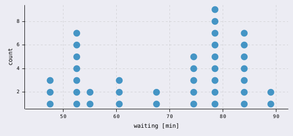
:::


## cljplot2.layout.pack

Circle packing (the `pack` chart): `pack` places a tree of values in a pixel box - every node gets `:x :y :r`;
`pack-siblings` gives the centres of circles of the given radii packed side by side, and `enclose` finds the
smallest circle around circles:


::: {.sourceClojure}
```clojure
(def packed (pack/pack {:value 20 :children [{:value 8} {:value 5} {:value 4} {:value 2} {:value 1}]}
                       {:x 0 :y 0 :w 100 :h 100} 2))
```
:::


```{=html}
<div class="data-table"><table class="table table-hover table-responsive clay-table"><thead><tr><th>value</th><th>r</th><th>x</th><th>y</th></tr></thead><tbody><tr><td>8</td><td>23.87506941071494</td><td>32.75690714630248</td><td>46.3331386125916</td></tr><tr><td>5</td><td>18.87489965811832</td><td>77.50694918032838</td><td>46.3331386125916</td></tr><tr><td>4</td><td>16.88222348161604</td><td>59.63009686963869</td><td>79.59007787596495</td></tr><tr><td>2</td><td>11.93753470535747</td><td>59.0775994387703</td><td>19.18503176704429</td></tr><tr><td>1</td><td>8.44111174080802</td><td>37.75760484130298</td><td>12.383200186046295</td></tr></tbody></table></div>
```


::: {.sourceClojure}
```clojure
(pack/pack-siblings [3 2 2 1])
```
:::


::: {.printedClojure}
```clojure
[[-2.0 0.0] [3.0 0.0] [1.4 3.666060555964672] [1.2000000000000002 -2.4]]

```
:::


::: {.sourceClojure}
```clojure
(pack/enclose [{:x 0 :y 0 :r 1} {:x 3 :y 0 :r 1}])
```
:::


::: {.printedClojure}
```clojure
{:x 1.5, :y 0.0, :r 2.5}

```
:::


The packed circles drawn as [polygons](reference.charts_points_lines.html#polygons) outlined in their own colour
(`:stroke-color :color`) - the root's circle in grey, the children in colour:


::: {.sourceClojure}
```clojure
(def circle-outlines (for [[i {:keys [x y r]}] (map-indexed vector (cons packed (:children packed)))
                           a (range 0 360 2)]
                       {:circle (if (zero? i) "root" (str "value " (:value (nth (:children packed) (dec i)))))
                        :x (m/+ x (m/* r (m/cos (m/radians a))))
                        :y (m/+ y (m/* r (m/sin (m/radians a))))}))
```
:::


```{=html}
<div class="data-table"><table class="table table-hover table-responsive clay-table"><thead><tr><th>circle</th><th>x</th><th>y</th></tr></thead><tbody><tr><td>root</td><td>100.0</td><td>50.0</td></tr><tr><td>root</td><td>99.96954135095478</td><td>51.74497483512505</td></tr><tr><td>root</td><td>99.87820251299121</td><td>53.487823687206266</td></tr><tr><td>root</td><td>99.72609476841366</td><td>55.22642316338268</td></tr><tr><td>root</td><td>99.51340343707851</td><td>56.95865504800327</td></tr><tr><td>root</td><td>99.24038765061039</td><td>58.68240888334651</td></tr><tr><td>root</td><td>98.90738003669028</td><td>60.39558454088797</td></tr><tr><td>root</td><td>98.51478631379982</td><td>62.09609477998339</td></tr><tr><td>root</td><td>98.06308479691594</td><td>63.78186779084996</td></tr><tr><td>root</td><td>97.55282581475767</td><td>65.45084971874736</td></tr><tr><td>root</td><td>96.98463103929541</td><td>67.10100716628344</td></tr><tr><td>root</td><td>96.35919272833937</td><td>68.7303296707956</td></tr><tr><td>root</td><td>95.67727288213004</td><td>70.33683215379</td></tr><tr><td>root</td><td>94.93970231495834</td><td>71.91855733945387</td></tr><tr><td>root</td><td>94.14737964294633</td><td>73.47357813929455</td></tr><tr><td>root</td><td>93.30127018922192</td><td>75.0</td></tr><tr><td>root</td><td>92.40240480782128</td><td>76.49596321166024</td></tr><tr><td>root</td><td>91.45187862775208</td><td>77.95964517353734</td></tr><tr><td>root</td><td>90.45084971874736</td><td>79.38926261462365</td></tr><tr><td>root</td><td>89.40053768033609</td><td>80.78307376628291</td></tr><tr><td>root</td><td>88.3022221559489</td><td>82.13938048432695</td></tr><tr><td>root</td><td>87.15724127386972</td><td>83.4565303179429</td></tr><tr><td>root</td><td>85.96699001693256</td><td>84.73291852294986</td></tr><tr><td>root</td><td>84.73291852294986</td><td>85.96699001693256</td></tr><tr><td>root</td><td>83.4565303179429</td><td>87.15724127386972</td></tr><tr><td>root</td><td>82.13938048432696</td><td>88.3022221559489</td></tr><tr><td>root</td><td>80.78307376628291</td><td>89.4005376803361</td></tr><tr><td>root</td><td>79.38926261462365</td><td>90.45084971874736</td></tr><tr><td>root</td><td>77.95964517353734</td><td>91.45187862775208</td></tr><tr><td>root</td><td>76.49596321166024</td><td>92.40240480782128</td></tr><tr><td>root</td><td>75.0</td><td>93.30127018922192</td></tr><tr><td>root</td><td>73.47357813929455</td><td>94.14737964294633</td></tr><tr><td>root</td><td>71.91855733945387</td><td>94.93970231495834</td></tr><tr><td>root</td><td>70.33683215379</td><td>95.67727288213004</td></tr><tr><td>root</td><td>68.7303296707956</td><td>96.35919272833937</td></tr><tr><td>root</td><td>67.10100716628344</td><td>96.98463103929541</td></tr><tr><td>root</td><td>65.45084971874738</td><td>97.55282581475767</td></tr><tr><td>root</td><td>63.78186779084996</td><td>98.06308479691594</td></tr><tr><td>root</td><td>62.09609477998338</td><td>98.51478631379982</td></tr><tr><td>root</td><td>60.39558454088797</td><td>98.90738003669027</td></tr><tr><td>root</td><td>58.68240888334652</td><td>99.24038765061039</td></tr><tr><td>root</td><td>56.95865504800327</td><td>99.51340343707851</td></tr><tr><td>root</td><td>55.22642316338267</td><td>99.72609476841366</td></tr><tr><td>root</td><td>53.48782368720626</td><td>99.87820251299121</td></tr><tr><td>root</td><td>51.744974835125056</td><td>99.96954135095478</td></tr><tr><td>root</td><td>50.0</td><td>100.0</td></tr><tr><td>root</td><td>48.25502516487495</td><td>99.96954135095478</td></tr><tr><td>root</td><td>46.512176312793734</td><td>99.87820251299121</td></tr><tr><td>root</td><td>44.77357683661732</td><td>99.72609476841366</td></tr><tr><td>root</td><td>43.041344951996734</td><td>99.51340343707851</td></tr><tr><td>root</td><td>41.31759111665349</td><td>99.24038765061039</td></tr><tr><td>root</td><td>39.60441545911203</td><td>98.90738003669028</td></tr><tr><td>root</td><td>37.90390522001661</td><td>98.51478631379982</td></tr><tr><td>root</td><td>36.21813220915005</td><td>98.06308479691594</td></tr><tr><td>root</td><td>34.549150281252636</td><td>97.55282581475768</td></tr><tr><td>root</td><td>32.89899283371656</td><td>96.98463103929541</td></tr><tr><td>root</td><td>31.2696703292044</td><td>96.35919272833937</td></tr><tr><td>root</td><td>29.66316784620999</td><td>95.67727288213004</td></tr><tr><td>root</td><td>28.081442660546127</td><td>94.93970231495834</td></tr><tr><td>root</td><td>26.526421860705458</td><td>94.14737964294633</td></tr><tr><td>root</td><td>25.000000000000014</td><td>93.30127018922192</td></tr><tr><td>root</td><td>23.504036788339764</td><td>92.4024048078213</td></tr><tr><td>root</td><td>22.04035482646267</td><td>91.45187862775208</td></tr><tr><td>root</td><td>20.610737385376353</td><td>90.45084971874736</td></tr><tr><td>root</td><td>19.21692623371709</td><td>89.4005376803361</td></tr><tr><td>root</td><td>17.860619515673037</td><td>88.3022221559489</td></tr><tr><td>root</td><td>16.543469682057093</td><td>87.15724127386972</td></tr><tr><td>root</td><td>15.267081477050134</td><td>85.96699001693256</td></tr><tr><td>root</td><td>14.033009983067444</td><td>84.73291852294986</td></tr><tr><td>root</td><td>12.842758726130306</td><td>83.4565303179429</td></tr><tr><td>root</td><td>11.69777784405111</td><td>82.13938048432698</td></tr><tr><td>root</td><td>10.599462319663914</td><td>80.78307376628291</td></tr><tr><td>root</td><td>9.549150281252636</td><td>79.38926261462366</td></tr><tr><td>root</td><td>8.548121372247927</td><td>77.95964517353734</td></tr><tr><td>root</td><td>7.597595192178709</td><td>76.49596321166024</td></tr><tr><td>root</td><td>6.698729810778069</td><td>75.0</td></tr><tr><td>root</td><td>5.8526203570536595</td><td>73.47357813929453</td></tr><tr><td>root</td><td>5.060297685041654</td><td>71.91855733945386</td></tr><tr><td>root</td><td>4.322727117869967</td><td>70.33683215379003</td></tr><tr><td>root</td><td>3.640807271660641</td><td>68.73032967079561</td></tr><tr><td>root</td><td>3.015368960704592</td><td>67.10100716628344</td></tr><tr><td>root</td><td>2.447174185242332</td><td>65.45084971874738</td></tr><tr><td>root</td><td>1.9369152030840624</td><td>63.78186779084996</td></tr><tr><td>root</td><td>1.4852136862001828</td><td>62.09609477998339</td></tr><tr><td>root</td><td>1.0926199633097227</td><td>60.39558454088797</td></tr><tr><td>root</td><td>0.7596123493896059</td><td>58.68240888334651</td></tr><tr><td>root</td><td>0.4865965629214912</td><td>56.958655048003266</td></tr><tr><td>root</td><td>0.2739052315863404</td><td>55.226423163382684</td></tr><tr><td>root</td><td>0.12179748700879856</td><td>53.48782368720627</td></tr><tr><td>root</td><td>0.03045864904522233</td><td>51.744974835125056</td></tr><tr><td>root</td><td>7.105427357601002E-15</td><td>50.00000000000001</td></tr><tr><td>root</td><td>0.03045864904522233</td><td>48.25502516487496</td></tr><tr><td>root</td><td>0.12179748700879856</td><td>46.512176312793734</td></tr><tr><td>root</td><td>0.2739052315863404</td><td>44.77357683661732</td></tr><tr><td>root</td><td>0.4865965629214912</td><td>43.04134495199673</td></tr><tr><td>root</td><td>0.7596123493896059</td><td>41.317591116653475</td></tr><tr><td>root</td><td>1.0926199633097298</td><td>39.604415459112026</td></tr><tr><td>root</td><td>1.4852136862001828</td><td>37.903905220016625</td></tr><tr><td>root</td><td>1.9369152030840624</td><td>36.218132209150056</td></tr><tr><td>root</td><td>2.447174185242325</td><td>34.549150281252636</td></tr><tr><td>…</td><td>…</td><td>…</td></tr></tbody></table></div>
```


::: {.sourceClojure}
```clojure
(plot/render-image {:data circle-outlines
                    :mapping {:x :x :y :y :color :circle}
                    :charts [(chart/polygon {:alpha 0.6 :stroke-color :color})]
                    :scales {:color {:domain ["root" "value 8" "value 5" "value 4" "value 2" "value 1"]
                                     :range [[200 200 200] [31 119 180] [255 127 14] [44 160 44] [214 39 40] [148 103 189]]}}}
                   {:width 560 :height 450})
```
:::


::: {.clay-image}
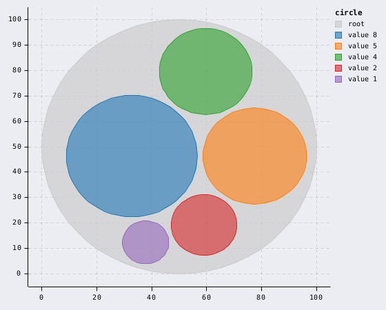
:::


## cljplot2.layout.treemap

Treemap rectangles (the `treemap` chart) of values in a box: squarified (near-square rectangles in the given
order, best with values in decreasing order, as here) or slice-and-dice (strips along x at even depths, along y at
odd ones):


::: {.sourceClojure}
```clojure
(def shares [6 3 2 1 1])
```
:::


```{=html}
<div class="data-table"><table class="table table-hover table-responsive clay-table"><thead><tr><th>x</th><th>y</th><th>w</th><th>h</th></tr></thead><tbody><tr><td>0</td><td>0</td><td>46.15384615384616</td><td>60.0</td></tr><tr><td>46.15384615384616</td><td>0</td><td>32.30769230769231</td><td>42.85714285714286</td></tr><tr><td>78.46153846153847</td><td>0</td><td>21.538461538461537</td><td>42.85714285714286</td></tr><tr><td>46.15384615384616</td><td>42.85714285714286</td><td>26.92307692307693</td><td>17.14285714285714</td></tr><tr><td>73.0769230769231</td><td>42.85714285714286</td><td>26.92307692307693</td><td>17.14285714285714</td></tr></tbody></table></div>
```


```{=html}
<div class="data-table"><table class="table table-hover table-responsive clay-table"><thead><tr><th>x</th><th>y</th><th>w</th><th>h</th></tr></thead><tbody><tr><td>0.0</td><td>0</td><td>46.15384615384615</td><td>60</td></tr><tr><td>46.15384615384615</td><td>0</td><td>23.076923076923077</td><td>60</td></tr><tr><td>69.23076923076923</td><td>0</td><td>15.384615384615385</td><td>60</td></tr><tr><td>84.61538461538461</td><td>0</td><td>7.6923076923076925</td><td>60</td></tr><tr><td>92.3076923076923</td><td>0</td><td>7.6923076923076925</td><td>60</td></tr></tbody></table></div>
```


Both layouts drawn with the [rect](reference.charts_annotations.html#rectangles) chart (an annotation chart: its own data
and mapping), outlined in white:


::: {.sourceClojure}
```clojure
(plot/render-image (plot/arrange (for [[title rects] [["squarify" (treemap/squarify shares {:x 0 :y 0 :w 100 :h 60})]
                                                      ["slice-dice, depth 0" (treemap/slice-dice shares {:x 0 :y 0 :w 100 :h 60} 0)]]]
                                   {:charts [(chart/rect {:data (map-indexed (fn [i {:keys [x y w h]}]
                                                                               {:share (str (nth shares i) " (" i ")")
                                                                                :x0 x :x1 (+ x w) :y0 y :y1 (+ y h)})
                                                                             rects)
                                                          :mapping {:x0 :x0 :x1 :x1 :y0 :y0 :y1 :y1 :color :share}
                                                          :stroke-color :white :stroke-width 2})]
                                    :labels {:title title}
                                    :legend false})
                                 {:columns 2})
                   {:width 900 :height 320})
```
:::


::: {.clay-image}
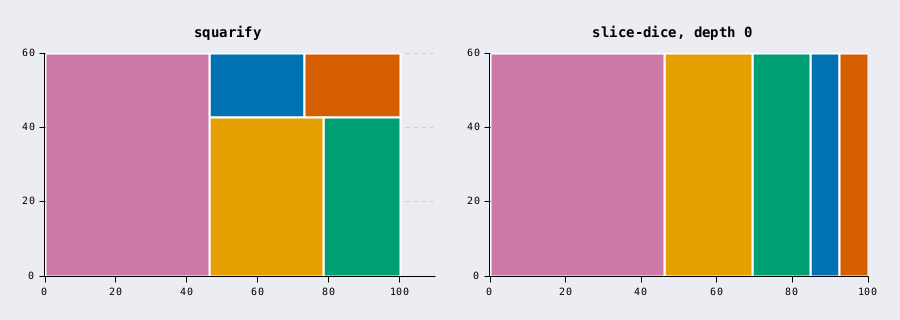
:::


## cljplot2.layout.venn

Venn circles (the `venn` chart): two sets with areas (and the overlap's lens) proportional to their sizes, the
classic three-set layout, a label point per region, and the lens area of two circles:


::: {.sourceClojure}
```clojure
(def two-circles (venn/two-sets 10 6 3 true))
```
:::


```{=html}
<div class="data-table"><table class="table table-hover table-responsive clay-table"><thead><tr><th>x</th><th>y</th><th>r</th></tr></thead><tbody><tr><td>0.0</td><td>0.0</td><td>1.7841241161527712</td></tr><tr><td>1.5915020413128615</td><td>0.0</td><td>1.381976597885342</td></tr></tbody></table></div>
```


::: {.sourceClojure}
```clojure
(venn/region-points two-circles)
```
:::


::: {.printedClojure}
```clojure
{#{0} [-0.7872993363626258 0.0],
 #{1} [2.3788013776754875 0.0],
 #{0 1} [0.9968247797901454 0.0]}

```
:::


::: {.sourceClojure}
```clojure
(venn/three-sets)
```
:::


::: {.printedClojure}
```clojure
[{:x -0.5629165124598852, :y -0.325, :r 1.0}
 {:x 0.5629165124598852, :y -0.325, :r 1.0}
 {:x 0.0, :y 0.65, :r 1.0}]

```
:::


::: {.sourceClojure}
```clojure
(venn/lens-area 1.0 1.0 1.0)
```
:::


::: {.printedClojure}
```clojure
1.228369698608757

```
:::


The two proportional circles drawn as polygons, each region labelled at its point:


::: {.sourceClojure}
```clojure
(def venn-outlines (for [[i {:keys [x y r]}] (map-indexed vector two-circles)
                         a (range 0 360 2)]
                     {:set (nth ["A (10)" "B (6)"] i)
                      :x (m/+ x (m/* r (m/cos (m/radians a))))
                      :y (m/+ y (m/* r (m/sin (m/radians a))))}))
```
:::


```{=html}
<div class="data-table"><table class="table table-hover table-responsive clay-table"><thead><tr><th>set</th><th>x</th><th>y</th></tr></thead><tbody><tr><td>A (10)</td><td>1.7841241161527712</td><td>0.0</td></tr><tr><td>A (10)</td><td>1.7830372759466313</td><td>0.062265033708526096</td></tr><tr><td>A (10)</td><td>1.7797780794755875</td><td>0.12445420706467154</td></tr><tr><td>A (10)</td><td>1.7743504975684994</td><td>0.18649175214020966</td></tr><tr><td>A (10)</td><td>1.766761142897866</td><td>0.24830208574261714</td></tr><tr><td>A (10)</td><td>1.7570192619233023</td><td>0.30980990150155147</td></tr><tr><td>A (10)</td><td>1.7451367236261548</td><td>0.37094026161806315</td></tr><tr><td>A (10)</td><td>1.7311280050489735</td><td>0.4316186881647602</td></tr><tr><td>A (10)</td><td>1.7150101736574672</td><td>0.49177125382569054</td></tr><tr><td>A (10)</td><td>1.6968028665464245</td><td>0.5513246719653889</td></tr><tr><td>A (10)</td><td>1.6765282665149401</td><td>0.6102063859173529</td></tr><tr><td>A (10)</td><td>1.6542110750400891</td><td>0.6683446573831645</td></tr><tr><td>A (10)</td><td>1.6298784821819843</td><td>0.7256686538345573</td></tr><tr><td>A (10)</td><td>1.6035601334568743</td><td>0.7821085348119394</td></tr><tr><td>A (10)</td><td>1.57528809371865</td><td>0.8375955370142377</td></tr><tr><td>A (10)</td><td>1.5450968080927585</td><td>0.8920620580763855</td></tr><tr><td>A (10)</td><td>1.5130230600101238</td><td>0.9454417389323935</td></tr><tr><td>A (10)</td><td>1.4791059263922026</td><td>0.9976695446636482</td></tr><tr><td>A (10)</td><td>1.4433867300417746</td><td>1.0486818437339422</td></tr><tr><td>A (10)</td><td>1.4059089892974719</td><td>1.0984164855147012</td></tr><tr><td>A (10)</td><td>1.3667183650133885</td><td>1.1468128760059493</td></tr><tr><td>A (10)</td><td>1.3258626049283615</td><td>1.1938120516607658</td></tr><tr><td>A (10)</td><td>1.2833914854927069</td><td>1.2393567512232828</td></tr><tr><td>A (10)</td><td>1.2393567512232828</td><td>1.2833914854927069</td></tr><tr><td>A (10)</td><td>1.1938120516607658</td><td>1.3258626049283615</td></tr><tr><td>A (10)</td><td>1.1468128760059495</td><td>1.3667183650133885</td></tr><tr><td>A (10)</td><td>1.0984164855147012</td><td>1.405908989297472</td></tr><tr><td>A (10)</td><td>1.0486818437339422</td><td>1.4433867300417746</td></tr><tr><td>A (10)</td><td>0.997669544663648</td><td>1.4791059263922028</td></tr><tr><td>A (10)</td><td>0.9454417389323935</td><td>1.5130230600101238</td></tr><tr><td>A (10)</td><td>0.8920620580763858</td><td>1.5450968080927583</td></tr><tr><td>A (10)</td><td>0.8375955370142377</td><td>1.5752880937186498</td></tr><tr><td>A (10)</td><td>0.7821085348119395</td><td>1.6035601334568743</td></tr><tr><td>A (10)</td><td>0.7256686538345573</td><td>1.6298784821819843</td></tr><tr><td>A (10)</td><td>0.6683446573831644</td><td>1.6542110750400891</td></tr><tr><td>A (10)</td><td>0.610206385917353</td><td>1.67652826651494</td></tr><tr><td>A (10)</td><td>0.551324671965389</td><td>1.6968028665464245</td></tr><tr><td>A (10)</td><td>0.49177125382569054</td><td>1.7150101736574672</td></tr><tr><td>A (10)</td><td>0.43161868816476007</td><td>1.7311280050489735</td></tr><tr><td>A (10)</td><td>0.3709402616180633</td><td>1.7451367236261546</td></tr><tr><td>A (10)</td><td>0.30980990150155163</td><td>1.7570192619233023</td></tr><tr><td>A (10)</td><td>0.2483020857426172</td><td>1.766761142897866</td></tr><tr><td>A (10)</td><td>0.18649175214020963</td><td>1.7743504975684994</td></tr><tr><td>A (10)</td><td>0.12445420706467142</td><td>1.7797780794755875</td></tr><tr><td>A (10)</td><td>0.06226503370852629</td><td>1.7830372759466313</td></tr><tr><td>A (10)</td><td>1.0924609440640459E-16</td><td>1.7841241161527712</td></tr><tr><td>A (10)</td><td>-0.06226503370852607</td><td>1.7830372759466313</td></tr><tr><td>A (10)</td><td>-0.1244542070646716</td><td>1.7797780794755875</td></tr><tr><td>A (10)</td><td>-0.1864917521402098</td><td>1.7743504975684994</td></tr><tr><td>A (10)</td><td>-0.248302085742617</td><td>1.766761142897866</td></tr><tr><td>A (10)</td><td>-0.3098099015015514</td><td>1.7570192619233023</td></tr><tr><td>A (10)</td><td>-0.37094026161806315</td><td>1.7451367236261548</td></tr><tr><td>A (10)</td><td>-0.4316186881647603</td><td>1.7311280050489735</td></tr><tr><td>A (10)</td><td>-0.49177125382569037</td><td>1.7150101736574672</td></tr><tr><td>A (10)</td><td>-0.5513246719653888</td><td>1.6968028665464248</td></tr><tr><td>A (10)</td><td>-0.6102063859173529</td><td>1.6765282665149401</td></tr><tr><td>A (10)</td><td>-0.6683446573831646</td><td>1.6542110750400891</td></tr><tr><td>A (10)</td><td>-0.7256686538345574</td><td>1.6298784821819843</td></tr><tr><td>A (10)</td><td>-0.7821085348119396</td><td>1.603560133456874</td></tr><tr><td>A (10)</td><td>-0.8375955370142378</td><td>1.5752880937186498</td></tr><tr><td>A (10)</td><td>-0.8920620580763852</td><td>1.5450968080927585</td></tr><tr><td>A (10)</td><td>-0.9454417389323934</td><td>1.513023060010124</td></tr><tr><td>A (10)</td><td>-0.9976695446636479</td><td>1.4791059263922028</td></tr><tr><td>A (10)</td><td>-1.048681843733942</td><td>1.4433867300417746</td></tr><tr><td>A (10)</td><td>-1.0984164855147012</td><td>1.405908989297472</td></tr><tr><td>A (10)</td><td>-1.1468128760059495</td><td>1.3667183650133885</td></tr><tr><td>A (10)</td><td>-1.1938120516607658</td><td>1.3258626049283615</td></tr><tr><td>A (10)</td><td>-1.239356751223283</td><td>1.2833914854927069</td></tr><tr><td>A (10)</td><td>-1.2833914854927069</td><td>1.2393567512232826</td></tr><tr><td>A (10)</td><td>-1.325862604928361</td><td>1.193812051660766</td></tr><tr><td>A (10)</td><td>-1.3667183650133883</td><td>1.1468128760059497</td></tr><tr><td>A (10)</td><td>-1.4059089892974719</td><td>1.0984164855147014</td></tr><tr><td>A (10)</td><td>-1.4433867300417744</td><td>1.0486818437339425</td></tr><tr><td>A (10)</td><td>-1.4791059263922026</td><td>0.9976695446636482</td></tr><tr><td>A (10)</td><td>-1.5130230600101238</td><td>0.9454417389323935</td></tr><tr><td>A (10)</td><td>-1.5450968080927585</td><td>0.8920620580763855</td></tr><tr><td>A (10)</td><td>-1.57528809371865</td><td>0.8375955370142375</td></tr><tr><td>A (10)</td><td>-1.6035601334568743</td><td>0.7821085348119392</td></tr><tr><td>A (10)</td><td>-1.629878482181984</td><td>0.7256686538345576</td></tr><tr><td>A (10)</td><td>-1.654211075040089</td><td>0.668344657383165</td></tr><tr><td>A (10)</td><td>-1.67652826651494</td><td>0.6102063859173531</td></tr><tr><td>A (10)</td><td>-1.6968028665464245</td><td>0.5513246719653891</td></tr><tr><td>A (10)</td><td>-1.7150101736574672</td><td>0.49177125382569065</td></tr><tr><td>A (10)</td><td>-1.7311280050489735</td><td>0.4316186881647602</td></tr><tr><td>A (10)</td><td>-1.7451367236261548</td><td>0.3709402616180631</td></tr><tr><td>A (10)</td><td>-1.7570192619233023</td><td>0.30980990150155135</td></tr><tr><td>A (10)</td><td>-1.766761142897866</td><td>0.24830208574261695</td></tr><tr><td>A (10)</td><td>-1.7743504975684994</td><td>0.18649175214021013</td></tr><tr><td>A (10)</td><td>-1.7797780794755875</td><td>0.12445420706467195</td></tr><tr><td>A (10)</td><td>-1.7830372759466313</td><td>0.0622650337085264</td></tr><tr><td>A (10)</td><td>-1.7841241161527712</td><td>2.1849218881280918E-16</td></tr><tr><td>A (10)</td><td>-1.7830372759466313</td><td>-0.06226503370852597</td></tr><tr><td>A (10)</td><td>-1.7797780794755875</td><td>-0.1244542070646715</td></tr><tr><td>A (10)</td><td>-1.7743504975684994</td><td>-0.18649175214020972</td></tr><tr><td>A (10)</td><td>-1.7667611428978658</td><td>-0.2483020857426173</td></tr><tr><td>A (10)</td><td>-1.7570192619233023</td><td>-0.3098099015015517</td></tr><tr><td>A (10)</td><td>-1.7451367236261546</td><td>-0.3709402616180634</td></tr><tr><td>A (10)</td><td>-1.7311280050489735</td><td>-0.4316186881647598</td></tr><tr><td>A (10)</td><td>-1.7150101736574672</td><td>-0.49177125382569026</td></tr><tr><td>A (10)</td><td>-1.6968028665464248</td><td>-0.5513246719653887</td></tr><tr><td>…</td><td>…</td><td>…</td></tr></tbody></table></div>
```


::: {.sourceClojure}
```clojure
(def venn-labels (for [[region [x y]] (venn/region-points two-circles)]
                   {:x x :y y :text (case region #{0} "A only" #{1} "B only" "both (3)")}))
```
:::


```{=html}
<div class="data-table"><table class="table table-hover table-responsive clay-table"><thead><tr><th>x</th><th>y</th><th>text</th></tr></thead><tbody><tr><td>-0.7872993363626258</td><td>0.0</td><td>A only</td></tr><tr><td>2.3788013776754875</td><td>0.0</td><td>B only</td></tr><tr><td>0.9968247797901454</td><td>0.0</td><td>both (3)</td></tr></tbody></table></div>
```


::: {.sourceClojure}
```clojure
(plot/render-image {:data venn-outlines
                    :mapping {:x :x :y :y :color :set}
                    :charts [(chart/polygon {:alpha 0.4 :stroke-color :color})
                             (chart/text {:data venn-labels :mapping {:x :x :y :y :label :text}})]
                    :scales {:x {:domain [-2 3.2]} :y {:domain [-2.2 2.2]}}}
                   {:width 560 :height 380})
```
:::


::: {.clay-image}
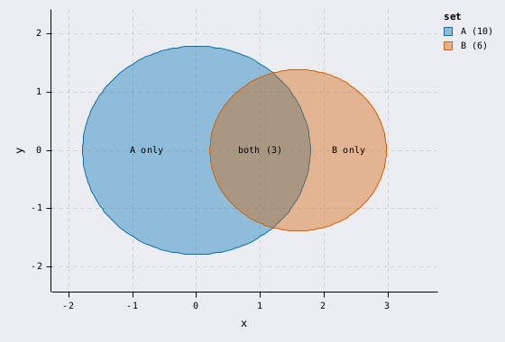
:::


## Recipes

Short compositions of the pieces documented in this part.

A reference curve over a histogram: the [histogram](reference.charts_one_variable.html#histograms) on the
density scale (`:y :density`) and the normal density with the data's mean and standard deviation as a
[function](reference.charts_annotations.html#function-curves) chart:


::: {.sourceClojure}
```clojure
(plot/render-image (let [xs (map :waiting faithful)
                         normal (r/distribution :normal {:mu (stats/mean xs) :sd (stats/stddev xs)})]
                     {:data faithful
                      :mapping {:x :waiting}
                      :charts [(chart/histogram {:y :density :bins 25})
                               (chart/function {:f #(r/pdf normal %) :domain [40 100] :color [200 50 50] :line-width 2})]
                      :labels {:x "waiting [min]" :title "a normal curve fails a bimodal sample"}})
                   {:width 600 :height 320})
```
:::


::: {.clay-image}
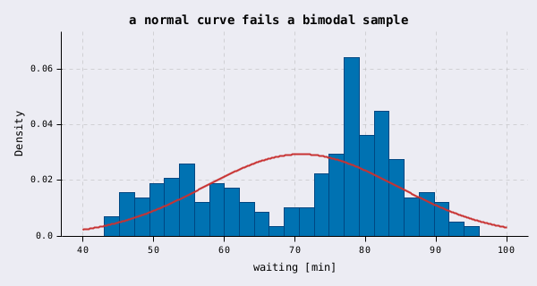
:::


A highlighted interval with an explanation: a band ([rect](reference.charts_annotations.html#rectangles) over an x
interval), a threshold ([rule](reference.charts_annotations.html#reference-lines)) and a note
([text](reference.charts_annotations.html#text-labels)) layered over a scatter with a loess
[smooth](reference.charts_fitted_curves.html#smoothing):


::: {.sourceClojure}
```clojure
(plot/render-image {:data faithful
                    :mapping {:x :eruptions :y :waiting}
                    :charts [(chart/rect {:x [2.5 3.5] :fill [255 200 0 60]})
                             (chart/scatter {:size 4})
                             (chart/smooth {:method :loess})
                             (chart/rule {:y 68 :dash :dashed})
                             (chart/text {:x 3.0 :y 95 :text "few eruptions of 2.5-3.5 min"})]
                    :labels {:x "eruptions [min]" :y "waiting [min]"}}
                   {:width 600 :height 320})
```
:::


::: {.clay-image}
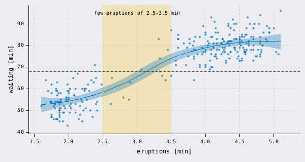
:::


Small multiples built in a loop - one plot per group with a shared domain, arranged in a row:


::: {.sourceClojure}
```clojure
(plot/render-image (plot/arrange (for [[label pred] [["short" #(< (:eruptions %) 3)] ["long" #(>= (:eruptions %) 3)]]]
                                   {:data (filter pred faithful)
                                    :mapping {:x :waiting}
                                    :charts [(chart/density {:fill :color})]
                                    :scales {:x {:domain [40 100]}}
                                    :labels {:title (str label " eruptions")}})
                                 {:columns 2})
                   {:width 800 :height 260})
```
:::


::: {.clay-image}
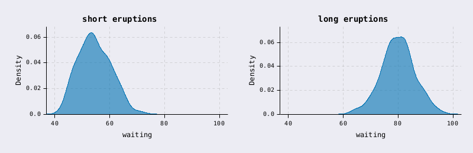
:::


Rendering to a file - `plot/save` at the end of a `render-image` pipeline - is shown in
[Render - Saving](reference.render.html#saving).


## Links

The use cases show the charts at work, one family per chapter: [distribution](use_cases.distribution.html),
[correlation](use_cases.correlation.html), [ranking](use_cases.ranking.html),
[part of a whole](use_cases.part_of_a_whole.html), [evolution](use_cases.evolution.html),
[flow](use_cases.flow.html) and [colours](use_cases.colors.html). The galleries reproduce other libraries' examples:
[lattice](galleries.lattice.html), [Vega-Lite](galleries.vega.html) and [cljplot](galleries.cljplot.html).


```{=html}
<div style="background-color:grey;height:2px;width:100%;"></div>
```


```{=html}
<div><pre><small><small>source: notebooks/reference/specific_cases.clj</small></small></pre></div>
```