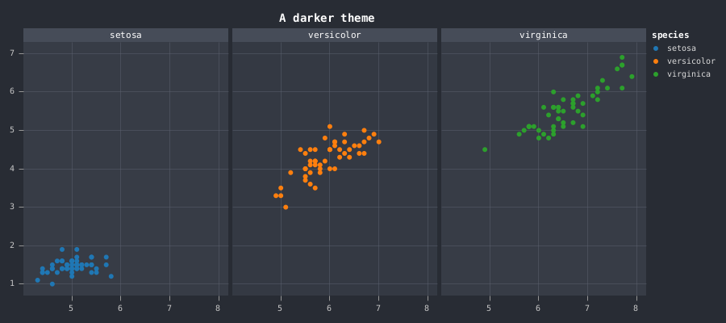

---
format:
  html: {toc: true, toc-location: right, toc-depth: 4, theme: cosmo}
code-block-background: true

---
<style></style><style>.printedClojure .sourceCode {
  background-color: transparent;
  border-style: none;
}
</style><style>.clay-limit-image-width .clay-image {max-width: 100%}
.clay-side-by-side .sourceCode {margin: 0}
.clay-side-by-side {margin: 1em 0}
</style>
<script src="https://code.jquery.com/jquery-3.6.0.min.js" type="text/javascript"></script><script src="https://code.jquery.com/ui/1.13.1/jquery-ui.min.js" type="text/javascript"></script>

# Theme

The theme holds every style default: backgrounds, grid lines, axes, legends, palettes, text roles and each chart
kind's style. A plot's `:theme` is deep-merged over the default theme, so it names only what changes.


::: {.sourceClojure}
```clojure
(ns reference.theme
  (:require [cljplot2.chart :as chart]
            [cljplot2.core :as plot]
            [cljplot2.describe :as describe]
            [notebook-utils :as nu]))
```
:::


Data: Edgar Anderson's iris measurements, R datasets package `iris` (Anderson 1935; Fisher 1936); licence: Part of R (GPL-2 | GPL-3).


::: {.sourceClojure}
```clojure
(def iris (nu/dataset :iris))
```
:::


::: {.sourceClojure}
```clojure
(plot/render-image {:data iris
                    :mapping {:x :sepal-length :y :petal-length :color :species :facet :species}
                    :charts [(chart/scatter)]
                    :facets {:columns 3}
                    :labels {:title "A darker theme"}
                    :theme {:plot {:background [40 44 52]}
                            :panel {:fill [55 60 70] :grid {:x {:color [90 96 110] :width 0.5 :dash :none}
                                                            :y {:color [90 96 110] :width 0.5 :dash :none}}}
                            :strip {:fill [70 76 88] :border-color :none}
                            :axis {:x {:line-color :none :tick-color [150 150 150]}
                                   :y {:line-color :none :tick-color [150 150 150]}}
                            :palette {:color :tableau-10}
                            :text {:title {:color :white}
                                   :axis-title {:color [220 220 220]}
                                   :tick-label {:color [200 200 200]}
                                   :strip {:color :white}
                                   :legend-title {:color :white}
                                   :legend-label {:color [220 220 220]}}}}
                   {:width 900 :height 400})
```
:::


::: {.clay-image}

:::


## Plot


::: {.sourceClojure}
```clojure
(nu/options-table (describe/theme-rows :plot))
```
:::


::: {.clay-table}

```{=html}
<table class="table table-hover table-responsive clay-table"><thead><tr><th>Option</th><th>Type</th><th>Default</th><th>Description</th></tr></thead><tbody><tr><td>:plot</td><td>map</td><td></td><td>the whole canvas</td></tr><tr><td>:plot :background</td><td>a clojure2d color or :none</td><td>0xececf3</td><td>canvas background colour</td></tr><tr><td>:plot :margin</td><td>a non-negative number</td><td>10</td><td>pixels around the plot on every side</td></tr></tbody></table>
```

:::


## Panel


::: {.sourceClojure}
```clojure
(nu/options-table (describe/theme-rows :panel))
```
:::


::: {.clay-table}

```{=html}
<table class="table table-hover table-responsive clay-table"><thead><tr><th>Option</th><th>Type</th><th>Default</th><th>Description</th></tr></thead><tbody><tr><td>:panel</td><td>map</td><td></td><td>the data panels</td></tr><tr><td>:panel :fill</td><td>a clojure2d color or :none</td><td>:none</td><td>panel background colour</td></tr><tr><td>:panel :alternate-fill</td><td>a clojure2d color or :none</td><td>[0 0 0 12]</td><td>drawn over odd facet panels (row + column odd); :none - off</td></tr><tr><td>:panel :border-color</td><td>a clojure2d color or :none</td><td>:none</td><td>panel border colour</td></tr><tr><td>:panel :border-width</td><td>a non-negative number</td><td>1</td><td>panel border width in pixels (drawn inside the panel)</td></tr><tr><td>:panel :grid</td><td>map</td><td></td><td>grid lines at the ticks</td></tr><tr><td>:panel :grid :x</td><td>:none or a line {:color :width :dash}</td><td>{:color 0xb4b4b4, :width 0.5, :dash [4.0]}</td><td>grid lines of the x scale</td></tr><tr><td>:panel :grid :y</td><td>:none or a line {:color :width :dash}</td><td>{:color 0xb4b4b4, :width 0.5, :dash [4.0]}</td><td>grid lines of the y scale</td></tr><tr><td>:panel :grid :bands</td><td>:none or a line {:color :width :dash}</td><td>{:color 0xb4b4b4, :width 1, :dash [1.0 2.0]}</td><td>grid lines of a bands scale, instead of :x / :y</td></tr><tr><td>:panel :grid :bands-fill</td><td>a clojure2d color or :none</td><td>[0 0 0 8]</td><td>fill of every second band of a bands scale; :none - off</td></tr><tr><td>:panel :grid :minor</td><td>:none or a line {:color :width :dash}</td><td>:none</td><td>grid lines at minor ticks</td></tr></tbody></table>
```

:::


## Axis

Per position scale key (`:x`, `:y`), also when `:flip` draws `:x` vertically.


::: {.sourceClojure}
```clojure
(nu/options-table (describe/theme-rows :axis))
```
:::


::: {.clay-table}

```{=html}
<table class="table table-hover table-responsive clay-table"><thead><tr><th>Option</th><th>Type</th><th>Default</th><th>Description</th></tr></thead><tbody><tr><td>:axis</td><td>map</td><td></td><td>axes per scale (kept by scale also when a flipped plot draws :x vertically)</td></tr><tr><td>:axis :x</td><td>map</td><td></td><td>x axis style</td></tr><tr><td>:axis :x :line-color</td><td>a clojure2d color or :none</td><td>:black</td><td>axis line colour</td></tr><tr><td>:axis :x :line-width</td><td>a non-negative number</td><td>1</td><td>axis line width in pixels (0 - not drawn)</td></tr><tr><td>:axis :x :tick-color</td><td>a clojure2d color or :none</td><td>:black</td><td>tick colour</td></tr><tr><td>:axis :x :tick-length</td><td>a non-negative number</td><td>6</td><td>tick length in pixels</td></tr><tr><td>:axis :x :tick-width</td><td>a non-negative number</td><td>1</td><td>tick width in pixels (0 - not drawn)</td></tr><tr><td>:axis :x :label-gap</td><td>a non-negative number</td><td>2</td><td>gap between ticks and tick labels in pixels</td></tr><tr><td>:axis :x :tick-spacing</td><td>a positive number</td><td>80</td><td>target distance between ticks in pixels (sets the tick count)</td></tr><tr><td>:axis :x :label-rotation</td><td>number, >= -90, <= 90</td><td>0</td><td>tick labels rotated clockwise, degrees</td></tr><tr><td>:axis :x :minor-tick-length</td><td>a non-negative number</td><td>3</td><td>minor tick length in pixels</td></tr><tr><td>:axis :y</td><td>map</td><td></td><td>y axis style</td></tr><tr><td>:axis :y :line-color</td><td>a clojure2d color or :none</td><td>:black</td><td>axis line colour</td></tr><tr><td>:axis :y :line-width</td><td>a non-negative number</td><td>1</td><td>axis line width in pixels (0 - not drawn)</td></tr><tr><td>:axis :y :tick-color</td><td>a clojure2d color or :none</td><td>:black</td><td>tick colour</td></tr><tr><td>:axis :y :tick-length</td><td>a non-negative number</td><td>6</td><td>tick length in pixels</td></tr><tr><td>:axis :y :tick-width</td><td>a non-negative number</td><td>1</td><td>tick width in pixels (0 - not drawn)</td></tr><tr><td>:axis :y :label-gap</td><td>a non-negative number</td><td>2</td><td>gap between ticks and tick labels in pixels</td></tr><tr><td>:axis :y :tick-spacing</td><td>a positive number</td><td>50</td><td>target distance between ticks in pixels (sets the tick count)</td></tr><tr><td>:axis :y :label-rotation</td><td>number, >= -90, <= 90</td><td>0</td><td>tick labels rotated clockwise, degrees</td></tr><tr><td>:axis :y :minor-tick-length</td><td>a non-negative number</td><td>3</td><td>minor tick length in pixels</td></tr></tbody></table>
```

:::


## Strip


::: {.sourceClojure}
```clojure
(nu/options-table (describe/theme-rows :strip))
```
:::


::: {.clay-table}

```{=html}
<table class="table table-hover table-responsive clay-table"><thead><tr><th>Option</th><th>Type</th><th>Default</th><th>Description</th></tr></thead><tbody><tr><td>:strip</td><td>map</td><td></td><td>facet strips</td></tr><tr><td>:strip :fill</td><td>a clojure2d color or :none</td><td>[255 255 255 150]</td><td>strip background colour</td></tr><tr><td>:strip :border-color</td><td>a clojure2d color or :none</td><td>[0 0 0 100]</td><td>strip border colour</td></tr><tr><td>:strip :border-width</td><td>a non-negative number</td><td>1</td><td>strip border width in pixels</td></tr><tr><td>:strip :shingle-fill</td><td>a clojure2d color or :none</td><td>[255 165 0 110]</td><td>colour of the bar marking a shingle level</td></tr></tbody></table>
```

:::


## Facet


::: {.sourceClojure}
```clojure
(nu/options-table (describe/theme-rows :facet))
```
:::


::: {.clay-table}

```{=html}
<table class="table table-hover table-responsive clay-table"><thead><tr><th>Option</th><th>Type</th><th>Default</th><th>Description</th></tr></thead><tbody><tr><td>:facet</td><td>map</td><td></td><td>facet layout</td></tr><tr><td>:facet :gap</td><td>a non-negative number</td><td>5</td><td>pixels between facet panels</td></tr></tbody></table>
```

:::


## Multiplot


::: {.sourceClojure}
```clojure
(nu/options-table (describe/theme-rows :multiplot))
```
:::


::: {.clay-table}

```{=html}
<table class="table table-hover table-responsive clay-table"><thead><tr><th>Option</th><th>Type</th><th>Default</th><th>Description</th></tr></thead><tbody><tr><td>:multiplot</td><td>map</td><td></td><td>arranged plots</td></tr><tr><td>:multiplot :gap</td><td>a non-negative number</td><td>10</td><td>pixels between arranged plots</td></tr></tbody></table>
```

:::


## Legend


::: {.sourceClojure}
```clojure
(nu/options-table (describe/theme-rows :legend))
```
:::


::: {.clay-table}

```{=html}
<table class="table table-hover table-responsive clay-table"><thead><tr><th>Option</th><th>Type</th><th>Default</th><th>Description</th></tr></thead><tbody><tr><td>:legend</td><td>map</td><td></td><td>legends and colour bars</td></tr><tr><td>:legend :gap</td><td>a non-negative number</td><td>5</td><td>pixels between key and label and between legends</td></tr><tr><td>:legend :key-size</td><td>a non-negative number</td><td>14</td><td>side of a legend key box in pixels</td></tr><tr><td>:legend :fill</td><td>a clojure2d color or :none</td><td>:none</td><td>legend box fill</td></tr><tr><td>:legend :border-color</td><td>a clojure2d color or :none</td><td>:none</td><td>legend box border colour</td></tr><tr><td>:legend :border-width</td><td>a non-negative number</td><td>1</td><td>legend box border width in pixels</td></tr><tr><td>:legend :bar-length</td><td>:stretch or a positive number</td><td>:stretch</td><td>colour bar length: :stretch (the space left) or pixels</td></tr><tr><td>:legend :bar-width</td><td>a positive number or nil</td><td></td><td>colour bar width in pixels (nil - the key size)</td></tr></tbody></table>
```

:::


## Palette

The default ranges of the aesthetic scales (Aesthetics and legends chapter).


::: {.sourceClojure}
```clojure
(nu/options-table (describe/theme-rows :palette))
```
:::


::: {.clay-table}

```{=html}
<table class="table table-hover table-responsive clay-table"><thead><tr><th>Option</th><th>Type</th><th>Default</th><th>Description</th></tr></thead><tbody><tr><td>:palette</td><td>map</td><td></td><td>default aesthetic ranges</td></tr><tr><td>:palette :color</td><td>a palette name or a non-empty sequence of colors</td><td>:category20</td><td>ordinal colours: a palette name or colours</td></tr><tr><td>:palette :gradient</td><td>a function or a palette name or a non-empty sequence of colors</td><td>[[255.0 255.0 255.0 255.0] [127.0 192.0 236.0 255.0] [56.0 133.0 201.0 255.0] [14.0 83.0 161.0 255.0] [0.0 63.0 143.0 255.0] [0.0 1.0 11.0 255.0]]</td><td>linear and binned colours: colours or a palette name</td></tr><tr><td>:palette :shape</td><td>sequential of a shape character, keyword or shape map (at least 1)</td><td>[\O \s \A \x \+ \V \o \S \^ \v \{ \} \< \>]</td><td>point shapes, cycled</td></tr><tr><td>:palette :size</td><td>[min max], non-negative numbers, min <= max</td><td>[2 10]</td><td>size range [min max] in pixels</td></tr><tr><td>:palette :dash</td><td>sequential of :none, a dash style (:dashed :dot-dash :dot-dot-dash :dotted :long-dash :loose-dot :solid :two-dash) or a sequence of positive numbers (at least 1)</td><td>[:solid :dashed :dotted :dot-dash :long-dash :dot-dot-dash :two-dash :loose-dot]</td><td>dash styles, cycled</td></tr><tr><td>:palette :pattern</td><td>sequential of a pattern name (:back-hatch :cross :dense-dots :diagonal-cross :dots :hatch :horizontal :solid :vertical) or a pattern map (at least 1)</td><td>[:hatch :back-hatch :horizontal :vertical :cross :diagonal-cross :dots :dense-dots]</td><td>fill patterns, cycled</td></tr><tr><td>:palette :na</td><td>a clojure2d color</td><td>[150 150 150]</td><td>colour of NA values</td></tr></tbody></table>
```

:::


## Text

Each text the library draws has a role; a label's `:role` may also name a role of your own added here. Every
role is a text style - the keys of the Text style group:


::: {.sourceClojure}
```clojure
(nu/options-table (describe/theme-rows :text))
```
:::


::: {.clay-table}

```{=html}
<table class="table table-hover table-responsive clay-table"><thead><tr><th>Option</th><th>Type</th><th>Default</th><th>Description</th></tr></thead><tbody><tr><td>:text</td><td>map of keyword to a text style (:font :size :font-style :color :padding :align :background)</td><td></td><td>text styles by role (see text-roles)</td></tr><tr><td>:text :annotation</td><td>a text style (:font :size :font-style :color :padding :align :background)</td><td>{:font "DejaVu Sans Mono", :size 10, :font-style :plain, :color :black, :padding 2, :align [:center :middle]}</td><td>text charts and strip n labels</td></tr><tr><td>:text :axis-title</td><td>a text style (:font :size :font-style :color :padding :align :background)</td><td>{:font "DejaVu Sans Mono", :size 12, :font-style :plain, :color :black, :padding 4, :align [:center :middle]}</td><td>axis titles</td></tr><tr><td>:text :contour-label</td><td>a text style (:font :size :font-style :color :padding :align :background)</td><td>{:font "DejaVu Sans Mono", :size 9, :font-style :plain, :color :black, :padding 1, :align [:center :middle], :background [255 255 255 180]}</td><td>contour level labels</td></tr><tr><td>:text :correlation</td><td>a text style (:font :size :font-style :color :padding :align :background)</td><td>{:font "DejaVu Sans Mono", :size 12, :font-style :plain, :color :black, :padding 1, :align [:center :middle]}</td><td>correlation numbers</td></tr><tr><td>:text :legend-label</td><td>a text style (:font :size :font-style :color :padding :align :background)</td><td>{:font "DejaVu Sans Mono", :size 10, :font-style :plain, :color :black, :padding 2, :align [:left :middle]}</td><td>legend entry labels and colour bar ticks</td></tr><tr><td>:text :legend-title</td><td>a text style (:font :size :font-style :color :padding :align :background)</td><td>{:font "DejaVu Sans Mono", :size 11, :font-style :bold, :color :black, :padding 2, :align [:left :middle]}</td><td>legend titles</td></tr><tr><td>:text :pack-group</td><td>a text style (:font :size :font-style :color :padding :align :background)</td><td>{:font "DejaVu Sans Mono", :size 10, :font-style :bold, :color :black, :padding 2, :align [:center :middle]}</td><td>circle packing group labels</td></tr><tr><td>:text :pack-leaf</td><td>a text style (:font :size :font-style :color :padding :align :background)</td><td>{:font "DejaVu Sans Mono", :size 9, :font-style :plain, :color :black, :padding 2, :align [:center :middle]}</td><td>circle packing leaf labels</td></tr><tr><td>:text :partition-group</td><td>a text style (:font :size :font-style :color :padding :align :background)</td><td>{:font "DejaVu Sans Mono", :size 10, :font-style :bold, :color :black, :padding 2, :align [:center :middle]}</td><td>partition (icicle, sunburst) group labels</td></tr><tr><td>:text :partition-leaf</td><td>a text style (:font :size :font-style :color :padding :align :background)</td><td>{:font "DejaVu Sans Mono", :size 9, :font-style :plain, :color :black, :padding 2, :align [:center :middle]}</td><td>partition leaf labels</td></tr><tr><td>:text :strip</td><td>a text style (:font :size :font-style :color :padding :align :background)</td><td>{:font "DejaVu Sans Mono", :size 11, :font-style :plain, :color :black, :padding 2, :align [:center :middle]}</td><td>facet strip texts</td></tr><tr><td>:text :tick-label</td><td>a text style (:font :size :font-style :color :padding :align :background)</td><td>{:font "DejaVu Sans Mono", :size 10, :font-style :plain, :color :black, :padding 2, :align [:center :middle]}</td><td>tick labels</td></tr><tr><td>:text :tile-value</td><td>a text style (:font :size :font-style :color :padding :align :background)</td><td>{:font "DejaVu Sans Mono", :size 9, :font-style :plain, :color :black, :padding 1, :align [:center :middle]}</td><td>tile value labels</td></tr><tr><td>:text :title</td><td>a text style (:font :size :font-style :color :padding :align :background)</td><td>{:font "DejaVu Sans Mono", :size 14, :font-style :bold, :color :black, :padding 4, :align [:center :middle]}</td><td>plot and multiplot titles</td></tr><tr><td>:text :treemap-group</td><td>a text style (:font :size :font-style :color :padding :align :background)</td><td>{:font "DejaVu Sans Mono", :size 10, :font-style :bold, :color :black, :padding 2, :align [:left :middle]}</td><td>treemap group headers</td></tr><tr><td>:text :treemap-leaf</td><td>a text style (:font :size :font-style :color :padding :align :background)</td><td>{:font "DejaVu Sans Mono", :size 9, :font-style :plain, :color :black, :padding 2, :align [:center :middle]}</td><td>treemap leaf labels</td></tr><tr><td>:text :venn-count</td><td>a text style (:font :size :font-style :color :padding :align :background)</td><td>{:font "DejaVu Sans Mono", :size 10, :font-style :plain, :color :black, :padding 2, :align [:center :middle]}</td><td>Venn diagram region counts</td></tr><tr><td>:text :venn-set</td><td>a text style (:font :size :font-style :color :padding :align :background)</td><td>{:font "DejaVu Sans Mono", :size 11, :font-style :bold, :color :black, :padding 2, :align [:center :middle]}</td><td>Venn diagram set names</td></tr></tbody></table>
```

:::


::: {.sourceClojure}
```clojure
(nu/options-table (describe/fragment-rows :text-style))
```
:::


::: {.clay-table}

```{=html}
<table class="table table-hover table-responsive clay-table"><thead><tr><th>Option</th><th>Type</th><th>Default</th><th>Description</th><th>Group</th></tr></thead><tbody><tr><td>:font</td><td>a bundled, installed or logical font name, or a java.awt.Font</td><td></td><td>font name (bundled, installed or logical) or a java.awt.Font</td><td>Text style</td></tr><tr><td>:size</td><td>a positive number</td><td></td><td>font size in points</td><td>Text style</td></tr><tr><td>:font-style</td><td>one of :bold :bold-italic :italic :plain</td><td></td><td>font style</td><td>Text style</td></tr><tr><td>:color</td><td>a clojure2d color</td><td></td><td>text colour</td><td>Text style</td></tr><tr><td>:padding</td><td>a non-negative number</td><td></td><td>space around the text in pixels</td><td>Text style</td></tr><tr><td>:align</td><td>[h v], h one of :left :center :right, v one of :top :middle :bottom</td><td></td><td>alignment [horizontal vertical] of the text at its anchor</td><td>Text style</td></tr><tr><td>:background</td><td>a clojure2d color or :none</td><td></td><td>box colour behind the text (:none - no box)</td><td>Text style</td></tr></tbody></table>
```

:::


## Chart

The style of each chart kind, `[:chart kind]` - its style keys and defaults are in the chart's table (the rows
with a theme default). Chart options given to the chart override the theme.


::: {.sourceClojure}
```clojure
(nu/options-table (describe/theme-rows :chart))
```
:::


::: {.clay-table}

```{=html}
<table class="table table-hover table-responsive clay-table"><thead><tr><th>Option</th><th>Type</th><th>Default</th><th>Description</th></tr></thead><tbody><tr><td>:chart</td><td>map of chart kind to its style</td><td></td><td>per chart kind styles, see each chart's style options</td></tr></tbody></table>
```

:::


::: {.sourceClojure}
```clojure
(plot/render-image {:data iris
                    :mapping {:x :sepal-length :y :petal-length}
                    :charts [(chart/scatter)]
                    :theme {:chart {:scatter {:shape \s :size 8 :color [178 34 34 120]}}}}
                   {:width 500 :height 350})
```
:::


::: {.clay-image}

:::


```{=html}
<div style="background-color:grey;height:2px;width:100%;"></div>
```


```{=html}
<div><pre><small><small>source: notebooks/reference/theme.clj</small></small></pre></div>
```