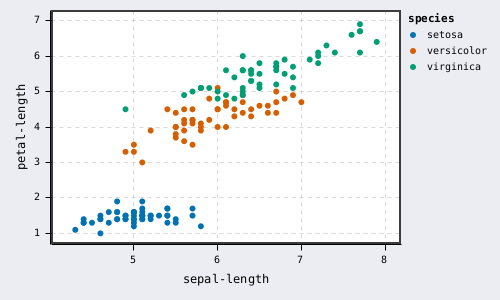
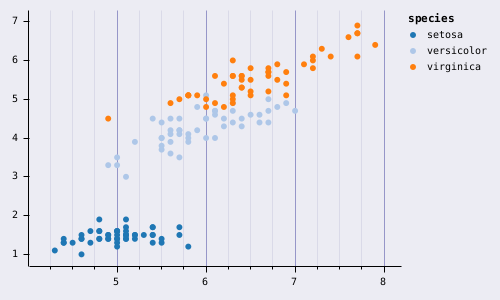
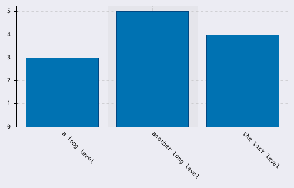
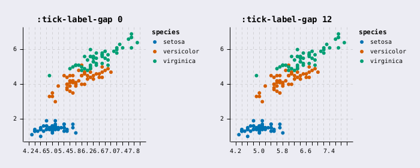
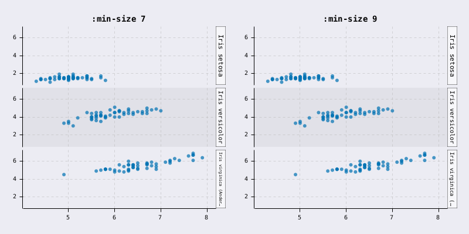
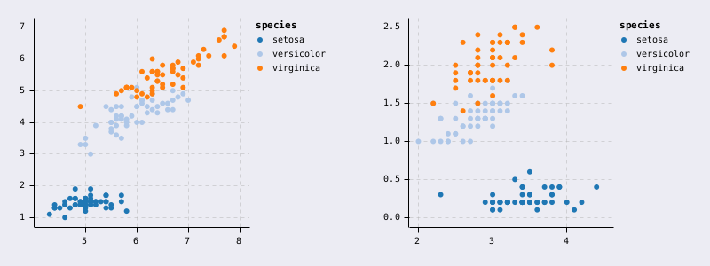
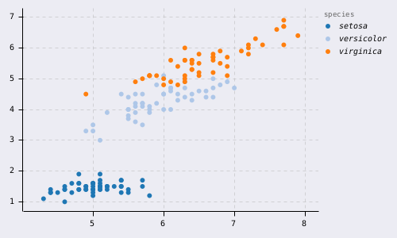

---
format:
  html:
    toc: true
    toc-location: right
    toc-depth: 4
    theme: cosmo
    include-in-header:
      text: |-
        <style>
        .data-table { width: fit-content; max-width: 100%; max-height: 15rem; overflow: auto; margin: 0 0 1rem 0; }
        .data-table .table-responsive { overflow: visible; }
        .data-table table { font-size: 0.75rem; width: auto; margin: 0; }
        .data-table th, .data-table td { padding: 0.1rem 0.45rem !important; white-space: nowrap; }
        .data-table thead th { position: sticky; top: 0; background: var(--bs-body-bg, #fff); }
        </style>
code-block-background: true

---
<style></style><style>.printedClojure .sourceCode {
  background-color: transparent;
  border-style: none;
}
</style><style>.clay-limit-image-width .clay-image {max-width: 100%}
.clay-side-by-side .sourceCode {margin: 0}
.clay-side-by-side {margin: 1em 0}
</style>
<script src="https://code.jquery.com/jquery-3.6.0.min.js" type="text/javascript"></script><script src="https://code.jquery.com/ui/1.13.1/jquery-ui.min.js" type="text/javascript"></script>

# Theme

The theme holds every style default: backgrounds, grid lines, axes, legends, palettes, text roles and each chart
kind's style. A plot's `:theme` is deep-merged over the default theme, so it names only what changes. Each
section below lists its keys with their default values and changes some of them.


::: {.sourceClojure}
```clojure
(ns reference.theme
  (:require [cljplot2.chart :as chart]
            [cljplot2.core :as plot]
            [cljplot2.describe :as describe]
            [notebook-utils :as nu]))
```
:::


Data: Edgar Anderson's iris measurements, R datasets package `iris` (Anderson 1935; Fisher 1936); licence: Part of R (GPL-2 | GPL-3).


::: {.sourceClojure}
```clojure
(def iris (nu/dataset :iris))
```
:::


```{=html}
<div class="data-table"><table class="table table-hover table-responsive clay-table"><thead><tr><th>sepal-length</th><th>sepal-width</th><th>petal-length</th><th>petal-width</th><th>species</th></tr></thead><tbody><tr><td>5.1</td><td>3.5</td><td>1.4</td><td>0.2</td><td>setosa</td></tr><tr><td>4.9</td><td>3</td><td>1.4</td><td>0.2</td><td>setosa</td></tr><tr><td>4.7</td><td>3.2</td><td>1.3</td><td>0.2</td><td>setosa</td></tr><tr><td>4.6</td><td>3.1</td><td>1.5</td><td>0.2</td><td>setosa</td></tr><tr><td>5</td><td>3.6</td><td>1.4</td><td>0.2</td><td>setosa</td></tr><tr><td>5.4</td><td>3.9</td><td>1.7</td><td>0.4</td><td>setosa</td></tr><tr><td>4.6</td><td>3.4</td><td>1.4</td><td>0.3</td><td>setosa</td></tr><tr><td>5</td><td>3.4</td><td>1.5</td><td>0.2</td><td>setosa</td></tr><tr><td>4.4</td><td>2.9</td><td>1.4</td><td>0.2</td><td>setosa</td></tr><tr><td>4.9</td><td>3.1</td><td>1.5</td><td>0.1</td><td>setosa</td></tr><tr><td>5.4</td><td>3.7</td><td>1.5</td><td>0.2</td><td>setosa</td></tr><tr><td>4.8</td><td>3.4</td><td>1.6</td><td>0.2</td><td>setosa</td></tr><tr><td>4.8</td><td>3</td><td>1.4</td><td>0.1</td><td>setosa</td></tr><tr><td>4.3</td><td>3</td><td>1.1</td><td>0.1</td><td>setosa</td></tr><tr><td>5.8</td><td>4</td><td>1.2</td><td>0.2</td><td>setosa</td></tr><tr><td>5.7</td><td>4.4</td><td>1.5</td><td>0.4</td><td>setosa</td></tr><tr><td>5.4</td><td>3.9</td><td>1.3</td><td>0.4</td><td>setosa</td></tr><tr><td>5.1</td><td>3.5</td><td>1.4</td><td>0.3</td><td>setosa</td></tr><tr><td>5.7</td><td>3.8</td><td>1.7</td><td>0.3</td><td>setosa</td></tr><tr><td>5.1</td><td>3.8</td><td>1.5</td><td>0.3</td><td>setosa</td></tr><tr><td>5.4</td><td>3.4</td><td>1.7</td><td>0.2</td><td>setosa</td></tr><tr><td>5.1</td><td>3.7</td><td>1.5</td><td>0.4</td><td>setosa</td></tr><tr><td>4.6</td><td>3.6</td><td>1</td><td>0.2</td><td>setosa</td></tr><tr><td>5.1</td><td>3.3</td><td>1.7</td><td>0.5</td><td>setosa</td></tr><tr><td>4.8</td><td>3.4</td><td>1.9</td><td>0.2</td><td>setosa</td></tr><tr><td>5</td><td>3</td><td>1.6</td><td>0.2</td><td>setosa</td></tr><tr><td>5</td><td>3.4</td><td>1.6</td><td>0.4</td><td>setosa</td></tr><tr><td>5.2</td><td>3.5</td><td>1.5</td><td>0.2</td><td>setosa</td></tr><tr><td>5.2</td><td>3.4</td><td>1.4</td><td>0.2</td><td>setosa</td></tr><tr><td>4.7</td><td>3.2</td><td>1.6</td><td>0.2</td><td>setosa</td></tr><tr><td>4.8</td><td>3.1</td><td>1.6</td><td>0.2</td><td>setosa</td></tr><tr><td>5.4</td><td>3.4</td><td>1.5</td><td>0.4</td><td>setosa</td></tr><tr><td>5.2</td><td>4.1</td><td>1.5</td><td>0.1</td><td>setosa</td></tr><tr><td>5.5</td><td>4.2</td><td>1.4</td><td>0.2</td><td>setosa</td></tr><tr><td>4.9</td><td>3.1</td><td>1.5</td><td>0.2</td><td>setosa</td></tr><tr><td>5</td><td>3.2</td><td>1.2</td><td>0.2</td><td>setosa</td></tr><tr><td>5.5</td><td>3.5</td><td>1.3</td><td>0.2</td><td>setosa</td></tr><tr><td>4.9</td><td>3.6</td><td>1.4</td><td>0.1</td><td>setosa</td></tr><tr><td>4.4</td><td>3</td><td>1.3</td><td>0.2</td><td>setosa</td></tr><tr><td>5.1</td><td>3.4</td><td>1.5</td><td>0.2</td><td>setosa</td></tr><tr><td>5</td><td>3.5</td><td>1.3</td><td>0.3</td><td>setosa</td></tr><tr><td>4.5</td><td>2.3</td><td>1.3</td><td>0.3</td><td>setosa</td></tr><tr><td>4.4</td><td>3.2</td><td>1.3</td><td>0.2</td><td>setosa</td></tr><tr><td>5</td><td>3.5</td><td>1.6</td><td>0.6</td><td>setosa</td></tr><tr><td>5.1</td><td>3.8</td><td>1.9</td><td>0.4</td><td>setosa</td></tr><tr><td>4.8</td><td>3</td><td>1.4</td><td>0.3</td><td>setosa</td></tr><tr><td>5.1</td><td>3.8</td><td>1.6</td><td>0.2</td><td>setosa</td></tr><tr><td>4.6</td><td>3.2</td><td>1.4</td><td>0.2</td><td>setosa</td></tr><tr><td>5.3</td><td>3.7</td><td>1.5</td><td>0.2</td><td>setosa</td></tr><tr><td>5</td><td>3.3</td><td>1.4</td><td>0.2</td><td>setosa</td></tr><tr><td>7</td><td>3.2</td><td>4.7</td><td>1.4</td><td>versicolor</td></tr><tr><td>6.4</td><td>3.2</td><td>4.5</td><td>1.5</td><td>versicolor</td></tr><tr><td>6.9</td><td>3.1</td><td>4.9</td><td>1.5</td><td>versicolor</td></tr><tr><td>5.5</td><td>2.3</td><td>4</td><td>1.3</td><td>versicolor</td></tr><tr><td>6.5</td><td>2.8</td><td>4.6</td><td>1.5</td><td>versicolor</td></tr><tr><td>5.7</td><td>2.8</td><td>4.5</td><td>1.3</td><td>versicolor</td></tr><tr><td>6.3</td><td>3.3</td><td>4.7</td><td>1.6</td><td>versicolor</td></tr><tr><td>4.9</td><td>2.4</td><td>3.3</td><td>1</td><td>versicolor</td></tr><tr><td>6.6</td><td>2.9</td><td>4.6</td><td>1.3</td><td>versicolor</td></tr><tr><td>5.2</td><td>2.7</td><td>3.9</td><td>1.4</td><td>versicolor</td></tr><tr><td>5</td><td>2</td><td>3.5</td><td>1</td><td>versicolor</td></tr><tr><td>5.9</td><td>3</td><td>4.2</td><td>1.5</td><td>versicolor</td></tr><tr><td>6</td><td>2.2</td><td>4</td><td>1</td><td>versicolor</td></tr><tr><td>6.1</td><td>2.9</td><td>4.7</td><td>1.4</td><td>versicolor</td></tr><tr><td>5.6</td><td>2.9</td><td>3.6</td><td>1.3</td><td>versicolor</td></tr><tr><td>6.7</td><td>3.1</td><td>4.4</td><td>1.4</td><td>versicolor</td></tr><tr><td>5.6</td><td>3</td><td>4.5</td><td>1.5</td><td>versicolor</td></tr><tr><td>5.8</td><td>2.7</td><td>4.1</td><td>1</td><td>versicolor</td></tr><tr><td>6.2</td><td>2.2</td><td>4.5</td><td>1.5</td><td>versicolor</td></tr><tr><td>5.6</td><td>2.5</td><td>3.9</td><td>1.1</td><td>versicolor</td></tr><tr><td>5.9</td><td>3.2</td><td>4.8</td><td>1.8</td><td>versicolor</td></tr><tr><td>6.1</td><td>2.8</td><td>4</td><td>1.3</td><td>versicolor</td></tr><tr><td>6.3</td><td>2.5</td><td>4.9</td><td>1.5</td><td>versicolor</td></tr><tr><td>6.1</td><td>2.8</td><td>4.7</td><td>1.2</td><td>versicolor</td></tr><tr><td>6.4</td><td>2.9</td><td>4.3</td><td>1.3</td><td>versicolor</td></tr><tr><td>6.6</td><td>3</td><td>4.4</td><td>1.4</td><td>versicolor</td></tr><tr><td>6.8</td><td>2.8</td><td>4.8</td><td>1.4</td><td>versicolor</td></tr><tr><td>6.7</td><td>3</td><td>5</td><td>1.7</td><td>versicolor</td></tr><tr><td>6</td><td>2.9</td><td>4.5</td><td>1.5</td><td>versicolor</td></tr><tr><td>5.7</td><td>2.6</td><td>3.5</td><td>1</td><td>versicolor</td></tr><tr><td>5.5</td><td>2.4</td><td>3.8</td><td>1.1</td><td>versicolor</td></tr><tr><td>5.5</td><td>2.4</td><td>3.7</td><td>1</td><td>versicolor</td></tr><tr><td>5.8</td><td>2.7</td><td>3.9</td><td>1.2</td><td>versicolor</td></tr><tr><td>6</td><td>2.7</td><td>5.1</td><td>1.6</td><td>versicolor</td></tr><tr><td>5.4</td><td>3</td><td>4.5</td><td>1.5</td><td>versicolor</td></tr><tr><td>6</td><td>3.4</td><td>4.5</td><td>1.6</td><td>versicolor</td></tr><tr><td>6.7</td><td>3.1</td><td>4.7</td><td>1.5</td><td>versicolor</td></tr><tr><td>6.3</td><td>2.3</td><td>4.4</td><td>1.3</td><td>versicolor</td></tr><tr><td>5.6</td><td>3</td><td>4.1</td><td>1.3</td><td>versicolor</td></tr><tr><td>5.5</td><td>2.5</td><td>4</td><td>1.3</td><td>versicolor</td></tr><tr><td>5.5</td><td>2.6</td><td>4.4</td><td>1.2</td><td>versicolor</td></tr><tr><td>6.1</td><td>3</td><td>4.6</td><td>1.4</td><td>versicolor</td></tr><tr><td>5.8</td><td>2.6</td><td>4</td><td>1.2</td><td>versicolor</td></tr><tr><td>5</td><td>2.3</td><td>3.3</td><td>1</td><td>versicolor</td></tr><tr><td>5.6</td><td>2.7</td><td>4.2</td><td>1.3</td><td>versicolor</td></tr><tr><td>5.7</td><td>3</td><td>4.2</td><td>1.2</td><td>versicolor</td></tr><tr><td>5.7</td><td>2.9</td><td>4.2</td><td>1.3</td><td>versicolor</td></tr><tr><td>6.2</td><td>2.9</td><td>4.3</td><td>1.3</td><td>versicolor</td></tr><tr><td>5.1</td><td>2.5</td><td>3</td><td>1.1</td><td>versicolor</td></tr><tr><td>5.7</td><td>2.8</td><td>4.1</td><td>1.3</td><td>versicolor</td></tr><tr><td>…</td><td>…</td><td>…</td><td>…</td><td>…</td></tr></tbody></table></div>
```


::: {.sourceClojure}
```clojure
(def iris-plot
  {:data iris
   :mapping {:x :sepal-length :y :petal-length :color :species}
   :charts [(chart/scatter)]})
```
:::


## Plot

The canvas behind everything and the margin around the plot.

::: {.clay-table}

```{=html}
<table class="table table-hover table-responsive clay-table"><thead><tr><th>Option</th><th>Type</th><th>Default</th><th>Description</th></tr></thead><tbody><tr><td>:plot</td><td>map</td><td></td><td>the whole canvas</td></tr><tr><td>:plot :background</td><td>a clojure2d color or :none</td><td>0xececf3</td><td>canvas background colour</td></tr><tr><td>:plot :margin</td><td>a non-negative number</td><td>10</td><td>pixels around the plot on every side</td></tr></tbody></table>
```

:::


::: {.sourceClojure}
```clojure
(plot/render-image (assoc iris-plot :theme {:plot {:background [255 250 235] :margin 30}})
                   {:width 500 :height 300})
```
:::


::: {.clay-image}

:::


## Panel box

The data panel's fill and border; `:alternate-fill` shades every other facet panel.

::: {.clay-table}

```{=html}
<table class="table table-hover table-responsive clay-table"><thead><tr><th>Option</th><th>Type</th><th>Default</th><th>Description</th></tr></thead><tbody><tr><td>:panel :fill</td><td>a clojure2d color or :none</td><td>:none</td><td>panel background colour</td></tr><tr><td>:panel :alternate-fill</td><td>a clojure2d color or :none</td><td>[0 0 0 12]</td><td>drawn over odd facet panels (row + column odd); :none - off</td></tr><tr><td>:panel :border-color</td><td>a clojure2d color or :none</td><td>:none</td><td>panel border colour</td></tr><tr><td>:panel :border-width</td><td>a non-negative number</td><td>1</td><td>panel border width in pixels (drawn inside the panel)</td></tr></tbody></table>
```

:::


::: {.sourceClojure}
```clojure
(plot/render-image (assoc iris-plot
                          :theme {:panel {:fill :white :border-color [60 60 60] :border-width 2}})
                   {:width 500 :height 300})
```
:::


::: {.clay-image}

:::


## Grid lines

Grid lines at the ticks of each position scale, of bands scales (with the alternate band fill) and at minor
ticks; `:none` turns a kind of line off.

::: {.clay-table}

```{=html}
<table class="table table-hover table-responsive clay-table"><thead><tr><th>Option</th><th>Type</th><th>Default</th><th>Description</th></tr></thead><tbody><tr><td>:panel :grid</td><td>map</td><td></td><td>grid lines at the ticks</td></tr><tr><td>:panel :grid :x</td><td>:none or a line {:color :width :dash}</td><td>{:color 0xb4b4b4, :width 0.5, :dash [4.0]}</td><td>grid lines of the x scale</td></tr><tr><td>:panel :grid :y</td><td>:none or a line {:color :width :dash}</td><td>{:color 0xb4b4b4, :width 0.5, :dash [4.0]}</td><td>grid lines of the y scale</td></tr><tr><td>:panel :grid :bands</td><td>:none or a line {:color :width :dash}</td><td>{:color 0xb4b4b4, :width 1, :dash [1.0 2.0]}</td><td>grid lines of a bands scale, instead of :x / :y</td></tr><tr><td>:panel :grid :bands-fill</td><td>a clojure2d color or :none</td><td>[0 0 0 8]</td><td>fill of every second band of a bands scale; :none - off</td></tr><tr><td>:panel :grid :minor</td><td>:none or a line {:color :width :dash}</td><td>:none</td><td>grid lines at minor ticks</td></tr></tbody></table>
```

:::


::: {.sourceClojure}
```clojure
(plot/render-image (assoc iris-plot
                          :scales {:x {:minor-ticks 4}}
                          :theme {:panel {:grid {:x {:color [150 150 200] :width 1 :dash :none}
                                                 :y :none
                                                 :minor {:color [200 200 220] :width 0.5 :dash :none}}}})
                   {:width 500 :height 300})
```
:::


::: {.clay-image}

:::


## Axes

The axis line, ticks and tick labels per position scale - kept by scale (`:x` stays `:x` when `:flip` draws it
vertically). `:tick-spacing` sets how many ticks fit (pixels per tick); `:label-rotation` turns long tick labels.

::: {.clay-table}

```{=html}
<table class="table table-hover table-responsive clay-table"><thead><tr><th>Option</th><th>Type</th><th>Default</th><th>Description</th></tr></thead><tbody><tr><td>:axis :x</td><td>map</td><td></td><td>x axis style</td></tr><tr><td>:axis :x :line-color</td><td>a clojure2d color or :none</td><td>:black</td><td>axis line colour</td></tr><tr><td>:axis :x :line-width</td><td>a non-negative number</td><td>1</td><td>axis line width in pixels (0 - not drawn)</td></tr><tr><td>:axis :x :tick-color</td><td>a clojure2d color or :none</td><td>:black</td><td>tick colour</td></tr><tr><td>:axis :x :tick-length</td><td>a non-negative number</td><td>6</td><td>tick length in pixels</td></tr><tr><td>:axis :x :tick-width</td><td>a non-negative number</td><td>1</td><td>tick width in pixels (0 - not drawn)</td></tr><tr><td>:axis :x :label-gap</td><td>a non-negative number</td><td>2</td><td>gap between ticks and tick labels in pixels</td></tr><tr><td>:axis :x :tick-spacing</td><td>a positive number</td><td>80</td><td>target distance between ticks in pixels (sets the tick count)</td></tr><tr><td>:axis :x :label-rotation</td><td>number, >= -90, <= 90</td><td>0</td><td>tick labels rotated clockwise, degrees</td></tr><tr><td>:axis :x :minor-tick-length</td><td>a non-negative number</td><td>3</td><td>minor tick length in pixels</td></tr></tbody></table>
```

:::


::: {.sourceClojure}
```clojure
(def long-levels [{:k "a long level" :v 3} {:k "another long level" :v 5} {:k "the last level" :v 4}])
```
:::


```{=html}
<div class="data-table"><table class="table table-hover table-responsive clay-table"><thead><tr><th>k</th><th>v</th></tr></thead><tbody><tr><td>a long level</td><td>3</td></tr><tr><td>another long level</td><td>5</td></tr><tr><td>the last level</td><td>4</td></tr></tbody></table></div>
```


::: {.sourceClojure}
```clojure
(plot/render-image {:data long-levels
                    :mapping {:x :k :y :v}
                    :charts [(chart/bar)]
                    :theme {:axis {:x {:label-rotation 45 :tick-length 0 :line-color :none}}}}
                   {:width 500 :height 320})
```
:::


::: {.clay-image}

:::


The y axis has the same keys:

::: {.clay-table}

```{=html}
<table class="table table-hover table-responsive clay-table"><thead><tr><th>Option</th><th>Type</th><th>Default</th><th>Description</th></tr></thead><tbody><tr><td>:axis :y</td><td>map</td><td></td><td>y axis style</td></tr><tr><td>:axis :y :line-color</td><td>a clojure2d color or :none</td><td>:black</td><td>axis line colour</td></tr><tr><td>:axis :y :line-width</td><td>a non-negative number</td><td>1</td><td>axis line width in pixels (0 - not drawn)</td></tr><tr><td>:axis :y :tick-color</td><td>a clojure2d color or :none</td><td>:black</td><td>tick colour</td></tr><tr><td>:axis :y :tick-length</td><td>a non-negative number</td><td>6</td><td>tick length in pixels</td></tr><tr><td>:axis :y :tick-width</td><td>a non-negative number</td><td>1</td><td>tick width in pixels (0 - not drawn)</td></tr><tr><td>:axis :y :label-gap</td><td>a non-negative number</td><td>2</td><td>gap between ticks and tick labels in pixels</td></tr><tr><td>:axis :y :tick-spacing</td><td>a positive number</td><td>50</td><td>target distance between ticks in pixels (sets the tick count)</td></tr><tr><td>:axis :y :label-rotation</td><td>number, >= -90, <= 90</td><td>0</td><td>tick labels rotated clockwise, degrees</td></tr><tr><td>:axis :y :minor-tick-length</td><td>a non-negative number</td><td>3</td><td>minor tick length in pixels</td></tr></tbody></table>
```

:::


::: {.sourceClojure}
```clojure
(plot/render-image (assoc iris-plot :theme {:axis {:y {:tick-spacing 25 :tick-color [200 0 0] :tick-length 10}}})
                   {:width 500 :height 300})
```
:::


::: {.clay-image}

:::


## Strips

Facet strip boxes; the shingle fill marks a shingle level's range.

::: {.clay-table}

```{=html}
<table class="table table-hover table-responsive clay-table"><thead><tr><th>Option</th><th>Type</th><th>Default</th><th>Description</th></tr></thead><tbody><tr><td>:strip</td><td>map</td><td></td><td>facet strips</td></tr><tr><td>:strip :fill</td><td>a clojure2d color or :none</td><td>[255 255 255 150]</td><td>strip background colour</td></tr><tr><td>:strip :border-color</td><td>a clojure2d color or :none</td><td>[0 0 0 100]</td><td>strip border colour</td></tr><tr><td>:strip :border-width</td><td>a non-negative number</td><td>1</td><td>strip border width in pixels</td></tr><tr><td>:strip :shingle-fill</td><td>a clojure2d color or :none</td><td>[255 165 0 110]</td><td>colour of the bar marking a shingle level</td></tr></tbody></table>
```

:::


::: {.sourceClojure}
```clojure
(def faceted-iris (assoc iris-plot :mapping {:x :sepal-length :y :petal-length :facet :species}))
```
:::


::: {.sourceClojure}
```clojure
(plot/render-image (assoc faceted-iris :theme {:strip {:fill [70 90 140] :border-color :none}
                                               :text {:strip {:color :white}}})
                   {:width 700 :height 280})
```
:::


::: {.clay-image}

:::


## Facets

The gap between facet panels.

::: {.clay-table}

```{=html}
<table class="table table-hover table-responsive clay-table"><thead><tr><th>Option</th><th>Type</th><th>Default</th><th>Description</th></tr></thead><tbody><tr><td>:facet</td><td>map</td><td></td><td>facet layout</td></tr><tr><td>:facet :gap</td><td>a non-negative number</td><td>5</td><td>pixels between facet panels</td></tr></tbody></table>
```

:::


::: {.sourceClojure}
```clojure
(plot/render-image (assoc faceted-iris :theme {:facet {:gap 25}}) {:width 700 :height 280})
```
:::


::: {.clay-image}

:::


## Multiplots

The gap between arranged plots.

::: {.clay-table}

```{=html}
<table class="table table-hover table-responsive clay-table"><thead><tr><th>Option</th><th>Type</th><th>Default</th><th>Description</th></tr></thead><tbody><tr><td>:multiplot</td><td>map</td><td></td><td>arranged plots</td></tr><tr><td>:multiplot :gap</td><td>a non-negative number</td><td>10</td><td>pixels between arranged plots</td></tr></tbody></table>
```

:::


::: {.sourceClojure}
```clojure
(plot/render-image (plot/arrange [iris-plot (assoc iris-plot :mapping {:x :sepal-width :y :petal-width :color :species})]
                                 {:columns 2 :theme {:multiplot {:gap 40}}})
                   {:width 800 :height 300})
```
:::


::: {.clay-image}

:::


## Legend

Legend key sizes, spacing, the legend box and the colour bar.

::: {.clay-table}

```{=html}
<table class="table table-hover table-responsive clay-table"><thead><tr><th>Option</th><th>Type</th><th>Default</th><th>Description</th></tr></thead><tbody><tr><td>:legend</td><td>map</td><td></td><td>legends and colour bars</td></tr><tr><td>:legend :gap</td><td>a non-negative number</td><td>5</td><td>pixels between key and label and between legends</td></tr><tr><td>:legend :key-size</td><td>a non-negative number</td><td>14</td><td>side of a legend key box in pixels</td></tr><tr><td>:legend :fill</td><td>a clojure2d color or :none</td><td>:none</td><td>legend box fill</td></tr><tr><td>:legend :border-color</td><td>a clojure2d color or :none</td><td>:none</td><td>legend box border colour</td></tr><tr><td>:legend :border-width</td><td>a non-negative number</td><td>1</td><td>legend box border width in pixels</td></tr><tr><td>:legend :bar-length</td><td>:stretch or a positive number</td><td>:stretch</td><td>colour bar length: :stretch (the space left) or pixels</td></tr><tr><td>:legend :bar-width</td><td>a positive number or nil</td><td></td><td>colour bar width in pixels (nil - the key size)</td></tr></tbody></table>
```

:::


::: {.sourceClojure}
```clojure
(plot/render-image (assoc iris-plot :theme {:legend {:key-size 24 :gap 10 :fill :white :border-color [150 150 150]}})
                   {:width 500 :height 300})
```
:::


::: {.clay-image}

:::


## Palette

The default ranges of the aesthetic scales (Aesthetics and legends chapter): colours of levels, the gradient of
numbers, shapes, sizes, dashes and patterns.

::: {.clay-table}

```{=html}
<table class="table table-hover table-responsive clay-table"><thead><tr><th>Option</th><th>Type</th><th>Default</th><th>Description</th></tr></thead><tbody><tr><td>:palette</td><td>map</td><td></td><td>default aesthetic ranges</td></tr><tr><td>:palette :color</td><td>a palette name or a non-empty sequence of colors</td><td>:category20</td><td>ordinal colours: a palette name or colours</td></tr><tr><td>:palette :gradient</td><td>a function or a palette name or a non-empty sequence of colors</td><td>[[255.0 255.0 255.0 255.0] [127.0 192.0 236.0 255.0] [56.0 133.0 201.0 255.0] [14.0 83.0 161.0 255.0] [0.0 63.0 143.0 255.0] [0.0 1.0 11.0 255.0]]</td><td>linear and binned colours: colours or a palette name</td></tr><tr><td>:palette :shape</td><td>sequential of a shape character, keyword or shape map (at least 1)</td><td>[\O \s \A \x \+ \V \o \S \^ \v \{ \} \< \>]</td><td>point shapes, cycled</td></tr><tr><td>:palette :size</td><td>[min max], non-negative numbers, min <= max</td><td>[2 10]</td><td>size range [min max] in pixels</td></tr><tr><td>:palette :dash</td><td>sequential of :none, a dash style (:dashed :dot-dash :dot-dot-dash :dotted :long-dash :loose-dot :solid :two-dash) or a sequence of positive numbers (at least 1)</td><td>[:solid :dashed :dotted :dot-dash :long-dash :dot-dot-dash :two-dash :loose-dot]</td><td>dash styles, cycled</td></tr><tr><td>:palette :pattern</td><td>sequential of a pattern name (:back-hatch :cross :dense-dots :diagonal-cross :dots :hatch :horizontal :solid :vertical) or a pattern map (at least 1)</td><td>[:hatch :back-hatch :horizontal :vertical :cross :diagonal-cross :dots :dense-dots]</td><td>fill patterns, cycled</td></tr><tr><td>:palette :na</td><td>a clojure2d color</td><td>[150 150 150]</td><td>colour of NA values</td></tr></tbody></table>
```

:::


::: {.sourceClojure}
```clojure
(plot/render-image (assoc iris-plot
                          :mapping {:x :sepal-length :y :petal-length :color :species :shape :species}
                          :theme {:palette {:color :tableau-10 :shape [\s \A \V]}})
                   {:width 500 :height 300})
```
:::


::: {.clay-image}

:::


## Text

Every text the library draws has a role; each role is a text style (the keys of the Text style group, last in this
section). A label's `:role` may also name a role of your own added under `:text`. A role's `:color` may be
`:contrast` - black or white, whichever reads on what's behind: the fill under a chart's label, else the plot
background. Labels drawn over fills (hierarchies, Venn counts, tile and bar values) default to it.

Titles, strips and axis texts:

::: {.clay-table}

```{=html}
<table class="table table-hover table-responsive clay-table"><thead><tr><th>Option</th><th>Type</th><th>Default</th><th>Description</th></tr></thead><tbody><tr><td>:text :axis-title</td><td>a text style (:font :size :font-style :color :padding :align :background)</td><td>{:font "DejaVu Sans Mono", :size 12, :font-style :plain, :color :black, :padding 4, :align [:center :middle]}</td><td>axis titles</td></tr><tr><td>:text :strip</td><td>a text style (:font :size :font-style :color :padding :align :background)</td><td>{:font "DejaVu Sans Mono", :size 11, :font-style :plain, :color :black, :padding 2, :align [:center :middle]}</td><td>facet strip texts</td></tr><tr><td>:text :tick-label</td><td>a text style (:font :size :font-style :color :padding :align :background)</td><td>{:font "DejaVu Sans Mono", :size 10, :font-style :plain, :color :black, :padding 2, :align [:center :middle]}</td><td>tick labels</td></tr><tr><td>:text :title</td><td>a text style (:font :size :font-style :color :padding :align :background)</td><td>{:font "DejaVu Sans Mono", :size 14, :font-style :bold, :color :black, :padding 4, :align [:center :middle]}</td><td>plot and multiplot titles</td></tr></tbody></table>
```

:::


::: {.sourceClojure}
```clojure
(plot/render-image (assoc iris-plot
                          :labels {:title "Iris" :x "sepal length" :y "petal length"}
                          :theme {:text {:title {:size 20 :font-style :italic :align [:left :middle]}
                                         :axis-title {:color [120 30 30]}
                                         :tick-label {:size 8}}})
                   {:width 500 :height 320})
```
:::


::: {.clay-image}

:::


Legend texts:

::: {.clay-table}

```{=html}
<table class="table table-hover table-responsive clay-table"><thead><tr><th>Option</th><th>Type</th><th>Default</th><th>Description</th></tr></thead><tbody><tr><td>:text :legend-label</td><td>a text style (:font :size :font-style :color :padding :align :background)</td><td>{:font "DejaVu Sans Mono", :size 10, :font-style :plain, :color :black, :padding 2, :align [:left :middle]}</td><td>legend entry labels and colour bar ticks</td></tr><tr><td>:text :legend-title</td><td>a text style (:font :size :font-style :color :padding :align :background)</td><td>{:font "DejaVu Sans Mono", :size 11, :font-style :bold, :color :black, :padding 2, :align [:left :middle]}</td><td>legend titles</td></tr></tbody></table>
```

:::


::: {.sourceClojure}
```clojure
(plot/render-image (assoc iris-plot :theme {:text {:legend-title {:size 9 :font-style :plain :color [100 100 100]}
                                                   :legend-label {:font-style :italic}}})
                   {:width 500 :height 300})
```
:::


::: {.clay-image}

:::


Labels of treemaps, partitions and circle packings - by default in the contrast colour of their cell; a colour
given wins, on every cell alike (here the leaves - hard to read on the light ones, which is why `:contrast` is
the default):

::: {.clay-table}

```{=html}
<table class="table table-hover table-responsive clay-table"><thead><tr><th>Option</th><th>Type</th><th>Default</th><th>Description</th></tr></thead><tbody><tr><td>:text :pack-group</td><td>a text style (:font :size :font-style :color :padding :align :background)</td><td>{:font "DejaVu Sans Mono", :size 10, :font-style :bold, :color :contrast, :padding 2, :align [:center :middle]}</td><td>circle packing group labels</td></tr><tr><td>:text :pack-leaf</td><td>a text style (:font :size :font-style :color :padding :align :background)</td><td>{:font "DejaVu Sans Mono", :size 9, :font-style :plain, :color :contrast, :padding 2, :align [:center :middle]}</td><td>circle packing leaf labels</td></tr><tr><td>:text :partition-group</td><td>a text style (:font :size :font-style :color :padding :align :background)</td><td>{:font "DejaVu Sans Mono", :size 10, :font-style :bold, :color :contrast, :padding 2, :align [:center :middle]}</td><td>partition (icicle, sunburst) group labels</td></tr><tr><td>:text :partition-leaf</td><td>a text style (:font :size :font-style :color :padding :align :background)</td><td>{:font "DejaVu Sans Mono", :size 9, :font-style :plain, :color :contrast, :padding 2, :align [:center :middle]}</td><td>partition leaf labels</td></tr><tr><td>:text :treemap-group</td><td>a text style (:font :size :font-style :color :padding :align :background)</td><td>{:font "DejaVu Sans Mono", :size 10, :font-style :bold, :color :contrast, :padding 2, :align [:left :middle]}</td><td>treemap group headers</td></tr><tr><td>:text :treemap-leaf</td><td>a text style (:font :size :font-style :color :padding :align :background)</td><td>{:font "DejaVu Sans Mono", :size 9, :font-style :plain, :color :contrast, :padding 2, :align [:center :middle]}</td><td>treemap leaf labels</td></tr></tbody></table>
```

:::


::: {.sourceClojure}
```clojure
(def budget [{:dept "science" :team "physics" :cost 40} {:dept "science" :team "biology" :cost 25}
             {:dept "arts" :team "music" :cost 15} {:dept "arts" :team "theatre" :cost 10}])
```
:::


```{=html}
<div class="data-table"><table class="table table-hover table-responsive clay-table"><thead><tr><th>dept</th><th>team</th><th>cost</th></tr></thead><tbody><tr><td>science</td><td>physics</td><td>40</td></tr><tr><td>science</td><td>biology</td><td>25</td></tr><tr><td>arts</td><td>music</td><td>15</td></tr><tr><td>arts</td><td>theatre</td><td>10</td></tr></tbody></table></div>
```


::: {.sourceClojure}
```clojure
(plot/render-image {:data budget
                    :mapping {:hierarchy [:dept :team] :value :cost}
                    :charts [(chart/treemap)]
                    :theme {:text {:treemap-group {:size 13 :font-style :bold-italic}
                                   :treemap-leaf {:font-style :italic :color [255 220 120]}}}}
                   {:width 500 :height 300})
```
:::


::: {.clay-image}

:::


Texts of other charts - text annotations, bar values, Venn diagrams, tiles, correlations, contours (bar values,
Venn counts and tile values in the contrast colour of what's behind them by default):

::: {.clay-table}

```{=html}
<table class="table table-hover table-responsive clay-table"><thead><tr><th>Option</th><th>Type</th><th>Default</th><th>Description</th></tr></thead><tbody><tr><td>:text :annotation</td><td>a text style (:font :size :font-style :color :padding :align :background)</td><td>{:font "DejaVu Sans Mono", :size 10, :font-style :plain, :color :black, :padding 2, :align [:center :middle]}</td><td>text charts and strip n labels</td></tr><tr><td>:text :bar-value</td><td>a text style (:font :size :font-style :color :padding :align :background)</td><td>{:font "DejaVu Sans Mono", :size 10, :font-style :plain, :color :contrast, :padding 2, :align [:center :middle]}</td><td>bar value and count labels</td></tr><tr><td>:text :contour-label</td><td>a text style (:font :size :font-style :color :padding :align :background)</td><td>{:font "DejaVu Sans Mono", :size 9, :font-style :plain, :color :black, :padding 1, :align [:center :middle], :background [255 255 255 180]}</td><td>contour level labels</td></tr><tr><td>:text :correlation</td><td>a text style (:font :size :font-style :color :padding :align :background)</td><td>{:font "DejaVu Sans Mono", :size 12, :font-style :plain, :color :black, :padding 1, :align [:center :middle]}</td><td>correlation numbers</td></tr><tr><td>:text :tile-value</td><td>a text style (:font :size :font-style :color :padding :align :background)</td><td>{:font "DejaVu Sans Mono", :size 9, :font-style :plain, :color :contrast, :padding 1, :align [:center :middle]}</td><td>tile value labels</td></tr><tr><td>:text :venn-count</td><td>a text style (:font :size :font-style :color :padding :align :background)</td><td>{:font "DejaVu Sans Mono", :size 10, :font-style :plain, :color :contrast, :padding 2, :align [:center :middle]}</td><td>Venn diagram region counts</td></tr><tr><td>:text :venn-set</td><td>a text style (:font :size :font-style :color :padding :align :background)</td><td>{:font "DejaVu Sans Mono", :size 11, :font-style :bold, :color :black, :padding 2, :align [:center :middle]}</td><td>Venn diagram set names</td></tr></tbody></table>
```

:::


::: {.sourceClojure}
```clojure
(plot/render-image (plot/arrange [(assoc iris-plot
                                          :charts [(chart/scatter) (chart/text {:x 6.5 :y 2 :text "an annotation"})]
                                          :theme {:text {:annotation {:size 14 :color [178 34 34]
                                                                      :background [255 255 255 200]}}})
                                  {:data [{:k "a" :v 3} {:k "b" :v 5} {:k "c" :v 4}]
                                   :mapping {:x :k :y :v}
                                   :charts [(chart/bar {:value-label true :label-position :center})]
                                   :theme {:text {:bar-value {:size 12 :font-style :bold}}}}]
                                 {:columns 2 :widths [3 2]})
                   {:width 800 :height 300})
```
:::


::: {.clay-image}

:::


The keys of a text style:

::: {.clay-table}

```{=html}
<table class="table table-hover table-responsive clay-table"><thead><tr><th>Option</th><th>Type</th><th>Default</th><th>Description</th></tr></thead><tbody><tr><td>:font</td><td>a bundled, installed or logical font name, or a java.awt.Font</td><td></td><td>font name (bundled, installed or logical) or a java.awt.Font</td></tr><tr><td>:size</td><td>a positive number</td><td></td><td>font size in points</td></tr><tr><td>:font-style</td><td>one of :bold :bold-italic :italic :plain</td><td></td><td>font style</td></tr><tr><td>:color</td><td>a clojure2d color or :contrast</td><td></td><td>text colour; :contrast - black or white by what is behind (a chart's fill under its labels, else the plot background)</td></tr><tr><td>:padding</td><td>a non-negative number</td><td></td><td>space around the text in pixels</td></tr><tr><td>:align</td><td>[h v], h one of :left :center :right, v one of :top :middle :bottom</td><td></td><td>alignment [horizontal vertical] of the text at its anchor</td></tr><tr><td>:background</td><td>a clojure2d color or :none</td><td></td><td>box colour behind the text (:none - no box)</td></tr></tbody></table>
```

:::


::: {.sourceClojure}
```clojure
(plot/render-image (assoc iris-plot
                          :labels {:title "Iris"}
                          :theme {:text {:title {:font "Serif" :size 16 :padding 10 :background [230 230 245]}}})
                   {:width 500 :height 300})
```
:::


::: {.clay-image}

:::


## Chart

The style of each chart kind, `[:chart kind]` - its keys and defaults are the rows with a theme default in the
chart's table. Options given to a chart override its theme style.

::: {.clay-table}

```{=html}
<table class="table table-hover table-responsive clay-table"><thead><tr><th>Option</th><th>Type</th><th>Default</th><th>Description</th></tr></thead><tbody><tr><td>:chart</td><td>map of chart kind to its style</td><td></td><td>per chart kind styles, see each chart's style options</td></tr></tbody></table>
```

:::


The kinds with a theme style:


::: {.sourceClojure}
```clojure
(keys (describe/chart-constructors))
```
:::


::: {.printedClojure}
```clojure
(:bar
 :beeswarm
 :bin2d
 :box
 :bullet
 :candlestick
 :cloud
 :contour
 :correlation
 :density
 :dotplot
 :ecdf
 :extent
 :field
 :function
 :histogram
 :image
 :line
 :pack
 :parallel
 :partition
 :polygon
 :pp
 :qq
 :rect
 :ribbon
 :rug
 :rule
 :scatter
 :segment
 :smooth
 :stripplot
 :surface
 :text
 :tile
 :treemap
 :venn
 :violin
 :waffle)

```
:::


::: {.sourceClojure}
```clojure
(plot/render-image (assoc iris-plot :theme {:chart {:scatter {:shape \s :size 8}}})
                   {:width 500 :height 300})
```
:::


::: {.clay-image}

:::


```{=html}
<div style="background-color:grey;height:2px;width:100%;"></div>
```


```{=html}
<div><pre><small><small>source: notebooks/reference/theme.clj</small></small></pre></div>
```