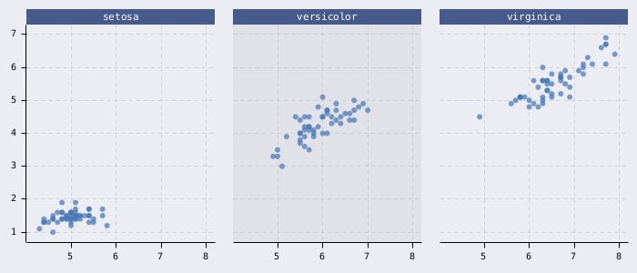
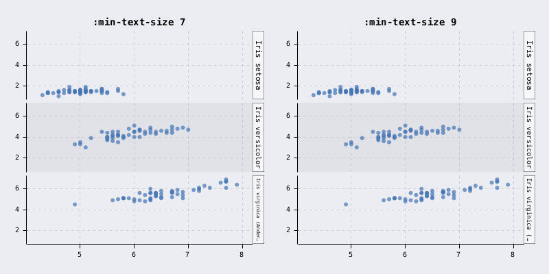
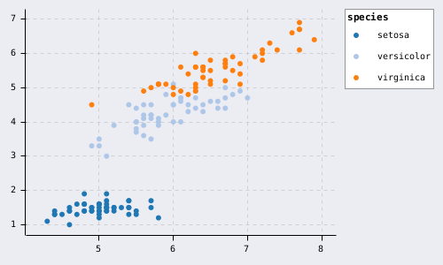
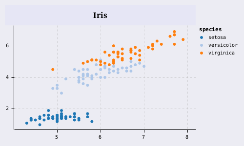
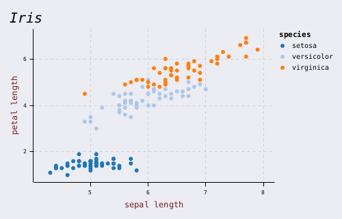
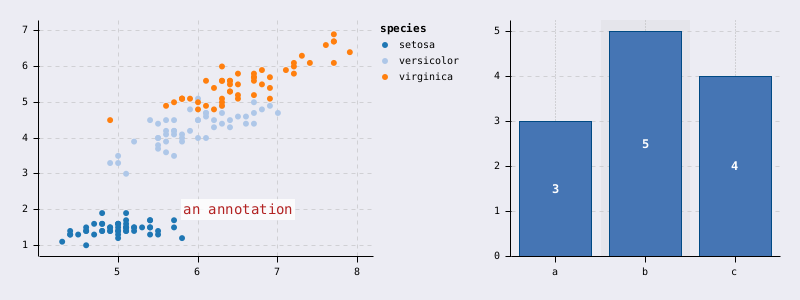
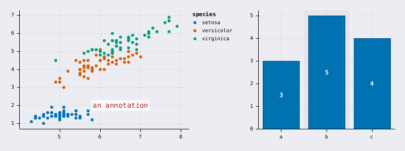
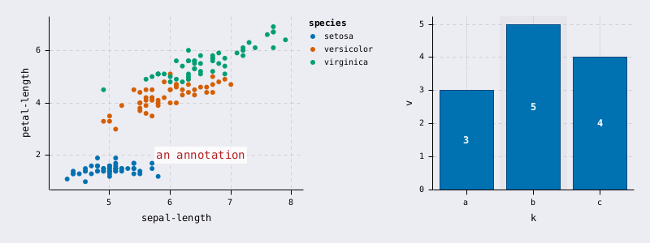
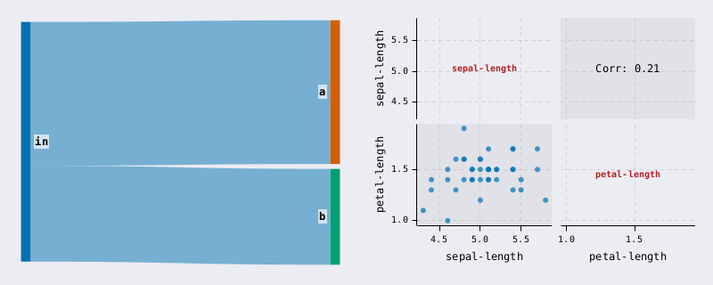
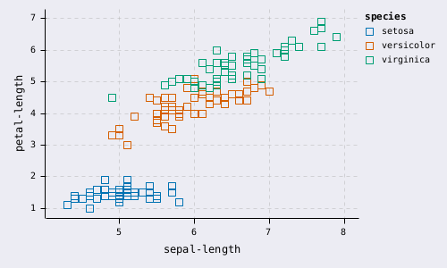

---
format:
  html:
    toc: true
    toc-location: right
    toc-depth: 4
    theme: cosmo
    include-in-header:
      text: |-
        <style>
        .data-table { width: fit-content; max-width: 100%; max-height: 15rem; overflow: auto; margin: 0 0 1rem 0; }
        .data-table .table-responsive { overflow: visible; }
        .data-table table { font-size: 0.75rem; width: auto; margin: 0; }
        .data-table th, .data-table td { padding: 0.1rem 0.45rem !important; white-space: nowrap; }
        .data-table thead th { position: sticky; top: 0; background: var(--bs-body-bg, #fff); }
        .options { margin: 0.5rem 0 1rem 0; }
        .options .option-card { margin: 0 0 0.9rem 0; border: 1px solid var(--bs-border-color, #dee2e6); border-radius: 0.375rem; overflow: hidden; }
        .options dt { display: flex; flex-wrap: wrap; align-items: baseline; gap: 0.1rem 1rem; margin: 0; padding: 0.4rem 0.75rem; background: #eef2f7; border-bottom: 1px solid var(--bs-border-color, #dee2e6); font-weight: normal; }
        .options dt > code { font-weight: 700; font-size: 1rem; background: none; padding: 0; }
        .options .option-default { font-size: 0.85rem; color: var(--bs-secondary-color, #6c757d); }
        .options dd { margin: 0; padding: 0.5rem 0.75rem; }
        .options .option-example { font-size: 0.85rem; padding: 0 0 0.45rem 0; margin-bottom: 0.45rem; border-bottom: 1px dashed var(--bs-border-color, #dee2e6); }
        .options .option-example code { background: none; padding: 0; }
        .options .option-text ul { margin: 0.3rem 0 0 0; padding-left: 1.25rem; }
        .options code, .mapping code { overflow-wrap: anywhere; }
        .options .option-default code, .options .option-example code { white-space: pre-wrap; }
        .mapping { margin: 0.5rem 0 1rem 0; padding: 0.5rem 0.75rem; border: 1px solid var(--bs-border-color, #dee2e6); border-left: 0.3rem solid #2780e3; border-radius: 0.375rem; background: #f5f8fc; }
        .mapping-title { font-weight: 700; margin-bottom: 0.25rem; }
        .mapping-hint { font-weight: normal; font-size: 0.85rem; color: var(--bs-secondary-color, #6c757d); }
        .mapping ul { margin: 0; padding-left: 1.25rem; }
        .mapping .required { font-size: 0.75rem; padding: 0 0.3rem; border: 1px solid currentColor; border-radius: 0.25rem; }
        .mapping-returns { margin-top: 0.25rem; }
        .mapping code { white-space: pre-wrap; }
        .shared { margin: 0.5rem 0 1rem 0; padding: 0.5rem 0.75rem; border: 1px solid var(--bs-border-color, #dee2e6); border-left: 0.3rem solid #6c757d; border-radius: 0.375rem; background: #f6f6f6; }
        .shared-title { font-weight: 700; margin-bottom: 0.25rem; }
        .shared-hint { font-weight: normal; font-size: 0.85rem; color: var(--bs-secondary-color, #6c757d); }
        .shared ul { margin: 0; padding-left: 1.25rem; }
        .shared code { overflow-wrap: anywhere; }
        p code, li code { white-space: pre-wrap; overflow-wrap: anywhere; }
        </style>
code-block-background: true

---
<style></style><style>.printedClojure .sourceCode {
  background-color: transparent;
  border-style: none;
}
</style><style>.clay-limit-image-width .clay-image {max-width: 100%}
.clay-side-by-side .sourceCode {margin: 0}
.clay-side-by-side {margin: 1em 0}
</style>
<script src="https://code.jquery.com/jquery-3.6.0.min.js" type="text/javascript"></script><script src="https://code.jquery.com/ui/1.13.1/jquery-ui.min.js" type="text/javascript"></script>

# Theme

The theme holds every style default: backgrounds, grid lines, axes, legends, palettes, text roles and each chart
kind's style. `build` deep-merges a plot's `:theme` over the default theme, so the plot's theme names only what
changes.


::: {.sourceClojure}
```clojure
(ns reference.theme
  (:require [fastmath.core :as m]
            [cljplot2.chart :as chart]
            [cljplot2.core :as plot]
            [cljplot2.describe :as describe]
            [notebook-utils :as nu]))
```
:::


The table below holds the iris flowers; most sections restyle a scatter plot of them (`iris-plot`):

Data: Edgar Anderson's iris measurements, R datasets package `iris` (Anderson 1935; Fisher 1936); licence: Part of R (GPL-2 | GPL-3).


::: {.sourceClojure}
```clojure
(def iris (nu/dataset :iris))
```
:::


```{=html}
<div class="data-table"><table class="table table-hover table-responsive clay-table"><thead><tr><th>sepal-length</th><th>sepal-width</th><th>petal-length</th><th>petal-width</th><th>species</th></tr></thead><tbody><tr><td>5.1</td><td>3.5</td><td>1.4</td><td>0.2</td><td>setosa</td></tr><tr><td>4.9</td><td>3</td><td>1.4</td><td>0.2</td><td>setosa</td></tr><tr><td>4.7</td><td>3.2</td><td>1.3</td><td>0.2</td><td>setosa</td></tr><tr><td>4.6</td><td>3.1</td><td>1.5</td><td>0.2</td><td>setosa</td></tr><tr><td>5</td><td>3.6</td><td>1.4</td><td>0.2</td><td>setosa</td></tr><tr><td>5.4</td><td>3.9</td><td>1.7</td><td>0.4</td><td>setosa</td></tr><tr><td>4.6</td><td>3.4</td><td>1.4</td><td>0.3</td><td>setosa</td></tr><tr><td>5</td><td>3.4</td><td>1.5</td><td>0.2</td><td>setosa</td></tr><tr><td>4.4</td><td>2.9</td><td>1.4</td><td>0.2</td><td>setosa</td></tr><tr><td>4.9</td><td>3.1</td><td>1.5</td><td>0.1</td><td>setosa</td></tr><tr><td>5.4</td><td>3.7</td><td>1.5</td><td>0.2</td><td>setosa</td></tr><tr><td>4.8</td><td>3.4</td><td>1.6</td><td>0.2</td><td>setosa</td></tr><tr><td>4.8</td><td>3</td><td>1.4</td><td>0.1</td><td>setosa</td></tr><tr><td>4.3</td><td>3</td><td>1.1</td><td>0.1</td><td>setosa</td></tr><tr><td>5.8</td><td>4</td><td>1.2</td><td>0.2</td><td>setosa</td></tr><tr><td>5.7</td><td>4.4</td><td>1.5</td><td>0.4</td><td>setosa</td></tr><tr><td>5.4</td><td>3.9</td><td>1.3</td><td>0.4</td><td>setosa</td></tr><tr><td>5.1</td><td>3.5</td><td>1.4</td><td>0.3</td><td>setosa</td></tr><tr><td>5.7</td><td>3.8</td><td>1.7</td><td>0.3</td><td>setosa</td></tr><tr><td>5.1</td><td>3.8</td><td>1.5</td><td>0.3</td><td>setosa</td></tr><tr><td>5.4</td><td>3.4</td><td>1.7</td><td>0.2</td><td>setosa</td></tr><tr><td>5.1</td><td>3.7</td><td>1.5</td><td>0.4</td><td>setosa</td></tr><tr><td>4.6</td><td>3.6</td><td>1</td><td>0.2</td><td>setosa</td></tr><tr><td>5.1</td><td>3.3</td><td>1.7</td><td>0.5</td><td>setosa</td></tr><tr><td>4.8</td><td>3.4</td><td>1.9</td><td>0.2</td><td>setosa</td></tr><tr><td>5</td><td>3</td><td>1.6</td><td>0.2</td><td>setosa</td></tr><tr><td>5</td><td>3.4</td><td>1.6</td><td>0.4</td><td>setosa</td></tr><tr><td>5.2</td><td>3.5</td><td>1.5</td><td>0.2</td><td>setosa</td></tr><tr><td>5.2</td><td>3.4</td><td>1.4</td><td>0.2</td><td>setosa</td></tr><tr><td>4.7</td><td>3.2</td><td>1.6</td><td>0.2</td><td>setosa</td></tr><tr><td>4.8</td><td>3.1</td><td>1.6</td><td>0.2</td><td>setosa</td></tr><tr><td>5.4</td><td>3.4</td><td>1.5</td><td>0.4</td><td>setosa</td></tr><tr><td>5.2</td><td>4.1</td><td>1.5</td><td>0.1</td><td>setosa</td></tr><tr><td>5.5</td><td>4.2</td><td>1.4</td><td>0.2</td><td>setosa</td></tr><tr><td>4.9</td><td>3.1</td><td>1.5</td><td>0.2</td><td>setosa</td></tr><tr><td>5</td><td>3.2</td><td>1.2</td><td>0.2</td><td>setosa</td></tr><tr><td>5.5</td><td>3.5</td><td>1.3</td><td>0.2</td><td>setosa</td></tr><tr><td>4.9</td><td>3.6</td><td>1.4</td><td>0.1</td><td>setosa</td></tr><tr><td>4.4</td><td>3</td><td>1.3</td><td>0.2</td><td>setosa</td></tr><tr><td>5.1</td><td>3.4</td><td>1.5</td><td>0.2</td><td>setosa</td></tr><tr><td>5</td><td>3.5</td><td>1.3</td><td>0.3</td><td>setosa</td></tr><tr><td>4.5</td><td>2.3</td><td>1.3</td><td>0.3</td><td>setosa</td></tr><tr><td>4.4</td><td>3.2</td><td>1.3</td><td>0.2</td><td>setosa</td></tr><tr><td>5</td><td>3.5</td><td>1.6</td><td>0.6</td><td>setosa</td></tr><tr><td>5.1</td><td>3.8</td><td>1.9</td><td>0.4</td><td>setosa</td></tr><tr><td>4.8</td><td>3</td><td>1.4</td><td>0.3</td><td>setosa</td></tr><tr><td>5.1</td><td>3.8</td><td>1.6</td><td>0.2</td><td>setosa</td></tr><tr><td>4.6</td><td>3.2</td><td>1.4</td><td>0.2</td><td>setosa</td></tr><tr><td>5.3</td><td>3.7</td><td>1.5</td><td>0.2</td><td>setosa</td></tr><tr><td>5</td><td>3.3</td><td>1.4</td><td>0.2</td><td>setosa</td></tr><tr><td>7</td><td>3.2</td><td>4.7</td><td>1.4</td><td>versicolor</td></tr><tr><td>6.4</td><td>3.2</td><td>4.5</td><td>1.5</td><td>versicolor</td></tr><tr><td>6.9</td><td>3.1</td><td>4.9</td><td>1.5</td><td>versicolor</td></tr><tr><td>5.5</td><td>2.3</td><td>4</td><td>1.3</td><td>versicolor</td></tr><tr><td>6.5</td><td>2.8</td><td>4.6</td><td>1.5</td><td>versicolor</td></tr><tr><td>5.7</td><td>2.8</td><td>4.5</td><td>1.3</td><td>versicolor</td></tr><tr><td>6.3</td><td>3.3</td><td>4.7</td><td>1.6</td><td>versicolor</td></tr><tr><td>4.9</td><td>2.4</td><td>3.3</td><td>1</td><td>versicolor</td></tr><tr><td>6.6</td><td>2.9</td><td>4.6</td><td>1.3</td><td>versicolor</td></tr><tr><td>5.2</td><td>2.7</td><td>3.9</td><td>1.4</td><td>versicolor</td></tr><tr><td>5</td><td>2</td><td>3.5</td><td>1</td><td>versicolor</td></tr><tr><td>5.9</td><td>3</td><td>4.2</td><td>1.5</td><td>versicolor</td></tr><tr><td>6</td><td>2.2</td><td>4</td><td>1</td><td>versicolor</td></tr><tr><td>6.1</td><td>2.9</td><td>4.7</td><td>1.4</td><td>versicolor</td></tr><tr><td>5.6</td><td>2.9</td><td>3.6</td><td>1.3</td><td>versicolor</td></tr><tr><td>6.7</td><td>3.1</td><td>4.4</td><td>1.4</td><td>versicolor</td></tr><tr><td>5.6</td><td>3</td><td>4.5</td><td>1.5</td><td>versicolor</td></tr><tr><td>5.8</td><td>2.7</td><td>4.1</td><td>1</td><td>versicolor</td></tr><tr><td>6.2</td><td>2.2</td><td>4.5</td><td>1.5</td><td>versicolor</td></tr><tr><td>5.6</td><td>2.5</td><td>3.9</td><td>1.1</td><td>versicolor</td></tr><tr><td>5.9</td><td>3.2</td><td>4.8</td><td>1.8</td><td>versicolor</td></tr><tr><td>6.1</td><td>2.8</td><td>4</td><td>1.3</td><td>versicolor</td></tr><tr><td>6.3</td><td>2.5</td><td>4.9</td><td>1.5</td><td>versicolor</td></tr><tr><td>6.1</td><td>2.8</td><td>4.7</td><td>1.2</td><td>versicolor</td></tr><tr><td>6.4</td><td>2.9</td><td>4.3</td><td>1.3</td><td>versicolor</td></tr><tr><td>6.6</td><td>3</td><td>4.4</td><td>1.4</td><td>versicolor</td></tr><tr><td>6.8</td><td>2.8</td><td>4.8</td><td>1.4</td><td>versicolor</td></tr><tr><td>6.7</td><td>3</td><td>5</td><td>1.7</td><td>versicolor</td></tr><tr><td>6</td><td>2.9</td><td>4.5</td><td>1.5</td><td>versicolor</td></tr><tr><td>5.7</td><td>2.6</td><td>3.5</td><td>1</td><td>versicolor</td></tr><tr><td>5.5</td><td>2.4</td><td>3.8</td><td>1.1</td><td>versicolor</td></tr><tr><td>5.5</td><td>2.4</td><td>3.7</td><td>1</td><td>versicolor</td></tr><tr><td>5.8</td><td>2.7</td><td>3.9</td><td>1.2</td><td>versicolor</td></tr><tr><td>6</td><td>2.7</td><td>5.1</td><td>1.6</td><td>versicolor</td></tr><tr><td>5.4</td><td>3</td><td>4.5</td><td>1.5</td><td>versicolor</td></tr><tr><td>6</td><td>3.4</td><td>4.5</td><td>1.6</td><td>versicolor</td></tr><tr><td>6.7</td><td>3.1</td><td>4.7</td><td>1.5</td><td>versicolor</td></tr><tr><td>6.3</td><td>2.3</td><td>4.4</td><td>1.3</td><td>versicolor</td></tr><tr><td>5.6</td><td>3</td><td>4.1</td><td>1.3</td><td>versicolor</td></tr><tr><td>5.5</td><td>2.5</td><td>4</td><td>1.3</td><td>versicolor</td></tr><tr><td>5.5</td><td>2.6</td><td>4.4</td><td>1.2</td><td>versicolor</td></tr><tr><td>6.1</td><td>3</td><td>4.6</td><td>1.4</td><td>versicolor</td></tr><tr><td>5.8</td><td>2.6</td><td>4</td><td>1.2</td><td>versicolor</td></tr><tr><td>5</td><td>2.3</td><td>3.3</td><td>1</td><td>versicolor</td></tr><tr><td>5.6</td><td>2.7</td><td>4.2</td><td>1.3</td><td>versicolor</td></tr><tr><td>5.7</td><td>3</td><td>4.2</td><td>1.2</td><td>versicolor</td></tr><tr><td>5.7</td><td>2.9</td><td>4.2</td><td>1.3</td><td>versicolor</td></tr><tr><td>6.2</td><td>2.9</td><td>4.3</td><td>1.3</td><td>versicolor</td></tr><tr><td>5.1</td><td>2.5</td><td>3</td><td>1.1</td><td>versicolor</td></tr><tr><td>5.7</td><td>2.8</td><td>4.1</td><td>1.3</td><td>versicolor</td></tr><tr><td>…</td><td>…</td><td>…</td><td>…</td><td>…</td></tr></tbody></table></div>
```


::: {.sourceClojure}
```clojure
(def iris-plot
  {:data iris
   :mapping {:x :sepal-length :y :petal-length :color :species}
   :charts [(chart/scatter)]})
```
:::


The table below holds three levels with long names; the axes section turns them:


::: {.sourceClojure}
```clojure
(def long-levels [{:k "a long level" :v 3} {:k "another long level" :v 5} {:k "the last level" :v 4}])
```
:::


```{=html}
<div class="data-table"><table class="table table-hover table-responsive clay-table"><thead><tr><th>k</th><th>v</th></tr></thead><tbody><tr><td>a long level</td><td>3</td></tr><tr><td>another long level</td><td>5</td></tr><tr><td>the last level</td><td>4</td></tr></tbody></table></div>
```


The table below holds made-up fruit counts named by emoji; the axes section draws them in an emoji font:


::: {.sourceClojure}
```clojure
(def fruit [{:fruit "🍎" :count 28} {:fruit "🍌" :count 55} {:fruit "🍇" :count 43} {:fruit "🍑" :count 91}
            {:fruit "🍒" :count 81}])
```
:::


```{=html}
<div class="data-table"><table class="table table-hover table-responsive clay-table"><thead><tr><th>fruit</th><th>count</th></tr></thead><tbody><tr><td>🍎</td><td>28</td></tr><tr><td>🍌</td><td>55</td></tr><tr><td>🍇</td><td>43</td></tr><tr><td>🍑</td><td>91</td></tr><tr><td>🍒</td><td>81</td></tr></tbody></table></div>
```


The table below holds the 14 levels of the default palette, one bar each; the palette section draws them:


::: {.sourceClojure}
```clojure
(def palette-levels (mapv (fn [i] {:level (format "%02d" (inc i)) :n 1}) (range 14)))
```
:::


```{=html}
<div class="data-table"><table class="table table-hover table-responsive clay-table"><thead><tr><th>level</th><th>n</th></tr></thead><tbody><tr><td>01</td><td>1</td></tr><tr><td>02</td><td>1</td></tr><tr><td>03</td><td>1</td></tr><tr><td>04</td><td>1</td></tr><tr><td>05</td><td>1</td></tr><tr><td>06</td><td>1</td></tr><tr><td>07</td><td>1</td></tr><tr><td>08</td><td>1</td></tr><tr><td>09</td><td>1</td></tr><tr><td>10</td><td>1</td></tr><tr><td>11</td><td>1</td></tr><tr><td>12</td><td>1</td></tr><tr><td>13</td><td>1</td></tr><tr><td>14</td><td>1</td></tr></tbody></table></div>
```


The table below holds a made-up budget of departments and teams; the text section draws it as a treemap:


::: {.sourceClojure}
```clojure
(def budget [{:dept "science" :team "physics" :cost 40} {:dept "science" :team "biology" :cost 25}
             {:dept "arts" :team "music" :cost 15} {:dept "arts" :team "theatre" :cost 10}])
```
:::


```{=html}
<div class="data-table"><table class="table table-hover table-responsive clay-table"><thead><tr><th>dept</th><th>team</th><th>cost</th></tr></thead><tbody><tr><td>science</td><td>physics</td><td>40</td></tr><tr><td>science</td><td>biology</td><td>25</td></tr><tr><td>arts</td><td>music</td><td>15</td></tr><tr><td>arts</td><td>theatre</td><td>10</td></tr></tbody></table></div>
```


## Plot

These keys style the canvas behind the plot. The plot below has a cream background and a wider margin:


```{=html}
<dl class="options"><div class="option-card"><dt><code>:plot :background</code><span class="option-default">Default: <code>[236 236 243]</code></span></dt><dd><div class="option-example"><code>{:theme {:plot {:background :white}}}</code></div><div class="option-text">The colour of the canvas behind the whole plot.<ul><li><code>:none</code> – No background: the canvas stays transparent.</li><li><a href="reference.types.html#solid-colour">solid colour</a> – Any other colour, e.g. <code>:black</code>.</li></ul></div></dd></div><div class="option-card"><dt><code>:plot :margin</code><span class="option-default">Default: <code>10</code></span></dt><dd><div class="option-example"><code>{:theme {:plot {:margin 30}}}</code></div><div class="option-text">The space in pixels around the plot on every side.<ul><li><a href="reference.types.html#non-negative-number">non-negative number</a></li></ul></div></dd></div></dl>
```


::: {.sourceClojure}
```clojure
(plot/render-image (assoc iris-plot :theme {:plot {:background [255 250 235] :margin 30}})
                   {:width 500 :height 300})
```
:::


::: {.clay-image}

:::


## Panel box

These keys style each data panel's box: its fill and border, the shading of alternate facet panels and the band
of invalid values. The plot below fills the panel white and draws a thick dark border:


```{=html}
<dl class="options"><div class="option-card"><dt><code>:panel :fill</code><span class="option-default">Default: <code>:none</code></span></dt><dd><div class="option-example"><code>{:theme {:panel {:fill :white}}}</code></div><div class="option-text">The background colour of each data panel.<ul><li><code>:none</code> – No fill: the plot background shows through.</li><li><a href="reference.types.html#solid-colour">solid colour</a> – Any other colour, e.g. <code>:black</code>.</li></ul></div></dd></div><div class="option-card"><dt><code>:panel :alternate-fill</code><span class="option-default">Default: <code>[0 0 0 12]</code></span></dt><dd><div class="option-example"><code>{:theme {:panel {:alternate-fill [0 0 0 40]}}}</code></div><div class="option-text">A colour drawn over the fill of every facet panel whose row and column numbers add up to an odd number; <code>plot/pairs</code> shades its cells the same way.<ul><li><code>:none</code> – No shading.</li><li><a href="reference.types.html#solid-colour">solid colour</a> – Any other colour, e.g. <code>:black</code>.</li></ul></div></dd></div><div class="option-card"><dt><code>:panel :border-color</code><span class="option-default">Default: <code>:none</code></span></dt><dd><div class="option-example"><code>{:theme {:panel {:border-color :black}}}</code></div><div class="option-text">The colour of the border drawn inside each panel's edge.<ul><li><code>:none</code> – No border.</li><li><a href="reference.types.html#solid-colour">solid colour</a> – Any other colour, e.g. <code>:black</code>.</li></ul></div></dd></div><div class="option-card"><dt><code>:panel :border-width</code><span class="option-default">Default: <code>1</code></span></dt><dd><div class="option-example"><code>{:theme {:panel {:border-color :black, :border-width 4}}}</code></div><div class="option-text">The width of the panel border in pixels.<ul><li><a href="reference.types.html#non-negative-number">non-negative number</a></li></ul></div></dd></div><div class="option-card"><dt><code>:panel :invalid-band-size</code><span class="option-default">Default: <code>24</code></span></dt><dd><div class="option-example"><code>{:theme {:panel {:invalid-band-size 48}}}</code></div><div class="option-text">The size in pixels across the band beside an axis where a chart with <code>:invalid :show</code> draws its invalid values; the band's label may widen it.<ul><li><a href="reference.types.html#non-negative-number">non-negative number</a></li></ul></div></dd></div></dl>
```


::: {.sourceClojure}
```clojure
(plot/render-image (assoc iris-plot
                          :theme {:panel {:fill :white :border-color [60 60 60] :border-width 2}})
                   {:width 500 :height 300})
```
:::


::: {.clay-image}

:::


## Grid lines

These keys draw the grid behind the charts. The plot below draws solid x lines, no y lines and light minor x lines:


```{=html}
<dl class="options"><div class="option-card"><dt><code>:panel :grid</code></dt><dd><div class="option-text">The grid lines and band shading, by kind: <code>:x</code>, <code>:y</code>, <code>:bands</code>, <code>:bands-fill</code> and <code>:minor</code>.</div></dd></div><div class="option-card"><dt><code>:panel :grid :x</code><span class="option-default">Default: <code>{:color [180 180 180], :line-width 0.5, :dash [4.0]}</code></span></dt><dd><div class="option-example"><code>{:theme {:panel {:grid {:x {:color :darkred, :line-width 1}}}}}</code></div><div class="option-text">The grid lines at the ticks of the x scale.<ul><li><code>:none</code> – No lines.</li><li><a href="reference.shared_options.html#line-style">line style</a> – Lines in this style; keys left out keep the default line's.</li></ul></div></dd></div><div class="option-card"><dt><code>:panel :grid :y</code><span class="option-default">Default: <code>{:color [180 180 180], :line-width 0.5, :dash [4.0]}</code></span></dt><dd><div class="option-example"><code>{:theme {:panel {:grid {:y :none}}}}</code></div><div class="option-text">The grid lines at the ticks of the y scale.<ul><li><code>:none</code> – No lines.</li><li><a href="reference.shared_options.html#line-style">line style</a> – Lines in this style; keys left out keep the default line's.</li></ul></div></dd></div><div class="option-card"><dt><code>:panel :grid :bands</code><span class="option-default">Default: <code>{:color [180 180 180], :line-width 1, :dash [1.0 2.0]}</code></span></dt><dd><div class="option-example"><code>{:theme {:panel {:grid {:bands {:color :darkred, :dash :none}}}}}</code></div><div class="option-text">The grid lines of a bands scale (levels on a categorical axis), drawn in place of its axis's <code>:x</code> or <code>:y</code> lines; <code>:none</code> for that axis turns them off too.<ul><li><code>:none</code> – No lines.</li><li><a href="reference.shared_options.html#line-style">line style</a> – Lines in this style; keys left out keep the default line's.</li></ul></div></dd></div><div class="option-card"><dt><code>:panel :grid :bands-fill</code><span class="option-default">Default: <code>[0 0 0 8]</code></span></dt><dd><div class="option-example"><code>{:theme {:panel {:grid {:bands-fill [0 0 255 30]}}}}</code></div><div class="option-text">The colour of every second band of a bands scale.<ul><li><code>:none</code> – No band shading.</li><li><a href="reference.types.html#solid-colour">solid colour</a> – Any other colour, e.g. <code>:black</code>.</li></ul></div></dd></div><div class="option-card"><dt><code>:panel :grid :minor</code><span class="option-default">Default: <code>:none</code></span></dt><dd><div class="option-example"><code>{:theme {:panel {:grid {:minor {:color :gray, :line-width 0.5, :dash :none}}}}}</code></div><div class="option-text">The grid lines at the minor ticks of a scale with <code>:minor-ticks</code>.<ul><li><code>:none</code> – No lines.</li><li><a href="reference.shared_options.html#line-style">line style</a> – Lines in this style; the default is <code>:none</code>, so give all three keys.</li></ul></div></dd></div></dl>
```


::: {.sourceClojure}
```clojure
(plot/render-image (assoc iris-plot
                          :scales {:x {:minor-ticks 4}}
                          :theme {:panel {:grid {:x {:color [150 150 200] :line-width 1 :dash :none}
                                                 :y :none
                                                 :minor {:color [200 200 220] :line-width 0.5 :dash :none}}}})
                   {:width 500 :height 300})
```
:::


::: {.clay-image}

:::


## Axes

These keys set the x axis line, its ticks and its tick labels. The plot below turns the long level names 45 degrees
and draws no ticks and no axis line:


```{=html}
<dl class="options"><div class="option-card"><dt><code>:axis :x</code></dt><dd><div class="option-text">The keys of the axis drawn for the x scale, also when <code>:flip</code> draws it vertically.</div></dd></div><div class="option-card"><dt><code>:axis :x :line-color</code><span class="option-default">Default: <code>:black</code></span></dt><dd><div class="option-example"><code>{:theme {:axis {:x {:line-color :red}}}}</code></div><div class="option-text">The colour of the axis line.<ul><li><code>:none</code> – No axis line.</li><li><a href="reference.types.html#solid-colour">solid colour</a> – Any other colour, e.g. <code>:black</code>.</li></ul></div></dd></div><div class="option-card"><dt><code>:axis :x :line-width</code><span class="option-default">Default: <code>1</code></span></dt><dd><div class="option-example"><code>{:theme {:axis {:x {:line-width 3}}}}</code></div><div class="option-text">The width of the axis line in pixels; 0 draws none.<ul><li><a href="reference.types.html#non-negative-number">non-negative number</a></li></ul></div></dd></div><div class="option-card"><dt><code>:axis :x :tick-color</code><span class="option-default">Default: <code>:black</code></span></dt><dd><div class="option-example"><code>{:theme {:axis {:x {:tick-color :red}}}}</code></div><div class="option-text">The colour of the ticks.<ul><li><code>:none</code> – No ticks.</li><li><a href="reference.types.html#solid-colour">solid colour</a> – Any other colour, e.g. <code>:black</code>.</li></ul></div></dd></div><div class="option-card"><dt><code>:axis :x :tick-length</code><span class="option-default">Default: <code>6</code></span></dt><dd><div class="option-example"><code>{:theme {:axis {:x {:tick-length 12}}}}</code></div><div class="option-text">The length of the ticks in pixels.<ul><li><a href="reference.types.html#non-negative-number">non-negative number</a></li></ul></div></dd></div><div class="option-card"><dt><code>:axis :x :tick-width</code><span class="option-default">Default: <code>1</code></span></dt><dd><div class="option-example"><code>{:theme {:axis {:x {:tick-width 3}}}}</code></div><div class="option-text">The width of the ticks in pixels; 0 draws none.<ul><li><a href="reference.types.html#non-negative-number">non-negative number</a></li></ul></div></dd></div><div class="option-card"><dt><code>:axis :x :label-gap</code><span class="option-default">Default: <code>2</code></span></dt><dd><div class="option-example"><code>{:theme {:axis {:x {:label-gap 12}}}}</code></div><div class="option-text">The space in pixels between the ticks and their labels.<ul><li><a href="reference.types.html#non-negative-number">non-negative number</a></li></ul></div></dd></div><div class="option-card"><dt><code>:axis :x :tick-label-gap</code><span class="option-default">Default: <code>3</code></span></dt><dd><div class="option-example"><code>{:theme {:axis {:x {:tick-label-gap 30}}}}</code></div><div class="option-text">The least space in pixels between neighbouring tick labels lying end to end (unrotated on a horizontal axis, turned 90 degrees on a vertical one); a numeric axis skips a label closer than this to the last one it drew.<ul><li><a href="reference.types.html#non-negative-number">non-negative number</a></li></ul></div></dd></div><div class="option-card"><dt><code>:axis :x :tick-spacing</code><span class="option-default">Default: <code>80</code></span></dt><dd><div class="option-example"><code>{:theme {:axis {:x {:tick-spacing 25}}}}</code></div><div class="option-text">The distance in pixels the axis aims for between ticks; it sets how many ticks fit.<ul><li><a href="reference.types.html#positive-number">positive number</a></li></ul></div></dd></div><div class="option-card"><dt><code>:axis :x :label-rotation</code><span class="option-default">Default: <code>0</code></span></dt><dd><div class="option-example"><code>{:theme {:axis {:x {:label-rotation 45}}}}</code></div><div class="option-text">The angle in degrees the tick labels turn clockwise, from -90 to 90.<ul><li><span>number at least -90 and at most 90</span></li></ul></div></dd></div><div class="option-card"><dt><code>:axis :x :minor-tick-length</code><span class="option-default">Default: <code>3</code></span></dt><dd><div class="option-example"><code>{:theme {:axis {:x {:minor-tick-length 8}}}}</code></div><div class="option-text">The length of the minor ticks in pixels; a scale with <code>:minor-ticks</code> draws them.<ul><li><a href="reference.types.html#non-negative-number">non-negative number</a></li></ul></div></dd></div><div class="option-card"><dt><code>:axis :x :tick-label</code><span class="option-default">Default: <code>{}</code></span></dt><dd><div class="option-example"><code>{:theme {:axis {:x {:tick-label {:size 14, :color :darkred}}}}}</code></div><div class="option-text">Text style keys of this axis's tick labels, merged over the <code>:tick-label</code> text role; polar guides take them too, and <code>[:axis :x]</code> styles 3D frames.<ul><li><a href="reference.shared_options.html#text-style">text style</a></li></ul></div></dd></div></dl>
```


::: {.sourceClojure}
```clojure
(plot/render-image {:data long-levels
                    :mapping {:x :k :y :v}
                    :charts [(chart/bar)]
                    :theme {:axis {:x {:label-rotation 45 :tick-length 0 :line-color :none}}}}
                   {:width 500 :height 320})
```
:::


::: {.clay-image}

:::


The plot below draws the emoji levels in the bundled Noto Emoji font, larger, while the y axis keeps the
`:tick-label` role's font:


::: {.sourceClojure}
```clojure
(plot/render-image {:data fruit
                    :mapping {:x :fruit :y :count}
                    :charts [(chart/bar)]
                    :theme {:axis {:x {:tick-label {:font "Noto Emoji" :size 22}}}}}
                   {:width 500 :height 300})
```
:::


::: {.clay-image}

:::


The y axis takes the same keys:


```{=html}
<dl class="options"><div class="option-card"><dt><code>:axis :y</code></dt><dd><div class="option-text">The keys of the axis drawn for the y scale, also when <code>:flip</code> draws it horizontally.</div></dd></div><div class="option-card"><dt><code>:axis :y :line-color</code><span class="option-default">Default: <code>:black</code></span></dt><dd><div class="option-example"><code>{:theme {:axis {:y {:line-color :red}}}}</code></div><div class="option-text">The colour of the axis line.<ul><li><code>:none</code> – No axis line.</li><li><a href="reference.types.html#solid-colour">solid colour</a> – Any other colour, e.g. <code>:black</code>.</li></ul></div></dd></div><div class="option-card"><dt><code>:axis :y :line-width</code><span class="option-default">Default: <code>1</code></span></dt><dd><div class="option-example"><code>{:theme {:axis {:y {:line-width 3}}}}</code></div><div class="option-text">The width of the axis line in pixels; 0 draws none.<ul><li><a href="reference.types.html#non-negative-number">non-negative number</a></li></ul></div></dd></div><div class="option-card"><dt><code>:axis :y :tick-color</code><span class="option-default">Default: <code>:black</code></span></dt><dd><div class="option-example"><code>{:theme {:axis {:y {:tick-color :red}}}}</code></div><div class="option-text">The colour of the ticks.<ul><li><code>:none</code> – No ticks.</li><li><a href="reference.types.html#solid-colour">solid colour</a> – Any other colour, e.g. <code>:black</code>.</li></ul></div></dd></div><div class="option-card"><dt><code>:axis :y :tick-length</code><span class="option-default">Default: <code>6</code></span></dt><dd><div class="option-example"><code>{:theme {:axis {:y {:tick-length 12}}}}</code></div><div class="option-text">The length of the ticks in pixels.<ul><li><a href="reference.types.html#non-negative-number">non-negative number</a></li></ul></div></dd></div><div class="option-card"><dt><code>:axis :y :tick-width</code><span class="option-default">Default: <code>1</code></span></dt><dd><div class="option-example"><code>{:theme {:axis {:y {:tick-width 3}}}}</code></div><div class="option-text">The width of the ticks in pixels; 0 draws none.<ul><li><a href="reference.types.html#non-negative-number">non-negative number</a></li></ul></div></dd></div><div class="option-card"><dt><code>:axis :y :label-gap</code><span class="option-default">Default: <code>2</code></span></dt><dd><div class="option-example"><code>{:theme {:axis {:y {:label-gap 12}}}}</code></div><div class="option-text">The space in pixels between the ticks and their labels.<ul><li><a href="reference.types.html#non-negative-number">non-negative number</a></li></ul></div></dd></div><div class="option-card"><dt><code>:axis :y :tick-label-gap</code><span class="option-default">Default: <code>3</code></span></dt><dd><div class="option-example"><code>{:theme {:axis {:y {:label-rotation 90, :tick-label-gap 30}}}}</code></div><div class="option-text">The least space in pixels between neighbouring tick labels lying end to end (unrotated on a horizontal axis, turned 90 degrees on a vertical one); a numeric axis skips a label closer than this to the last one it drew.<ul><li><a href="reference.types.html#non-negative-number">non-negative number</a></li></ul></div></dd></div><div class="option-card"><dt><code>:axis :y :tick-spacing</code><span class="option-default">Default: <code>50</code></span></dt><dd><div class="option-example"><code>{:theme {:axis {:y {:tick-spacing 25}}}}</code></div><div class="option-text">The distance in pixels the axis aims for between ticks; it sets how many ticks fit.<ul><li><a href="reference.types.html#positive-number">positive number</a></li></ul></div></dd></div><div class="option-card"><dt><code>:axis :y :label-rotation</code><span class="option-default">Default: <code>0</code></span></dt><dd><div class="option-example"><code>{:theme {:axis {:y {:label-rotation 45}}}}</code></div><div class="option-text">The angle in degrees the tick labels turn clockwise, from -90 to 90.<ul><li><span>number at least -90 and at most 90</span></li></ul></div></dd></div><div class="option-card"><dt><code>:axis :y :minor-tick-length</code><span class="option-default">Default: <code>3</code></span></dt><dd><div class="option-example"><code>{:theme {:axis {:y {:minor-tick-length 8}}}}</code></div><div class="option-text">The length of the minor ticks in pixels; a scale with <code>:minor-ticks</code> draws them.<ul><li><a href="reference.types.html#non-negative-number">non-negative number</a></li></ul></div></dd></div><div class="option-card"><dt><code>:axis :y :tick-label</code><span class="option-default">Default: <code>{}</code></span></dt><dd><div class="option-example"><code>{:theme {:axis {:y {:tick-label {:size 14, :color :darkred}}}}}</code></div><div class="option-text">Text style keys of this axis's tick labels, merged over the <code>:tick-label</code> text role; polar guides take them too, and <code>[:axis :x]</code> styles 3D frames.<ul><li><a href="reference.shared_options.html#text-style">text style</a></li></ul></div></dd></div></dl>
```


The plot below draws more y ticks, longer and red:


::: {.sourceClojure}
```clojure
(plot/render-image (assoc iris-plot :theme {:axis {:y {:tick-spacing 25 :tick-color [200 0 0] :tick-length 10}}})
                   {:width 500 :height 300})
```
:::


::: {.clay-image}

:::


The plots below draw dense x ticks with no gap between their labels (left, where labels may touch) and with a wide
gap (right):


::: {.sourceClojure}
```clojure
(plot/render-image (plot/arrange (for [gap [0 12]]
                                   (assoc iris-plot
                                          :scales {:x {:ticks 20}}
                                          :labels {:title (str ":tick-label-gap " gap)}
                                          :theme {:axis {:x {:tick-label-gap gap}}}))
                                 {:columns 2})
                   {:width 700 :height 280})
```
:::


::: {.clay-image}

:::


## Strips

These keys style the facet strips. The plot below fills the strips dark blue without a border and writes their
texts in white:


```{=html}
<dl class="options"><div class="option-card"><dt><code>:strip :fill</code><span class="option-default">Default: <code>[255 255 255 150]</code></span></dt><dd><div class="option-example"><code>{:theme {:strip {:fill :lightblue}}}</code></div><div class="option-text">The background colour of the facet strips.<ul><li><code>:none</code> – No strip background.</li><li><a href="reference.types.html#solid-colour">solid colour</a> – Any other colour, e.g. <code>:black</code>.</li></ul></div></dd></div><div class="option-card"><dt><code>:strip :border-color</code><span class="option-default">Default: <code>[0 0 0 100]</code></span></dt><dd><div class="option-example"><code>{:theme {:strip {:border-color :black}}}</code></div><div class="option-text">The colour of the strip border.<ul><li><code>:none</code> – No border.</li><li><a href="reference.types.html#solid-colour">solid colour</a> – Any other colour, e.g. <code>:black</code>.</li></ul></div></dd></div><div class="option-card"><dt><code>:strip :border-width</code><span class="option-default">Default: <code>1</code></span></dt><dd><div class="option-example"><code>{:theme {:strip {:border-width 3}}}</code></div><div class="option-text">The width of the strip border in pixels.<ul><li><a href="reference.types.html#non-negative-number">non-negative number</a></li></ul></div></dd></div><div class="option-card"><dt><code>:strip :shingle-fill</code><span class="option-default">Default: <code>[255 165 0 110]</code></span></dt><dd><div class="option-example"><code>{:theme {:strip {:shingle-fill :lightgreen}}}</code></div><div class="option-text">The colour of the bar marking a shingle level's range in its strip.<ul><li><code>:none</code> – No bar.</li><li><a href="reference.types.html#solid-colour">solid colour</a> – Any other colour, e.g. <code>:black</code>.</li></ul></div></dd></div></dl>
```


::: {.sourceClojure}
```clojure
(def faceted-iris (assoc iris-plot :mapping {:x :sepal-length :y :petal-length :facet :species}))
```
:::


::: {.sourceClojure}
```clojure
(plot/render-image (assoc faceted-iris :theme {:strip {:fill [70 90 140] :border-color :none}
                                               :text {:strip {:color :white}}})
                   {:width 700 :height 280})
```
:::


::: {.clay-image}

:::


When a strip's text doesn't fit, the library shrinks it down to the `:strip` role's `:min-size` and then cuts it
with an ellipsis. In the plots below the first two row names fit; the third is cut later at the default 7 points
(left) than at 9 (right):


::: {.sourceClojure}
```clojure
(plot/render-image (plot/arrange (for [min-size [7 9]]
                                   (assoc iris-plot
                                          :mapping {:x :sepal-length :y :petal-length
                                                    :facet-row #(str "Iris " (:species %) (when (= "virginica" (:species %)) " (Anderson)"))}
                                          :labels {:title (str ":min-size " min-size)}
                                          :theme {:text {:strip {:min-size min-size}}}))
                                 {:columns 2})
                   {:width 800 :height 400})
```
:::


::: {.clay-image}

:::


## Facets

This key sets how far apart the facet panels sit. The plot below widens the gap:


```{=html}
<dl class="options"><div class="option-card"><dt><code>:facet :gap</code><span class="option-default">Default: <code>5</code></span></dt><dd><div class="option-example"><code>{:theme {:facet {:gap 25}}}</code></div><div class="option-text">The space in pixels between facet panels, and between a panel and its margins or invalid-value band.<ul><li><a href="reference.types.html#non-negative-number">non-negative number</a></li></ul></div></dd></div></dl>
```


::: {.sourceClojure}
```clojure
(plot/render-image (assoc faceted-iris :theme {:facet {:gap 25}}) {:width 700 :height 280})
```
:::


::: {.clay-image}

:::


## Multiplots

This key sets how far apart arranged plots sit; `plot/arrange` takes it in its `:theme` option. The plot below
widens the gap:


```{=html}
<dl class="options"><div class="option-card"><dt><code>:multiplot :gap</code><span class="option-default">Default: <code>10</code></span></dt><dd><div class="option-example"><code>{:theme {:multiplot {:gap 40}}}</code></div><div class="option-text">The space in pixels between arranged plots.<ul><li><a href="reference.types.html#non-negative-number">non-negative number</a></li></ul></div></dd></div></dl>
```


::: {.sourceClojure}
```clojure
(plot/render-image (plot/arrange [iris-plot (assoc iris-plot :mapping {:x :sepal-width :y :petal-width :color :species})]
                                 {:columns 2 :theme {:multiplot {:gap 40}}})
                   {:width 800 :height 300})
```
:::


::: {.clay-image}

:::


## Legend

These keys set the legend keys' size and spacing, the legend box and the colour bar. The plot below draws larger,
wider spaced keys in a white box with a gray border:


```{=html}
<dl class="options"><div class="option-card"><dt><code>:legend :gap</code><span class="option-default">Default: <code>5</code></span></dt><dd><div class="option-example"><code>{:theme {:legend {:gap 15}}}</code></div><div class="option-text">The space in pixels between a legend's keys and their labels, between two legends and between the panels and the legends.<ul><li><a href="reference.types.html#non-negative-number">non-negative number</a></li></ul></div></dd></div><div class="option-card"><dt><code>:legend :key-size</code><span class="option-default">Default: <code>14</code></span></dt><dd><div class="option-example"><code>{:theme {:legend {:key-size 28}}}</code></div><div class="option-text">The least side of a legend key's box in pixels; a key grows to fit a mapped size. It is also the default colour bar width.<ul><li><a href="reference.types.html#non-negative-number">non-negative number</a></li></ul></div></dd></div><div class="option-card"><dt><code>:legend :fill</code><span class="option-default">Default: <code>:none</code></span></dt><dd><div class="option-example"><code>{:theme {:legend {:fill :white}}}</code></div><div class="option-text">The fill colour of the legend box.<ul><li><code>:none</code> – No fill.</li><li><a href="reference.types.html#solid-colour">solid colour</a> – Any other colour, e.g. <code>:black</code>.</li></ul></div></dd></div><div class="option-card"><dt><code>:legend :border-color</code><span class="option-default">Default: <code>:none</code></span></dt><dd><div class="option-example"><code>{:theme {:legend {:border-color :black}}}</code></div><div class="option-text">The colour of the legend box's border.<ul><li><code>:none</code> – No border.</li><li><a href="reference.types.html#solid-colour">solid colour</a> – Any other colour, e.g. <code>:black</code>.</li></ul></div></dd></div><div class="option-card"><dt><code>:legend :border-width</code><span class="option-default">Default: <code>1</code></span></dt><dd><div class="option-example"><code>{:theme {:legend {:border-color :black, :border-width 3}}}</code></div><div class="option-text">The width of the legend box's border in pixels.<ul><li><a href="reference.types.html#non-negative-number">non-negative number</a></li></ul></div></dd></div><div class="option-card"><dt><code>:legend :bar-length</code><span class="option-default">Default: <code>:stretch</code></span></dt><dd><div class="option-example"><code>{:theme {:legend {:bar-length 60}}}</code></div><div class="option-text">The length of a colour bar in pixels, at most the height available.<ul><li><code>:stretch</code> – The height left in the bar's column of legends, at least three key sizes.</li><li><a href="reference.types.html#positive-number">positive number</a> – This many pixels.</li></ul></div></dd></div><div class="option-card"><dt><code>:legend :bar-width</code><span class="option-default">Default: The legend's <code>:key-size</code>.</span></dt><dd><div class="option-example"><code>{:theme {:legend {:bar-width 30}}}</code></div><div class="option-text">The width of a colour bar in pixels.<ul><li><a href="reference.types.html#positive-number">positive number</a></li></ul></div></dd></div><div class="option-card"><dt><code>:legend :bar-ticks</code><span class="option-default">Default: <code>5</code></span></dt><dd><div class="option-example"><code>{:theme {:legend {:bar-ticks 2}}}</code></div><div class="option-text">The tick count a colour bar aims for; a colour scale's <code>:ticks</code> wins, and a binned bar ticks its breaks.<ul><li><a href="reference.types.html#positive-integer">positive integer</a></li></ul></div></dd></div><div class="option-card"><dt><code>:legend :bar-tick-length</code><span class="option-default">Default: <code>3</code></span></dt><dd><div class="option-example"><code>{:theme {:legend {:bar-tick-length 8}}}</code></div><div class="option-text">The length of a colour bar's ticks in pixels; the labels sit past them.<ul><li><a href="reference.types.html#non-negative-number">non-negative number</a></li></ul></div></dd></div><div class="option-card"><dt><code>:legend :bar-tick-width</code><span class="option-default">Default: <code>1</code></span></dt><dd><div class="option-example"><code>{:theme {:legend {:bar-tick-width 3}}}</code></div><div class="option-text">The width of a colour bar's ticks in pixels; 0 draws none.<ul><li><a href="reference.types.html#non-negative-number">non-negative number</a></li></ul></div></dd></div><div class="option-card"><dt><code>:legend :min-key-line-width</code><span class="option-default">Default: <code>2</code></span></dt><dd><div class="option-example"><code>{:theme {:legend {:min-key-line-width 5}}}</code></div><div class="option-text">The least width in pixels of a line in a legend key: a key draws a thinner line this wide, and a line of width 0 stays 0. 0 keeps the panel's widths.<ul><li><a href="reference.types.html#non-negative-number">non-negative number</a></li></ul></div></dd></div></dl>
```


::: {.sourceClojure}
```clojure
(plot/render-image (assoc iris-plot :theme {:legend {:key-size 24 :gap 10 :fill :white :border-color [150 150 150]}})
                   {:width 500 :height 300})
```
:::


::: {.clay-image}

:::


The plots below draw line keys at three values of `:min-key-line-width`; the lines in the panels are 1 pixel wide:


::: {.sourceClojure}
```clojure
(plot/render-image (plot/arrange (for [min-key-line-width [0 2 4]]
                                   (assoc iris-plot
                                          :charts [(chart/line)]
                                          :labels {:title (str ":min-key-line-width " min-key-line-width)}
                                          :theme {:legend {:min-key-line-width min-key-line-width}}))
                                 {:columns 3})
                   {:width 900 :height 260})
```
:::


::: {.clay-image}

:::


The plot below draws a colour bar with more, longer and thicker ticks:


::: {.sourceClojure}
```clojure
(plot/render-image {:data iris
                    :mapping {:x :sepal-length :y :petal-length :color :petal-width}
                    :charts [(chart/scatter)]
                    :theme {:legend {:bar-ticks 10 :bar-tick-length 8 :bar-tick-width 2}}}
                   {:width 500 :height 300})
```
:::


::: {.clay-image}

:::


## 3D frame

This key sets the dash of a 3D box's hidden edges; the box edges and axes take the x axis style (`[:axis :x]`). The
plot below draws a [surface](reference.charts_multivariate_3d.html#d-surfaces) of $z = \sin(xy)$ over $[-2, 2]^2$
with dash-dot hidden edges and thicker axes:


```{=html}
<dl class="options"><div class="option-card"><dt><code>:frame-3d :hidden-edge-dash</code><span class="option-default">Default: <code>[3 3]</code></span></dt><dd><div class="option-example"><code>{:theme {:frame-3d {:hidden-edge-dash [8 2 2 2]}}}</code></div><div class="option-text">The dash of a 3D box's hidden edges.<ul><li><a href="reference.types.html#dash">dash</a></li></ul></div></dd></div></dl>
```


::: {.sourceClojure}
```clojure
(plot/render-image {:charts [(chart/surface {:f (fn [[x y]] (m/sin (m/* x y))) :domain {:x [-2 2] :y [-2 2]}})]
                    :labels {:title "$z = \\sin(xy)$"}
                    :theme {:frame-3d {:hidden-edge-dash [8 2 2 2]}
                            :axis {:x {:line-width 2}}}}
                   {:width 500 :height 400})
```
:::


::: {.clay-image}

:::


## Palette

These keys set the default ranges of the [aesthetic scales](reference.aesthetics_legends.html): colours for levels
and for numbers, shapes, sizes, dashes and patterns. The level colours start with the Okabe-Ito colours, with a
darker yellow and a gray in place of black, then repeat the first six lighter, the blue turned toward violet. The
lighter six are weak as thin lines. The plot below takes the Tableau 10 colours and three other shapes:


```{=html}
<dl class="options"><div class="option-card"><dt><code>:palette :color</code><span class="option-default">Default: The default palette: 14 colours checked for colour vision deficiencies.</span></dt><dd><div class="option-example"><code>{:theme {:palette {:color :tableau-10}}}</code></div><div class="option-text">The colours of a categorical colour scale's levels, repeated past their count.<ul><li><a href="reference.types.html#palette">palette</a></li></ul></div></dd></div><div class="option-card"><dt><code>:palette :gradient</code><span class="option-default">Default: <code>[[255 255 255] [127 192 236] [56 133 201] [14 83 161] [0 63 143] [0 1 11]]</code></span></dt><dd><div class="option-example"><code>{:theme {:palette {:gradient [:gold :darkred]}}}</code></div><div class="option-text">The colours of a continuous or binned colour scale, from its low end to its high end.<ul><li><a href="reference.types.html#function">function</a> – A function of <code>t</code> from 0 to 1 that returns a colour.</li><li><a href="reference.types.html#palette">palette</a> – These colours, spread evenly over the scale.</li></ul></div></dd></div><div class="option-card"><dt><code>:palette :shape</code><span class="option-default">Default: <code>[\O \s \A \x \+ \V \o \S \^ \v \{ \} \< \>]</code></span></dt><dd><div class="option-example"><code>{:theme {:palette {:shape [\s \A \V]}}}</code></div><div class="option-text">The point shapes of a categorical shape scale's levels, repeated past their count.<ul><li><span>sequence of point shapes</span></li></ul></div></dd></div><div class="option-card"><dt><code>:palette :size</code><span class="option-default">Default: <code>[2 10]</code></span></dt><dd><div class="option-example"><code>{:theme {:palette {:size [1 20]}}}</code></div><div class="option-text">The range of a size scale in pixels.<ul><li><a href="reference.types.html#size-range">size range</a></li></ul></div></dd></div><div class="option-card"><dt><code>:palette :dash</code><span class="option-default">Default: <code>[:solid :dashed :dotted :dot-dash :long-dash :dot-dot-dash :two-dash :loose-dot]</code></span></dt><dd><div class="option-example"><code>{:theme {:palette {:dash [:solid :dotted]}}}</code></div><div class="option-text">The dash styles of a categorical dash scale's levels, repeated past their count.<ul><li><span>sequence of dashes</span></li></ul></div></dd></div><div class="option-card"><dt><code>:palette :pattern</code><span class="option-default">Default: <code>[:hatch :back-hatch :horizontal :vertical :cross :diagonal-cross :dots :dense-dots]</code></span></dt><dd><div class="option-example"><code>{:theme {:palette {:pattern [:dots :cross]}}}</code></div><div class="option-text">The fill patterns of a categorical pattern scale's levels, repeated past their count.<ul><li><span>sequence of fill patterns</span></li></ul></div></dd></div><div class="option-card"><dt><code>:palette :na</code><span class="option-default">Default: <code>[150 150 150]</code></span></dt><dd><div class="option-example"><code>{:theme {:palette {:na :red}}}</code></div><div class="option-text">The colour of missing (<code>nil</code>) values of a colour scale; hierarchy charts also fill nodes without a colour with it.<ul><li><a href="reference.types.html#solid-colour">solid colour</a></li></ul></div></dd></div></dl>
```


::: {.sourceClojure}
```clojure
(plot/render-image (assoc iris-plot
                          :mapping {:x :sepal-length :y :petal-length :color :species :shape :species}
                          :theme {:palette {:color :tableau-10 :shape [\s \A \V]}})
                   {:width 500 :height 300})
```
:::


::: {.clay-image}

:::


The plots below draw the default level colours as rendered and as a viewer with deuteranopia sees them (the
[render option](reference.render.html) `:cvd`). The closest pair is orange and the darker yellow (04, 07); the
lighter six read as lighter versions of the first.


::: {.sourceClojure}
```clojure
(plot/render-image {:data palette-levels :mapping {:x :level :y :n :color :level}
                    :charts [(chart/bar)] :legend false :labels {:title "default palette" :x nil :y nil}}
                   {:width 700 :height 200})
```
:::


::: {.clay-image}

:::


::: {.sourceClojure}
```clojure
(plot/render-image {:data palette-levels :mapping {:x :level :y :n :color :level}
                    :charts [(chart/bar)] :legend false :labels {:title "the same, deuteranopia" :x nil :y nil}}
                   {:width 700 :height 200 :cvd :deuteranopia})
```
:::


::: {.clay-image}

:::


## Text

These keys style the texts the library draws, by role. Each role is a text style: the keys of the
[Text style](reference.shared_options.html#text-style) group plus `:min-size`. A label's `:role` may also name a role
of your own added under `:text`. The roles of labels drawn over fills (hierarchies, Venn counts, tile and bar values,
correlation and pairwise numbers) default to the colour `:contrast`: black or white, whichever reads on the fill.

These roles style the titles, strips and axis texts. The plot below draws a larger italic title on the left, dark
red axis titles and smaller tick labels:


```{=html}
<dl class="options"><div class="option-card"><dt><code>:text :axis-title</code><span class="option-default">Default: <code>{:font "DejaVu Sans Mono", :size 12, :min-size 8, :font-style :plain, :color :black, :inset 4, :align [:center :middle]}</code></span></dt><dd><div class="option-example"><code>{:theme {:text {:axis-title {:color :darkred}}}}</code></div><div class="option-text">The style of axis titles.<ul><li><a href="reference.shared_options.html#text-style">text style</a></li></ul></div></dd></div><div class="option-card"><dt><code>:text :strip</code><span class="option-default">Default: <code>{:font "DejaVu Sans Mono", :size 11, :min-size 7, :font-style :plain, :color :black, :inset 2, :align [:center :middle]}</code></span></dt><dd><div class="option-example"><code>{:theme {:text {:strip {:font-style :bold}}}}</code></div><div class="option-text">The style of facet strip texts.<ul><li><a href="reference.shared_options.html#text-style">text style</a></li></ul></div></dd></div><div class="option-card"><dt><code>:text :tick-label</code><span class="option-default">Default: <code>{:font "DejaVu Sans Mono", :size 10, :font-style :plain, :color :black, :inset 2, :align [:center :middle]}</code></span></dt><dd><div class="option-example"><code>{:theme {:text {:tick-label {:size 8}}}}</code></div><div class="option-text">The style of tick labels; an axis's <code>:tick-label</code> keys go over it.<ul><li><a href="reference.shared_options.html#text-style">text style</a></li></ul></div></dd></div><div class="option-card"><dt><code>:text :title</code><span class="option-default">Default: <code>{:font "DejaVu Sans Mono", :size 14, :font-style :bold, :color :black, :inset 4, :align [:center :middle]}</code></span></dt><dd><div class="option-example"><code>{:theme {:text {:title {:size 20, :font-style :italic}}}}</code></div><div class="option-text">The style of plot and multiplot titles.<ul><li><a href="reference.shared_options.html#text-style">text style</a></li></ul></div></dd></div></dl>
```


::: {.sourceClojure}
```clojure
(plot/render-image (assoc iris-plot
                          :labels {:title "Iris" :x "sepal length" :y "petal length"}
                          :theme {:text {:title {:size 20 :font-style :italic :align [:left :middle]}
                                         :axis-title {:color [120 30 30]}
                                         :tick-label {:size 8}}})
                   {:width 500 :height 320})
```
:::


::: {.clay-image}

:::


The plot below restyles the title's role with keys of the Text style group: another font, a box and a wider inset:


::: {.sourceClojure}
```clojure
(plot/render-image (assoc iris-plot
                          :labels {:title "Iris"}
                          :theme {:text {:title {:font "Serif" :size 16 :inset 10 :background [230 230 245]}}})
                   {:width 500 :height 300})
```
:::


::: {.clay-image}

:::


These roles style the legend texts. The plot below draws a smaller, plain gray legend title and italic labels:


```{=html}
<dl class="options"><div class="option-card"><dt><code>:text :legend-label</code><span class="option-default">Default: <code>{:font "DejaVu Sans Mono", :size 10, :font-style :plain, :color :black, :inset 2, :align [:left :middle]}</code></span></dt><dd><div class="option-example"><code>{:theme {:text {:legend-label {:font-style :italic}}}}</code></div><div class="option-text">The style of legend entry labels and colour bar tick labels.<ul><li><a href="reference.shared_options.html#text-style">text style</a></li></ul></div></dd></div><div class="option-card"><dt><code>:text :legend-title</code><span class="option-default">Default: <code>{:font "DejaVu Sans Mono", :size 11, :font-style :bold, :color :black, :inset 2, :align [:left :middle]}</code></span></dt><dd><div class="option-example"><code>{:theme {:text {:legend-title {:font-style :plain}}}}</code></div><div class="option-text">The style of legend titles.<ul><li><a href="reference.shared_options.html#text-style">text style</a></li></ul></div></dd></div></dl>
```


::: {.sourceClojure}
```clojure
(plot/render-image (assoc iris-plot :theme {:text {:legend-title {:size 9 :font-style :plain :color [100 100 100]}
                                                   :legend-label {:font-style :italic}}})
                   {:width 500 :height 300})
```
:::


::: {.clay-image}

:::


These roles style the labels of treemaps, partitions and circle packings. A colour you give applies on every cell
alike. The plot below sets dark leaf labels, which are hard to read on the dark cells; that is why `:contrast` is
the default:


```{=html}
<dl class="options"><div class="option-card"><dt><code>:text :pack-group</code><span class="option-default">Default: <code>{:font "DejaVu Sans Mono", :size 10, :font-style :bold, :color :contrast, :inset 2, :align [:center :middle]}</code></span></dt><dd><div class="option-example"><code>{:theme {:text {:pack-group {:size 13}}}}</code></div><div class="option-text">The style of circle packing group labels.<ul><li><a href="reference.shared_options.html#text-style">text style</a></li></ul></div></dd></div><div class="option-card"><dt><code>:text :pack-leaf</code><span class="option-default">Default: <code>{:font "DejaVu Sans Mono", :size 9, :font-style :plain, :color :contrast, :inset 2, :align [:center :middle]}</code></span></dt><dd><div class="option-example"><code>{:theme {:text {:pack-leaf {:font-style :italic}}}}</code></div><div class="option-text">The style of circle packing leaf labels.<ul><li><a href="reference.shared_options.html#text-style">text style</a></li></ul></div></dd></div><div class="option-card"><dt><code>:text :partition-group</code><span class="option-default">Default: <code>{:font "DejaVu Sans Mono", :size 10, :font-style :bold, :color :contrast, :inset 2, :align [:center :middle]}</code></span></dt><dd><div class="option-example"><code>{:theme {:text {:partition-group {:size 13}}}}</code></div><div class="option-text">The style of partition (icicle and sunburst) group labels.<ul><li><a href="reference.shared_options.html#text-style">text style</a></li></ul></div></dd></div><div class="option-card"><dt><code>:text :partition-leaf</code><span class="option-default">Default: <code>{:font "DejaVu Sans Mono", :size 9, :font-style :plain, :color :contrast, :inset 2, :align [:center :middle]}</code></span></dt><dd><div class="option-example"><code>{:theme {:text {:partition-leaf {:font-style :italic}}}}</code></div><div class="option-text">The style of partition leaf labels.<ul><li><a href="reference.shared_options.html#text-style">text style</a></li></ul></div></dd></div><div class="option-card"><dt><code>:text :treemap-group</code><span class="option-default">Default: <code>{:font "DejaVu Sans Mono", :size 10, :font-style :bold, :color :contrast, :inset 2, :align [:left :middle]}</code></span></dt><dd><div class="option-example"><code>{:theme {:text {:treemap-group {:size 13}}}}</code></div><div class="option-text">The style of treemap group headers.<ul><li><a href="reference.shared_options.html#text-style">text style</a></li></ul></div></dd></div><div class="option-card"><dt><code>:text :treemap-leaf</code><span class="option-default">Default: <code>{:font "DejaVu Sans Mono", :size 9, :font-style :plain, :color :contrast, :inset 2, :align [:center :middle]}</code></span></dt><dd><div class="option-example"><code>{:theme {:text {:treemap-leaf {:font-style :italic}}}}</code></div><div class="option-text">The style of treemap leaf labels.<ul><li><a href="reference.shared_options.html#text-style">text style</a></li></ul></div></dd></div></dl>
```


::: {.sourceClojure}
```clojure
(plot/render-image {:data budget
                    :mapping {:hierarchy [:dept :team] :value :cost}
                    :charts [(chart/treemap)]
                    :theme {:text {:treemap-group {:size 13 :font-style :bold-italic}
                                   :treemap-leaf {:font-style :italic :color [40 40 60]}}}}
                   {:width 500 :height 300})
```
:::


::: {.clay-image}

:::


These roles style the texts of other charts. The plot below draws a larger red annotation on a white box and bold
bar values in the bars' middle ([bar](reference.charts_bars.html#bar-charts) `:value-label`, `:label-position`):


```{=html}
<dl class="options"><div class="option-card"><dt><code>:text :annotation</code><span class="option-default">Default: <code>{:font "DejaVu Sans Mono", :size 10, :min-size 6, :font-style :plain, :color :black, :inset 2, :align [:center :middle]}</code></span></dt><dd><div class="option-example"><code>{:theme {:text {:annotation {:size 14, :color :darkred}}}}</code></div><div class="option-text">The style of text charts and strip n labels.<ul><li><a href="reference.shared_options.html#text-style">text style</a></li></ul></div></dd></div><div class="option-card"><dt><code>:text :bar-value</code><span class="option-default">Default: <code>{:font "DejaVu Sans Mono", :size 10, :font-style :plain, :color :contrast, :inset 2, :align [:center :middle]}</code></span></dt><dd><div class="option-example"><code>{:theme {:text {:bar-value {:font-style :bold}}}}</code></div><div class="option-text">The style of bar value and count labels.<ul><li><a href="reference.shared_options.html#text-style">text style</a></li></ul></div></dd></div><div class="option-card"><dt><code>:text :contour-label</code><span class="option-default">Default: <code>{:font "DejaVu Sans Mono", :size 9, :font-style :plain, :color :black, :inset 1, :align [:center :middle], :background [255 255 255 180]}</code></span></dt><dd><div class="option-example"><code>{:theme {:text {:contour-label {:background :none}}}}</code></div><div class="option-text">The style of contour level labels.<ul><li><a href="reference.shared_options.html#text-style">text style</a></li></ul></div></dd></div><div class="option-card"><dt><code>:text :correlation</code><span class="option-default">Default: <code>{:font "DejaVu Sans Mono", :size 12, :font-style :plain, :color :contrast, :inset 1, :align [:center :middle]}</code></span></dt><dd><div class="option-example"><code>{:theme {:text {:correlation {:size 16}}}}</code></div><div class="option-text">The style of correlation numbers; they shrink to fit their cell, down to 6 points.<ul><li><a href="reference.shared_options.html#text-style">text style</a></li></ul></div></dd></div><div class="option-card"><dt><code>:text :pairwise</code><span class="option-default">Default: <code>{:font "DejaVu Sans Mono", :size 12, :font-style :plain, :color :contrast, :inset 1, :align [:center :middle]}</code></span></dt><dd><div class="option-example"><code>{:theme {:text {:pairwise {:size 16}}}}</code></div><div class="option-text">The style of pairwise statistic numbers; they shrink to fit their cell, down to 6 points.<ul><li><a href="reference.shared_options.html#text-style">text style</a></li></ul></div></dd></div><div class="option-card"><dt><code>:text :tile-value</code><span class="option-default">Default: <code>{:font "DejaVu Sans Mono", :size 9, :font-style :plain, :color :contrast, :inset 1, :align [:center :middle]}</code></span></dt><dd><div class="option-example"><code>{:theme {:text {:tile-value {:size 12}}}}</code></div><div class="option-text">The style of tile value labels.<ul><li><a href="reference.shared_options.html#text-style">text style</a></li></ul></div></dd></div><div class="option-card"><dt><code>:text :venn-count</code><span class="option-default">Default: <code>{:font "DejaVu Sans Mono", :size 10, :font-style :plain, :color :contrast, :inset 2, :align [:center :middle]}</code></span></dt><dd><div class="option-example"><code>{:theme {:text {:venn-count {:font-style :bold}}}}</code></div><div class="option-text">The style of Venn diagram region counts.<ul><li><a href="reference.shared_options.html#text-style">text style</a></li></ul></div></dd></div><div class="option-card"><dt><code>:text :venn-set</code><span class="option-default">Default: <code>{:font "DejaVu Sans Mono", :size 11, :font-style :bold, :color :black, :inset 2, :align [:center :middle]}</code></span></dt><dd><div class="option-example"><code>{:theme {:text {:venn-set {:size 14}}}}</code></div><div class="option-text">The style of Venn diagram set names.<ul><li><a href="reference.shared_options.html#text-style">text style</a></li></ul></div></dd></div></dl>
```


::: {.sourceClojure}
```clojure
(plot/render-image (plot/arrange [(assoc iris-plot
                                          :charts [(chart/scatter) (chart/text {:x 6.5 :y 2 :text "an annotation"})]
                                          :theme {:text {:annotation {:size 14 :color [178 34 34]
                                                                      :background [255 255 255 200]}}})
                                  {:data [{:k "a" :v 3} {:k "b" :v 5} {:k "c" :v 4}]
                                   :mapping {:x :k :y :v}
                                   :charts [(chart/bar {:value-label true :label-position :center})]
                                   :theme {:text {:bar-value {:size 12 :font-style :bold}}}}]
                                 {:columns 2 :widths [3 2]})
                   {:width 800 :height 300})
```
:::


::: {.clay-image}

:::


These roles style the labels of builders. The plot below draws larger bold sankey labels and smaller red names on
a scatter-plot matrix (`plot/pairs` `:diagonal :names`):


```{=html}
<dl class="options"><div class="option-card"><dt><code>:text :alluvial-label</code><span class="option-default">Default: <code>{:font "DejaVu Sans Mono", :size 9, :font-style :plain, :color :black, :inset 1, :align [:center :middle], :background [255 255 255 190]}</code></span></dt><dd><div class="option-example"><code>{:theme {:text {:alluvial-label {:font-style :bold}}}}</code></div><div class="option-text">The style of alluvial stratum labels.<ul><li><a href="reference.shared_options.html#text-style">text style</a></li></ul></div></dd></div><div class="option-card"><dt><code>:text :dendrogram-group-label</code><span class="option-default">Default: <code>{:font "DejaVu Sans Mono", :size 8, :font-style :plain, :color :black, :inset 1, :align [:center :middle], :background [255 255 255 170]}</code></span></dt><dd><div class="option-example"><code>{:theme {:text {:dendrogram-group-label {:size 11}}}}</code></div><div class="option-text">The style of dendrogram group (inner node) labels.<ul><li><a href="reference.shared_options.html#text-style">text style</a></li></ul></div></dd></div><div class="option-card"><dt><code>:text :network-label</code><span class="option-default">Default: <code>{:font "DejaVu Sans Mono", :size 8, :font-style :plain, :color :black, :inset 1, :align [:center :middle], :background [255 255 255 170]}</code></span></dt><dd><div class="option-example"><code>{:theme {:text {:network-label {:size 11}}}}</code></div><div class="option-text">The style of network node labels.<ul><li><a href="reference.shared_options.html#text-style">text style</a></li></ul></div></dd></div><div class="option-card"><dt><code>:text :pairs-name</code><span class="option-default">Default: <code>{:font "DejaVu Sans Mono", :size 13, :font-style :bold, :color :black, :inset 2, :align [:center :middle]}</code></span></dt><dd><div class="option-example"><code>{:theme {:text {:pairs-name {:size 10, :color :darkred}}}}</code></div><div class="option-text">The style of variable names on the diagonal of a scatter-plot matrix.<ul><li><a href="reference.shared_options.html#text-style">text style</a></li></ul></div></dd></div><div class="option-card"><dt><code>:text :radial-label</code><span class="option-default">Default: <code>{:font "DejaVu Sans Mono", :size 9, :min-size 5, :font-style :plain, :color :black, :inset 2, :align [:center :middle]}</code></span></dt><dd><div class="option-example"><code>{:theme {:text {:radial-label {:color :darkred}}}}</code></div><div class="option-text">The style of leaf names around circular builders (dendrogram, tree, bundle, chord); the builder picks the size from the leaf count, between <code>:min-size</code> and <code>:size</code>.<ul><li><a href="reference.shared_options.html#text-style">text style</a></li></ul></div></dd></div><div class="option-card"><dt><code>:text :sankey-label</code><span class="option-default">Default: <code>{:font "DejaVu Sans Mono", :size 9, :min-size 6, :font-style :plain, :color :black, :inset 1, :align [:center :middle], :background [255 255 255 170]}</code></span></dt><dd><div class="option-example"><code>{:theme {:text {:sankey-label {:size 12, :font-style :bold}}}}</code></div><div class="option-text">The style of sankey node labels.<ul><li><a href="reference.shared_options.html#text-style">text style</a></li></ul></div></dd></div><div class="option-card"><dt><code>:text :tree-label</code><span class="option-default">Default: <code>{:font "DejaVu Sans Mono", :size 9, :font-style :plain, :color :black, :inset 2, :align [:center :middle]}</code></span></dt><dd><div class="option-example"><code>{:theme {:text {:tree-label {:size 11}}}}</code></div><div class="option-text">The style of node-link tree node labels.<ul><li><a href="reference.shared_options.html#text-style">text style</a></li></ul></div></dd></div></dl>
```


::: {.sourceClojure}
```clojure
(plot/render-image (plot/arrange [(plot/sankey [{:from "in" :to "a" :value 3} {:from "in" :to "b" :value 2}]
                                               {:theme {:text {:sankey-label {:size 12 :font-style :bold}}}})
                                  (plot/pairs (take 40 iris) {:variables [:sepal-length :petal-length]
                                                          :diagonal :names
                                                          :theme {:text {:pairs-name {:size 10 :color [178 34 34]}}}})]
                                 {:columns 2})
                   {:width 800 :height 320})
```
:::


::: {.clay-image}

:::


## Chart

These keys hold each chart kind's style under `[:chart kind]`. Their keys are the chart's style options, and the
option cards on the chart's page show these defaults. Options given to a chart override its theme style. Four kinds
also take theme-only keys, listed in a Theme keys box on their page: [violin plots](reference.charts_per_level.html#violin-plots),
[heatmaps](reference.charts_bins_fields.html#heatmaps), [Venn diagrams](reference.charts_shares_sets.html#venn-diagrams)
and [3D clouds](reference.charts_multivariate_3d.html#d-clouds). The other `[:chart name]` entries are
[named styles](reference.shared_options.html#named-theme-styles): partial styles that a chart's `:theme-style` merges
over its kind's style. Builders draw with their own named styles (`:network-node`, `:tree-link` ...), and each
builder's page lists them in a Theme keys box.

The chart kinds; every kind but `:text` has a theme style (text charts take the text role `:annotation`):


::: {.sourceClojure}
```clojure
(keys (describe/chart-constructors))
```
:::


::: {.printedClojure}
```clojure
(:bar
 :beeswarm
 :bin2d
 :box
 :bullet
 :candlestick
 :cloud
 :contour
 :correlation
 :density
 :dotplot
 :ecdf
 :extent
 :field
 :function
 :histogram
 :image
 :line
 :pack
 :pairwise
 :parallel
 :partition
 :polygon
 :pp
 :qq
 :rect
 :ribbon
 :rug
 :rule
 :scatter
 :segment
 :smooth
 :stripplot
 :surface
 :text
 :tile
 :treemap
 :venn
 :violin
 :waffle)

```
:::


The plot below draws larger squares in every scatter chart:


::: {.sourceClojure}
```clojure
(plot/render-image (assoc iris-plot :theme {:chart {:scatter {:shape \s :size 8}}})
                   {:width 500 :height 300})
```
:::


::: {.clay-image}

:::


```{=html}
<div style="background-color:grey;height:2px;width:100%;"></div>
```


```{=html}
<div><pre><small><small>source: notebooks/reference/theme.clj</small></small></pre></div>
```