---
format:
  html:
    toc: true
    toc-location: right
    toc-depth: 4
    theme: cosmo
    include-in-header:
      text: |-
        <style>
        .data-table { width: fit-content; max-width: 100%; max-height: 15rem; overflow: auto; margin: 0 0 1rem 0; }
        .data-table .table-responsive { overflow: visible; }
        .data-table table { font-size: 0.75rem; width: auto; margin: 0; }
        .data-table th, .data-table td { padding: 0.1rem 0.45rem !important; white-space: nowrap; }
        .data-table thead th { position: sticky; top: 0; background: var(--bs-body-bg, #fff); }
        </style>
code-block-background: true

---
<style></style><style>.printedClojure .sourceCode {
  background-color: transparent;
  border-style: none;
}
</style><style>.clay-limit-image-width .clay-image {max-width: 100%}
.clay-side-by-side .sourceCode {margin: 0}
.clay-side-by-side {margin: 1em 0}
</style>
<script src="https://code.jquery.com/jquery-3.6.0.min.js" type="text/javascript"></script><script src="https://code.jquery.com/ui/1.13.1/jquery-ui.min.js" type="text/javascript"></script>

# Colours

How cljplot2 picks colours: specifying a colour, palettes, discrete and continuous colour scales, colour in
practice and accessibility (the [R Graph Gallery](https://r-graph-gallery.com/ggplot2-color.html) colour pages
and the [data-to-viz](https://www.data-to-viz.com/caveats.html) colour caveats).

Colours come from [clojure2d](https://github.com/Clojure2D/clojure2d): any colour name, hex string or RGB(A)
vector, about 7,300 named palettes and 5,000 gradients.


::: {.sourceClojure}
```clojure
(ns use-cases.colors
  (:require [clojure2d.color :as c]
            [fastmath.random :as r]
            [fastmath.stats :as stats]
            [cljplot2.chart :as chart]
            [cljplot2.core :as plot]
            [notebook-utils :as nu]))
```
:::


::: {.sourceClojure}
```clojure
(def iris (nu/dataset :iris))
```
:::


```{=html}
<div class="data-table"><table class="table table-hover table-responsive clay-table"><thead><tr><th>sepal-length</th><th>sepal-width</th><th>petal-length</th><th>petal-width</th><th>species</th></tr></thead><tbody><tr><td>5.1</td><td>3.5</td><td>1.4</td><td>0.2</td><td>setosa</td></tr><tr><td>4.9</td><td>3</td><td>1.4</td><td>0.2</td><td>setosa</td></tr><tr><td>4.7</td><td>3.2</td><td>1.3</td><td>0.2</td><td>setosa</td></tr><tr><td>4.6</td><td>3.1</td><td>1.5</td><td>0.2</td><td>setosa</td></tr><tr><td>5</td><td>3.6</td><td>1.4</td><td>0.2</td><td>setosa</td></tr><tr><td>5.4</td><td>3.9</td><td>1.7</td><td>0.4</td><td>setosa</td></tr><tr><td>4.6</td><td>3.4</td><td>1.4</td><td>0.3</td><td>setosa</td></tr><tr><td>5</td><td>3.4</td><td>1.5</td><td>0.2</td><td>setosa</td></tr><tr><td>4.4</td><td>2.9</td><td>1.4</td><td>0.2</td><td>setosa</td></tr><tr><td>4.9</td><td>3.1</td><td>1.5</td><td>0.1</td><td>setosa</td></tr><tr><td>5.4</td><td>3.7</td><td>1.5</td><td>0.2</td><td>setosa</td></tr><tr><td>4.8</td><td>3.4</td><td>1.6</td><td>0.2</td><td>setosa</td></tr><tr><td>4.8</td><td>3</td><td>1.4</td><td>0.1</td><td>setosa</td></tr><tr><td>4.3</td><td>3</td><td>1.1</td><td>0.1</td><td>setosa</td></tr><tr><td>5.8</td><td>4</td><td>1.2</td><td>0.2</td><td>setosa</td></tr><tr><td>5.7</td><td>4.4</td><td>1.5</td><td>0.4</td><td>setosa</td></tr><tr><td>5.4</td><td>3.9</td><td>1.3</td><td>0.4</td><td>setosa</td></tr><tr><td>5.1</td><td>3.5</td><td>1.4</td><td>0.3</td><td>setosa</td></tr><tr><td>5.7</td><td>3.8</td><td>1.7</td><td>0.3</td><td>setosa</td></tr><tr><td>5.1</td><td>3.8</td><td>1.5</td><td>0.3</td><td>setosa</td></tr><tr><td>5.4</td><td>3.4</td><td>1.7</td><td>0.2</td><td>setosa</td></tr><tr><td>5.1</td><td>3.7</td><td>1.5</td><td>0.4</td><td>setosa</td></tr><tr><td>4.6</td><td>3.6</td><td>1</td><td>0.2</td><td>setosa</td></tr><tr><td>5.1</td><td>3.3</td><td>1.7</td><td>0.5</td><td>setosa</td></tr><tr><td>4.8</td><td>3.4</td><td>1.9</td><td>0.2</td><td>setosa</td></tr><tr><td>5</td><td>3</td><td>1.6</td><td>0.2</td><td>setosa</td></tr><tr><td>5</td><td>3.4</td><td>1.6</td><td>0.4</td><td>setosa</td></tr><tr><td>5.2</td><td>3.5</td><td>1.5</td><td>0.2</td><td>setosa</td></tr><tr><td>5.2</td><td>3.4</td><td>1.4</td><td>0.2</td><td>setosa</td></tr><tr><td>4.7</td><td>3.2</td><td>1.6</td><td>0.2</td><td>setosa</td></tr><tr><td>4.8</td><td>3.1</td><td>1.6</td><td>0.2</td><td>setosa</td></tr><tr><td>5.4</td><td>3.4</td><td>1.5</td><td>0.4</td><td>setosa</td></tr><tr><td>5.2</td><td>4.1</td><td>1.5</td><td>0.1</td><td>setosa</td></tr><tr><td>5.5</td><td>4.2</td><td>1.4</td><td>0.2</td><td>setosa</td></tr><tr><td>4.9</td><td>3.1</td><td>1.5</td><td>0.2</td><td>setosa</td></tr><tr><td>5</td><td>3.2</td><td>1.2</td><td>0.2</td><td>setosa</td></tr><tr><td>5.5</td><td>3.5</td><td>1.3</td><td>0.2</td><td>setosa</td></tr><tr><td>4.9</td><td>3.6</td><td>1.4</td><td>0.1</td><td>setosa</td></tr><tr><td>4.4</td><td>3</td><td>1.3</td><td>0.2</td><td>setosa</td></tr><tr><td>5.1</td><td>3.4</td><td>1.5</td><td>0.2</td><td>setosa</td></tr><tr><td>5</td><td>3.5</td><td>1.3</td><td>0.3</td><td>setosa</td></tr><tr><td>4.5</td><td>2.3</td><td>1.3</td><td>0.3</td><td>setosa</td></tr><tr><td>4.4</td><td>3.2</td><td>1.3</td><td>0.2</td><td>setosa</td></tr><tr><td>5</td><td>3.5</td><td>1.6</td><td>0.6</td><td>setosa</td></tr><tr><td>5.1</td><td>3.8</td><td>1.9</td><td>0.4</td><td>setosa</td></tr><tr><td>4.8</td><td>3</td><td>1.4</td><td>0.3</td><td>setosa</td></tr><tr><td>5.1</td><td>3.8</td><td>1.6</td><td>0.2</td><td>setosa</td></tr><tr><td>4.6</td><td>3.2</td><td>1.4</td><td>0.2</td><td>setosa</td></tr><tr><td>5.3</td><td>3.7</td><td>1.5</td><td>0.2</td><td>setosa</td></tr><tr><td>5</td><td>3.3</td><td>1.4</td><td>0.2</td><td>setosa</td></tr><tr><td>7</td><td>3.2</td><td>4.7</td><td>1.4</td><td>versicolor</td></tr><tr><td>6.4</td><td>3.2</td><td>4.5</td><td>1.5</td><td>versicolor</td></tr><tr><td>6.9</td><td>3.1</td><td>4.9</td><td>1.5</td><td>versicolor</td></tr><tr><td>5.5</td><td>2.3</td><td>4</td><td>1.3</td><td>versicolor</td></tr><tr><td>6.5</td><td>2.8</td><td>4.6</td><td>1.5</td><td>versicolor</td></tr><tr><td>5.7</td><td>2.8</td><td>4.5</td><td>1.3</td><td>versicolor</td></tr><tr><td>6.3</td><td>3.3</td><td>4.7</td><td>1.6</td><td>versicolor</td></tr><tr><td>4.9</td><td>2.4</td><td>3.3</td><td>1</td><td>versicolor</td></tr><tr><td>6.6</td><td>2.9</td><td>4.6</td><td>1.3</td><td>versicolor</td></tr><tr><td>5.2</td><td>2.7</td><td>3.9</td><td>1.4</td><td>versicolor</td></tr><tr><td>5</td><td>2</td><td>3.5</td><td>1</td><td>versicolor</td></tr><tr><td>5.9</td><td>3</td><td>4.2</td><td>1.5</td><td>versicolor</td></tr><tr><td>6</td><td>2.2</td><td>4</td><td>1</td><td>versicolor</td></tr><tr><td>6.1</td><td>2.9</td><td>4.7</td><td>1.4</td><td>versicolor</td></tr><tr><td>5.6</td><td>2.9</td><td>3.6</td><td>1.3</td><td>versicolor</td></tr><tr><td>6.7</td><td>3.1</td><td>4.4</td><td>1.4</td><td>versicolor</td></tr><tr><td>5.6</td><td>3</td><td>4.5</td><td>1.5</td><td>versicolor</td></tr><tr><td>5.8</td><td>2.7</td><td>4.1</td><td>1</td><td>versicolor</td></tr><tr><td>6.2</td><td>2.2</td><td>4.5</td><td>1.5</td><td>versicolor</td></tr><tr><td>5.6</td><td>2.5</td><td>3.9</td><td>1.1</td><td>versicolor</td></tr><tr><td>5.9</td><td>3.2</td><td>4.8</td><td>1.8</td><td>versicolor</td></tr><tr><td>6.1</td><td>2.8</td><td>4</td><td>1.3</td><td>versicolor</td></tr><tr><td>6.3</td><td>2.5</td><td>4.9</td><td>1.5</td><td>versicolor</td></tr><tr><td>6.1</td><td>2.8</td><td>4.7</td><td>1.2</td><td>versicolor</td></tr><tr><td>6.4</td><td>2.9</td><td>4.3</td><td>1.3</td><td>versicolor</td></tr><tr><td>6.6</td><td>3</td><td>4.4</td><td>1.4</td><td>versicolor</td></tr><tr><td>6.8</td><td>2.8</td><td>4.8</td><td>1.4</td><td>versicolor</td></tr><tr><td>6.7</td><td>3</td><td>5</td><td>1.7</td><td>versicolor</td></tr><tr><td>6</td><td>2.9</td><td>4.5</td><td>1.5</td><td>versicolor</td></tr><tr><td>5.7</td><td>2.6</td><td>3.5</td><td>1</td><td>versicolor</td></tr><tr><td>5.5</td><td>2.4</td><td>3.8</td><td>1.1</td><td>versicolor</td></tr><tr><td>5.5</td><td>2.4</td><td>3.7</td><td>1</td><td>versicolor</td></tr><tr><td>5.8</td><td>2.7</td><td>3.9</td><td>1.2</td><td>versicolor</td></tr><tr><td>6</td><td>2.7</td><td>5.1</td><td>1.6</td><td>versicolor</td></tr><tr><td>5.4</td><td>3</td><td>4.5</td><td>1.5</td><td>versicolor</td></tr><tr><td>6</td><td>3.4</td><td>4.5</td><td>1.6</td><td>versicolor</td></tr><tr><td>6.7</td><td>3.1</td><td>4.7</td><td>1.5</td><td>versicolor</td></tr><tr><td>6.3</td><td>2.3</td><td>4.4</td><td>1.3</td><td>versicolor</td></tr><tr><td>5.6</td><td>3</td><td>4.1</td><td>1.3</td><td>versicolor</td></tr><tr><td>5.5</td><td>2.5</td><td>4</td><td>1.3</td><td>versicolor</td></tr><tr><td>5.5</td><td>2.6</td><td>4.4</td><td>1.2</td><td>versicolor</td></tr><tr><td>6.1</td><td>3</td><td>4.6</td><td>1.4</td><td>versicolor</td></tr><tr><td>5.8</td><td>2.6</td><td>4</td><td>1.2</td><td>versicolor</td></tr><tr><td>5</td><td>2.3</td><td>3.3</td><td>1</td><td>versicolor</td></tr><tr><td>5.6</td><td>2.7</td><td>4.2</td><td>1.3</td><td>versicolor</td></tr><tr><td>5.7</td><td>3</td><td>4.2</td><td>1.2</td><td>versicolor</td></tr><tr><td>5.7</td><td>2.9</td><td>4.2</td><td>1.3</td><td>versicolor</td></tr><tr><td>6.2</td><td>2.9</td><td>4.3</td><td>1.3</td><td>versicolor</td></tr><tr><td>5.1</td><td>2.5</td><td>3</td><td>1.1</td><td>versicolor</td></tr><tr><td>5.7</td><td>2.8</td><td>4.1</td><td>1.3</td><td>versicolor</td></tr><tr><td>…</td><td>…</td><td>…</td><td>…</td><td>…</td></tr></tbody></table></div>
```


::: {.sourceClojure}
```clojure
(def mtcars (nu/dataset :mtcars))
```
:::


```{=html}
<div class="data-table"><table class="table table-hover table-responsive clay-table"><thead><tr><th>model</th><th>mpg</th><th>cyl</th><th>disp</th><th>hp</th><th>drat</th><th>wt</th><th>qsec</th><th>vs</th><th>am</th><th>gear</th><th>carb</th></tr></thead><tbody><tr><td>Mazda RX4</td><td>21</td><td>6</td><td>160</td><td>110</td><td>3.9</td><td>2.62</td><td>16.46</td><td>0</td><td>1</td><td>4</td><td>4</td></tr><tr><td>Mazda RX4 Wag</td><td>21</td><td>6</td><td>160</td><td>110</td><td>3.9</td><td>2.875</td><td>17.02</td><td>0</td><td>1</td><td>4</td><td>4</td></tr><tr><td>Datsun 710</td><td>22.8</td><td>4</td><td>108</td><td>93</td><td>3.85</td><td>2.32</td><td>18.61</td><td>1</td><td>1</td><td>4</td><td>1</td></tr><tr><td>Hornet 4 Drive</td><td>21.4</td><td>6</td><td>258</td><td>110</td><td>3.08</td><td>3.215</td><td>19.44</td><td>1</td><td>0</td><td>3</td><td>1</td></tr><tr><td>Hornet Sportabout</td><td>18.7</td><td>8</td><td>360</td><td>175</td><td>3.15</td><td>3.44</td><td>17.02</td><td>0</td><td>0</td><td>3</td><td>2</td></tr><tr><td>Valiant</td><td>18.1</td><td>6</td><td>225</td><td>105</td><td>2.76</td><td>3.46</td><td>20.22</td><td>1</td><td>0</td><td>3</td><td>1</td></tr><tr><td>Duster 360</td><td>14.3</td><td>8</td><td>360</td><td>245</td><td>3.21</td><td>3.57</td><td>15.84</td><td>0</td><td>0</td><td>3</td><td>4</td></tr><tr><td>Merc 240D</td><td>24.4</td><td>4</td><td>146.7</td><td>62</td><td>3.69</td><td>3.19</td><td>20</td><td>1</td><td>0</td><td>4</td><td>2</td></tr><tr><td>Merc 230</td><td>22.8</td><td>4</td><td>140.8</td><td>95</td><td>3.92</td><td>3.15</td><td>22.9</td><td>1</td><td>0</td><td>4</td><td>2</td></tr><tr><td>Merc 280</td><td>19.2</td><td>6</td><td>167.6</td><td>123</td><td>3.92</td><td>3.44</td><td>18.3</td><td>1</td><td>0</td><td>4</td><td>4</td></tr><tr><td>Merc 280C</td><td>17.8</td><td>6</td><td>167.6</td><td>123</td><td>3.92</td><td>3.44</td><td>18.9</td><td>1</td><td>0</td><td>4</td><td>4</td></tr><tr><td>Merc 450SE</td><td>16.4</td><td>8</td><td>275.8</td><td>180</td><td>3.07</td><td>4.07</td><td>17.4</td><td>0</td><td>0</td><td>3</td><td>3</td></tr><tr><td>Merc 450SL</td><td>17.3</td><td>8</td><td>275.8</td><td>180</td><td>3.07</td><td>3.73</td><td>17.6</td><td>0</td><td>0</td><td>3</td><td>3</td></tr><tr><td>Merc 450SLC</td><td>15.2</td><td>8</td><td>275.8</td><td>180</td><td>3.07</td><td>3.78</td><td>18</td><td>0</td><td>0</td><td>3</td><td>3</td></tr><tr><td>Cadillac Fleetwood</td><td>10.4</td><td>8</td><td>472</td><td>205</td><td>2.93</td><td>5.25</td><td>17.98</td><td>0</td><td>0</td><td>3</td><td>4</td></tr><tr><td>Lincoln Continental</td><td>10.4</td><td>8</td><td>460</td><td>215</td><td>3</td><td>5.424</td><td>17.82</td><td>0</td><td>0</td><td>3</td><td>4</td></tr><tr><td>Chrysler Imperial</td><td>14.7</td><td>8</td><td>440</td><td>230</td><td>3.23</td><td>5.345</td><td>17.42</td><td>0</td><td>0</td><td>3</td><td>4</td></tr><tr><td>Fiat 128</td><td>32.4</td><td>4</td><td>78.7</td><td>66</td><td>4.08</td><td>2.2</td><td>19.47</td><td>1</td><td>1</td><td>4</td><td>1</td></tr><tr><td>Honda Civic</td><td>30.4</td><td>4</td><td>75.7</td><td>52</td><td>4.93</td><td>1.615</td><td>18.52</td><td>1</td><td>1</td><td>4</td><td>2</td></tr><tr><td>Toyota Corolla</td><td>33.9</td><td>4</td><td>71.1</td><td>65</td><td>4.22</td><td>1.835</td><td>19.9</td><td>1</td><td>1</td><td>4</td><td>1</td></tr><tr><td>Toyota Corona</td><td>21.5</td><td>4</td><td>120.1</td><td>97</td><td>3.7</td><td>2.465</td><td>20.01</td><td>1</td><td>0</td><td>3</td><td>1</td></tr><tr><td>Dodge Challenger</td><td>15.5</td><td>8</td><td>318</td><td>150</td><td>2.76</td><td>3.52</td><td>16.87</td><td>0</td><td>0</td><td>3</td><td>2</td></tr><tr><td>AMC Javelin</td><td>15.2</td><td>8</td><td>304</td><td>150</td><td>3.15</td><td>3.435</td><td>17.3</td><td>0</td><td>0</td><td>3</td><td>2</td></tr><tr><td>Camaro Z28</td><td>13.3</td><td>8</td><td>350</td><td>245</td><td>3.73</td><td>3.84</td><td>15.41</td><td>0</td><td>0</td><td>3</td><td>4</td></tr><tr><td>Pontiac Firebird</td><td>19.2</td><td>8</td><td>400</td><td>175</td><td>3.08</td><td>3.845</td><td>17.05</td><td>0</td><td>0</td><td>3</td><td>2</td></tr><tr><td>Fiat X1-9</td><td>27.3</td><td>4</td><td>79</td><td>66</td><td>4.08</td><td>1.935</td><td>18.9</td><td>1</td><td>1</td><td>4</td><td>1</td></tr><tr><td>Porsche 914-2</td><td>26</td><td>4</td><td>120.3</td><td>91</td><td>4.43</td><td>2.14</td><td>16.7</td><td>0</td><td>1</td><td>5</td><td>2</td></tr><tr><td>Lotus Europa</td><td>30.4</td><td>4</td><td>95.1</td><td>113</td><td>3.77</td><td>1.513</td><td>16.9</td><td>1</td><td>1</td><td>5</td><td>2</td></tr><tr><td>Ford Pantera L</td><td>15.8</td><td>8</td><td>351</td><td>264</td><td>4.22</td><td>3.17</td><td>14.5</td><td>0</td><td>1</td><td>5</td><td>4</td></tr><tr><td>Ferrari Dino</td><td>19.7</td><td>6</td><td>145</td><td>175</td><td>3.62</td><td>2.77</td><td>15.5</td><td>0</td><td>1</td><td>5</td><td>6</td></tr><tr><td>Maserati Bora</td><td>15</td><td>8</td><td>301</td><td>335</td><td>3.54</td><td>3.57</td><td>14.6</td><td>0</td><td>1</td><td>5</td><td>8</td></tr><tr><td>Volvo 142E</td><td>21.4</td><td>4</td><td>121</td><td>109</td><td>4.11</td><td>2.78</td><td>18.6</td><td>1</td><td>1</td><td>4</td><td>2</td></tr></tbody></table></div>
```


::: {.sourceClojure}
```clojure
(def barley (nu/dataset :barley))
```
:::


```{=html}
<div class="data-table"><table class="table table-hover table-responsive clay-table"><thead><tr><th>yield</th><th>variety</th><th>year</th><th>site</th></tr></thead><tbody><tr><td>27</td><td>Manchuria</td><td>1931</td><td>University Farm</td></tr><tr><td>48.86667</td><td>Manchuria</td><td>1931</td><td>Waseca</td></tr><tr><td>27.43334</td><td>Manchuria</td><td>1931</td><td>Morris</td></tr><tr><td>39.93333</td><td>Manchuria</td><td>1931</td><td>Crookston</td></tr><tr><td>32.96667</td><td>Manchuria</td><td>1931</td><td>Grand Rapids</td></tr><tr><td>28.96667</td><td>Manchuria</td><td>1931</td><td>Duluth</td></tr><tr><td>43.06666</td><td>Glabron</td><td>1931</td><td>University Farm</td></tr><tr><td>55.2</td><td>Glabron</td><td>1931</td><td>Waseca</td></tr><tr><td>28.76667</td><td>Glabron</td><td>1931</td><td>Morris</td></tr><tr><td>38.13333</td><td>Glabron</td><td>1931</td><td>Crookston</td></tr><tr><td>29.13333</td><td>Glabron</td><td>1931</td><td>Grand Rapids</td></tr><tr><td>29.66667</td><td>Glabron</td><td>1931</td><td>Duluth</td></tr><tr><td>35.13333</td><td>Svansota</td><td>1931</td><td>University Farm</td></tr><tr><td>47.33333</td><td>Svansota</td><td>1931</td><td>Waseca</td></tr><tr><td>25.76667</td><td>Svansota</td><td>1931</td><td>Morris</td></tr><tr><td>40.46667</td><td>Svansota</td><td>1931</td><td>Crookston</td></tr><tr><td>29.66667</td><td>Svansota</td><td>1931</td><td>Grand Rapids</td></tr><tr><td>25.7</td><td>Svansota</td><td>1931</td><td>Duluth</td></tr><tr><td>39.9</td><td>Velvet</td><td>1931</td><td>University Farm</td></tr><tr><td>50.23333</td><td>Velvet</td><td>1931</td><td>Waseca</td></tr><tr><td>26.13333</td><td>Velvet</td><td>1931</td><td>Morris</td></tr><tr><td>41.33333</td><td>Velvet</td><td>1931</td><td>Crookston</td></tr><tr><td>23.03333</td><td>Velvet</td><td>1931</td><td>Grand Rapids</td></tr><tr><td>26.3</td><td>Velvet</td><td>1931</td><td>Duluth</td></tr><tr><td>36.56666</td><td>Trebi</td><td>1931</td><td>University Farm</td></tr><tr><td>63.8333</td><td>Trebi</td><td>1931</td><td>Waseca</td></tr><tr><td>43.76667</td><td>Trebi</td><td>1931</td><td>Morris</td></tr><tr><td>46.93333</td><td>Trebi</td><td>1931</td><td>Crookston</td></tr><tr><td>29.76667</td><td>Trebi</td><td>1931</td><td>Grand Rapids</td></tr><tr><td>33.93333</td><td>Trebi</td><td>1931</td><td>Duluth</td></tr><tr><td>43.26667</td><td>No. 457</td><td>1931</td><td>University Farm</td></tr><tr><td>58.1</td><td>No. 457</td><td>1931</td><td>Waseca</td></tr><tr><td>28.7</td><td>No. 457</td><td>1931</td><td>Morris</td></tr><tr><td>45.66667</td><td>No. 457</td><td>1931</td><td>Crookston</td></tr><tr><td>32.16667</td><td>No. 457</td><td>1931</td><td>Grand Rapids</td></tr><tr><td>33.6</td><td>No. 457</td><td>1931</td><td>Duluth</td></tr><tr><td>36.6</td><td>No. 462</td><td>1931</td><td>University Farm</td></tr><tr><td>65.7667</td><td>No. 462</td><td>1931</td><td>Waseca</td></tr><tr><td>30.36667</td><td>No. 462</td><td>1931</td><td>Morris</td></tr><tr><td>48.56666</td><td>No. 462</td><td>1931</td><td>Crookston</td></tr><tr><td>24.93334</td><td>No. 462</td><td>1931</td><td>Grand Rapids</td></tr><tr><td>28.1</td><td>No. 462</td><td>1931</td><td>Duluth</td></tr><tr><td>32.76667</td><td>Peatland</td><td>1931</td><td>University Farm</td></tr><tr><td>48.56666</td><td>Peatland</td><td>1931</td><td>Waseca</td></tr><tr><td>29.86667</td><td>Peatland</td><td>1931</td><td>Morris</td></tr><tr><td>41.6</td><td>Peatland</td><td>1931</td><td>Crookston</td></tr><tr><td>34.7</td><td>Peatland</td><td>1931</td><td>Grand Rapids</td></tr><tr><td>32</td><td>Peatland</td><td>1931</td><td>Duluth</td></tr><tr><td>24.66667</td><td>No. 475</td><td>1931</td><td>University Farm</td></tr><tr><td>46.76667</td><td>No. 475</td><td>1931</td><td>Waseca</td></tr><tr><td>22.6</td><td>No. 475</td><td>1931</td><td>Morris</td></tr><tr><td>44.1</td><td>No. 475</td><td>1931</td><td>Crookston</td></tr><tr><td>19.7</td><td>No. 475</td><td>1931</td><td>Grand Rapids</td></tr><tr><td>33.06666</td><td>No. 475</td><td>1931</td><td>Duluth</td></tr><tr><td>39.3</td><td>Wisconsin No. 38</td><td>1931</td><td>University Farm</td></tr><tr><td>58.8</td><td>Wisconsin No. 38</td><td>1931</td><td>Waseca</td></tr><tr><td>29.46667</td><td>Wisconsin No. 38</td><td>1931</td><td>Morris</td></tr><tr><td>49.86667</td><td>Wisconsin No. 38</td><td>1931</td><td>Crookston</td></tr><tr><td>34.46667</td><td>Wisconsin No. 38</td><td>1931</td><td>Grand Rapids</td></tr><tr><td>31.6</td><td>Wisconsin No. 38</td><td>1931</td><td>Duluth</td></tr><tr><td>26.9</td><td>Manchuria</td><td>1932</td><td>University Farm</td></tr><tr><td>33.46667</td><td>Manchuria</td><td>1932</td><td>Waseca</td></tr><tr><td>34.36666</td><td>Manchuria</td><td>1932</td><td>Morris</td></tr><tr><td>32.96667</td><td>Manchuria</td><td>1932</td><td>Crookston</td></tr><tr><td>22.13333</td><td>Manchuria</td><td>1932</td><td>Grand Rapids</td></tr><tr><td>22.56667</td><td>Manchuria</td><td>1932</td><td>Duluth</td></tr><tr><td>36.8</td><td>Glabron</td><td>1932</td><td>University Farm</td></tr><tr><td>37.73333</td><td>Glabron</td><td>1932</td><td>Waseca</td></tr><tr><td>35.13333</td><td>Glabron</td><td>1932</td><td>Morris</td></tr><tr><td>26.16667</td><td>Glabron</td><td>1932</td><td>Crookston</td></tr><tr><td>14.43333</td><td>Glabron</td><td>1932</td><td>Grand Rapids</td></tr><tr><td>25.86667</td><td>Glabron</td><td>1932</td><td>Duluth</td></tr><tr><td>27.43334</td><td>Svansota</td><td>1932</td><td>University Farm</td></tr><tr><td>38.5</td><td>Svansota</td><td>1932</td><td>Waseca</td></tr><tr><td>35.03333</td><td>Svansota</td><td>1932</td><td>Morris</td></tr><tr><td>20.63333</td><td>Svansota</td><td>1932</td><td>Crookston</td></tr><tr><td>16.63333</td><td>Svansota</td><td>1932</td><td>Grand Rapids</td></tr><tr><td>22.23333</td><td>Svansota</td><td>1932</td><td>Duluth</td></tr><tr><td>26.8</td><td>Velvet</td><td>1932</td><td>University Farm</td></tr><tr><td>37.4</td><td>Velvet</td><td>1932</td><td>Waseca</td></tr><tr><td>38.83333</td><td>Velvet</td><td>1932</td><td>Morris</td></tr><tr><td>32.06666</td><td>Velvet</td><td>1932</td><td>Crookston</td></tr><tr><td>32.23333</td><td>Velvet</td><td>1932</td><td>Grand Rapids</td></tr><tr><td>22.46667</td><td>Velvet</td><td>1932</td><td>Duluth</td></tr><tr><td>29.06667</td><td>Trebi</td><td>1932</td><td>University Farm</td></tr><tr><td>49.2333</td><td>Trebi</td><td>1932</td><td>Waseca</td></tr><tr><td>46.63333</td><td>Trebi</td><td>1932</td><td>Morris</td></tr><tr><td>41.83333</td><td>Trebi</td><td>1932</td><td>Crookston</td></tr><tr><td>20.63333</td><td>Trebi</td><td>1932</td><td>Grand Rapids</td></tr><tr><td>30.6</td><td>Trebi</td><td>1932</td><td>Duluth</td></tr><tr><td>26.43334</td><td>No. 457</td><td>1932</td><td>University Farm</td></tr><tr><td>42.2</td><td>No. 457</td><td>1932</td><td>Waseca</td></tr><tr><td>43.53334</td><td>No. 457</td><td>1932</td><td>Morris</td></tr><tr><td>34.33333</td><td>No. 457</td><td>1932</td><td>Crookston</td></tr><tr><td>19.46667</td><td>No. 457</td><td>1932</td><td>Grand Rapids</td></tr><tr><td>22.7</td><td>No. 457</td><td>1932</td><td>Duluth</td></tr><tr><td>25.56667</td><td>No. 462</td><td>1932</td><td>University Farm</td></tr><tr><td>44.7</td><td>No. 462</td><td>1932</td><td>Waseca</td></tr><tr><td>47</td><td>No. 462</td><td>1932</td><td>Morris</td></tr><tr><td>30.53333</td><td>No. 462</td><td>1932</td><td>Crookston</td></tr><tr><td>…</td><td>…</td><td>…</td><td>…</td></tr></tbody></table></div>
```


::: {.sourceClojure}
```clojure
(def quakes (nu/dataset :quakes))
```
:::


```{=html}
<div class="data-table"><table class="table table-hover table-responsive clay-table"><thead><tr><th>lat</th><th>long</th><th>depth</th><th>mag</th><th>stations</th></tr></thead><tbody><tr><td>-20.42</td><td>181.62</td><td>562</td><td>4.8</td><td>41</td></tr><tr><td>-20.62</td><td>181.03</td><td>650</td><td>4.2</td><td>15</td></tr><tr><td>-26</td><td>184.1</td><td>42</td><td>5.4</td><td>43</td></tr><tr><td>-17.97</td><td>181.66</td><td>626</td><td>4.1</td><td>19</td></tr><tr><td>-20.42</td><td>181.96</td><td>649</td><td>4</td><td>11</td></tr><tr><td>-19.68</td><td>184.31</td><td>195</td><td>4</td><td>12</td></tr><tr><td>-11.7</td><td>166.1</td><td>82</td><td>4.8</td><td>43</td></tr><tr><td>-28.11</td><td>181.93</td><td>194</td><td>4.4</td><td>15</td></tr><tr><td>-28.74</td><td>181.74</td><td>211</td><td>4.7</td><td>35</td></tr><tr><td>-17.47</td><td>179.59</td><td>622</td><td>4.3</td><td>19</td></tr><tr><td>-21.44</td><td>180.69</td><td>583</td><td>4.4</td><td>13</td></tr><tr><td>-12.26</td><td>167</td><td>249</td><td>4.6</td><td>16</td></tr><tr><td>-18.54</td><td>182.11</td><td>554</td><td>4.4</td><td>19</td></tr><tr><td>-21</td><td>181.66</td><td>600</td><td>4.4</td><td>10</td></tr><tr><td>-20.7</td><td>169.92</td><td>139</td><td>6.1</td><td>94</td></tr><tr><td>-15.94</td><td>184.95</td><td>306</td><td>4.3</td><td>11</td></tr><tr><td>-13.64</td><td>165.96</td><td>50</td><td>6</td><td>83</td></tr><tr><td>-17.83</td><td>181.5</td><td>590</td><td>4.5</td><td>21</td></tr><tr><td>-23.5</td><td>179.78</td><td>570</td><td>4.4</td><td>13</td></tr><tr><td>-22.63</td><td>180.31</td><td>598</td><td>4.4</td><td>18</td></tr><tr><td>-20.84</td><td>181.16</td><td>576</td><td>4.5</td><td>17</td></tr><tr><td>-10.98</td><td>166.32</td><td>211</td><td>4.2</td><td>12</td></tr><tr><td>-23.3</td><td>180.16</td><td>512</td><td>4.4</td><td>18</td></tr><tr><td>-30.2</td><td>182</td><td>125</td><td>4.7</td><td>22</td></tr><tr><td>-19.66</td><td>180.28</td><td>431</td><td>5.4</td><td>57</td></tr><tr><td>-17.94</td><td>181.49</td><td>537</td><td>4</td><td>15</td></tr><tr><td>-14.72</td><td>167.51</td><td>155</td><td>4.6</td><td>18</td></tr><tr><td>-16.46</td><td>180.79</td><td>498</td><td>5.2</td><td>79</td></tr><tr><td>-20.97</td><td>181.47</td><td>582</td><td>4.5</td><td>25</td></tr><tr><td>-19.84</td><td>182.37</td><td>328</td><td>4.4</td><td>17</td></tr><tr><td>-22.58</td><td>179.24</td><td>553</td><td>4.6</td><td>21</td></tr><tr><td>-16.32</td><td>166.74</td><td>50</td><td>4.7</td><td>30</td></tr><tr><td>-15.55</td><td>185.05</td><td>292</td><td>4.8</td><td>42</td></tr><tr><td>-23.55</td><td>180.8</td><td>349</td><td>4</td><td>10</td></tr><tr><td>-16.3</td><td>186</td><td>48</td><td>4.5</td><td>10</td></tr><tr><td>-25.82</td><td>179.33</td><td>600</td><td>4.3</td><td>13</td></tr><tr><td>-18.73</td><td>169.23</td><td>206</td><td>4.5</td><td>17</td></tr><tr><td>-17.64</td><td>181.28</td><td>574</td><td>4.6</td><td>17</td></tr><tr><td>-17.66</td><td>181.4</td><td>585</td><td>4.1</td><td>17</td></tr><tr><td>-18.82</td><td>169.33</td><td>230</td><td>4.4</td><td>11</td></tr><tr><td>-37.37</td><td>176.78</td><td>263</td><td>4.7</td><td>34</td></tr><tr><td>-15.31</td><td>186.1</td><td>96</td><td>4.6</td><td>32</td></tr><tr><td>-24.97</td><td>179.82</td><td>511</td><td>4.4</td><td>23</td></tr><tr><td>-15.49</td><td>186.04</td><td>94</td><td>4.3</td><td>26</td></tr><tr><td>-19.23</td><td>169.41</td><td>246</td><td>4.6</td><td>27</td></tr><tr><td>-30.1</td><td>182.3</td><td>56</td><td>4.9</td><td>34</td></tr><tr><td>-26.4</td><td>181.7</td><td>329</td><td>4.5</td><td>24</td></tr><tr><td>-11.77</td><td>166.32</td><td>70</td><td>4.4</td><td>18</td></tr><tr><td>-24.12</td><td>180.08</td><td>493</td><td>4.3</td><td>21</td></tr><tr><td>-18.97</td><td>185.25</td><td>129</td><td>5.1</td><td>73</td></tr><tr><td>-18.75</td><td>182.35</td><td>554</td><td>4.2</td><td>13</td></tr><tr><td>-19.26</td><td>184.42</td><td>223</td><td>4</td><td>15</td></tr><tr><td>-22.75</td><td>173.2</td><td>46</td><td>4.6</td><td>26</td></tr><tr><td>-21.37</td><td>180.67</td><td>593</td><td>4.3</td><td>13</td></tr><tr><td>-20.1</td><td>182.16</td><td>489</td><td>4.2</td><td>16</td></tr><tr><td>-19.85</td><td>182.13</td><td>562</td><td>4.4</td><td>31</td></tr><tr><td>-22.7</td><td>181</td><td>445</td><td>4.5</td><td>17</td></tr><tr><td>-22.06</td><td>180.6</td><td>584</td><td>4</td><td>11</td></tr><tr><td>-17.8</td><td>181.35</td><td>535</td><td>4.4</td><td>23</td></tr><tr><td>-24.2</td><td>179.2</td><td>530</td><td>4.3</td><td>12</td></tr><tr><td>-20.69</td><td>181.55</td><td>582</td><td>4.7</td><td>35</td></tr><tr><td>-21.16</td><td>182.4</td><td>260</td><td>4.1</td><td>12</td></tr><tr><td>-13.82</td><td>172.38</td><td>613</td><td>5</td><td>61</td></tr><tr><td>-11.49</td><td>166.22</td><td>84</td><td>4.6</td><td>32</td></tr><tr><td>-20.68</td><td>181.41</td><td>593</td><td>4.9</td><td>40</td></tr><tr><td>-17.1</td><td>184.93</td><td>286</td><td>4.7</td><td>25</td></tr><tr><td>-20.14</td><td>181.6</td><td>587</td><td>4.1</td><td>13</td></tr><tr><td>-21.96</td><td>179.62</td><td>627</td><td>5</td><td>45</td></tr><tr><td>-20.42</td><td>181.86</td><td>530</td><td>4.5</td><td>27</td></tr><tr><td>-15.46</td><td>187.81</td><td>40</td><td>5.5</td><td>91</td></tr><tr><td>-15.31</td><td>185.8</td><td>152</td><td>4</td><td>11</td></tr><tr><td>-19.86</td><td>184.35</td><td>201</td><td>4.5</td><td>30</td></tr><tr><td>-11.55</td><td>166.2</td><td>96</td><td>4.3</td><td>14</td></tr><tr><td>-23.74</td><td>179.99</td><td>506</td><td>5.2</td><td>75</td></tr><tr><td>-17.7</td><td>181.23</td><td>546</td><td>4.4</td><td>35</td></tr><tr><td>-23.54</td><td>180.04</td><td>564</td><td>4.3</td><td>15</td></tr><tr><td>-19.21</td><td>184.7</td><td>197</td><td>4.1</td><td>11</td></tr><tr><td>-12.11</td><td>167.06</td><td>265</td><td>4.5</td><td>23</td></tr><tr><td>-21.81</td><td>181.71</td><td>323</td><td>4.2</td><td>15</td></tr><tr><td>-28.98</td><td>181.11</td><td>304</td><td>5.3</td><td>60</td></tr><tr><td>-34.02</td><td>180.21</td><td>75</td><td>5.2</td><td>65</td></tr><tr><td>-23.84</td><td>180.99</td><td>367</td><td>4.5</td><td>27</td></tr><tr><td>-19.57</td><td>182.38</td><td>579</td><td>4.6</td><td>38</td></tr><tr><td>-20.12</td><td>183.4</td><td>284</td><td>4.3</td><td>15</td></tr><tr><td>-17.7</td><td>181.7</td><td>450</td><td>4</td><td>11</td></tr><tr><td>-19.66</td><td>184.31</td><td>170</td><td>4.3</td><td>15</td></tr><tr><td>-21.5</td><td>170.5</td><td>117</td><td>4.7</td><td>32</td></tr><tr><td>-23.64</td><td>179.96</td><td>538</td><td>4.5</td><td>26</td></tr><tr><td>-15.43</td><td>186.3</td><td>123</td><td>4.2</td><td>16</td></tr><tr><td>-15.41</td><td>186.44</td><td>69</td><td>4.3</td><td>42</td></tr><tr><td>-15.48</td><td>167.53</td><td>128</td><td>5.1</td><td>61</td></tr><tr><td>-13.36</td><td>167.06</td><td>236</td><td>4.7</td><td>22</td></tr><tr><td>-20.64</td><td>182.02</td><td>497</td><td>5.2</td><td>64</td></tr><tr><td>-19.72</td><td>169.71</td><td>271</td><td>4.2</td><td>14</td></tr><tr><td>-15.44</td><td>185.26</td><td>224</td><td>4.2</td><td>21</td></tr><tr><td>-19.73</td><td>182.4</td><td>375</td><td>4</td><td>18</td></tr><tr><td>-27.24</td><td>181.11</td><td>365</td><td>4.5</td><td>21</td></tr><tr><td>-18.16</td><td>183.41</td><td>306</td><td>5.2</td><td>54</td></tr><tr><td>-13.66</td><td>166.54</td><td>50</td><td>5.1</td><td>45</td></tr><tr><td>-24.57</td><td>179.92</td><td>484</td><td>4.7</td><td>33</td></tr><tr><td>…</td><td>…</td><td>…</td><td>…</td><td>…</td></tr></tbody></table></div>
```


::: {.sourceClojure}
```clojure
(def diamonds (nu/dataset :diamonds))
```
:::


```{=html}
<div class="data-table"><table class="table table-hover table-responsive clay-table"><thead><tr><th>carat</th><th>cut</th><th>color</th><th>clarity</th><th>depth</th><th>table</th><th>price</th><th>x</th><th>y</th><th>z</th></tr></thead><tbody><tr><td>0.23</td><td>Ideal</td><td>E</td><td>SI2</td><td>61.5</td><td>55</td><td>326</td><td>3.95</td><td>3.98</td><td>2.43</td></tr><tr><td>0.21</td><td>Premium</td><td>E</td><td>SI1</td><td>59.8</td><td>61</td><td>326</td><td>3.89</td><td>3.84</td><td>2.31</td></tr><tr><td>0.23</td><td>Good</td><td>E</td><td>VS1</td><td>56.9</td><td>65</td><td>327</td><td>4.05</td><td>4.07</td><td>2.31</td></tr><tr><td>0.29</td><td>Premium</td><td>I</td><td>VS2</td><td>62.4</td><td>58</td><td>334</td><td>4.2</td><td>4.23</td><td>2.63</td></tr><tr><td>0.31</td><td>Good</td><td>J</td><td>SI2</td><td>63.3</td><td>58</td><td>335</td><td>4.34</td><td>4.35</td><td>2.75</td></tr><tr><td>0.24</td><td>Very Good</td><td>J</td><td>VVS2</td><td>62.8</td><td>57</td><td>336</td><td>3.94</td><td>3.96</td><td>2.48</td></tr><tr><td>0.24</td><td>Very Good</td><td>I</td><td>VVS1</td><td>62.3</td><td>57</td><td>336</td><td>3.95</td><td>3.98</td><td>2.47</td></tr><tr><td>0.26</td><td>Very Good</td><td>H</td><td>SI1</td><td>61.9</td><td>55</td><td>337</td><td>4.07</td><td>4.11</td><td>2.53</td></tr><tr><td>0.22</td><td>Fair</td><td>E</td><td>VS2</td><td>65.1</td><td>61</td><td>337</td><td>3.87</td><td>3.78</td><td>2.49</td></tr><tr><td>0.23</td><td>Very Good</td><td>H</td><td>VS1</td><td>59.4</td><td>61</td><td>338</td><td>4</td><td>4.05</td><td>2.39</td></tr><tr><td>0.3</td><td>Good</td><td>J</td><td>SI1</td><td>64</td><td>55</td><td>339</td><td>4.25</td><td>4.28</td><td>2.73</td></tr><tr><td>0.23</td><td>Ideal</td><td>J</td><td>VS1</td><td>62.8</td><td>56</td><td>340</td><td>3.93</td><td>3.9</td><td>2.46</td></tr><tr><td>0.22</td><td>Premium</td><td>F</td><td>SI1</td><td>60.4</td><td>61</td><td>342</td><td>3.88</td><td>3.84</td><td>2.33</td></tr><tr><td>0.31</td><td>Ideal</td><td>J</td><td>SI2</td><td>62.2</td><td>54</td><td>344</td><td>4.35</td><td>4.37</td><td>2.71</td></tr><tr><td>0.2</td><td>Premium</td><td>E</td><td>SI2</td><td>60.2</td><td>62</td><td>345</td><td>3.79</td><td>3.75</td><td>2.27</td></tr><tr><td>0.32</td><td>Premium</td><td>E</td><td>I1</td><td>60.9</td><td>58</td><td>345</td><td>4.38</td><td>4.42</td><td>2.68</td></tr><tr><td>0.3</td><td>Ideal</td><td>I</td><td>SI2</td><td>62</td><td>54</td><td>348</td><td>4.31</td><td>4.34</td><td>2.68</td></tr><tr><td>0.3</td><td>Good</td><td>J</td><td>SI1</td><td>63.4</td><td>54</td><td>351</td><td>4.23</td><td>4.29</td><td>2.7</td></tr><tr><td>0.3</td><td>Good</td><td>J</td><td>SI1</td><td>63.8</td><td>56</td><td>351</td><td>4.23</td><td>4.26</td><td>2.71</td></tr><tr><td>0.3</td><td>Very Good</td><td>J</td><td>SI1</td><td>62.7</td><td>59</td><td>351</td><td>4.21</td><td>4.27</td><td>2.66</td></tr><tr><td>0.3</td><td>Good</td><td>I</td><td>SI2</td><td>63.3</td><td>56</td><td>351</td><td>4.26</td><td>4.3</td><td>2.71</td></tr><tr><td>0.23</td><td>Very Good</td><td>E</td><td>VS2</td><td>63.8</td><td>55</td><td>352</td><td>3.85</td><td>3.92</td><td>2.48</td></tr><tr><td>0.23</td><td>Very Good</td><td>H</td><td>VS1</td><td>61</td><td>57</td><td>353</td><td>3.94</td><td>3.96</td><td>2.41</td></tr><tr><td>0.31</td><td>Very Good</td><td>J</td><td>SI1</td><td>59.4</td><td>62</td><td>353</td><td>4.39</td><td>4.43</td><td>2.62</td></tr><tr><td>0.31</td><td>Very Good</td><td>J</td><td>SI1</td><td>58.1</td><td>62</td><td>353</td><td>4.44</td><td>4.47</td><td>2.59</td></tr><tr><td>0.23</td><td>Very Good</td><td>G</td><td>VVS2</td><td>60.4</td><td>58</td><td>354</td><td>3.97</td><td>4.01</td><td>2.41</td></tr><tr><td>0.24</td><td>Premium</td><td>I</td><td>VS1</td><td>62.5</td><td>57</td><td>355</td><td>3.97</td><td>3.94</td><td>2.47</td></tr><tr><td>0.3</td><td>Very Good</td><td>J</td><td>VS2</td><td>62.2</td><td>57</td><td>357</td><td>4.28</td><td>4.3</td><td>2.67</td></tr><tr><td>0.23</td><td>Very Good</td><td>D</td><td>VS2</td><td>60.5</td><td>61</td><td>357</td><td>3.96</td><td>3.97</td><td>2.4</td></tr><tr><td>0.23</td><td>Very Good</td><td>F</td><td>VS1</td><td>60.9</td><td>57</td><td>357</td><td>3.96</td><td>3.99</td><td>2.42</td></tr><tr><td>0.23</td><td>Very Good</td><td>F</td><td>VS1</td><td>60</td><td>57</td><td>402</td><td>4</td><td>4.03</td><td>2.41</td></tr><tr><td>0.23</td><td>Very Good</td><td>F</td><td>VS1</td><td>59.8</td><td>57</td><td>402</td><td>4.04</td><td>4.06</td><td>2.42</td></tr><tr><td>0.23</td><td>Very Good</td><td>E</td><td>VS1</td><td>60.7</td><td>59</td><td>402</td><td>3.97</td><td>4.01</td><td>2.42</td></tr><tr><td>0.23</td><td>Very Good</td><td>E</td><td>VS1</td><td>59.5</td><td>58</td><td>402</td><td>4.01</td><td>4.06</td><td>2.4</td></tr><tr><td>0.23</td><td>Very Good</td><td>D</td><td>VS1</td><td>61.9</td><td>58</td><td>402</td><td>3.92</td><td>3.96</td><td>2.44</td></tr><tr><td>0.23</td><td>Good</td><td>F</td><td>VS1</td><td>58.2</td><td>59</td><td>402</td><td>4.06</td><td>4.08</td><td>2.37</td></tr><tr><td>0.23</td><td>Good</td><td>E</td><td>VS1</td><td>64.1</td><td>59</td><td>402</td><td>3.83</td><td>3.85</td><td>2.46</td></tr><tr><td>0.31</td><td>Good</td><td>H</td><td>SI1</td><td>64</td><td>54</td><td>402</td><td>4.29</td><td>4.31</td><td>2.75</td></tr><tr><td>0.26</td><td>Very Good</td><td>D</td><td>VS2</td><td>60.8</td><td>59</td><td>403</td><td>4.13</td><td>4.16</td><td>2.52</td></tr><tr><td>0.33</td><td>Ideal</td><td>I</td><td>SI2</td><td>61.8</td><td>55</td><td>403</td><td>4.49</td><td>4.51</td><td>2.78</td></tr><tr><td>0.33</td><td>Ideal</td><td>I</td><td>SI2</td><td>61.2</td><td>56</td><td>403</td><td>4.49</td><td>4.5</td><td>2.75</td></tr><tr><td>0.33</td><td>Ideal</td><td>J</td><td>SI1</td><td>61.1</td><td>56</td><td>403</td><td>4.49</td><td>4.55</td><td>2.76</td></tr><tr><td>0.26</td><td>Good</td><td>D</td><td>VS2</td><td>65.2</td><td>56</td><td>403</td><td>3.99</td><td>4.02</td><td>2.61</td></tr><tr><td>0.26</td><td>Good</td><td>D</td><td>VS1</td><td>58.4</td><td>63</td><td>403</td><td>4.19</td><td>4.24</td><td>2.46</td></tr><tr><td>0.32</td><td>Good</td><td>H</td><td>SI2</td><td>63.1</td><td>56</td><td>403</td><td>4.34</td><td>4.37</td><td>2.75</td></tr><tr><td>0.29</td><td>Premium</td><td>F</td><td>SI1</td><td>62.4</td><td>58</td><td>403</td><td>4.24</td><td>4.26</td><td>2.65</td></tr><tr><td>0.32</td><td>Very Good</td><td>H</td><td>SI2</td><td>61.8</td><td>55</td><td>403</td><td>4.35</td><td>4.42</td><td>2.71</td></tr><tr><td>0.32</td><td>Good</td><td>H</td><td>SI2</td><td>63.8</td><td>56</td><td>403</td><td>4.36</td><td>4.38</td><td>2.79</td></tr><tr><td>0.25</td><td>Very Good</td><td>E</td><td>VS2</td><td>63.3</td><td>60</td><td>404</td><td>4</td><td>4.03</td><td>2.54</td></tr><tr><td>0.29</td><td>Very Good</td><td>H</td><td>SI2</td><td>60.7</td><td>60</td><td>404</td><td>4.33</td><td>4.37</td><td>2.64</td></tr><tr><td>0.24</td><td>Very Good</td><td>F</td><td>SI1</td><td>60.9</td><td>61</td><td>404</td><td>4.02</td><td>4.03</td><td>2.45</td></tr><tr><td>0.23</td><td>Ideal</td><td>G</td><td>VS1</td><td>61.9</td><td>54</td><td>404</td><td>3.93</td><td>3.95</td><td>2.44</td></tr><tr><td>0.32</td><td>Ideal</td><td>I</td><td>SI1</td><td>60.9</td><td>55</td><td>404</td><td>4.45</td><td>4.48</td><td>2.72</td></tr><tr><td>0.22</td><td>Premium</td><td>E</td><td>VS2</td><td>61.6</td><td>58</td><td>404</td><td>3.93</td><td>3.89</td><td>2.41</td></tr><tr><td>0.22</td><td>Premium</td><td>D</td><td>VS2</td><td>59.3</td><td>62</td><td>404</td><td>3.91</td><td>3.88</td><td>2.31</td></tr><tr><td>0.3</td><td>Ideal</td><td>I</td><td>SI2</td><td>61</td><td>59</td><td>405</td><td>4.3</td><td>4.33</td><td>2.63</td></tr><tr><td>0.3</td><td>Premium</td><td>J</td><td>SI2</td><td>59.3</td><td>61</td><td>405</td><td>4.43</td><td>4.38</td><td>2.61</td></tr><tr><td>0.3</td><td>Very Good</td><td>I</td><td>SI1</td><td>62.6</td><td>57</td><td>405</td><td>4.25</td><td>4.28</td><td>2.67</td></tr><tr><td>0.3</td><td>Very Good</td><td>I</td><td>SI1</td><td>63</td><td>57</td><td>405</td><td>4.28</td><td>4.32</td><td>2.71</td></tr><tr><td>0.3</td><td>Good</td><td>I</td><td>SI1</td><td>63.2</td><td>55</td><td>405</td><td>4.25</td><td>4.29</td><td>2.7</td></tr><tr><td>0.35</td><td>Ideal</td><td>I</td><td>VS1</td><td>60.9</td><td>57</td><td>552</td><td>4.54</td><td>4.59</td><td>2.78</td></tr><tr><td>0.3</td><td>Premium</td><td>D</td><td>SI1</td><td>62.6</td><td>59</td><td>552</td><td>4.23</td><td>4.27</td><td>2.66</td></tr><tr><td>0.3</td><td>Ideal</td><td>D</td><td>SI1</td><td>62.5</td><td>57</td><td>552</td><td>4.29</td><td>4.32</td><td>2.69</td></tr><tr><td>0.3</td><td>Ideal</td><td>D</td><td>SI1</td><td>62.1</td><td>56</td><td>552</td><td>4.3</td><td>4.33</td><td>2.68</td></tr><tr><td>0.42</td><td>Premium</td><td>I</td><td>SI2</td><td>61.5</td><td>59</td><td>552</td><td>4.78</td><td>4.84</td><td>2.96</td></tr><tr><td>0.28</td><td>Ideal</td><td>G</td><td>VVS2</td><td>61.4</td><td>56</td><td>553</td><td>4.19</td><td>4.22</td><td>2.58</td></tr><tr><td>0.32</td><td>Ideal</td><td>I</td><td>VVS1</td><td>62</td><td>55.3</td><td>553</td><td>4.39</td><td>4.42</td><td>2.73</td></tr><tr><td>0.31</td><td>Very Good</td><td>G</td><td>SI1</td><td>63.3</td><td>57</td><td>553</td><td>4.33</td><td>4.3</td><td>2.73</td></tr><tr><td>0.31</td><td>Premium</td><td>G</td><td>SI1</td><td>61.8</td><td>58</td><td>553</td><td>4.35</td><td>4.32</td><td>2.68</td></tr><tr><td>0.24</td><td>Premium</td><td>E</td><td>VVS1</td><td>60.7</td><td>58</td><td>553</td><td>4.01</td><td>4.03</td><td>2.44</td></tr><tr><td>0.24</td><td>Very Good</td><td>D</td><td>VVS1</td><td>61.5</td><td>60</td><td>553</td><td>3.97</td><td>4</td><td>2.45</td></tr><tr><td>0.3</td><td>Very Good</td><td>H</td><td>SI1</td><td>63.1</td><td>56</td><td>554</td><td>4.29</td><td>4.27</td><td>2.7</td></tr><tr><td>0.3</td><td>Premium</td><td>H</td><td>SI1</td><td>62.9</td><td>59</td><td>554</td><td>4.28</td><td>4.24</td><td>2.68</td></tr><tr><td>0.3</td><td>Premium</td><td>H</td><td>SI1</td><td>62.5</td><td>57</td><td>554</td><td>4.29</td><td>4.25</td><td>2.67</td></tr><tr><td>0.3</td><td>Good</td><td>H</td><td>SI1</td><td>63.7</td><td>57</td><td>554</td><td>4.28</td><td>4.26</td><td>2.72</td></tr><tr><td>0.26</td><td>Very Good</td><td>F</td><td>VVS2</td><td>59.2</td><td>60</td><td>554</td><td>4.19</td><td>4.22</td><td>2.49</td></tr><tr><td>0.26</td><td>Very Good</td><td>E</td><td>VVS2</td><td>59.9</td><td>58</td><td>554</td><td>4.15</td><td>4.23</td><td>2.51</td></tr><tr><td>0.26</td><td>Very Good</td><td>D</td><td>VVS2</td><td>62.4</td><td>54</td><td>554</td><td>4.08</td><td>4.13</td><td>2.56</td></tr><tr><td>0.26</td><td>Very Good</td><td>D</td><td>VVS2</td><td>62.8</td><td>60</td><td>554</td><td>4.01</td><td>4.05</td><td>2.53</td></tr><tr><td>0.26</td><td>Very Good</td><td>E</td><td>VVS1</td><td>62.6</td><td>59</td><td>554</td><td>4.06</td><td>4.09</td><td>2.55</td></tr><tr><td>0.26</td><td>Very Good</td><td>E</td><td>VVS1</td><td>63.4</td><td>59</td><td>554</td><td>4</td><td>4.04</td><td>2.55</td></tr><tr><td>0.26</td><td>Very Good</td><td>D</td><td>VVS1</td><td>62.1</td><td>60</td><td>554</td><td>4.03</td><td>4.12</td><td>2.53</td></tr><tr><td>0.26</td><td>Ideal</td><td>E</td><td>VVS2</td><td>62.9</td><td>58</td><td>554</td><td>4.02</td><td>4.06</td><td>2.54</td></tr><tr><td>0.38</td><td>Ideal</td><td>I</td><td>SI2</td><td>61.6</td><td>56</td><td>554</td><td>4.65</td><td>4.67</td><td>2.87</td></tr><tr><td>0.26</td><td>Good</td><td>E</td><td>VVS1</td><td>57.9</td><td>60</td><td>554</td><td>4.22</td><td>4.25</td><td>2.45</td></tr><tr><td>0.24</td><td>Premium</td><td>G</td><td>VVS1</td><td>62.3</td><td>59</td><td>554</td><td>3.95</td><td>3.92</td><td>2.45</td></tr><tr><td>0.24</td><td>Premium</td><td>H</td><td>VVS1</td><td>61.2</td><td>58</td><td>554</td><td>4.01</td><td>3.96</td><td>2.44</td></tr><tr><td>0.24</td><td>Premium</td><td>H</td><td>VVS1</td><td>60.8</td><td>59</td><td>554</td><td>4.02</td><td>4</td><td>2.44</td></tr><tr><td>0.24</td><td>Premium</td><td>H</td><td>VVS2</td><td>60.7</td><td>58</td><td>554</td><td>4.07</td><td>4.04</td><td>2.46</td></tr><tr><td>0.32</td><td>Premium</td><td>I</td><td>SI1</td><td>62.9</td><td>58</td><td>554</td><td>4.35</td><td>4.33</td><td>2.73</td></tr><tr><td>0.7</td><td>Ideal</td><td>E</td><td>SI1</td><td>62.5</td><td>57</td><td>2757</td><td>5.7</td><td>5.72</td><td>3.57</td></tr><tr><td>0.86</td><td>Fair</td><td>E</td><td>SI2</td><td>55.1</td><td>69</td><td>2757</td><td>6.45</td><td>6.33</td><td>3.52</td></tr><tr><td>0.7</td><td>Ideal</td><td>G</td><td>VS2</td><td>61.6</td><td>56</td><td>2757</td><td>5.7</td><td>5.67</td><td>3.5</td></tr><tr><td>0.71</td><td>Very Good</td><td>E</td><td>VS2</td><td>62.4</td><td>57</td><td>2759</td><td>5.68</td><td>5.73</td><td>3.56</td></tr><tr><td>0.78</td><td>Very Good</td><td>G</td><td>SI2</td><td>63.8</td><td>56</td><td>2759</td><td>5.81</td><td>5.85</td><td>3.72</td></tr><tr><td>0.7</td><td>Good</td><td>E</td><td>VS2</td><td>57.5</td><td>58</td><td>2759</td><td>5.85</td><td>5.9</td><td>3.38</td></tr><tr><td>0.7</td><td>Good</td><td>F</td><td>VS1</td><td>59.4</td><td>62</td><td>2759</td><td>5.71</td><td>5.76</td><td>3.4</td></tr><tr><td>0.96</td><td>Fair</td><td>F</td><td>SI2</td><td>66.3</td><td>62</td><td>2759</td><td>6.27</td><td>5.95</td><td>4.07</td></tr><tr><td>0.73</td><td>Very Good</td><td>E</td><td>SI1</td><td>61.6</td><td>59</td><td>2760</td><td>5.77</td><td>5.78</td><td>3.56</td></tr><tr><td>0.8</td><td>Premium</td><td>H</td><td>SI1</td><td>61.5</td><td>58</td><td>2760</td><td>5.97</td><td>5.93</td><td>3.66</td></tr><tr><td>…</td><td>…</td><td>…</td><td>…</td><td>…</td><td>…</td><td>…</td><td>…</td><td>…</td><td>…</td></tr></tbody></table></div>
```


::: {.sourceClojure}
```clojure
(def lincoln (nu/dataset :lincoln-weather))
```
:::


```{=html}
<div class="data-table"><table class="table table-hover table-responsive clay-table"><thead><tr><th>date</th><th>month</th><th>mean-temp</th><th>max-temp</th><th>min-temp</th></tr></thead><tbody><tr><td>2016-1-1</td><td>January</td><td>24</td><td>37</td><td>11</td></tr><tr><td>2016-1-2</td><td>January</td><td>23</td><td>41</td><td>5</td></tr><tr><td>2016-1-3</td><td>January</td><td>23</td><td>37</td><td>8</td></tr><tr><td>2016-1-4</td><td>January</td><td>17</td><td>30</td><td>4</td></tr><tr><td>2016-1-5</td><td>January</td><td>29</td><td>38</td><td>19</td></tr><tr><td>2016-1-6</td><td>January</td><td>33</td><td>34</td><td>32</td></tr><tr><td>2016-1-7</td><td>January</td><td>30</td><td>33</td><td>27</td></tr><tr><td>2016-1-8</td><td>January</td><td>25</td><td>28</td><td>22</td></tr><tr><td>2016-1-9</td><td>January</td><td>9</td><td>22</td><td>-4</td></tr><tr><td>2016-1-10</td><td>January</td><td>11</td><td>31</td><td>-9</td></tr><tr><td>2016-1-11</td><td>January</td><td>28</td><td>37</td><td>18</td></tr><tr><td>2016-1-12</td><td>January</td><td>24</td><td>34</td><td>14</td></tr><tr><td>2016-1-13</td><td>January</td><td>33</td><td>47</td><td>19</td></tr><tr><td>2016-1-14</td><td>January</td><td>40</td><td>51</td><td>28</td></tr><tr><td>2016-1-15</td><td>January</td><td>29</td><td>35</td><td>23</td></tr><tr><td>2016-1-16</td><td>January</td><td>19</td><td>30</td><td>7</td></tr><tr><td>2016-1-17</td><td>January</td><td>5</td><td>15</td><td>-5</td></tr><tr><td>2016-1-18</td><td>January</td><td>11</td><td>26</td><td>-4</td></tr><tr><td>2016-1-19</td><td>January</td><td>22</td><td>25</td><td>19</td></tr><tr><td>2016-1-20</td><td>January</td><td>28</td><td>32</td><td>24</td></tr><tr><td>2016-1-21</td><td>January</td><td>25</td><td>29</td><td>21</td></tr><tr><td>2016-1-22</td><td>January</td><td>22</td><td>25</td><td>19</td></tr><tr><td>2016-1-23</td><td>January</td><td>28</td><td>36</td><td>20</td></tr><tr><td>2016-1-24</td><td>January</td><td>30</td><td>41</td><td>19</td></tr><tr><td>2016-1-25</td><td>January</td><td>26</td><td>30</td><td>22</td></tr><tr><td>2016-1-26</td><td>January</td><td>29</td><td>42</td><td>15</td></tr><tr><td>2016-1-27</td><td>January</td><td>33</td><td>49</td><td>17</td></tr><tr><td>2016-1-28</td><td>January</td><td>41</td><td>51</td><td>31</td></tr><tr><td>2016-1-29</td><td>January</td><td>41</td><td>54</td><td>27</td></tr><tr><td>2016-1-30</td><td>January</td><td>39</td><td>49</td><td>28</td></tr><tr><td>2016-1-31</td><td>January</td><td>35</td><td>47</td><td>22</td></tr><tr><td>2016-2-1</td><td>February</td><td>31</td><td>42</td><td>20</td></tr><tr><td>2016-2-2</td><td>February</td><td>27</td><td>32</td><td>21</td></tr><tr><td>2016-2-3</td><td>February</td><td>17</td><td>27</td><td>6</td></tr><tr><td>2016-2-4</td><td>February</td><td>18</td><td>33</td><td>2</td></tr><tr><td>2016-2-5</td><td>February</td><td>28</td><td>39</td><td>17</td></tr><tr><td>2016-2-6</td><td>February</td><td>24</td><td>39</td><td>10</td></tr><tr><td>2016-2-7</td><td>February</td><td>36</td><td>42</td><td>30</td></tr><tr><td>2016-2-8</td><td>February</td><td>31</td><td>36</td><td>25</td></tr><tr><td>2016-2-9</td><td>February</td><td>26</td><td>29</td><td>22</td></tr><tr><td>2016-2-10</td><td>February</td><td>37</td><td>56</td><td>17</td></tr><tr><td>2016-2-11</td><td>February</td><td>32</td><td>38</td><td>26</td></tr><tr><td>2016-2-12</td><td>February</td><td>23</td><td>29</td><td>17</td></tr><tr><td>2016-2-13</td><td>February</td><td>19</td><td>23</td><td>15</td></tr><tr><td>2016-2-14</td><td>February</td><td>35</td><td>49</td><td>20</td></tr><tr><td>2016-2-15</td><td>February</td><td>36</td><td>49</td><td>23</td></tr><tr><td>2016-2-16</td><td>February</td><td>41</td><td>47</td><td>34</td></tr><tr><td>2016-2-17</td><td>February</td><td>41</td><td>57</td><td>25</td></tr><tr><td>2016-2-18</td><td>February</td><td>48</td><td>62</td><td>33</td></tr><tr><td>2016-2-19</td><td>February</td><td>52</td><td>67</td><td>37</td></tr><tr><td>2016-2-20</td><td>February</td><td>42</td><td>58</td><td>26</td></tr><tr><td>2016-2-21</td><td>February</td><td>40</td><td>50</td><td>29</td></tr><tr><td>2016-2-22</td><td>February</td><td>35</td><td>47</td><td>23</td></tr><tr><td>2016-2-23</td><td>February</td><td>36</td><td>48</td><td>23</td></tr><tr><td>2016-2-24</td><td>February</td><td>35</td><td>50</td><td>20</td></tr><tr><td>2016-2-25</td><td>February</td><td>31</td><td>40</td><td>22</td></tr><tr><td>2016-2-26</td><td>February</td><td>39</td><td>58</td><td>19</td></tr><tr><td>2016-2-27</td><td>February</td><td>50</td><td>75</td><td>24</td></tr><tr><td>2016-2-28</td><td>February</td><td>44</td><td>58</td><td>29</td></tr><tr><td>2016-2-29</td><td>February</td><td>34</td><td>50</td><td>18</td></tr><tr><td>2016-3-1</td><td>March</td><td>32</td><td>48</td><td>16</td></tr><tr><td>2016-3-2</td><td>March</td><td>39</td><td>54</td><td>24</td></tr><tr><td>2016-3-3</td><td>March</td><td>38</td><td>47</td><td>29</td></tr><tr><td>2016-3-4</td><td>March</td><td>45</td><td>63</td><td>27</td></tr><tr><td>2016-3-5</td><td>March</td><td>45</td><td>70</td><td>20</td></tr><tr><td>2016-3-6</td><td>March</td><td>56</td><td>72</td><td>39</td></tr><tr><td>2016-3-7</td><td>March</td><td>55</td><td>79</td><td>30</td></tr><tr><td>2016-3-8</td><td>March</td><td>45</td><td>55</td><td>34</td></tr><tr><td>2016-3-9</td><td>March</td><td>43</td><td>65</td><td>20</td></tr><tr><td>2016-3-10</td><td>March</td><td>46</td><td>63</td><td>28</td></tr><tr><td>2016-3-11</td><td>March</td><td>50</td><td>73</td><td>27</td></tr><tr><td>2016-3-12</td><td>March</td><td>46</td><td>64</td><td>28</td></tr><tr><td>2016-3-13</td><td>March</td><td>55</td><td>71</td><td>39</td></tr><tr><td>2016-3-14</td><td>March</td><td>53</td><td>75</td><td>30</td></tr><tr><td>2016-3-15</td><td>March</td><td>45</td><td>57</td><td>33</td></tr><tr><td>2016-3-16</td><td>March</td><td>40</td><td>54</td><td>25</td></tr><tr><td>2016-3-17</td><td>March</td><td>37</td><td>54</td><td>20</td></tr><tr><td>2016-3-18</td><td>March</td><td>31</td><td>44</td><td>18</td></tr><tr><td>2016-3-19</td><td>March</td><td>30</td><td>38</td><td>21</td></tr><tr><td>2016-3-20</td><td>March</td><td>33</td><td>50</td><td>15</td></tr><tr><td>2016-3-21</td><td>March</td><td>55</td><td>79</td><td>30</td></tr><tr><td>2016-3-22</td><td>March</td><td>58</td><td>71</td><td>44</td></tr><tr><td>2016-3-23</td><td>March</td><td>40</td><td>50</td><td>29</td></tr><tr><td>2016-3-24</td><td>March</td><td>30</td><td>41</td><td>18</td></tr><tr><td>2016-3-25</td><td>March</td><td>38</td><td>55</td><td>21</td></tr><tr><td>2016-3-26</td><td>March</td><td>31</td><td>38</td><td>23</td></tr><tr><td>2016-3-27</td><td>March</td><td>37</td><td>58</td><td>15</td></tr><tr><td>2016-3-28</td><td>March</td><td>45</td><td>66</td><td>23</td></tr><tr><td>2016-3-29</td><td>March</td><td>50</td><td>58</td><td>41</td></tr><tr><td>2016-3-30</td><td>March</td><td>47</td><td>56</td><td>38</td></tr><tr><td>2016-3-31</td><td>March</td><td>39</td><td>45</td><td>33</td></tr><tr><td>2016-4-1</td><td>April</td><td>35</td><td>42</td><td>28</td></tr><tr><td>2016-4-2</td><td>April</td><td>48</td><td>63</td><td>33</td></tr><tr><td>2016-4-3</td><td>April</td><td>60</td><td>78</td><td>41</td></tr><tr><td>2016-4-4</td><td>April</td><td>49</td><td>61</td><td>37</td></tr><tr><td>2016-4-5</td><td>April</td><td>56</td><td>70</td><td>42</td></tr><tr><td>2016-4-6</td><td>April</td><td>52</td><td>65</td><td>39</td></tr><tr><td>2016-4-7</td><td>April</td><td>45</td><td>58</td><td>31</td></tr><tr><td>2016-4-8</td><td>April</td><td>42</td><td>59</td><td>25</td></tr><tr><td>2016-4-9</td><td>April</td><td>46</td><td>65</td><td>26</td></tr><tr><td>…</td><td>…</td><td>…</td><td>…</td><td>…</td></tr></tbody></table></div>
```


## Specifying colours

A colour is a clojure2d colour: a name keyword, a hex string, an RGB vector, or RGBA with alpha in 0-255.


### Calling a colour

Literal rects take a vector of fills, one per interval; the labels are a text chart. `:axis false` on both
scales leaves out axes and grid lines that would mean nothing here.

Source: R Graph Gallery - Dealing with color in base R; colour names ([1](https://r-graph-gallery.com/colors.html), [2](https://r-graph-gallery.com/42-colors-names.html)).


::: {.sourceClojure}
```clojure
(let [colors [:steelblue :tomato "#2ca25f" "#fdae6b" [102 51 153] [255 0 0 90]]
      labels [":steelblue" ":tomato" "\"#2ca25f\"" "\"#fdae6b\"" "[102 51 153]" "[255 0 0 90]"]
      xs (mapv (fn [i] [i (+ i 0.9)]) (range (count colors)))]
  (plot/render-image
   {:scales {:x {:axis false} :y {:axis false}}
    :charts [(chart/rect {:x xs :y [0 1] :fill colors})
             (chart/text {:x (mapv #(+ % 0.45) (range (count colors))) :y -0.15 :text labels :size 11})]
    :labels {:title "Names, hex strings, RGB and RGBA vectors" :x nil :y nil}}
   {:width 900 :height 300}))
```
:::


::: {.clay-image}
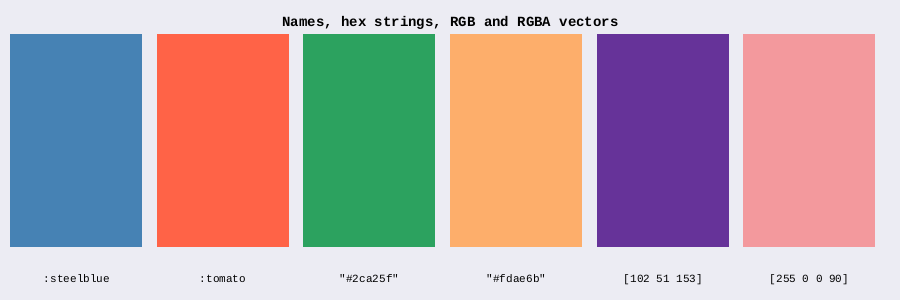
:::


## Palettes

Palettes are named lists of colours (`plot/palette` gives one, `plot/find-palette` lists the names); gradients are
functions of `t` in `[0 1]` (`plot/gradient`, names from `plot/find-gradient`). A scale's `:range` takes either
name.


### Palette types

Qualitative palettes for categories, sequential for ordered values, diverging around a meaningful middle (here
the mean mpg, `:midpoint`). The lightest end of a sequential palette is almost white and nearly disappears
against the grey panel - a property of the palette worth knowing when choosing one.

Source: [R Graph Gallery - Dealing with color in ggplot2](https://r-graph-gallery.com/ggplot2-color.html). Data: Edgar Anderson's iris measurements, R datasets package `iris` (Anderson 1935; Fisher 1936); licence: Part of R (GPL-2 | GPL-3).


::: {.sourceClojure}
```clojure
(let [mean-mpg (stats/mean (map :mpg mtcars))]
  (plot/render-image
   (plot/arrange
    [{:data iris :mapping {:x :sepal-length :y :sepal-width :color :species}
      :scales {:color {:range :RColorBrewer/Set2}}
      :charts [(chart/scatter {:size 7})] :labels {:title "qualitative" :x "sepal length" :y "sepal width"}}
     {:data iris :mapping {:x :sepal-length :y :sepal-width :color :petal-length}
      :scales {:color {:range :blues-9}}
      :charts [(chart/scatter {:size 7})] :labels {:title "sequential" :x "sepal length" :y "sepal width"}}
     {:data mtcars :mapping {:x :wt :y :hp :color #(- (:mpg %) mean-mpg)}
      :scales {:color {:range :RColorBrewer/RdBu :midpoint 0 :title "mpg - mean"}}
      :charts [(chart/scatter {:size 8})] :labels {:title "diverging" :x "weight" :y "horse power"}}]
    {:columns 3})
   {:width 1000 :height 360}))
```
:::


::: {.clay-image}
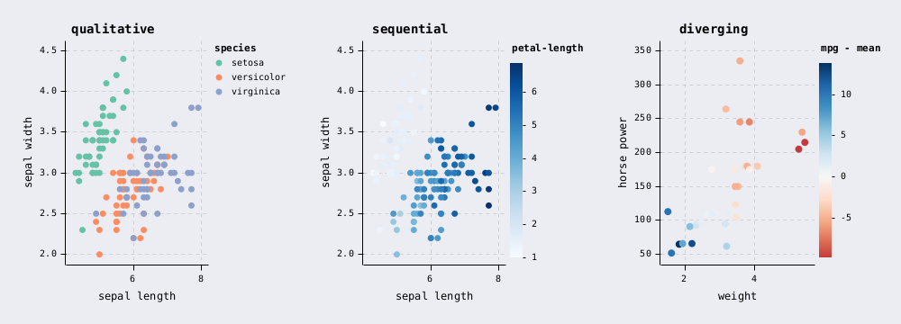
:::


### Palette families

The same scatter with a ColorBrewer, viridis, MetBrewer and Tableau palette; `plot/find-palette` lists palettes by
name:

Source: R Graph Gallery - paletteer, viridis, RColorBrewer ([1](https://r-graph-gallery.com/package/paletteer.html), [2](https://r-graph-gallery.com/package/viridis.html), [3](https://r-graph-gallery.com/38-rcolorbrewers-palettes.html)). Data: Edgar Anderson's iris measurements, R datasets package `iris` (Anderson 1935; Fisher 1936); licence: Part of R (GPL-2 | GPL-3).


::: {.sourceClojure}
```clojure
(plot/find-palette #"(?i)tableau")
```
:::


::: {.printedClojure}
```clojure
(:tableau-10
 :tableau-10-2
 :tableau-10-light
 :tableau-10-medium
 :tableau-20
 :tableau-20-2
 :tableau-classic-20
 :tableau-classic-medium
 :ggthemes/Tableau_10
 :ggthemes/Tableau_20)

```
:::


::: {.sourceClojure}
```clojure
(plot/render-image
 (plot/arrange
  (for [[title palette] [["RColorBrewer Dark2" :RColorBrewer/Dark2] ["viridis" :viridis]
                         ["MetBrewer Klimt" :MetBrewer/Klimt] ["Tableau 10" :tableau-10]]]
    {:data iris :mapping {:x :petal-length :y :petal-width :color :species}
     :scales {:color {:range palette :spread (= palette :viridis)}}
     :charts [(chart/scatter {:size 7})]
     :labels {:title title :x "petal length" :y "petal width"}})
  {:columns 2})
 {:width 900 :height 650})
```
:::


::: {.clay-image}

:::


`:viridis` has 256 colours, so its scale uses `:spread true` - three colours across the whole palette instead
of its first three.


### Palette swatches

A palette shown as colours: rects with an identity colour scale (the data values are the colours). Every row is
resampled to nine colours with `(plot/palette p 9)`, which also samples a gradient (given as `(plot/gradient name)`).

Source: [R Graph Gallery - Color palette finder](https://r-graph-gallery.com/color-palette-finder).


::: {.sourceClojure}
```clojure
(let [palettes [[":RColorBrewer/Set2" :RColorBrewer/Set2] [":tableau-10" :tableau-10]
                [":MetBrewer/Hiroshige" :MetBrewer/Hiroshige] [":blues-9" :blues-9] [":viridis" :viridis]
                ["gradient :viridis/magma" (plot/gradient :viridis/magma)] [":RColorBrewer/RdBu" :RColorBrewer/RdBu]]
      rows (for [[row [_ p]] (map-indexed vector palettes)
                 [i col] (map-indexed vector (plot/palette p 9))]
             {:x0 i :x1 (+ i 0.92) :y0 (- row) :y1 (- 0.85 row) :c col})
      names (for [[row [label]] (map-indexed vector palettes)] {:x -0.2 :y (- 0.42 row) :label label})]
  (plot/render-image
   {:scales {:color {:kind :identity} :x {:domain [-3.6 9] :axis false} :y {:axis false}}
    :charts [(chart/rect {:data rows :mapping {:x0 :x0 :x1 :x1 :y0 :y0 :y1 :y1 :color :c}})
             (chart/text {:data names :mapping {:x :x :y :y :label :label} :anchor [:right :middle] :size 11})]
    :labels {:title "Seven palettes and gradients, nine colours each" :x nil :y nil}}
   {:width 900 :height 500}))
```
:::


::: {.clay-image}

:::


## Discrete colour scales

Categories take palette colours in level order, unless a scale says otherwise.


### Manual colours

A level map as `:range` gives every level its own colour; a level without one is an error.

Source: [R Graph Gallery - Dealing with color in ggplot2](https://r-graph-gallery.com/ggplot2-color.html). Data: Edgar Anderson's iris measurements, R datasets package `iris` (Anderson 1935; Fisher 1936); licence: Part of R (GPL-2 | GPL-3).


::: {.sourceClojure}
```clojure
(plot/render-image
 {:data iris :mapping {:x :sepal-length :y :sepal-width :color :species}
  :scales {:color {:range {"setosa" :darkorange "versicolor" :purple "virginica" :teal}}}
  :charts [(chart/scatter {:size 8})]
  :labels {:title "Manual colours per species" :x "sepal length" :y "sepal width"}}
 {:width 800 :height 500})
```
:::


::: {.clay-image}
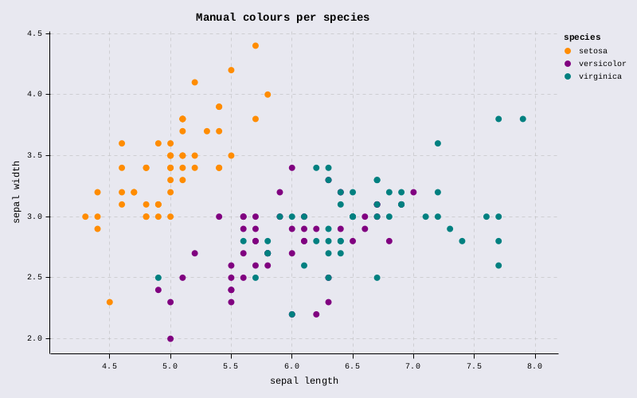
:::


### Highlighting a group

One group in colour, the others grey. Cylinder counts are numbers, so the scale is declared categorical.

Source: data-to-viz - The spaghetti plot; don't use color if it communicates nothing ([1](https://www.data-to-viz.com/caveat/spaghetti.html), [2](https://www.data-to-viz.com/caveat/color_com_nothing.html)). Data: Motor Trend car road tests (1974), R datasets package `mtcars` (Henderson & Velleman 1981); licence: Part of R (GPL-2 | GPL-3).


::: {.sourceClojure}
```clojure
(plot/render-image
 {:data mtcars :mapping {:x :hp :y :mpg :color :cyl}
  :scales {:color {:type :categorical :range {4 :lightgrey 6 :firebrick 8 :lightgrey} :title "cylinders"}}
  :charts [(chart/scatter {:size 9})]
  :labels {:title "Six-cylinder cars" :x "horse power" :y "miles per gallon"}}
 {:width 800 :height 500})
```
:::


::: {.clay-image}
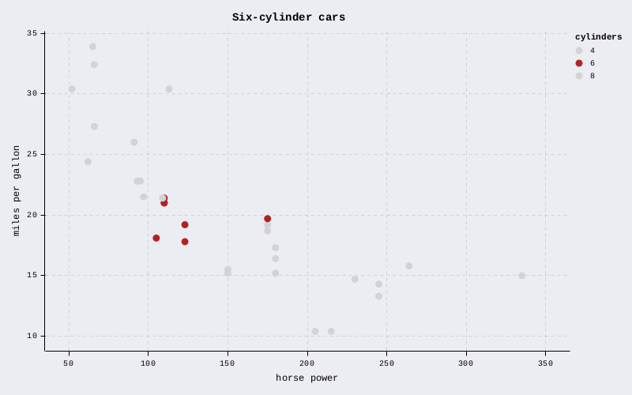
:::


### Sequential palettes on categories

A sequential palette has more colours than there are levels: by default the levels take its first colours
(all light here, the first nearly invisible on the grey panel); `:spread true` resamples it across its whole
range.

Source: [R Graph Gallery - RColorBrewer palettes](https://r-graph-gallery.com/38-rcolorbrewers-palettes.html). Data: Barley yields, Minnesota 1931-1932, R lattice package `barley` (Immer et al. 1934; Fisher 1971; Cleveland 1993); licence: GPL (>= 2) (lattice).


::: {.sourceClojure}
```clojure
(plot/render-image
 (plot/arrange
  (for [spread [false true]]
    {:data barley :mapping {:x :yield :y :variety :color :site}
     :scales {:color {:range :blues-9 :spread spread}}
     :charts [(chart/scatter {:size 8})]
     :labels {:title (if spread ":spread true" "first colours (default)") :x "yield" :y nil}})
  {:columns 2})
 {:width 1000 :height 450})
```
:::


::: {.clay-image}
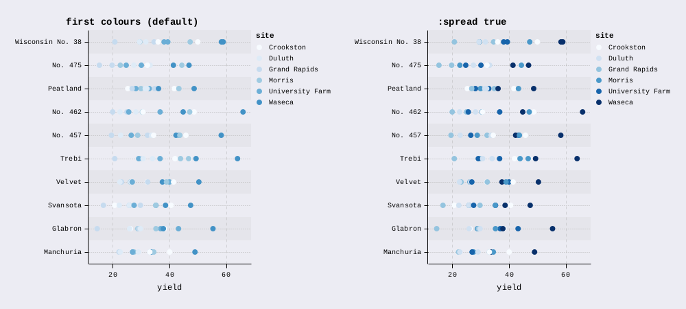
:::


## Continuous colour scales

Numbers on `:color` get a gradient and a colour bar.


### Gradients

`:range` takes two colours, several colours, a gradient name or any function of `t` in `[0 1]`.

Source: R Graph Gallery - Dealing with color in ggplot2; viridis ([1](https://r-graph-gallery.com/ggplot2-color.html), [2](https://r-graph-gallery.com/package/viridis.html)). Data: Earthquakes off Fiji since 1964, R datasets package `quakes` (Harvard PRIM-H project); licence: Part of R (GPL-2 | GPL-3).


::: {.sourceClojure}
```clojure
(plot/render-image
 (plot/arrange
  (for [[title color-range] [["two colours" [:lightyellow :darkred]]
                             ["four colours" [:lightyellow :orange :red :darkred]]
                             ["gradient name :viridis/magma" :viridis/magma]
                             ["a function: lerp navy to gold" (fn [t] (c/lerp :navy :gold t))]]]
    {:data quakes :mapping {:x :long :y :lat :color :depth}
     :scales {:color {:range color-range}}
     :charts [(chart/scatter {:size 5})]
     :labels {:title title :x "longitude" :y "latitude"}})
  {:columns 2})
 {:width 900 :height 700})
```
:::


::: {.clay-image}
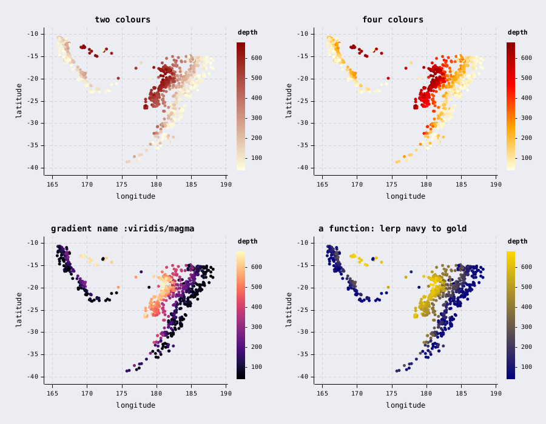
:::


### Diverging gradient with a midpoint

`:midpoint` puts a value at the middle of the gradient and scales both sides by the larger distance to it; the
colour bar ticks the midpoint. `:reverse true` turns RdBu around, so high horse power is red.

Source: [R Graph Gallery - Dealing with color in ggplot2](https://r-graph-gallery.com/ggplot2-color.html). Data: Motor Trend car road tests (1974), R datasets package `mtcars` (Henderson & Velleman 1981); licence: Part of R (GPL-2 | GPL-3).


::: {.sourceClojure}
```clojure
(let [mean-hp (stats/mean (map :hp mtcars))]
  (plot/render-image
   {:data mtcars :mapping {:x :wt :y :mpg :color :hp}
    :scales {:color {:range :RColorBrewer/RdBu :midpoint mean-hp :reverse true}}
    :charts [(chart/scatter {:size 10})]
    :labels {:title (format "Horse power around its mean (%.1f)" mean-hp) :x "weight" :y "miles per gallon"}}
   {:width 800 :height 500}))
```
:::


::: {.clay-image}
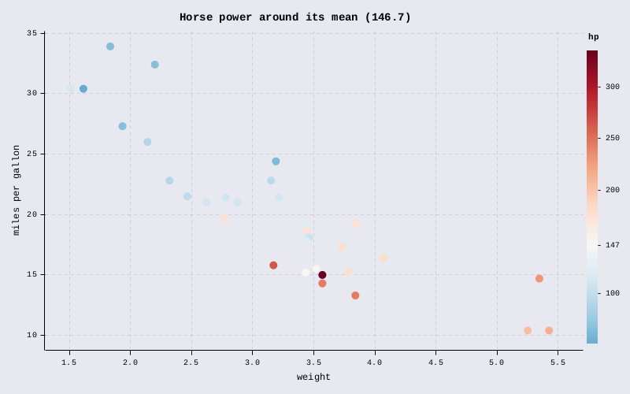
:::


### Reversing

`:reverse true` turns the colours around: categories keep their order with the colours reversed, a gradient
runs the other way.

Source: [R Graph Gallery - Dealing with color in ggplot2](https://r-graph-gallery.com/ggplot2-color.html). Data: Edgar Anderson's iris measurements, R datasets package `iris` (Anderson 1935; Fisher 1936); licence: Part of R (GPL-2 | GPL-3).


::: {.sourceClojure}
```clojure
(plot/render-image
 (plot/arrange
  (for [[title color scale] [["categories" :species {:range :RColorBrewer/Set1}]
                             ["categories, reversed" :species {:range :RColorBrewer/Set1 :reverse true}]
                             ["gradient" :petal-length {:range :viridis/viridis}]
                             ["gradient, reversed" :petal-length {:range :viridis/viridis :reverse true}]]]
    {:data iris :mapping {:x :sepal-length :y :sepal-width :color color}
     :scales {:color scale}
     :charts [(chart/scatter {:size 7})]
     :labels {:title title :x "sepal length" :y "sepal width"}})
  {:columns 2})
 {:width 900 :height 650})
```
:::


::: {.clay-image}
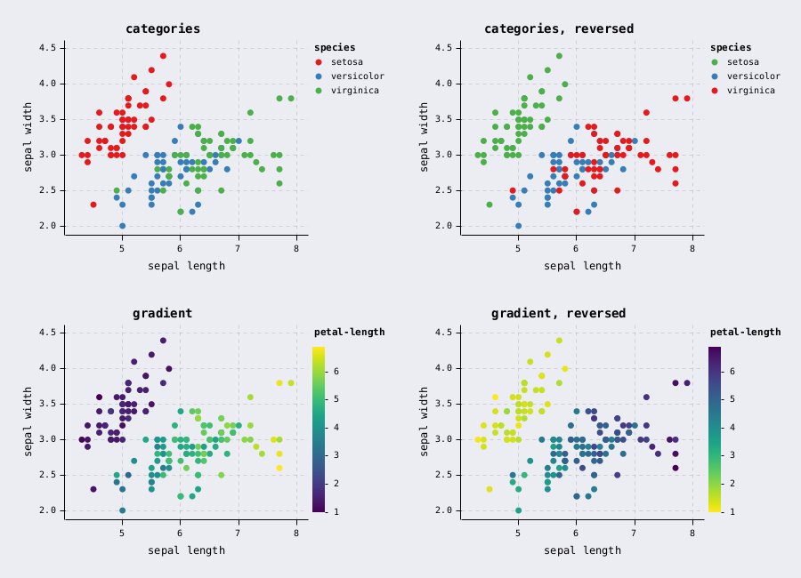
:::


### Binned colours

`:kind :binned` colours values by bin: a count of equal bins, a breaks vector, or quantile bins (`{:quantiles 5}`:
five bins of about equal counts, an `:estimation` strategy optional); the colour bar has one block per bin. For a
discrete legend of intervals, bin the data with `levels/bin`, which takes the same `:bins`.

Source: [R Graph Gallery - Dealing with color in ggplot2](https://r-graph-gallery.com/ggplot2-color.html). Data: Prices and attributes of round cut diamonds, R ggplot2 package `diamonds` (Wickham et al.); licence: MIT (ggplot2).


::: {.sourceClojure}
```clojure
(def diamonds-sample
  "A fixed 5% sample of diamonds (the full data has 53,940 rows)."
  (let [rng (r/rng :mersenne 7)] (filterv (fn [_] (< (r/drandom rng) 0.05)) diamonds)))
```
:::


```{=html}
<div class="data-table"><table class="table table-hover table-responsive clay-table"><thead><tr><th>carat</th><th>cut</th><th>color</th><th>clarity</th><th>depth</th><th>table</th><th>price</th><th>x</th><th>y</th><th>z</th></tr></thead><tbody><tr><td>0.23</td><td>Very Good</td><td>E</td><td>VS2</td><td>63.8</td><td>55</td><td>352</td><td>3.85</td><td>3.92</td><td>2.48</td></tr><tr><td>0.23</td><td>Very Good</td><td>D</td><td>VS2</td><td>60.5</td><td>61</td><td>357</td><td>3.96</td><td>3.97</td><td>2.4</td></tr><tr><td>0.23</td><td>Very Good</td><td>E</td><td>VS1</td><td>59.5</td><td>58</td><td>402</td><td>4.01</td><td>4.06</td><td>2.4</td></tr><tr><td>0.33</td><td>Ideal</td><td>I</td><td>SI2</td><td>61.8</td><td>55</td><td>403</td><td>4.49</td><td>4.51</td><td>2.78</td></tr><tr><td>0.32</td><td>Good</td><td>H</td><td>SI2</td><td>63.1</td><td>56</td><td>403</td><td>4.34</td><td>4.37</td><td>2.75</td></tr><tr><td>0.32</td><td>Good</td><td>H</td><td>SI2</td><td>63.8</td><td>56</td><td>403</td><td>4.36</td><td>4.38</td><td>2.79</td></tr><tr><td>0.3</td><td>Ideal</td><td>D</td><td>SI1</td><td>62.1</td><td>56</td><td>552</td><td>4.3</td><td>4.33</td><td>2.68</td></tr><tr><td>0.3</td><td>Very Good</td><td>H</td><td>SI1</td><td>63.1</td><td>56</td><td>554</td><td>4.29</td><td>4.27</td><td>2.7</td></tr><tr><td>0.75</td><td>Very Good</td><td>D</td><td>SI1</td><td>63.2</td><td>56</td><td>2760</td><td>5.8</td><td>5.75</td><td>3.65</td></tr><tr><td>0.8</td><td>Ideal</td><td>I</td><td>VS1</td><td>62.9</td><td>56</td><td>2760</td><td>5.94</td><td>5.87</td><td>3.72</td></tr><tr><td>0.74</td><td>Ideal</td><td>I</td><td>VVS2</td><td>62.3</td><td>55</td><td>2761</td><td>5.77</td><td>5.81</td><td>3.61</td></tr><tr><td>0.7</td><td>Fair</td><td>F</td><td>VS2</td><td>64.5</td><td>57</td><td>2762</td><td>5.57</td><td>5.53</td><td>3.58</td></tr><tr><td>0.7</td><td>Very Good</td><td>D</td><td>VS1</td><td>62.7</td><td>58</td><td>2777</td><td>5.66</td><td>5.73</td><td>3.57</td></tr><tr><td>0.71</td><td>Very Good</td><td>F</td><td>VS2</td><td>62.8</td><td>57</td><td>2777</td><td>5.64</td><td>5.69</td><td>3.56</td></tr><tr><td>0.71</td><td>Good</td><td>F</td><td>VS2</td><td>63.8</td><td>58</td><td>2777</td><td>5.61</td><td>5.64</td><td>3.59</td></tr><tr><td>0.7</td><td>Ideal</td><td>E</td><td>VS2</td><td>62.1</td><td>55</td><td>2777</td><td>5.7</td><td>5.67</td><td>3.53</td></tr><tr><td>0.52</td><td>Ideal</td><td>F</td><td>VVS1</td><td>61.3</td><td>55</td><td>2778</td><td>5.19</td><td>5.22</td><td>3.19</td></tr><tr><td>0.74</td><td>Ideal</td><td>G</td><td>VS1</td><td>61.5</td><td>55</td><td>2780</td><td>5.81</td><td>5.86</td><td>3.59</td></tr><tr><td>0.53</td><td>Very Good</td><td>D</td><td>VVS2</td><td>57.5</td><td>64</td><td>2782</td><td>5.34</td><td>5.37</td><td>3.08</td></tr><tr><td>0.77</td><td>Good</td><td>G</td><td>VS1</td><td>59.4</td><td>64</td><td>2788</td><td>5.97</td><td>5.92</td><td>3.53</td></tr><tr><td>0.76</td><td>Premium</td><td>E</td><td>SI1</td><td>61.8</td><td>58</td><td>2789</td><td>5.82</td><td>5.86</td><td>3.61</td></tr><tr><td>0.7</td><td>Very Good</td><td>E</td><td>VS2</td><td>62.9</td><td>57</td><td>2793</td><td>5.66</td><td>5.69</td><td>3.57</td></tr><tr><td>0.79</td><td>Very Good</td><td>E</td><td>SI1</td><td>63.2</td><td>56</td><td>2794</td><td>5.91</td><td>5.86</td><td>3.72</td></tr><tr><td>0.83</td><td>Ideal</td><td>G</td><td>SI1</td><td>61.8</td><td>57</td><td>2800</td><td>6.03</td><td>6.07</td><td>3.74</td></tr><tr><td>0.87</td><td>Very Good</td><td>G</td><td>SI2</td><td>59.9</td><td>58</td><td>2802</td><td>6.19</td><td>6.23</td><td>3.72</td></tr><tr><td>0.53</td><td>Ideal</td><td>F</td><td>IF</td><td>61.9</td><td>54</td><td>2802</td><td>5.22</td><td>5.25</td><td>3.24</td></tr><tr><td>0.74</td><td>Very Good</td><td>E</td><td>SI1</td><td>63.5</td><td>56</td><td>2803</td><td>5.74</td><td>5.79</td><td>3.66</td></tr><tr><td>0.73</td><td>Ideal</td><td>E</td><td>SI1</td><td>60.6</td><td>54</td><td>2803</td><td>5.84</td><td>5.89</td><td>3.55</td></tr><tr><td>0.72</td><td>Ideal</td><td>D</td><td>SI1</td><td>62.2</td><td>56</td><td>2804</td><td>5.74</td><td>5.77</td><td>3.58</td></tr><tr><td>0.7</td><td>Good</td><td>E</td><td>SI1</td><td>63.5</td><td>59</td><td>2812</td><td>5.49</td><td>5.53</td><td>3.5</td></tr><tr><td>0.32</td><td>Premium</td><td>I</td><td>SI1</td><td>61</td><td>59</td><td>554</td><td>4.39</td><td>4.36</td><td>2.67</td></tr><tr><td>0.3</td><td>Premium</td><td>H</td><td>SI1</td><td>60.9</td><td>59</td><td>554</td><td>4.31</td><td>4.29</td><td>2.62</td></tr><tr><td>0.51</td><td>Ideal</td><td>F</td><td>VVS1</td><td>62</td><td>57</td><td>2812</td><td>5.15</td><td>5.11</td><td>3.18</td></tr><tr><td>0.72</td><td>Premium</td><td>E</td><td>VS2</td><td>60.9</td><td>60</td><td>2822</td><td>5.8</td><td>5.76</td><td>3.52</td></tr><tr><td>0.71</td><td>Premium</td><td>E</td><td>VS2</td><td>62.3</td><td>58</td><td>2823</td><td>5.71</td><td>5.66</td><td>3.54</td></tr><tr><td>0.71</td><td>Ideal</td><td>E</td><td>SI1</td><td>60.5</td><td>56</td><td>2823</td><td>5.77</td><td>5.73</td><td>3.47</td></tr><tr><td>0.77</td><td>Ideal</td><td>I</td><td>VVS2</td><td>62.1</td><td>57</td><td>2824</td><td>5.84</td><td>5.86</td><td>3.63</td></tr><tr><td>0.7</td><td>Very Good</td><td>D</td><td>SI1</td><td>62.3</td><td>59</td><td>2827</td><td>5.67</td><td>5.7</td><td>3.54</td></tr><tr><td>0.71</td><td>Premium</td><td>F</td><td>VS1</td><td>62.2</td><td>58</td><td>2832</td><td>5.72</td><td>5.66</td><td>3.54</td></tr><tr><td>0.78</td><td>Ideal</td><td>I</td><td>VS2</td><td>61.8</td><td>55</td><td>2834</td><td>5.92</td><td>5.95</td><td>3.67</td></tr><tr><td>0.75</td><td>Premium</td><td>F</td><td>VS2</td><td>59.6</td><td>59</td><td>2835</td><td>6.04</td><td>5.94</td><td>3.57</td></tr><tr><td>0.71</td><td>Premium</td><td>F</td><td>VS1</td><td>59.1</td><td>61</td><td>2839</td><td>5.84</td><td>5.81</td><td>3.44</td></tr><tr><td>0.7</td><td>Premium</td><td>H</td><td>VVS1</td><td>59.2</td><td>60</td><td>2840</td><td>5.87</td><td>5.78</td><td>3.45</td></tr><tr><td>0.73</td><td>Very Good</td><td>D</td><td>SI1</td><td>63.9</td><td>57</td><td>2841</td><td>5.66</td><td>5.71</td><td>3.63</td></tr><tr><td>0.82</td><td>Ideal</td><td>F</td><td>SI2</td><td>61.7</td><td>53</td><td>2841</td><td>6</td><td>6.12</td><td>3.74</td></tr><tr><td>0.72</td><td>Ideal</td><td>E</td><td>VS2</td><td>62</td><td>57</td><td>2843</td><td>5.71</td><td>5.74</td><td>3.55</td></tr><tr><td>0.74</td><td>Very Good</td><td>E</td><td>VS1</td><td>63.1</td><td>58</td><td>2849</td><td>5.75</td><td>5.73</td><td>3.62</td></tr><tr><td>0.7</td><td>Very Good</td><td>E</td><td>VS2</td><td>61</td><td>60</td><td>2850</td><td>5.74</td><td>5.77</td><td>3.51</td></tr><tr><td>0.73</td><td>Ideal</td><td>E</td><td>SI1</td><td>62.7</td><td>55</td><td>2852</td><td>5.7</td><td>5.79</td><td>3.6</td></tr><tr><td>0.33</td><td>Premium</td><td>J</td><td>VS1</td><td>61.5</td><td>61</td><td>557</td><td>4.46</td><td>4.39</td><td>2.72</td></tr><tr><td>0.33</td><td>Ideal</td><td>J</td><td>VS1</td><td>62.1</td><td>55</td><td>557</td><td>4.44</td><td>4.41</td><td>2.75</td></tr><tr><td>0.9</td><td>Fair</td><td>G</td><td>SI2</td><td>64.5</td><td>56</td><td>2858</td><td>6.06</td><td>6</td><td>3.89</td></tr><tr><td>0.71</td><td>Very Good</td><td>F</td><td>VVS1</td><td>63.2</td><td>60</td><td>2862</td><td>5.65</td><td>5.61</td><td>3.56</td></tr><tr><td>0.91</td><td>Premium</td><td>J</td><td>SI1</td><td>59.5</td><td>62</td><td>2863</td><td>6.4</td><td>6.18</td><td>3.74</td></tr><tr><td>0.71</td><td>Ideal</td><td>E</td><td>VS1</td><td>62.2</td><td>55</td><td>2866</td><td>5.74</td><td>5.7</td><td>3.56</td></tr><tr><td>0.52</td><td>Premium</td><td>F</td><td>VVS2</td><td>61.8</td><td>60</td><td>2870</td><td>5.16</td><td>5.13</td><td>3.18</td></tr><tr><td>1.04</td><td>Premium</td><td>I</td><td>I1</td><td>61.6</td><td>61</td><td>2870</td><td>6.47</td><td>6.45</td><td>3.98</td></tr><tr><td>0.9</td><td>Premium</td><td>J</td><td>SI1</td><td>60.9</td><td>61</td><td>2873</td><td>6.26</td><td>6.22</td><td>3.8</td></tr><tr><td>0.7</td><td>Ideal</td><td>F</td><td>VS1</td><td>62.4</td><td>56</td><td>2874</td><td>5.69</td><td>5.65</td><td>3.54</td></tr><tr><td>0.71</td><td>Ideal</td><td>E</td><td>VS1</td><td>62.4</td><td>56</td><td>2877</td><td>5.75</td><td>5.7</td><td>3.57</td></tr><tr><td>0.92</td><td>Very Good</td><td>J</td><td>SI2</td><td>58.7</td><td>61</td><td>2880</td><td>6.34</td><td>6.43</td><td>3.75</td></tr><tr><td>0.71</td><td>Very Good</td><td>G</td><td>VS2</td><td>60.9</td><td>56</td><td>2895</td><td>5.75</td><td>5.78</td><td>3.51</td></tr><tr><td>0.79</td><td>Ideal</td><td>D</td><td>SI1</td><td>61.5</td><td>56</td><td>2896</td><td>5.91</td><td>5.96</td><td>3.65</td></tr><tr><td>0.72</td><td>Premium</td><td>E</td><td>VS2</td><td>61.1</td><td>59</td><td>2903</td><td>5.8</td><td>5.75</td><td>3.53</td></tr><tr><td>0.7</td><td>Ideal</td><td>F</td><td>VS2</td><td>62.3</td><td>53</td><td>2907</td><td>5.69</td><td>5.73</td><td>3.56</td></tr><tr><td>0.79</td><td>Ideal</td><td>G</td><td>SI1</td><td>60.3</td><td>60</td><td>2907</td><td>5.98</td><td>6.02</td><td>3.62</td></tr><tr><td>0.31</td><td>Ideal</td><td>E</td><td>SI2</td><td>61.7</td><td>56</td><td>558</td><td>4.4</td><td>4.35</td><td>2.7</td></tr><tr><td>0.7</td><td>Very Good</td><td>D</td><td>VS2</td><td>60.7</td><td>60</td><td>2913</td><td>5.72</td><td>5.74</td><td>3.48</td></tr><tr><td>0.71</td><td>Premium</td><td>D</td><td>SI1</td><td>61.4</td><td>58</td><td>2913</td><td>5.75</td><td>5.79</td><td>3.54</td></tr><tr><td>0.71</td><td>Very Good</td><td>F</td><td>VS2</td><td>59.5</td><td>58</td><td>2918</td><td>5.82</td><td>5.87</td><td>3.48</td></tr><tr><td>0.9</td><td>Fair</td><td>I</td><td>VS2</td><td>64.1</td><td>66</td><td>2921</td><td>6.04</td><td>5.98</td><td>3.85</td></tr><tr><td>0.77</td><td>Ideal</td><td>D</td><td>SI2</td><td>60.6</td><td>56</td><td>2922</td><td>5.95</td><td>5.9</td><td>3.59</td></tr><tr><td>0.72</td><td>Very Good</td><td>E</td><td>VS2</td><td>63</td><td>57</td><td>2923</td><td>5.69</td><td>5.73</td><td>3.6</td></tr><tr><td>0.71</td><td>Very Good</td><td>E</td><td>VS2</td><td>61.3</td><td>60</td><td>2930</td><td>5.74</td><td>5.71</td><td>3.51</td></tr><tr><td>0.71</td><td>Ideal</td><td>G</td><td>VS1</td><td>62.7</td><td>57</td><td>2930</td><td>5.69</td><td>5.73</td><td>3.58</td></tr><tr><td>0.7</td><td>Premium</td><td>G</td><td>VVS1</td><td>62</td><td>61</td><td>2932</td><td>5.71</td><td>5.62</td><td>3.51</td></tr><tr><td>0.71</td><td>Ideal</td><td>D</td><td>SI2</td><td>62</td><td>54</td><td>2934</td><td>5.77</td><td>5.74</td><td>3.57</td></tr><tr><td>0.7</td><td>Ideal</td><td>F</td><td>VS1</td><td>61.2</td><td>54</td><td>2940</td><td>5.92</td><td>5.64</td><td>3.54</td></tr><tr><td>0.7</td><td>Ideal</td><td>E</td><td>VS2</td><td>61.5</td><td>56</td><td>2940</td><td>5.73</td><td>5.68</td><td>3.51</td></tr><tr><td>0.71</td><td>Ideal</td><td>G</td><td>VS1</td><td>62.4</td><td>57</td><td>2950</td><td>5.68</td><td>5.73</td><td>3.56</td></tr><tr><td>0.7</td><td>Ideal</td><td>E</td><td>VS2</td><td>62.1</td><td>55</td><td>2952</td><td>5.71</td><td>5.75</td><td>3.56</td></tr><tr><td>0.79</td><td>Premium</td><td>G</td><td>VS2</td><td>62.3</td><td>58</td><td>2959</td><td>5.92</td><td>5.89</td><td>3.68</td></tr><tr><td>0.63</td><td>Ideal</td><td>F</td><td>VVS2</td><td>62.3</td><td>56</td><td>2961</td><td>5.48</td><td>5.5</td><td>3.42</td></tr><tr><td>0.63</td><td>Ideal</td><td>D</td><td>VVS2</td><td>62.6</td><td>56</td><td>2962</td><td>5.47</td><td>5.49</td><td>3.43</td></tr><tr><td>0.72</td><td>Ideal</td><td>E</td><td>VS2</td><td>62</td><td>56</td><td>2962</td><td>5.73</td><td>5.76</td><td>3.56</td></tr><tr><td>0.7</td><td>Ideal</td><td>G</td><td>SI1</td><td>60.9</td><td>56</td><td>2965</td><td>5.73</td><td>5.79</td><td>3.51</td></tr><tr><td>0.7</td><td>Very Good</td><td>E</td><td>VS1</td><td>61.5</td><td>56</td><td>2967</td><td>5.69</td><td>5.75</td><td>3.52</td></tr><tr><td>0.31</td><td>Very Good</td><td>G</td><td>VS2</td><td>60.9</td><td>57</td><td>559</td><td>4.37</td><td>4.39</td><td>2.67</td></tr><tr><td>0.24</td><td>Ideal</td><td>G</td><td>IF</td><td>61.8</td><td>55</td><td>559</td><td>3.99</td><td>4.02</td><td>2.47</td></tr><tr><td>0.27</td><td>Very Good</td><td>F</td><td>IF</td><td>60.4</td><td>58</td><td>560</td><td>4.18</td><td>4.2</td><td>2.53</td></tr><tr><td>0.91</td><td>Ideal</td><td>I</td><td>SI2</td><td>61.6</td><td>57</td><td>2981</td><td>6.24</td><td>6.23</td><td>3.84</td></tr><tr><td>1.03</td><td>Very Good</td><td>G</td><td>I1</td><td>63.2</td><td>58</td><td>2988</td><td>6.44</td><td>6.34</td><td>4.04</td></tr><tr><td>0.77</td><td>Ideal</td><td>D</td><td>SI1</td><td>61.4</td><td>56</td><td>2996</td><td>5.9</td><td>5.93</td><td>3.63</td></tr><tr><td>0.7</td><td>Ideal</td><td>D</td><td>VS2</td><td>62.8</td><td>57</td><td>2998</td><td>5.69</td><td>5.75</td><td>3.59</td></tr><tr><td>0.77</td><td>Ideal</td><td>E</td><td>SI1</td><td>62.5</td><td>56</td><td>3000</td><td>5.87</td><td>5.91</td><td>3.68</td></tr><tr><td>0.71</td><td>Premium</td><td>D</td><td>VS2</td><td>62.1</td><td>60</td><td>3002</td><td>5.68</td><td>5.72</td><td>3.54</td></tr><tr><td>0.7</td><td>Premium</td><td>E</td><td>VS1</td><td>61.8</td><td>58</td><td>3016</td><td>5.71</td><td>5.75</td><td>3.54</td></tr><tr><td>0.76</td><td>Ideal</td><td>E</td><td>SI1</td><td>62.5</td><td>57</td><td>3033</td><td>5.8</td><td>5.82</td><td>3.63</td></tr><tr><td>0.32</td><td>Ideal</td><td>H</td><td>VS1</td><td>61.9</td><td>55</td><td>561</td><td>4.4</td><td>4.42</td><td>2.73</td></tr><tr><td>0.71</td><td>Ideal</td><td>F</td><td>VS1</td><td>62.7</td><td>57</td><td>3041</td><td>5.66</td><td>5.7</td><td>3.56</td></tr><tr><td>…</td><td>…</td><td>…</td><td>…</td><td>…</td><td>…</td><td>…</td><td>…</td><td>…</td><td>…</td></tr></tbody></table></div>
```


::: {.sourceClojure}
```clojure
(plot/render-image
 (plot/arrange
  (for [[title bins] [["5 equal bins" 5] ["breaks vector" [0 1000 2500 5000 10000 20000]]
                      ["{:quantiles 5}" {:quantiles 5}]]]
    {:data diamonds-sample :mapping {:x :carat :y :price :color :price}
     :scales {:color {:kind :binned :bins bins :range :viridis}}
     :charts [(chart/scatter {:size 4})]
     :labels {:title title :x "carat" :y "price"}})
  {:columns 3})
 {:width 1000 :height 400})
```
:::


::: {.clay-image}

:::


## Colour in practice


### Missing values and the theme palette

A missing value gets the theme's NA colour and the last legend entry; the theme `:palette` sets the default
colours of every plot (here a MetBrewer palette and a magenta NA).

Source: [R Graph Gallery - Dealing with color in ggplot2](https://r-graph-gallery.com/ggplot2-color.html). Data: Edgar Anderson's iris measurements, R datasets package `iris` (Anderson 1935; Fisher 1936); licence: Part of R (GPL-2 | GPL-3).


::: {.sourceClojure}
```clojure
(def iris-with-na
  "Iris with every seventh species missing."
  (map-indexed (fn [i row] (if (zero? (mod i 7)) (assoc row :species nil) row)) iris))
```
:::


```{=html}
<div class="data-table"><table class="table table-hover table-responsive clay-table"><thead><tr><th>sepal-length</th><th>sepal-width</th><th>petal-length</th><th>petal-width</th><th>species</th></tr></thead><tbody><tr><td>5.1</td><td>3.5</td><td>1.4</td><td>0.2</td><td></td></tr><tr><td>4.9</td><td>3</td><td>1.4</td><td>0.2</td><td>setosa</td></tr><tr><td>4.7</td><td>3.2</td><td>1.3</td><td>0.2</td><td>setosa</td></tr><tr><td>4.6</td><td>3.1</td><td>1.5</td><td>0.2</td><td>setosa</td></tr><tr><td>5</td><td>3.6</td><td>1.4</td><td>0.2</td><td>setosa</td></tr><tr><td>5.4</td><td>3.9</td><td>1.7</td><td>0.4</td><td>setosa</td></tr><tr><td>4.6</td><td>3.4</td><td>1.4</td><td>0.3</td><td>setosa</td></tr><tr><td>5</td><td>3.4</td><td>1.5</td><td>0.2</td><td></td></tr><tr><td>4.4</td><td>2.9</td><td>1.4</td><td>0.2</td><td>setosa</td></tr><tr><td>4.9</td><td>3.1</td><td>1.5</td><td>0.1</td><td>setosa</td></tr><tr><td>5.4</td><td>3.7</td><td>1.5</td><td>0.2</td><td>setosa</td></tr><tr><td>4.8</td><td>3.4</td><td>1.6</td><td>0.2</td><td>setosa</td></tr><tr><td>4.8</td><td>3</td><td>1.4</td><td>0.1</td><td>setosa</td></tr><tr><td>4.3</td><td>3</td><td>1.1</td><td>0.1</td><td>setosa</td></tr><tr><td>5.8</td><td>4</td><td>1.2</td><td>0.2</td><td></td></tr><tr><td>5.7</td><td>4.4</td><td>1.5</td><td>0.4</td><td>setosa</td></tr><tr><td>5.4</td><td>3.9</td><td>1.3</td><td>0.4</td><td>setosa</td></tr><tr><td>5.1</td><td>3.5</td><td>1.4</td><td>0.3</td><td>setosa</td></tr><tr><td>5.7</td><td>3.8</td><td>1.7</td><td>0.3</td><td>setosa</td></tr><tr><td>5.1</td><td>3.8</td><td>1.5</td><td>0.3</td><td>setosa</td></tr><tr><td>5.4</td><td>3.4</td><td>1.7</td><td>0.2</td><td>setosa</td></tr><tr><td>5.1</td><td>3.7</td><td>1.5</td><td>0.4</td><td></td></tr><tr><td>4.6</td><td>3.6</td><td>1</td><td>0.2</td><td>setosa</td></tr><tr><td>5.1</td><td>3.3</td><td>1.7</td><td>0.5</td><td>setosa</td></tr><tr><td>4.8</td><td>3.4</td><td>1.9</td><td>0.2</td><td>setosa</td></tr><tr><td>5</td><td>3</td><td>1.6</td><td>0.2</td><td>setosa</td></tr><tr><td>5</td><td>3.4</td><td>1.6</td><td>0.4</td><td>setosa</td></tr><tr><td>5.2</td><td>3.5</td><td>1.5</td><td>0.2</td><td>setosa</td></tr><tr><td>5.2</td><td>3.4</td><td>1.4</td><td>0.2</td><td></td></tr><tr><td>4.7</td><td>3.2</td><td>1.6</td><td>0.2</td><td>setosa</td></tr><tr><td>4.8</td><td>3.1</td><td>1.6</td><td>0.2</td><td>setosa</td></tr><tr><td>5.4</td><td>3.4</td><td>1.5</td><td>0.4</td><td>setosa</td></tr><tr><td>5.2</td><td>4.1</td><td>1.5</td><td>0.1</td><td>setosa</td></tr><tr><td>5.5</td><td>4.2</td><td>1.4</td><td>0.2</td><td>setosa</td></tr><tr><td>4.9</td><td>3.1</td><td>1.5</td><td>0.2</td><td>setosa</td></tr><tr><td>5</td><td>3.2</td><td>1.2</td><td>0.2</td><td></td></tr><tr><td>5.5</td><td>3.5</td><td>1.3</td><td>0.2</td><td>setosa</td></tr><tr><td>4.9</td><td>3.6</td><td>1.4</td><td>0.1</td><td>setosa</td></tr><tr><td>4.4</td><td>3</td><td>1.3</td><td>0.2</td><td>setosa</td></tr><tr><td>5.1</td><td>3.4</td><td>1.5</td><td>0.2</td><td>setosa</td></tr><tr><td>5</td><td>3.5</td><td>1.3</td><td>0.3</td><td>setosa</td></tr><tr><td>4.5</td><td>2.3</td><td>1.3</td><td>0.3</td><td>setosa</td></tr><tr><td>4.4</td><td>3.2</td><td>1.3</td><td>0.2</td><td></td></tr><tr><td>5</td><td>3.5</td><td>1.6</td><td>0.6</td><td>setosa</td></tr><tr><td>5.1</td><td>3.8</td><td>1.9</td><td>0.4</td><td>setosa</td></tr><tr><td>4.8</td><td>3</td><td>1.4</td><td>0.3</td><td>setosa</td></tr><tr><td>5.1</td><td>3.8</td><td>1.6</td><td>0.2</td><td>setosa</td></tr><tr><td>4.6</td><td>3.2</td><td>1.4</td><td>0.2</td><td>setosa</td></tr><tr><td>5.3</td><td>3.7</td><td>1.5</td><td>0.2</td><td>setosa</td></tr><tr><td>5</td><td>3.3</td><td>1.4</td><td>0.2</td><td></td></tr><tr><td>7</td><td>3.2</td><td>4.7</td><td>1.4</td><td>versicolor</td></tr><tr><td>6.4</td><td>3.2</td><td>4.5</td><td>1.5</td><td>versicolor</td></tr><tr><td>6.9</td><td>3.1</td><td>4.9</td><td>1.5</td><td>versicolor</td></tr><tr><td>5.5</td><td>2.3</td><td>4</td><td>1.3</td><td>versicolor</td></tr><tr><td>6.5</td><td>2.8</td><td>4.6</td><td>1.5</td><td>versicolor</td></tr><tr><td>5.7</td><td>2.8</td><td>4.5</td><td>1.3</td><td>versicolor</td></tr><tr><td>6.3</td><td>3.3</td><td>4.7</td><td>1.6</td><td></td></tr><tr><td>4.9</td><td>2.4</td><td>3.3</td><td>1</td><td>versicolor</td></tr><tr><td>6.6</td><td>2.9</td><td>4.6</td><td>1.3</td><td>versicolor</td></tr><tr><td>5.2</td><td>2.7</td><td>3.9</td><td>1.4</td><td>versicolor</td></tr><tr><td>5</td><td>2</td><td>3.5</td><td>1</td><td>versicolor</td></tr><tr><td>5.9</td><td>3</td><td>4.2</td><td>1.5</td><td>versicolor</td></tr><tr><td>6</td><td>2.2</td><td>4</td><td>1</td><td>versicolor</td></tr><tr><td>6.1</td><td>2.9</td><td>4.7</td><td>1.4</td><td></td></tr><tr><td>5.6</td><td>2.9</td><td>3.6</td><td>1.3</td><td>versicolor</td></tr><tr><td>6.7</td><td>3.1</td><td>4.4</td><td>1.4</td><td>versicolor</td></tr><tr><td>5.6</td><td>3</td><td>4.5</td><td>1.5</td><td>versicolor</td></tr><tr><td>5.8</td><td>2.7</td><td>4.1</td><td>1</td><td>versicolor</td></tr><tr><td>6.2</td><td>2.2</td><td>4.5</td><td>1.5</td><td>versicolor</td></tr><tr><td>5.6</td><td>2.5</td><td>3.9</td><td>1.1</td><td>versicolor</td></tr><tr><td>5.9</td><td>3.2</td><td>4.8</td><td>1.8</td><td></td></tr><tr><td>6.1</td><td>2.8</td><td>4</td><td>1.3</td><td>versicolor</td></tr><tr><td>6.3</td><td>2.5</td><td>4.9</td><td>1.5</td><td>versicolor</td></tr><tr><td>6.1</td><td>2.8</td><td>4.7</td><td>1.2</td><td>versicolor</td></tr><tr><td>6.4</td><td>2.9</td><td>4.3</td><td>1.3</td><td>versicolor</td></tr><tr><td>6.6</td><td>3</td><td>4.4</td><td>1.4</td><td>versicolor</td></tr><tr><td>6.8</td><td>2.8</td><td>4.8</td><td>1.4</td><td>versicolor</td></tr><tr><td>6.7</td><td>3</td><td>5</td><td>1.7</td><td></td></tr><tr><td>6</td><td>2.9</td><td>4.5</td><td>1.5</td><td>versicolor</td></tr><tr><td>5.7</td><td>2.6</td><td>3.5</td><td>1</td><td>versicolor</td></tr><tr><td>5.5</td><td>2.4</td><td>3.8</td><td>1.1</td><td>versicolor</td></tr><tr><td>5.5</td><td>2.4</td><td>3.7</td><td>1</td><td>versicolor</td></tr><tr><td>5.8</td><td>2.7</td><td>3.9</td><td>1.2</td><td>versicolor</td></tr><tr><td>6</td><td>2.7</td><td>5.1</td><td>1.6</td><td>versicolor</td></tr><tr><td>5.4</td><td>3</td><td>4.5</td><td>1.5</td><td></td></tr><tr><td>6</td><td>3.4</td><td>4.5</td><td>1.6</td><td>versicolor</td></tr><tr><td>6.7</td><td>3.1</td><td>4.7</td><td>1.5</td><td>versicolor</td></tr><tr><td>6.3</td><td>2.3</td><td>4.4</td><td>1.3</td><td>versicolor</td></tr><tr><td>5.6</td><td>3</td><td>4.1</td><td>1.3</td><td>versicolor</td></tr><tr><td>5.5</td><td>2.5</td><td>4</td><td>1.3</td><td>versicolor</td></tr><tr><td>5.5</td><td>2.6</td><td>4.4</td><td>1.2</td><td>versicolor</td></tr><tr><td>6.1</td><td>3</td><td>4.6</td><td>1.4</td><td></td></tr><tr><td>5.8</td><td>2.6</td><td>4</td><td>1.2</td><td>versicolor</td></tr><tr><td>5</td><td>2.3</td><td>3.3</td><td>1</td><td>versicolor</td></tr><tr><td>5.6</td><td>2.7</td><td>4.2</td><td>1.3</td><td>versicolor</td></tr><tr><td>5.7</td><td>3</td><td>4.2</td><td>1.2</td><td>versicolor</td></tr><tr><td>5.7</td><td>2.9</td><td>4.2</td><td>1.3</td><td>versicolor</td></tr><tr><td>6.2</td><td>2.9</td><td>4.3</td><td>1.3</td><td>versicolor</td></tr><tr><td>5.1</td><td>2.5</td><td>3</td><td>1.1</td><td></td></tr><tr><td>5.7</td><td>2.8</td><td>4.1</td><td>1.3</td><td>versicolor</td></tr><tr><td>…</td><td>…</td><td>…</td><td>…</td><td>…</td></tr></tbody></table></div>
```


::: {.sourceClojure}
```clojure
(plot/render-image
 (plot/arrange
  [{:data iris-with-na :mapping {:x :sepal-length :y :sepal-width :color :species}
    :charts [(chart/scatter {:size 7})] :labels {:title "default theme" :x "sepal length" :y "sepal width"}}
   {:data iris-with-na :mapping {:x :sepal-length :y :sepal-width :color :species}
    :theme {:palette {:color :MetBrewer/Egypt :na [230 0 230]}}
    :charts [(chart/scatter {:size 7})] :labels {:title "theme :palette" :x "sepal length" :y "sepal width"}}]
  {:columns 2})
 {:width 1000 :height 420})
```
:::


::: {.clay-image}
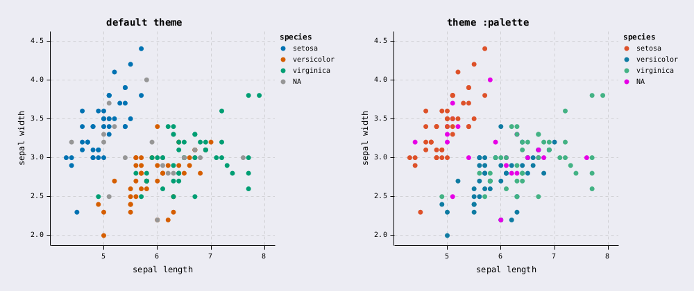
:::


### Transparency against overplotting

With 53,940 diamonds the opaque points hide where most of them are; a colour with a low alpha shows the density.

Source: [data-to-viz - Overplotting](https://www.data-to-viz.com/caveat/overplotting.html). Data: Prices and attributes of round cut diamonds, R ggplot2 package `diamonds` (Wickham et al.); licence: MIT (ggplot2).


::: {.sourceClojure}
```clojure
(plot/render-image
 (plot/arrange
  (for [[title color] [["opaque" [0 114 178]] ["alpha 12 of 255" [0 114 178 12]]]]
    {:data diamonds :mapping {:x :carat :y :price}
     :charts [(chart/scatter {:size 4 :color color})]
     :labels {:title title :x "carat" :y "price"}})
  {:columns 2})
 {:width 1000 :height 450})
```
:::


::: {.clay-image}
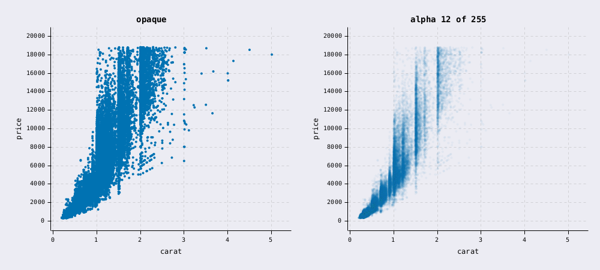
:::


### A line coloured by a variable

A linear or binned colour on a line colours it along its length: each segment takes the colour of the mean of
its two ends.

Source: [R Graph Gallery - Dealing with color in ggplot2](https://r-graph-gallery.com/ggplot2-color.html). Data: Weather in Lincoln, Nebraska, 2016, R ggridges package `lincoln_weather` (Weather Underground, via Wilke); licence: GPL-2 (ggridges).


::: {.sourceClojure}
```clojure
(def lincoln-days
  "Lincoln weather with the day of the year."
  (map-indexed (fn [i row] (assoc row :day (inc i))) lincoln))
```
:::


```{=html}
<div class="data-table"><table class="table table-hover table-responsive clay-table"><thead><tr><th>date</th><th>month</th><th>mean-temp</th><th>max-temp</th><th>min-temp</th><th>day</th></tr></thead><tbody><tr><td>2016-1-1</td><td>January</td><td>24</td><td>37</td><td>11</td><td>1</td></tr><tr><td>2016-1-2</td><td>January</td><td>23</td><td>41</td><td>5</td><td>2</td></tr><tr><td>2016-1-3</td><td>January</td><td>23</td><td>37</td><td>8</td><td>3</td></tr><tr><td>2016-1-4</td><td>January</td><td>17</td><td>30</td><td>4</td><td>4</td></tr><tr><td>2016-1-5</td><td>January</td><td>29</td><td>38</td><td>19</td><td>5</td></tr><tr><td>2016-1-6</td><td>January</td><td>33</td><td>34</td><td>32</td><td>6</td></tr><tr><td>2016-1-7</td><td>January</td><td>30</td><td>33</td><td>27</td><td>7</td></tr><tr><td>2016-1-8</td><td>January</td><td>25</td><td>28</td><td>22</td><td>8</td></tr><tr><td>2016-1-9</td><td>January</td><td>9</td><td>22</td><td>-4</td><td>9</td></tr><tr><td>2016-1-10</td><td>January</td><td>11</td><td>31</td><td>-9</td><td>10</td></tr><tr><td>2016-1-11</td><td>January</td><td>28</td><td>37</td><td>18</td><td>11</td></tr><tr><td>2016-1-12</td><td>January</td><td>24</td><td>34</td><td>14</td><td>12</td></tr><tr><td>2016-1-13</td><td>January</td><td>33</td><td>47</td><td>19</td><td>13</td></tr><tr><td>2016-1-14</td><td>January</td><td>40</td><td>51</td><td>28</td><td>14</td></tr><tr><td>2016-1-15</td><td>January</td><td>29</td><td>35</td><td>23</td><td>15</td></tr><tr><td>2016-1-16</td><td>January</td><td>19</td><td>30</td><td>7</td><td>16</td></tr><tr><td>2016-1-17</td><td>January</td><td>5</td><td>15</td><td>-5</td><td>17</td></tr><tr><td>2016-1-18</td><td>January</td><td>11</td><td>26</td><td>-4</td><td>18</td></tr><tr><td>2016-1-19</td><td>January</td><td>22</td><td>25</td><td>19</td><td>19</td></tr><tr><td>2016-1-20</td><td>January</td><td>28</td><td>32</td><td>24</td><td>20</td></tr><tr><td>2016-1-21</td><td>January</td><td>25</td><td>29</td><td>21</td><td>21</td></tr><tr><td>2016-1-22</td><td>January</td><td>22</td><td>25</td><td>19</td><td>22</td></tr><tr><td>2016-1-23</td><td>January</td><td>28</td><td>36</td><td>20</td><td>23</td></tr><tr><td>2016-1-24</td><td>January</td><td>30</td><td>41</td><td>19</td><td>24</td></tr><tr><td>2016-1-25</td><td>January</td><td>26</td><td>30</td><td>22</td><td>25</td></tr><tr><td>2016-1-26</td><td>January</td><td>29</td><td>42</td><td>15</td><td>26</td></tr><tr><td>2016-1-27</td><td>January</td><td>33</td><td>49</td><td>17</td><td>27</td></tr><tr><td>2016-1-28</td><td>January</td><td>41</td><td>51</td><td>31</td><td>28</td></tr><tr><td>2016-1-29</td><td>January</td><td>41</td><td>54</td><td>27</td><td>29</td></tr><tr><td>2016-1-30</td><td>January</td><td>39</td><td>49</td><td>28</td><td>30</td></tr><tr><td>2016-1-31</td><td>January</td><td>35</td><td>47</td><td>22</td><td>31</td></tr><tr><td>2016-2-1</td><td>February</td><td>31</td><td>42</td><td>20</td><td>32</td></tr><tr><td>2016-2-2</td><td>February</td><td>27</td><td>32</td><td>21</td><td>33</td></tr><tr><td>2016-2-3</td><td>February</td><td>17</td><td>27</td><td>6</td><td>34</td></tr><tr><td>2016-2-4</td><td>February</td><td>18</td><td>33</td><td>2</td><td>35</td></tr><tr><td>2016-2-5</td><td>February</td><td>28</td><td>39</td><td>17</td><td>36</td></tr><tr><td>2016-2-6</td><td>February</td><td>24</td><td>39</td><td>10</td><td>37</td></tr><tr><td>2016-2-7</td><td>February</td><td>36</td><td>42</td><td>30</td><td>38</td></tr><tr><td>2016-2-8</td><td>February</td><td>31</td><td>36</td><td>25</td><td>39</td></tr><tr><td>2016-2-9</td><td>February</td><td>26</td><td>29</td><td>22</td><td>40</td></tr><tr><td>2016-2-10</td><td>February</td><td>37</td><td>56</td><td>17</td><td>41</td></tr><tr><td>2016-2-11</td><td>February</td><td>32</td><td>38</td><td>26</td><td>42</td></tr><tr><td>2016-2-12</td><td>February</td><td>23</td><td>29</td><td>17</td><td>43</td></tr><tr><td>2016-2-13</td><td>February</td><td>19</td><td>23</td><td>15</td><td>44</td></tr><tr><td>2016-2-14</td><td>February</td><td>35</td><td>49</td><td>20</td><td>45</td></tr><tr><td>2016-2-15</td><td>February</td><td>36</td><td>49</td><td>23</td><td>46</td></tr><tr><td>2016-2-16</td><td>February</td><td>41</td><td>47</td><td>34</td><td>47</td></tr><tr><td>2016-2-17</td><td>February</td><td>41</td><td>57</td><td>25</td><td>48</td></tr><tr><td>2016-2-18</td><td>February</td><td>48</td><td>62</td><td>33</td><td>49</td></tr><tr><td>2016-2-19</td><td>February</td><td>52</td><td>67</td><td>37</td><td>50</td></tr><tr><td>2016-2-20</td><td>February</td><td>42</td><td>58</td><td>26</td><td>51</td></tr><tr><td>2016-2-21</td><td>February</td><td>40</td><td>50</td><td>29</td><td>52</td></tr><tr><td>2016-2-22</td><td>February</td><td>35</td><td>47</td><td>23</td><td>53</td></tr><tr><td>2016-2-23</td><td>February</td><td>36</td><td>48</td><td>23</td><td>54</td></tr><tr><td>2016-2-24</td><td>February</td><td>35</td><td>50</td><td>20</td><td>55</td></tr><tr><td>2016-2-25</td><td>February</td><td>31</td><td>40</td><td>22</td><td>56</td></tr><tr><td>2016-2-26</td><td>February</td><td>39</td><td>58</td><td>19</td><td>57</td></tr><tr><td>2016-2-27</td><td>February</td><td>50</td><td>75</td><td>24</td><td>58</td></tr><tr><td>2016-2-28</td><td>February</td><td>44</td><td>58</td><td>29</td><td>59</td></tr><tr><td>2016-2-29</td><td>February</td><td>34</td><td>50</td><td>18</td><td>60</td></tr><tr><td>2016-3-1</td><td>March</td><td>32</td><td>48</td><td>16</td><td>61</td></tr><tr><td>2016-3-2</td><td>March</td><td>39</td><td>54</td><td>24</td><td>62</td></tr><tr><td>2016-3-3</td><td>March</td><td>38</td><td>47</td><td>29</td><td>63</td></tr><tr><td>2016-3-4</td><td>March</td><td>45</td><td>63</td><td>27</td><td>64</td></tr><tr><td>2016-3-5</td><td>March</td><td>45</td><td>70</td><td>20</td><td>65</td></tr><tr><td>2016-3-6</td><td>March</td><td>56</td><td>72</td><td>39</td><td>66</td></tr><tr><td>2016-3-7</td><td>March</td><td>55</td><td>79</td><td>30</td><td>67</td></tr><tr><td>2016-3-8</td><td>March</td><td>45</td><td>55</td><td>34</td><td>68</td></tr><tr><td>2016-3-9</td><td>March</td><td>43</td><td>65</td><td>20</td><td>69</td></tr><tr><td>2016-3-10</td><td>March</td><td>46</td><td>63</td><td>28</td><td>70</td></tr><tr><td>2016-3-11</td><td>March</td><td>50</td><td>73</td><td>27</td><td>71</td></tr><tr><td>2016-3-12</td><td>March</td><td>46</td><td>64</td><td>28</td><td>72</td></tr><tr><td>2016-3-13</td><td>March</td><td>55</td><td>71</td><td>39</td><td>73</td></tr><tr><td>2016-3-14</td><td>March</td><td>53</td><td>75</td><td>30</td><td>74</td></tr><tr><td>2016-3-15</td><td>March</td><td>45</td><td>57</td><td>33</td><td>75</td></tr><tr><td>2016-3-16</td><td>March</td><td>40</td><td>54</td><td>25</td><td>76</td></tr><tr><td>2016-3-17</td><td>March</td><td>37</td><td>54</td><td>20</td><td>77</td></tr><tr><td>2016-3-18</td><td>March</td><td>31</td><td>44</td><td>18</td><td>78</td></tr><tr><td>2016-3-19</td><td>March</td><td>30</td><td>38</td><td>21</td><td>79</td></tr><tr><td>2016-3-20</td><td>March</td><td>33</td><td>50</td><td>15</td><td>80</td></tr><tr><td>2016-3-21</td><td>March</td><td>55</td><td>79</td><td>30</td><td>81</td></tr><tr><td>2016-3-22</td><td>March</td><td>58</td><td>71</td><td>44</td><td>82</td></tr><tr><td>2016-3-23</td><td>March</td><td>40</td><td>50</td><td>29</td><td>83</td></tr><tr><td>2016-3-24</td><td>March</td><td>30</td><td>41</td><td>18</td><td>84</td></tr><tr><td>2016-3-25</td><td>March</td><td>38</td><td>55</td><td>21</td><td>85</td></tr><tr><td>2016-3-26</td><td>March</td><td>31</td><td>38</td><td>23</td><td>86</td></tr><tr><td>2016-3-27</td><td>March</td><td>37</td><td>58</td><td>15</td><td>87</td></tr><tr><td>2016-3-28</td><td>March</td><td>45</td><td>66</td><td>23</td><td>88</td></tr><tr><td>2016-3-29</td><td>March</td><td>50</td><td>58</td><td>41</td><td>89</td></tr><tr><td>2016-3-30</td><td>March</td><td>47</td><td>56</td><td>38</td><td>90</td></tr><tr><td>2016-3-31</td><td>March</td><td>39</td><td>45</td><td>33</td><td>91</td></tr><tr><td>2016-4-1</td><td>April</td><td>35</td><td>42</td><td>28</td><td>92</td></tr><tr><td>2016-4-2</td><td>April</td><td>48</td><td>63</td><td>33</td><td>93</td></tr><tr><td>2016-4-3</td><td>April</td><td>60</td><td>78</td><td>41</td><td>94</td></tr><tr><td>2016-4-4</td><td>April</td><td>49</td><td>61</td><td>37</td><td>95</td></tr><tr><td>2016-4-5</td><td>April</td><td>56</td><td>70</td><td>42</td><td>96</td></tr><tr><td>2016-4-6</td><td>April</td><td>52</td><td>65</td><td>39</td><td>97</td></tr><tr><td>2016-4-7</td><td>April</td><td>45</td><td>58</td><td>31</td><td>98</td></tr><tr><td>2016-4-8</td><td>April</td><td>42</td><td>59</td><td>25</td><td>99</td></tr><tr><td>2016-4-9</td><td>April</td><td>46</td><td>65</td><td>26</td><td>100</td></tr><tr><td>…</td><td>…</td><td>…</td><td>…</td><td>…</td><td>…</td></tr></tbody></table></div>
```


::: {.sourceClojure}
```clojure
(plot/render-image
 (plot/arrange
  (for [[title scale] [["gradient" {:range :viridis/inferno}]
                       ["4 bins" {:kind :binned :bins 4 :range :RColorBrewer/RdBu :reverse true}]]]
    {:data lincoln-days :mapping {:x :day :y :mean-temp :color :mean-temp}
     :scales {:color (assoc scale :title "°F")}
     :charts [(chart/line {:line-width 2})]
     :labels {:title title :x "day of 2016" :y "mean temperature [°F]"}})
  {:columns 1})
 {:width 900 :height 650})
```
:::


::: {.clay-image}
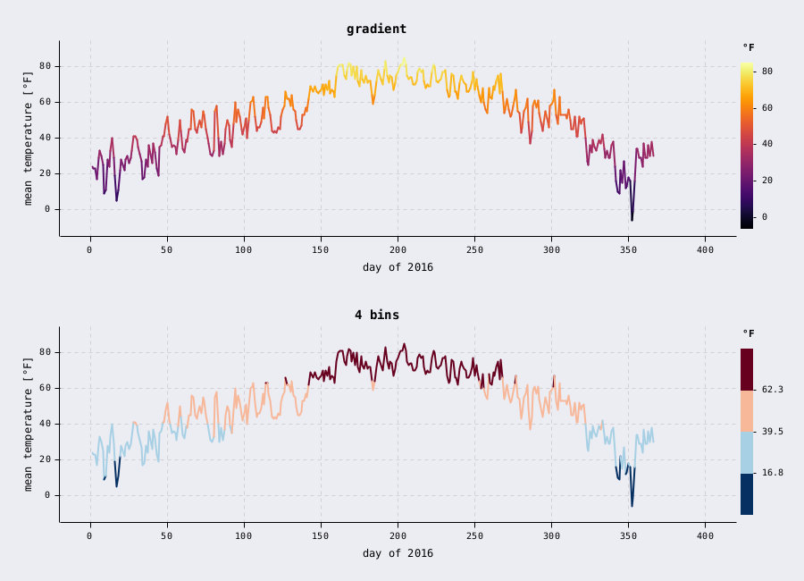
:::


## Accessibility


### Colour-blind preview

The render option `:cvd` draws a whole plot as seen with a colour vision deficiency; `plot/cvd-image` turns an image
already rendered. The default palette as most people see it, then with deuteranopia and protanopia (the render
option) and tritanopia (`plot/cvd-image`).

Source: [R Graph Gallery - viridis (colour-blind friendly maps)](https://r-graph-gallery.com/package/viridis.html). Data: Edgar Anderson's iris measurements, R datasets package `iris` (Anderson 1935; Fisher 1936); licence: Part of R (GPL-2 | GPL-3).


::: {.sourceClojure}
```clojure
(def cvd-example
  {:data iris :mapping {:x :sepal-length :y :sepal-width :color :species}
   :charts [(chart/scatter {:size 7})]
   :labels {:title "default palette, as most people see it" :x "sepal length" :y "sepal width"}})
```
:::


::: {.sourceClojure}
```clojure
(plot/render-image cvd-example {:width 480 :height 340})
```
:::


::: {.clay-image}
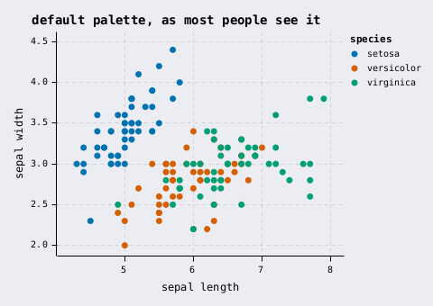
:::


::: {.sourceClojure}
```clojure
(plot/render-image (assoc-in cvd-example [:labels :title] "deuteranopia (:cvd)")
                   {:width 480 :height 340 :cvd :deuteranopia})
```
:::


::: {.clay-image}

:::


::: {.sourceClojure}
```clojure
(plot/render-image (assoc-in cvd-example [:labels :title] "protanopia (:cvd)")
                   {:width 480 :height 340 :cvd :protanopia})
```
:::


::: {.clay-image}
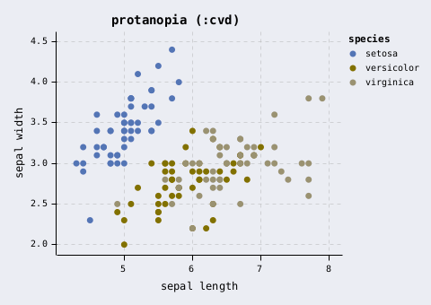
:::


::: {.sourceClojure}
```clojure
(plot/cvd-image (plot/render-image (assoc-in cvd-example [:labels :title] "tritanopia (plot/cvd-image)")
                                   {:width 480 :height 340})
                :tritanopia)
```
:::


::: {.clay-image}

:::


### Colour caveats

A rainbow gradient has bright bands that look like edges in the data; viridis changes evenly. Red against green
separates categories for most readers but not for deuteranopes: the last panel draws the same colours as a
deuteranope sees them (mapped through `c/cvd-filter`).

Source: data-to-viz - pitfalls; R Graph Gallery - viridis ([1](https://www.data-to-viz.com/caveats.html), [2](https://r-graph-gallery.com/package/viridis.html)). Data: Edgar Anderson's iris measurements, R datasets package `iris` (Anderson 1935; Fisher 1936); licence: Part of R (GPL-2 | GPL-3).


::: {.sourceClojure}
```clojure
(let [red-green {"setosa" :red "versicolor" :green "virginica" :blue}
      deutan (c/cvd-filter :deuteranopia)]
  (plot/render-image
   (plot/arrange
    [{:data iris :mapping {:x :sepal-length :y :sepal-width :color :petal-length}
      :scales {:color {:range :rainbow}}
      :charts [(chart/scatter {:size 7})] :labels {:title "rainbow" :x "sepal length" :y "sepal width"}}
     {:data iris :mapping {:x :sepal-length :y :sepal-width :color :petal-length}
      :scales {:color {:range :viridis/viridis}}
      :charts [(chart/scatter {:size 7})] :labels {:title "viridis" :x "sepal length" :y "sepal width"}}
     {:data iris :mapping {:x :sepal-length :y :sepal-width :color :species}
      :scales {:color {:range red-green}}
      :charts [(chart/scatter {:size 7})] :labels {:title "red / green" :x "sepal length" :y "sepal width"}}
     {:data iris :mapping {:x :sepal-length :y :sepal-width :color :species}
      :scales {:color {:range (update-vals red-green deutan)}}
      :charts [(chart/scatter {:size 7})] :labels {:title "red / green with deuteranopia" :x "sepal length" :y "sepal width"}}]
    {:columns 2})
   {:width 900 :height 650}))
```
:::


::: {.clay-image}
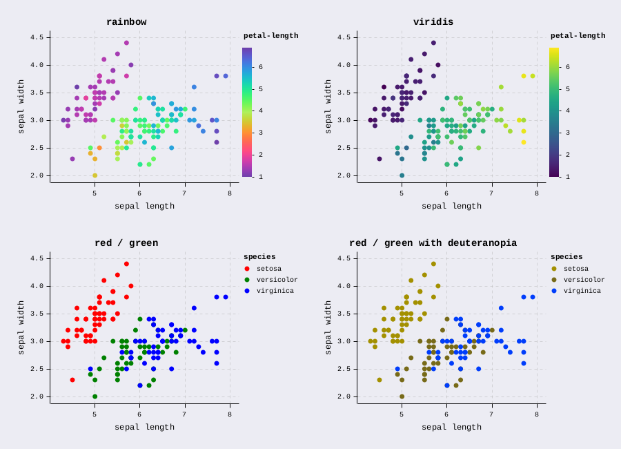
:::


```{=html}
<div style="background-color:grey;height:2px;width:100%;"></div>
```


```{=html}
<div><pre><small><small>source: notebooks/use_cases/colors.clj</small></small></pre></div>
```