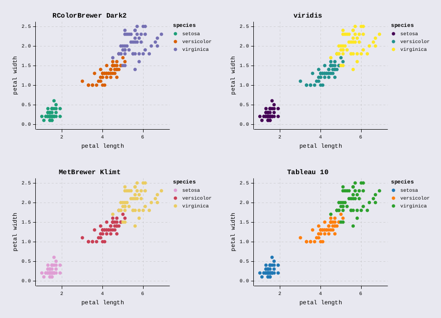
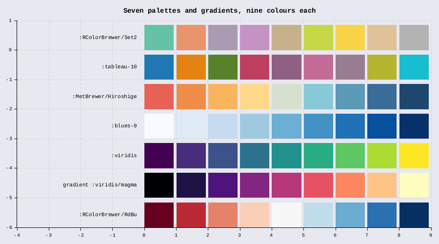
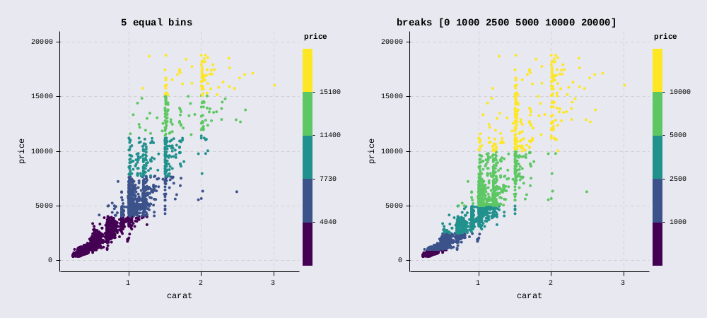
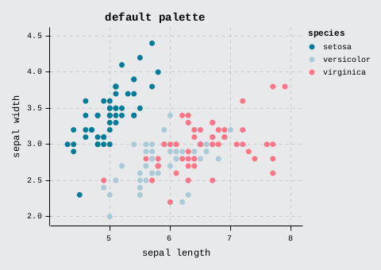

---
format:
  html: {toc: true, toc-location: right, toc-depth: 4, theme: cosmo}
code-block-background: true

---
<style></style><style>.printedClojure .sourceCode {
  background-color: transparent;
  border-style: none;
}
</style><style>.clay-limit-image-width .clay-image {max-width: 100%}
.clay-side-by-side .sourceCode {margin: 0}
.clay-side-by-side {margin: 1em 0}
</style>
<script src="https://code.jquery.com/jquery-3.6.0.min.js" type="text/javascript"></script><script src="https://code.jquery.com/ui/1.13.1/jquery-ui.min.js" type="text/javascript"></script>

# Colors

How cljplot2 picks colours: specifying a colour, palettes, discrete and continuous colour scales, colour in
practice and accessibility (the [R Graph Gallery](https://r-graph-gallery.com/ggplot2-color.html) colour pages
and the [data-to-viz](https://www.data-to-viz.com/caveats.html) colour caveats).

Colours come from [clojure2d](https://github.com/Clojure2D/clojure2d): any colour name, hex string or RGB(A)
vector, about 7,300 named palettes and 5,000 gradients.


::: {.sourceClojure}
```clojure
(ns use-cases.colors
  (:require [clojure2d.color :as c]
            [fastmath.random :as r]
            [fastmath.stats :as stats]
            [scicloj.kindly.v4.kind :as kind]
            [cljplot2.chart :as chart]
            [cljplot2.core :as plot]
            [notebook-utils :as nu]))
```
:::


::: {.sourceClojure}
```clojure
(def iris (nu/dataset :iris))
```
:::


::: {.sourceClojure}
```clojure
(def mtcars (nu/dataset :mtcars))
```
:::


::: {.sourceClojure}
```clojure
(def barley (nu/dataset :barley))
```
:::


::: {.sourceClojure}
```clojure
(def quakes (nu/dataset :quakes))
```
:::


::: {.sourceClojure}
```clojure
(def diamonds (nu/dataset :diamonds))
```
:::


::: {.sourceClojure}
```clojure
(def lincoln (nu/dataset :lincoln-weather))
```
:::


## Specifying colours

A colour is a clojure2d colour: a name keyword, a hex string, an RGB vector, or RGBA with alpha in 0-255.


### Calling a colour

Literal rects take a vector of fills, one per interval; the labels are a text chart.

Source: R Graph Gallery - Dealing with color in base R; colour names ([1](https://r-graph-gallery.com/colors.html), [2](https://r-graph-gallery.com/42-colors-names.html)).


::: {.sourceClojure}
```clojure
(let [colors [:steelblue :tomato "#2ca25f" "#fdae6b" [102 51 153] [255 0 0 90]]
      labels [":steelblue" ":tomato" "\"#2ca25f\"" "\"#fdae6b\"" "[102 51 153]" "[255 0 0 90]"]
      xs (mapv (fn [i] [i (+ i 0.9)]) (range (count colors)))]
  (plot/render-image
   {:charts [(chart/rect {:x xs :y [0 1] :fill colors})
             (chart/text {:x (mapv #(+ % 0.45) (range (count colors))) :y -0.15 :text labels :size 11})]
    :labels {:title "Names, hex strings, RGB and RGBA vectors" :x nil :y nil}}
   {:width 900 :height 300}))
```
:::


::: {.clay-image}

:::


## Palettes

Palettes are named lists of colours (`c/palette`, `c/find-palette`); gradients are functions of `t` in `[0 1]`
(`c/gradient`). A scale's `:range` takes either name.


### Palette types

Qualitative palettes for categories, sequential for ordered values, diverging around a meaningful middle (here
the mean mpg, `:midpoint`).

Source: [R Graph Gallery - Dealing with color in ggplot2](https://r-graph-gallery.com/ggplot2-color.html). Data: Edgar Anderson's iris measurements, R datasets package `iris` (Anderson 1935; Fisher 1936); licence: Part of R (GPL-2 | GPL-3).


::: {.sourceClojure}
```clojure
(let [mean-mpg (stats/mean (map :mpg mtcars))]
  (plot/render-image
   (plot/arrange
    [{:data iris :mapping {:x :sepal-length :y :sepal-width :color :species}
      :scales {:color {:range :RColorBrewer/Set2}}
      :charts [(chart/scatter {:size 7})] :labels {:title "qualitative" :x "sepal length" :y "sepal width"}}
     {:data iris :mapping {:x :sepal-length :y :sepal-width :color :petal-length}
      :scales {:color {:range :blues-9}}
      :charts [(chart/scatter {:size 7})] :labels {:title "sequential" :x "sepal length" :y "sepal width"}}
     {:data mtcars :mapping {:x :wt :y :hp :color #(- (:mpg %) mean-mpg)}
      :scales {:color {:range :RColorBrewer/RdBu :midpoint 0 :title "mpg - mean"}}
      :charts [(chart/scatter {:size 8})] :labels {:title "diverging" :x "weight" :y "horse power"}}]
    {:columns 3})
   {:width 1000 :height 360}))
```
:::


::: {.clay-image}

:::


### Palette families

The same scatter with a ColorBrewer, viridis, MetBrewer and Tableau palette. `(c/find-palette #"(?i)tableau")`
lists palettes by name.

Source: R Graph Gallery - paletteer, viridis, RColorBrewer ([1](https://r-graph-gallery.com/package/paletteer.html), [2](https://r-graph-gallery.com/package/viridis.html), [3](https://r-graph-gallery.com/38-rcolorbrewers-palettes.html)). Data: Edgar Anderson's iris measurements, R datasets package `iris` (Anderson 1935; Fisher 1936); licence: Part of R (GPL-2 | GPL-3).


::: {.sourceClojure}
```clojure
(plot/render-image
 (plot/arrange
  (for [[title palette] [["RColorBrewer Dark2" :RColorBrewer/Dark2] ["viridis" :viridis]
                         ["MetBrewer Klimt" :MetBrewer/Klimt] ["Tableau 10" :tableau-10]]]
    {:data iris :mapping {:x :petal-length :y :petal-width :color :species}
     :scales {:color {:range palette :spread (= palette :viridis)}}
     :charts [(chart/scatter {:size 7})]
     :labels {:title title :x "petal length" :y "petal width"}})
  {:columns 2})
 {:width 900 :height 650})
```
:::


::: {.clay-image}

:::


`:viridis` has 256 colours, so its scale uses `:spread true` - three colours across the whole palette instead
of its first three.


### Palette swatches

A palette shown as colours: rects with an identity colour scale (the data values are the colours). Every row is
resampled to nine colours with `c/resample`, which also samples a gradient (given as `(c/gradient name)`).

Source: [R Graph Gallery - Color palette finder](https://r-graph-gallery.com/color-palette-finder).


::: {.sourceClojure}
```clojure
(let [palettes [[":RColorBrewer/Set2" :RColorBrewer/Set2] [":tableau-10" :tableau-10]
                [":MetBrewer/Hiroshige" :MetBrewer/Hiroshige] [":blues-9" :blues-9] [":viridis" :viridis]
                ["gradient :viridis/magma" (c/gradient :viridis/magma)] [":RColorBrewer/RdBu" :RColorBrewer/RdBu]]
      rows (for [[row [_ p]] (map-indexed vector palettes)
                 [i col] (map-indexed vector (c/resample p 9))]
             {:x0 i :x1 (+ i 0.92) :y0 (- row) :y1 (- 0.85 row) :c col})
      names (for [[row [label]] (map-indexed vector palettes)] {:x -0.2 :y (- 0.42 row) :label label})]
  (plot/render-image
   {:scales {:color {:kind :identity} :x {:domain [-3.6 9]}}
    :charts [(chart/rect {:data rows :mapping {:x0 :x0 :x1 :x1 :y0 :y0 :y1 :y1 :color :c}})
             (chart/text {:data names :mapping {:x :x :y :y :label :label} :anchor [:right :middle] :size 11})]
    :labels {:title "Seven palettes and gradients, nine colours each" :x nil :y nil}}
   {:width 900 :height 500}))
```
:::


::: {.clay-image}

:::


## Discrete colour scales

Categories take palette colours in level order, unless a scale says otherwise.


### Manual colours

A level map as `:range` gives every level its own colour; a level without one is an error.

Source: [R Graph Gallery - Dealing with color in ggplot2](https://r-graph-gallery.com/ggplot2-color.html). Data: Edgar Anderson's iris measurements, R datasets package `iris` (Anderson 1935; Fisher 1936); licence: Part of R (GPL-2 | GPL-3).


::: {.sourceClojure}
```clojure
(plot/render-image
 {:data iris :mapping {:x :sepal-length :y :sepal-width :color :species}
  :scales {:color {:range {"setosa" :darkorange "versicolor" :purple "virginica" :teal}}}
  :charts [(chart/scatter {:size 8})]
  :labels {:title "Manual colours per species" :x "sepal length" :y "sepal width"}}
 {:width 800 :height 500})
```
:::


::: {.clay-image}

:::


### Highlighting a group

One group in colour, the others grey. Cylinder counts are numbers, so the scale is declared categorical.

Source: data-to-viz - The spaghetti plot; don't use color if it communicates nothing ([1](https://www.data-to-viz.com/caveat/spaghetti.html), [2](https://www.data-to-viz.com/caveat/color_com_nothing.html)). Data: Motor Trend car road tests (1974), R datasets package `mtcars` (Henderson & Velleman 1981); licence: Part of R (GPL-2 | GPL-3).


::: {.sourceClojure}
```clojure
(plot/render-image
 {:data mtcars :mapping {:x :hp :y :mpg :color :cyl}
  :scales {:color {:type :categorical :range {4 :lightgrey 6 :firebrick 8 :lightgrey} :title "cylinders"}}
  :charts [(chart/scatter {:size 9})]
  :labels {:title "Six-cylinder cars" :x "horse power" :y "miles per gallon"}}
 {:width 800 :height 500})
```
:::


::: {.clay-image}

:::


### Sequential palettes on categories

A sequential palette has more colours than there are levels: by default the levels take its first colours
(all light here); `:spread true` resamples it across its whole range.

Source: [R Graph Gallery - RColorBrewer palettes](https://r-graph-gallery.com/38-rcolorbrewers-palettes.html). Data: Barley yields, Minnesota 1931-1932, R lattice package `barley` (Immer et al. 1934; Fisher 1971; Cleveland 1993); licence: GPL (>= 2) (lattice).


::: {.sourceClojure}
```clojure
(plot/render-image
 (plot/arrange
  (for [spread [false true]]
    {:data barley :mapping {:x :yield :y :variety :color :site}
     :scales {:color {:range :blues-9 :spread spread}}
     :charts [(chart/scatter {:size 8})]
     :labels {:title (if spread ":spread true" "first colours (default)") :x "yield" :y nil}})
  {:columns 2})
 {:width 1000 :height 450})
```
:::


::: {.clay-image}

:::


## Continuous colour scales

Numbers on `:color` get a gradient and a colour bar.


### Gradients

`:range` takes two colours, several colours, a gradient name or any function of `t` in `[0 1]`.

Source: R Graph Gallery - Dealing with color in ggplot2; viridis ([1](https://r-graph-gallery.com/ggplot2-color.html), [2](https://r-graph-gallery.com/package/viridis.html)). Data: Earthquakes off Fiji since 1964, R datasets package `quakes` (Harvard PRIM-H project); licence: Part of R (GPL-2 | GPL-3).


::: {.sourceClojure}
```clojure
(plot/render-image
 (plot/arrange
  (for [[title color-range] [["two colours" [:lightyellow :darkred]]
                             ["four colours" [:lightyellow :orange :red :darkred]]
                             ["gradient name :viridis/magma" :viridis/magma]
                             ["a function: lerp navy to gold" (fn [t] (c/lerp :navy :gold t))]]]
    {:data quakes :mapping {:x :long :y :lat :color :depth}
     :scales {:color {:range color-range}}
     :charts [(chart/scatter {:size 5})]
     :labels {:title title :x "longitude" :y "latitude"}})
  {:columns 2})
 {:width 900 :height 700})
```
:::


::: {.clay-image}

:::


### Diverging gradient with a midpoint

`:midpoint` puts a value at the middle of the gradient and scales both sides by the larger distance to it; the
colour bar ticks the midpoint.

Source: [R Graph Gallery - Dealing with color in ggplot2](https://r-graph-gallery.com/ggplot2-color.html). Data: Motor Trend car road tests (1974), R datasets package `mtcars` (Henderson & Velleman 1981); licence: Part of R (GPL-2 | GPL-3).


::: {.sourceClojure}
```clojure
(let [mean-hp (stats/mean (map :hp mtcars))]
  (plot/render-image
   {:data mtcars :mapping {:x :wt :y :mpg :color :hp}
    :scales {:color {:range :RColorBrewer/RdBu :midpoint mean-hp :reverse true}}
    :charts [(chart/scatter {:size 10})]
    :labels {:title (format "Horse power around its mean (%.1f)" mean-hp) :x "weight" :y "miles per gallon"}}
   {:width 800 :height 500}))
```
:::


::: {.clay-image}

:::


### Reversing

`:reverse true` turns the colours around: categories keep their order with the colours reversed, a gradient
runs the other way.

Source: [R Graph Gallery - Dealing with color in ggplot2](https://r-graph-gallery.com/ggplot2-color.html). Data: Edgar Anderson's iris measurements, R datasets package `iris` (Anderson 1935; Fisher 1936); licence: Part of R (GPL-2 | GPL-3).


::: {.sourceClojure}
```clojure
(plot/render-image
 (plot/arrange
  (for [[title color scale] [["categories" :species {:range :RColorBrewer/Set1}]
                             ["categories, reversed" :species {:range :RColorBrewer/Set1 :reverse true}]
                             ["gradient" :petal-length {:range :viridis/viridis}]
                             ["gradient, reversed" :petal-length {:range :viridis/viridis :reverse true}]]]
    {:data iris :mapping {:x :sepal-length :y :sepal-width :color color}
     :scales {:color scale}
     :charts [(chart/scatter {:size 7})]
     :labels {:title title :x "sepal length" :y "sepal width"}})
  {:columns 2})
 {:width 900 :height 650})
```
:::


::: {.clay-image}

:::


### Binned colours

`:kind :binned` colours values by bin: a count of equal bins or a breaks vector; the colour bar has one block per
bin. For a discrete legend of intervals, bin the data with `levels/bin` instead.

Source: [R Graph Gallery - Dealing with color in ggplot2](https://r-graph-gallery.com/ggplot2-color.html). Data: Prices and attributes of round cut diamonds, R ggplot2 package `diamonds` (Wickham et al.); licence: MIT (ggplot2).


::: {.sourceClojure}
```clojure
(def diamonds-sample
  "A fixed 5% sample of diamonds (the full data has 53,940 rows)."
  (let [rng (r/rng :mersenne 7)] (filterv (fn [_] (< (r/drandom rng) 0.05)) diamonds)))
```
:::


::: {.sourceClojure}
```clojure
(plot/render-image
 (plot/arrange
  (for [[title bins] [["5 equal bins" 5] ["breaks [0 1000 2500 5000 10000 20000]" [0 1000 2500 5000 10000 20000]]]]
    {:data diamonds-sample :mapping {:x :carat :y :price :color :price}
     :scales {:color {:kind :binned :bins bins :range :viridis}}
     :charts [(chart/scatter {:size 4})]
     :labels {:title title :x "carat" :y "price"}})
  {:columns 2})
 {:width 1000 :height 450})
```
:::


::: {.clay-image}

:::


## Colour in practice


### Missing values and the theme palette

A missing value gets the theme's NA colour and the last legend entry; the theme `:palette` sets the default
colours of every plot (here a MetBrewer palette and a magenta NA).

Source: [R Graph Gallery - Dealing with color in ggplot2](https://r-graph-gallery.com/ggplot2-color.html). Data: Edgar Anderson's iris measurements, R datasets package `iris` (Anderson 1935; Fisher 1936); licence: Part of R (GPL-2 | GPL-3).


::: {.sourceClojure}
```clojure
(def iris-with-na
  "Iris with every seventh species missing."
  (map-indexed (fn [i row] (if (zero? (mod i 7)) (assoc row :species nil) row)) iris))
```
:::


::: {.sourceClojure}
```clojure
(plot/render-image
 (plot/arrange
  [{:data iris-with-na :mapping {:x :sepal-length :y :sepal-width :color :species}
    :charts [(chart/scatter {:size 7})] :labels {:title "default theme" :x "sepal length" :y "sepal width"}}
   {:data iris-with-na :mapping {:x :sepal-length :y :sepal-width :color :species}
    :theme {:palette {:color :MetBrewer/Egypt :na [230 0 230]}}
    :charts [(chart/scatter {:size 7})] :labels {:title "theme :palette" :x "sepal length" :y "sepal width"}}]
  {:columns 2})
 {:width 1000 :height 420})
```
:::


::: {.clay-image}

:::


### Transparency against overplotting

With 53,940 diamonds the opaque points hide where most of them are; a colour with a low alpha shows the density.

Source: [data-to-viz - Overplotting](https://www.data-to-viz.com/caveat/overplotting.html). Data: Prices and attributes of round cut diamonds, R ggplot2 package `diamonds` (Wickham et al.); licence: MIT (ggplot2).


::: {.sourceClojure}
```clojure
(plot/render-image
 (plot/arrange
  (for [[title color] [["opaque" [69 117 180]] ["alpha 12 of 255" [69 117 180 12]]]]
    {:data diamonds :mapping {:x :carat :y :price}
     :charts [(chart/scatter {:size 4 :color color})]
     :labels {:title title :x "carat" :y "price"}})
  {:columns 2})
 {:width 1000 :height 450})
```
:::


::: {.clay-image}

:::


### A line coloured by a variable

A linear or binned colour on a line colours it along its length: each segment takes the colour of the mean of
its two ends.

Source: [R Graph Gallery - Dealing with color in ggplot2](https://r-graph-gallery.com/ggplot2-color.html). Data: Weather in Lincoln, Nebraska, 2016, R ggridges package `lincoln_weather` (Weather Underground, via Wilke); licence: GPL-2 (ggridges).


::: {.sourceClojure}
```clojure
(def lincoln-days
  "Lincoln weather with the day of the year."
  (map-indexed (fn [i row] (assoc row :day (inc i))) lincoln))
```
:::


::: {.sourceClojure}
```clojure
(plot/render-image
 (plot/arrange
  (for [[title scale] [["gradient" {:range :viridis/inferno}]
                       ["4 bins" {:kind :binned :bins 4 :range :RColorBrewer/RdBu :reverse true}]]]
    {:data lincoln-days :mapping {:x :day :y :mean-temp :color :mean-temp}
     :scales {:color (assoc scale :title "°F")}
     :charts [(chart/line {:width 2})]
     :labels {:title title :x "day of 2016" :y "mean temperature [°F]"}})
  {:columns 1})
 {:width 900 :height 650})
```
:::


::: {.clay-image}

:::


## Accessibility


### Colour-blind preview

`plot/cvd-image` shows an image as seen with a colour vision deficiency (the render option `:cvd` does the
same for a whole plot). The default palette as most people see it, then with deuteranopia, protanopia and
tritanopia.

Source: [R Graph Gallery - viridis (colour-blind friendly maps)](https://r-graph-gallery.com/package/viridis.html). Data: Edgar Anderson's iris measurements, R datasets package `iris` (Anderson 1935; Fisher 1936); licence: Part of R (GPL-2 | GPL-3).


::: {.sourceClojure}
```clojure
(let [image (plot/render-image {:data iris :mapping {:x :sepal-length :y :sepal-width :color :species}
                                :charts [(chart/scatter {:size 7})]
                                :labels {:title "default palette" :x "sepal length" :y "sepal width"}}
                               {:width 480 :height 340})]
  (kind/hiccup
   [:div {:style {:display "flex" :flex-wrap "wrap" :gap "8px"}}
    image
    (plot/cvd-image image :deuteranopia)
    (plot/cvd-image image :protanopia)
    (plot/cvd-image image :tritanopia)]))
```
:::


```{=html}
<div style="display:flex;flex-wrap:wrap;gap:8px;"><div class="clay-image"><p></p></div><div class="clay-image"><p></p></div><div class="clay-image"><p></p></div><div class="clay-image"><p></p></div></div>
```


### Colour caveats

A rainbow gradient has bright bands that look like edges in the data; viridis changes evenly. Red against green
separates categories for most readers but not for deuteranopes: the last panel draws the same colours as a
deuteranope sees them (mapped through `c/cvd-filter`).

Source: data-to-viz - pitfalls; R Graph Gallery - viridis ([1](https://www.data-to-viz.com/caveats.html), [2](https://r-graph-gallery.com/package/viridis.html)). Data: Edgar Anderson's iris measurements, R datasets package `iris` (Anderson 1935; Fisher 1936); licence: Part of R (GPL-2 | GPL-3).


::: {.sourceClojure}
```clojure
(let [red-green {"setosa" :red "versicolor" :green "virginica" :blue}
      deutan (c/cvd-filter :deuteranopia)]
  (plot/render-image
   (plot/arrange
    [{:data iris :mapping {:x :sepal-length :y :sepal-width :color :petal-length}
      :scales {:color {:range :rainbow}}
      :charts [(chart/scatter {:size 7})] :labels {:title "rainbow" :x "sepal length" :y "sepal width"}}
     {:data iris :mapping {:x :sepal-length :y :sepal-width :color :petal-length}
      :scales {:color {:range :viridis/viridis}}
      :charts [(chart/scatter {:size 7})] :labels {:title "viridis" :x "sepal length" :y "sepal width"}}
     {:data iris :mapping {:x :sepal-length :y :sepal-width :color :species}
      :scales {:color {:range red-green}}
      :charts [(chart/scatter {:size 7})] :labels {:title "red / green" :x "sepal length" :y "sepal width"}}
     {:data iris :mapping {:x :sepal-length :y :sepal-width :color :species}
      :scales {:color {:range (update-vals red-green deutan)}}
      :charts [(chart/scatter {:size 7})] :labels {:title "red / green with deuteranopia" :x "sepal length" :y "sepal width"}}]
    {:columns 2})
   {:width 900 :height 650}))
```
:::


::: {.clay-image}

:::


```{=html}
<div style="background-color:grey;height:2px;width:100%;"></div>
```


```{=html}
<div><pre><small><small>source: notebooks/use_cases/colors.clj</small></small></pre></div>
```