---
format:
  html: {toc: true, toc-location: right, toc-depth: 4, theme: cosmo}
code-block-background: true

---
<style></style><style>.printedClojure .sourceCode {
  background-color: transparent;
  border-style: none;
}
</style><style>.clay-limit-image-width .clay-image {max-width: 100%}
.clay-side-by-side .sourceCode {margin: 0}
.clay-side-by-side {margin: 1em 0}
</style>
<script src="https://code.jquery.com/jquery-3.6.0.min.js" type="text/javascript"></script><script src="https://code.jquery.com/ui/1.13.1/jquery-ui.min.js" type="text/javascript"></script>

# Correlation

How two or more variables move together: scatter plots, heatmaps, correlograms, bubble charts, connected scatter
plots, 2D densities, functions of two variables and the ways out of overplotting (the
[R Graph Gallery](https://r-graph-gallery.com/) correlation pages and [data-to-viz](https://www.data-to-viz.com/)).

Not here: labels along a trend line and label repel, clustered heatmap order with dendrograms (waits for
hierarchical clustering in fastmath), arrows on connected scatter plots (backlog), 3D densities and interactivity.


::: {.sourceClojure}
```clojure
(ns use-cases.correlation
  (:require [fastmath.core :as m]
            [fastmath.random :as r]
            [fastmath.stats :as stats]
            [cljplot2.chart :as chart]
            [cljplot2.core :as plot]
            [notebook-utils :as nu])
  (:import [java.time DayOfWeek LocalDate]
           [java.time.temporal IsoFields]))
```
:::


::: {.sourceClojure}
```clojure
(def houses (nu/dataset :house-prices))
```
:::


::: {.sourceClojure}
```clojure
(def iris (nu/dataset :iris))
```
:::


::: {.sourceClojure}
```clojure
(def mtcars (nu/dataset :mtcars))
```
:::


::: {.sourceClojure}
```clojure
(def faithful (nu/dataset :faithful))
```
:::


::: {.sourceClojure}
```clojure
(def gapminder (nu/dataset :gapminder-2007))
```
:::


::: {.sourceClojure}
```clojure
(def countries (nu/dataset :countries))
```
:::


::: {.sourceClojure}
```clojure
(def diamonds (nu/dataset :diamonds))
```
:::


::: {.sourceClojure}
```clojure
(def economics (mapv #(update % :date (fn [d] (LocalDate/parse d))) (nu/dataset :economics)))
```
:::


::: {.sourceClojure}
```clojure
(def bitcoin (mapv #(update % :date (fn [d] (LocalDate/parse d))) (nu/dataset :bitcoin)))
```
:::


::: {.sourceClojure}
```clojure
(def indicators
  "The countries' rate indicators (per person, comparable across countries)."
  [:birth-rate :mortality-rate :life-expectancy :infant-mortality :children-per-woman :growth-rate])
```
:::


::: {.sourceClojure}
```clojure
(defn- z-scores
  "Long rows `{:country :indicator :value :z}` of `rows` - each indicator standardized over `rows`."
  [rows]
  (let [moments (into {} (for [k indicators :let [vs (map k rows)]] [k [(stats/mean vs) (stats/stddev vs)]]))]
    (vec (for [row rows k indicators :let [[mu sd] (moments k)]]
           {:country (:country row) :continent (:continent row) :indicator (name k)
            :value (k row) :z (/ (- (double (k row)) (double mu)) (double sd))}))))
```
:::


::: {.printedClojure}
```clojure
#'use-cases.correlation/z-scores

```
:::


## Scatter

One point per observation at its two values; colour, shape and size carry more variables.


### Basic scatter, styled points

Living area against sale price of 1460 houses: the default points, then a translucent fill with an outline and
another shape.

Source: R Graph Gallery - Basic scatterplot with ggplot2; data-to-viz - Scatter ([1](https://r-graph-gallery.com/272-basic-scatterplot-with-ggplot2.html), [2](https://www.data-to-viz.com/graph/scatter.html)). Data: House prices: living area and sale price, data-to-viz example dataset `2_TwoNum` (Yan Holtz; Kaggle House Prices, Ames, Iowa); licence: MIT (data_to_viz repository).


::: {.sourceClojure}
```clojure
(plot/render-image
 (plot/arrange
  [{:data houses :mapping {:x :living-area :y :price} :charts [(chart/scatter)]
    :labels {:title "default" :x "living area, sq ft" :y "price, USD"}}
   {:data houses :mapping {:x :living-area :y :price}
    :charts [(chart/scatter {:shape \A :size 6 :color [70 130 180 90] :stroke-color [20 60 100] :stroke-width 0.5})]
    :labels {:title "translucent triangles with outlines" :x "living area, sq ft" :y nil}}]
  {:columns 2})
 {:width 1000 :height 450})
```
:::


::: {.clay-image}
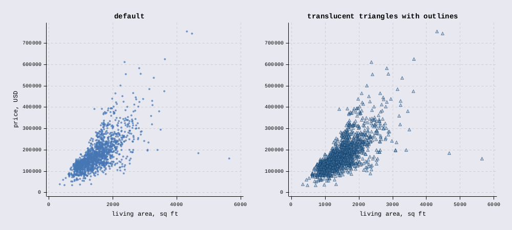
:::


### Colour and shape by group

Mapping `:color` and `:shape` to the same variable gives every species its colour and shape, and one legend.

Source: [R Graph Gallery - Map a variable to a ggplot2 scatterplot](https://r-graph-gallery.com/274-map-a-variable-to-ggplot2-scatterplot.html). Data: Edgar Anderson's iris measurements, R datasets package `iris` (Anderson 1935; Fisher 1936); licence: Part of R (GPL-2 | GPL-3).


::: {.sourceClojure}
```clojure
(plot/render-image
 {:data iris :mapping {:x :sepal-length :y :sepal-width :color :species :shape :species}
  :charts [(chart/scatter {:size 7})]
  :labels {:title "Iris sepals by species" :x "sepal length, cm" :y "sepal width, cm"}}
 {:width 700 :height 500})
```
:::


::: {.clay-image}

:::


### Text labels in boxes

A text chart names some cars; `:background` puts each label on a semi-transparent box, so the points it covers
stay visible and the text stays readable over them.

Source: [R Graph Gallery - Add text labels with ggplot2](https://r-graph-gallery.com/275-add-text-labels-with-ggplot2.html). Data: Motor Trend car road tests (1974), R datasets package `mtcars` (Henderson & Velleman 1981); licence: Part of R (GPL-2 | GPL-3).


::: {.sourceClojure}
```clojure
(let [label-box {:size 9 :background [255 255 255 200] :padding 2 :mapping {:x :wt :y :mpg :label :model}}]
  (plot/render-image
   {:data mtcars :mapping {:x :wt :y :mpg}
    :charts [(chart/scatter {:size 8 :color [200 60 40]})
             (chart/text (merge label-box {:data (filterv #(> (double (:mpg %)) 31.0) mtcars)
                                           :anchor [:left :middle] :offset [6 0]}))
             (chart/text (merge label-box {:data (filterv #(or (> (double (:wt %)) 5.3) (> (double (:hp %)) 250.0)) mtcars)
                                           :anchor [:right :middle] :offset [-6 0]}))]
    :labels {:title "Cars by weight and fuel use" :x "weight, 1000 lbs" :y "miles per gallon"}}
   {:width 750 :height 500}))
```
:::


::: {.clay-image}

:::


### Rugs and marginal distributions

Margins share the panel's axes: rugs (one line per value) beside both axes, or the densities of both variables.

Source: [R Graph Gallery - Marginal distribution with ggplot2](https://r-graph-gallery.com/277-marginal-histogram-for-ggplot2.html). Data: Old Faithful geyser eruptions, R datasets package `faithful` (Härdle 1991; Azzalini & Bowman 1990); licence: Part of R (GPL-2 | GPL-3).


::: {.sourceClojure}
```clojure
(plot/render-image
 {:data faithful :mapping {:x :eruptions :y :waiting} :charts [(chart/scatter {:size 4})]
  :margins {:top {:charts (chart/rug) :size 25} :right {:charts (chart/rug) :size 25}}
  :labels {:title "Old Faithful with rugs" :x "eruption, min" :y "waiting, min"}}
 {:width 650 :height 480})
```
:::


::: {.clay-image}
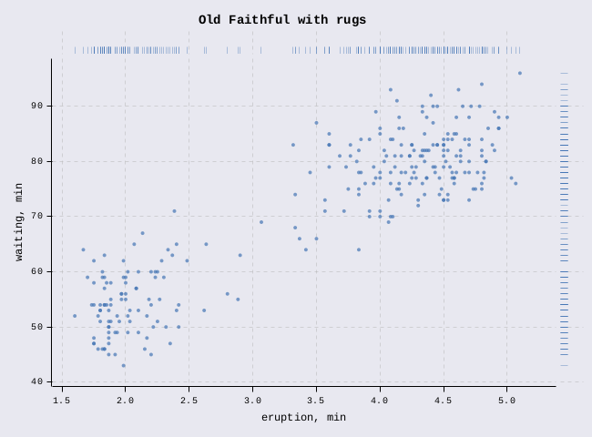
:::


::: {.sourceClojure}
```clojure
(plot/render-image
 {:data faithful :mapping {:x :eruptions :y :waiting} :charts [(chart/scatter {:size 4})]
  :margins {:top (chart/density {:fill [70 130 180 120]}) :right (chart/density {:fill [70 130 180 120]})}
  :labels {:title "Old Faithful with marginal densities" :x "eruption, min" :y "waiting, min"}}
 {:width 650 :height 520})
```
:::


::: {.clay-image}

:::


### Linear fit with a confidence band

`chart/smooth {:method :lm}` adds the least-squares line and its 95 % confidence band.

Source: [R Graph Gallery - Scatterplot with a regression line](https://r-graph-gallery.com/50-51-52-scatter-plot-with-ggplot2.html). Data: House prices: living area and sale price, data-to-viz example dataset `2_TwoNum` (Yan Holtz; Kaggle House Prices, Ames, Iowa); licence: MIT (data_to_viz repository).


::: {.sourceClojure}
```clojure
(plot/render-image
 {:data houses :mapping {:x :living-area :y :price}
  :charts [(chart/scatter {:size 3 :color [0 0 0 70]}) (chart/smooth {:method :lm})]
  :labels {:title "Price grows with living area" :x "living area, sq ft" :y "price, USD"}}
 {:width 700 :height 480})
```
:::


::: {.clay-image}
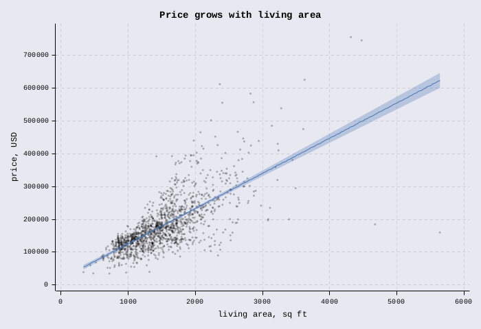
:::


### A scatter per group

A facet mapping draws one panel per species on shared scales.

Source: [R Graph Gallery - Faceting with ggplot2](https://r-graph-gallery.com/223-faceting-with-ggplot2.html). Data: Edgar Anderson's iris measurements, R datasets package `iris` (Anderson 1935; Fisher 1936); licence: Part of R (GPL-2 | GPL-3).


::: {.sourceClojure}
```clojure
(plot/render-image
 {:data iris :mapping {:x :sepal-length :y :sepal-width :facet :species}
  :charts [(chart/scatter {:size 5})]
  :labels {:title "Iris sepals, a panel per species" :x "sepal length, cm" :y "sepal width, cm"}}
 {:width 1000 :height 400})
```
:::


::: {.clay-image}

:::


### Size by overlap count

Integer data puts many cars on one point; counting the cars per point and mapping the count to the point's area
(`:area true` on the size scale) shows how many sit there.

Source: [R Graph Gallery - Scatterplot](https://r-graph-gallery.com/scatterplot.html). Data: Motor Trend car road tests (1974), R datasets package `mtcars` (Henderson & Velleman 1981); licence: Part of R (GPL-2 | GPL-3).


::: {.sourceClojure}
```clojure
(let [counts (mapv (fn [[[cyl gear] cars]] {:cyl cyl :gear gear :cars (count cars)})
                   (group-by (juxt :cyl :gear) mtcars))]
  (plot/render-image
   {:data counts :mapping {:x :cyl :y :gear :size :cars}
    :charts [(chart/scatter {:color [70 130 180 200]})]
    :scales {:size {:area true :range [4 36] :title "cars"}}
    :labels {:title "Cars per cylinder and gear count" :x "cylinders" :y "forward gears"}}
   {:width 650 :height 450}))
```
:::


::: {.clay-image}
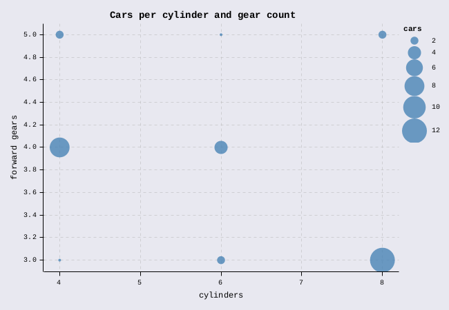
:::


### Manhattan plot

A genome-wide association plot (seeded data): one point per marker at its position along the chromosomes and its
−log10 p-value, chromosomes in alternating colours, the significance threshold 5·10⁻⁸ as a rule.

Source: [R Graph Gallery - Manhattan plot](https://r-graph-gallery.com/101_Manhattan_plot.html).


::: {.sourceClojure}
```clojure
(def markers
  "Seeded association results: 22 chromosomes of 200-400 markers, uniform p-values with three peaks."
  (let [rng (r/rng :mersenne 101)
        peaks {3 0.4 9 0.7 16 0.3}]
    (loop [chromosome 1 offset 0.0 rows []]
      (if (> chromosome 22)
        rows
        (let [n (r/irandom rng 200 400)
              chromosome-rows (for [i (range n)
                                    :let [t (/ (double i) n)
                                          peak (get peaks chromosome)
                                          strength (if peak (* 9.0 (m/exp (- (m/sq (/ (- t peak) 0.03))))) 0.0)
                                          p (* (r/drandom rng) (m/pow 10.0 (- strength)))]]
                                {:chromosome chromosome :position (+ offset i) :log-p (- (m/log10 (max p 1.0e-12)))})]
          (recur (inc chromosome) (+ offset n) (into rows chromosome-rows)))))))
```
:::


::: {.sourceClojure}
```clojure
(plot/render-image
 {:data markers :mapping {:x :position :y :log-p :color #(if (odd? (:chromosome %)) "odd" "even")}
  :charts [(chart/scatter {:size 3})
           (chart/rule {:y (- (m/log10 5.0e-8)) :dash :dashed :color [200 40 40]})]
  :scales {:color {:range {"odd" [40 70 120] "even" [140 170 210]} :legend false}}
  :labels {:title "Association with a trait along 22 chromosomes" :x "marker position (chromosome by chromosome)"
           :y "-log10 p"}}
 {:width 1000 :height 400})
```
:::


::: {.clay-image}
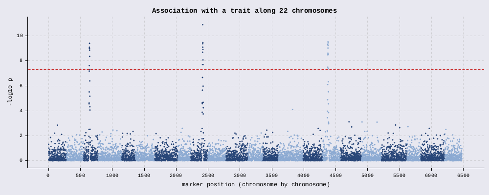
:::


### Simpson's paradox

Three groups (seeded): within each group y grows with x, across all of them it falls. One fit for everything
points the wrong way; a fit per group shows the relation inside the groups.

Source: [data-to-viz - Simpson's paradox](https://www.data-to-viz.com/caveat/simpson.html).


::: {.sourceClojure}
```clojure
(def simpson
  (let [rng (r/rng :mersenne 33)]
    (vec (for [[g cx cy] [["A" 2.0 9.0] ["B" 5.0 6.0] ["C" 8.0 3.0]]
               _ (range 40)
               :let [dx (r/grandom rng 0.0 1.0)]]
           {:group g :x (+ cx dx) :y (+ cy (* 0.8 dx) (r/grandom rng 0.0 0.5))}))))
```
:::


::: {.sourceClojure}
```clojure
(plot/render-image
 (plot/arrange
  [{:data simpson :mapping {:x :x :y :y}
    :charts [(chart/scatter {:size 5 :color [90 90 90]}) (chart/smooth {:method :lm})]
    :labels {:title "one fit: y falls with x"}}
   {:data simpson :mapping {:x :x :y :y :color :group}
    :charts [(chart/scatter {:size 5}) (chart/smooth {:method :lm})]
    :theme {:palette {:color :set1}}
    :labels {:title "a fit per group: y grows with x" :y nil}}]
  {:columns 2})
 {:width 1000 :height 430})
```
:::


::: {.clay-image}
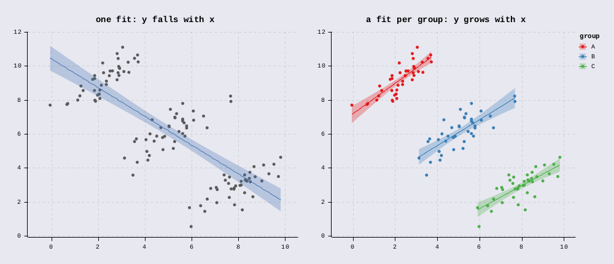
:::


## Heatmap

A grid of cells coloured by a value: rows and columns are categories (or binned numbers).


### Basic heatmap, square and hexagon cells

European countries × demographic indicators, each indicator standardized (z-score) so the colours compare across
columns of different units; `:cell :pointy-hex` draws the same grid as a honeycomb.


::: {.sourceClojure}
```clojure
(def europe (filterv #(= "Europe" (:continent %)) countries))
```
:::


Source: R Graph Gallery - Heatmap; data-to-viz - Heatmap ([1](https://r-graph-gallery.com/heatmap.html), [2](https://www.data-to-viz.com/graph/heatmap.html)). Data: Countries: demographic indicators, data-to-viz example dataset `multivariate` (Yan Holtz; UN World Population Prospects); licence: MIT (data_to_viz repository).


::: {.sourceClojure}
```clojure
(let [rows (z-scores europe)
      heatmap (fn [cell title legend?]
                {:data rows :mapping {:x :country :y :indicator :color :z} :legend legend?
                 :scales {:color {:range :RColorBrewer/RdBu :midpoint 0 :reverse true :title "z-score"}}
                 :theme {:axis {:x {:label-rotation 90}}}
                 :charts [(chart/tile {:cell cell})]
                 :labels {:title title :x nil :y nil}})]
  (plot/render-image
   (plot/arrange [(heatmap :square "square cells" false) (heatmap :pointy-hex "pointy-hex cells" true)]
                 {:columns 1})
   {:width 1000 :height 800}))
```
:::


::: {.clay-image}
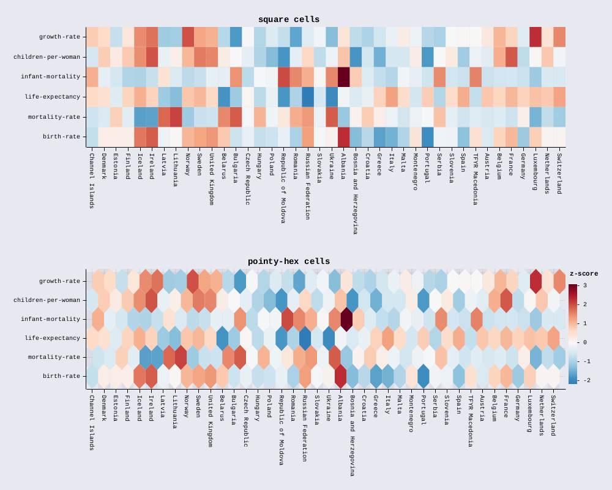
:::


### Palettes, normalized columns

Raw values put every indicator on one colour scale, so life expectancy (around 80) drowns the rates (0-20);
standardizing each column first gives every indicator the full palette. Any palette or gradient works:
viridis on the left, a diverging RdBu around 0 on the right.

Source: [R Graph Gallery - Heatmap with the levelplot function](https://r-graph-gallery.com/79-levelplot-with-ggplot2.html). Data: Countries: demographic indicators, data-to-viz example dataset `multivariate` (Yan Holtz; UN World Population Prospects); licence: MIT (data_to_viz repository).


::: {.sourceClojure}
```clojure
(let [rows (z-scores (take 25 europe))
      base {:data rows :theme {:axis {:x {:label-rotation 90}}} :labels {:x nil :y nil}}]
  (plot/render-image
   (plot/arrange
    [(merge base {:mapping {:x :country :y :indicator :color :value} :charts [(chart/tile)]
                  :scales {:color {:range :viridis :title "value"}}
                  :labels {:title "raw values (viridis)" :x nil :y nil}})
     (merge base {:mapping {:x :country :y :indicator :color :z} :charts [(chart/tile)]
                  :scales {:color {:range :RColorBrewer/RdBu :midpoint 0 :reverse true :title "z-score"}}
                  :labels {:title "standardized per indicator (RdBu)" :x nil :y nil}})]
    {:columns 2})
   {:width 1000 :height 520}))
```
:::


::: {.clay-image}

:::


### Side colour bar

A category of the columns as a one-row tile above the heatmap: both plots share the column order (`:domain`),
`plot/arrange` aligns the cells. Here: the six most populous countries of each continent, grouped by continent.

Source: [R Graph Gallery - The heatmap function (side colours)](https://r-graph-gallery.com/215-the-heatmap-function.html). Data: Countries: demographic indicators, data-to-viz example dataset `multivariate` (Yan Holtz; UN World Population Prospects); licence: MIT (data_to_viz repository).


::: {.sourceClojure}
```clojure
(let [picked (vec (mapcat (fn [[_ rows]] (take 6 (sort-by #(- (double (:pop %))) rows)))
                          (sort-by key (group-by :continent countries))))
      order (mapv :country picked)]
  (plot/render-image
   (plot/arrange
    [{:data picked :mapping {:x :country :y (constantly "continent") :color :continent}
      :scales {:x {:domain order :axis false} :color {:title "continent"}}
      :charts [(chart/tile {:stroke-color :white})]
      :labels {:title "Indicators of the largest countries per continent" :x nil :y nil}}
     {:data (z-scores picked) :mapping {:x :country :y :indicator :color :z}
      :scales {:x {:domain order} :color {:range :RColorBrewer/RdBu :midpoint 0 :reverse true :title "z-score"}}
      :theme {:axis {:x {:label-rotation 90}}}
      :charts [(chart/tile {:stroke-color :white})]
      :labels {:x nil :y nil}}]
    {:columns 1 :heights [1 6]})
   {:width 1000 :height 600}))
```
:::


::: {.clay-image}
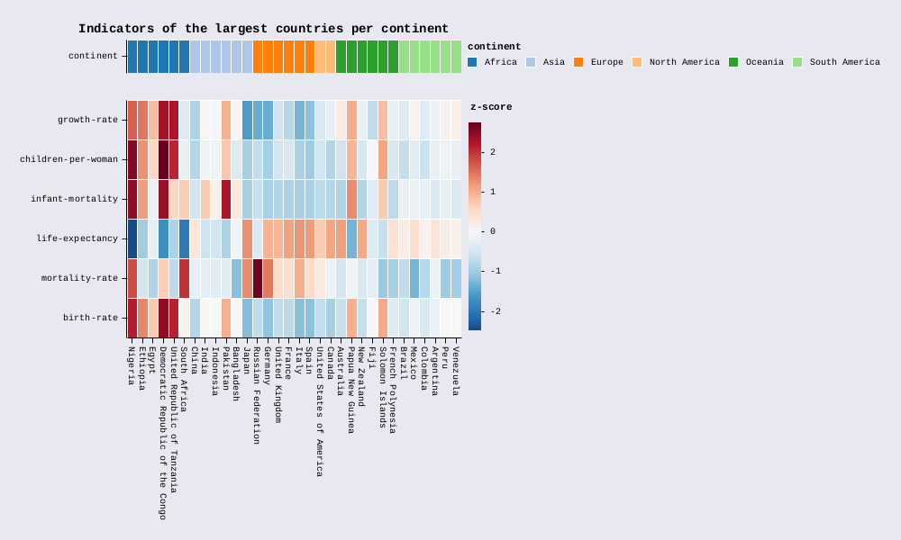
:::


### Values in cells: the correlation matrix

`fastmath.stats/correlation-matrix` gives r of every pair of variables; one tile per pair, coloured on a
diverging scale over [-1 1] and labelled with its value (`:value-label`, text in a contrasting colour).

Source: [R Graph Gallery - Correlation matrix with ggally (heatmap)](https://r-graph-gallery.com/199-correlation-matrix-with-ggally.html). Data: Motor Trend car road tests (1974), R datasets package `mtcars` (Henderson & Velleman 1981); licence: Part of R (GPL-2 | GPL-3).


::: {.sourceClojure}
```clojure
(let [variables [:mpg :cyl :disp :hp :drat :wt :qsec :gear :carb]
      names (mapv name variables)
      r (stats/correlation-matrix (mapv (fn [k] (mapv k mtcars)) variables))]
  (plot/render-image
   {:data (vec (for [i (range (count names)) j (range (count names))]
                 {:x (names i) :y (names j) :r (nth (nth r i) j)}))
    :mapping {:x :x :y :y :color :r}
    :scales {:y {:domain (vec (reverse names))} :color {:range :RColorBrewer/RdBu :domain [-1 1] :title "r"}}
    :charts [(chart/tile {:stroke-color :white :value-label (fn [{:keys [value]}] (format "%.2f" (double value)))})]
    :labels {:title "mtcars: correlation of every pair" :x nil :y nil}}
   {:width 700 :height 600}))
```
:::


::: {.clay-image}
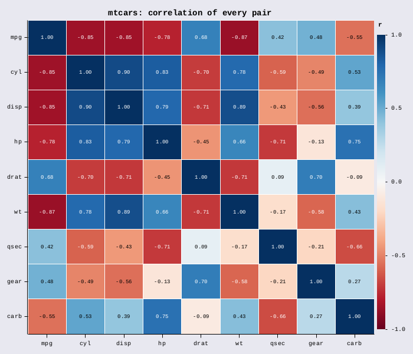
:::


### Calendar heatmap

Daily bitcoin price changes on a calendar: ISO week across, weekday down, a row of panels per year; the colour
is the day's change, capped at ±10 % so a few extreme days don't flatten the rest.

Source: [R Graph Gallery - The hourly heatmap (calendar layout)](https://r-graph-gallery.com/283-the-hourly-heatmap.html). Data: Bitcoin daily price, 2013-2018, data-to-viz example dataset `3_TwoNumOrdered` (Yan Holtz); licence: MIT (data_to_viz repository).


::: {.sourceClojure}
```clojure
(let [weekdays ["Mon" "Tue" "Wed" "Thu" "Fri" "Sat" "Sun"]
      days (vec (for [[prev day] (partition 2 1 bitcoin)
                      :let [^LocalDate d (:date day)]]
                  {:week (.get d IsoFields/WEEK_OF_WEEK_BASED_YEAR)
                   :year (.get d IsoFields/WEEK_BASED_YEAR)
                   :weekday (weekdays (dec (.getValue ^DayOfWeek (.getDayOfWeek d))))
                   :change (m/constrain (- (/ (double (:value day)) (double (:value prev))) 1.0) -0.1 0.1)}))]
  (plot/render-image
   {:data days :mapping {:x :week :y :weekday :color :change :facet-row :year}
    :scales {:y {:domain (vec (reverse weekdays))}
             :color {:range :RColorBrewer/RdYlGn :midpoint 0 :domain [-0.1 0.1] :title "daily change"
                     :formatter #(format "%+.0f%%" (* 100.0 (double %)))}}
    :charts [(chart/tile {:stroke-color :white})]
    :labels {:title "Bitcoin: daily price change, 2013-2018" :x "ISO week" :y nil}}
   {:width 1000 :height 800}))
```
:::


::: {.clay-image}
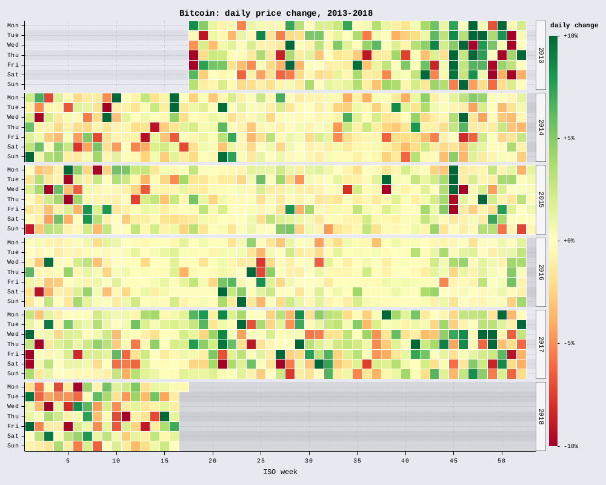
:::


### Row and column order

The order of the categories is the scale's `:domain`: the data order (the default; here the dataset's subregions)
hides structure that a meaningful order shows - countries sorted by life expectancy.

Source: [R Graph Gallery - Heatmap](https://r-graph-gallery.com/heatmap.html). Data: Countries: demographic indicators, data-to-viz example dataset `multivariate` (Yan Holtz; UN World Population Prospects); licence: MIT (data_to_viz repository).


::: {.sourceClojure}
```clojure
(let [rows (z-scores europe)
      by-life (mapv :country (sort-by :life-expectancy europe))
      heatmap (fn [order title legend?]
                {:data rows :mapping {:x :country :y :indicator :color :z} :legend legend?
                 :scales (cond-> {:color {:range :RColorBrewer/RdBu :midpoint 0 :reverse true :title "z-score"}}
                           order (assoc :x {:domain order}))
                 :theme {:axis {:x {:label-rotation 90}}}
                 :charts [(chart/tile)]
                 :labels {:title title :x nil :y nil}})]
  (plot/render-image
   (plot/arrange [(heatmap nil "data order" false) (heatmap by-life "by life expectancy" true)] {:columns 1})
   {:width 1000 :height 800}))
```
:::


::: {.clay-image}

:::


### Smoothed heatmap

Measurements on a coarse lattice (seeded: two bumps and noise) as tiles, and the same values interpolated
bicubically into a smooth field with contour lines.

Source: [R Graph Gallery - 2D density chart (raster smoothing)](https://r-graph-gallery.com/2d-density-chart.html).


::: {.sourceClojure}
```clojure
(def lattice
  (let [rng (r/rng :mersenne 21)]
    (vec (for [x (range 12) y (range 9)]
           {:x x :y y :z (+ (* 8 (m/exp (- (/ (+ (m/sq (- x 3)) (m/sq (- y 6))) 6.0))))
                            (* 5 (m/exp (- (/ (+ (m/sq (- x 8)) (m/sq (- y 2))) 8.0))))
                            (* 0.6 (r/drandom rng)))}))))
```
:::


::: {.sourceClojure}
```clojure
(plot/render-image
 (plot/arrange
  [{:data lattice :mapping {:x :x :y :y :color :z} :charts [(chart/tile)] :legend false
    :labels {:title "measured lattice"}}
   {:data lattice :mapping {:x :x :y :y :value :z}
    :charts [(chart/field {:interpolation :bicubic}) (chart/contour {:interpolation :bicubic :color [0 0 0 120]})]
    :labels {:title "bicubic field and contours" :y nil}}]
  {:columns 2})
 {:width 1000 :height 430})
```
:::


::: {.clay-image}
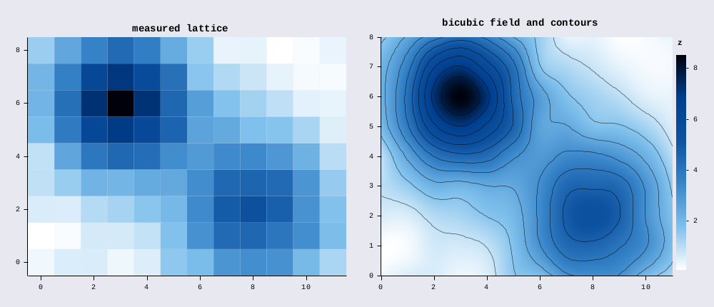
:::


## Correlogram

All pairs of several variables at once: `plot/pairs` lays out a matrix of cells sharing the variables' scales.


### Scatter-plot matrix by group

Scatter plots below the diagonal, densities on it, the correlation per species above it, coloured by species.

Source: R Graph Gallery - Correlogram; data-to-viz - Correlogram ([1](https://r-graph-gallery.com/correlogram.html), [2](https://www.data-to-viz.com/graph/correlogram.html)). Data: Edgar Anderson's iris measurements, R datasets package `iris` (Anderson 1935; Fisher 1936); licence: Part of R (GPL-2 | GPL-3).


::: {.sourceClojure}
```clojure
(plot/render-image
 (plot/pairs iris {:variables [:sepal-length :sepal-width :petal-length :petal-width] :mapping {:color :species}
                   :theme {:palette {:color :set1}} :title "Iris measurements by species"})
 {:width 950 :height 800})
```
:::


::: {.clay-image}
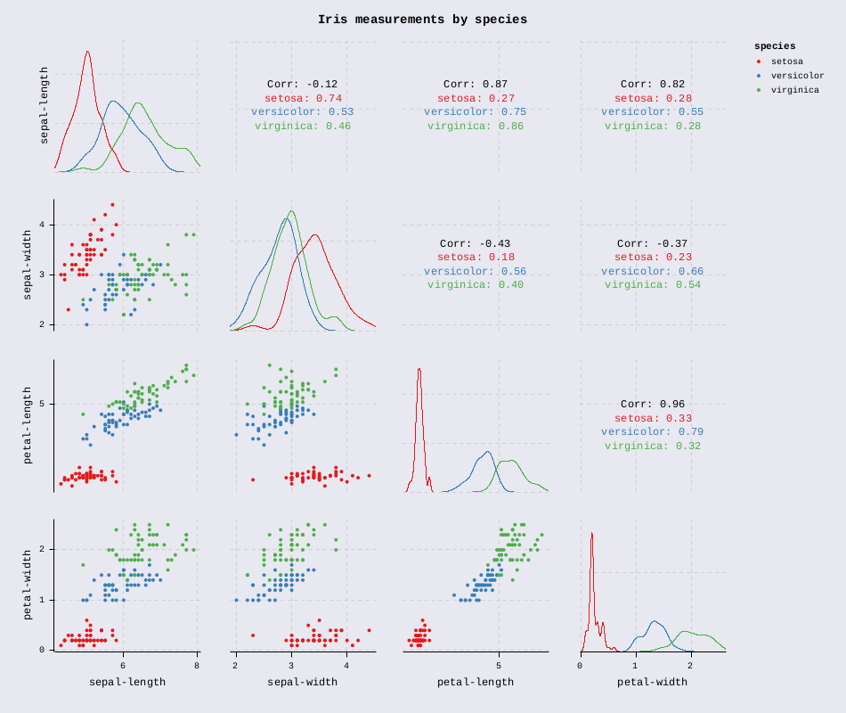
:::


### Correlation glyphs

`chart/correlation` draws r of its cell as a glyph: ellipses (the shape of a bivariate normal with that r)
below, pies (|r| as a filled angle) above, the variable names on the diagonal; the r colour bar on the side.

Source: [R Graph Gallery - Correlation ellipses](https://r-graph-gallery.com/97-correlation-ellipses.html). Data: Motor Trend car road tests (1974), R datasets package `mtcars` (Henderson & Velleman 1981); licence: Part of R (GPL-2 | GPL-3).


::: {.sourceClojure}
```clojure
(plot/render-image
 (plot/pairs mtcars {:variables [:mpg :disp :hp :drat :wt :qsec]
                     :lower (chart/correlation {:glyph :ellipse}) :upper (chart/correlation {:glyph :pie})
                     :diagonal :names :title "mtcars correlogram"})
 {:width 800 :height 750})
```
:::


::: {.clay-image}
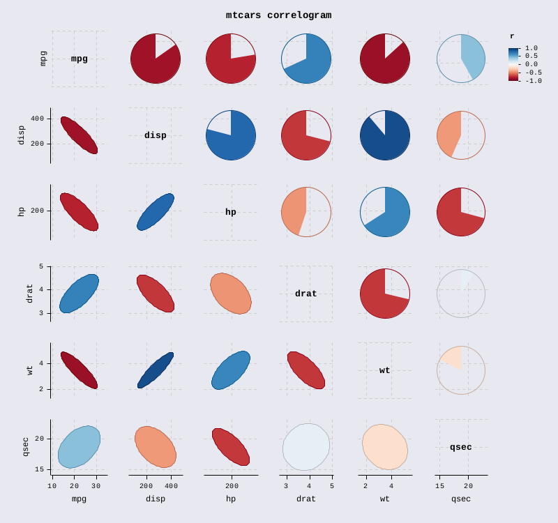
:::


## Bubble

A scatter plot with a third variable as the point's size - by area, so a point twice the value has twice the ink.


### Bubble chart: area, size range, colours and legend

Gapminder 2007: income (log axis) against life expectancy, population as the bubble's area (`:area true`, size
range 1-40 px), continent as colour. The left panel maps population linearly to the diameter: large countries
look far larger than they are.

Source: R Graph Gallery - Bubble chart; data-to-viz - Bubble ([1](https://r-graph-gallery.com/320-the-basis-of-bubble-plot.html), [2](https://www.data-to-viz.com/graph/bubble.html)). Data: Gapminder 2007: life expectancy, population and GDP per capita, data-to-viz example dataset `4_ThreeNum` (Yan Holtz; Gapminder via the R gapminder package); licence: MIT (data_to_viz repository).


::: {.sourceClojure}
```clojure
(let [bubbles (fn [area? title legend?]
                {:data (sort-by #(- (double (:pop %))) gapminder) :legend legend?
                 :mapping {:x :gdp-per-cap :y :life-exp :size #(/ (double (:pop %)) 1.0e6) :color :continent}
                 :scales {:x {:kind :log} :size (cond-> {:range [1 40] :title "population, M"} area? (assoc :area true))}
                 :charts [(chart/scatter {:stroke-color :white :stroke-width 0.5})]
                 :theme {:palette {:color :set2}}
                 :labels {:title title :x "GDP per capita, USD" :y "life expectancy, years"}})]
  (plot/render-image
   (plot/arrange [(bubbles false "diameter linear in population" false) (bubbles true "area linear in population" true)]
                 {:columns 2 :widths [1 1.25]})
   {:width 1000 :height 480}))
```
:::


::: {.clay-image}

:::


## Connected scatter

Two variables over time: the points in time order joined by a path, dates written next to some of them.


### Connected scatter with dates

Yearly means of US unemployment duration and savings rate, 1990-2014; labels on boxes keep the years readable
where the path crosses itself.

Source: R Graph Gallery - Connected scatterplot with ggplot2; data-to-viz - Connected scatter ([1](https://r-graph-gallery.com/connected_scatterplot_ggplot2.html), [2](https://www.data-to-viz.com/graph/connectedscatter.html)). Data: US economic time series, 1967-2015, R ggplot2 package `economics` (Federal Reserve Bank of St. Louis, FRED); licence: MIT (ggplot2).


::: {.sourceClojure}
```clojure
(let [yearly (vec (for [[year rows] (sort-by key (group-by #(.getYear ^LocalDate (:date %)) economics))
                        :when (<= 1990 year 2014)]
                    {:year year :uempmed (stats/mean (map :uempmed rows)) :psavert (stats/mean (map :psavert rows))}))]
  (plot/render-image
   {:data yearly :mapping {:x :uempmed :y :psavert}
    :charts [(chart/line {:sort false :curve :bezier :color [33 102 172]})
             (chart/scatter {:size 6 :color [33 102 172]})
             (chart/text {:data (filterv #(zero? (mod (long (:year %)) 4)) yearly)
                          :mapping {:x :uempmed :y :psavert :label :year}
                          :background [255 255 255 210] :padding 2 :anchor [:left :bottom] :offset [5 5]})]
    :labels {:title "Unemployment duration vs savings rate, 1990-2014" :x "median unemployment, weeks" :y "savings rate, %"}}
   {:width 800 :height 550}))
```
:::


::: {.clay-image}
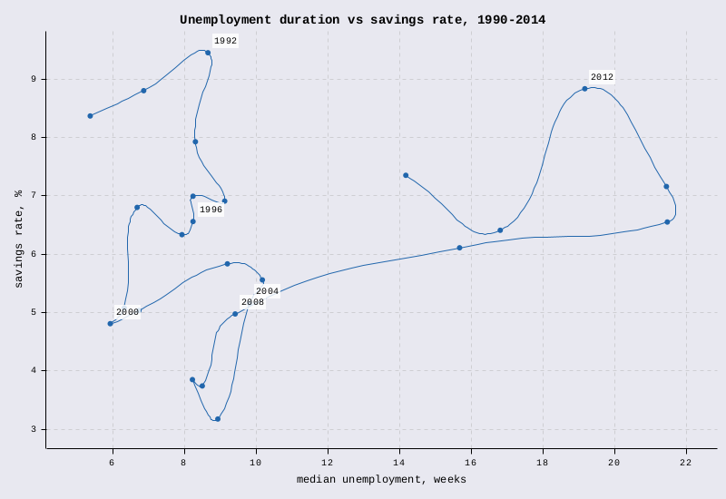
:::


## 2D density

Where the points concentrate: counts in cells, a smooth density estimate, its contour lines.


### 2D histogram and hexbin

`chart/bin2d` counts points in cells: squares, or hexagons (the default) - regular on screen for the panel's shape.

Source: R Graph Gallery - 2D density chart; data-to-viz - 2D density ([1](https://r-graph-gallery.com/2d-density-chart.html), [2](https://www.data-to-viz.com/graph/density2d.html)). Data: Old Faithful geyser eruptions, R datasets package `faithful` (Härdle 1991; Azzalini & Bowman 1990); licence: Part of R (GPL-2 | GPL-3).


::: {.sourceClojure}
```clojure
(plot/render-image
 (plot/arrange
  [{:data faithful :mapping {:x :eruptions :y :waiting} :charts [(chart/bin2d {:cell :square :bins 20})]
    :legend false :labels {:title "2D histogram" :x "eruption, min" :y "waiting, min"}}
   {:data faithful :mapping {:x :eruptions :y :waiting} :charts [(chart/bin2d {:bins 20})]
    :labels {:title "hexbin" :x "eruption, min" :y nil}}]
  {:columns 2})
 {:width 1000 :height 450})
```
:::


::: {.clay-image}

:::


### 2D kernel density and contours

`chart/field` estimates the density (Gaussian kernel, a bandwidth per axis) and draws it as a raster;
`chart/contour` draws its level lines, or with `:fill true` the bands between them.

Source: [R Graph Gallery - 2D density plot with ggplot2](https://r-graph-gallery.com/2d-density-plot-with-ggplot2.html). Data: Old Faithful geyser eruptions, R datasets package `faithful` (Härdle 1991; Azzalini & Bowman 1990); licence: Part of R (GPL-2 | GPL-3).


::: {.sourceClojure}
```clojure
(plot/render-image
 (plot/arrange
  [{:data faithful :mapping {:x :eruptions :y :waiting}
    :charts [(chart/field) (chart/contour {:color :white :width 0.8})] :legend false
    :labels {:title "density raster and contour lines" :x "eruption, min" :y "waiting, min"}}
   {:data faithful :mapping {:x :eruptions :y :waiting}
    :charts [(chart/contour {:fill true :levels 8})]
    :labels {:title "filled contour bands" :x "eruption, min" :y nil}}]
  {:columns 2})
 {:width 1000 :height 450})
```
:::


::: {.clay-image}
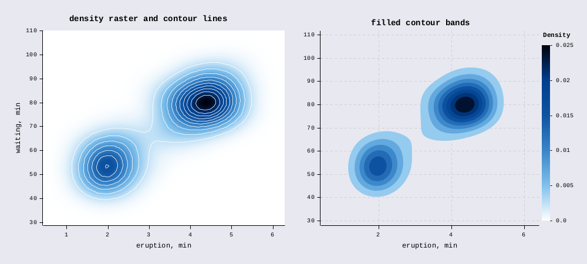
:::


### Points over a density

The density as a backdrop for the points themselves.

Source: [R Graph Gallery - 2D density chart](https://r-graph-gallery.com/2d-density-chart.html). Data: Old Faithful geyser eruptions, R datasets package `faithful` (Härdle 1991; Azzalini & Bowman 1990); licence: Part of R (GPL-2 | GPL-3).


::: {.sourceClojure}
```clojure
(plot/render-image
 {:data faithful :mapping {:x :eruptions :y :waiting}
  :charts [(chart/field {:alpha 0.8}) (chart/scatter {:size 3 :color [255 255 255 200]})]
  :labels {:title "Old Faithful eruptions over their density" :x "eruption, min" :y "waiting, min"}}
 {:width 700 :height 500})
```
:::


::: {.clay-image}
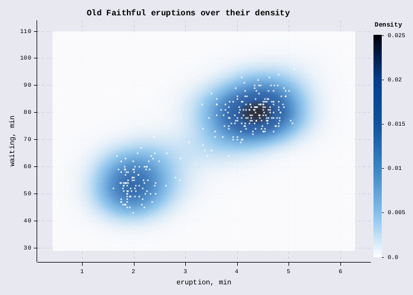
:::


## Functions

`chart/field {:f f}` samples a function of x and y on a grid over a given domain (`:n` samples per axis) - no
data needed. These examples have no gallery counterpart.


### A function as a raster

−(x² + y²) · sin x · sin y · sin xy on [−π, π]², white to black, 300 × 300 samples, square pixels (`:aspect :iso`).

Source: cljplot2 - chart/field.


::: {.sourceClojure}
```clojure
(defn fn2d
  [^double x ^double y]
  (* (- (+ (* x x) (* y y))) (m/sin x) (m/sin y) (m/sin (* x y))))
```
:::


::: {.sourceClojure}
```clojure
(plot/render-image
 {:charts [(chart/field {:f fn2d :domain {:x [(- m/PI) m/PI] :y [(- m/PI) m/PI]} :n 300})]
  :scales {:color {:range [:white :black]}}
  :aspect :iso
  :labels {:title "-(x^2 + y^2) sin x sin y sin xy"}}
 {:width 650 :height 600})
```
:::


::: {.clay-image}
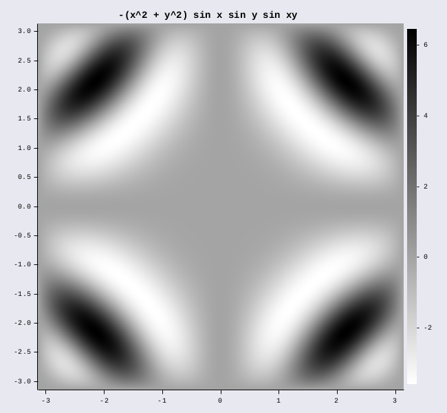
:::


### A function with contour lines

sin x · cos y on a diverging palette centred at 0, with contour lines at fixed levels.

Source: cljplot2 - chart/field, chart/contour.


::: {.sourceClojure}
```clojure
(let [wave (fn [x y] (* (m/sin x) (m/cos y)))
      domain {:x [0 (* 2 m/PI)] :y [0 4]}]
  (plot/render-image
   {:charts [(chart/field {:f wave :domain domain})
             (chart/contour {:f wave :domain domain :color :black :levels [-0.75 -0.5 -0.25 0 0.25 0.5 0.75]})]
    :scales {:color {:range :RColorBrewer/RdBu :midpoint 0 :title "sin x cos y"}}
    :labels {:title "sin x cos y with contour lines"}}
   {:width 700 :height 450}))
```
:::


::: {.clay-image}
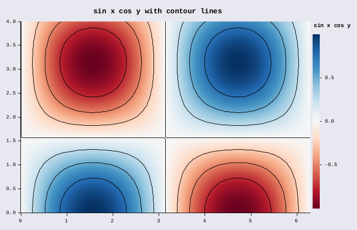
:::


## Overplotting

With thousands of points a scatter plot turns into a blot. The usual ways out, on 53 940 diamonds.


### Size, transparency, sampling, binning, facets, margins

Smaller points and transparency let density show; a sample keeps the shape with fewer points; hexagon counts
replace points by numbers; facets split the cloud by a category; marginal densities show where it is thick.

Source: [data-to-viz - Overplotting](https://www.data-to-viz.com/caveat/overplotting.html). Data: Prices and attributes of round cut diamonds, R ggplot2 package `diamonds` (Wickham et al.); licence: MIT (ggplot2).


::: {.sourceClojure}
```clojure
(let [base {:data diamonds :mapping {:x :carat :y :price} :scales {:x {:domain [0 5.5] :nice false :expand [0 0]} :y {:domain [0 20000] :nice false :expand [0 0]}}}
      sample (let [rng (r/rng :mersenne 9)] (filterv (fn [_] (< (r/drandom rng) 0.04)) diamonds))]
  (plot/render-image
   (plot/arrange
    [(merge base {:charts [(chart/scatter)] :labels {:title "all points" :x "carat" :y "price, USD"}})
     (merge base {:charts [(chart/scatter {:size 1})] :labels {:title "small points" :x "carat" :y nil}})
     (merge base {:charts [(chart/scatter {:size 3 :color [30 60 120 12]})] :labels {:title "transparency" :x "carat" :y nil}})
     (merge base {:data sample :charts [(chart/scatter {:size 3 :color [30 60 120 120]})]
                  :labels {:title "4 % sample" :x "carat" :y "price, USD"}})
     (merge base {:charts [(chart/bin2d {:bins 30})] :legend false :labels {:title "hexbin" :x "carat" :y nil}})
     (merge base {:charts [(chart/scatter {:size 2 :color [30 60 120 20]})]
                  :margins {:top (chart/density {:fill [30 60 120 100]}) :right (chart/density {:fill [30 60 120 100]})}
                  :labels {:title "marginal densities" :x "carat" :y nil}})]
    {:columns 3})
   {:width 1000 :height 700}))
```
:::


::: {.clay-image}
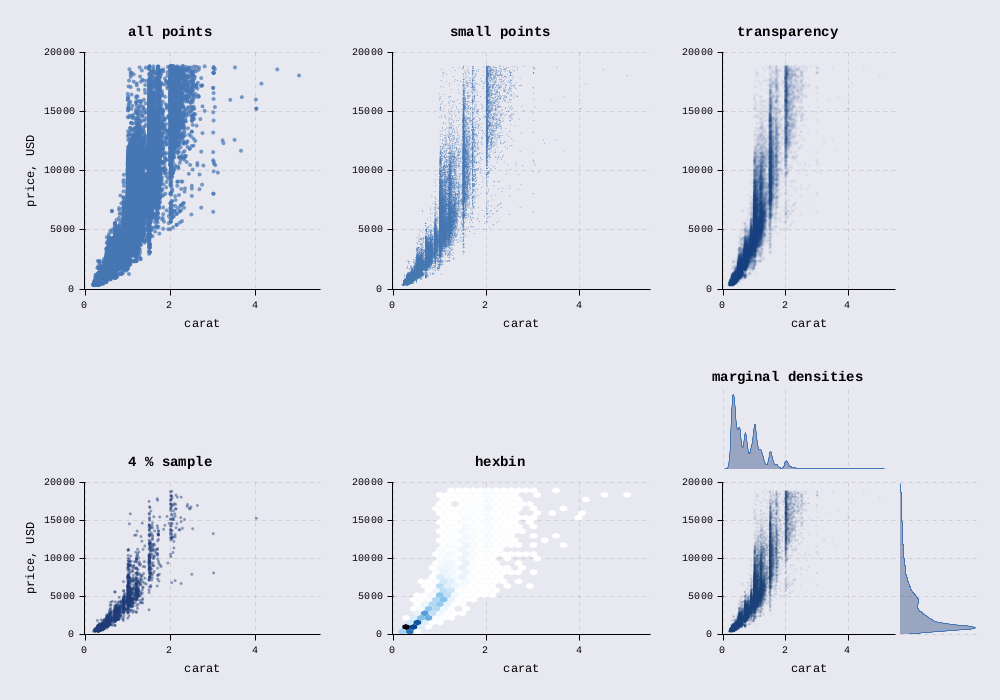
:::


Source: [data-to-viz - Overplotting (facets)](https://www.data-to-viz.com/caveat/overplotting.html). Data: Prices and attributes of round cut diamonds, R ggplot2 package `diamonds` (Wickham et al.); licence: MIT (ggplot2).


::: {.sourceClojure}
```clojure
(plot/render-image
 {:data diamonds :mapping {:x :carat :y :price :facet :cut}
  :charts [(chart/scatter {:size 2 :color [30 60 120 25]})]
  :scales {:facet {:domain ["Fair" "Good" "Very Good" "Premium" "Ideal"]}}
  :labels {:title "Diamonds: a panel per cut, worst to best" :x "carat" :y "price, USD"}}
 {:width 1000 :height 400})
```
:::


::: {.clay-image}

:::


### Jitter

Integer values pile up on a few positions; `:jitter [dx dy]` moves every point by a random offset within ±dx, ±dy
(data units) so the piles spread - `:rng` with a seed makes it the same in every rendering.

Source: [data-to-viz - Overplotting (jitter)](https://www.data-to-viz.com/caveat/overplotting.html). Data: Motor Trend car road tests (1974), R datasets package `mtcars` (Henderson & Velleman 1981); licence: Part of R (GPL-2 | GPL-3).


::: {.sourceClojure}
```clojure
(let [gears (fn [title jitter]
              {:data mtcars :mapping {:x :cyl :y :gear}
               :charts [(chart/scatter (cond-> {:size 7 :color [40 40 40 120]}
                                         jitter (assoc :jitter jitter :rng (r/rng :mersenne 7))))]
               :labels {:title title :x "cylinders" :y "forward gears"}})]
  (plot/render-image
   (plot/arrange [(gears "32 cars on 8 positions" nil) (gears ":jitter [0.25 0.15]" [0.25 0.15])] {:columns 2})
   {:width 900 :height 420}))
```
:::


::: {.clay-image}

:::


## Caveats


- Correlation is not causation: two variables can move together because a third one drives both.
- Pearson's r measures only a linear relation: very different clouds (Anscombe's quartet) share one r; look at
  the scatter plot, and use Spearman or Kendall (`chart/correlation {:method :spearman}`) for monotone relations.

- Bubbles: map the value to the area (`:area true`), not the diameter, or large values look far larger.
- 2D histograms and densities depend on the cell size or bandwidth: try a few before reading shapes into them.


```{=html}
<div style="background-color:grey;height:2px;width:100%;"></div>
```


```{=html}
<div><pre><small><small>source: notebooks/use_cases/correlation.clj</small></small></pre></div>
```