---
format:
  html:
    toc: true
    toc-location: right
    toc-depth: 4
    theme: cosmo
    include-in-header:
      text: |-
        <style>
        .data-table { width: fit-content; max-width: 100%; max-height: 15rem; overflow: auto; margin: 0 0 1rem 0; }
        .data-table .table-responsive { overflow: visible; }
        .data-table table { font-size: 0.75rem; width: auto; margin: 0; }
        .data-table th, .data-table td { padding: 0.1rem 0.45rem !important; white-space: nowrap; }
        .data-table thead th { position: sticky; top: 0; background: var(--bs-body-bg, #fff); }
        </style>
code-block-background: true

---
<style></style><style>.printedClojure .sourceCode {
  background-color: transparent;
  border-style: none;
}
</style><style>.clay-limit-image-width .clay-image {max-width: 100%}
.clay-side-by-side .sourceCode {margin: 0}
.clay-side-by-side {margin: 1em 0}
</style>
<script src="https://code.jquery.com/jquery-3.6.0.min.js" type="text/javascript"></script><script src="https://code.jquery.com/ui/1.13.1/jquery-ui.min.js" type="text/javascript"></script>

# Correlation

How two or more variables move together: scatter plots, heatmaps, correlograms, bubble charts, connected scatter
plots, 2D densities, functions of two variables and the ways out of overplotting (the
[R Graph Gallery](https://r-graph-gallery.com/) correlation pages and [data-to-viz](https://www.data-to-viz.com/)).

Not here: labels along a trend line and label repel, clustered heatmap order with dendrograms (waits for
hierarchical clustering in fastmath), arrows on connected scatter plots (backlog), 3D densities and interactivity.


::: {.sourceClojure}
```clojure
(ns use-cases.correlation
  (:require [fastmath.core :as m]
            [fastmath.random :as r]
            [fastmath.stats :as stats]
            [cljplot2.chart :as chart]
            [cljplot2.core :as plot]
            [notebook-utils :as nu])
  (:import [java.time DayOfWeek LocalDate]
           [java.time.temporal IsoFields]))
```
:::


::: {.sourceClojure}
```clojure
(def houses (nu/dataset :house-prices))
```
:::


```{=html}
<div class="data-table"><table class="table table-hover table-responsive clay-table"><thead><tr><th>living-area</th><th>price</th></tr></thead><tbody><tr><td>1710</td><td>208500</td></tr><tr><td>1262</td><td>181500</td></tr><tr><td>1786</td><td>223500</td></tr><tr><td>1717</td><td>140000</td></tr><tr><td>2198</td><td>250000</td></tr><tr><td>1362</td><td>143000</td></tr><tr><td>1694</td><td>307000</td></tr><tr><td>2090</td><td>200000</td></tr><tr><td>1774</td><td>129900</td></tr><tr><td>1077</td><td>118000</td></tr><tr><td>1040</td><td>129500</td></tr><tr><td>2324</td><td>345000</td></tr><tr><td>912</td><td>144000</td></tr><tr><td>1494</td><td>279500</td></tr><tr><td>1253</td><td>157000</td></tr><tr><td>854</td><td>132000</td></tr><tr><td>1004</td><td>149000</td></tr><tr><td>1296</td><td>90000</td></tr><tr><td>1114</td><td>159000</td></tr><tr><td>1339</td><td>139000</td></tr><tr><td>2376</td><td>325300</td></tr><tr><td>1108</td><td>139400</td></tr><tr><td>1795</td><td>230000</td></tr><tr><td>1060</td><td>129900</td></tr><tr><td>1060</td><td>154000</td></tr><tr><td>1600</td><td>256300</td></tr><tr><td>900</td><td>134800</td></tr><tr><td>1704</td><td>306000</td></tr><tr><td>1600</td><td>207500</td></tr><tr><td>520</td><td>68500</td></tr><tr><td>1317</td><td>40000</td></tr><tr><td>1228</td><td>149350</td></tr><tr><td>1234</td><td>179900</td></tr><tr><td>1700</td><td>165500</td></tr><tr><td>1561</td><td>277500</td></tr><tr><td>2452</td><td>309000</td></tr><tr><td>1097</td><td>145000</td></tr><tr><td>1297</td><td>153000</td></tr><tr><td>1057</td><td>109000</td></tr><tr><td>1152</td><td>82000</td></tr><tr><td>1324</td><td>160000</td></tr><tr><td>1328</td><td>170000</td></tr><tr><td>884</td><td>144000</td></tr><tr><td>938</td><td>130250</td></tr><tr><td>1150</td><td>141000</td></tr><tr><td>1752</td><td>319900</td></tr><tr><td>2149</td><td>239686</td></tr><tr><td>1656</td><td>249700</td></tr><tr><td>1452</td><td>113000</td></tr><tr><td>955</td><td>127000</td></tr><tr><td>1470</td><td>177000</td></tr><tr><td>1176</td><td>114500</td></tr><tr><td>816</td><td>110000</td></tr><tr><td>1842</td><td>385000</td></tr><tr><td>1360</td><td>130000</td></tr><tr><td>1425</td><td>180500</td></tr><tr><td>1739</td><td>172500</td></tr><tr><td>1720</td><td>196500</td></tr><tr><td>2945</td><td>438780</td></tr><tr><td>780</td><td>124900</td></tr><tr><td>1158</td><td>158000</td></tr><tr><td>1111</td><td>101000</td></tr><tr><td>1370</td><td>202500</td></tr><tr><td>1710</td><td>140000</td></tr><tr><td>2034</td><td>219500</td></tr><tr><td>2473</td><td>317000</td></tr><tr><td>2207</td><td>180000</td></tr><tr><td>1479</td><td>226000</td></tr><tr><td>747</td><td>80000</td></tr><tr><td>2287</td><td>225000</td></tr><tr><td>2223</td><td>244000</td></tr><tr><td>845</td><td>129500</td></tr><tr><td>1718</td><td>185000</td></tr><tr><td>1086</td><td>144900</td></tr><tr><td>1605</td><td>107400</td></tr><tr><td>988</td><td>91000</td></tr><tr><td>952</td><td>135750</td></tr><tr><td>1285</td><td>127000</td></tr><tr><td>1768</td><td>136500</td></tr><tr><td>1230</td><td>110000</td></tr><tr><td>2142</td><td>193500</td></tr><tr><td>1337</td><td>153500</td></tr><tr><td>1563</td><td>245000</td></tr><tr><td>1065</td><td>126500</td></tr><tr><td>1474</td><td>168500</td></tr><tr><td>2417</td><td>260000</td></tr><tr><td>1560</td><td>174000</td></tr><tr><td>1224</td><td>164500</td></tr><tr><td>1526</td><td>85000</td></tr><tr><td>990</td><td>123600</td></tr><tr><td>1040</td><td>109900</td></tr><tr><td>1235</td><td>98600</td></tr><tr><td>964</td><td>163500</td></tr><tr><td>2291</td><td>133900</td></tr><tr><td>1786</td><td>204750</td></tr><tr><td>1470</td><td>185000</td></tr><tr><td>1588</td><td>214000</td></tr><tr><td>960</td><td>94750</td></tr><tr><td>835</td><td>83000</td></tr><tr><td>1225</td><td>128950</td></tr><tr><td>…</td><td>…</td></tr></tbody></table></div>
```


::: {.sourceClojure}
```clojure
(def iris (nu/dataset :iris))
```
:::


```{=html}
<div class="data-table"><table class="table table-hover table-responsive clay-table"><thead><tr><th>sepal-length</th><th>sepal-width</th><th>petal-length</th><th>petal-width</th><th>species</th></tr></thead><tbody><tr><td>5.1</td><td>3.5</td><td>1.4</td><td>0.2</td><td>setosa</td></tr><tr><td>4.9</td><td>3</td><td>1.4</td><td>0.2</td><td>setosa</td></tr><tr><td>4.7</td><td>3.2</td><td>1.3</td><td>0.2</td><td>setosa</td></tr><tr><td>4.6</td><td>3.1</td><td>1.5</td><td>0.2</td><td>setosa</td></tr><tr><td>5</td><td>3.6</td><td>1.4</td><td>0.2</td><td>setosa</td></tr><tr><td>5.4</td><td>3.9</td><td>1.7</td><td>0.4</td><td>setosa</td></tr><tr><td>4.6</td><td>3.4</td><td>1.4</td><td>0.3</td><td>setosa</td></tr><tr><td>5</td><td>3.4</td><td>1.5</td><td>0.2</td><td>setosa</td></tr><tr><td>4.4</td><td>2.9</td><td>1.4</td><td>0.2</td><td>setosa</td></tr><tr><td>4.9</td><td>3.1</td><td>1.5</td><td>0.1</td><td>setosa</td></tr><tr><td>5.4</td><td>3.7</td><td>1.5</td><td>0.2</td><td>setosa</td></tr><tr><td>4.8</td><td>3.4</td><td>1.6</td><td>0.2</td><td>setosa</td></tr><tr><td>4.8</td><td>3</td><td>1.4</td><td>0.1</td><td>setosa</td></tr><tr><td>4.3</td><td>3</td><td>1.1</td><td>0.1</td><td>setosa</td></tr><tr><td>5.8</td><td>4</td><td>1.2</td><td>0.2</td><td>setosa</td></tr><tr><td>5.7</td><td>4.4</td><td>1.5</td><td>0.4</td><td>setosa</td></tr><tr><td>5.4</td><td>3.9</td><td>1.3</td><td>0.4</td><td>setosa</td></tr><tr><td>5.1</td><td>3.5</td><td>1.4</td><td>0.3</td><td>setosa</td></tr><tr><td>5.7</td><td>3.8</td><td>1.7</td><td>0.3</td><td>setosa</td></tr><tr><td>5.1</td><td>3.8</td><td>1.5</td><td>0.3</td><td>setosa</td></tr><tr><td>5.4</td><td>3.4</td><td>1.7</td><td>0.2</td><td>setosa</td></tr><tr><td>5.1</td><td>3.7</td><td>1.5</td><td>0.4</td><td>setosa</td></tr><tr><td>4.6</td><td>3.6</td><td>1</td><td>0.2</td><td>setosa</td></tr><tr><td>5.1</td><td>3.3</td><td>1.7</td><td>0.5</td><td>setosa</td></tr><tr><td>4.8</td><td>3.4</td><td>1.9</td><td>0.2</td><td>setosa</td></tr><tr><td>5</td><td>3</td><td>1.6</td><td>0.2</td><td>setosa</td></tr><tr><td>5</td><td>3.4</td><td>1.6</td><td>0.4</td><td>setosa</td></tr><tr><td>5.2</td><td>3.5</td><td>1.5</td><td>0.2</td><td>setosa</td></tr><tr><td>5.2</td><td>3.4</td><td>1.4</td><td>0.2</td><td>setosa</td></tr><tr><td>4.7</td><td>3.2</td><td>1.6</td><td>0.2</td><td>setosa</td></tr><tr><td>4.8</td><td>3.1</td><td>1.6</td><td>0.2</td><td>setosa</td></tr><tr><td>5.4</td><td>3.4</td><td>1.5</td><td>0.4</td><td>setosa</td></tr><tr><td>5.2</td><td>4.1</td><td>1.5</td><td>0.1</td><td>setosa</td></tr><tr><td>5.5</td><td>4.2</td><td>1.4</td><td>0.2</td><td>setosa</td></tr><tr><td>4.9</td><td>3.1</td><td>1.5</td><td>0.2</td><td>setosa</td></tr><tr><td>5</td><td>3.2</td><td>1.2</td><td>0.2</td><td>setosa</td></tr><tr><td>5.5</td><td>3.5</td><td>1.3</td><td>0.2</td><td>setosa</td></tr><tr><td>4.9</td><td>3.6</td><td>1.4</td><td>0.1</td><td>setosa</td></tr><tr><td>4.4</td><td>3</td><td>1.3</td><td>0.2</td><td>setosa</td></tr><tr><td>5.1</td><td>3.4</td><td>1.5</td><td>0.2</td><td>setosa</td></tr><tr><td>5</td><td>3.5</td><td>1.3</td><td>0.3</td><td>setosa</td></tr><tr><td>4.5</td><td>2.3</td><td>1.3</td><td>0.3</td><td>setosa</td></tr><tr><td>4.4</td><td>3.2</td><td>1.3</td><td>0.2</td><td>setosa</td></tr><tr><td>5</td><td>3.5</td><td>1.6</td><td>0.6</td><td>setosa</td></tr><tr><td>5.1</td><td>3.8</td><td>1.9</td><td>0.4</td><td>setosa</td></tr><tr><td>4.8</td><td>3</td><td>1.4</td><td>0.3</td><td>setosa</td></tr><tr><td>5.1</td><td>3.8</td><td>1.6</td><td>0.2</td><td>setosa</td></tr><tr><td>4.6</td><td>3.2</td><td>1.4</td><td>0.2</td><td>setosa</td></tr><tr><td>5.3</td><td>3.7</td><td>1.5</td><td>0.2</td><td>setosa</td></tr><tr><td>5</td><td>3.3</td><td>1.4</td><td>0.2</td><td>setosa</td></tr><tr><td>7</td><td>3.2</td><td>4.7</td><td>1.4</td><td>versicolor</td></tr><tr><td>6.4</td><td>3.2</td><td>4.5</td><td>1.5</td><td>versicolor</td></tr><tr><td>6.9</td><td>3.1</td><td>4.9</td><td>1.5</td><td>versicolor</td></tr><tr><td>5.5</td><td>2.3</td><td>4</td><td>1.3</td><td>versicolor</td></tr><tr><td>6.5</td><td>2.8</td><td>4.6</td><td>1.5</td><td>versicolor</td></tr><tr><td>5.7</td><td>2.8</td><td>4.5</td><td>1.3</td><td>versicolor</td></tr><tr><td>6.3</td><td>3.3</td><td>4.7</td><td>1.6</td><td>versicolor</td></tr><tr><td>4.9</td><td>2.4</td><td>3.3</td><td>1</td><td>versicolor</td></tr><tr><td>6.6</td><td>2.9</td><td>4.6</td><td>1.3</td><td>versicolor</td></tr><tr><td>5.2</td><td>2.7</td><td>3.9</td><td>1.4</td><td>versicolor</td></tr><tr><td>5</td><td>2</td><td>3.5</td><td>1</td><td>versicolor</td></tr><tr><td>5.9</td><td>3</td><td>4.2</td><td>1.5</td><td>versicolor</td></tr><tr><td>6</td><td>2.2</td><td>4</td><td>1</td><td>versicolor</td></tr><tr><td>6.1</td><td>2.9</td><td>4.7</td><td>1.4</td><td>versicolor</td></tr><tr><td>5.6</td><td>2.9</td><td>3.6</td><td>1.3</td><td>versicolor</td></tr><tr><td>6.7</td><td>3.1</td><td>4.4</td><td>1.4</td><td>versicolor</td></tr><tr><td>5.6</td><td>3</td><td>4.5</td><td>1.5</td><td>versicolor</td></tr><tr><td>5.8</td><td>2.7</td><td>4.1</td><td>1</td><td>versicolor</td></tr><tr><td>6.2</td><td>2.2</td><td>4.5</td><td>1.5</td><td>versicolor</td></tr><tr><td>5.6</td><td>2.5</td><td>3.9</td><td>1.1</td><td>versicolor</td></tr><tr><td>5.9</td><td>3.2</td><td>4.8</td><td>1.8</td><td>versicolor</td></tr><tr><td>6.1</td><td>2.8</td><td>4</td><td>1.3</td><td>versicolor</td></tr><tr><td>6.3</td><td>2.5</td><td>4.9</td><td>1.5</td><td>versicolor</td></tr><tr><td>6.1</td><td>2.8</td><td>4.7</td><td>1.2</td><td>versicolor</td></tr><tr><td>6.4</td><td>2.9</td><td>4.3</td><td>1.3</td><td>versicolor</td></tr><tr><td>6.6</td><td>3</td><td>4.4</td><td>1.4</td><td>versicolor</td></tr><tr><td>6.8</td><td>2.8</td><td>4.8</td><td>1.4</td><td>versicolor</td></tr><tr><td>6.7</td><td>3</td><td>5</td><td>1.7</td><td>versicolor</td></tr><tr><td>6</td><td>2.9</td><td>4.5</td><td>1.5</td><td>versicolor</td></tr><tr><td>5.7</td><td>2.6</td><td>3.5</td><td>1</td><td>versicolor</td></tr><tr><td>5.5</td><td>2.4</td><td>3.8</td><td>1.1</td><td>versicolor</td></tr><tr><td>5.5</td><td>2.4</td><td>3.7</td><td>1</td><td>versicolor</td></tr><tr><td>5.8</td><td>2.7</td><td>3.9</td><td>1.2</td><td>versicolor</td></tr><tr><td>6</td><td>2.7</td><td>5.1</td><td>1.6</td><td>versicolor</td></tr><tr><td>5.4</td><td>3</td><td>4.5</td><td>1.5</td><td>versicolor</td></tr><tr><td>6</td><td>3.4</td><td>4.5</td><td>1.6</td><td>versicolor</td></tr><tr><td>6.7</td><td>3.1</td><td>4.7</td><td>1.5</td><td>versicolor</td></tr><tr><td>6.3</td><td>2.3</td><td>4.4</td><td>1.3</td><td>versicolor</td></tr><tr><td>5.6</td><td>3</td><td>4.1</td><td>1.3</td><td>versicolor</td></tr><tr><td>5.5</td><td>2.5</td><td>4</td><td>1.3</td><td>versicolor</td></tr><tr><td>5.5</td><td>2.6</td><td>4.4</td><td>1.2</td><td>versicolor</td></tr><tr><td>6.1</td><td>3</td><td>4.6</td><td>1.4</td><td>versicolor</td></tr><tr><td>5.8</td><td>2.6</td><td>4</td><td>1.2</td><td>versicolor</td></tr><tr><td>5</td><td>2.3</td><td>3.3</td><td>1</td><td>versicolor</td></tr><tr><td>5.6</td><td>2.7</td><td>4.2</td><td>1.3</td><td>versicolor</td></tr><tr><td>5.7</td><td>3</td><td>4.2</td><td>1.2</td><td>versicolor</td></tr><tr><td>5.7</td><td>2.9</td><td>4.2</td><td>1.3</td><td>versicolor</td></tr><tr><td>6.2</td><td>2.9</td><td>4.3</td><td>1.3</td><td>versicolor</td></tr><tr><td>5.1</td><td>2.5</td><td>3</td><td>1.1</td><td>versicolor</td></tr><tr><td>5.7</td><td>2.8</td><td>4.1</td><td>1.3</td><td>versicolor</td></tr><tr><td>…</td><td>…</td><td>…</td><td>…</td><td>…</td></tr></tbody></table></div>
```


::: {.sourceClojure}
```clojure
(def mtcars (nu/dataset :mtcars))
```
:::


```{=html}
<div class="data-table"><table class="table table-hover table-responsive clay-table"><thead><tr><th>model</th><th>mpg</th><th>cyl</th><th>disp</th><th>hp</th><th>drat</th><th>wt</th><th>qsec</th><th>vs</th><th>am</th><th>gear</th><th>carb</th></tr></thead><tbody><tr><td>Mazda RX4</td><td>21</td><td>6</td><td>160</td><td>110</td><td>3.9</td><td>2.62</td><td>16.46</td><td>0</td><td>1</td><td>4</td><td>4</td></tr><tr><td>Mazda RX4 Wag</td><td>21</td><td>6</td><td>160</td><td>110</td><td>3.9</td><td>2.875</td><td>17.02</td><td>0</td><td>1</td><td>4</td><td>4</td></tr><tr><td>Datsun 710</td><td>22.8</td><td>4</td><td>108</td><td>93</td><td>3.85</td><td>2.32</td><td>18.61</td><td>1</td><td>1</td><td>4</td><td>1</td></tr><tr><td>Hornet 4 Drive</td><td>21.4</td><td>6</td><td>258</td><td>110</td><td>3.08</td><td>3.215</td><td>19.44</td><td>1</td><td>0</td><td>3</td><td>1</td></tr><tr><td>Hornet Sportabout</td><td>18.7</td><td>8</td><td>360</td><td>175</td><td>3.15</td><td>3.44</td><td>17.02</td><td>0</td><td>0</td><td>3</td><td>2</td></tr><tr><td>Valiant</td><td>18.1</td><td>6</td><td>225</td><td>105</td><td>2.76</td><td>3.46</td><td>20.22</td><td>1</td><td>0</td><td>3</td><td>1</td></tr><tr><td>Duster 360</td><td>14.3</td><td>8</td><td>360</td><td>245</td><td>3.21</td><td>3.57</td><td>15.84</td><td>0</td><td>0</td><td>3</td><td>4</td></tr><tr><td>Merc 240D</td><td>24.4</td><td>4</td><td>146.7</td><td>62</td><td>3.69</td><td>3.19</td><td>20</td><td>1</td><td>0</td><td>4</td><td>2</td></tr><tr><td>Merc 230</td><td>22.8</td><td>4</td><td>140.8</td><td>95</td><td>3.92</td><td>3.15</td><td>22.9</td><td>1</td><td>0</td><td>4</td><td>2</td></tr><tr><td>Merc 280</td><td>19.2</td><td>6</td><td>167.6</td><td>123</td><td>3.92</td><td>3.44</td><td>18.3</td><td>1</td><td>0</td><td>4</td><td>4</td></tr><tr><td>Merc 280C</td><td>17.8</td><td>6</td><td>167.6</td><td>123</td><td>3.92</td><td>3.44</td><td>18.9</td><td>1</td><td>0</td><td>4</td><td>4</td></tr><tr><td>Merc 450SE</td><td>16.4</td><td>8</td><td>275.8</td><td>180</td><td>3.07</td><td>4.07</td><td>17.4</td><td>0</td><td>0</td><td>3</td><td>3</td></tr><tr><td>Merc 450SL</td><td>17.3</td><td>8</td><td>275.8</td><td>180</td><td>3.07</td><td>3.73</td><td>17.6</td><td>0</td><td>0</td><td>3</td><td>3</td></tr><tr><td>Merc 450SLC</td><td>15.2</td><td>8</td><td>275.8</td><td>180</td><td>3.07</td><td>3.78</td><td>18</td><td>0</td><td>0</td><td>3</td><td>3</td></tr><tr><td>Cadillac Fleetwood</td><td>10.4</td><td>8</td><td>472</td><td>205</td><td>2.93</td><td>5.25</td><td>17.98</td><td>0</td><td>0</td><td>3</td><td>4</td></tr><tr><td>Lincoln Continental</td><td>10.4</td><td>8</td><td>460</td><td>215</td><td>3</td><td>5.424</td><td>17.82</td><td>0</td><td>0</td><td>3</td><td>4</td></tr><tr><td>Chrysler Imperial</td><td>14.7</td><td>8</td><td>440</td><td>230</td><td>3.23</td><td>5.345</td><td>17.42</td><td>0</td><td>0</td><td>3</td><td>4</td></tr><tr><td>Fiat 128</td><td>32.4</td><td>4</td><td>78.7</td><td>66</td><td>4.08</td><td>2.2</td><td>19.47</td><td>1</td><td>1</td><td>4</td><td>1</td></tr><tr><td>Honda Civic</td><td>30.4</td><td>4</td><td>75.7</td><td>52</td><td>4.93</td><td>1.615</td><td>18.52</td><td>1</td><td>1</td><td>4</td><td>2</td></tr><tr><td>Toyota Corolla</td><td>33.9</td><td>4</td><td>71.1</td><td>65</td><td>4.22</td><td>1.835</td><td>19.9</td><td>1</td><td>1</td><td>4</td><td>1</td></tr><tr><td>Toyota Corona</td><td>21.5</td><td>4</td><td>120.1</td><td>97</td><td>3.7</td><td>2.465</td><td>20.01</td><td>1</td><td>0</td><td>3</td><td>1</td></tr><tr><td>Dodge Challenger</td><td>15.5</td><td>8</td><td>318</td><td>150</td><td>2.76</td><td>3.52</td><td>16.87</td><td>0</td><td>0</td><td>3</td><td>2</td></tr><tr><td>AMC Javelin</td><td>15.2</td><td>8</td><td>304</td><td>150</td><td>3.15</td><td>3.435</td><td>17.3</td><td>0</td><td>0</td><td>3</td><td>2</td></tr><tr><td>Camaro Z28</td><td>13.3</td><td>8</td><td>350</td><td>245</td><td>3.73</td><td>3.84</td><td>15.41</td><td>0</td><td>0</td><td>3</td><td>4</td></tr><tr><td>Pontiac Firebird</td><td>19.2</td><td>8</td><td>400</td><td>175</td><td>3.08</td><td>3.845</td><td>17.05</td><td>0</td><td>0</td><td>3</td><td>2</td></tr><tr><td>Fiat X1-9</td><td>27.3</td><td>4</td><td>79</td><td>66</td><td>4.08</td><td>1.935</td><td>18.9</td><td>1</td><td>1</td><td>4</td><td>1</td></tr><tr><td>Porsche 914-2</td><td>26</td><td>4</td><td>120.3</td><td>91</td><td>4.43</td><td>2.14</td><td>16.7</td><td>0</td><td>1</td><td>5</td><td>2</td></tr><tr><td>Lotus Europa</td><td>30.4</td><td>4</td><td>95.1</td><td>113</td><td>3.77</td><td>1.513</td><td>16.9</td><td>1</td><td>1</td><td>5</td><td>2</td></tr><tr><td>Ford Pantera L</td><td>15.8</td><td>8</td><td>351</td><td>264</td><td>4.22</td><td>3.17</td><td>14.5</td><td>0</td><td>1</td><td>5</td><td>4</td></tr><tr><td>Ferrari Dino</td><td>19.7</td><td>6</td><td>145</td><td>175</td><td>3.62</td><td>2.77</td><td>15.5</td><td>0</td><td>1</td><td>5</td><td>6</td></tr><tr><td>Maserati Bora</td><td>15</td><td>8</td><td>301</td><td>335</td><td>3.54</td><td>3.57</td><td>14.6</td><td>0</td><td>1</td><td>5</td><td>8</td></tr><tr><td>Volvo 142E</td><td>21.4</td><td>4</td><td>121</td><td>109</td><td>4.11</td><td>2.78</td><td>18.6</td><td>1</td><td>1</td><td>4</td><td>2</td></tr></tbody></table></div>
```


::: {.sourceClojure}
```clojure
(def faithful (nu/dataset :faithful))
```
:::


```{=html}
<div class="data-table"><table class="table table-hover table-responsive clay-table"><thead><tr><th>eruptions</th><th>waiting</th></tr></thead><tbody><tr><td>3.6</td><td>79</td></tr><tr><td>1.8</td><td>54</td></tr><tr><td>3.333</td><td>74</td></tr><tr><td>2.283</td><td>62</td></tr><tr><td>4.533</td><td>85</td></tr><tr><td>2.883</td><td>55</td></tr><tr><td>4.7</td><td>88</td></tr><tr><td>3.6</td><td>85</td></tr><tr><td>1.95</td><td>51</td></tr><tr><td>4.35</td><td>85</td></tr><tr><td>1.833</td><td>54</td></tr><tr><td>3.917</td><td>84</td></tr><tr><td>4.2</td><td>78</td></tr><tr><td>1.75</td><td>47</td></tr><tr><td>4.7</td><td>83</td></tr><tr><td>2.167</td><td>52</td></tr><tr><td>1.75</td><td>62</td></tr><tr><td>4.8</td><td>84</td></tr><tr><td>1.6</td><td>52</td></tr><tr><td>4.25</td><td>79</td></tr><tr><td>1.8</td><td>51</td></tr><tr><td>1.75</td><td>47</td></tr><tr><td>3.45</td><td>78</td></tr><tr><td>3.067</td><td>69</td></tr><tr><td>4.533</td><td>74</td></tr><tr><td>3.6</td><td>83</td></tr><tr><td>1.967</td><td>55</td></tr><tr><td>4.083</td><td>76</td></tr><tr><td>3.85</td><td>78</td></tr><tr><td>4.433</td><td>79</td></tr><tr><td>4.3</td><td>73</td></tr><tr><td>4.467</td><td>77</td></tr><tr><td>3.367</td><td>66</td></tr><tr><td>4.033</td><td>80</td></tr><tr><td>3.833</td><td>74</td></tr><tr><td>2.017</td><td>52</td></tr><tr><td>1.867</td><td>48</td></tr><tr><td>4.833</td><td>80</td></tr><tr><td>1.833</td><td>59</td></tr><tr><td>4.783</td><td>90</td></tr><tr><td>4.35</td><td>80</td></tr><tr><td>1.883</td><td>58</td></tr><tr><td>4.567</td><td>84</td></tr><tr><td>1.75</td><td>58</td></tr><tr><td>4.533</td><td>73</td></tr><tr><td>3.317</td><td>83</td></tr><tr><td>3.833</td><td>64</td></tr><tr><td>2.1</td><td>53</td></tr><tr><td>4.633</td><td>82</td></tr><tr><td>2</td><td>59</td></tr><tr><td>4.8</td><td>75</td></tr><tr><td>4.716</td><td>90</td></tr><tr><td>1.833</td><td>54</td></tr><tr><td>4.833</td><td>80</td></tr><tr><td>1.733</td><td>54</td></tr><tr><td>4.883</td><td>83</td></tr><tr><td>3.717</td><td>71</td></tr><tr><td>1.667</td><td>64</td></tr><tr><td>4.567</td><td>77</td></tr><tr><td>4.317</td><td>81</td></tr><tr><td>2.233</td><td>59</td></tr><tr><td>4.5</td><td>84</td></tr><tr><td>1.75</td><td>48</td></tr><tr><td>4.8</td><td>82</td></tr><tr><td>1.817</td><td>60</td></tr><tr><td>4.4</td><td>92</td></tr><tr><td>4.167</td><td>78</td></tr><tr><td>4.7</td><td>78</td></tr><tr><td>2.067</td><td>65</td></tr><tr><td>4.7</td><td>73</td></tr><tr><td>4.033</td><td>82</td></tr><tr><td>1.967</td><td>56</td></tr><tr><td>4.5</td><td>79</td></tr><tr><td>4</td><td>71</td></tr><tr><td>1.983</td><td>62</td></tr><tr><td>5.067</td><td>76</td></tr><tr><td>2.017</td><td>60</td></tr><tr><td>4.567</td><td>78</td></tr><tr><td>3.883</td><td>76</td></tr><tr><td>3.6</td><td>83</td></tr><tr><td>4.133</td><td>75</td></tr><tr><td>4.333</td><td>82</td></tr><tr><td>4.1</td><td>70</td></tr><tr><td>2.633</td><td>65</td></tr><tr><td>4.067</td><td>73</td></tr><tr><td>4.933</td><td>88</td></tr><tr><td>3.95</td><td>76</td></tr><tr><td>4.517</td><td>80</td></tr><tr><td>2.167</td><td>48</td></tr><tr><td>4</td><td>86</td></tr><tr><td>2.2</td><td>60</td></tr><tr><td>4.333</td><td>90</td></tr><tr><td>1.867</td><td>50</td></tr><tr><td>4.817</td><td>78</td></tr><tr><td>1.833</td><td>63</td></tr><tr><td>4.3</td><td>72</td></tr><tr><td>4.667</td><td>84</td></tr><tr><td>3.75</td><td>75</td></tr><tr><td>1.867</td><td>51</td></tr><tr><td>4.9</td><td>82</td></tr><tr><td>…</td><td>…</td></tr></tbody></table></div>
```


::: {.sourceClojure}
```clojure
(def gapminder (nu/dataset :gapminder-2007))
```
:::


```{=html}
<div class="data-table"><table class="table table-hover table-responsive clay-table"><thead><tr><th>country</th><th>continent</th><th>life-exp</th><th>pop</th><th>gdp-per-cap</th></tr></thead><tbody><tr><td>Afghanistan</td><td>Asia</td><td>43.828</td><td>31889923</td><td>974.5803384</td></tr><tr><td>Albania</td><td>Europe</td><td>76.423</td><td>3600523</td><td>5937.029526</td></tr><tr><td>Algeria</td><td>Africa</td><td>72.301</td><td>33333216</td><td>6223.367465</td></tr><tr><td>Angola</td><td>Africa</td><td>42.731</td><td>12420476</td><td>4797.231267</td></tr><tr><td>Argentina</td><td>Americas</td><td>75.32</td><td>40301927</td><td>12779.37964</td></tr><tr><td>Australia</td><td>Oceania</td><td>81.235</td><td>20434176</td><td>34435.36744</td></tr><tr><td>Austria</td><td>Europe</td><td>79.829</td><td>8199783</td><td>36126.4927</td></tr><tr><td>Bahrain</td><td>Asia</td><td>75.635</td><td>708573</td><td>29796.04834</td></tr><tr><td>Bangladesh</td><td>Asia</td><td>64.062</td><td>150448339</td><td>1391.253792</td></tr><tr><td>Belgium</td><td>Europe</td><td>79.441</td><td>10392226</td><td>33692.60508</td></tr><tr><td>Benin</td><td>Africa</td><td>56.728</td><td>8078314</td><td>1441.284873</td></tr><tr><td>Bolivia</td><td>Americas</td><td>65.554</td><td>9119152</td><td>3822.137084</td></tr><tr><td>Bosnia and Herzegovina</td><td>Europe</td><td>74.852</td><td>4552198</td><td>7446.298803</td></tr><tr><td>Botswana</td><td>Africa</td><td>50.728</td><td>1639131</td><td>12569.85177</td></tr><tr><td>Brazil</td><td>Americas</td><td>72.39</td><td>190010647</td><td>9065.800825</td></tr><tr><td>Bulgaria</td><td>Europe</td><td>73.005</td><td>7322858</td><td>10680.79282</td></tr><tr><td>Burkina Faso</td><td>Africa</td><td>52.295</td><td>14326203</td><td>1217.032994</td></tr><tr><td>Burundi</td><td>Africa</td><td>49.58</td><td>8390505</td><td>430.0706916</td></tr><tr><td>Cambodia</td><td>Asia</td><td>59.723</td><td>14131858</td><td>1713.778686</td></tr><tr><td>Cameroon</td><td>Africa</td><td>50.43</td><td>17696293</td><td>2042.09524</td></tr><tr><td>Canada</td><td>Americas</td><td>80.653</td><td>33390141</td><td>36319.23501</td></tr><tr><td>Central African Republic</td><td>Africa</td><td>44.741</td><td>4369038</td><td>706.016537</td></tr><tr><td>Chad</td><td>Africa</td><td>50.651</td><td>10238807</td><td>1704.063724</td></tr><tr><td>Chile</td><td>Americas</td><td>78.553</td><td>16284741</td><td>13171.63885</td></tr><tr><td>China</td><td>Asia</td><td>72.961</td><td>1318683096</td><td>4959.114854</td></tr><tr><td>Colombia</td><td>Americas</td><td>72.889</td><td>44227550</td><td>7006.580419</td></tr><tr><td>Comoros</td><td>Africa</td><td>65.152</td><td>710960</td><td>986.1478792</td></tr><tr><td>Congo, Dem. Rep.</td><td>Africa</td><td>46.462</td><td>64606759</td><td>277.5518587</td></tr><tr><td>Congo, Rep.</td><td>Africa</td><td>55.322</td><td>3800610</td><td>3632.557798</td></tr><tr><td>Costa Rica</td><td>Americas</td><td>78.782</td><td>4133884</td><td>9645.06142</td></tr><tr><td>Cote d'Ivoire</td><td>Africa</td><td>48.328</td><td>18013409</td><td>1544.750112</td></tr><tr><td>Croatia</td><td>Europe</td><td>75.748</td><td>4493312</td><td>14619.22272</td></tr><tr><td>Cuba</td><td>Americas</td><td>78.273</td><td>11416987</td><td>8948.102923</td></tr><tr><td>Czech Republic</td><td>Europe</td><td>76.486</td><td>10228744</td><td>22833.30851</td></tr><tr><td>Denmark</td><td>Europe</td><td>78.332</td><td>5468120</td><td>35278.41874</td></tr><tr><td>Djibouti</td><td>Africa</td><td>54.791</td><td>496374</td><td>2082.481567</td></tr><tr><td>Dominican Republic</td><td>Americas</td><td>72.235</td><td>9319622</td><td>6025.374752</td></tr><tr><td>Ecuador</td><td>Americas</td><td>74.994</td><td>13755680</td><td>6873.262326</td></tr><tr><td>Egypt</td><td>Africa</td><td>71.338</td><td>80264543</td><td>5581.180998</td></tr><tr><td>El Salvador</td><td>Americas</td><td>71.878</td><td>6939688</td><td>5728.353514</td></tr><tr><td>Equatorial Guinea</td><td>Africa</td><td>51.579</td><td>551201</td><td>12154.08975</td></tr><tr><td>Eritrea</td><td>Africa</td><td>58.04</td><td>4906585</td><td>641.3695236</td></tr><tr><td>Ethiopia</td><td>Africa</td><td>52.947</td><td>76511887</td><td>690.8055759</td></tr><tr><td>Finland</td><td>Europe</td><td>79.313</td><td>5238460</td><td>33207.0844</td></tr><tr><td>France</td><td>Europe</td><td>80.657</td><td>61083916</td><td>30470.0167</td></tr><tr><td>Gabon</td><td>Africa</td><td>56.735</td><td>1454867</td><td>13206.48452</td></tr><tr><td>Gambia</td><td>Africa</td><td>59.448</td><td>1688359</td><td>752.7497265</td></tr><tr><td>Germany</td><td>Europe</td><td>79.406</td><td>82400996</td><td>32170.37442</td></tr><tr><td>Ghana</td><td>Africa</td><td>60.022</td><td>22873338</td><td>1327.60891</td></tr><tr><td>Greece</td><td>Europe</td><td>79.483</td><td>10706290</td><td>27538.41188</td></tr><tr><td>Guatemala</td><td>Americas</td><td>70.259</td><td>12572928</td><td>5186.050003</td></tr><tr><td>Guinea</td><td>Africa</td><td>56.007</td><td>9947814</td><td>942.6542111</td></tr><tr><td>Guinea-Bissau</td><td>Africa</td><td>46.388</td><td>1472041</td><td>579.231743</td></tr><tr><td>Haiti</td><td>Americas</td><td>60.916</td><td>8502814</td><td>1201.637154</td></tr><tr><td>Honduras</td><td>Americas</td><td>70.198</td><td>7483763</td><td>3548.330846</td></tr><tr><td>Hong Kong, China</td><td>Asia</td><td>82.208</td><td>6980412</td><td>39724.97867</td></tr><tr><td>Hungary</td><td>Europe</td><td>73.338</td><td>9956108</td><td>18008.94444</td></tr><tr><td>Iceland</td><td>Europe</td><td>81.757</td><td>301931</td><td>36180.78919</td></tr><tr><td>India</td><td>Asia</td><td>64.698</td><td>1110396331</td><td>2452.210407</td></tr><tr><td>Indonesia</td><td>Asia</td><td>70.65</td><td>223547000</td><td>3540.651564</td></tr><tr><td>Iran</td><td>Asia</td><td>70.964</td><td>69453570</td><td>11605.71449</td></tr><tr><td>Iraq</td><td>Asia</td><td>59.545</td><td>27499638</td><td>4471.061906</td></tr><tr><td>Ireland</td><td>Europe</td><td>78.885</td><td>4109086</td><td>40675.99635</td></tr><tr><td>Israel</td><td>Asia</td><td>80.745</td><td>6426679</td><td>25523.2771</td></tr><tr><td>Italy</td><td>Europe</td><td>80.546</td><td>58147733</td><td>28569.7197</td></tr><tr><td>Jamaica</td><td>Americas</td><td>72.567</td><td>2780132</td><td>7320.880262</td></tr><tr><td>Japan</td><td>Asia</td><td>82.603</td><td>127467972</td><td>31656.06806</td></tr><tr><td>Jordan</td><td>Asia</td><td>72.535</td><td>6053193</td><td>4519.461171</td></tr><tr><td>Kenya</td><td>Africa</td><td>54.11</td><td>35610177</td><td>1463.249282</td></tr><tr><td>Korea, Dem. Rep.</td><td>Asia</td><td>67.297</td><td>23301725</td><td>1593.06548</td></tr><tr><td>Korea, Rep.</td><td>Asia</td><td>78.623</td><td>49044790</td><td>23348.13973</td></tr><tr><td>Kuwait</td><td>Asia</td><td>77.588</td><td>2505559</td><td>47306.98978</td></tr><tr><td>Lebanon</td><td>Asia</td><td>71.993</td><td>3921278</td><td>10461.05868</td></tr><tr><td>Lesotho</td><td>Africa</td><td>42.592</td><td>2012649</td><td>1569.331442</td></tr><tr><td>Liberia</td><td>Africa</td><td>45.678</td><td>3193942</td><td>414.5073415</td></tr><tr><td>Libya</td><td>Africa</td><td>73.952</td><td>6036914</td><td>12057.49928</td></tr><tr><td>Madagascar</td><td>Africa</td><td>59.443</td><td>19167654</td><td>1044.770126</td></tr><tr><td>Malawi</td><td>Africa</td><td>48.303</td><td>13327079</td><td>759.3499101</td></tr><tr><td>Malaysia</td><td>Asia</td><td>74.241</td><td>24821286</td><td>12451.6558</td></tr><tr><td>Mali</td><td>Africa</td><td>54.467</td><td>12031795</td><td>1042.581557</td></tr><tr><td>Mauritania</td><td>Africa</td><td>64.164</td><td>3270065</td><td>1803.151496</td></tr><tr><td>Mauritius</td><td>Africa</td><td>72.801</td><td>1250882</td><td>10956.99112</td></tr><tr><td>Mexico</td><td>Americas</td><td>76.195</td><td>108700891</td><td>11977.57496</td></tr><tr><td>Mongolia</td><td>Asia</td><td>66.803</td><td>2874127</td><td>3095.772271</td></tr><tr><td>Montenegro</td><td>Europe</td><td>74.543</td><td>684736</td><td>9253.896111</td></tr><tr><td>Morocco</td><td>Africa</td><td>71.164</td><td>33757175</td><td>3820.17523</td></tr><tr><td>Mozambique</td><td>Africa</td><td>42.082</td><td>19951656</td><td>823.6856205</td></tr><tr><td>Myanmar</td><td>Asia</td><td>62.069</td><td>47761980</td><td>944</td></tr><tr><td>Namibia</td><td>Africa</td><td>52.906</td><td>2055080</td><td>4811.060429</td></tr><tr><td>Nepal</td><td>Asia</td><td>63.785</td><td>28901790</td><td>1091.359778</td></tr><tr><td>Netherlands</td><td>Europe</td><td>79.762</td><td>16570613</td><td>36797.93332</td></tr><tr><td>New Zealand</td><td>Oceania</td><td>80.204</td><td>4115771</td><td>25185.00911</td></tr><tr><td>Nicaragua</td><td>Americas</td><td>72.899</td><td>5675356</td><td>2749.320965</td></tr><tr><td>Niger</td><td>Africa</td><td>56.867</td><td>12894865</td><td>619.6768924</td></tr><tr><td>Nigeria</td><td>Africa</td><td>46.859</td><td>135031164</td><td>2013.977305</td></tr><tr><td>Norway</td><td>Europe</td><td>80.196</td><td>4627926</td><td>49357.19017</td></tr><tr><td>Oman</td><td>Asia</td><td>75.64</td><td>3204897</td><td>22316.19287</td></tr><tr><td>Pakistan</td><td>Asia</td><td>65.483</td><td>169270617</td><td>2605.94758</td></tr><tr><td>Panama</td><td>Americas</td><td>75.537</td><td>3242173</td><td>9809.185636</td></tr><tr><td>Paraguay</td><td>Americas</td><td>71.752</td><td>6667147</td><td>4172.838464</td></tr><tr><td>…</td><td>…</td><td>…</td><td>…</td><td>…</td></tr></tbody></table></div>
```


::: {.sourceClojure}
```clojure
(def countries (nu/dataset :countries))
```
:::


```{=html}
<div class="data-table"><table class="table table-hover table-responsive clay-table"><thead><tr><th>country</th><th>pop</th><th>birth-rate</th><th>mortality-rate</th><th>life-expectancy</th><th>infant-mortality</th><th>children-per-woman</th><th>growth-rate</th><th>population-aged-65</th><th>group</th><th>continent</th></tr></thead><tbody><tr><td>Channel Islands</td><td>166</td><td>9.28</td><td>9.14</td><td>81.269</td><td>7.276</td><td>1.492</td><td>4.56</td><td>30</td><td>North</td><td>Europe</td></tr><tr><td>Denmark</td><td>5733</td><td>10.707</td><td>9.62</td><td>80.839</td><td>3.495</td><td>1.758</td><td>3.67</td><td>1132</td><td>North</td><td>Europe</td></tr><tr><td>Estonia</td><td>1302</td><td>10.698</td><td>12.657</td><td>77.342</td><td>2.843</td><td>1.657</td><td>-2.63</td><td>256</td><td>North</td><td>Europe</td></tr><tr><td>Finland</td><td>5556</td><td>10.672</td><td>9.865</td><td>81.576</td><td>1.839</td><td>1.764</td><td>2.65</td><td>1212</td><td>North</td><td>Europe</td></tr><tr><td>Iceland</td><td>337</td><td>12.836</td><td>6.467</td><td>83.22</td><td>1.752</td><td>1.893</td><td>7.83</td><td>50</td><td>North</td><td>Europe</td></tr><tr><td>Ireland</td><td>4791</td><td>13.179</td><td>6.562</td><td>81.621</td><td>2.385</td><td>1.998</td><td>8.84</td><td>682</td><td>North</td><td>Europe</td></tr><tr><td>Latvia</td><td>1936</td><td>10.093</td><td>15.36</td><td>74.59</td><td>5.493</td><td>1.555</td><td>-4.36</td><td>383</td><td>North</td><td>Europe</td></tr><tr><td>Lithuania</td><td>2817</td><td>10.459</td><td>16.187</td><td>73.831</td><td>3.076</td><td>1.641</td><td>-4.27</td><td>535</td><td>North</td><td>Europe</td></tr><tr><td>Norway</td><td>5387</td><td>11.923</td><td>7.908</td><td>82.187</td><td>2.108</td><td>1.809</td><td>10.29</td><td>913</td><td>North</td><td>Europe</td></tr><tr><td>Sweden</td><td>9987</td><td>12.22</td><td>9.011</td><td>82.851</td><td>2.427</td><td>1.927</td><td>6.64</td><td>2044</td><td>North</td><td>Europe</td></tr><tr><td>United Kingdom</td><td>65913</td><td>12.385</td><td>9.096</td><td>81.327</td><td>3.559</td><td>1.909</td><td>6.06</td><td>11997</td><td>North</td><td>Europe</td></tr><tr><td>Belarus</td><td>9429</td><td>11.6</td><td>14.6</td><td>71.8</td><td>3.5</td><td>1.65</td><td>-3.3</td><td>1387</td><td>East</td><td>Europe</td></tr><tr><td>Bulgaria</td><td>6992</td><td>9.4</td><td>15.6</td><td>74.6</td><td>8.0</td><td>1.6</td><td>-7.6</td><td>1463</td><td>East</td><td>Europe</td></tr><tr><td>Czech Republic</td><td>10563</td><td>10.0</td><td>10.6</td><td>79.2</td><td>2.1</td><td>1.54</td><td>0.7</td><td>2067</td><td>East</td><td>Europe</td></tr><tr><td>Hungary</td><td>9754</td><td>9.3</td><td>13.5</td><td>75.7</td><td>4.2</td><td>1.41</td><td>-3.5</td><td>1864</td><td>East</td><td>Europe</td></tr><tr><td>Poland</td><td>38523</td><td>9.4</td><td>10.4</td><td>78.1</td><td>4.0</td><td>1.33</td><td>-1.2</td><td>6686</td><td>East</td><td>Europe</td></tr><tr><td>Republic of Moldova</td><td>4045</td><td>10.0</td><td>11.7</td><td>71.9</td><td>9.7</td><td>1.23</td><td>-2.7</td><td>464</td><td>East</td><td>Europe</td></tr><tr><td>Romania</td><td>19105</td><td>8.9</td><td>13.7</td><td>75.2</td><td>8.3</td><td>1.54</td><td>-6.9</td><td>3575</td><td>East</td><td>Europe</td></tr><tr><td>Russian Federation</td><td>143261</td><td>12.3</td><td>14.2</td><td>70.5</td><td>7.3</td><td>1.73</td><td>-1.0</td><td>20676</td><td>East</td><td>Europe</td></tr><tr><td>Slovakia</td><td>5434</td><td>10.3</td><td>10.3</td><td>76.8</td><td>4.4</td><td>1.44</td><td>0.3</td><td>837</td><td>East</td><td>Europe</td></tr><tr><td>Ukraine</td><td>4417</td><td>10.6</td><td>15.6</td><td>71.3</td><td>8.3</td><td>1.56</td><td>-5.4</td><td>7283</td><td>East</td><td>Europe</td></tr><tr><td>Albania</td><td>2919</td><td>13.8</td><td>7.8</td><td>78.5</td><td>12.5</td><td>1.78</td><td>2.7</td><td>393</td><td>South</td><td>Europe</td></tr><tr><td>Bosnia and Herzegovina</td><td>3782</td><td>8.4</td><td>11.1</td><td>77.1</td><td>6.4</td><td>1.23</td><td>-2.9</td><td>644</td><td>South</td><td>Europe</td></tr><tr><td>Croatia</td><td>4195</td><td>9.1</td><td>12.8</td><td>78.0</td><td>3.2</td><td>1.48</td><td>-3.7</td><td>844</td><td>South</td><td>Europe</td></tr><tr><td>Greece</td><td>10872</td><td>7.9</td><td>11.3</td><td>81.7</td><td>2.3</td><td>1.3</td><td>-2.0</td><td>2383</td><td>South</td><td>Europe</td></tr><tr><td>Italy</td><td>59788</td><td>8.2</td><td>10.3</td><td>83.8</td><td>1.9</td><td>1.49</td><td>-0.2</td><td>1397</td><td>South</td><td>Europe</td></tr><tr><td>Malta</td><td>421</td><td>9.0</td><td>9.3</td><td>81.2</td><td>4.0</td><td>1.49</td><td>2.0</td><td>86</td><td>South</td><td>Europe</td></tr><tr><td>Montenegro</td><td>626</td><td>11.0</td><td>10.3</td><td>76.7</td><td>3.6</td><td>1.65</td><td>-0.1</td><td>94</td><td>South</td><td>Europe</td></tr><tr><td>Portugal</td><td>10229</td><td>7.5</td><td>10.7</td><td>81.9</td><td>2.6</td><td>1.24</td><td>-3.4</td><td>2246</td><td>South</td><td>Europe</td></tr><tr><td>Serbia</td><td>8743</td><td>10.2</td><td>13.1</td><td>75.4</td><td>8.2</td><td>1.6</td><td>-3.9</td><td>1626</td><td>South</td><td>Europe</td></tr><tr><td>Slovenia</td><td>2073</td><td>10.1</td><td>10.0</td><td>81.1</td><td>2.7</td><td>1.66</td><td>0.8</td><td>406</td><td>South</td><td>Europe</td></tr><tr><td>Spain</td><td>46117</td><td>8.5</td><td>9.2</td><td>83.3</td><td>2.5</td><td>1.38</td><td>1.1</td><td>9048</td><td>South</td><td>Europe</td></tr><tr><td>TFYR Macedonia</td><td>2085</td><td>11.1</td><td>9.8</td><td>76.0</td><td>8.4</td><td>1.56</td><td>0.9</td><td>284</td><td>South</td><td>Europe</td></tr><tr><td>Austria</td><td>8614</td><td>9.7</td><td>9.5</td><td>82.2</td><td>2.5</td><td>1.53</td><td>2.4</td><td>166</td><td>West</td><td>Europe</td></tr><tr><td>Belgium</td><td>11513</td><td>11.4</td><td>9.7</td><td>81.5</td><td>2.7</td><td>1.83</td><td>5.8</td><td>2171</td><td>West</td><td>Europe</td></tr><tr><td>France</td><td>65206</td><td>11.9</td><td>9.1</td><td>82.9</td><td>2.8</td><td>1.99</td><td>4.1</td><td>13167</td><td>West</td><td>Europe</td></tr><tr><td>Germany</td><td>80561</td><td>8.7</td><td>11.3</td><td>81.6</td><td>2.5</td><td>1.44</td><td>-1.0</td><td>17746</td><td>West</td><td>Europe</td></tr><tr><td>Luxembourg</td><td>591</td><td>11.5</td><td>7.1</td><td>82.4</td><td>1.3</td><td>1.61</td><td>11.7</td><td>86</td><td>West</td><td>Europe</td></tr><tr><td>Netherlands</td><td>17085</td><td>10.5</td><td>8.8</td><td>82.1</td><td>3.0</td><td>1.77</td><td>3.0</td><td>333</td><td>West</td><td>Europe</td></tr><tr><td>Switzerland</td><td>8524</td><td>10.5</td><td>8.0</td><td>83.7</td><td>3.0</td><td>1.58</td><td>8.0</td><td>1592</td><td>West</td><td>Europe</td></tr><tr><td>Canada</td><td>36958</td><td>10.5</td><td>7.5</td><td>82.7</td><td>4.0</td><td>1.56</td><td>8.9</td><td>6419</td><td>North America</td><td>North America</td></tr><tr><td>United States of America</td><td>328836</td><td>12.5</td><td>8.5</td><td>79.6</td><td>5.3</td><td>1.89</td><td>7.2</td><td>52269</td><td>North America</td><td>North America</td></tr><tr><td>Burundi</td><td>12329</td><td>41.8</td><td>10.4</td><td>58.2</td><td>70.3</td><td>5.62</td><td>32.0</td><td>319</td><td>East</td><td>Africa</td></tr><tr><td>Comoros</td><td>845</td><td>31.9</td><td>7.0</td><td>64.3</td><td>51.6</td><td>4.2</td><td>22.5</td><td>25</td><td>East</td><td>Africa</td></tr><tr><td>Djibouti</td><td>923</td><td>23.6</td><td>8.5</td><td>62.9</td><td>49.9</td><td>2.96</td><td>12.8</td><td>40</td><td>East</td><td>Africa</td></tr><tr><td>Eritrea</td><td>5617</td><td>31.4</td><td>6.0</td><td>65.3</td><td>36.2</td><td>3.99</td><td>24.2</td><td>152</td><td>East</td><td>Africa</td></tr><tr><td>Ethiopia</td><td>106863</td><td>30.4</td><td>6.7</td><td>66.0</td><td>41.8</td><td>3.93</td><td>23.7</td><td>3804</td><td>East</td><td>Africa</td></tr><tr><td>Kenya</td><td>49695</td><td>32.5</td><td>7.5</td><td>63.4</td><td>47.6</td><td>4.07</td><td>24.8</td><td>1485</td><td>East</td><td>Africa</td></tr><tr><td>Madagascar</td><td>26326</td><td>33.5</td><td>6.1</td><td>66.6</td><td>29.1</td><td>4.18</td><td>27.4</td><td>785</td><td>East</td><td>Africa</td></tr><tr><td>Malawi</td><td>18861</td><td>37.3</td><td>6.7</td><td>66.1</td><td>50.9</td><td>4.84</td><td>30.1</td><td>646</td><td>East</td><td>Africa</td></tr><tr><td>Mauritius</td><td>1285</td><td>10.8</td><td>8.0</td><td>75.1</td><td>10.1</td><td>1.43</td><td>2.7</td><td>140</td><td>East</td><td>Africa</td></tr><tr><td>Mayotte</td><td>260</td><td>28.0</td><td>2.4</td><td>80.8</td><td>3.3</td><td>3.69</td><td>25.7</td><td>10</td><td>East</td><td>Africa</td></tr><tr><td>Mozambique</td><td>30339</td><td>37.6</td><td>10.7</td><td>56.4</td><td>56.1</td><td>5.09</td><td>26.7</td><td>103</td><td>East</td><td>Africa</td></tr><tr><td>Reunion</td><td>880</td><td>14.1</td><td>5.9</td><td>80.9</td><td>3.3</td><td>2.11</td><td>7.0</td><td>102</td><td>East</td><td>Africa</td></tr><tr><td>Rwanda</td><td>12439</td><td>29.2</td><td>6.3</td><td>66.3</td><td>41.8</td><td>3.57</td><td>22.5</td><td>375</td><td>East</td><td>Africa</td></tr><tr><td>Seychelles</td><td>98</td><td>15.5</td><td>7.7</td><td>73.8</td><td>8.1</td><td>2.21</td><td>4.6</td><td>7</td><td>East</td><td>Africa</td></tr><tr><td>Somalia</td><td>11723</td><td>42.7</td><td>11.2</td><td>56.7</td><td>69.3</td><td>6.07</td><td>28.8</td><td>333</td><td>East</td><td>Africa</td></tr><tr><td>South Sudan</td><td>13439</td><td>35.3</td><td>10.7</td><td>57.3</td><td>67.0</td><td>4.69</td><td>25.3</td><td>458</td><td>East</td><td>Africa</td></tr><tr><td>Uganda</td><td>43021</td><td>41.2</td><td>8.5</td><td>61.1</td><td>55.6</td><td>5.41</td><td>32.2</td><td>1062</td><td>East</td><td>Africa</td></tr><tr><td>United Republic of Tanzania</td><td>58637</td><td>37.2</td><td>6.2</td><td>66.7</td><td>30.9</td><td>4.89</td><td>30.3</td><td>1883</td><td>East</td><td>Africa</td></tr><tr><td>Zambia</td><td>17773</td><td>38.6</td><td>7.9</td><td>62.5</td><td>45.5</td><td>5.11</td><td>30.5</td><td>508</td><td>East</td><td>Africa</td></tr><tr><td>Zimbabwe</td><td>16713</td><td>32.1</td><td>7.7</td><td>62.6</td><td>38.6</td><td>3.63</td><td>22.6</td><td>495</td><td>East</td><td>Africa</td></tr><tr><td>Angola</td><td>27498</td><td>43.6</td><td>12.6</td><td>53.9</td><td>86.8</td><td>5.75</td><td>31.0</td><td>658</td><td>Middle</td><td>Africa</td></tr><tr><td>Cameroon</td><td>25112</td><td>34.7</td><td>10.5</td><td>57.2</td><td>64.6</td><td>4.42</td><td>24.0</td><td>805</td><td>Middle</td><td>Africa</td></tr><tr><td>Central African Republic</td><td>5201</td><td>32.2</td><td>12.9</td><td>53.5</td><td>82.7</td><td>3.98</td><td>19.8</td><td>202</td><td>Middle</td><td>Africa</td></tr><tr><td>Chad</td><td>15444</td><td>43.4</td><td>13.1</td><td>52.7</td><td>85.9</td><td>5.74</td><td>31.3</td><td>383</td><td>Middle</td><td>Africa</td></tr><tr><td>Congo</td><td>4996</td><td>34.5</td><td>7.7</td><td>64.2</td><td>42.8</td><td>4.62</td><td>26.2</td><td>186</td><td>Middle</td><td>Africa</td></tr><tr><td>Democratic Republic of the Congo</td><td>84825</td><td>40.2</td><td>9.5</td><td>60.1</td><td>65.4</td><td>5.62</td><td>30.8</td><td>252</td><td>Middle</td><td>Africa</td></tr><tr><td>Equatorial Guinea</td><td>920</td><td>33.3</td><td>10.2</td><td>58.8</td><td>61.2</td><td>4.48</td><td>27.5</td><td>29</td><td>Middle</td><td>Africa</td></tr><tr><td>Gabon</td><td>184</td><td>28.2</td><td>7.8</td><td>66.2</td><td>36.7</td><td>3.65</td><td>20.9</td><td>92</td><td>Middle</td><td>Africa</td></tr><tr><td>Sao Tome and Principe</td><td>203</td><td>32.0</td><td>6.5</td><td>67.0</td><td>41.0</td><td>4.33</td><td>20.5</td><td>6</td><td>Middle</td><td>Africa</td></tr><tr><td>Algeria</td><td>4173</td><td>21.3</td><td>5.1</td><td>75.7</td><td>24.8</td><td>2.61</td><td>15.7</td><td>2706</td><td>North</td><td>Africa</td></tr><tr><td>Egypt</td><td>97007</td><td>25.0</td><td>5.9</td><td>71.9</td><td>15.3</td><td>3.16</td><td>18.3</td><td>5204</td><td>North</td><td>Africa</td></tr><tr><td>Libyan Arab Jamahiriya</td><td>6505</td><td>18.5</td><td>5.4</td><td>72.3</td><td>20.7</td><td>2.3</td><td>15.1</td><td>315</td><td>North</td><td>Africa</td></tr><tr><td>Morocco</td><td>35652</td><td>19.0</td><td>5.7</td><td>75.0</td><td>20.3</td><td>2.37</td><td>11.4</td><td>24</td><td>North</td><td>Africa</td></tr><tr><td>Sudan</td><td>43196</td><td>31.5</td><td>7.4</td><td>64.4</td><td>47.9</td><td>4.1</td><td>24.1</td><td>1493</td><td>North</td><td>Africa</td></tr><tr><td>Tunisia</td><td>11612</td><td>16.9</td><td>6.6</td><td>75.5</td><td>16.3</td><td>2.07</td><td>9.9</td><td>958</td><td>North</td><td>Africa</td></tr><tr><td>Western Sahara</td><td>608</td><td>17.0</td><td>5.6</td><td>69.5</td><td>30.1</td><td>2.05</td><td>19.5</td><td>21</td><td>North</td><td>Africa</td></tr><tr><td>Botswana</td><td>2383</td><td>23.0</td><td>7.6</td><td>64.9</td><td>28.4</td><td>2.66</td><td>16.3</td><td>93</td><td>South</td><td>Africa</td></tr><tr><td>Lesotho</td><td>221</td><td>27.5</td><td>14.5</td><td>50.7</td><td>49.1</td><td>2.99</td><td>11.0</td><td>93</td><td>South</td><td>Africa</td></tr><tr><td>Namibia</td><td>2623</td><td>28.0</td><td>7.0</td><td>65.5</td><td>28.5</td><td>3.29</td><td>20.6</td><td>96</td><td>South</td><td>Africa</td></tr><tr><td>South Africa</td><td>55867</td><td>19.6</td><td>12.6</td><td>57.9</td><td>32.9</td><td>2.27</td><td>7.5</td><td>2957</td><td>South</td><td>Africa</td></tr><tr><td>Swaziland</td><td>1336</td><td>28.1</td><td>14.8</td><td>48.9</td><td>57.2</td><td>3.03</td><td>11.6</td><td>50</td><td>South</td><td>Africa</td></tr><tr><td>Benin</td><td>11755</td><td>34.4</td><td>8.9</td><td>60.4</td><td>62.7</td><td>4.46</td><td>25.4</td><td>345</td><td>West</td><td>Africa</td></tr><tr><td>Burkina Faso</td><td>19724</td><td>38.2</td><td>8.7</td><td>60.0</td><td>57.6</td><td>5.19</td><td>28.2</td><td>471</td><td>West</td><td>Africa</td></tr><tr><td>Cape Verde</td><td>540</td><td>20.0</td><td>5.1</td><td>74.3</td><td>17.0</td><td>2.17</td><td>12.0</td><td>25</td><td>West</td><td>Africa</td></tr><tr><td>Cote Ivoire</td><td>24387</td><td>36.1</td><td>12.6</td><td>53.0</td><td>61.8</td><td>4.74</td><td>23.7</td><td>743</td><td>West</td><td>Africa</td></tr><tr><td>Gambia</td><td>2187</td><td>40.2</td><td>8.1</td><td>61.2</td><td>42.1</td><td>5.51</td><td>30.9</td><td>51</td><td>West</td><td>Africa</td></tr><tr><td>Ghana</td><td>2928</td><td>30.5</td><td>8.4</td><td>62.1</td><td>46.5</td><td>3.93</td><td>21.3</td><td>990</td><td>West</td><td>Africa</td></tr><tr><td>Guinea</td><td>13639</td><td>35.0</td><td>9.0</td><td>60.4</td><td>49.3</td><td>4.7</td><td>25.8</td><td>434</td><td>West</td><td>Africa</td></tr><tr><td>Guinea-Bissau</td><td>1978</td><td>35.1</td><td>11.3</td><td>56.3</td><td>81.4</td><td>4.53</td><td>22.7</td><td>66</td><td>West</td><td>Africa</td></tr><tr><td>Liberia</td><td>4849</td><td>33.4</td><td>8.0</td><td>62.2</td><td>51.5</td><td>4.44</td><td>24.6</td><td>148</td><td>West</td><td>Africa</td></tr><tr><td>Mali</td><td>19264</td><td>41.2</td><td>9.1</td><td>60.0</td><td>68.9</td><td>5.88</td><td>30.2</td><td>482</td><td>West</td><td>Africa</td></tr><tr><td>Mauritania</td><td>4368</td><td>31.9</td><td>7.7</td><td>63.7</td><td>62.0</td><td>4.36</td><td>23.3</td><td>144</td><td>West</td><td>Africa</td></tr><tr><td>Niger</td><td>22445</td><td>48.4</td><td>8.2</td><td>63.1</td><td>49.5</td><td>7.43</td><td>40.1</td><td>581</td><td>West</td><td>Africa</td></tr><tr><td>Nigeria</td><td>196753</td><td>37.7</td><td>12.1</td><td>53.9</td><td>66.7</td><td>5.38</td><td>25.2</td><td>5403</td><td>West</td><td>Africa</td></tr><tr><td>Senegal</td><td>16524</td><td>35.5</td><td>5.5</td><td>68.0</td><td>32.6</td><td>4.81</td><td>28.7</td><td>482</td><td>West</td><td>Africa</td></tr><tr><td>Sierra Leone</td><td>6875</td><td>33.8</td><td>12.6</td><td>52.3</td><td>79.6</td><td>4.22</td><td>20.7</td><td>186</td><td>West</td><td>Africa</td></tr><tr><td>Togo</td><td>789</td><td>33.6</td><td>8.1</td><td>61.3</td><td>41.2</td><td>4.31</td><td>25.3</td><td>223</td><td>West</td><td>Africa</td></tr><tr><td>Antigua and Barbuda</td><td>95</td><td>15.9</td><td>6.1</td><td>76.7</td><td>7.6</td><td>2.03</td><td>9.7</td><td>7</td><td>Caribean</td><td>South America</td></tr><tr><td>…</td><td>…</td><td>…</td><td>…</td><td>…</td><td>…</td><td>…</td><td>…</td><td>…</td><td>…</td><td>…</td></tr></tbody></table></div>
```


::: {.sourceClojure}
```clojure
(def diamonds (nu/dataset :diamonds))
```
:::


```{=html}
<div class="data-table"><table class="table table-hover table-responsive clay-table"><thead><tr><th>carat</th><th>cut</th><th>color</th><th>clarity</th><th>depth</th><th>table</th><th>price</th><th>x</th><th>y</th><th>z</th></tr></thead><tbody><tr><td>0.23</td><td>Ideal</td><td>E</td><td>SI2</td><td>61.5</td><td>55</td><td>326</td><td>3.95</td><td>3.98</td><td>2.43</td></tr><tr><td>0.21</td><td>Premium</td><td>E</td><td>SI1</td><td>59.8</td><td>61</td><td>326</td><td>3.89</td><td>3.84</td><td>2.31</td></tr><tr><td>0.23</td><td>Good</td><td>E</td><td>VS1</td><td>56.9</td><td>65</td><td>327</td><td>4.05</td><td>4.07</td><td>2.31</td></tr><tr><td>0.29</td><td>Premium</td><td>I</td><td>VS2</td><td>62.4</td><td>58</td><td>334</td><td>4.2</td><td>4.23</td><td>2.63</td></tr><tr><td>0.31</td><td>Good</td><td>J</td><td>SI2</td><td>63.3</td><td>58</td><td>335</td><td>4.34</td><td>4.35</td><td>2.75</td></tr><tr><td>0.24</td><td>Very Good</td><td>J</td><td>VVS2</td><td>62.8</td><td>57</td><td>336</td><td>3.94</td><td>3.96</td><td>2.48</td></tr><tr><td>0.24</td><td>Very Good</td><td>I</td><td>VVS1</td><td>62.3</td><td>57</td><td>336</td><td>3.95</td><td>3.98</td><td>2.47</td></tr><tr><td>0.26</td><td>Very Good</td><td>H</td><td>SI1</td><td>61.9</td><td>55</td><td>337</td><td>4.07</td><td>4.11</td><td>2.53</td></tr><tr><td>0.22</td><td>Fair</td><td>E</td><td>VS2</td><td>65.1</td><td>61</td><td>337</td><td>3.87</td><td>3.78</td><td>2.49</td></tr><tr><td>0.23</td><td>Very Good</td><td>H</td><td>VS1</td><td>59.4</td><td>61</td><td>338</td><td>4</td><td>4.05</td><td>2.39</td></tr><tr><td>0.3</td><td>Good</td><td>J</td><td>SI1</td><td>64</td><td>55</td><td>339</td><td>4.25</td><td>4.28</td><td>2.73</td></tr><tr><td>0.23</td><td>Ideal</td><td>J</td><td>VS1</td><td>62.8</td><td>56</td><td>340</td><td>3.93</td><td>3.9</td><td>2.46</td></tr><tr><td>0.22</td><td>Premium</td><td>F</td><td>SI1</td><td>60.4</td><td>61</td><td>342</td><td>3.88</td><td>3.84</td><td>2.33</td></tr><tr><td>0.31</td><td>Ideal</td><td>J</td><td>SI2</td><td>62.2</td><td>54</td><td>344</td><td>4.35</td><td>4.37</td><td>2.71</td></tr><tr><td>0.2</td><td>Premium</td><td>E</td><td>SI2</td><td>60.2</td><td>62</td><td>345</td><td>3.79</td><td>3.75</td><td>2.27</td></tr><tr><td>0.32</td><td>Premium</td><td>E</td><td>I1</td><td>60.9</td><td>58</td><td>345</td><td>4.38</td><td>4.42</td><td>2.68</td></tr><tr><td>0.3</td><td>Ideal</td><td>I</td><td>SI2</td><td>62</td><td>54</td><td>348</td><td>4.31</td><td>4.34</td><td>2.68</td></tr><tr><td>0.3</td><td>Good</td><td>J</td><td>SI1</td><td>63.4</td><td>54</td><td>351</td><td>4.23</td><td>4.29</td><td>2.7</td></tr><tr><td>0.3</td><td>Good</td><td>J</td><td>SI1</td><td>63.8</td><td>56</td><td>351</td><td>4.23</td><td>4.26</td><td>2.71</td></tr><tr><td>0.3</td><td>Very Good</td><td>J</td><td>SI1</td><td>62.7</td><td>59</td><td>351</td><td>4.21</td><td>4.27</td><td>2.66</td></tr><tr><td>0.3</td><td>Good</td><td>I</td><td>SI2</td><td>63.3</td><td>56</td><td>351</td><td>4.26</td><td>4.3</td><td>2.71</td></tr><tr><td>0.23</td><td>Very Good</td><td>E</td><td>VS2</td><td>63.8</td><td>55</td><td>352</td><td>3.85</td><td>3.92</td><td>2.48</td></tr><tr><td>0.23</td><td>Very Good</td><td>H</td><td>VS1</td><td>61</td><td>57</td><td>353</td><td>3.94</td><td>3.96</td><td>2.41</td></tr><tr><td>0.31</td><td>Very Good</td><td>J</td><td>SI1</td><td>59.4</td><td>62</td><td>353</td><td>4.39</td><td>4.43</td><td>2.62</td></tr><tr><td>0.31</td><td>Very Good</td><td>J</td><td>SI1</td><td>58.1</td><td>62</td><td>353</td><td>4.44</td><td>4.47</td><td>2.59</td></tr><tr><td>0.23</td><td>Very Good</td><td>G</td><td>VVS2</td><td>60.4</td><td>58</td><td>354</td><td>3.97</td><td>4.01</td><td>2.41</td></tr><tr><td>0.24</td><td>Premium</td><td>I</td><td>VS1</td><td>62.5</td><td>57</td><td>355</td><td>3.97</td><td>3.94</td><td>2.47</td></tr><tr><td>0.3</td><td>Very Good</td><td>J</td><td>VS2</td><td>62.2</td><td>57</td><td>357</td><td>4.28</td><td>4.3</td><td>2.67</td></tr><tr><td>0.23</td><td>Very Good</td><td>D</td><td>VS2</td><td>60.5</td><td>61</td><td>357</td><td>3.96</td><td>3.97</td><td>2.4</td></tr><tr><td>0.23</td><td>Very Good</td><td>F</td><td>VS1</td><td>60.9</td><td>57</td><td>357</td><td>3.96</td><td>3.99</td><td>2.42</td></tr><tr><td>0.23</td><td>Very Good</td><td>F</td><td>VS1</td><td>60</td><td>57</td><td>402</td><td>4</td><td>4.03</td><td>2.41</td></tr><tr><td>0.23</td><td>Very Good</td><td>F</td><td>VS1</td><td>59.8</td><td>57</td><td>402</td><td>4.04</td><td>4.06</td><td>2.42</td></tr><tr><td>0.23</td><td>Very Good</td><td>E</td><td>VS1</td><td>60.7</td><td>59</td><td>402</td><td>3.97</td><td>4.01</td><td>2.42</td></tr><tr><td>0.23</td><td>Very Good</td><td>E</td><td>VS1</td><td>59.5</td><td>58</td><td>402</td><td>4.01</td><td>4.06</td><td>2.4</td></tr><tr><td>0.23</td><td>Very Good</td><td>D</td><td>VS1</td><td>61.9</td><td>58</td><td>402</td><td>3.92</td><td>3.96</td><td>2.44</td></tr><tr><td>0.23</td><td>Good</td><td>F</td><td>VS1</td><td>58.2</td><td>59</td><td>402</td><td>4.06</td><td>4.08</td><td>2.37</td></tr><tr><td>0.23</td><td>Good</td><td>E</td><td>VS1</td><td>64.1</td><td>59</td><td>402</td><td>3.83</td><td>3.85</td><td>2.46</td></tr><tr><td>0.31</td><td>Good</td><td>H</td><td>SI1</td><td>64</td><td>54</td><td>402</td><td>4.29</td><td>4.31</td><td>2.75</td></tr><tr><td>0.26</td><td>Very Good</td><td>D</td><td>VS2</td><td>60.8</td><td>59</td><td>403</td><td>4.13</td><td>4.16</td><td>2.52</td></tr><tr><td>0.33</td><td>Ideal</td><td>I</td><td>SI2</td><td>61.8</td><td>55</td><td>403</td><td>4.49</td><td>4.51</td><td>2.78</td></tr><tr><td>0.33</td><td>Ideal</td><td>I</td><td>SI2</td><td>61.2</td><td>56</td><td>403</td><td>4.49</td><td>4.5</td><td>2.75</td></tr><tr><td>0.33</td><td>Ideal</td><td>J</td><td>SI1</td><td>61.1</td><td>56</td><td>403</td><td>4.49</td><td>4.55</td><td>2.76</td></tr><tr><td>0.26</td><td>Good</td><td>D</td><td>VS2</td><td>65.2</td><td>56</td><td>403</td><td>3.99</td><td>4.02</td><td>2.61</td></tr><tr><td>0.26</td><td>Good</td><td>D</td><td>VS1</td><td>58.4</td><td>63</td><td>403</td><td>4.19</td><td>4.24</td><td>2.46</td></tr><tr><td>0.32</td><td>Good</td><td>H</td><td>SI2</td><td>63.1</td><td>56</td><td>403</td><td>4.34</td><td>4.37</td><td>2.75</td></tr><tr><td>0.29</td><td>Premium</td><td>F</td><td>SI1</td><td>62.4</td><td>58</td><td>403</td><td>4.24</td><td>4.26</td><td>2.65</td></tr><tr><td>0.32</td><td>Very Good</td><td>H</td><td>SI2</td><td>61.8</td><td>55</td><td>403</td><td>4.35</td><td>4.42</td><td>2.71</td></tr><tr><td>0.32</td><td>Good</td><td>H</td><td>SI2</td><td>63.8</td><td>56</td><td>403</td><td>4.36</td><td>4.38</td><td>2.79</td></tr><tr><td>0.25</td><td>Very Good</td><td>E</td><td>VS2</td><td>63.3</td><td>60</td><td>404</td><td>4</td><td>4.03</td><td>2.54</td></tr><tr><td>0.29</td><td>Very Good</td><td>H</td><td>SI2</td><td>60.7</td><td>60</td><td>404</td><td>4.33</td><td>4.37</td><td>2.64</td></tr><tr><td>0.24</td><td>Very Good</td><td>F</td><td>SI1</td><td>60.9</td><td>61</td><td>404</td><td>4.02</td><td>4.03</td><td>2.45</td></tr><tr><td>0.23</td><td>Ideal</td><td>G</td><td>VS1</td><td>61.9</td><td>54</td><td>404</td><td>3.93</td><td>3.95</td><td>2.44</td></tr><tr><td>0.32</td><td>Ideal</td><td>I</td><td>SI1</td><td>60.9</td><td>55</td><td>404</td><td>4.45</td><td>4.48</td><td>2.72</td></tr><tr><td>0.22</td><td>Premium</td><td>E</td><td>VS2</td><td>61.6</td><td>58</td><td>404</td><td>3.93</td><td>3.89</td><td>2.41</td></tr><tr><td>0.22</td><td>Premium</td><td>D</td><td>VS2</td><td>59.3</td><td>62</td><td>404</td><td>3.91</td><td>3.88</td><td>2.31</td></tr><tr><td>0.3</td><td>Ideal</td><td>I</td><td>SI2</td><td>61</td><td>59</td><td>405</td><td>4.3</td><td>4.33</td><td>2.63</td></tr><tr><td>0.3</td><td>Premium</td><td>J</td><td>SI2</td><td>59.3</td><td>61</td><td>405</td><td>4.43</td><td>4.38</td><td>2.61</td></tr><tr><td>0.3</td><td>Very Good</td><td>I</td><td>SI1</td><td>62.6</td><td>57</td><td>405</td><td>4.25</td><td>4.28</td><td>2.67</td></tr><tr><td>0.3</td><td>Very Good</td><td>I</td><td>SI1</td><td>63</td><td>57</td><td>405</td><td>4.28</td><td>4.32</td><td>2.71</td></tr><tr><td>0.3</td><td>Good</td><td>I</td><td>SI1</td><td>63.2</td><td>55</td><td>405</td><td>4.25</td><td>4.29</td><td>2.7</td></tr><tr><td>0.35</td><td>Ideal</td><td>I</td><td>VS1</td><td>60.9</td><td>57</td><td>552</td><td>4.54</td><td>4.59</td><td>2.78</td></tr><tr><td>0.3</td><td>Premium</td><td>D</td><td>SI1</td><td>62.6</td><td>59</td><td>552</td><td>4.23</td><td>4.27</td><td>2.66</td></tr><tr><td>0.3</td><td>Ideal</td><td>D</td><td>SI1</td><td>62.5</td><td>57</td><td>552</td><td>4.29</td><td>4.32</td><td>2.69</td></tr><tr><td>0.3</td><td>Ideal</td><td>D</td><td>SI1</td><td>62.1</td><td>56</td><td>552</td><td>4.3</td><td>4.33</td><td>2.68</td></tr><tr><td>0.42</td><td>Premium</td><td>I</td><td>SI2</td><td>61.5</td><td>59</td><td>552</td><td>4.78</td><td>4.84</td><td>2.96</td></tr><tr><td>0.28</td><td>Ideal</td><td>G</td><td>VVS2</td><td>61.4</td><td>56</td><td>553</td><td>4.19</td><td>4.22</td><td>2.58</td></tr><tr><td>0.32</td><td>Ideal</td><td>I</td><td>VVS1</td><td>62</td><td>55.3</td><td>553</td><td>4.39</td><td>4.42</td><td>2.73</td></tr><tr><td>0.31</td><td>Very Good</td><td>G</td><td>SI1</td><td>63.3</td><td>57</td><td>553</td><td>4.33</td><td>4.3</td><td>2.73</td></tr><tr><td>0.31</td><td>Premium</td><td>G</td><td>SI1</td><td>61.8</td><td>58</td><td>553</td><td>4.35</td><td>4.32</td><td>2.68</td></tr><tr><td>0.24</td><td>Premium</td><td>E</td><td>VVS1</td><td>60.7</td><td>58</td><td>553</td><td>4.01</td><td>4.03</td><td>2.44</td></tr><tr><td>0.24</td><td>Very Good</td><td>D</td><td>VVS1</td><td>61.5</td><td>60</td><td>553</td><td>3.97</td><td>4</td><td>2.45</td></tr><tr><td>0.3</td><td>Very Good</td><td>H</td><td>SI1</td><td>63.1</td><td>56</td><td>554</td><td>4.29</td><td>4.27</td><td>2.7</td></tr><tr><td>0.3</td><td>Premium</td><td>H</td><td>SI1</td><td>62.9</td><td>59</td><td>554</td><td>4.28</td><td>4.24</td><td>2.68</td></tr><tr><td>0.3</td><td>Premium</td><td>H</td><td>SI1</td><td>62.5</td><td>57</td><td>554</td><td>4.29</td><td>4.25</td><td>2.67</td></tr><tr><td>0.3</td><td>Good</td><td>H</td><td>SI1</td><td>63.7</td><td>57</td><td>554</td><td>4.28</td><td>4.26</td><td>2.72</td></tr><tr><td>0.26</td><td>Very Good</td><td>F</td><td>VVS2</td><td>59.2</td><td>60</td><td>554</td><td>4.19</td><td>4.22</td><td>2.49</td></tr><tr><td>0.26</td><td>Very Good</td><td>E</td><td>VVS2</td><td>59.9</td><td>58</td><td>554</td><td>4.15</td><td>4.23</td><td>2.51</td></tr><tr><td>0.26</td><td>Very Good</td><td>D</td><td>VVS2</td><td>62.4</td><td>54</td><td>554</td><td>4.08</td><td>4.13</td><td>2.56</td></tr><tr><td>0.26</td><td>Very Good</td><td>D</td><td>VVS2</td><td>62.8</td><td>60</td><td>554</td><td>4.01</td><td>4.05</td><td>2.53</td></tr><tr><td>0.26</td><td>Very Good</td><td>E</td><td>VVS1</td><td>62.6</td><td>59</td><td>554</td><td>4.06</td><td>4.09</td><td>2.55</td></tr><tr><td>0.26</td><td>Very Good</td><td>E</td><td>VVS1</td><td>63.4</td><td>59</td><td>554</td><td>4</td><td>4.04</td><td>2.55</td></tr><tr><td>0.26</td><td>Very Good</td><td>D</td><td>VVS1</td><td>62.1</td><td>60</td><td>554</td><td>4.03</td><td>4.12</td><td>2.53</td></tr><tr><td>0.26</td><td>Ideal</td><td>E</td><td>VVS2</td><td>62.9</td><td>58</td><td>554</td><td>4.02</td><td>4.06</td><td>2.54</td></tr><tr><td>0.38</td><td>Ideal</td><td>I</td><td>SI2</td><td>61.6</td><td>56</td><td>554</td><td>4.65</td><td>4.67</td><td>2.87</td></tr><tr><td>0.26</td><td>Good</td><td>E</td><td>VVS1</td><td>57.9</td><td>60</td><td>554</td><td>4.22</td><td>4.25</td><td>2.45</td></tr><tr><td>0.24</td><td>Premium</td><td>G</td><td>VVS1</td><td>62.3</td><td>59</td><td>554</td><td>3.95</td><td>3.92</td><td>2.45</td></tr><tr><td>0.24</td><td>Premium</td><td>H</td><td>VVS1</td><td>61.2</td><td>58</td><td>554</td><td>4.01</td><td>3.96</td><td>2.44</td></tr><tr><td>0.24</td><td>Premium</td><td>H</td><td>VVS1</td><td>60.8</td><td>59</td><td>554</td><td>4.02</td><td>4</td><td>2.44</td></tr><tr><td>0.24</td><td>Premium</td><td>H</td><td>VVS2</td><td>60.7</td><td>58</td><td>554</td><td>4.07</td><td>4.04</td><td>2.46</td></tr><tr><td>0.32</td><td>Premium</td><td>I</td><td>SI1</td><td>62.9</td><td>58</td><td>554</td><td>4.35</td><td>4.33</td><td>2.73</td></tr><tr><td>0.7</td><td>Ideal</td><td>E</td><td>SI1</td><td>62.5</td><td>57</td><td>2757</td><td>5.7</td><td>5.72</td><td>3.57</td></tr><tr><td>0.86</td><td>Fair</td><td>E</td><td>SI2</td><td>55.1</td><td>69</td><td>2757</td><td>6.45</td><td>6.33</td><td>3.52</td></tr><tr><td>0.7</td><td>Ideal</td><td>G</td><td>VS2</td><td>61.6</td><td>56</td><td>2757</td><td>5.7</td><td>5.67</td><td>3.5</td></tr><tr><td>0.71</td><td>Very Good</td><td>E</td><td>VS2</td><td>62.4</td><td>57</td><td>2759</td><td>5.68</td><td>5.73</td><td>3.56</td></tr><tr><td>0.78</td><td>Very Good</td><td>G</td><td>SI2</td><td>63.8</td><td>56</td><td>2759</td><td>5.81</td><td>5.85</td><td>3.72</td></tr><tr><td>0.7</td><td>Good</td><td>E</td><td>VS2</td><td>57.5</td><td>58</td><td>2759</td><td>5.85</td><td>5.9</td><td>3.38</td></tr><tr><td>0.7</td><td>Good</td><td>F</td><td>VS1</td><td>59.4</td><td>62</td><td>2759</td><td>5.71</td><td>5.76</td><td>3.4</td></tr><tr><td>0.96</td><td>Fair</td><td>F</td><td>SI2</td><td>66.3</td><td>62</td><td>2759</td><td>6.27</td><td>5.95</td><td>4.07</td></tr><tr><td>0.73</td><td>Very Good</td><td>E</td><td>SI1</td><td>61.6</td><td>59</td><td>2760</td><td>5.77</td><td>5.78</td><td>3.56</td></tr><tr><td>0.8</td><td>Premium</td><td>H</td><td>SI1</td><td>61.5</td><td>58</td><td>2760</td><td>5.97</td><td>5.93</td><td>3.66</td></tr><tr><td>…</td><td>…</td><td>…</td><td>…</td><td>…</td><td>…</td><td>…</td><td>…</td><td>…</td><td>…</td></tr></tbody></table></div>
```


::: {.sourceClojure}
```clojure
(def economics (mapv #(update % :date (fn [d] (LocalDate/parse d))) (nu/dataset :economics)))
```
:::


```{=html}
<div class="data-table"><table class="table table-hover table-responsive clay-table"><thead><tr><th>date</th><th>pce</th><th>pop</th><th>psavert</th><th>uempmed</th><th>unemploy</th></tr></thead><tbody><tr><td>1967-07-01</td><td>506.7</td><td>198712</td><td>12.6</td><td>4.5</td><td>2944</td></tr><tr><td>1967-08-01</td><td>509.8</td><td>198911</td><td>12.6</td><td>4.7</td><td>2945</td></tr><tr><td>1967-09-01</td><td>515.6</td><td>199113</td><td>11.9</td><td>4.6</td><td>2958</td></tr><tr><td>1967-10-01</td><td>512.2</td><td>199311</td><td>12.9</td><td>4.9</td><td>3143</td></tr><tr><td>1967-11-01</td><td>517.4</td><td>199498</td><td>12.8</td><td>4.7</td><td>3066</td></tr><tr><td>1967-12-01</td><td>525.1</td><td>199657</td><td>11.8</td><td>4.8</td><td>3018</td></tr><tr><td>1968-01-01</td><td>530.9</td><td>199808</td><td>11.7</td><td>5.1</td><td>2878</td></tr><tr><td>1968-02-01</td><td>533.6</td><td>199920</td><td>12.3</td><td>4.5</td><td>3001</td></tr><tr><td>1968-03-01</td><td>544.3</td><td>200056</td><td>11.7</td><td>4.1</td><td>2877</td></tr><tr><td>1968-04-01</td><td>544</td><td>200208</td><td>12.3</td><td>4.6</td><td>2709</td></tr><tr><td>1968-05-01</td><td>549.8</td><td>200361</td><td>12</td><td>4.4</td><td>2740</td></tr><tr><td>1968-06-01</td><td>556.3</td><td>200536</td><td>11.7</td><td>4.4</td><td>2938</td></tr><tr><td>1968-07-01</td><td>563.2</td><td>200706</td><td>10.7</td><td>4.5</td><td>2883</td></tr><tr><td>1968-08-01</td><td>567</td><td>200898</td><td>10.5</td><td>4.2</td><td>2768</td></tr><tr><td>1968-09-01</td><td>568.2</td><td>201095</td><td>10.6</td><td>4.6</td><td>2686</td></tr><tr><td>1968-10-01</td><td>571.6</td><td>201290</td><td>10.8</td><td>4.8</td><td>2689</td></tr><tr><td>1968-11-01</td><td>576.7</td><td>201466</td><td>10.6</td><td>4.4</td><td>2715</td></tr><tr><td>1968-12-01</td><td>576.5</td><td>201621</td><td>11.1</td><td>4.4</td><td>2685</td></tr><tr><td>1969-01-01</td><td>583.5</td><td>201760</td><td>10.3</td><td>4.4</td><td>2718</td></tr><tr><td>1969-02-01</td><td>588.7</td><td>201881</td><td>9.7</td><td>4.9</td><td>2692</td></tr><tr><td>1969-03-01</td><td>588.9</td><td>202023</td><td>10.2</td><td>4</td><td>2712</td></tr><tr><td>1969-04-01</td><td>593.9</td><td>202161</td><td>9.7</td><td>4</td><td>2758</td></tr><tr><td>1969-05-01</td><td>600.3</td><td>202331</td><td>10.1</td><td>4.2</td><td>2713</td></tr><tr><td>1969-06-01</td><td>600.9</td><td>202507</td><td>11.1</td><td>4.4</td><td>2816</td></tr><tr><td>1969-07-01</td><td>602.7</td><td>202677</td><td>11.8</td><td>4.4</td><td>2868</td></tr><tr><td>1969-08-01</td><td>609.9</td><td>202877</td><td>11.5</td><td>4.4</td><td>2856</td></tr><tr><td>1969-09-01</td><td>613.2</td><td>203090</td><td>11.6</td><td>4.7</td><td>3040</td></tr><tr><td>1969-10-01</td><td>618.5</td><td>203302</td><td>11.4</td><td>4.5</td><td>3049</td></tr><tr><td>1969-11-01</td><td>620.5</td><td>203500</td><td>11.6</td><td>4.8</td><td>2856</td></tr><tr><td>1969-12-01</td><td>622.8</td><td>203675</td><td>11.8</td><td>4.6</td><td>2884</td></tr><tr><td>1970-01-01</td><td>628.7</td><td>203849</td><td>11.8</td><td>4.6</td><td>3201</td></tr><tr><td>1970-02-01</td><td>634</td><td>204008</td><td>11.7</td><td>4.5</td><td>3453</td></tr><tr><td>1970-03-01</td><td>632.3</td><td>204156</td><td>12.4</td><td>4.6</td><td>3635</td></tr><tr><td>1970-04-01</td><td>636</td><td>204401</td><td>13.3</td><td>4.1</td><td>3797</td></tr><tr><td>1970-05-01</td><td>642.4</td><td>204607</td><td>12.4</td><td>4.7</td><td>3919</td></tr><tr><td>1970-06-01</td><td>646.3</td><td>204830</td><td>12.3</td><td>4.9</td><td>4071</td></tr><tr><td>1970-07-01</td><td>648.5</td><td>205052</td><td>13.5</td><td>5.1</td><td>4175</td></tr><tr><td>1970-08-01</td><td>652.9</td><td>205295</td><td>13.4</td><td>5.4</td><td>4256</td></tr><tr><td>1970-09-01</td><td>659.1</td><td>205540</td><td>12.9</td><td>5.2</td><td>4456</td></tr><tr><td>1970-10-01</td><td>658.3</td><td>205788</td><td>13.1</td><td>5.2</td><td>4591</td></tr><tr><td>1970-11-01</td><td>656.6</td><td>206024</td><td>13.6</td><td>5.6</td><td>4898</td></tr><tr><td>1970-12-01</td><td>665.6</td><td>206238</td><td>13.2</td><td>5.9</td><td>5076</td></tr><tr><td>1971-01-01</td><td>676.1</td><td>206466</td><td>13.3</td><td>6.2</td><td>4986</td></tr><tr><td>1971-02-01</td><td>679.4</td><td>206668</td><td>13.3</td><td>6.3</td><td>4903</td></tr><tr><td>1971-03-01</td><td>682</td><td>206855</td><td>13.5</td><td>6.4</td><td>4987</td></tr><tr><td>1971-04-01</td><td>688.8</td><td>207065</td><td>13.2</td><td>6.5</td><td>4959</td></tr><tr><td>1971-05-01</td><td>691.1</td><td>207260</td><td>13.6</td><td>6.7</td><td>4996</td></tr><tr><td>1971-06-01</td><td>699.8</td><td>207462</td><td>14.7</td><td>5.7</td><td>4949</td></tr><tr><td>1971-07-01</td><td>698.9</td><td>207661</td><td>13.8</td><td>6.2</td><td>5035</td></tr><tr><td>1971-08-01</td><td>704.9</td><td>207881</td><td>13.6</td><td>6.4</td><td>5134</td></tr><tr><td>1971-09-01</td><td>713</td><td>208114</td><td>13.3</td><td>5.8</td><td>5042</td></tr><tr><td>1971-10-01</td><td>715.8</td><td>208345</td><td>13.3</td><td>6.5</td><td>4954</td></tr><tr><td>1971-11-01</td><td>720.9</td><td>208555</td><td>13.1</td><td>6.4</td><td>5161</td></tr><tr><td>1971-12-01</td><td>728.4</td><td>208740</td><td>13</td><td>6.2</td><td>5154</td></tr><tr><td>1972-01-01</td><td>731.5</td><td>208917</td><td>12.5</td><td>6.2</td><td>5019</td></tr><tr><td>1972-02-01</td><td>736.2</td><td>209061</td><td>12.8</td><td>6.6</td><td>4928</td></tr><tr><td>1972-03-01</td><td>749.2</td><td>209212</td><td>11.8</td><td>6.6</td><td>5038</td></tr><tr><td>1972-04-01</td><td>752.5</td><td>209386</td><td>11.5</td><td>6.7</td><td>4959</td></tr><tr><td>1972-05-01</td><td>758</td><td>209545</td><td>11.7</td><td>6.6</td><td>4922</td></tr><tr><td>1972-06-01</td><td>761.6</td><td>209725</td><td>11.7</td><td>5.4</td><td>4923</td></tr><tr><td>1972-07-01</td><td>769.9</td><td>209896</td><td>11.7</td><td>6.1</td><td>4913</td></tr><tr><td>1972-08-01</td><td>776.3</td><td>210075</td><td>12</td><td>6</td><td>4939</td></tr><tr><td>1972-09-01</td><td>781.1</td><td>210278</td><td>12.2</td><td>5.6</td><td>4849</td></tr><tr><td>1972-10-01</td><td>794.9</td><td>210479</td><td>13</td><td>5.7</td><td>4875</td></tr><tr><td>1972-11-01</td><td>800.5</td><td>210656</td><td>13.6</td><td>5.7</td><td>4602</td></tr><tr><td>1972-12-01</td><td>806.1</td><td>210821</td><td>13.7</td><td>6.1</td><td>4543</td></tr><tr><td>1973-01-01</td><td>816.5</td><td>210985</td><td>12.4</td><td>5.7</td><td>4326</td></tr><tr><td>1973-02-01</td><td>825.8</td><td>211120</td><td>12.5</td><td>5.2</td><td>4452</td></tr><tr><td>1973-03-01</td><td>832.8</td><td>211254</td><td>12.7</td><td>5.5</td><td>4394</td></tr><tr><td>1973-04-01</td><td>835.7</td><td>211420</td><td>13.2</td><td>5</td><td>4459</td></tr><tr><td>1973-05-01</td><td>841.6</td><td>211577</td><td>13.2</td><td>4.9</td><td>4329</td></tr><tr><td>1973-06-01</td><td>844.3</td><td>211746</td><td>13.6</td><td>5</td><td>4363</td></tr><tr><td>1973-07-01</td><td>854.1</td><td>211909</td><td>13.2</td><td>5.2</td><td>4305</td></tr><tr><td>1973-08-01</td><td>853.3</td><td>212092</td><td>13.9</td><td>4.9</td><td>4305</td></tr><tr><td>1973-09-01</td><td>869.2</td><td>212289</td><td>13.1</td><td>5.4</td><td>4350</td></tr><tr><td>1973-10-01</td><td>868.2</td><td>212475</td><td>14.4</td><td>5.5</td><td>4144</td></tr><tr><td>1973-11-01</td><td>876.9</td><td>212634</td><td>14.4</td><td>5.1</td><td>4396</td></tr><tr><td>1973-12-01</td><td>876.6</td><td>212785</td><td>14.8</td><td>4.7</td><td>4489</td></tr><tr><td>1974-01-01</td><td>884.5</td><td>212932</td><td>14.3</td><td>5</td><td>4644</td></tr><tr><td>1974-02-01</td><td>889.7</td><td>213074</td><td>14.2</td><td>5.1</td><td>4731</td></tr><tr><td>1974-03-01</td><td>901.4</td><td>213211</td><td>13.4</td><td>4.8</td><td>4634</td></tr><tr><td>1974-04-01</td><td>910.8</td><td>213361</td><td>13.1</td><td>5</td><td>4618</td></tr><tr><td>1974-05-01</td><td>922.4</td><td>213513</td><td>12.8</td><td>4.6</td><td>4705</td></tr><tr><td>1974-06-01</td><td>928</td><td>213686</td><td>12.8</td><td>5.3</td><td>4927</td></tr><tr><td>1974-07-01</td><td>937.9</td><td>213854</td><td>12.8</td><td>5.7</td><td>5063</td></tr><tr><td>1974-08-01</td><td>954.8</td><td>214042</td><td>12.1</td><td>5</td><td>5022</td></tr><tr><td>1974-09-01</td><td>955.1</td><td>214246</td><td>12.9</td><td>5.3</td><td>5437</td></tr><tr><td>1974-10-01</td><td>959.2</td><td>214451</td><td>13.4</td><td>5.5</td><td>5523</td></tr><tr><td>1974-11-01</td><td>956.2</td><td>214625</td><td>13.8</td><td>5.2</td><td>6140</td></tr><tr><td>1974-12-01</td><td>961.8</td><td>214782</td><td>14</td><td>5.7</td><td>6636</td></tr><tr><td>1975-01-01</td><td>975.6</td><td>214931</td><td>13.2</td><td>6.3</td><td>7501</td></tr><tr><td>1975-02-01</td><td>989.4</td><td>215065</td><td>12.5</td><td>7.1</td><td>7520</td></tr><tr><td>1975-03-01</td><td>990.6</td><td>215198</td><td>12.7</td><td>7.2</td><td>7978</td></tr><tr><td>1975-04-01</td><td>995</td><td>215353</td><td>14.2</td><td>8.7</td><td>8210</td></tr><tr><td>1975-05-01</td><td>1018.9</td><td>215523</td><td>17.3</td><td>9.4</td><td>8433</td></tr><tr><td>1975-06-01</td><td>1026.8</td><td>215768</td><td>14.3</td><td>8.8</td><td>8220</td></tr><tr><td>1975-07-01</td><td>1039.8</td><td>215973</td><td>12.6</td><td>8.6</td><td>8127</td></tr><tr><td>1975-08-01</td><td>1047</td><td>216195</td><td>13</td><td>9.2</td><td>7928</td></tr><tr><td>1975-09-01</td><td>1054.8</td><td>216393</td><td>13</td><td>9.2</td><td>7923</td></tr><tr><td>1975-10-01</td><td>1060.9</td><td>216587</td><td>13.4</td><td>8.6</td><td>7897</td></tr><tr><td>…</td><td>…</td><td>…</td><td>…</td><td>…</td><td>…</td></tr></tbody></table></div>
```


::: {.sourceClojure}
```clojure
(def bitcoin (mapv #(update % :date (fn [d] (LocalDate/parse d))) (nu/dataset :bitcoin)))
```
:::


```{=html}
<div class="data-table"><table class="table table-hover table-responsive clay-table"><thead><tr><th>date</th><th>value</th></tr></thead><tbody><tr><td>2013-04-28</td><td>135.98</td></tr><tr><td>2013-04-29</td><td>147.49</td></tr><tr><td>2013-04-30</td><td>146.93</td></tr><tr><td>2013-05-01</td><td>139.89</td></tr><tr><td>2013-05-02</td><td>125.6</td></tr><tr><td>2013-05-03</td><td>108.13</td></tr><tr><td>2013-05-04</td><td>115</td></tr><tr><td>2013-05-05</td><td>118.8</td></tr><tr><td>2013-05-06</td><td>124.66</td></tr><tr><td>2013-05-07</td><td>113.44</td></tr><tr><td>2013-05-08</td><td>115.78</td></tr><tr><td>2013-05-09</td><td>113.46</td></tr><tr><td>2013-05-10</td><td>122</td></tr><tr><td>2013-05-11</td><td>118.68</td></tr><tr><td>2013-05-12</td><td>117.45</td></tr><tr><td>2013-05-13</td><td>118.7</td></tr><tr><td>2013-05-14</td><td>119.8</td></tr><tr><td>2013-05-15</td><td>115.81</td></tr><tr><td>2013-05-16</td><td>118.76</td></tr><tr><td>2013-05-17</td><td>125.3</td></tr><tr><td>2013-05-18</td><td>125.25</td></tr><tr><td>2013-05-19</td><td>124.5</td></tr><tr><td>2013-05-20</td><td>123.62</td></tr><tr><td>2013-05-21</td><td>123</td></tr><tr><td>2013-05-22</td><td>124</td></tr><tr><td>2013-05-23</td><td>126.93</td></tr><tr><td>2013-05-24</td><td>133.85</td></tr><tr><td>2013-05-25</td><td>133.22</td></tr><tr><td>2013-05-26</td><td>136</td></tr><tr><td>2013-05-27</td><td>135.47</td></tr><tr><td>2013-05-28</td><td>130.58</td></tr><tr><td>2013-05-29</td><td>132.59</td></tr><tr><td>2013-05-30</td><td>132.25</td></tr><tr><td>2013-05-31</td><td>129.9</td></tr><tr><td>2013-06-01</td><td>129.78</td></tr><tr><td>2013-06-02</td><td>129.4</td></tr><tr><td>2013-06-03</td><td>122.5</td></tr><tr><td>2013-06-04</td><td>123.84</td></tr><tr><td>2013-06-05</td><td>123.47</td></tr><tr><td>2013-06-06</td><td>123.1</td></tr><tr><td>2013-06-07</td><td>119</td></tr><tr><td>2013-06-08</td><td>111.42</td></tr><tr><td>2013-06-09</td><td>108.99</td></tr><tr><td>2013-06-10</td><td>110.1</td></tr><tr><td>2013-06-11</td><td>109.6</td></tr><tr><td>2013-06-12</td><td>111.79</td></tr><tr><td>2013-06-13</td><td>110.3</td></tr><tr><td>2013-06-14</td><td>104.7</td></tr><tr><td>2013-06-15</td><td>103.7</td></tr><tr><td>2013-06-16</td><td>101.6</td></tr><tr><td>2013-06-17</td><td>102.21</td></tr><tr><td>2013-06-18</td><td>111.11</td></tr><tr><td>2013-06-19</td><td>110.22</td></tr><tr><td>2013-06-20</td><td>114.3</td></tr><tr><td>2013-06-21</td><td>114.99</td></tr><tr><td>2013-06-22</td><td>109.96</td></tr><tr><td>2013-06-23</td><td>108.8</td></tr><tr><td>2013-06-24</td><td>108.33</td></tr><tr><td>2013-06-25</td><td>106.47</td></tr><tr><td>2013-06-26</td><td>105.49</td></tr><tr><td>2013-06-27</td><td>104</td></tr><tr><td>2013-06-28</td><td>101.74</td></tr><tr><td>2013-06-29</td><td>99.99</td></tr><tr><td>2013-06-30</td><td>98.12</td></tr><tr><td>2013-07-01</td><td>97.66</td></tr><tr><td>2013-07-02</td><td>92.3</td></tr><tr><td>2013-07-03</td><td>90.98</td></tr><tr><td>2013-07-04</td><td>83.11</td></tr><tr><td>2013-07-05</td><td>80</td></tr><tr><td>2013-07-06</td><td>75</td></tr><tr><td>2013-07-07</td><td>74.56</td></tr><tr><td>2013-07-08</td><td>80</td></tr><tr><td>2013-07-09</td><td>78.3</td></tr><tr><td>2013-07-10</td><td>87</td></tr><tr><td>2013-07-11</td><td>90.28</td></tr><tr><td>2013-07-12</td><td>104</td></tr><tr><td>2013-07-13</td><td>98.25</td></tr><tr><td>2013-07-14</td><td>98.7</td></tr><tr><td>2013-07-15</td><td>101.9</td></tr><tr><td>2013-07-16</td><td>99.86</td></tr><tr><td>2013-07-17</td><td>99.97</td></tr><tr><td>2013-07-18</td><td>98.8</td></tr><tr><td>2013-07-19</td><td>95.2</td></tr><tr><td>2013-07-20</td><td>93.1</td></tr><tr><td>2013-07-21</td><td>91.95</td></tr><tr><td>2013-07-22</td><td>92</td></tr><tr><td>2013-07-23</td><td>96.82</td></tr><tr><td>2013-07-24</td><td>95.99</td></tr><tr><td>2013-07-25</td><td>97.33</td></tr><tr><td>2013-07-26</td><td>97.47</td></tr><tr><td>2013-07-27</td><td>97</td></tr><tr><td>2013-07-28</td><td>100.58</td></tr><tr><td>2013-07-29</td><td>102.5</td></tr><tr><td>2013-07-30</td><td>107.99</td></tr><tr><td>2013-07-31</td><td>111.34</td></tr><tr><td>2013-08-01</td><td>108</td></tr><tr><td>2013-08-02</td><td>108</td></tr><tr><td>2013-08-03</td><td>105.78</td></tr><tr><td>2013-08-04</td><td>105.95</td></tr><tr><td>2013-08-05</td><td>107.77</td></tr><tr><td>…</td><td>…</td></tr></tbody></table></div>
```


::: {.sourceClojure}
```clojure
(def indicators
  "The countries' rate indicators (per person, comparable across countries)."
  [:birth-rate :mortality-rate :life-expectancy :infant-mortality :children-per-woman :growth-rate])
```
:::


::: {.sourceClojure}
```clojure
(defn- z-scores
  "Long rows `{:country :indicator :value :z}` of `rows` - each indicator standardized over `rows`."
  [rows]
  (let [moments (into {} (for [k indicators :let [vs (map k rows)]] [k [(stats/mean vs) (stats/stddev vs)]]))]
    (vec (for [row rows k indicators :let [[mu sd] (moments k)]]
           {:country (:country row) :continent (:continent row) :indicator (name k)
            :value (k row) :z (/ (- (double (k row)) (double mu)) (double sd))}))))
```
:::


::: {.printedClojure}
```clojure
#'use-cases.correlation/z-scores

```
:::


## Scatter

One point per observation at its two values; colour, shape and size carry more variables.


### Basic scatter, styled points

Living area against sale price of 1460 houses: the default points, then a translucent fill with an outline and
another shape.

Source: R Graph Gallery - Basic scatterplot with ggplot2; data-to-viz - Scatter ([1](https://r-graph-gallery.com/272-basic-scatterplot-with-ggplot2.html), [2](https://www.data-to-viz.com/graph/scatter.html)). Data: House prices: living area and sale price, data-to-viz example dataset `2_TwoNum` (Yan Holtz; Kaggle House Prices competition); licence: MIT (data_to_viz repository).


::: {.sourceClojure}
```clojure
(plot/render-image
 (plot/arrange
  [{:data houses :mapping {:x :living-area :y :price} :charts [(chart/scatter)]
    :labels {:title "default" :x "living area, sq ft" :y "price, USD"}}
   {:data houses :mapping {:x :living-area :y :price}
    :charts [(chart/scatter {:shape \A :size 6 :color [70 130 180 90] :stroke-color [20 60 100] :stroke-width 0.5})]
    :labels {:title "translucent triangles with outlines" :x "living area, sq ft" :y nil}}]
  {:columns 2})
 {:width 1000 :height 450})
```
:::


::: {.clay-image}

:::


### Colour and shape by group

Mapping `:color` and `:shape` to the same variable gives every species its colour and shape, and one legend.

Source: [R Graph Gallery - Map a variable to a ggplot2 scatterplot](https://r-graph-gallery.com/274-map-a-variable-to-ggplot2-scatterplot.html). Data: Edgar Anderson's iris measurements, R datasets package `iris` (Anderson 1935; Fisher 1936); licence: Part of R (GPL-2 | GPL-3).


::: {.sourceClojure}
```clojure
(plot/render-image
 {:data iris :mapping {:x :sepal-length :y :sepal-width :color :species :shape :species}
  :charts [(chart/scatter {:size 7})]
  :labels {:title "Iris sepals by species" :x "sepal length, cm" :y "sepal width, cm"}}
 {:width 700 :height 500})
```
:::


::: {.clay-image}
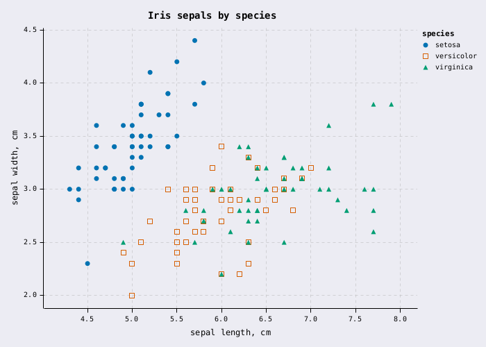
:::


### Text labels in boxes

A text chart names some cars; `:background` puts each label on a semi-transparent box, so the points it covers
stay visible and the text stays readable over them.

Source: [R Graph Gallery - Add text labels with ggplot2](https://r-graph-gallery.com/275-add-text-labels-with-ggplot2.html). Data: Motor Trend car road tests (1974), R datasets package `mtcars` (Henderson & Velleman 1981); licence: Part of R (GPL-2 | GPL-3).


::: {.sourceClojure}
```clojure
(let [label-box {:size 9 :background [255 255 255 200] :inset 2 :mapping {:x :wt :y :mpg :label :model}}]
  (plot/render-image
   {:data mtcars :mapping {:x :wt :y :mpg}
    :charts [(chart/scatter {:size 8 :color [200 60 40]})
             (chart/text (merge label-box {:data (filterv #(> (double (:mpg %)) 31.0) mtcars)
                                           :anchor [:left :middle] :offset [6 0]}))
             (chart/text (merge label-box {:data (filterv #(or (> (double (:wt %)) 5.3) (> (double (:hp %)) 250.0)) mtcars)
                                           :anchor [:right :middle] :offset [-6 0]}))]
    :labels {:title "Cars by weight and fuel use" :x "weight, 1000 lbs" :y "miles per gallon"}}
   {:width 750 :height 500}))
```
:::


::: {.clay-image}
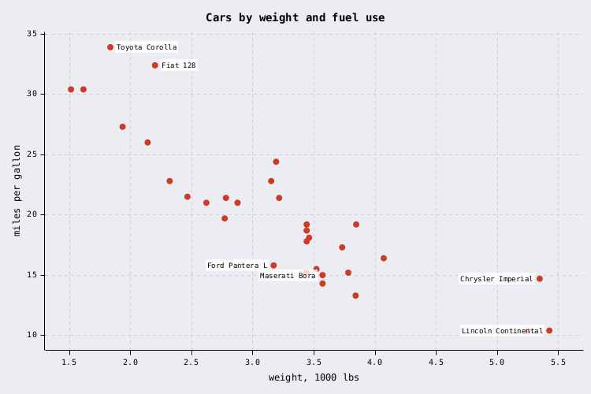
:::


### Rugs and marginal distributions

Margins share the panel's axes: rugs (one line per value) beside both axes, or the densities of both variables.

Source: [R Graph Gallery - Marginal distribution with ggplot2](https://r-graph-gallery.com/277-marginal-histogram-for-ggplot2.html). Data: Old Faithful geyser eruptions, R datasets package `faithful` (Härdle 1991; Azzalini & Bowman 1990); licence: Part of R (GPL-2 | GPL-3).


::: {.sourceClojure}
```clojure
(plot/render-image
 {:data faithful :mapping {:x :eruptions :y :waiting} :charts [(chart/scatter {:size 4})]
  :margins {:top {:charts (chart/rug) :size 25} :right {:charts (chart/rug) :size 25}}
  :labels {:title "Old Faithful with rugs" :x "eruption, min" :y "waiting, min"}}
 {:width 650 :height 480})
```
:::


::: {.clay-image}

:::


::: {.sourceClojure}
```clojure
(plot/render-image
 {:data faithful :mapping {:x :eruptions :y :waiting} :charts [(chart/scatter {:size 4})]
  :margins {:top (chart/density {:fill [70 130 180 120]}) :right (chart/density {:fill [70 130 180 120]})}
  :labels {:title "Old Faithful with marginal densities" :x "eruption, min" :y "waiting, min"}}
 {:width 650 :height 520})
```
:::


::: {.clay-image}
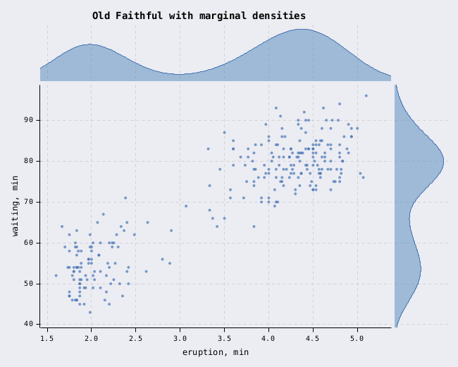
:::


### Linear fit with a confidence band

`chart/smooth {:method :lm}` adds the least-squares line and its 95 % confidence band.

Source: [R Graph Gallery - Scatterplot with a regression line](https://r-graph-gallery.com/50-51-52-scatter-plot-with-ggplot2.html). Data: House prices: living area and sale price, data-to-viz example dataset `2_TwoNum` (Yan Holtz; Kaggle House Prices competition); licence: MIT (data_to_viz repository).


::: {.sourceClojure}
```clojure
(plot/render-image
 {:data houses :mapping {:x :living-area :y :price}
  :charts [(chart/scatter {:size 3 :color [0 0 0 70]}) (chart/smooth {:method :lm})]
  :labels {:title "Price grows with living area" :x "living area, sq ft" :y "price, USD"}}
 {:width 700 :height 480})
```
:::


::: {.clay-image}

:::


### A scatter per group

A facet mapping draws one panel per species on shared scales.

Source: [R Graph Gallery - Faceting with ggplot2](https://r-graph-gallery.com/223-faceting-with-ggplot2.html). Data: Edgar Anderson's iris measurements, R datasets package `iris` (Anderson 1935; Fisher 1936); licence: Part of R (GPL-2 | GPL-3).


::: {.sourceClojure}
```clojure
(plot/render-image
 {:data iris :mapping {:x :sepal-length :y :sepal-width :facet :species}
  :charts [(chart/scatter {:size 5})]
  :labels {:title "Iris sepals, a panel per species" :x "sepal length, cm" :y "sepal width, cm"}}
 {:width 1000 :height 400})
```
:::


::: {.clay-image}
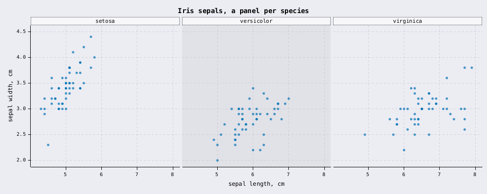
:::


### Size by overlap count

Integer data puts many cars on one point; counting the cars per point and mapping the count to the point's area
(`:area true` on the size scale) shows how many sit there.

Source: [R Graph Gallery - Scatterplot](https://r-graph-gallery.com/scatterplot.html). Data: Motor Trend car road tests (1974), R datasets package `mtcars` (Henderson & Velleman 1981); licence: Part of R (GPL-2 | GPL-3).


::: {.sourceClojure}
```clojure
(let [counts (mapv (fn [[[cyl gear] cars]] {:cyl cyl :gear gear :cars (count cars)})
                   (group-by (juxt :cyl :gear) mtcars))]
  (plot/render-image
   {:data counts :mapping {:x :cyl :y :gear :size :cars}
    :charts [(chart/scatter {:color [70 130 180 200]})]
    :scales {:size {:area true :range [4 36] :title "cars"}}
    :labels {:title "Cars per cylinder and gear count" :x "cylinders" :y "forward gears"}}
   {:width 650 :height 450}))
```
:::


::: {.clay-image}

:::


### Manhattan plot

A genome-wide association plot (seeded data): one point per marker at its position along the chromosomes and its
−log10 p-value, chromosomes in alternating colours and numbered at their centres (explicit `:ticks` with a
`:formatter`), the significance threshold 5·10⁻⁸ as a rule.

Source: [R Graph Gallery - Manhattan plot](https://r-graph-gallery.com/101_Manhattan_plot.html).


::: {.sourceClojure}
```clojure
(def markers
  "Seeded association results: 22 chromosomes of 200-400 markers, uniform p-values with three peaks."
  (let [rng (r/rng :mersenne 101)
        peaks {3 0.4 9 0.7 16 0.3}]
    (loop [chromosome 1 offset 0.0 rows []]
      (if (> chromosome 22)
        rows
        (let [n (r/irandom rng 200 400)
              chromosome-rows (for [i (range n)
                                    :let [t (/ (double i) n)
                                          peak (get peaks chromosome)
                                          strength (if peak (* 9.0 (m/exp (- (m/sq (/ (- t peak) 0.03))))) 0.0)
                                          p (* (r/drandom rng) (m/pow 10.0 (- strength)))]]
                                {:chromosome chromosome :position (+ offset i) :log-p (- (m/log10 (max p 1.0e-12)))})]
          (recur (inc chromosome) (+ offset n) (into rows chromosome-rows)))))))
```
:::


```{=html}
<div class="data-table"><table class="table table-hover table-responsive clay-table"><thead><tr><th>chromosome</th><th>position</th><th>log-p</th></tr></thead><tbody><tr><td>1</td><td>0.0</td><td>1.321090133402618</td></tr><tr><td>1</td><td>1.0</td><td>0.7254255854028658</td></tr><tr><td>1</td><td>2.0</td><td>0.10937040916998979</td></tr><tr><td>1</td><td>3.0</td><td>0.0702732624489996</td></tr><tr><td>1</td><td>4.0</td><td>1.018195079432974</td></tr><tr><td>1</td><td>5.0</td><td>0.5768220228695394</td></tr><tr><td>1</td><td>6.0</td><td>0.4434303735301068</td></tr><tr><td>1</td><td>7.0</td><td>0.6520557277177679</td></tr><tr><td>1</td><td>8.0</td><td>0.10660696402683194</td></tr><tr><td>1</td><td>9.0</td><td>0.577315467668362</td></tr><tr><td>1</td><td>10.0</td><td>0.13146550887608105</td></tr><tr><td>1</td><td>11.0</td><td>0.07147022229649572</td></tr><tr><td>1</td><td>12.0</td><td>0.05114169705832379</td></tr><tr><td>1</td><td>13.0</td><td>0.557647045257219</td></tr><tr><td>1</td><td>14.0</td><td>0.024200374772555124</td></tr><tr><td>1</td><td>15.0</td><td>0.7215572712806041</td></tr><tr><td>1</td><td>16.0</td><td>0.7744425026350125</td></tr><tr><td>1</td><td>17.0</td><td>0.9122967819583525</td></tr><tr><td>1</td><td>18.0</td><td>0.19547118084685794</td></tr><tr><td>1</td><td>19.0</td><td>0.059444391902772946</td></tr><tr><td>1</td><td>20.0</td><td>0.2148286096563049</td></tr><tr><td>1</td><td>21.0</td><td>0.10736662688214545</td></tr><tr><td>1</td><td>22.0</td><td>0.07083415930273512</td></tr><tr><td>1</td><td>23.0</td><td>0.2078307867807872</td></tr><tr><td>1</td><td>24.0</td><td>0.3143875760677496</td></tr><tr><td>1</td><td>25.0</td><td>0.2286689361115589</td></tr><tr><td>1</td><td>26.0</td><td>0.2049796028918247</td></tr><tr><td>1</td><td>27.0</td><td>0.5696103564533317</td></tr><tr><td>1</td><td>28.0</td><td>0.021315097689522434</td></tr><tr><td>1</td><td>29.0</td><td>1.869906698413462</td></tr><tr><td>1</td><td>30.0</td><td>0.1995572437170634</td></tr><tr><td>1</td><td>31.0</td><td>0.1328125777734478</td></tr><tr><td>1</td><td>32.0</td><td>0.10554589493793098</td></tr><tr><td>1</td><td>33.0</td><td>0.06477536557566124</td></tr><tr><td>1</td><td>34.0</td><td>0.22722149226592828</td></tr><tr><td>1</td><td>35.0</td><td>0.03889818418216146</td></tr><tr><td>1</td><td>36.0</td><td>0.1418168475724755</td></tr><tr><td>1</td><td>37.0</td><td>1.1497895543271632</td></tr><tr><td>1</td><td>38.0</td><td>0.057589103861989885</td></tr><tr><td>1</td><td>39.0</td><td>0.08549169738508867</td></tr><tr><td>1</td><td>40.0</td><td>0.639511148349671</td></tr><tr><td>1</td><td>41.0</td><td>0.1907283865939548</td></tr><tr><td>1</td><td>42.0</td><td>0.726341866606375</td></tr><tr><td>1</td><td>43.0</td><td>0.0678698487565619</td></tr><tr><td>1</td><td>44.0</td><td>1.5292106704649437</td></tr><tr><td>1</td><td>45.0</td><td>0.07169734425996548</td></tr><tr><td>1</td><td>46.0</td><td>0.31651892914074914</td></tr><tr><td>1</td><td>47.0</td><td>0.1301648485414591</td></tr><tr><td>1</td><td>48.0</td><td>0.10000070193553397</td></tr><tr><td>1</td><td>49.0</td><td>0.10954073426815966</td></tr><tr><td>1</td><td>50.0</td><td>0.45134210881535664</td></tr><tr><td>1</td><td>51.0</td><td>0.34841421331005396</td></tr><tr><td>1</td><td>52.0</td><td>0.13029389132889732</td></tr><tr><td>1</td><td>53.0</td><td>0.04913480386377777</td></tr><tr><td>1</td><td>54.0</td><td>0.6055397174988397</td></tr><tr><td>1</td><td>55.0</td><td>0.0033920334192492833</td></tr><tr><td>1</td><td>56.0</td><td>0.3015032969743674</td></tr><tr><td>1</td><td>57.0</td><td>0.9125902797089116</td></tr><tr><td>1</td><td>58.0</td><td>0.3331350206714257</td></tr><tr><td>1</td><td>59.0</td><td>0.12146943795179406</td></tr><tr><td>1</td><td>60.0</td><td>0.0928962335388104</td></tr><tr><td>1</td><td>61.0</td><td>0.6902674448584781</td></tr><tr><td>1</td><td>62.0</td><td>0.18716515573047776</td></tr><tr><td>1</td><td>63.0</td><td>0.15493787191261976</td></tr><tr><td>1</td><td>64.0</td><td>0.4987103351374514</td></tr><tr><td>1</td><td>65.0</td><td>3.790928323470816E-4</td></tr><tr><td>1</td><td>66.0</td><td>0.016200642665642834</td></tr><tr><td>1</td><td>67.0</td><td>0.17952188703893712</td></tr><tr><td>1</td><td>68.0</td><td>0.32505946707462896</td></tr><tr><td>1</td><td>69.0</td><td>0.1234262108372529</td></tr><tr><td>1</td><td>70.0</td><td>0.7806478404275248</td></tr><tr><td>1</td><td>71.0</td><td>0.20832413793665486</td></tr><tr><td>1</td><td>72.0</td><td>0.007986027183787853</td></tr><tr><td>1</td><td>73.0</td><td>0.026224509601937663</td></tr><tr><td>1</td><td>74.0</td><td>0.3454675839091202</td></tr><tr><td>1</td><td>75.0</td><td>0.49498848601206386</td></tr><tr><td>1</td><td>76.0</td><td>0.1490475327611436</td></tr><tr><td>1</td><td>77.0</td><td>0.049816956005540106</td></tr><tr><td>1</td><td>78.0</td><td>0.022176700864748062</td></tr><tr><td>1</td><td>79.0</td><td>0.058106064072997066</td></tr><tr><td>1</td><td>80.0</td><td>0.17587597824404708</td></tr><tr><td>1</td><td>81.0</td><td>0.7574124753510013</td></tr><tr><td>1</td><td>82.0</td><td>0.8117273884425281</td></tr><tr><td>1</td><td>83.0</td><td>0.25482134708120274</td></tr><tr><td>1</td><td>84.0</td><td>0.7995205557250042</td></tr><tr><td>1</td><td>85.0</td><td>0.9259894684826615</td></tr><tr><td>1</td><td>86.0</td><td>0.09911270732273096</td></tr><tr><td>1</td><td>87.0</td><td>0.5459345667781825</td></tr><tr><td>1</td><td>88.0</td><td>0.8084550289905961</td></tr><tr><td>1</td><td>89.0</td><td>0.3668581604275299</td></tr><tr><td>1</td><td>90.0</td><td>0.3881246628611805</td></tr><tr><td>1</td><td>91.0</td><td>0.3282595994065482</td></tr><tr><td>1</td><td>92.0</td><td>0.1234040634227983</td></tr><tr><td>1</td><td>93.0</td><td>0.2597301683792858</td></tr><tr><td>1</td><td>94.0</td><td>2.2112262165728076</td></tr><tr><td>1</td><td>95.0</td><td>1.043448634947657</td></tr><tr><td>1</td><td>96.0</td><td>0.5664236026450195</td></tr><tr><td>1</td><td>97.0</td><td>0.7591408258927068</td></tr><tr><td>1</td><td>98.0</td><td>0.037832200082531894</td></tr><tr><td>1</td><td>99.0</td><td>0.15515928310512367</td></tr><tr><td>…</td><td>…</td><td>…</td></tr></tbody></table></div>
```


::: {.sourceClojure}
```clojure
(let [centres (into (sorted-map) (for [[chromosome rows] (group-by :chromosome markers)]
                                     [(stats/mean (map :position rows)) chromosome]))]
  (plot/render-image
   {:data markers :mapping {:x :position :y :log-p :color #(if (odd? (:chromosome %)) "odd" "even")}
    :charts [(chart/scatter {:size 3})
             (chart/rule {:y (- (m/log10 5.0e-8)) :dash :dashed :color [200 40 40]})]
    :scales {:x {:ticks (vec (keys centres)) :formatter #(str (get centres (double %)))}
             :color {:range {"odd" [40 70 120] "even" [140 170 210]} :legend false}}
    :theme {:panel {:grid {:x :none}}}
    :labels {:title "Association with a trait along 22 chromosomes" :x "chromosome" :y "-log10 p"}}
   {:width 1000 :height 400}))
```
:::


::: {.clay-image}

:::


### Simpson's paradox

Three groups (seeded): within each group y grows with x, across all of them it falls. One fit for everything
points the wrong way; a fit per group shows the relation inside the groups.

Source: [data-to-viz - Simpson's paradox](https://www.data-to-viz.com/caveat/simpson.html).


::: {.sourceClojure}
```clojure
(def simpson
  (let [rng (r/rng :mersenne 33)]
    (vec (for [[g cx cy] [["A" 2.0 9.0] ["B" 5.0 6.0] ["C" 8.0 3.0]]
               _ (range 40)
               :let [dx (r/grandom rng 0.0 1.0)]]
           {:group g :x (+ cx dx) :y (+ cy (* 0.8 dx) (r/grandom rng 0.0 0.5))}))))
```
:::


```{=html}
<div class="data-table"><table class="table table-hover table-responsive clay-table"><thead><tr><th>group</th><th>x</th><th>y</th></tr></thead><tbody><tr><td>A</td><td>1.964851789392963</td><td>8.293392098333136</td></tr><tr><td>A</td><td>1.8506553288621237</td><td>7.994134154424934</td></tr><tr><td>A</td><td>2.4682031622430958</td><td>9.438554239321407</td></tr><tr><td>A</td><td>2.339649580463365</td><td>8.920732421423196</td></tr><tr><td>A</td><td>3.0902695866547676</td><td>9.68263359678026</td></tr><tr><td>A</td><td>1.2538220564626124</td><td>8.83299577380547</td></tr><tr><td>A</td><td>2.1843915905855322</td><td>10.188346349613735</td></tr><tr><td>A</td><td>2.869938240703129</td><td>9.983660269689159</td></tr><tr><td>A</td><td>3.7022689397102972</td><td>10.250856464153001</td></tr><tr><td>A</td><td>1.8765067624365201</td><td>7.9373114383204655</td></tr><tr><td>A</td><td>1.8411167628271052</td><td>9.271800689739065</td></tr><tr><td>A</td><td>0.6544402113380126</td><td>7.749149535867572</td></tr><tr><td>A</td><td>2.8408745240703306</td><td>9.61266948425986</td></tr><tr><td>A</td><td>2.067016347602631</td><td>8.597646404926156</td></tr><tr><td>A</td><td>2.12563489951287</td><td>8.879995060439057</td></tr><tr><td>A</td><td>1.3484728637738421</td><td>8.567706946253892</td></tr><tr><td>A</td><td>2.908064158562901</td><td>9.869689389775663</td></tr><tr><td>A</td><td>2.343433734770051</td><td>9.11868358537767</td></tr><tr><td>A</td><td>-0.06369835858025485</td><td>7.70958186873844</td></tr><tr><td>A</td><td>1.1178627218415558</td><td>8.004903449617627</td></tr><tr><td>A</td><td>2.8018356321731286</td><td>10.739337184269665</td></tr><tr><td>A</td><td>2.601115153804444</td><td>9.721295785811398</td></tr><tr><td>A</td><td>3.0370188585344677</td><td>11.112654575703685</td></tr><tr><td>A</td><td>1.7554758833959316</td><td>9.223981179414029</td></tr><tr><td>A</td><td>2.882143698907368</td><td>9.453835389625427</td></tr><tr><td>A</td><td>1.831812962526217</td><td>8.56736711012351</td></tr><tr><td>A</td><td>3.27334191397109</td><td>10.232005181110196</td></tr><tr><td>A</td><td>2.0369498314217283</td><td>8.358106844227095</td></tr><tr><td>A</td><td>2.8444687173384553</td><td>10.45121533060675</td></tr><tr><td>A</td><td>3.3035963343041956</td><td>9.637304650793773</td></tr><tr><td>A</td><td>3.5448226337166133</td><td>10.462240767763149</td></tr><tr><td>A</td><td>2.5025077326127536</td><td>9.71561144193858</td></tr><tr><td>A</td><td>2.8961104917587654</td><td>9.893467766589119</td></tr><tr><td>A</td><td>0.6893230033879922</td><td>7.7995825932223095</td></tr><tr><td>A</td><td>2.2204631461921784</td><td>9.612868006042754</td></tr><tr><td>A</td><td>2.065396537528806</td><td>8.098651148742457</td></tr><tr><td>A</td><td>2.7999398068600474</td><td>9.199428681093458</td></tr><tr><td>A</td><td>1.8397318066298296</td><td>9.445534241607655</td></tr><tr><td>A</td><td>1.2086374093554357</td><td>8.253781348575542</td></tr><tr><td>A</td><td>3.673967683013235</td><td>10.657592641048797</td></tr><tr><td>B</td><td>5.605535926378746</td><td>7.8076596150314455</td></tr><tr><td>B</td><td>5.77256409836571</td><td>6.36148435003143</td></tr><tr><td>B</td><td>4.072775716123957</td><td>4.983628356710099</td></tr><tr><td>B</td><td>4.7616976534884445</td><td>5.087922125239712</td></tr><tr><td>B</td><td>4.116597251109011</td><td>4.471887610441705</td></tr><tr><td>B</td><td>5.268738697039081</td><td>6.99677831341429</td></tr><tr><td>B</td><td>3.545289340651612</td><td>5.564933271324392</td></tr><tr><td>B</td><td>3.624616073963369</td><td>5.722988083543513</td></tr><tr><td>B</td><td>4.834601312281533</td><td>5.873498104793147</td></tr><tr><td>B</td><td>5.60264679684919</td><td>6.033942683240947</td></tr><tr><td>B</td><td>4.384009996279789</td><td>5.589658932341485</td></tr><tr><td>B</td><td>4.7445351577924075</td><td>5.801468540501135</td></tr><tr><td>B</td><td>5.664017177388377</td><td>6.6657545128026126</td></tr><tr><td>B</td><td>5.699884592180361</td><td>5.882589607383901</td></tr><tr><td>B</td><td>5.445182245459797</td><td>6.15570946542215</td></tr><tr><td>B</td><td>4.494793925163821</td><td>5.882990726247141</td></tr><tr><td>B</td><td>3.1173307779715973</td><td>4.594755432965971</td></tr><tr><td>B</td><td>3.477931693443861</td><td>3.5897736072599216</td></tr><tr><td>B</td><td>5.2034185560544595</td><td>5.159058530463275</td></tr><tr><td>B</td><td>5.0238754415755595</td><td>6.436440252237034</td></tr><tr><td>B</td><td>4.178301210583946</td><td>4.7452572369133605</td></tr><tr><td>B</td><td>5.773571157206251</td><td>6.485372182942343</td></tr><tr><td>B</td><td>4.2960801249373</td><td>6.844286611756491</td></tr><tr><td>B</td><td>3.661347383957131</td><td>4.345414201582099</td></tr><tr><td>B</td><td>5.019505660805107</td><td>6.483464679727872</td></tr><tr><td>B</td><td>7.651291722506816</td><td>8.239654069576808</td></tr><tr><td>B</td><td>4.206715875987849</td><td>6.017272829066868</td></tr><tr><td>B</td><td>4.670932137273514</td><td>6.383624191750447</td></tr><tr><td>B</td><td>5.277489409868092</td><td>6.960817085715451</td></tr><tr><td>B</td><td>7.665910545722857</td><td>7.9243850550113635</td></tr><tr><td>B</td><td>5.078876307056935</td><td>7.460297007137912</td></tr><tr><td>B</td><td>5.260095466178881</td><td>5.5641987446222485</td></tr><tr><td>B</td><td>4.0352996081199874</td><td>5.677041667667212</td></tr><tr><td>B</td><td>5.603029997074368</td><td>6.884568942006892</td></tr><tr><td>B</td><td>6.497045379761575</td><td>7.063223234944211</td></tr><tr><td>B</td><td>6.058064016573274</td><td>7.3615898628581755</td></tr><tr><td>B</td><td>6.646832220837828</td><td>6.373774728500281</td></tr><tr><td>B</td><td>5.3436288457747825</td><td>7.204654790319295</td></tr><tr><td>B</td><td>5.603201258804736</td><td>6.775482865319951</td></tr><tr><td>B</td><td>6.073163275869223</td><td>6.822574901112882</td></tr><tr><td>C</td><td>7.605167199746975</td><td>3.4728555437681403</td></tr><tr><td>C</td><td>8.103475529278436</td><td>3.0029423364449523</td></tr><tr><td>C</td><td>8.477317932499913</td><td>3.7547390518650445</td></tr><tr><td>C</td><td>7.564381876559468</td><td>3.101797683458473</td></tr><tr><td>C</td><td>8.302566293730322</td><td>3.2887982886838416</td></tr><tr><td>C</td><td>8.347928193508992</td><td>3.2357808628112723</td></tr><tr><td>C</td><td>8.652796972133698</td><td>4.091730830773349</td></tr><tr><td>C</td><td>5.894352473109018</td><td>1.6751904759493659</td></tr><tr><td>C</td><td>8.70110080153371</td><td>3.496344546715223</td></tr><tr><td>C</td><td>9.793042379057077</td><td>4.63843199802634</td></tr><tr><td>C</td><td>7.374794858909034</td><td>3.600871448903887</td></tr><tr><td>C</td><td>8.25162939232895</td><td>2.5528875236787947</td></tr><tr><td>C</td><td>8.057322476855699</td><td>2.983419789333151</td></tr><tr><td>C</td><td>8.453590754189284</td><td>3.3958311367472493</td></tr><tr><td>C</td><td>8.152863549975093</td><td>1.5457205512327161</td></tr><tr><td>C</td><td>7.03874236843896</td><td>2.862982595265567</td></tr><tr><td>C</td><td>6.802051492258309</td><td>2.8071101676815458</td></tr><tr><td>C</td><td>5.964364724091371</td><td>0.5628270384772995</td></tr><tr><td>C</td><td>8.98766594250061</td><td>3.247585393017352</td></tr><tr><td>C</td><td>6.371536778313243</td><td>1.7900250685769812</td></tr><tr><td>…</td><td>…</td><td>…</td></tr></tbody></table></div>
```


::: {.sourceClojure}
```clojure
(plot/render-image
 (plot/arrange
  [{:data simpson :mapping {:x :x :y :y}
    :charts [(chart/scatter {:size 5 :color [90 90 90]}) (chart/smooth {:method :lm})]
    :labels {:title "one fit: y falls with x"}}
   {:data simpson :mapping {:x :x :y :y :color :group}
    :charts [(chart/scatter {:size 5}) (chart/smooth {:method :lm})]
    :theme {:palette {:color :set1}}
    :labels {:title "a fit per group: y grows with x" :y nil}}]
  {:columns 2})
 {:width 1000 :height 430})
```
:::


::: {.clay-image}

:::


## Heatmap

A grid of cells coloured by a value: rows and columns are categories (or binned numbers).


### Basic heatmap, square and hexagon cells

European countries × demographic indicators, each indicator standardized (z-score) so the colours compare across
columns of different units; `:cell :pointy-hex` draws the same grid as a honeycomb.


::: {.sourceClojure}
```clojure
(def europe (filterv #(= "Europe" (:continent %)) countries))
```
:::


```{=html}
<div class="data-table"><table class="table table-hover table-responsive clay-table"><thead><tr><th>country</th><th>pop</th><th>birth-rate</th><th>mortality-rate</th><th>life-expectancy</th><th>infant-mortality</th><th>children-per-woman</th><th>growth-rate</th><th>population-aged-65</th><th>group</th><th>continent</th></tr></thead><tbody><tr><td>Channel Islands</td><td>166</td><td>9.28</td><td>9.14</td><td>81.269</td><td>7.276</td><td>1.492</td><td>4.56</td><td>30</td><td>North</td><td>Europe</td></tr><tr><td>Denmark</td><td>5733</td><td>10.707</td><td>9.62</td><td>80.839</td><td>3.495</td><td>1.758</td><td>3.67</td><td>1132</td><td>North</td><td>Europe</td></tr><tr><td>Estonia</td><td>1302</td><td>10.698</td><td>12.657</td><td>77.342</td><td>2.843</td><td>1.657</td><td>-2.63</td><td>256</td><td>North</td><td>Europe</td></tr><tr><td>Finland</td><td>5556</td><td>10.672</td><td>9.865</td><td>81.576</td><td>1.839</td><td>1.764</td><td>2.65</td><td>1212</td><td>North</td><td>Europe</td></tr><tr><td>Iceland</td><td>337</td><td>12.836</td><td>6.467</td><td>83.22</td><td>1.752</td><td>1.893</td><td>7.83</td><td>50</td><td>North</td><td>Europe</td></tr><tr><td>Ireland</td><td>4791</td><td>13.179</td><td>6.562</td><td>81.621</td><td>2.385</td><td>1.998</td><td>8.84</td><td>682</td><td>North</td><td>Europe</td></tr><tr><td>Latvia</td><td>1936</td><td>10.093</td><td>15.36</td><td>74.59</td><td>5.493</td><td>1.555</td><td>-4.36</td><td>383</td><td>North</td><td>Europe</td></tr><tr><td>Lithuania</td><td>2817</td><td>10.459</td><td>16.187</td><td>73.831</td><td>3.076</td><td>1.641</td><td>-4.27</td><td>535</td><td>North</td><td>Europe</td></tr><tr><td>Norway</td><td>5387</td><td>11.923</td><td>7.908</td><td>82.187</td><td>2.108</td><td>1.809</td><td>10.29</td><td>913</td><td>North</td><td>Europe</td></tr><tr><td>Sweden</td><td>9987</td><td>12.22</td><td>9.011</td><td>82.851</td><td>2.427</td><td>1.927</td><td>6.64</td><td>2044</td><td>North</td><td>Europe</td></tr><tr><td>United Kingdom</td><td>65913</td><td>12.385</td><td>9.096</td><td>81.327</td><td>3.559</td><td>1.909</td><td>6.06</td><td>11997</td><td>North</td><td>Europe</td></tr><tr><td>Belarus</td><td>9429</td><td>11.6</td><td>14.6</td><td>71.8</td><td>3.5</td><td>1.65</td><td>-3.3</td><td>1387</td><td>East</td><td>Europe</td></tr><tr><td>Bulgaria</td><td>6992</td><td>9.4</td><td>15.6</td><td>74.6</td><td>8.0</td><td>1.6</td><td>-7.6</td><td>1463</td><td>East</td><td>Europe</td></tr><tr><td>Czech Republic</td><td>10563</td><td>10.0</td><td>10.6</td><td>79.2</td><td>2.1</td><td>1.54</td><td>0.7</td><td>2067</td><td>East</td><td>Europe</td></tr><tr><td>Hungary</td><td>9754</td><td>9.3</td><td>13.5</td><td>75.7</td><td>4.2</td><td>1.41</td><td>-3.5</td><td>1864</td><td>East</td><td>Europe</td></tr><tr><td>Poland</td><td>38523</td><td>9.4</td><td>10.4</td><td>78.1</td><td>4.0</td><td>1.33</td><td>-1.2</td><td>6686</td><td>East</td><td>Europe</td></tr><tr><td>Republic of Moldova</td><td>4045</td><td>10.0</td><td>11.7</td><td>71.9</td><td>9.7</td><td>1.23</td><td>-2.7</td><td>464</td><td>East</td><td>Europe</td></tr><tr><td>Romania</td><td>19105</td><td>8.9</td><td>13.7</td><td>75.2</td><td>8.3</td><td>1.54</td><td>-6.9</td><td>3575</td><td>East</td><td>Europe</td></tr><tr><td>Russian Federation</td><td>143261</td><td>12.3</td><td>14.2</td><td>70.5</td><td>7.3</td><td>1.73</td><td>-1.0</td><td>20676</td><td>East</td><td>Europe</td></tr><tr><td>Slovakia</td><td>5434</td><td>10.3</td><td>10.3</td><td>76.8</td><td>4.4</td><td>1.44</td><td>0.3</td><td>837</td><td>East</td><td>Europe</td></tr><tr><td>Ukraine</td><td>4417</td><td>10.6</td><td>15.6</td><td>71.3</td><td>8.3</td><td>1.56</td><td>-5.4</td><td>7283</td><td>East</td><td>Europe</td></tr><tr><td>Albania</td><td>2919</td><td>13.8</td><td>7.8</td><td>78.5</td><td>12.5</td><td>1.78</td><td>2.7</td><td>393</td><td>South</td><td>Europe</td></tr><tr><td>Bosnia and Herzegovina</td><td>3782</td><td>8.4</td><td>11.1</td><td>77.1</td><td>6.4</td><td>1.23</td><td>-2.9</td><td>644</td><td>South</td><td>Europe</td></tr><tr><td>Croatia</td><td>4195</td><td>9.1</td><td>12.8</td><td>78.0</td><td>3.2</td><td>1.48</td><td>-3.7</td><td>844</td><td>South</td><td>Europe</td></tr><tr><td>Greece</td><td>10872</td><td>7.9</td><td>11.3</td><td>81.7</td><td>2.3</td><td>1.3</td><td>-2.0</td><td>2383</td><td>South</td><td>Europe</td></tr><tr><td>Italy</td><td>59788</td><td>8.2</td><td>10.3</td><td>83.8</td><td>1.9</td><td>1.49</td><td>-0.2</td><td>1397</td><td>South</td><td>Europe</td></tr><tr><td>Malta</td><td>421</td><td>9.0</td><td>9.3</td><td>81.2</td><td>4.0</td><td>1.49</td><td>2.0</td><td>86</td><td>South</td><td>Europe</td></tr><tr><td>Montenegro</td><td>626</td><td>11.0</td><td>10.3</td><td>76.7</td><td>3.6</td><td>1.65</td><td>-0.1</td><td>94</td><td>South</td><td>Europe</td></tr><tr><td>Portugal</td><td>10229</td><td>7.5</td><td>10.7</td><td>81.9</td><td>2.6</td><td>1.24</td><td>-3.4</td><td>2246</td><td>South</td><td>Europe</td></tr><tr><td>Serbia</td><td>8743</td><td>10.2</td><td>13.1</td><td>75.4</td><td>8.2</td><td>1.6</td><td>-3.9</td><td>1626</td><td>South</td><td>Europe</td></tr><tr><td>Slovenia</td><td>2073</td><td>10.1</td><td>10.0</td><td>81.1</td><td>2.7</td><td>1.66</td><td>0.8</td><td>406</td><td>South</td><td>Europe</td></tr><tr><td>Spain</td><td>46117</td><td>8.5</td><td>9.2</td><td>83.3</td><td>2.5</td><td>1.38</td><td>1.1</td><td>9048</td><td>South</td><td>Europe</td></tr><tr><td>TFYR Macedonia</td><td>2085</td><td>11.1</td><td>9.8</td><td>76.0</td><td>8.4</td><td>1.56</td><td>0.9</td><td>284</td><td>South</td><td>Europe</td></tr><tr><td>Austria</td><td>8614</td><td>9.7</td><td>9.5</td><td>82.2</td><td>2.5</td><td>1.53</td><td>2.4</td><td>166</td><td>West</td><td>Europe</td></tr><tr><td>Belgium</td><td>11513</td><td>11.4</td><td>9.7</td><td>81.5</td><td>2.7</td><td>1.83</td><td>5.8</td><td>2171</td><td>West</td><td>Europe</td></tr><tr><td>France</td><td>65206</td><td>11.9</td><td>9.1</td><td>82.9</td><td>2.8</td><td>1.99</td><td>4.1</td><td>13167</td><td>West</td><td>Europe</td></tr><tr><td>Germany</td><td>80561</td><td>8.7</td><td>11.3</td><td>81.6</td><td>2.5</td><td>1.44</td><td>-1.0</td><td>17746</td><td>West</td><td>Europe</td></tr><tr><td>Luxembourg</td><td>591</td><td>11.5</td><td>7.1</td><td>82.4</td><td>1.3</td><td>1.61</td><td>11.7</td><td>86</td><td>West</td><td>Europe</td></tr><tr><td>Netherlands</td><td>17085</td><td>10.5</td><td>8.8</td><td>82.1</td><td>3.0</td><td>1.77</td><td>3.0</td><td>333</td><td>West</td><td>Europe</td></tr><tr><td>Switzerland</td><td>8524</td><td>10.5</td><td>8.0</td><td>83.7</td><td>3.0</td><td>1.58</td><td>8.0</td><td>1592</td><td>West</td><td>Europe</td></tr></tbody></table></div>
```


Source: R Graph Gallery - Heatmap; data-to-viz - Heatmap ([1](https://r-graph-gallery.com/heatmap.html), [2](https://www.data-to-viz.com/graph/heatmap.html)). Data: Countries: demographic indicators, data-to-viz example dataset `multivariate` (Yan Holtz; original source not documented); licence: MIT (data_to_viz repository).


::: {.sourceClojure}
```clojure
(let [rows (z-scores europe)
      heatmap (fn [cell title legend?]
                {:data rows :mapping {:x :country :y :indicator :color :z} :legend legend?
                 :scales {:color {:range :RColorBrewer/RdBu :midpoint 0 :reverse true :title "z-score"}}
                 :theme {:axis {:x {:label-rotation 90}}}
                 :charts [(chart/tile {:cell cell})]
                 :labels {:title title :x nil :y nil}})]
  (plot/render-image
   (plot/arrange [(heatmap :square "square cells" false) (heatmap :pointy-hex "pointy-hex cells" true)]
                 {:columns 1})
   {:width 1000 :height 800}))
```
:::


::: {.clay-image}

:::


### Palettes, normalized columns

Raw values put every indicator on one colour scale, so life expectancy (around 80) drowns the rates (0-20);
standardizing each column first gives every indicator the full palette. Any palette or gradient works:
viridis on the left, a diverging RdBu around 0 on the right.

Source: [R Graph Gallery - Heatmap with the levelplot function](https://r-graph-gallery.com/79-levelplot-with-ggplot2.html). Data: Countries: demographic indicators, data-to-viz example dataset `multivariate` (Yan Holtz; original source not documented); licence: MIT (data_to_viz repository).


::: {.sourceClojure}
```clojure
(let [rows (z-scores (take 25 europe))
      base {:data rows :theme {:axis {:x {:label-rotation 90}}} :labels {:x nil :y nil}}]
  (plot/render-image
   (plot/arrange
    [(merge base {:mapping {:x :country :y :indicator :color :value} :charts [(chart/tile)]
                  :scales {:color {:range :viridis :title "value"}}
                  :labels {:title "raw values (viridis)" :x nil :y nil}})
     (merge base {:mapping {:x :country :y :indicator :color :z} :charts [(chart/tile)]
                  :scales {:color {:range :RColorBrewer/RdBu :midpoint 0 :reverse true :title "z-score"}}
                  :labels {:title "standardized per indicator (RdBu)" :x nil :y nil}})]
    {:columns 2})
   {:width 1000 :height 520}))
```
:::


::: {.clay-image}
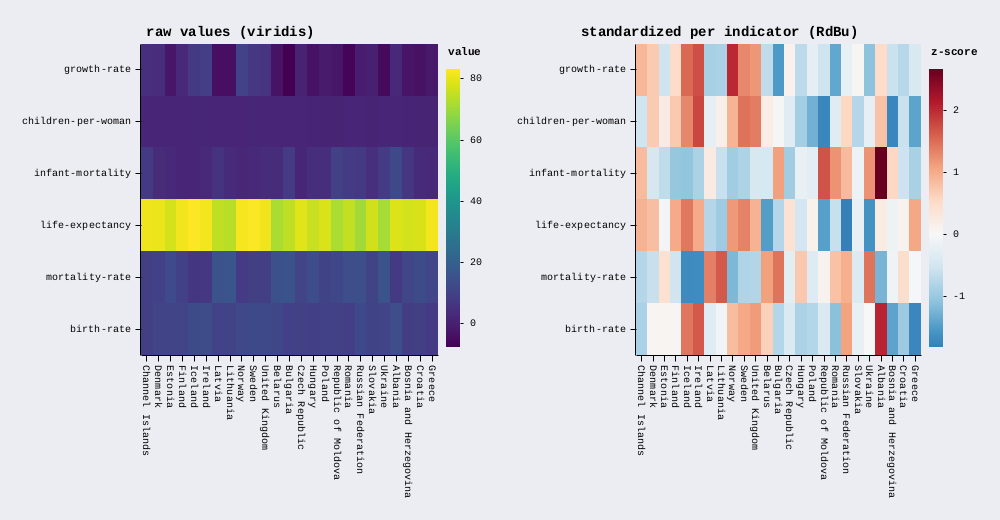
:::


### Side colour bar

A category of the columns as a one-row tile above the heatmap: both plots share the column order (`:domain`),
`plot/arrange` aligns the cells. Here: up to six of the most populous countries of each continent (the dataset
has two in North America), grouped by continent.

Source: [R Graph Gallery - The heatmap function (side colours)](https://r-graph-gallery.com/215-the-heatmap-function.html). Data: Countries: demographic indicators, data-to-viz example dataset `multivariate` (Yan Holtz; original source not documented); licence: MIT (data_to_viz repository).


::: {.sourceClojure}
```clojure
(let [picked (vec (mapcat (fn [[_ rows]] (take 6 (sort-by #(- (double (:pop %))) rows)))
                          (sort-by key (group-by :continent countries))))
      order (mapv :country picked)]
  (plot/render-image
   (plot/arrange
    [{:data picked :mapping {:x :country :y (constantly "continent") :color :continent}
      :scales {:x {:domain order :axis false} :color {:title "continent"}}
      :charts [(chart/tile {:stroke-color :white})]
      :labels {:title "Indicators of the largest countries per continent" :x nil :y nil}}
     {:data (z-scores picked) :mapping {:x :country :y :indicator :color :z}
      :scales {:x {:domain order} :color {:range :RColorBrewer/RdBu :midpoint 0 :reverse true :title "z-score"}}
      :theme {:axis {:x {:label-rotation 90}}}
      :charts [(chart/tile {:stroke-color :white})]
      :labels {:x nil :y nil}}]
    {:columns 1 :heights [1 6]})
   {:width 1000 :height 600}))
```
:::


::: {.clay-image}

:::


### Values in cells: the correlation matrix

`fastmath.stats/correlation-matrix` gives r of every pair of variables; one tile per pair, coloured on a
diverging scale over [-1 1] and labelled with its value (`:value-label`, text in a contrasting colour).

Source: [R Graph Gallery - Correlation matrix with ggally (heatmap)](https://r-graph-gallery.com/199-correlation-matrix-with-ggally.html). Data: Motor Trend car road tests (1974), R datasets package `mtcars` (Henderson & Velleman 1981); licence: Part of R (GPL-2 | GPL-3).


::: {.sourceClojure}
```clojure
(let [variables [:mpg :cyl :disp :hp :drat :wt :qsec :gear :carb]
      names (mapv name variables)
      r (stats/correlation-matrix (mapv (fn [k] (mapv k mtcars)) variables))]
  (plot/render-image
   {:data (vec (for [i (range (count names)) j (range (count names))]
                 {:x (names i) :y (names j) :r (nth (nth r i) j)}))
    :mapping {:x :x :y :y :color :r}
    :scales {:y {:domain (vec (reverse names))} :color {:range :RColorBrewer/RdBu :domain [-1 1] :title "r"}}
    :charts [(chart/tile {:stroke-color :white :value-label (fn [{:keys [value]}] (format "%.2f" (double value)))})]
    :labels {:title "mtcars: correlation of every pair" :x nil :y nil}}
   {:width 700 :height 600}))
```
:::


::: {.clay-image}

:::


### Calendar heatmap

Daily bitcoin price changes on a calendar: ISO week across, weekday down, a row of panels per year; the colour
is the day's change, capped at ±10 % so a few extreme days don't flatten the rest.

Source: [R Graph Gallery - The hourly heatmap (calendar layout)](https://r-graph-gallery.com/283-the-hourly-heatmap.html). Data: Bitcoin daily price, 2013-2018, data-to-viz example dataset `3_TwoNumOrdered` (Yan Holtz; CoinMarketCap via JesseVent/crypto); licence: MIT (data_to_viz repository).


::: {.sourceClojure}
```clojure
(let [weekdays ["Mon" "Tue" "Wed" "Thu" "Fri" "Sat" "Sun"]
      days (vec (for [[prev day] (partition 2 1 bitcoin)
                      :let [^LocalDate d (:date day)]]
                  {:week (.get d IsoFields/WEEK_OF_WEEK_BASED_YEAR)
                   :year (.get d IsoFields/WEEK_BASED_YEAR)
                   :weekday (weekdays (dec (.getValue ^DayOfWeek (.getDayOfWeek d))))
                   :change (m/constrain (- (/ (double (:value day)) (double (:value prev))) 1.0) -0.1 0.1)}))]
  (plot/render-image
   {:data days :mapping {:x :week :y :weekday :color :change :facet-row :year}
    :scales {:y {:domain (vec (reverse weekdays))}
             :color {:range :RColorBrewer/RdYlGn :midpoint 0 :domain [-0.1 0.1] :title "daily change"
                     :formatter #(format "%+.0f%%" (* 100.0 (double %)))}}
    :charts [(chart/tile {:stroke-color :white})]
    :labels {:title "Bitcoin: daily price change, 2013-2018" :x "ISO week" :y nil}}
   {:width 1000 :height 800}))
```
:::


::: {.clay-image}

:::


### Row and column order

The order of the categories is the scale's `:domain`: the data order (the default; here the dataset's subregions)
hides structure that a meaningful order shows - countries sorted by life expectancy.

Source: [R Graph Gallery - Heatmap](https://r-graph-gallery.com/heatmap.html). Data: Countries: demographic indicators, data-to-viz example dataset `multivariate` (Yan Holtz; original source not documented); licence: MIT (data_to_viz repository).


::: {.sourceClojure}
```clojure
(let [rows (z-scores europe)
      by-life (mapv :country (sort-by :life-expectancy europe))
      heatmap (fn [order title legend?]
                {:data rows :mapping {:x :country :y :indicator :color :z} :legend legend?
                 :scales (cond-> {:color {:range :RColorBrewer/RdBu :midpoint 0 :reverse true :title "z-score"}}
                           order (assoc :x {:domain order}))
                 :theme {:axis {:x {:label-rotation 90}}}
                 :charts [(chart/tile)]
                 :labels {:title title :x nil :y nil}})]
  (plot/render-image
   (plot/arrange [(heatmap nil "data order" false) (heatmap by-life "by life expectancy" true)] {:columns 1})
   {:width 1000 :height 800}))
```
:::


::: {.clay-image}
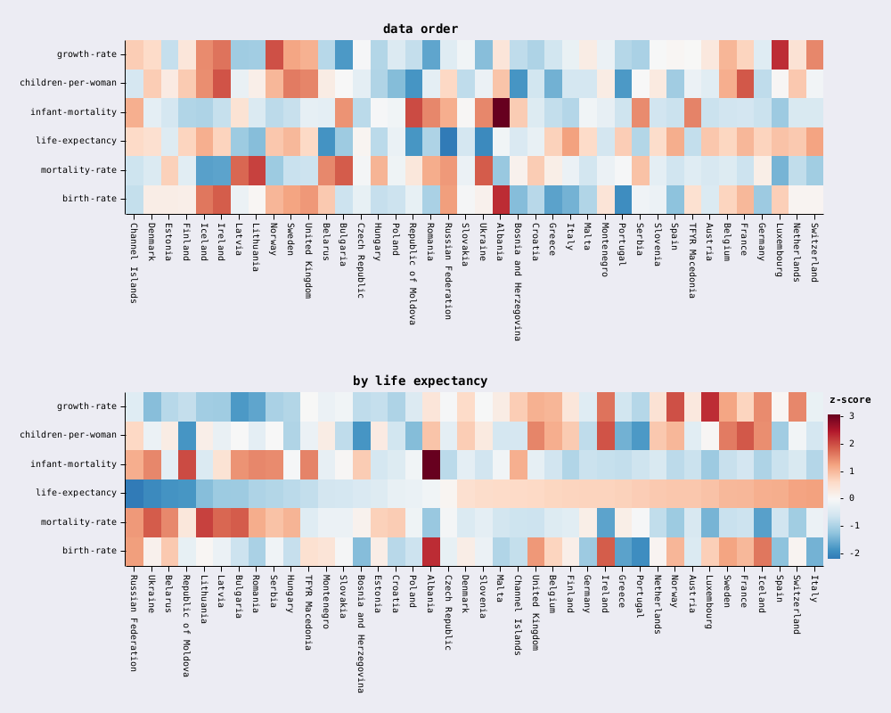
:::


### Smoothed heatmap

Measurements on a coarse lattice (seeded: two bumps and noise) as tiles, and the same values interpolated
bicubically into a smooth field with contour lines.

Source: [R Graph Gallery - 2D density chart (raster smoothing)](https://r-graph-gallery.com/2d-density-chart.html).


::: {.sourceClojure}
```clojure
(def lattice
  (let [rng (r/rng :mersenne 21)]
    (vec (for [x (range 12) y (range 9)]
           {:x x :y y :z (+ (* 8 (m/exp (- (/ (+ (m/sq (- x 3)) (m/sq (- y 6))) 6.0))))
                            (* 5 (m/exp (- (/ (+ (m/sq (- x 8)) (m/sq (- y 2))) 8.0))))
                            (* 0.6 (r/drandom rng)))}))))
```
:::


```{=html}
<div class="data-table"><table class="table table-hover table-responsive clay-table"><thead><tr><th>x</th><th>y</th><th>z</th></tr></thead><tbody><tr><td>0</td><td>0</td><td>0.28583487104429245</td></tr><tr><td>0</td><td>1</td><td>0.10791487180475237</td></tr><tr><td>0</td><td>2</td><td>0.6030843843725184</td></tr><tr><td>0</td><td>3</td><td>0.9389467343849848</td></tr><tr><td>0</td><td>4</td><td>0.9211178618580388</td></tr><tr><td>0</td><td>5</td><td>1.9119705375688558</td></tr><tr><td>0</td><td>6</td><td>2.134064852433023</td></tr><tr><td>0</td><td>7</td><td>2.08609507944629</td></tr><tr><td>0</td><td>8</td><td>1.438453017789411</td></tr><tr><td>1</td><td>0</td><td>0.5952671498688122</td></tr><tr><td>1</td><td>1</td><td>0.19969212793906976</td></tr><tr><td>1</td><td>2</td><td>0.5844746003855454</td></tr><tr><td>1</td><td>3</td><td>1.4545009012104928</td></tr><tr><td>1</td><td>4</td><td>2.5409391316790555</td></tr><tr><td>1</td><td>5</td><td>3.8373025676266934</td></tr><tr><td>1</td><td>6</td><td>4.201832671922312</td></tr><tr><td>1</td><td>7</td><td>3.655938975804499</td></tr><tr><td>1</td><td>8</td><td>2.5001012113405694</td></tr><tr><td>2</td><td>0</td><td>0.618362826989968</td></tr><tr><td>2</td><td>1</td><td>0.6732405127858085</td></tr><tr><td>2</td><td>2</td><td>1.0761058547793179</td></tr><tr><td>2</td><td>3</td><td>2.156963479413669</td></tr><tr><td>2</td><td>4</td><td>3.9437515115583293</td></tr><tr><td>2</td><td>5</td><td>6.088869393303253</td></tr><tr><td>2</td><td>6</td><td>7.223963808658699</td></tr><tr><td>2</td><td>7</td><td>6.181575787813296</td></tr><tr><td>2</td><td>8</td><td>3.595401513596446</td></tr><tr><td>3</td><td>0</td><td>0.333213361563252</td></tr><tr><td>3</td><td>1</td><td>0.6697686994738297</td></tr><tr><td>3</td><td>2</td><td>1.2793636388027463</td></tr><tr><td>3</td><td>3</td><td>2.0862415090015136</td></tr><tr><td>3</td><td>4</td><td>4.458190459015801</td></tr><tr><td>3</td><td>5</td><td>6.970829698765733</td></tr><tr><td>3</td><td>6</td><td>8.534564851753958</td></tr><tr><td>3</td><td>7</td><td>7.057261446850634</td></tr><tr><td>3</td><td>8</td><td>4.359105718963007</td></tr><tr><td>4</td><td>0</td><td>0.5570483235833215</td></tr><tr><td>4</td><td>1</td><td>0.8944207518167911</td></tr><tr><td>4</td><td>2</td><td>1.6501578267870998</td></tr><tr><td>4</td><td>3</td><td>2.3840911784251038</td></tr><tr><td>4</td><td>4</td><td>4.244627066242449</td></tr><tr><td>4</td><td>5</td><td>6.02619508927574</td></tr><tr><td>4</td><td>6</td><td>7.187452425372401</td></tr><tr><td>4</td><td>7</td><td>5.8280157113365405</td></tr><tr><td>4</td><td>8</td><td>3.704818687511894</td></tr><tr><td>5</td><td>0</td><td>1.586086948590935</td></tr><tr><td>5</td><td>1</td><td>1.758570203324923</td></tr><tr><td>5</td><td>2</td><td>2.016978161678625</td></tr><tr><td>5</td><td>3</td><td>2.46072848102963</td></tr><tr><td>5</td><td>4</td><td>3.2577475177638577</td></tr><tr><td>5</td><td>5</td><td>4.594418052081281</td></tr><tr><td>5</td><td>6</td><td>4.468750221391473</td></tr><tr><td>5</td><td>7</td><td>4.13940626176397</td></tr><tr><td>5</td><td>8</td><td>2.3669197353085063</td></tr><tr><td>6</td><td>0</td><td>1.8887162462996216</td></tr><tr><td>6</td><td>1</td><td>3.1333427768332953</td></tr><tr><td>6</td><td>2</td><td>3.339224776138032</td></tr><tr><td>6</td><td>3</td><td>3.25110392251887</td></tr><tr><td>6</td><td>4</td><td>2.886591905153736</td></tr><tr><td>6</td><td>5</td><td>2.619771824298391</td></tr><tr><td>6</td><td>6</td><td>2.764658117098137</td></tr><tr><td>6</td><td>7</td><td>1.658904714071102</td></tr><tr><td>6</td><td>8</td><td>1.4316441251394127</td></tr><tr><td>7</td><td>0</td><td>3.0231573018396793</td></tr><tr><td>7</td><td>1</td><td>4.355480281556456</td></tr><tr><td>7</td><td>2</td><td>4.87069215197841</td></tr><tr><td>7</td><td>3</td><td>4.45222733511073</td></tr><tr><td>7</td><td>4</td><td>3.3300051593905104</td></tr><tr><td>7</td><td>5</td><td>2.4322224055470194</td></tr><tr><td>7</td><td>6</td><td>1.7382256200025936</td></tr><tr><td>7</td><td>7</td><td>1.134535831088446</td></tr><tr><td>7</td><td>8</td><td>0.41642342959362333</td></tr><tr><td>8</td><td>0</td><td>3.2315842696194066</td></tr><tr><td>8</td><td>1</td><td>4.495457710039368</td></tr><tr><td>8</td><td>2</td><td>5.4578978189143</td></tr><tr><td>8</td><td>3</td><td>4.574010303877224</td></tr><tr><td>8</td><td>4</td><td>3.3559974276459315</td></tr><tr><td>8</td><td>5</td><td>1.7895030317462122</td></tr><tr><td>8</td><td>6</td><td>1.3201149775070067</td></tr><tr><td>8</td><td>7</td><td>0.7909536026608897</td></tr><tr><td>8</td><td>8</td><td>0.4199979299355363</td></tr><tr><td>9</td><td>0</td><td>3.1218434814847975</td></tr><tr><td>9</td><td>1</td><td>3.9952972248372474</td></tr><tr><td>9</td><td>2</td><td>4.71571875898743</td></tr><tr><td>9</td><td>3</td><td>4.345432803474976</td></tr><tr><td>9</td><td>4</td><td>2.9519278627245535</td></tr><tr><td>9</td><td>5</td><td>1.6921846217085832</td></tr><tr><td>9</td><td>6</td><td>0.9685752885813317</td></tr><tr><td>9</td><td>7</td><td>0.424429410700548</td></tr><tr><td>9</td><td>8</td><td>0.11065502824543222</td></tr><tr><td>10</td><td>0</td><td>1.978359493499266</td></tr><tr><td>10</td><td>1</td><td>3.2237065179057676</td></tr><tr><td>10</td><td>2</td><td>3.101479844427019</td></tr><tr><td>10</td><td>3</td><td>3.0347060185303345</td></tr><tr><td>10</td><td>4</td><td>2.195848619843698</td></tr><tr><td>10</td><td>5</td><td>1.2401573576208922</td></tr><tr><td>10</td><td>6</td><td>0.4920506059344093</td></tr><tr><td>10</td><td>7</td><td>0.2403305652264046</td></tr><tr><td>10</td><td>8</td><td>0.18932609941153122</td></tr><tr><td>11</td><td>0</td><td>1.2104157576539942</td></tr><tr><td>…</td><td>…</td><td>…</td></tr></tbody></table></div>
```


::: {.sourceClojure}
```clojure
(plot/render-image
 (plot/arrange
  [{:data lattice :mapping {:x :x :y :y :color :z} :charts [(chart/tile)] :legend false
    :labels {:title "measured lattice"}}
   {:data lattice :mapping {:x :x :y :y :value :z}
    :charts [(chart/field {:interpolation :bicubic}) (chart/contour {:interpolation :bicubic :color [0 0 0 120]})]
    :labels {:title "bicubic field and contours" :y nil}}]
  {:columns 2})
 {:width 1000 :height 430})
```
:::


::: {.clay-image}

:::


## Correlogram

All pairs of several variables at once: `plot/pairs` lays out a matrix of cells sharing the variables' scales.


### Scatter-plot matrix by group

Scatter plots below the diagonal, densities on it, the correlation per species above it, coloured by species.

Source: R Graph Gallery - Correlogram; data-to-viz - Correlogram ([1](https://r-graph-gallery.com/correlogram.html), [2](https://www.data-to-viz.com/graph/correlogram.html)). Data: Edgar Anderson's iris measurements, R datasets package `iris` (Anderson 1935; Fisher 1936); licence: Part of R (GPL-2 | GPL-3).


::: {.sourceClojure}
```clojure
(plot/render-image
 (plot/pairs iris {:variables [:sepal-length :sepal-width :petal-length :petal-width] :mapping {:color :species}
                   :theme {:palette {:color :set1}} :title "Iris measurements by species"})
 {:width 950 :height 800})
```
:::


::: {.clay-image}

:::


### Correlation glyphs

`chart/correlation` draws r of its cell as a glyph: ellipses (the shape of a bivariate normal with that r)
below, pies (|r| as a filled angle) above, the variable names on the diagonal; the r colour bar on the side.

Source: [R Graph Gallery - Correlation ellipses](https://r-graph-gallery.com/97-correlation-ellipses.html). Data: Motor Trend car road tests (1974), R datasets package `mtcars` (Henderson & Velleman 1981); licence: Part of R (GPL-2 | GPL-3).


::: {.sourceClojure}
```clojure
(plot/render-image
 (plot/pairs mtcars {:variables [:mpg :disp :hp :drat :wt :qsec]
                     :lower (chart/correlation {:glyph :ellipse}) :upper (chart/correlation {:glyph :pie})
                     :diagonal :names :title "mtcars correlogram"})
 {:width 800 :height 750})
```
:::


::: {.clay-image}

:::


## Bubble

A scatter plot with a third variable as the point's size - by area, so a point twice the value has twice the ink.


### Bubble chart: area, size range, colours and legend

Gapminder 2007: income (log axis) against life expectancy, population as the bubble's area (`:area true`, size
range 1-40 px), continent as colour. The left panel maps population linearly to the diameter: large countries
look far larger than they are.

Source: R Graph Gallery - Bubble chart; data-to-viz - Bubble ([1](https://r-graph-gallery.com/320-the-basis-of-bubble-plot.html), [2](https://www.data-to-viz.com/graph/bubble.html)). Data: Gapminder 2007: life expectancy, population and GDP per capita, data-to-viz example dataset `4_ThreeNum` (Yan Holtz; Gapminder via the R gapminder package); licence: MIT (data_to_viz repository).


::: {.sourceClojure}
```clojure
(let [bubbles (fn [area? title legend?]
                {:data (sort-by #(- (double (:pop %))) gapminder) :legend legend?
                 :mapping {:x :gdp-per-cap :y :life-exp :size #(/ (double (:pop %)) 1.0e6) :color :continent}
                 :scales {:x {:kind :log} :size (cond-> {:range [1 40] :title "population, M"} area? (assoc :area true))}
                 :charts [(chart/scatter {:stroke-color :white :stroke-width 0.5})]
                 :theme {:palette {:color :set2}}
                 :labels {:title title :x "GDP per capita, USD" :y "life expectancy, years"}})]
  (plot/render-image
   (plot/arrange [(bubbles false "diameter linear in population" false) (bubbles true "area linear in population" true)]
                 {:columns 2 :widths [1 1.25]})
   {:width 1000 :height 480}))
```
:::


::: {.clay-image}
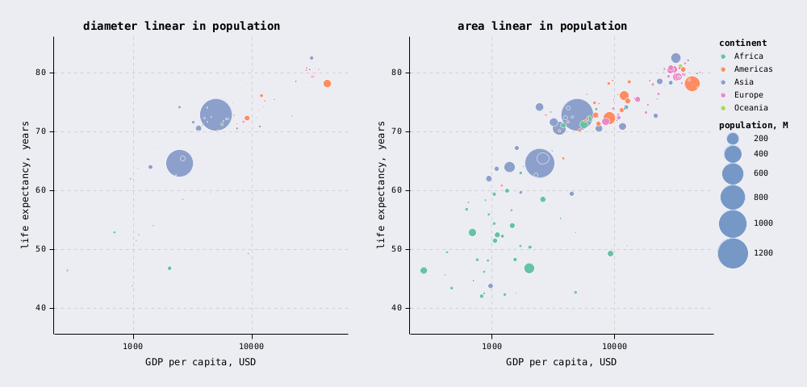
:::


## Connected scatter

Two variables over time: the points in time order joined by a path, dates written next to some of them.


### Connected scatter with dates

Yearly means of US unemployment duration and savings rate, 1990-2014; labels on boxes keep the years readable
where the path crosses itself.

Source: R Graph Gallery - Connected scatterplot with ggplot2; data-to-viz - Connected scatter ([1](https://r-graph-gallery.com/connected_scatterplot_ggplot2.html), [2](https://www.data-to-viz.com/graph/connectedscatter.html)). Data: US economic time series, 1967-2015, R ggplot2 package `economics` (Federal Reserve Bank of St. Louis, FRED); licence: MIT (ggplot2).


::: {.sourceClojure}
```clojure
(let [yearly (vec (for [[year rows] (sort-by key (group-by #(.getYear ^LocalDate (:date %)) economics))
                        :when (<= 1990 year 2014)]
                    {:year year :uempmed (stats/mean (map :uempmed rows)) :psavert (stats/mean (map :psavert rows))}))]
  (plot/render-image
   {:data yearly :mapping {:x :uempmed :y :psavert}
    :charts [(chart/line {:order :data :curve :bezier :color [33 102 172]})
             (chart/scatter {:size 6 :color [33 102 172]})
             (chart/text {:data (filterv #(zero? (mod (long (:year %)) 4)) yearly)
                          :mapping {:x :uempmed :y :psavert :label :year}
                          :background [255 255 255 210] :inset 2 :anchor [:left :bottom] :offset [5 5]})]
    :labels {:title "Unemployment duration vs savings rate, 1990-2014" :x "median unemployment, weeks" :y "savings rate, %"}}
   {:width 800 :height 550}))
```
:::


::: {.clay-image}

:::


## 2D density

Where the points concentrate: counts in cells, a smooth density estimate, its contour lines.


### 2D histogram and hexbin

`chart/bin2d` counts points in cells: squares, or hexagons (the default) - regular on screen for the panel's shape.

Source: R Graph Gallery - 2D density chart; data-to-viz - 2D density ([1](https://r-graph-gallery.com/2d-density-chart.html), [2](https://www.data-to-viz.com/graph/density2d.html)). Data: Old Faithful geyser eruptions, R datasets package `faithful` (Härdle 1991; Azzalini & Bowman 1990); licence: Part of R (GPL-2 | GPL-3).


::: {.sourceClojure}
```clojure
(plot/render-image
 (plot/arrange
  [{:data faithful :mapping {:x :eruptions :y :waiting} :charts [(chart/bin2d {:cell :square :bins 20})]
    :legend false :labels {:title "2D histogram" :x "eruption, min" :y "waiting, min"}}
   {:data faithful :mapping {:x :eruptions :y :waiting} :charts [(chart/bin2d {:bins 20})]
    :labels {:title "hexbin" :x "eruption, min" :y nil}}]
  {:columns 2})
 {:width 1000 :height 450})
```
:::


::: {.clay-image}
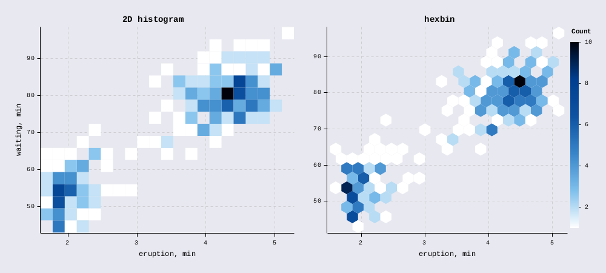
:::


### 2D kernel density and contours

`chart/field` estimates the density (Gaussian kernel, a bandwidth per axis) and draws it as a raster;
`chart/contour` draws its level lines, or with `:filled true` the bands between them.

Source: [R Graph Gallery - 2D density plot with ggplot2](https://r-graph-gallery.com/2d-density-plot-with-ggplot2.html). Data: Old Faithful geyser eruptions, R datasets package `faithful` (Härdle 1991; Azzalini & Bowman 1990); licence: Part of R (GPL-2 | GPL-3).


::: {.sourceClojure}
```clojure
(plot/render-image
 (plot/arrange
  [{:data faithful :mapping {:x :eruptions :y :waiting}
    :charts [(chart/field) (chart/contour {:color :white :line-width 0.8})] :legend false
    :labels {:title "density raster and contour lines" :x "eruption, min" :y "waiting, min"}}
   {:data faithful :mapping {:x :eruptions :y :waiting}
    :charts [(chart/contour {:filled true :levels 8})]
    :labels {:title "filled contour bands" :x "eruption, min" :y nil}}]
  {:columns 2})
 {:width 1000 :height 450})
```
:::


::: {.clay-image}

:::


### Points over a density

The density as a backdrop for the points themselves.

Source: [R Graph Gallery - 2D density chart](https://r-graph-gallery.com/2d-density-chart.html). Data: Old Faithful geyser eruptions, R datasets package `faithful` (Härdle 1991; Azzalini & Bowman 1990); licence: Part of R (GPL-2 | GPL-3).


::: {.sourceClojure}
```clojure
(plot/render-image
 {:data faithful :mapping {:x :eruptions :y :waiting}
  :charts [(chart/field {:alpha-factor 0.8}) (chart/scatter {:size 3 :color [255 255 255 200]})]
  :labels {:title "Old Faithful eruptions over their density" :x "eruption, min" :y "waiting, min"}}
 {:width 700 :height 500})
```
:::


::: {.clay-image}

:::


## Functions

`chart/field {:f f}` samples a function of a point `[x y]` on a grid over a given domain (`:n` samples per axis) - no
data needed. These examples have no gallery counterpart.


### A function as a raster

−(x² + y²) · sin x · sin y · sin xy on [−π, π]², white to black, 300 × 300 samples, square pixels (`:aspect :iso`).

Source: cljplot2 - chart/field.


::: {.sourceClojure}
```clojure
(defn fn2d
  [[x y]]
  (let [x (double x) y (double y)]
    (* (- (+ (* x x) (* y y))) (m/sin x) (m/sin y) (m/sin (* x y)))))
```
:::


::: {.sourceClojure}
```clojure
(plot/render-image
 {:charts [(chart/field {:f fn2d :domain {:x [(- m/PI) m/PI] :y [(- m/PI) m/PI]} :n 300})]
  :scales {:color {:range [:white :black]}}
  :aspect :iso
  :labels {:title "-(x^2 + y^2) sin x sin y sin xy"}}
 {:width 650 :height 600})
```
:::


::: {.clay-image}

:::


### A function with contour lines

sin x · cos y on a diverging palette centred at 0, with contour lines at fixed levels.

Source: cljplot2 - chart/field, chart/contour.


::: {.sourceClojure}
```clojure
(let [wave (fn [[x y]] (* (m/sin x) (m/cos y)))
      domain {:x [0 (* 2 m/PI)] :y [0 4]}]
  (plot/render-image
   {:charts [(chart/field {:f wave :domain domain})
             (chart/contour {:f wave :domain domain :color :black :levels [-0.75 -0.5 -0.25 0 0.25 0.5 0.75]})]
    :scales {:color {:range :RColorBrewer/RdBu :midpoint 0 :title "sin x cos y"}}
    :labels {:title "sin x cos y with contour lines"}}
   {:width 700 :height 450}))
```
:::


::: {.clay-image}

:::


## Overplotting

With thousands of points a scatter plot turns into a blot. The usual ways out, on 53 940 diamonds.


### Size, transparency, sampling, binning, facets, margins

Smaller points and transparency let density show; a sample keeps the shape with fewer points; hexagon counts
replace points by numbers; facets split the cloud by a category; marginal densities show where it is thick.

Source: [data-to-viz - Overplotting](https://www.data-to-viz.com/caveat/overplotting.html). Data: Prices and attributes of round cut diamonds, R ggplot2 package `diamonds` (Wickham et al.); licence: MIT (ggplot2).


::: {.sourceClojure}
```clojure
(let [base {:data diamonds :mapping {:x :carat :y :price} :scales {:x {:domain [0 5.5] :nice false :expand [0 0]} :y {:domain [0 20000] :nice false :expand [0 0]}}}
      sample (let [rng (r/rng :mersenne 9)] (filterv (fn [_] (< (r/drandom rng) 0.04)) diamonds))]
  (plot/render-image
   (plot/arrange
    [(merge base {:charts [(chart/scatter)] :labels {:title "all points" :x "carat" :y "price, USD"}})
     (merge base {:charts [(chart/scatter {:size 1})] :labels {:title "small points" :x "carat" :y nil}})
     (merge base {:charts [(chart/scatter {:size 3 :color [30 60 120 12]})] :labels {:title "transparency" :x "carat" :y nil}})
     (merge base {:data sample :charts [(chart/scatter {:size 3 :color [30 60 120 120]})]
                  :labels {:title "4 % sample" :x "carat" :y "price, USD"}})
     (merge base {:charts [(chart/bin2d {:bins 30})] :legend false :labels {:title "hexbin" :x "carat" :y nil}})
     (merge base {:charts [(chart/scatter {:size 2 :color [30 60 120 20]})]
                  :margins {:top (chart/density {:fill [30 60 120 100]}) :right (chart/density {:fill [30 60 120 100]})}
                  :labels {:title "marginal densities" :x "carat" :y nil}})]
    {:columns 3})
   {:width 1000 :height 700}))
```
:::


::: {.clay-image}

:::


Source: [data-to-viz - Overplotting (facets)](https://www.data-to-viz.com/caveat/overplotting.html). Data: Prices and attributes of round cut diamonds, R ggplot2 package `diamonds` (Wickham et al.); licence: MIT (ggplot2).


::: {.sourceClojure}
```clojure
(plot/render-image
 {:data diamonds :mapping {:x :carat :y :price :facet :cut}
  :charts [(chart/scatter {:size 2 :color [30 60 120 25]})]
  :scales {:facet {:domain ["Fair" "Good" "Very Good" "Premium" "Ideal"]}}
  :labels {:title "Diamonds: a panel per cut, worst to best" :x "carat" :y "price, USD"}}
 {:width 1000 :height 400})
```
:::


::: {.clay-image}
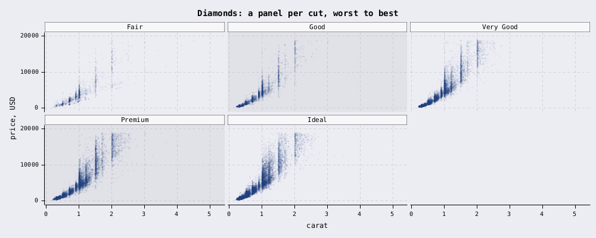
:::


### Jitter

Integer values pile up on a few positions; `:jitter [dx dy]` moves every point by a random offset within ±dx, ±dy
(data units) so the piles spread - `:rng` with a seed makes it the same in every rendering.

Source: [data-to-viz - Overplotting (jitter)](https://www.data-to-viz.com/caveat/overplotting.html). Data: Motor Trend car road tests (1974), R datasets package `mtcars` (Henderson & Velleman 1981); licence: Part of R (GPL-2 | GPL-3).


::: {.sourceClojure}
```clojure
(let [gears (fn [title jitter]
              {:data mtcars :mapping {:x :cyl :y :gear}
               :charts [(chart/scatter (cond-> {:size 7 :color [40 40 40 120]}
                                         jitter (assoc :jitter jitter :rng (r/rng :mersenne 7))))]
               :labels {:title title :x "cylinders" :y "forward gears"}})]
  (plot/render-image
   (plot/arrange [(gears "32 cars on 8 positions" nil) (gears ":jitter [0.25 0.15]" [0.25 0.15])] {:columns 2})
   {:width 900 :height 420}))
```
:::


::: {.clay-image}
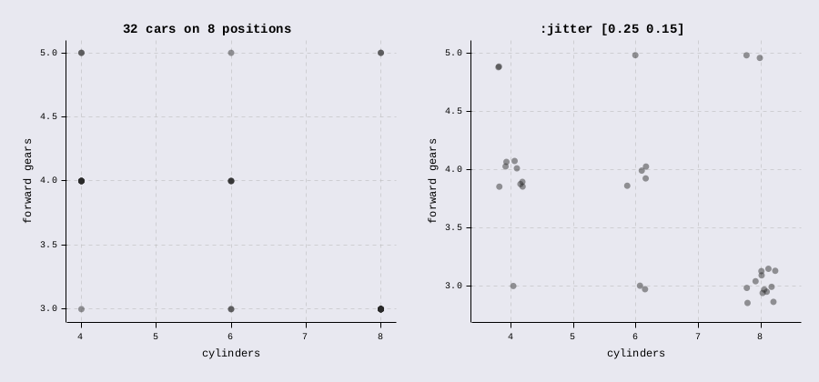
:::


## Caveats


### Anscombe's quartet

Four datasets with the same means, variances, linear fit and r ≈ 0.82 - and four different relations: a line, a
curve, a line with an outlier, a single far point making the correlation. Always look at the scatter plot.
The same mean and spread of x and the same residual variance give the same line and confidence band; drawn over
the whole x domain (`:full-range` with an explicit `:domain`, shared by the panels) they coincide.

Source: [Anscombe (1973), Graphs in Statistical Analysis (R datasets::anscombe)](https://en.wikipedia.org/wiki/Anscombe%27s_quartet).


::: {.sourceClojure}
```clojure
(def anscombe
  "Anscombe's quartet (R `datasets::anscombe`) in long form."
  (let [x123 [10 8 13 9 11 14 6 4 12 7 5]
        x4 [8 8 8 8 8 8 8 19 8 8 8]
        ys {"I" [8.04 6.95 7.58 8.81 8.33 9.96 7.24 4.26 10.84 4.82 5.68]
            "II" [9.14 8.14 8.74 8.77 9.26 8.10 6.13 3.10 9.13 7.26 4.74]
            "III" [7.46 6.77 12.74 7.11 7.81 8.84 6.08 5.39 8.15 6.42 5.73]
            "IV" [6.58 5.76 7.71 8.84 8.47 7.04 5.25 12.50 5.56 7.91 6.89]}]
    (vec (for [set ["I" "II" "III" "IV"] [x y] (map vector (if (= "IV" set) x4 x123) (ys set))]
           {:set set :x x :y y}))))
```
:::


```{=html}
<div class="data-table"><table class="table table-hover table-responsive clay-table"><thead><tr><th>set</th><th>x</th><th>y</th></tr></thead><tbody><tr><td>I</td><td>10</td><td>8.04</td></tr><tr><td>I</td><td>8</td><td>6.95</td></tr><tr><td>I</td><td>13</td><td>7.58</td></tr><tr><td>I</td><td>9</td><td>8.81</td></tr><tr><td>I</td><td>11</td><td>8.33</td></tr><tr><td>I</td><td>14</td><td>9.96</td></tr><tr><td>I</td><td>6</td><td>7.24</td></tr><tr><td>I</td><td>4</td><td>4.26</td></tr><tr><td>I</td><td>12</td><td>10.84</td></tr><tr><td>I</td><td>7</td><td>4.82</td></tr><tr><td>I</td><td>5</td><td>5.68</td></tr><tr><td>II</td><td>10</td><td>9.14</td></tr><tr><td>II</td><td>8</td><td>8.14</td></tr><tr><td>II</td><td>13</td><td>8.74</td></tr><tr><td>II</td><td>9</td><td>8.77</td></tr><tr><td>II</td><td>11</td><td>9.26</td></tr><tr><td>II</td><td>14</td><td>8.1</td></tr><tr><td>II</td><td>6</td><td>6.13</td></tr><tr><td>II</td><td>4</td><td>3.1</td></tr><tr><td>II</td><td>12</td><td>9.13</td></tr><tr><td>II</td><td>7</td><td>7.26</td></tr><tr><td>II</td><td>5</td><td>4.74</td></tr><tr><td>III</td><td>10</td><td>7.46</td></tr><tr><td>III</td><td>8</td><td>6.77</td></tr><tr><td>III</td><td>13</td><td>12.74</td></tr><tr><td>III</td><td>9</td><td>7.11</td></tr><tr><td>III</td><td>11</td><td>7.81</td></tr><tr><td>III</td><td>14</td><td>8.84</td></tr><tr><td>III</td><td>6</td><td>6.08</td></tr><tr><td>III</td><td>4</td><td>5.39</td></tr><tr><td>III</td><td>12</td><td>8.15</td></tr><tr><td>III</td><td>7</td><td>6.42</td></tr><tr><td>III</td><td>5</td><td>5.73</td></tr><tr><td>IV</td><td>8</td><td>6.58</td></tr><tr><td>IV</td><td>8</td><td>5.76</td></tr><tr><td>IV</td><td>8</td><td>7.71</td></tr><tr><td>IV</td><td>8</td><td>8.84</td></tr><tr><td>IV</td><td>8</td><td>8.47</td></tr><tr><td>IV</td><td>8</td><td>7.04</td></tr><tr><td>IV</td><td>8</td><td>5.25</td></tr><tr><td>IV</td><td>19</td><td>12.5</td></tr><tr><td>IV</td><td>8</td><td>5.56</td></tr><tr><td>IV</td><td>8</td><td>7.91</td></tr><tr><td>IV</td><td>8</td><td>6.89</td></tr></tbody></table></div>
```


::: {.sourceClojure}
```clojure
(let [r-label (fn [rows] (format "r = %.2f" (stats/pearson-correlation (map :x rows) (map :y rows))))]
  (plot/render-image
   {:data anscombe :mapping {:x :x :y :y :facet :set}
    :facets {:columns 4}
    :scales {:x {:domain [3 20]}}
    :charts [(chart/smooth {:method :lm :full-range true})
             (chart/scatter {:size 7 :color [200 60 40]})
             (chart/text {:data (vec (for [[set rows] (group-by :set anscombe)] {:set set :x 4 :y 13 :label (r-label rows)}))
                          :mapping {:x :x :y :y :label :label} :anchor [:left :top]
                          :background [255 255 255 210] :inset 3})]
    :labels {:title "Anscombe's quartet: one r, four relations"}}
   {:width 1000 :height 330}))
```
:::


::: {.clay-image}
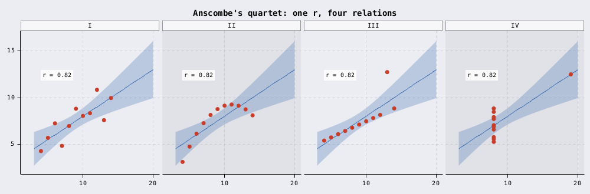
:::


### Other caveats


- Correlation is not causation: two variables can move together because a third one drives both.
- Pearson's r measures only a linear relation: very different clouds (Anscombe's quartet) share one r; look at
  the scatter plot, and use Spearman or Kendall (`chart/correlation {:method :spearman}`) for monotone relations.

- Bubbles: map the value to the area (`:area true`), not the diameter, or large values look far larger.
- 2D histograms and densities depend on the cell size or bandwidth: try a few before reading shapes into them.


```{=html}
<div style="background-color:grey;height:2px;width:100%;"></div>
```


```{=html}
<div><pre><small><small>source: notebooks/use_cases/correlation.clj</small></small></pre></div>
```