---
format:
  html: {toc: true, toc-location: right, toc-depth: 4, theme: cosmo}
code-block-background: true

---
<style></style><style>.printedClojure .sourceCode {
  background-color: transparent;
  border-style: none;
}
</style><style>.clay-limit-image-width .clay-image {max-width: 100%}
.clay-side-by-side .sourceCode {margin: 0}
.clay-side-by-side {margin: 1em 0}
</style>
<script src="https://code.jquery.com/jquery-3.6.0.min.js" type="text/javascript"></script><script src="https://code.jquery.com/ui/1.13.1/jquery-ui.min.js" type="text/javascript"></script>

# Distribution

Charts of how the values of one numeric variable spread: violins, densities, histograms, boxplots and
ridgelines (the [R Graph Gallery](https://r-graph-gallery.com/) distribution family), then beeswarms, strip
plots, rugs and ECDFs.

Distribution charts put the values on `:x` and the groups (if any) on `:y`, so they are horizontal by default.
`:flip true` draws the same plot vertically.


::: {.sourceClojure}
```clojure
(ns use-cases.distribution
  (:require [fastmath.random :as r]
            [fastmath.stats :as stats]
            [cljplot2.chart :as chart]
            [cljplot2.core :as plot]
            [cljplot2.data.levels :as levels]
            [notebook-utils :as nu]))
```
:::


::: {.sourceClojure}
```clojure
(def iris (nu/dataset :iris))
```
:::


::: {.sourceClojure}
```clojure
(def mtcars (nu/dataset :mtcars))
```
:::


::: {.sourceClojure}
```clojure
(def faithful (nu/dataset :faithful))
```
:::


::: {.sourceClojure}
```clojure
(def barley (nu/dataset :barley))
```
:::


::: {.sourceClojure}
```clojure
(def chem97 (nu/dataset :chem97))
```
:::


::: {.sourceClojure}
```clojure
(def diamonds (nu/dataset :diamonds))
```
:::


::: {.sourceClojure}
```clojure
(def lincoln (nu/dataset :lincoln-weather))
```
:::


## Violin

A violin is a kernel density estimate mirrored around the centre line of its group, here with a small box
inside (the default `:inner`).


### Basic violin

Source: [R Graph Gallery - Violin plot](https://r-graph-gallery.com/95-violin-plot-with-ggplot2.html). Data: Edgar Anderson's iris measurements, R datasets package `iris` (Anderson 1935; Fisher 1936); licence: Part of R (GPL-2 | GPL-3).


::: {.sourceClojure}
```clojure
(plot/render-image
 {:data iris
  :mapping {:x :sepal-length :y :species}
  :charts [(chart/violin)]
  :labels {:title "Sepal length by species" :x "sepal length [cm]" :y nil}}
 {:width 800 :height 450})
```
:::


::: {.clay-image}
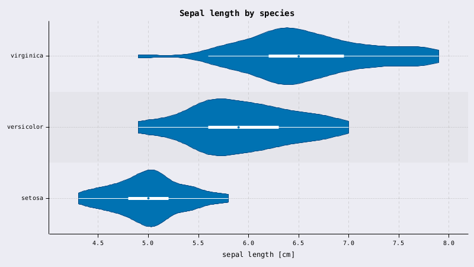
:::


### Ordered violins

`levels/order-levels` orders the levels by any statistic of a value; the result is the scale's `:domain`.

Source: [R Graph Gallery - Violin plot (reorder)](https://r-graph-gallery.com/267-reorder-a-variable-in-ggplot2.html). Data: Edgar Anderson's iris measurements, R datasets package `iris` (Anderson 1935; Fisher 1936); licence: Part of R (GPL-2 | GPL-3).


::: {.sourceClojure}
```clojure
(plot/render-image
 {:data iris
  :mapping {:x :petal-width :y :species}
  :scales {:y {:domain (levels/order-levels iris :species :petal-width stats/median {:descending true})}}
  :charts [(chart/violin {:inner :quartiles})]
  :labels {:title "Petal width, species by descending median" :x "petal width [cm]" :y nil}}
 {:width 800 :height 450})
```
:::


::: {.clay-image}
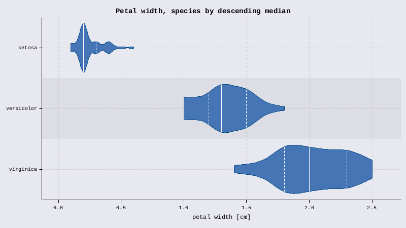
:::


### Horizontal and vertical

The R Graph Gallery draws violins and boxplots vertically; here that is `:flip true` on the same plot - values
stay on `:x`, which is now drawn vertically.

Source: [R Graph Gallery - Horizontal violin plot](https://r-graph-gallery.com/violin_horizontal_ggplot2.html). Data: Edgar Anderson's iris measurements, R datasets package `iris` (Anderson 1935; Fisher 1936); licence: Part of R (GPL-2 | GPL-3).


::: {.sourceClojure}
```clojure
(let [p {:data iris
         :mapping {:x :sepal-width :y :species}
         :charts [(chart/violin)]
         :labels {:x "sepal width [cm]" :y nil}}]
  (plot/render-image
   (plot/arrange [(assoc-in p [:labels :title] "horizontal (default)")
                  (-> p (assoc :flip true) (assoc-in [:labels :title] ":flip true"))]
                 {:columns 2})
   {:width 900 :height 450}))
```
:::


::: {.clay-image}
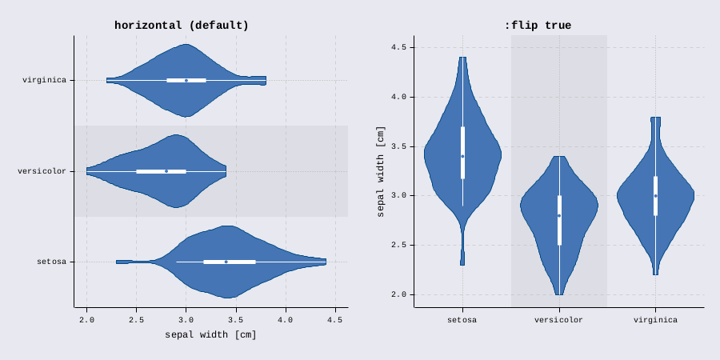
:::


### Violin with a box and sample sizes

Two strip charts share the bands: a violin without inner marks and a narrow box. `:n-label` writes each
group's count past its largest value.

Source: [R Graph Gallery - Violin with boxplot and sample size](https://r-graph-gallery.com/violin_and_boxplot_ggplot2.html). Data: Barley yields, Minnesota 1931-1932, R lattice package `barley` (Immer et al. 1934; Fisher 1971; Cleveland 1993); licence: GPL (>= 2) (lattice).


::: {.sourceClojure}
```clojure
(plot/render-image
 {:data barley
  :mapping {:x :yield :y :site}
  :charts [(chart/violin {:inner :none :color [200 200 220]})
           (chart/box {:width 0.12 :outliers false :n-label true})]
  :labels {:title "Barley yield by site" :x "yield [bushels/acre]" :y nil}}
 {:width 800 :height 500})
```
:::


::: {.clay-image}

:::


### Grouped violins

A second grouping (here the year, coloured) dodges the violins inside each band, in legend order; with exactly
two groups `:position :mirror` draws split violins, one half per group. The year is a number, so
`:scales {:color {:type :categorical}}` declares it categorical: one colour per year instead of a gradient.

Source: [R Graph Gallery - Grouped violin plot](https://r-graph-gallery.com/violin_grouped_ggplot2.html). Data: Barley yields, Minnesota 1931-1932, R lattice package `barley` (Immer et al. 1934; Fisher 1971; Cleveland 1993); licence: GPL (>= 2) (lattice).


::: {.sourceClojure}
```clojure
(let [p {:data barley
         :mapping {:x :yield :y :site :color :year}
         :scales {:color {:type :categorical}}
         :labels {:x "yield [bushels/acre]" :y nil}}]
  (plot/render-image
   (plot/arrange [(assoc p :charts [(chart/violin {:inner :none})] :labels {:title "dodged" :x "yield" :y nil})
                  (assoc p :charts [(chart/violin {:position :mirror :inner :quartiles})]
                         :labels {:title "split (:position :mirror)" :x "yield" :y nil})]
                 {:columns 2})
   {:width 1000 :height 550}))
```
:::


::: {.clay-image}

:::


### Inner marks

`:inner` chooses what a violin shows inside: a box (default), quartile lines, a rug or the points. The data is a
fixed 5% sample of chem97 (31022 rows), so the rug and the points stay readable.

Source: R Graph Gallery - Violin plot; seaborn violinplot ([1](https://r-graph-gallery.com/violin.html), [2](https://seaborn.pydata.org/generated/seaborn.violinplot.html)). Data: A-level chemistry scores, England 1997, R mlmRev package `Chem97` (Yang et al. 2002); licence: GPL (>= 2) (mlmRev).


::: {.sourceClojure}
```clojure
(def chem97-sample
  "A fixed 5% sample of chem97 (the full data has 31022 rows)."
  (let [rng (r/rng :mersenne 3)] (filterv (fn [_] (< (r/drandom rng) 0.05)) chem97)))
```
:::


::: {.sourceClojure}
```clojure
(plot/render-image
 (plot/arrange (for [inner [:box :quartiles :rug :points]]
                 {:data chem97-sample
                  :mapping {:x :gcsescore :y :score}
                  :scales {:y {:type :categorical}}
                  :charts [(chart/violin {:inner inner})]
                  :labels {:title (str ":inner " inner) :x "GCSE score"}})
               {:columns 2})
 {:width 1000 :height 800})
```
:::


::: {.clay-image}
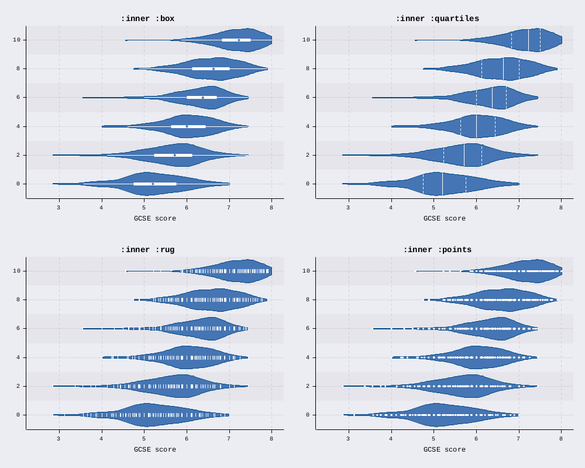
:::


## Density

A kernel density estimate (fastmath) of the values, per panel and group.


### Basic density

`:bandwidth` is a number or a fastmath rule (`:nrd0` by default, as R); `:kernel` any fastmath kernel.

Source: [R Graph Gallery - Density plot](https://r-graph-gallery.com/21-distribution-plot-using-ggplot2.html). Data: Old Faithful geyser eruptions, R datasets package `faithful` (Härdle 1991; Azzalini & Bowman 1990); licence: Part of R (GPL-2 | GPL-3).


::: {.sourceClojure}
```clojure
(plot/render-image
 (plot/arrange (for [[title opts] [["default (:nrd0)" {}]
                                   [":bandwidth 0.1" {:bandwidth 0.1}]
                                   [":bandwidth 0.6" {:bandwidth 0.6}]
                                   [":kernel :epanechnikov" {:kernel :epanechnikov}]]]
                 {:data faithful
                  :mapping {:x :eruptions}
                  :charts [(chart/density (assoc opts :fill [69 117 180 60]))]
                  :labels {:title title :x "eruption time [min]"}})
               {:columns 2})
 {:width 900 :height 600})
```
:::


::: {.clay-image}

:::


### Mirror density

Two groups, the second drawn downward, with the y = 0 line (`:zero-line`, on by default). `:symmetric` puts
both halves on one range so they compare by height.

Source: [R Graph Gallery - Mirror density chart](https://r-graph-gallery.com/density_mirror_ggplot2.html). Data: A-level chemistry scores, England 1997, R mlmRev package `Chem97` (Yang et al. 2002); licence: GPL (>= 2) (mlmRev).


::: {.sourceClojure}
```clojure
(plot/render-image
 (plot/arrange [{:data chem97
                 :mapping {:x :gcsescore :color :gender}
                 :charts [(chart/density {:position :mirror :fill :color})]
                 :labels {:title "GCSE score: F up, M down" :x "GCSE score"}}
                {:data chem97
                 :mapping {:x :age :color :gender}
                 :charts [(chart/density {:position :mirror :symmetric true})]
                 :labels {:title "age, :symmetric" :x "age [months, centred]"}}]
               {:columns 2})
 {:width 1000 :height 450})
```
:::


::: {.clay-image}

:::


### Several groups

Groups from a colour mapping, overlaid. The line takes the group colour; `:fill :color` fills each area with
its group colour at opacity `:alpha`, a fixed `:fill` colour fills every area alike.

Source: [R Graph Gallery - Density with multiple groups](https://r-graph-gallery.com/density-plot.html). Data: Edgar Anderson's iris measurements, R datasets package `iris` (Anderson 1935; Fisher 1936); licence: Part of R (GPL-2 | GPL-3).


::: {.sourceClojure}
```clojure
(plot/render-image
 (plot/arrange [{:data iris
                 :mapping {:x :sepal-length :color :species}
                 :charts [(chart/density {:width 2})]
                 :labels {:title "lines" :x "sepal length [cm]"}}
                {:data iris
                 :mapping {:x :sepal-length :color :species}
                 :charts [(chart/density {:fill :color :alpha 0.4})]
                 :labels {:title ":fill :color, :alpha 0.4" :x "sepal length [cm]"}}
                {:data iris
                 :mapping {:x :petal-length :color :species}
                 :charts [(chart/density {:fill [0 0 0 30]})]
                 :labels {:title ":fill [0 0 0 30]" :x "petal length [cm]"}}]
               {:columns 3})
 {:width 1000 :height 400})
```
:::


::: {.clay-image}

:::


### Annotated density

Annotation charts take literal positions: a rule at the mean, a text label and a band (`chart/rect`) over the
central 50% of the values.

Source: [R Graph Gallery - Density chart with annotation](https://r-graph-gallery.com/density-plot.html). Data: Old Faithful geyser eruptions, R datasets package `faithful` (Härdle 1991; Azzalini & Bowman 1990); licence: Part of R (GPL-2 | GPL-3).


::: {.sourceClojure}
```clojure
(let [xs (map :eruptions faithful)
      mean (stats/mean xs)
      [q1 q3] (stats/quantiles xs [0.25 0.75])]
  (plot/render-image
   {:data faithful
    :mapping {:x :eruptions}
    :charts [(chart/rect {:x [q1 q3] :fill [69 117 180 40]})
             (chart/density)
             (chart/rule {:x mean :dash [5.0 3.0] :color :red})
             (chart/text {:x mean :y [:panel 0.95] :text (format "mean %.2f" mean) :anchor [:left :top]
                          :offset [4 0] :color :red})
             (chart/text {:x (* 0.5 (+ q1 q3)) :y [:panel 0.05] :text "IQR" :anchor [:center :bottom]})]
    :labels {:title "Old Faithful eruption times" :x "eruption time [min]"}}
   {:width 800 :height 450}))
```
:::


::: {.clay-image}
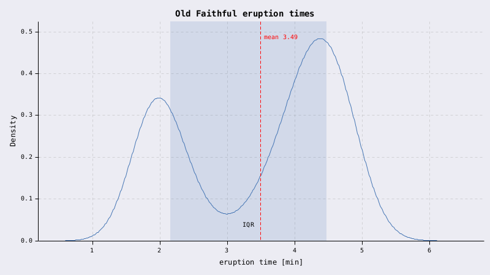
:::


### Small multiples

A facet mapping gives one panel per level; the colour still groups inside each panel.

Source: [R Graph Gallery - Density small multiples](https://r-graph-gallery.com/density-plot.html). Data: A-level chemistry scores, England 1997, R mlmRev package `Chem97` (Yang et al. 2002); licence: GPL (>= 2) (mlmRev).


::: {.sourceClojure}
```clojure
(plot/render-image
 {:data chem97
  :mapping {:x :gcsescore :facet :score :color :gender}
  :charts [(chart/density)]
  :labels {:title "GCSE score by A-level score and gender" :x "GCSE score"}}
 {:width 900 :height 600})
```
:::


::: {.clay-image}
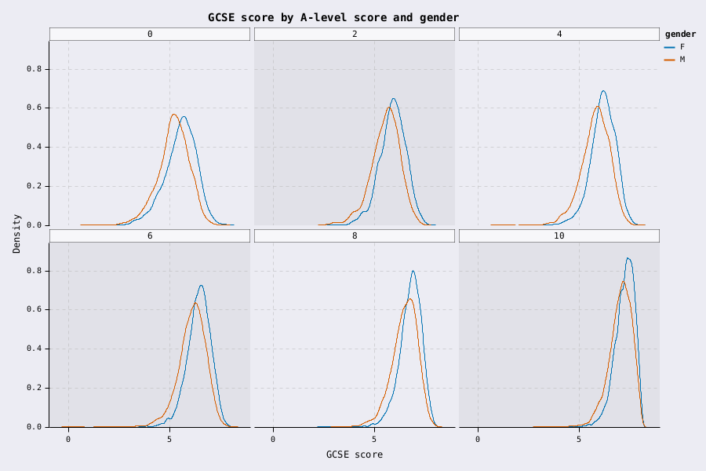
:::


### Stacked density

`:position :stack` piles the group densities on one common grid; `:normalize` shows each group's share.

Source: [R Graph Gallery - Stacked density chart](https://r-graph-gallery.com/135-stacked-density-graph.html). Data: Prices and attributes of round cut diamonds, R ggplot2 package `diamonds` (Wickham et al.); licence: MIT (ggplot2).


::: {.sourceClojure}
```clojure
(let [p {:data diamonds
         :mapping {:x :price :color :cut}
         :scales {:color {:domain ["Fair" "Good" "Very Good" "Premium" "Ideal"]}}}]
  (plot/render-image
   (plot/arrange [(assoc p :charts [(chart/density {:position :stack})] :labels {:title ":stack" :x "price [USD]"})
                  (assoc p :charts [(chart/density {:position :normalize})] :labels {:title ":normalize" :x "price [USD]"})]
                 {:columns 2})
   {:width 1000 :height 450}))
```
:::


::: {.clay-image}

:::


### Marginal density

`:margins` adds charts beside the panel: the top margin shares the horizontal axis, the right margin the
vertical one. Margin charts read the plot's data and colour mapping, with `:x` mapped to the shared dimension
for them; they have no axes of their own, so the scatter keeps the only x and y axes.

Source: [R Graph Gallery - Marginal distribution](https://r-graph-gallery.com/277-marginal-histogram-for-ggplot2.html). Data: Edgar Anderson's iris measurements, R datasets package `iris` (Anderson 1935; Fisher 1936); licence: Part of R (GPL-2 | GPL-3).


::: {.sourceClojure}
```clojure
(plot/render-image
 {:data iris
  :mapping {:x :sepal-length :y :sepal-width :color :species}
  :charts [(chart/scatter)]
  :margins {:top (chart/density {:fill :color :alpha 0.4})
            :right (chart/density {:fill :color :alpha 0.4})}
  :labels {:title "Iris sepals with marginal densities" :x "sepal length [cm]" :y "sepal width [cm]"}}
 {:width 750 :height 650})
```
:::


::: {.clay-image}

:::


## Histogram

Counts of the values in bins shared by all panels and groups.


### Basic histogram

`:y` chooses the bar height: percent of the total (default), count, density (area 1) or probability.

Source: [R Graph Gallery - Histogram](https://r-graph-gallery.com/220-basic-ggplot2-histogram.html). Data: Old Faithful geyser eruptions, R datasets package `faithful` (Härdle 1991; Azzalini & Bowman 1990); licence: Part of R (GPL-2 | GPL-3).


::: {.sourceClojure}
```clojure
(plot/render-image
 (plot/arrange (for [y [:percent :count :density :pmf]]
                 {:data faithful
                  :mapping {:x :waiting}
                  :charts [(chart/histogram {:y y})]
                  :labels {:title (str ":y " y) :x "waiting [min]"}})
               {:columns 2})
 {:width 900 :height 600})
```
:::


::: {.clay-image}

:::


### Bin size

`:bins` takes a fastmath estimation rule, a number of equal bins or explicit breaks.

Source: [R Graph Gallery - Histogram bin size](https://r-graph-gallery.com/220-basic-ggplot2-histogram.html). Data: Old Faithful geyser eruptions, R datasets package `faithful` (Härdle 1991; Azzalini & Bowman 1990); licence: Part of R (GPL-2 | GPL-3).


::: {.sourceClojure}
```clojure
(plot/render-image
 (plot/arrange (for [bins [:sturges 5 40 [1.5 2.5 3.5 4 4.5 5.5]]]
                 {:data faithful
                  :mapping {:x :eruptions}
                  :charts [(chart/histogram {:bins bins})]
                  :labels {:title (str ":bins " bins) :x "eruption time [min]"}})
               {:columns 2})
 {:width 900 :height 600})
```
:::


::: {.clay-image}
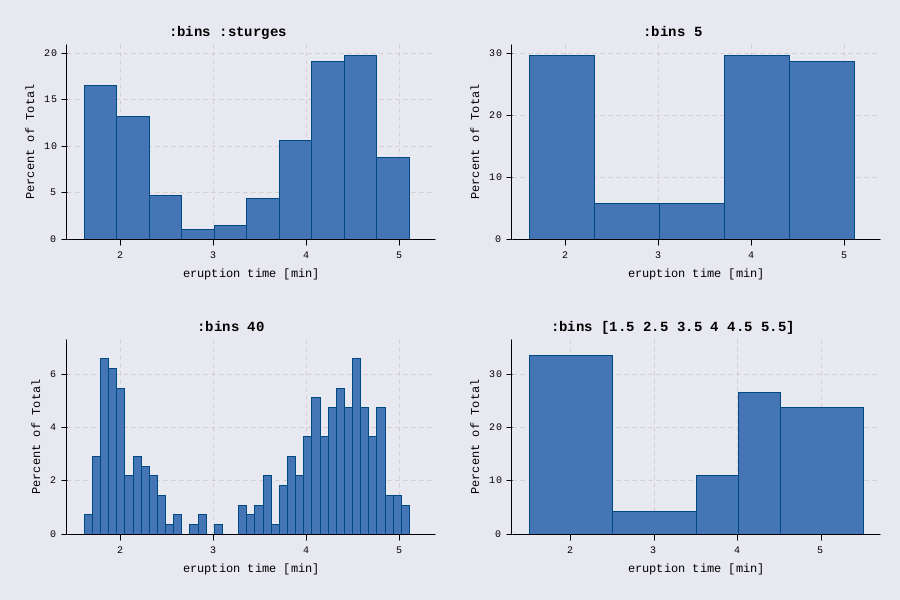
:::


### Mirror histogram

Two groups back to back. Bars are filled by the group colour and outlined by `:stroke-color` - a colour,
`:none` or `:darker` (the darkened fill, default); `:symmetric` gives both halves one range.

Source: [R Graph Gallery - Mirror histogram](https://r-graph-gallery.com/190-mirrored-histogram.html). Data: A-level chemistry scores, England 1997, R mlmRev package `Chem97` (Yang et al. 2002); licence: GPL (>= 2) (mlmRev).


::: {.sourceClojure}
```clojure
(plot/render-image
 (plot/arrange [{:data chem97 :mapping {:x :gcsescore :color :gender}
                 :charts [(chart/histogram {:position :mirror :bins 30})]
                 :labels {:title "default outline" :x "GCSE score"}}
                {:data chem97 :mapping {:x :gcsescore :color :gender}
                 :charts [(chart/histogram {:position :mirror :bins 30 :stroke-color :white :symmetric true})]
                 :labels {:title "white outline, :symmetric" :x "GCSE score"}}]
               {:columns 2})
 {:width 1000 :height 450})
```
:::


::: {.clay-image}

:::


### Groups on one axis

`:position` places the groups' bars: over each other (translucent), side by side, stacked or normalized.

Source: [R Graph Gallery - Histogram with several groups](https://r-graph-gallery.com/histogram_several_group.html). Data: Edgar Anderson's iris measurements, R datasets package `iris` (Anderson 1935; Fisher 1936); licence: Part of R (GPL-2 | GPL-3).


::: {.sourceClojure}
```clojure
(plot/render-image
 (plot/arrange (for [position [:overlay :dodge :stack :normalize]]
                 {:data iris
                  :mapping {:x :sepal-length :color :species}
                  :charts [(chart/histogram {:position position :bins 15})]
                  :labels {:title (str ":position " position) :x "sepal length [cm]"}})
               {:columns 2})
 {:width 1000 :height 650})
```
:::


::: {.clay-image}

:::


### Small multiples

Source: [R Graph Gallery - Histogram small multiples](https://r-graph-gallery.com/histogram.html). Data: Prices and attributes of round cut diamonds, R ggplot2 package `diamonds` (Wickham et al.); licence: MIT (ggplot2).


::: {.sourceClojure}
```clojure
(plot/render-image
 {:data diamonds
  :mapping {:x :price :facet :cut}
  :scales {:facet {:domain ["Fair" "Good" "Very Good" "Premium" "Ideal"]}}
  :charts [(chart/histogram {:bins 30})]
  :labels {:title "Diamond prices by cut" :x "price [USD]"}}
 {:width 900 :height 600})
```
:::


::: {.clay-image}

:::


### Marginal histogram

A margin may hold several charts, `:size` sets its thickness in pixels and `:axis true` shows the magnitude
(count, density) of a histogram or density margin; strips (boxes, rugs, ...) work in margins too.

Source: [R Graph Gallery - Marginal histogram](https://r-graph-gallery.com/277-marginal-histogram-for-ggplot2.html). Data: Edgar Anderson's iris measurements, R datasets package `iris` (Anderson 1935; Fisher 1936); licence: Part of R (GPL-2 | GPL-3).


::: {.sourceClojure}
```clojure
(plot/render-image
 {:data iris
  :mapping {:x :petal-length :y :petal-width :color :species}
  :charts [(chart/scatter)]
  :margins {:top {:charts (chart/histogram {:bins 25 :position :stack :y :count}) :axis true}
            :right {:charts [(chart/box {:outliers false}) (chart/rug)] :size 70}}
  :labels {:title "Iris petals: stacked histogram on top, boxes and a rug on the right"
           :x "petal length [cm]" :y "petal width [cm]"}}
 {:width 750 :height 650})
```
:::


::: {.clay-image}
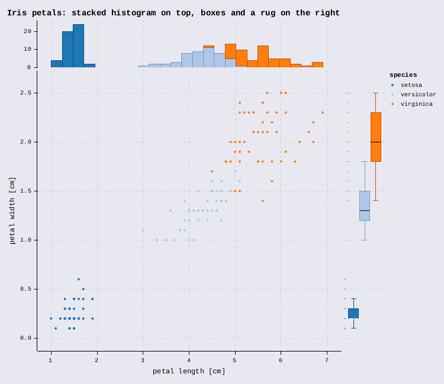
:::


### Strips on a histogram

Any strip chart (box, violin, rug, stripplot, beeswarm, extent) layers on a histogram or density:
`{:at v}` centres it on y = v; `:place :bottom` draws it below y = 0 in room the chart asks for.

Source: R Graph Gallery - Histogram with boxplot on top; lattice Fig 3.1 ([1](https://r-graph-gallery.com/82-boxplot-on-top-of-histogram.html), [2](http://lmdvr.r-forge.r-project.org/figures/figures.html)). Data: Old Faithful geyser eruptions, R datasets package `faithful` (Härdle 1991; Azzalini & Bowman 1990); licence: Part of R (GPL-2 | GPL-3).


::: {.sourceClojure}
```clojure
(plot/render-image
 (plot/arrange [{:data faithful :mapping {:x :eruptions}
                 :charts [(chart/histogram {:bins 20}) (chart/box {:place {:at 14.5} :thickness 16})]
                 :labels {:title "box above ({:at 14.5})" :x "eruption time [min]"}}
                {:data faithful :mapping {:x :eruptions}
                 :charts [(chart/density) (chart/rug {:place :bottom :width 1.0})]
                 :labels {:title "rug below (:bottom)" :x "eruption time [min]"}}
                {:data faithful :mapping {:x :eruptions}
                 :charts [(chart/density) (chart/stripplot {:place :bottom :rng (r/rng :mersenne 2) :size 6})]
                 :labels {:title "jittered points below" :x "eruption time [min]"}}
                {:data faithful :mapping {:x :eruptions}
                 :charts [(chart/histogram {:bins 20}) (chart/beeswarm {:place :bottom :size 4 :bottom-share 0.3})]
                 :labels {:title "beeswarm below" :x "eruption time [min]"}}]
               {:columns 2})
 {:width 1000 :height 700})
```
:::


::: {.clay-image}

:::


## Boxplot

A Tukey box per group: quartiles, whiskers to the most extreme values within 1.5 IQR, outliers beyond.


### Basic boxplot

Source: [R Graph Gallery - Boxplot](https://r-graph-gallery.com/262-basic-boxplot-with-ggplot2.html). Data: Motor Trend car road tests (1974), R datasets package `mtcars` (Henderson & Velleman 1981); licence: Part of R (GPL-2 | GPL-3).


::: {.sourceClojure}
```clojure
(plot/render-image
 {:data mtcars
  :mapping {:x :mpg :y :cyl}
  :scales {:y {:type :categorical}}
  :charts [(chart/box)]
  :labels {:title "Fuel economy by number of cylinders" :x "miles per gallon" :y "cylinders"}}
 {:width 800 :height 400})
```
:::


::: {.clay-image}
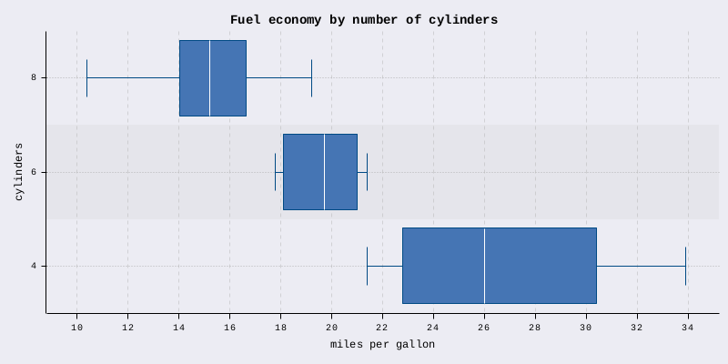
:::


The cylinder count is a number, so it is declared categorical - one band per value instead of a numeric axis -
with `:scales {:y {:type :categorical}}`; strings and keywords are categorical by themselves.


### Boxplot with jittered points

Source: [R Graph Gallery - Boxplot with jitter](https://r-graph-gallery.com/96-boxplot-with-jitter.html). Data: Motor Trend car road tests (1974), R datasets package `mtcars` (Henderson & Velleman 1981); licence: Part of R (GPL-2 | GPL-3).


::: {.sourceClojure}
```clojure
(plot/render-image
 {:data mtcars
  :mapping {:x :mpg :y :cyl}
  :scales {:y {:type :categorical}}
  :charts [(chart/box {:outliers false :color [210 210 225]})
           (chart/stripplot {:rng (r/rng :mersenne 7) :jitter 0.2 :size 8 :color [215 48 39 160]})]
  :labels {:title "Box with every car" :x "miles per gallon" :y "cylinders"}}
 {:width 800 :height 400})
```
:::


::: {.clay-image}

:::


### Group order

Source: [R Graph Gallery - Reorder boxplot](https://r-graph-gallery.com/267-reorder-a-variable-in-ggplot2.html). Data: Barley yields, Minnesota 1931-1932, R lattice package `barley` (Immer et al. 1934; Fisher 1971; Cleveland 1993); licence: GPL (>= 2) (lattice).


::: {.sourceClojure}
```clojure
(plot/render-image
 (plot/arrange [{:data barley :mapping {:x :yield :y :variety}
                 :scales {:y {:domain (levels/order-levels barley :variety :yield stats/median)}}
                 :charts [(chart/box)]
                 :labels {:title "by median" :x "yield" :y nil}}
                {:data barley :mapping {:x :yield :y :variety}
                 :scales {:y {:domain (levels/order-levels barley :variety :yield stats/mean {:descending true})}}
                 :charts [(chart/box)]
                 :labels {:title "by mean, descending" :x "yield" :y nil}}]
               {:columns 2})
 {:width 1000 :height 500})
```
:::


::: {.clay-image}
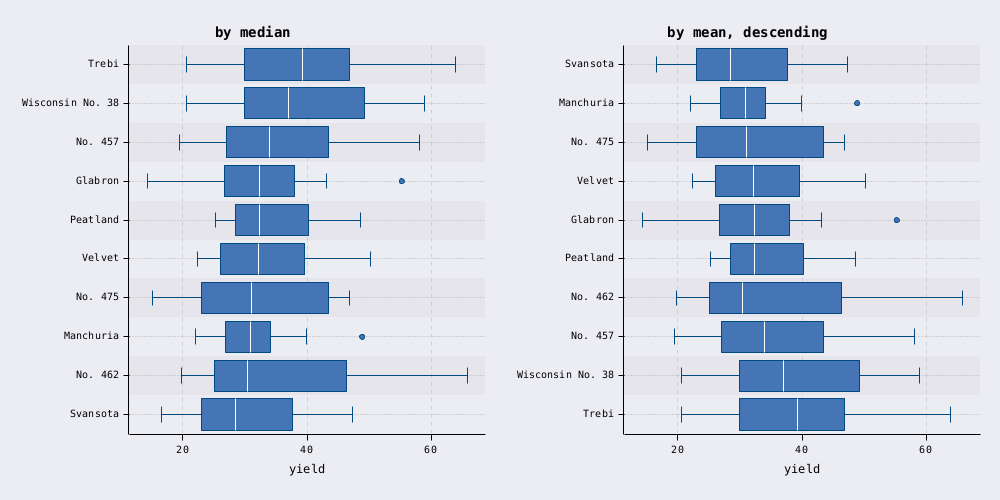
:::


### Highlight a group

A derived column and an explicit colour scale: grey for the rest, red for the group in focus. A colour mapping
makes groups, and groups inside a band dodge by default; `:position :overlay` keeps every box on its band's
centre line (each band holds one group anyway).

Source: [R Graph Gallery - Highlight a group in boxplot](https://r-graph-gallery.com/23-add-colors-to-specific-groups-of-a-boxplot.html). Data: Motor Trend car road tests (1974), R datasets package `mtcars` (Henderson & Velleman 1981); licence: Part of R (GPL-2 | GPL-3).


::: {.sourceClojure}
```clojure
(plot/render-image
 {:data (map #(assoc % :focus (if (= 6 (:cyl %)) "6 cylinders" "other")) mtcars)
  :mapping {:x :hp :y :cyl :color :focus}
  :scales {:y {:type :categorical}
           :color {:domain ["other" "6 cylinders"] :range [[190 190 190] [215 48 39]]}}
  :charts [(chart/box {:position :overlay})]
  :labels {:title "Horse power, 6 cylinders highlighted" :x "horse power" :y "cylinders"}}
 {:width 800 :height 400})
```
:::


::: {.clay-image}

:::


### Grouped boxplot

Source: [R Graph Gallery - Grouped boxplot](https://r-graph-gallery.com/265-grouped-boxplot-with-ggplot2.html). Data: Barley yields, Minnesota 1931-1932, R lattice package `barley` (Immer et al. 1934; Fisher 1971; Cleveland 1993); licence: GPL (>= 2) (lattice).


::: {.sourceClojure}
```clojure
(plot/render-image
 {:data barley
  :mapping {:x :yield :y :site :color :year}
  :scales {:color {:type :categorical}}
  :charts [(chart/box)]
  :labels {:title "Barley yield by site and year" :x "yield [bushels/acre]" :y nil}}
 {:width 800 :height 500})
```
:::


::: {.clay-image}

:::


### Faceted boxplot

Source: [R Graph Gallery - Boxplot small multiples](https://r-graph-gallery.com/boxplot.html). Data: Barley yields, Minnesota 1931-1932, R lattice package `barley` (Immer et al. 1934; Fisher 1971; Cleveland 1993); licence: GPL (>= 2) (lattice).


::: {.sourceClojure}
```clojure
(plot/render-image
 {:data barley
  :mapping {:x :yield :y :year :facet :site}
  :scales {:y {:type :categorical}}
  :charts [(chart/box)]
  :labels {:title "Yield by year, one panel per site" :x "yield" :y nil}}
 {:width 900 :height 500})
```
:::


::: {.clay-image}

:::


### Variable width

`:varwidth` makes each box's width proportional to the square root of its count.

Source: [R Graph Gallery - Boxplot with variable width](https://r-graph-gallery.com/266-ggplot2-boxplot-with-variable-width.html). Data: A-level chemistry scores, England 1997, R mlmRev package `Chem97` (Yang et al. 2002); licence: GPL (>= 2) (mlmRev).


::: {.sourceClojure}
```clojure
(plot/render-image
 {:data chem97
  :mapping {:x :gcsescore :y :score}
  :scales {:y {:type :categorical}}
  :charts [(chart/box {:varwidth true :n-label true})]
  :labels {:title "GCSE score by A-level score" :x "GCSE score" :y "A-level score"}}
 {:width 800 :height 550})
```
:::


::: {.clay-image}

:::


### Binned continuous variable

`levels/bin` cuts a numeric column into half-open interval bins; the bins are ordered levels for the boxes.

Source: [R Graph Gallery - Boxplot from continuous variable](https://r-graph-gallery.com/268-ggplot2-boxplot-from-continuous-variable.html). Data: Prices and attributes of round cut diamonds, R ggplot2 package `diamonds` (Wickham et al.); licence: MIT (ggplot2).


::: {.sourceClojure}
```clojure
(plot/render-image
 {:data (levels/bin diamonds :carat {:as :carat-bin :bins [0 0.5 1 1.5 2 2.5 5.01]})
  :mapping {:x :price :y :carat-bin}
  :charts [(chart/box {:outliers false :n-label true})]
  :labels {:title "Diamond price by carat" :x "price [USD]" :y "carat"}}
 {:width 800 :height 500})
```
:::


::: {.clay-image}
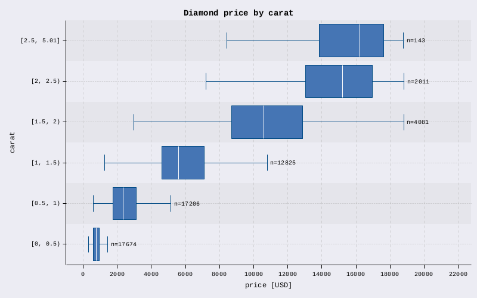
:::


### Mean marker

The categorical declaration can also sit on the mapping: `(levels/categorical :gear)` reads `:gear` as usual
and makes its dimension categorical, here instead of a `:scales` entry.

Source: [R Graph Gallery - Boxplot with mean](https://r-graph-gallery.com/269-ggplot2-boxplot-with-average-value.html). Data: Motor Trend car road tests (1974), R datasets package `mtcars` (Henderson & Velleman 1981); licence: Part of R (GPL-2 | GPL-3).


::: {.sourceClojure}
```clojure
(plot/render-image
 {:data mtcars
  :mapping {:x :qsec :y (levels/categorical :gear)}
  :charts [(chart/box {:mean true})]
  :labels {:title "Quarter mile time by gears, mean marked" :x "quarter mile [s]" :y "gears"}}
 {:width 800 :height 400})
```
:::


::: {.clay-image}

:::


### Sample size

`:n-label` with `:n-format` (a format string for the count).

Source: [R Graph Gallery - Boxplot with sample size](https://r-graph-gallery.com/26-add-text-over-a-boxplot.html). Data: Barley yields, Minnesota 1931-1932, R lattice package `barley` (Immer et al. 1934; Fisher 1971; Cleveland 1993); licence: GPL (>= 2) (lattice).


::: {.sourceClojure}
```clojure
(plot/render-image
 {:data barley
  :mapping {:x :yield :y :variety :color :year}
  :scales {:color {:type :categorical}}
  :charts [(chart/box {:n-label true :n-format "%d obs"})]
  :labels {:title "Yield by variety and year" :x "yield" :y nil}}
 {:width 900 :height 650})
```
:::


::: {.clay-image}

:::


### Horizontal and vertical

Source: [R Graph Gallery - Horizontal boxplot](https://r-graph-gallery.com/boxplot.html). Data: Motor Trend car road tests (1974), R datasets package `mtcars` (Henderson & Velleman 1981); licence: Part of R (GPL-2 | GPL-3).


::: {.sourceClojure}
```clojure
(let [p {:data mtcars :mapping {:x :wt :y :am} :scales {:y {:type :categorical}} :charts [(chart/box)]
         :labels {:x "weight [1000 lbs]" :y "manual transmission"}}]
  (plot/render-image
   (plot/arrange [(assoc-in p [:labels :title] "horizontal")
                  (-> p (assoc :flip true) (assoc-in [:labels :title] ":flip true"))]
                 {:columns 2})
   {:width 900 :height 400}))
```
:::


::: {.clay-image}

:::


### Intervals

`chart/extent` draws an interval per group from fastmath.stats: here the 95% confidence interval of the mean,
mean ± standard deviation and a bootstrap percentile interval.

Source: [cljplot extents](https://seaborn.pydata.org/generated/seaborn.pointplot.html). Data: Barley yields, Minnesota 1931-1932, R lattice package `barley` (Immer et al. 1934; Fisher 1971; Cleveland 1993); licence: GPL (>= 2) (lattice).


::: {.sourceClojure}
```clojure
(plot/render-image
 (plot/arrange (for [[title opts] [[":ci" {:method :ci}]
                                   [":stddev" {:method :stddev}]
                                   [":bootstrap-percentile" {:method :bootstrap-percentile :rng (r/rng :mersenne 1)}]]]
                 {:data barley :mapping {:x :yield :y :site}
                  :charts [(chart/extent opts)]
                  :labels {:title title :x "yield" :y nil}})
               {:columns 3})
 {:width 1000 :height 400})
```
:::


::: {.clay-image}

:::


## Ridgeline

Histograms and densities with a categorical `:y` become ridgelines: one profile per level, growing toward the
next level, all on one height scale (`:overlap` - the tallest profile in band steps).


### Basic ridgeline


::: {.sourceClojure}
```clojure
(def months ["January" "February" "March" "April" "May" "June" "July" "August" "September" "October" "November"
             "December"])
```
:::


Source: [R Graph Gallery - Ridgeline chart](https://r-graph-gallery.com/294-basic-ridgeline-plot.html). Data: Weather in Lincoln, Nebraska, 2016, R ggridges package `lincoln_weather` (Weather Underground, via Wilke); licence: GPL-2 (ggridges).


::: {.sourceClojure}
```clojure
(plot/render-image
 {:data lincoln
  :mapping {:x :mean-temp :y :month}
  :scales {:y {:domain (vec (reverse months))}}
  :charts [(chart/density {:overlap 1.5})]
  :labels {:title "Mean temperature in Lincoln, 2016" :x "mean temperature [F]" :y nil}}
 {:width 800 :height 650})
```
:::


::: {.clay-image}
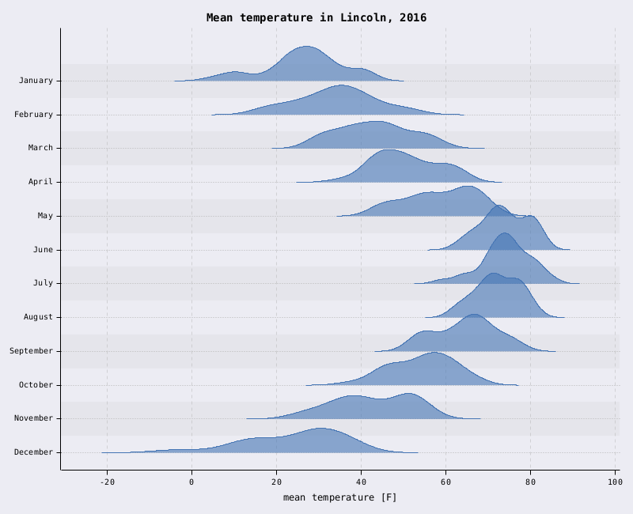
:::


### Ridge shapes

Histograms make ridgelines too; any strip chart can share the bands.

Source: [R Graph Gallery - Ridgeline chart](https://r-graph-gallery.com/294-basic-ridgeline-plot.html). Data: Prices and attributes of round cut diamonds, R ggplot2 package `diamonds` (Wickham et al.); licence: MIT (ggplot2).


::: {.sourceClojure}
```clojure
(let [p {:data diamonds
         :mapping {:x :price :y :cut}
         :scales {:y {:domain ["Fair" "Good" "Very Good" "Premium" "Ideal"]}}}]
  (plot/render-image
   (plot/arrange [(assoc p :charts [(chart/histogram {:bins 40})] :labels {:title "histogram ridges" :x "price" :y nil})
                  (assoc p :data (take-nth 25 diamonds)
                         :charts [(chart/density {:overlap 0.7}) (chart/stripplot {:rng (r/rng :mersenne 4) :size 3 :jitter 0.2})]
                         :labels {:title "density ridges with points (4% sample)" :x "price" :y nil})]
                 {:columns 2})
   {:width 1000 :height 550}))
```
:::


::: {.clay-image}
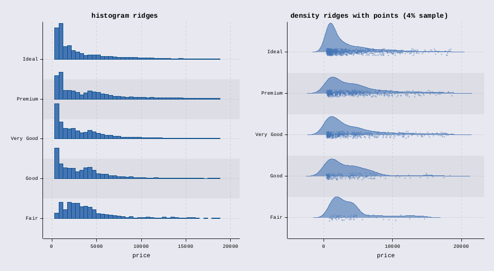
:::


### Gradient fill

`:fill-gradient` colours the area along `:x` with a clojure2d gradient.

Source: [R Graph Gallery - Ridgeline with gradient](https://r-graph-gallery.com/294-basic-ridgeline-plot.html). Data: Weather in Lincoln, Nebraska, 2016, R ggridges package `lincoln_weather` (Weather Underground, via Wilke); licence: GPL-2 (ggridges).


::: {.sourceClojure}
```clojure
(plot/render-image
 {:data lincoln
  :mapping {:x :max-temp :y :month}
  :scales {:y {:domain (vec (reverse months))}}
  :charts [(chart/density {:overlap 1.5 :fill-gradient :mpl/plasma})]
  :labels {:title "Daily maximum temperature" :x "max temperature [F]" :y nil}}
 {:width 800 :height 650})
```
:::


::: {.clay-image}

:::


### Double ridgeline

With two groups, `:position :mirror` grows the second group away from the next level.

Source: [R Graph Gallery - Ridgeline (two groups)](https://r-graph-gallery.com/web-double-ridgeline-plot.html). Data: A-level chemistry scores, England 1997, R mlmRev package `Chem97` (Yang et al. 2002); licence: GPL (>= 2) (mlmRev).


::: {.sourceClojure}
```clojure
(plot/render-image
 {:data chem97
  :mapping {:x :gcsescore :y :score :color :gender}
  :scales {:y {:type :categorical}}
  :charts [(chart/density {:position :mirror :overlap 0.45})]
  :labels {:title "GCSE score: F up, M down, by A-level score" :x "GCSE score" :y "A-level score"}}
 {:width 800 :height 650})
```
:::


::: {.clay-image}

:::


## Beeswarm

Points packed across their band so none overlap (`:fit` squeezes a swarm that is too wide into its band).
A colour mapping makes groups; inside a band groups dodge by default, so the coloured beeswarm sets
`:position :overlay` (each species is alone in its band anyway), and the box opts out of the colour with
`:mapping {:color nil}`.

Source: R Graph Gallery - Beeswarm ([1](https://r-graph-gallery.com/370-basic-beeswarm-plot.html), [2](https://r-graph-gallery.com/371-custom-dots-beeswarm.html), [3](https://r-graph-gallery.com/372-grouped-beeswarm.html)). Data: Edgar Anderson's iris measurements, R datasets package `iris` (Anderson 1935; Fisher 1936); licence: Part of R (GPL-2 | GPL-3).


::: {.sourceClojure}
```clojure
(plot/render-image
 (plot/arrange [{:data iris :mapping {:x :sepal-length :y :species}
                 :charts [(chart/beeswarm {:size 6})]
                 :labels {:title "basic" :x "sepal length" :y nil}}
                {:data iris :mapping {:x :sepal-length :y :species} :flip true
                 :charts [(chart/beeswarm {:size 6})]
                 :labels {:title "vertical (:flip)" :x "sepal length" :y nil}}
                {:data mtcars :mapping {:x :mpg :y :cyl} :scales {:y {:type :categorical}}
                 :charts [(chart/beeswarm {:size 12 :shape \A :color [215 48 39 200]})]
                 :labels {:title "dot style (:shape, :size)" :x "mpg" :y "cylinders"}}
                {:data iris :mapping {:x :petal-length :y :species :color :species}
                 :charts [(chart/box {:outliers false :color [235 235 240] :width 0.6 :mapping {:color nil}})
                          (chart/beeswarm {:size 5 :position :overlay})]
                 :labels {:title "coloured, over boxes" :x "petal length" :y nil}}]
               {:columns 2})
 {:width 1000 :height 700})
```
:::


::: {.clay-image}
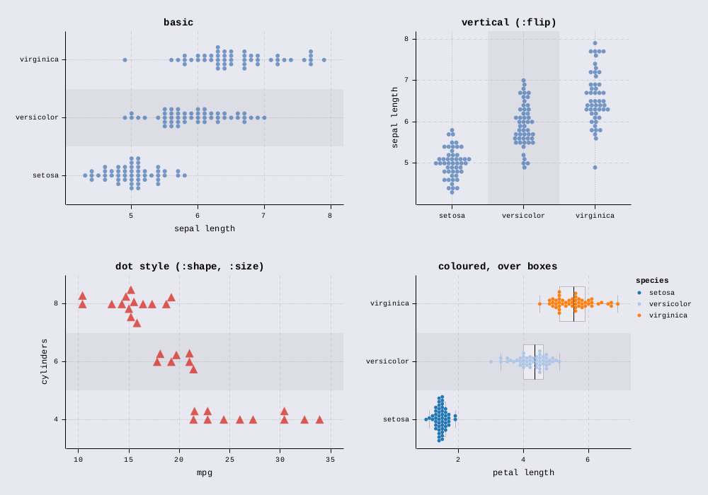
:::


## Strip plot and rug


### Strip plot

Jittered points; `:rng` makes the jitter reproducible.

Source: lattice stripplot; cljplot strips ([1](http://lmdvr.r-forge.r-project.org/figures/figures.html), [2](https://seaborn.pydata.org/generated/seaborn.stripplot.html)). Data: Barley yields, Minnesota 1931-1932, R lattice package `barley` (Immer et al. 1934; Fisher 1971; Cleveland 1993); licence: GPL (>= 2) (lattice).


::: {.sourceClojure}
```clojure
(plot/render-image
 {:data barley
  :mapping {:x :yield :y :variety :color :year}
  :scales {:color {:type :categorical}}
  :charts [(chart/stripplot {:rng (r/rng :mersenne 1) :size 8 :jitter 0.1})]
  :labels {:title "Barley yield by variety, dodged by year" :x "yield" :y nil}}
 {:width 800 :height 550})
```
:::


::: {.clay-image}
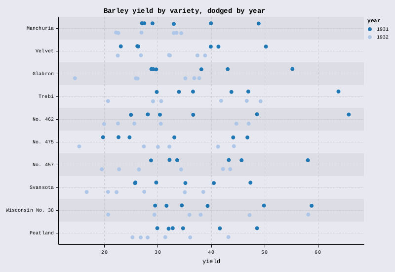
:::


### Rug

One line per value along the panel edge (`:edge`, the default without `:y`) or below y = 0 (`:bottom`).

Source: cljplot rug; lattice densityplot ([1](https://seaborn.pydata.org/generated/seaborn.rugplot.html), [2](http://lmdvr.r-forge.r-project.org/figures/figures.html)). Data: Old Faithful geyser eruptions, R datasets package `faithful` (Härdle 1991; Azzalini & Bowman 1990); licence: Part of R (GPL-2 | GPL-3).


::: {.sourceClojure}
```clojure
(plot/render-image
 (plot/arrange [{:data faithful :mapping {:x :waiting} :charts [(chart/density) (chart/rug)]
                 :labels {:title "rug on the edge" :x "waiting [min]"}}
                {:data faithful :mapping {:x :waiting} :charts [(chart/density) (chart/rug {:place :bottom :width 1.0})]
                 :labels {:title "rug below zero (:bottom)" :x "waiting [min]"}}]
               {:columns 2})
 {:width 900 :height 400})
```
:::


::: {.clay-image}
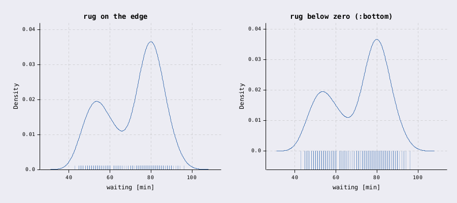
:::


## 1d strips

Every strip chart also works on one variable alone: without `:y` it is placed in the middle of the panel and
the plot has no y axis.

Source: seaborn 1d plots; cljplot strips ([1](https://seaborn.pydata.org/generated/seaborn.boxplot.html), [2](https://seaborn.pydata.org/generated/seaborn.swarmplot.html)). Data: Old Faithful geyser eruptions, R datasets package `faithful` (Härdle 1991; Azzalini & Bowman 1990); licence: Part of R (GPL-2 | GPL-3).


::: {.sourceClojure}
```clojure
(plot/render-image
 (plot/arrange (for [[title c] [["box" (chart/box)]
                                ["violin" (chart/violin)]
                                ["stripplot" (chart/stripplot {:rng (r/rng :mersenne 5) :jitter 0.3 :size 6})]
                                ["beeswarm" (chart/beeswarm {:size 5})]
                                ["rug" (chart/rug {:place :center :width 0.6})]
                                ["extent :stddev" (chart/extent {:method :stddev})]]]
                 {:data faithful
                  :mapping {:x :waiting}
                  :charts [c]
                  :labels {:title title :x "waiting [min]"}})
               {:columns 2})
 {:width 900 :height 650})
```
:::


::: {.clay-image}

:::


## Empirical cumulative distribution

Source: lattice ecdfplot ([1](http://lmdvr.r-forge.r-project.org/figures/figures.html), [2](https://seaborn.pydata.org/generated/seaborn.ecdfplot.html)). Data: Edgar Anderson's iris measurements, R datasets package `iris` (Anderson 1935; Fisher 1936); licence: Part of R (GPL-2 | GPL-3).


::: {.sourceClojure}
```clojure
(plot/render-image
 {:data iris
  :mapping {:x :petal-length :color :species}
  :charts [(chart/ecdf {:width 2})]
  :labels {:title "ECDF of petal length by species" :x "petal length [cm]"}}
 {:width 800 :height 450})
```
:::


::: {.clay-image}

:::


```{=html}
<div style="background-color:grey;height:2px;width:100%;"></div>
```


```{=html}
<div><pre><small><small>source: notebooks/use_cases/distribution.clj</small></small></pre></div>
```