---
format:
  html:
    toc: true
    toc-location: right
    toc-depth: 4
    theme: cosmo
    include-in-header:
      text: |-
        <style>
        .data-table { width: fit-content; max-width: 100%; max-height: 15rem; overflow: auto; margin: 0 0 1rem 0; }
        .data-table .table-responsive { overflow: visible; }
        .data-table table { font-size: 0.75rem; width: auto; margin: 0; }
        .data-table th, .data-table td { padding: 0.1rem 0.45rem !important; white-space: nowrap; }
        .data-table thead th { position: sticky; top: 0; background: var(--bs-body-bg, #fff); }
        .options { margin: 0.5rem 0 1rem 0; }
        .options .option-card { margin: 0 0 0.9rem 0; border: 1px solid var(--bs-border-color, #dee2e6); border-radius: 0.375rem; overflow: hidden; }
        .options dt { display: flex; flex-wrap: wrap; align-items: baseline; gap: 0.1rem 1rem; margin: 0; padding: 0.4rem 0.75rem; background: #eef2f7; border-bottom: 1px solid var(--bs-border-color, #dee2e6); font-weight: normal; }
        .options dt > code { font-weight: 700; font-size: 1rem; background: none; padding: 0; }
        .options .option-default { font-size: 0.85rem; color: var(--bs-secondary-color, #6c757d); }
        .options dd { margin: 0; padding: 0.5rem 0.75rem; }
        .options .option-example { font-size: 0.85rem; padding: 0 0 0.45rem 0; margin-bottom: 0.45rem; border-bottom: 1px dashed var(--bs-border-color, #dee2e6); }
        .options .option-example code { background: none; padding: 0; }
        .options .option-text ul { margin: 0.3rem 0 0 0; padding-left: 1.25rem; }
        .options code, .mapping code { overflow-wrap: anywhere; }
        .options .option-default code, .options .option-example code { white-space: pre-wrap; }
        .mapping { margin: 0.5rem 0 1rem 0; padding: 0.5rem 0.75rem; border: 1px solid var(--bs-border-color, #dee2e6); border-left: 0.3rem solid #2780e3; border-radius: 0.375rem; background: #f5f8fc; }
        .mapping-title { font-weight: 700; margin-bottom: 0.25rem; }
        .mapping-hint { font-weight: normal; font-size: 0.85rem; color: var(--bs-secondary-color, #6c757d); }
        .mapping ul { margin: 0; padding-left: 1.25rem; }
        .mapping .required { font-size: 0.75rem; padding: 0 0.3rem; border: 1px solid currentColor; border-radius: 0.25rem; }
        .mapping-returns { margin-top: 0.25rem; }
        .mapping code { white-space: pre-wrap; }
        .shared { margin: 0.5rem 0 1rem 0; padding: 0.5rem 0.75rem; border: 1px solid var(--bs-border-color, #dee2e6); border-left: 0.3rem solid #6c757d; border-radius: 0.375rem; background: #f6f6f6; }
        .shared-title { font-weight: 700; margin-bottom: 0.25rem; }
        .shared-hint { font-weight: normal; font-size: 0.85rem; color: var(--bs-secondary-color, #6c757d); }
        .shared ul { margin: 0; padding-left: 1.25rem; }
        .shared code { overflow-wrap: anywhere; }
        p code, li code { white-space: pre-wrap; overflow-wrap: anywhere; }
        </style>
code-block-background: true

---
<style></style><style>.printedClojure .sourceCode {
  background-color: transparent;
  border-style: none;
}
</style><style>.clay-limit-image-width .clay-image {max-width: 100%}
.clay-side-by-side .sourceCode {margin: 0}
.clay-side-by-side {margin: 1em 0}
</style>
<script src="https://code.jquery.com/jquery-3.6.0.min.js" type="text/javascript"></script><script src="https://code.jquery.com/ui/1.13.1/jquery-ui.min.js" type="text/javascript"></script>

# Distribution

Charts of how the values of one numeric variable spread: violins, densities, histograms, boxplots and
ridgelines (the [R Graph Gallery](https://r-graph-gallery.com/) distribution family), then beeswarms, strip
plots, rugs and ECDFs.

Distribution charts put the values on `:x` and the groups (if any) on `:y`, so they are horizontal by default.
`:flip true` draws the same plot vertically.


::: {.sourceClojure}
```clojure
(ns use-cases.distribution
  (:require [fastmath.random :as r]
            [fastmath.stats :as stats]
            [cljplot2.chart :as chart]
            [cljplot2.core :as plot]
            [cljplot2.data.levels :as levels]
            [notebook-utils :as nu]))
```
:::


::: {.sourceClojure}
```clojure
(def iris (nu/dataset :iris))
```
:::


```{=html}
<div class="data-table"><table class="table table-hover table-responsive clay-table"><thead><tr><th>sepal-length</th><th>sepal-width</th><th>petal-length</th><th>petal-width</th><th>species</th></tr></thead><tbody><tr><td>5.1</td><td>3.5</td><td>1.4</td><td>0.2</td><td>setosa</td></tr><tr><td>4.9</td><td>3</td><td>1.4</td><td>0.2</td><td>setosa</td></tr><tr><td>4.7</td><td>3.2</td><td>1.3</td><td>0.2</td><td>setosa</td></tr><tr><td>4.6</td><td>3.1</td><td>1.5</td><td>0.2</td><td>setosa</td></tr><tr><td>5</td><td>3.6</td><td>1.4</td><td>0.2</td><td>setosa</td></tr><tr><td>5.4</td><td>3.9</td><td>1.7</td><td>0.4</td><td>setosa</td></tr><tr><td>4.6</td><td>3.4</td><td>1.4</td><td>0.3</td><td>setosa</td></tr><tr><td>5</td><td>3.4</td><td>1.5</td><td>0.2</td><td>setosa</td></tr><tr><td>4.4</td><td>2.9</td><td>1.4</td><td>0.2</td><td>setosa</td></tr><tr><td>4.9</td><td>3.1</td><td>1.5</td><td>0.1</td><td>setosa</td></tr><tr><td>5.4</td><td>3.7</td><td>1.5</td><td>0.2</td><td>setosa</td></tr><tr><td>4.8</td><td>3.4</td><td>1.6</td><td>0.2</td><td>setosa</td></tr><tr><td>4.8</td><td>3</td><td>1.4</td><td>0.1</td><td>setosa</td></tr><tr><td>4.3</td><td>3</td><td>1.1</td><td>0.1</td><td>setosa</td></tr><tr><td>5.8</td><td>4</td><td>1.2</td><td>0.2</td><td>setosa</td></tr><tr><td>5.7</td><td>4.4</td><td>1.5</td><td>0.4</td><td>setosa</td></tr><tr><td>5.4</td><td>3.9</td><td>1.3</td><td>0.4</td><td>setosa</td></tr><tr><td>5.1</td><td>3.5</td><td>1.4</td><td>0.3</td><td>setosa</td></tr><tr><td>5.7</td><td>3.8</td><td>1.7</td><td>0.3</td><td>setosa</td></tr><tr><td>5.1</td><td>3.8</td><td>1.5</td><td>0.3</td><td>setosa</td></tr><tr><td>5.4</td><td>3.4</td><td>1.7</td><td>0.2</td><td>setosa</td></tr><tr><td>5.1</td><td>3.7</td><td>1.5</td><td>0.4</td><td>setosa</td></tr><tr><td>4.6</td><td>3.6</td><td>1</td><td>0.2</td><td>setosa</td></tr><tr><td>5.1</td><td>3.3</td><td>1.7</td><td>0.5</td><td>setosa</td></tr><tr><td>4.8</td><td>3.4</td><td>1.9</td><td>0.2</td><td>setosa</td></tr><tr><td>5</td><td>3</td><td>1.6</td><td>0.2</td><td>setosa</td></tr><tr><td>5</td><td>3.4</td><td>1.6</td><td>0.4</td><td>setosa</td></tr><tr><td>5.2</td><td>3.5</td><td>1.5</td><td>0.2</td><td>setosa</td></tr><tr><td>5.2</td><td>3.4</td><td>1.4</td><td>0.2</td><td>setosa</td></tr><tr><td>4.7</td><td>3.2</td><td>1.6</td><td>0.2</td><td>setosa</td></tr><tr><td>4.8</td><td>3.1</td><td>1.6</td><td>0.2</td><td>setosa</td></tr><tr><td>5.4</td><td>3.4</td><td>1.5</td><td>0.4</td><td>setosa</td></tr><tr><td>5.2</td><td>4.1</td><td>1.5</td><td>0.1</td><td>setosa</td></tr><tr><td>5.5</td><td>4.2</td><td>1.4</td><td>0.2</td><td>setosa</td></tr><tr><td>4.9</td><td>3.1</td><td>1.5</td><td>0.2</td><td>setosa</td></tr><tr><td>5</td><td>3.2</td><td>1.2</td><td>0.2</td><td>setosa</td></tr><tr><td>5.5</td><td>3.5</td><td>1.3</td><td>0.2</td><td>setosa</td></tr><tr><td>4.9</td><td>3.6</td><td>1.4</td><td>0.1</td><td>setosa</td></tr><tr><td>4.4</td><td>3</td><td>1.3</td><td>0.2</td><td>setosa</td></tr><tr><td>5.1</td><td>3.4</td><td>1.5</td><td>0.2</td><td>setosa</td></tr><tr><td>5</td><td>3.5</td><td>1.3</td><td>0.3</td><td>setosa</td></tr><tr><td>4.5</td><td>2.3</td><td>1.3</td><td>0.3</td><td>setosa</td></tr><tr><td>4.4</td><td>3.2</td><td>1.3</td><td>0.2</td><td>setosa</td></tr><tr><td>5</td><td>3.5</td><td>1.6</td><td>0.6</td><td>setosa</td></tr><tr><td>5.1</td><td>3.8</td><td>1.9</td><td>0.4</td><td>setosa</td></tr><tr><td>4.8</td><td>3</td><td>1.4</td><td>0.3</td><td>setosa</td></tr><tr><td>5.1</td><td>3.8</td><td>1.6</td><td>0.2</td><td>setosa</td></tr><tr><td>4.6</td><td>3.2</td><td>1.4</td><td>0.2</td><td>setosa</td></tr><tr><td>5.3</td><td>3.7</td><td>1.5</td><td>0.2</td><td>setosa</td></tr><tr><td>5</td><td>3.3</td><td>1.4</td><td>0.2</td><td>setosa</td></tr><tr><td>7</td><td>3.2</td><td>4.7</td><td>1.4</td><td>versicolor</td></tr><tr><td>6.4</td><td>3.2</td><td>4.5</td><td>1.5</td><td>versicolor</td></tr><tr><td>6.9</td><td>3.1</td><td>4.9</td><td>1.5</td><td>versicolor</td></tr><tr><td>5.5</td><td>2.3</td><td>4</td><td>1.3</td><td>versicolor</td></tr><tr><td>6.5</td><td>2.8</td><td>4.6</td><td>1.5</td><td>versicolor</td></tr><tr><td>5.7</td><td>2.8</td><td>4.5</td><td>1.3</td><td>versicolor</td></tr><tr><td>6.3</td><td>3.3</td><td>4.7</td><td>1.6</td><td>versicolor</td></tr><tr><td>4.9</td><td>2.4</td><td>3.3</td><td>1</td><td>versicolor</td></tr><tr><td>6.6</td><td>2.9</td><td>4.6</td><td>1.3</td><td>versicolor</td></tr><tr><td>5.2</td><td>2.7</td><td>3.9</td><td>1.4</td><td>versicolor</td></tr><tr><td>5</td><td>2</td><td>3.5</td><td>1</td><td>versicolor</td></tr><tr><td>5.9</td><td>3</td><td>4.2</td><td>1.5</td><td>versicolor</td></tr><tr><td>6</td><td>2.2</td><td>4</td><td>1</td><td>versicolor</td></tr><tr><td>6.1</td><td>2.9</td><td>4.7</td><td>1.4</td><td>versicolor</td></tr><tr><td>5.6</td><td>2.9</td><td>3.6</td><td>1.3</td><td>versicolor</td></tr><tr><td>6.7</td><td>3.1</td><td>4.4</td><td>1.4</td><td>versicolor</td></tr><tr><td>5.6</td><td>3</td><td>4.5</td><td>1.5</td><td>versicolor</td></tr><tr><td>5.8</td><td>2.7</td><td>4.1</td><td>1</td><td>versicolor</td></tr><tr><td>6.2</td><td>2.2</td><td>4.5</td><td>1.5</td><td>versicolor</td></tr><tr><td>5.6</td><td>2.5</td><td>3.9</td><td>1.1</td><td>versicolor</td></tr><tr><td>5.9</td><td>3.2</td><td>4.8</td><td>1.8</td><td>versicolor</td></tr><tr><td>6.1</td><td>2.8</td><td>4</td><td>1.3</td><td>versicolor</td></tr><tr><td>6.3</td><td>2.5</td><td>4.9</td><td>1.5</td><td>versicolor</td></tr><tr><td>6.1</td><td>2.8</td><td>4.7</td><td>1.2</td><td>versicolor</td></tr><tr><td>6.4</td><td>2.9</td><td>4.3</td><td>1.3</td><td>versicolor</td></tr><tr><td>6.6</td><td>3</td><td>4.4</td><td>1.4</td><td>versicolor</td></tr><tr><td>6.8</td><td>2.8</td><td>4.8</td><td>1.4</td><td>versicolor</td></tr><tr><td>6.7</td><td>3</td><td>5</td><td>1.7</td><td>versicolor</td></tr><tr><td>6</td><td>2.9</td><td>4.5</td><td>1.5</td><td>versicolor</td></tr><tr><td>5.7</td><td>2.6</td><td>3.5</td><td>1</td><td>versicolor</td></tr><tr><td>5.5</td><td>2.4</td><td>3.8</td><td>1.1</td><td>versicolor</td></tr><tr><td>5.5</td><td>2.4</td><td>3.7</td><td>1</td><td>versicolor</td></tr><tr><td>5.8</td><td>2.7</td><td>3.9</td><td>1.2</td><td>versicolor</td></tr><tr><td>6</td><td>2.7</td><td>5.1</td><td>1.6</td><td>versicolor</td></tr><tr><td>5.4</td><td>3</td><td>4.5</td><td>1.5</td><td>versicolor</td></tr><tr><td>6</td><td>3.4</td><td>4.5</td><td>1.6</td><td>versicolor</td></tr><tr><td>6.7</td><td>3.1</td><td>4.7</td><td>1.5</td><td>versicolor</td></tr><tr><td>6.3</td><td>2.3</td><td>4.4</td><td>1.3</td><td>versicolor</td></tr><tr><td>5.6</td><td>3</td><td>4.1</td><td>1.3</td><td>versicolor</td></tr><tr><td>5.5</td><td>2.5</td><td>4</td><td>1.3</td><td>versicolor</td></tr><tr><td>5.5</td><td>2.6</td><td>4.4</td><td>1.2</td><td>versicolor</td></tr><tr><td>6.1</td><td>3</td><td>4.6</td><td>1.4</td><td>versicolor</td></tr><tr><td>5.8</td><td>2.6</td><td>4</td><td>1.2</td><td>versicolor</td></tr><tr><td>5</td><td>2.3</td><td>3.3</td><td>1</td><td>versicolor</td></tr><tr><td>5.6</td><td>2.7</td><td>4.2</td><td>1.3</td><td>versicolor</td></tr><tr><td>5.7</td><td>3</td><td>4.2</td><td>1.2</td><td>versicolor</td></tr><tr><td>5.7</td><td>2.9</td><td>4.2</td><td>1.3</td><td>versicolor</td></tr><tr><td>6.2</td><td>2.9</td><td>4.3</td><td>1.3</td><td>versicolor</td></tr><tr><td>5.1</td><td>2.5</td><td>3</td><td>1.1</td><td>versicolor</td></tr><tr><td>5.7</td><td>2.8</td><td>4.1</td><td>1.3</td><td>versicolor</td></tr><tr><td>…</td><td>…</td><td>…</td><td>…</td><td>…</td></tr></tbody></table></div>
```


::: {.sourceClojure}
```clojure
(def mtcars (nu/dataset :mtcars))
```
:::


```{=html}
<div class="data-table"><table class="table table-hover table-responsive clay-table"><thead><tr><th>model</th><th>mpg</th><th>cyl</th><th>disp</th><th>hp</th><th>drat</th><th>wt</th><th>qsec</th><th>vs</th><th>am</th><th>gear</th><th>carb</th></tr></thead><tbody><tr><td>Mazda RX4</td><td>21</td><td>6</td><td>160</td><td>110</td><td>3.9</td><td>2.62</td><td>16.46</td><td>0</td><td>1</td><td>4</td><td>4</td></tr><tr><td>Mazda RX4 Wag</td><td>21</td><td>6</td><td>160</td><td>110</td><td>3.9</td><td>2.875</td><td>17.02</td><td>0</td><td>1</td><td>4</td><td>4</td></tr><tr><td>Datsun 710</td><td>22.8</td><td>4</td><td>108</td><td>93</td><td>3.85</td><td>2.32</td><td>18.61</td><td>1</td><td>1</td><td>4</td><td>1</td></tr><tr><td>Hornet 4 Drive</td><td>21.4</td><td>6</td><td>258</td><td>110</td><td>3.08</td><td>3.215</td><td>19.44</td><td>1</td><td>0</td><td>3</td><td>1</td></tr><tr><td>Hornet Sportabout</td><td>18.7</td><td>8</td><td>360</td><td>175</td><td>3.15</td><td>3.44</td><td>17.02</td><td>0</td><td>0</td><td>3</td><td>2</td></tr><tr><td>Valiant</td><td>18.1</td><td>6</td><td>225</td><td>105</td><td>2.76</td><td>3.46</td><td>20.22</td><td>1</td><td>0</td><td>3</td><td>1</td></tr><tr><td>Duster 360</td><td>14.3</td><td>8</td><td>360</td><td>245</td><td>3.21</td><td>3.57</td><td>15.84</td><td>0</td><td>0</td><td>3</td><td>4</td></tr><tr><td>Merc 240D</td><td>24.4</td><td>4</td><td>146.7</td><td>62</td><td>3.69</td><td>3.19</td><td>20</td><td>1</td><td>0</td><td>4</td><td>2</td></tr><tr><td>Merc 230</td><td>22.8</td><td>4</td><td>140.8</td><td>95</td><td>3.92</td><td>3.15</td><td>22.9</td><td>1</td><td>0</td><td>4</td><td>2</td></tr><tr><td>Merc 280</td><td>19.2</td><td>6</td><td>167.6</td><td>123</td><td>3.92</td><td>3.44</td><td>18.3</td><td>1</td><td>0</td><td>4</td><td>4</td></tr><tr><td>Merc 280C</td><td>17.8</td><td>6</td><td>167.6</td><td>123</td><td>3.92</td><td>3.44</td><td>18.9</td><td>1</td><td>0</td><td>4</td><td>4</td></tr><tr><td>Merc 450SE</td><td>16.4</td><td>8</td><td>275.8</td><td>180</td><td>3.07</td><td>4.07</td><td>17.4</td><td>0</td><td>0</td><td>3</td><td>3</td></tr><tr><td>Merc 450SL</td><td>17.3</td><td>8</td><td>275.8</td><td>180</td><td>3.07</td><td>3.73</td><td>17.6</td><td>0</td><td>0</td><td>3</td><td>3</td></tr><tr><td>Merc 450SLC</td><td>15.2</td><td>8</td><td>275.8</td><td>180</td><td>3.07</td><td>3.78</td><td>18</td><td>0</td><td>0</td><td>3</td><td>3</td></tr><tr><td>Cadillac Fleetwood</td><td>10.4</td><td>8</td><td>472</td><td>205</td><td>2.93</td><td>5.25</td><td>17.98</td><td>0</td><td>0</td><td>3</td><td>4</td></tr><tr><td>Lincoln Continental</td><td>10.4</td><td>8</td><td>460</td><td>215</td><td>3</td><td>5.424</td><td>17.82</td><td>0</td><td>0</td><td>3</td><td>4</td></tr><tr><td>Chrysler Imperial</td><td>14.7</td><td>8</td><td>440</td><td>230</td><td>3.23</td><td>5.345</td><td>17.42</td><td>0</td><td>0</td><td>3</td><td>4</td></tr><tr><td>Fiat 128</td><td>32.4</td><td>4</td><td>78.7</td><td>66</td><td>4.08</td><td>2.2</td><td>19.47</td><td>1</td><td>1</td><td>4</td><td>1</td></tr><tr><td>Honda Civic</td><td>30.4</td><td>4</td><td>75.7</td><td>52</td><td>4.93</td><td>1.615</td><td>18.52</td><td>1</td><td>1</td><td>4</td><td>2</td></tr><tr><td>Toyota Corolla</td><td>33.9</td><td>4</td><td>71.1</td><td>65</td><td>4.22</td><td>1.835</td><td>19.9</td><td>1</td><td>1</td><td>4</td><td>1</td></tr><tr><td>Toyota Corona</td><td>21.5</td><td>4</td><td>120.1</td><td>97</td><td>3.7</td><td>2.465</td><td>20.01</td><td>1</td><td>0</td><td>3</td><td>1</td></tr><tr><td>Dodge Challenger</td><td>15.5</td><td>8</td><td>318</td><td>150</td><td>2.76</td><td>3.52</td><td>16.87</td><td>0</td><td>0</td><td>3</td><td>2</td></tr><tr><td>AMC Javelin</td><td>15.2</td><td>8</td><td>304</td><td>150</td><td>3.15</td><td>3.435</td><td>17.3</td><td>0</td><td>0</td><td>3</td><td>2</td></tr><tr><td>Camaro Z28</td><td>13.3</td><td>8</td><td>350</td><td>245</td><td>3.73</td><td>3.84</td><td>15.41</td><td>0</td><td>0</td><td>3</td><td>4</td></tr><tr><td>Pontiac Firebird</td><td>19.2</td><td>8</td><td>400</td><td>175</td><td>3.08</td><td>3.845</td><td>17.05</td><td>0</td><td>0</td><td>3</td><td>2</td></tr><tr><td>Fiat X1-9</td><td>27.3</td><td>4</td><td>79</td><td>66</td><td>4.08</td><td>1.935</td><td>18.9</td><td>1</td><td>1</td><td>4</td><td>1</td></tr><tr><td>Porsche 914-2</td><td>26</td><td>4</td><td>120.3</td><td>91</td><td>4.43</td><td>2.14</td><td>16.7</td><td>0</td><td>1</td><td>5</td><td>2</td></tr><tr><td>Lotus Europa</td><td>30.4</td><td>4</td><td>95.1</td><td>113</td><td>3.77</td><td>1.513</td><td>16.9</td><td>1</td><td>1</td><td>5</td><td>2</td></tr><tr><td>Ford Pantera L</td><td>15.8</td><td>8</td><td>351</td><td>264</td><td>4.22</td><td>3.17</td><td>14.5</td><td>0</td><td>1</td><td>5</td><td>4</td></tr><tr><td>Ferrari Dino</td><td>19.7</td><td>6</td><td>145</td><td>175</td><td>3.62</td><td>2.77</td><td>15.5</td><td>0</td><td>1</td><td>5</td><td>6</td></tr><tr><td>Maserati Bora</td><td>15</td><td>8</td><td>301</td><td>335</td><td>3.54</td><td>3.57</td><td>14.6</td><td>0</td><td>1</td><td>5</td><td>8</td></tr><tr><td>Volvo 142E</td><td>21.4</td><td>4</td><td>121</td><td>109</td><td>4.11</td><td>2.78</td><td>18.6</td><td>1</td><td>1</td><td>4</td><td>2</td></tr></tbody></table></div>
```


::: {.sourceClojure}
```clojure
(def faithful (nu/dataset :faithful))
```
:::


```{=html}
<div class="data-table"><table class="table table-hover table-responsive clay-table"><thead><tr><th>eruptions</th><th>waiting</th></tr></thead><tbody><tr><td>3.6</td><td>79</td></tr><tr><td>1.8</td><td>54</td></tr><tr><td>3.333</td><td>74</td></tr><tr><td>2.283</td><td>62</td></tr><tr><td>4.533</td><td>85</td></tr><tr><td>2.883</td><td>55</td></tr><tr><td>4.7</td><td>88</td></tr><tr><td>3.6</td><td>85</td></tr><tr><td>1.95</td><td>51</td></tr><tr><td>4.35</td><td>85</td></tr><tr><td>1.833</td><td>54</td></tr><tr><td>3.917</td><td>84</td></tr><tr><td>4.2</td><td>78</td></tr><tr><td>1.75</td><td>47</td></tr><tr><td>4.7</td><td>83</td></tr><tr><td>2.167</td><td>52</td></tr><tr><td>1.75</td><td>62</td></tr><tr><td>4.8</td><td>84</td></tr><tr><td>1.6</td><td>52</td></tr><tr><td>4.25</td><td>79</td></tr><tr><td>1.8</td><td>51</td></tr><tr><td>1.75</td><td>47</td></tr><tr><td>3.45</td><td>78</td></tr><tr><td>3.067</td><td>69</td></tr><tr><td>4.533</td><td>74</td></tr><tr><td>3.6</td><td>83</td></tr><tr><td>1.967</td><td>55</td></tr><tr><td>4.083</td><td>76</td></tr><tr><td>3.85</td><td>78</td></tr><tr><td>4.433</td><td>79</td></tr><tr><td>4.3</td><td>73</td></tr><tr><td>4.467</td><td>77</td></tr><tr><td>3.367</td><td>66</td></tr><tr><td>4.033</td><td>80</td></tr><tr><td>3.833</td><td>74</td></tr><tr><td>2.017</td><td>52</td></tr><tr><td>1.867</td><td>48</td></tr><tr><td>4.833</td><td>80</td></tr><tr><td>1.833</td><td>59</td></tr><tr><td>4.783</td><td>90</td></tr><tr><td>4.35</td><td>80</td></tr><tr><td>1.883</td><td>58</td></tr><tr><td>4.567</td><td>84</td></tr><tr><td>1.75</td><td>58</td></tr><tr><td>4.533</td><td>73</td></tr><tr><td>3.317</td><td>83</td></tr><tr><td>3.833</td><td>64</td></tr><tr><td>2.1</td><td>53</td></tr><tr><td>4.633</td><td>82</td></tr><tr><td>2</td><td>59</td></tr><tr><td>4.8</td><td>75</td></tr><tr><td>4.716</td><td>90</td></tr><tr><td>1.833</td><td>54</td></tr><tr><td>4.833</td><td>80</td></tr><tr><td>1.733</td><td>54</td></tr><tr><td>4.883</td><td>83</td></tr><tr><td>3.717</td><td>71</td></tr><tr><td>1.667</td><td>64</td></tr><tr><td>4.567</td><td>77</td></tr><tr><td>4.317</td><td>81</td></tr><tr><td>2.233</td><td>59</td></tr><tr><td>4.5</td><td>84</td></tr><tr><td>1.75</td><td>48</td></tr><tr><td>4.8</td><td>82</td></tr><tr><td>1.817</td><td>60</td></tr><tr><td>4.4</td><td>92</td></tr><tr><td>4.167</td><td>78</td></tr><tr><td>4.7</td><td>78</td></tr><tr><td>2.067</td><td>65</td></tr><tr><td>4.7</td><td>73</td></tr><tr><td>4.033</td><td>82</td></tr><tr><td>1.967</td><td>56</td></tr><tr><td>4.5</td><td>79</td></tr><tr><td>4</td><td>71</td></tr><tr><td>1.983</td><td>62</td></tr><tr><td>5.067</td><td>76</td></tr><tr><td>2.017</td><td>60</td></tr><tr><td>4.567</td><td>78</td></tr><tr><td>3.883</td><td>76</td></tr><tr><td>3.6</td><td>83</td></tr><tr><td>4.133</td><td>75</td></tr><tr><td>4.333</td><td>82</td></tr><tr><td>4.1</td><td>70</td></tr><tr><td>2.633</td><td>65</td></tr><tr><td>4.067</td><td>73</td></tr><tr><td>4.933</td><td>88</td></tr><tr><td>3.95</td><td>76</td></tr><tr><td>4.517</td><td>80</td></tr><tr><td>2.167</td><td>48</td></tr><tr><td>4</td><td>86</td></tr><tr><td>2.2</td><td>60</td></tr><tr><td>4.333</td><td>90</td></tr><tr><td>1.867</td><td>50</td></tr><tr><td>4.817</td><td>78</td></tr><tr><td>1.833</td><td>63</td></tr><tr><td>4.3</td><td>72</td></tr><tr><td>4.667</td><td>84</td></tr><tr><td>3.75</td><td>75</td></tr><tr><td>1.867</td><td>51</td></tr><tr><td>4.9</td><td>82</td></tr><tr><td>…</td><td>…</td></tr></tbody></table></div>
```


::: {.sourceClojure}
```clojure
(def barley (nu/dataset :barley))
```
:::


```{=html}
<div class="data-table"><table class="table table-hover table-responsive clay-table"><thead><tr><th>yield</th><th>variety</th><th>year</th><th>site</th></tr></thead><tbody><tr><td>27</td><td>Manchuria</td><td>1931</td><td>University Farm</td></tr><tr><td>48.86667</td><td>Manchuria</td><td>1931</td><td>Waseca</td></tr><tr><td>27.43334</td><td>Manchuria</td><td>1931</td><td>Morris</td></tr><tr><td>39.93333</td><td>Manchuria</td><td>1931</td><td>Crookston</td></tr><tr><td>32.96667</td><td>Manchuria</td><td>1931</td><td>Grand Rapids</td></tr><tr><td>28.96667</td><td>Manchuria</td><td>1931</td><td>Duluth</td></tr><tr><td>43.06666</td><td>Glabron</td><td>1931</td><td>University Farm</td></tr><tr><td>55.2</td><td>Glabron</td><td>1931</td><td>Waseca</td></tr><tr><td>28.76667</td><td>Glabron</td><td>1931</td><td>Morris</td></tr><tr><td>38.13333</td><td>Glabron</td><td>1931</td><td>Crookston</td></tr><tr><td>29.13333</td><td>Glabron</td><td>1931</td><td>Grand Rapids</td></tr><tr><td>29.66667</td><td>Glabron</td><td>1931</td><td>Duluth</td></tr><tr><td>35.13333</td><td>Svansota</td><td>1931</td><td>University Farm</td></tr><tr><td>47.33333</td><td>Svansota</td><td>1931</td><td>Waseca</td></tr><tr><td>25.76667</td><td>Svansota</td><td>1931</td><td>Morris</td></tr><tr><td>40.46667</td><td>Svansota</td><td>1931</td><td>Crookston</td></tr><tr><td>29.66667</td><td>Svansota</td><td>1931</td><td>Grand Rapids</td></tr><tr><td>25.7</td><td>Svansota</td><td>1931</td><td>Duluth</td></tr><tr><td>39.9</td><td>Velvet</td><td>1931</td><td>University Farm</td></tr><tr><td>50.23333</td><td>Velvet</td><td>1931</td><td>Waseca</td></tr><tr><td>26.13333</td><td>Velvet</td><td>1931</td><td>Morris</td></tr><tr><td>41.33333</td><td>Velvet</td><td>1931</td><td>Crookston</td></tr><tr><td>23.03333</td><td>Velvet</td><td>1931</td><td>Grand Rapids</td></tr><tr><td>26.3</td><td>Velvet</td><td>1931</td><td>Duluth</td></tr><tr><td>36.56666</td><td>Trebi</td><td>1931</td><td>University Farm</td></tr><tr><td>63.8333</td><td>Trebi</td><td>1931</td><td>Waseca</td></tr><tr><td>43.76667</td><td>Trebi</td><td>1931</td><td>Morris</td></tr><tr><td>46.93333</td><td>Trebi</td><td>1931</td><td>Crookston</td></tr><tr><td>29.76667</td><td>Trebi</td><td>1931</td><td>Grand Rapids</td></tr><tr><td>33.93333</td><td>Trebi</td><td>1931</td><td>Duluth</td></tr><tr><td>43.26667</td><td>No. 457</td><td>1931</td><td>University Farm</td></tr><tr><td>58.1</td><td>No. 457</td><td>1931</td><td>Waseca</td></tr><tr><td>28.7</td><td>No. 457</td><td>1931</td><td>Morris</td></tr><tr><td>45.66667</td><td>No. 457</td><td>1931</td><td>Crookston</td></tr><tr><td>32.16667</td><td>No. 457</td><td>1931</td><td>Grand Rapids</td></tr><tr><td>33.6</td><td>No. 457</td><td>1931</td><td>Duluth</td></tr><tr><td>36.6</td><td>No. 462</td><td>1931</td><td>University Farm</td></tr><tr><td>65.7667</td><td>No. 462</td><td>1931</td><td>Waseca</td></tr><tr><td>30.36667</td><td>No. 462</td><td>1931</td><td>Morris</td></tr><tr><td>48.56666</td><td>No. 462</td><td>1931</td><td>Crookston</td></tr><tr><td>24.93334</td><td>No. 462</td><td>1931</td><td>Grand Rapids</td></tr><tr><td>28.1</td><td>No. 462</td><td>1931</td><td>Duluth</td></tr><tr><td>32.76667</td><td>Peatland</td><td>1931</td><td>University Farm</td></tr><tr><td>48.56666</td><td>Peatland</td><td>1931</td><td>Waseca</td></tr><tr><td>29.86667</td><td>Peatland</td><td>1931</td><td>Morris</td></tr><tr><td>41.6</td><td>Peatland</td><td>1931</td><td>Crookston</td></tr><tr><td>34.7</td><td>Peatland</td><td>1931</td><td>Grand Rapids</td></tr><tr><td>32</td><td>Peatland</td><td>1931</td><td>Duluth</td></tr><tr><td>24.66667</td><td>No. 475</td><td>1931</td><td>University Farm</td></tr><tr><td>46.76667</td><td>No. 475</td><td>1931</td><td>Waseca</td></tr><tr><td>22.6</td><td>No. 475</td><td>1931</td><td>Morris</td></tr><tr><td>44.1</td><td>No. 475</td><td>1931</td><td>Crookston</td></tr><tr><td>19.7</td><td>No. 475</td><td>1931</td><td>Grand Rapids</td></tr><tr><td>33.06666</td><td>No. 475</td><td>1931</td><td>Duluth</td></tr><tr><td>39.3</td><td>Wisconsin No. 38</td><td>1931</td><td>University Farm</td></tr><tr><td>58.8</td><td>Wisconsin No. 38</td><td>1931</td><td>Waseca</td></tr><tr><td>29.46667</td><td>Wisconsin No. 38</td><td>1931</td><td>Morris</td></tr><tr><td>49.86667</td><td>Wisconsin No. 38</td><td>1931</td><td>Crookston</td></tr><tr><td>34.46667</td><td>Wisconsin No. 38</td><td>1931</td><td>Grand Rapids</td></tr><tr><td>31.6</td><td>Wisconsin No. 38</td><td>1931</td><td>Duluth</td></tr><tr><td>26.9</td><td>Manchuria</td><td>1932</td><td>University Farm</td></tr><tr><td>33.46667</td><td>Manchuria</td><td>1932</td><td>Waseca</td></tr><tr><td>34.36666</td><td>Manchuria</td><td>1932</td><td>Morris</td></tr><tr><td>32.96667</td><td>Manchuria</td><td>1932</td><td>Crookston</td></tr><tr><td>22.13333</td><td>Manchuria</td><td>1932</td><td>Grand Rapids</td></tr><tr><td>22.56667</td><td>Manchuria</td><td>1932</td><td>Duluth</td></tr><tr><td>36.8</td><td>Glabron</td><td>1932</td><td>University Farm</td></tr><tr><td>37.73333</td><td>Glabron</td><td>1932</td><td>Waseca</td></tr><tr><td>35.13333</td><td>Glabron</td><td>1932</td><td>Morris</td></tr><tr><td>26.16667</td><td>Glabron</td><td>1932</td><td>Crookston</td></tr><tr><td>14.43333</td><td>Glabron</td><td>1932</td><td>Grand Rapids</td></tr><tr><td>25.86667</td><td>Glabron</td><td>1932</td><td>Duluth</td></tr><tr><td>27.43334</td><td>Svansota</td><td>1932</td><td>University Farm</td></tr><tr><td>38.5</td><td>Svansota</td><td>1932</td><td>Waseca</td></tr><tr><td>35.03333</td><td>Svansota</td><td>1932</td><td>Morris</td></tr><tr><td>20.63333</td><td>Svansota</td><td>1932</td><td>Crookston</td></tr><tr><td>16.63333</td><td>Svansota</td><td>1932</td><td>Grand Rapids</td></tr><tr><td>22.23333</td><td>Svansota</td><td>1932</td><td>Duluth</td></tr><tr><td>26.8</td><td>Velvet</td><td>1932</td><td>University Farm</td></tr><tr><td>37.4</td><td>Velvet</td><td>1932</td><td>Waseca</td></tr><tr><td>38.83333</td><td>Velvet</td><td>1932</td><td>Morris</td></tr><tr><td>32.06666</td><td>Velvet</td><td>1932</td><td>Crookston</td></tr><tr><td>32.23333</td><td>Velvet</td><td>1932</td><td>Grand Rapids</td></tr><tr><td>22.46667</td><td>Velvet</td><td>1932</td><td>Duluth</td></tr><tr><td>29.06667</td><td>Trebi</td><td>1932</td><td>University Farm</td></tr><tr><td>49.2333</td><td>Trebi</td><td>1932</td><td>Waseca</td></tr><tr><td>46.63333</td><td>Trebi</td><td>1932</td><td>Morris</td></tr><tr><td>41.83333</td><td>Trebi</td><td>1932</td><td>Crookston</td></tr><tr><td>20.63333</td><td>Trebi</td><td>1932</td><td>Grand Rapids</td></tr><tr><td>30.6</td><td>Trebi</td><td>1932</td><td>Duluth</td></tr><tr><td>26.43334</td><td>No. 457</td><td>1932</td><td>University Farm</td></tr><tr><td>42.2</td><td>No. 457</td><td>1932</td><td>Waseca</td></tr><tr><td>43.53334</td><td>No. 457</td><td>1932</td><td>Morris</td></tr><tr><td>34.33333</td><td>No. 457</td><td>1932</td><td>Crookston</td></tr><tr><td>19.46667</td><td>No. 457</td><td>1932</td><td>Grand Rapids</td></tr><tr><td>22.7</td><td>No. 457</td><td>1932</td><td>Duluth</td></tr><tr><td>25.56667</td><td>No. 462</td><td>1932</td><td>University Farm</td></tr><tr><td>44.7</td><td>No. 462</td><td>1932</td><td>Waseca</td></tr><tr><td>47</td><td>No. 462</td><td>1932</td><td>Morris</td></tr><tr><td>30.53333</td><td>No. 462</td><td>1932</td><td>Crookston</td></tr><tr><td>…</td><td>…</td><td>…</td><td>…</td></tr></tbody></table></div>
```


::: {.sourceClojure}
```clojure
(def chem97 (nu/dataset :chem97))
```
:::


```{=html}
<div class="data-table"><table class="table table-hover table-responsive clay-table"><thead><tr><th>lea</th><th>school</th><th>student</th><th>score</th><th>gender</th><th>age</th><th>gcsescore</th><th>gcsecnt</th></tr></thead><tbody><tr><td>1</td><td>1</td><td>1</td><td>4</td><td>F</td><td>3</td><td>6.625</td><td>0.33931571143033</td></tr><tr><td>1</td><td>1</td><td>2</td><td>10</td><td>F</td><td>-3</td><td>7.625</td><td>1.33931571143033</td></tr><tr><td>1</td><td>1</td><td>3</td><td>10</td><td>F</td><td>-4</td><td>7.25</td><td>0.96431571143033</td></tr><tr><td>1</td><td>1</td><td>4</td><td>10</td><td>F</td><td>-2</td><td>7.5</td><td>1.21431571143033</td></tr><tr><td>1</td><td>1</td><td>5</td><td>8</td><td>F</td><td>-1</td><td>6.444</td><td>0.15831571143033</td></tr><tr><td>1</td><td>1</td><td>6</td><td>10</td><td>F</td><td>4</td><td>7.75</td><td>1.46431571143033</td></tr><tr><td>1</td><td>1</td><td>7</td><td>6</td><td>F</td><td>1</td><td>6.75</td><td>0.46431571143033</td></tr><tr><td>1</td><td>1</td><td>8</td><td>8</td><td>F</td><td>4</td><td>6.909</td><td>0.62331571143033</td></tr><tr><td>1</td><td>1</td><td>9</td><td>4</td><td>F</td><td>3</td><td>6.375</td><td>0.0893157114303298</td></tr><tr><td>1</td><td>1</td><td>10</td><td>10</td><td>F</td><td>0</td><td>7.75</td><td>1.46431571143033</td></tr><tr><td>1</td><td>1</td><td>11</td><td>10</td><td>F</td><td>-1</td><td>7.857</td><td>1.57131571143033</td></tr><tr><td>1</td><td>1</td><td>12</td><td>8</td><td>F</td><td>1</td><td>7.333</td><td>1.04731571143033</td></tr><tr><td>1</td><td>1</td><td>13</td><td>10</td><td>F</td><td>1</td><td>7.75</td><td>1.46431571143033</td></tr><tr><td>1</td><td>2</td><td>14</td><td>10</td><td>M</td><td>0</td><td>7.7</td><td>1.41431571143033</td></tr><tr><td>1</td><td>2</td><td>15</td><td>10</td><td>M</td><td>-4</td><td>6.3</td><td>0.0143157114303296</td></tr><tr><td>1</td><td>2</td><td>16</td><td>10</td><td>M</td><td>5</td><td>7.3</td><td>1.01431571143033</td></tr><tr><td>1</td><td>2</td><td>17</td><td>8</td><td>M</td><td>-3</td><td>6.636</td><td>0.35031571143033</td></tr><tr><td>1</td><td>2</td><td>18</td><td>10</td><td>M</td><td>4</td><td>7.272</td><td>0.98631571143033</td></tr><tr><td>1</td><td>2</td><td>19</td><td>10</td><td>M</td><td>0</td><td>7.2</td><td>0.91431571143033</td></tr><tr><td>1</td><td>2</td><td>20</td><td>4</td><td>M</td><td>-3</td><td>6.454</td><td>0.16831571143033</td></tr><tr><td>1</td><td>2</td><td>21</td><td>6</td><td>M</td><td>4</td><td>6.818</td><td>0.532315711430329</td></tr><tr><td>1</td><td>2</td><td>22</td><td>10</td><td>M</td><td>-5</td><td>7.3</td><td>1.01431571143033</td></tr><tr><td>1</td><td>2</td><td>23</td><td>2</td><td>M</td><td>-1</td><td>6.2</td><td>-0.08568428856967</td></tr><tr><td>1</td><td>2</td><td>24</td><td>10</td><td>M</td><td>-2</td><td>7.111</td><td>0.82531571143033</td></tr><tr><td>1</td><td>2</td><td>25</td><td>10</td><td>M</td><td>2</td><td>6.8</td><td>0.51431571143033</td></tr><tr><td>1</td><td>2</td><td>26</td><td>8</td><td>M</td><td>-4</td><td>6.5</td><td>0.21431571143033</td></tr><tr><td>1</td><td>2</td><td>27</td><td>10</td><td>M</td><td>-5</td><td>6.727</td><td>0.44131571143033</td></tr><tr><td>1</td><td>2</td><td>28</td><td>6</td><td>M</td><td>-6</td><td>7</td><td>0.71431571143033</td></tr><tr><td>1</td><td>2</td><td>29</td><td>10</td><td>M</td><td>-2</td><td>7.7</td><td>1.41431571143033</td></tr><tr><td>1</td><td>2</td><td>30</td><td>10</td><td>M</td><td>3</td><td>7.3</td><td>1.01431571143033</td></tr><tr><td>1</td><td>2</td><td>31</td><td>8</td><td>M</td><td>3</td><td>6.4</td><td>0.11431571143033</td></tr><tr><td>1</td><td>2</td><td>32</td><td>10</td><td>M</td><td>2</td><td>6.833</td><td>0.54731571143033</td></tr><tr><td>1</td><td>2</td><td>33</td><td>10</td><td>M</td><td>2</td><td>7.363</td><td>1.07731571143033</td></tr><tr><td>1</td><td>2</td><td>34</td><td>4</td><td>M</td><td>5</td><td>6.6</td><td>0.314315711430329</td></tr><tr><td>1</td><td>2</td><td>35</td><td>10</td><td>M</td><td>-1</td><td>7.6</td><td>1.31431571143033</td></tr><tr><td>1</td><td>2</td><td>36</td><td>10</td><td>M</td><td>-2</td><td>7.555</td><td>1.26931571143033</td></tr><tr><td>1</td><td>2</td><td>37</td><td>10</td><td>M</td><td>0</td><td>7.7</td><td>1.41431571143033</td></tr><tr><td>1</td><td>2</td><td>38</td><td>10</td><td>M</td><td>-5</td><td>7.7</td><td>1.41431571143033</td></tr><tr><td>1</td><td>2</td><td>39</td><td>8</td><td>M</td><td>-5</td><td>6</td><td>-0.28568428856967</td></tr><tr><td>1</td><td>2</td><td>40</td><td>10</td><td>M</td><td>3</td><td>8</td><td>1.71431571143033</td></tr><tr><td>1</td><td>2</td><td>41</td><td>10</td><td>M</td><td>-6</td><td>6.6</td><td>0.314315711430329</td></tr><tr><td>2</td><td>3</td><td>42</td><td>8</td><td>F</td><td>3</td><td>6.555</td><td>0.26931571143033</td></tr><tr><td>2</td><td>3</td><td>43</td><td>0</td><td>F</td><td>-1</td><td>4.75</td><td>-1.53568428856967</td></tr><tr><td>2</td><td>3</td><td>44</td><td>6</td><td>M</td><td>0</td><td>4.625</td><td>-1.66068428856967</td></tr><tr><td>2</td><td>4</td><td>45</td><td>6</td><td>M</td><td>0</td><td>5.25</td><td>-1.03568428856967</td></tr><tr><td>2</td><td>4</td><td>46</td><td>10</td><td>M</td><td>5</td><td>6</td><td>-0.28568428856967</td></tr><tr><td>2</td><td>4</td><td>47</td><td>10</td><td>M</td><td>-3</td><td>6.375</td><td>0.0893157114303298</td></tr><tr><td>2</td><td>4</td><td>48</td><td>10</td><td>M</td><td>1</td><td>6.75</td><td>0.46431571143033</td></tr><tr><td>2</td><td>4</td><td>49</td><td>2</td><td>M</td><td>3</td><td>6</td><td>-0.28568428856967</td></tr><tr><td>2</td><td>4</td><td>50</td><td>10</td><td>M</td><td>3</td><td>6.25</td><td>-0.0356842885696702</td></tr><tr><td>2</td><td>4</td><td>51</td><td>10</td><td>F</td><td>3</td><td>7</td><td>0.71431571143033</td></tr><tr><td>2</td><td>5</td><td>52</td><td>8</td><td>M</td><td>5</td><td>6.25</td><td>-0.0356842885696702</td></tr><tr><td>2</td><td>5</td><td>53</td><td>0</td><td>F</td><td>3</td><td>4.285</td><td>-2.00068428856967</td></tr><tr><td>2</td><td>5</td><td>54</td><td>6</td><td>M</td><td>-2</td><td>6.75</td><td>0.46431571143033</td></tr><tr><td>2</td><td>5</td><td>55</td><td>4</td><td>M</td><td>4</td><td>6.375</td><td>0.0893157114303298</td></tr><tr><td>2</td><td>5</td><td>56</td><td>6</td><td>M</td><td>-2</td><td>6.777</td><td>0.49131571143033</td></tr><tr><td>2</td><td>5</td><td>57</td><td>8</td><td>F</td><td>0</td><td>7.125</td><td>0.83931571143033</td></tr><tr><td>2</td><td>5</td><td>58</td><td>6</td><td>F</td><td>-3</td><td>6.285</td><td>-6.84288569670066E-4</td></tr><tr><td>2</td><td>5</td><td>59</td><td>8</td><td>M</td><td>-4</td><td>7.25</td><td>0.96431571143033</td></tr><tr><td>2</td><td>5</td><td>60</td><td>2</td><td>M</td><td>-5</td><td>5.25</td><td>-1.03568428856967</td></tr><tr><td>2</td><td>5</td><td>61</td><td>8</td><td>F</td><td>4</td><td>5.8</td><td>-0.48568428856967</td></tr><tr><td>2</td><td>5</td><td>62</td><td>6</td><td>F</td><td>5</td><td>6</td><td>-0.28568428856967</td></tr><tr><td>2</td><td>5</td><td>63</td><td>4</td><td>F</td><td>-1</td><td>5.75</td><td>-0.53568428856967</td></tr><tr><td>2</td><td>5</td><td>64</td><td>8</td><td>M</td><td>4</td><td>6.875</td><td>0.58931571143033</td></tr><tr><td>2</td><td>5</td><td>65</td><td>6</td><td>M</td><td>5</td><td>5.75</td><td>-0.53568428856967</td></tr><tr><td>2</td><td>5</td><td>66</td><td>2</td><td>M</td><td>-3</td><td>5.142</td><td>-1.14368428856967</td></tr><tr><td>2</td><td>5</td><td>67</td><td>6</td><td>F</td><td>2</td><td>7.125</td><td>0.83931571143033</td></tr><tr><td>2</td><td>6</td><td>68</td><td>10</td><td>F</td><td>2</td><td>8</td><td>1.71431571143033</td></tr><tr><td>2</td><td>6</td><td>69</td><td>4</td><td>F</td><td>0</td><td>7</td><td>0.71431571143033</td></tr><tr><td>2</td><td>6</td><td>70</td><td>4</td><td>F</td><td>3</td><td>5.777</td><td>-0.50868428856967</td></tr><tr><td>2</td><td>6</td><td>71</td><td>2</td><td>F</td><td>-2</td><td>7</td><td>0.71431571143033</td></tr><tr><td>2</td><td>6</td><td>72</td><td>2</td><td>F</td><td>-1</td><td>5.666</td><td>-0.61968428856967</td></tr><tr><td>2</td><td>6</td><td>73</td><td>2</td><td>M</td><td>0</td><td>6.5</td><td>0.21431571143033</td></tr><tr><td>2</td><td>6</td><td>74</td><td>10</td><td>F</td><td>1</td><td>7.875</td><td>1.58931571143033</td></tr><tr><td>2</td><td>6</td><td>75</td><td>10</td><td>F</td><td>-5</td><td>7.666</td><td>1.38031571143033</td></tr><tr><td>2</td><td>6</td><td>76</td><td>0</td><td>M</td><td>1</td><td>6.888</td><td>0.60231571143033</td></tr><tr><td>2</td><td>6</td><td>77</td><td>8</td><td>F</td><td>0</td><td>6.555</td><td>0.26931571143033</td></tr><tr><td>2</td><td>6</td><td>78</td><td>0</td><td>F</td><td>2</td><td>5.666</td><td>-0.61968428856967</td></tr><tr><td>2</td><td>6</td><td>79</td><td>8</td><td>M</td><td>0</td><td>6.5</td><td>0.21431571143033</td></tr><tr><td>2</td><td>6</td><td>80</td><td>2</td><td>F</td><td>-4</td><td>5.777</td><td>-0.50868428856967</td></tr><tr><td>2</td><td>6</td><td>81</td><td>4</td><td>F</td><td>4</td><td>7</td><td>0.71431571143033</td></tr><tr><td>2</td><td>7</td><td>82</td><td>4</td><td>F</td><td>-5</td><td>5.2</td><td>-1.08568428856967</td></tr><tr><td>2</td><td>7</td><td>83</td><td>0</td><td>F</td><td>-3</td><td>5</td><td>-1.28568428856967</td></tr><tr><td>2</td><td>7</td><td>84</td><td>4</td><td>F</td><td>5</td><td>6.777</td><td>0.49131571143033</td></tr><tr><td>2</td><td>7</td><td>85</td><td>0</td><td>F</td><td>1</td><td>4.555</td><td>-1.73068428856967</td></tr><tr><td>2</td><td>8</td><td>86</td><td>10</td><td>F</td><td>0</td><td>7.111</td><td>0.82531571143033</td></tr><tr><td>2</td><td>8</td><td>87</td><td>4</td><td>M</td><td>-1</td><td>5.285</td><td>-1.00068428856967</td></tr><tr><td>2</td><td>8</td><td>88</td><td>8</td><td>F</td><td>-6</td><td>7</td><td>0.71431571143033</td></tr><tr><td>2</td><td>8</td><td>89</td><td>6</td><td>M</td><td>0</td><td>5.8</td><td>-0.48568428856967</td></tr><tr><td>2</td><td>8</td><td>90</td><td>10</td><td>F</td><td>2</td><td>7.111</td><td>0.82531571143033</td></tr><tr><td>2</td><td>8</td><td>91</td><td>8</td><td>F</td><td>-3</td><td>5.555</td><td>-0.73068428856967</td></tr><tr><td>2</td><td>8</td><td>92</td><td>6</td><td>F</td><td>-2</td><td>5.6</td><td>-0.685684288569671</td></tr><tr><td>2</td><td>8</td><td>93</td><td>4</td><td>M</td><td>5</td><td>5.714</td><td>-0.57168428856967</td></tr><tr><td>2</td><td>8</td><td>94</td><td>8</td><td>F</td><td>-3</td><td>6.875</td><td>0.58931571143033</td></tr><tr><td>2</td><td>8</td><td>95</td><td>8</td><td>M</td><td>5</td><td>5</td><td>-1.28568428856967</td></tr><tr><td>2</td><td>8</td><td>96</td><td>6</td><td>F</td><td>-1</td><td>6.375</td><td>0.0893157114303298</td></tr><tr><td>2</td><td>9</td><td>97</td><td>10</td><td>M</td><td>-2</td><td>6.875</td><td>0.58931571143033</td></tr><tr><td>2</td><td>9</td><td>98</td><td>6</td><td>M</td><td>-1</td><td>5.875</td><td>-0.41068428856967</td></tr><tr><td>2</td><td>9</td><td>99</td><td>10</td><td>M</td><td>-5</td><td>8</td><td>1.71431571143033</td></tr><tr><td>2</td><td>9</td><td>100</td><td>10</td><td>F</td><td>2</td><td>6.625</td><td>0.33931571143033</td></tr><tr><td>…</td><td>…</td><td>…</td><td>…</td><td>…</td><td>…</td><td>…</td><td>…</td></tr></tbody></table></div>
```


::: {.sourceClojure}
```clojure
(def diamonds (nu/dataset :diamonds))
```
:::


```{=html}
<div class="data-table"><table class="table table-hover table-responsive clay-table"><thead><tr><th>carat</th><th>cut</th><th>color</th><th>clarity</th><th>depth</th><th>table</th><th>price</th><th>x</th><th>y</th><th>z</th></tr></thead><tbody><tr><td>0.23</td><td>Ideal</td><td>E</td><td>SI2</td><td>61.5</td><td>55</td><td>326</td><td>3.95</td><td>3.98</td><td>2.43</td></tr><tr><td>0.21</td><td>Premium</td><td>E</td><td>SI1</td><td>59.8</td><td>61</td><td>326</td><td>3.89</td><td>3.84</td><td>2.31</td></tr><tr><td>0.23</td><td>Good</td><td>E</td><td>VS1</td><td>56.9</td><td>65</td><td>327</td><td>4.05</td><td>4.07</td><td>2.31</td></tr><tr><td>0.29</td><td>Premium</td><td>I</td><td>VS2</td><td>62.4</td><td>58</td><td>334</td><td>4.2</td><td>4.23</td><td>2.63</td></tr><tr><td>0.31</td><td>Good</td><td>J</td><td>SI2</td><td>63.3</td><td>58</td><td>335</td><td>4.34</td><td>4.35</td><td>2.75</td></tr><tr><td>0.24</td><td>Very Good</td><td>J</td><td>VVS2</td><td>62.8</td><td>57</td><td>336</td><td>3.94</td><td>3.96</td><td>2.48</td></tr><tr><td>0.24</td><td>Very Good</td><td>I</td><td>VVS1</td><td>62.3</td><td>57</td><td>336</td><td>3.95</td><td>3.98</td><td>2.47</td></tr><tr><td>0.26</td><td>Very Good</td><td>H</td><td>SI1</td><td>61.9</td><td>55</td><td>337</td><td>4.07</td><td>4.11</td><td>2.53</td></tr><tr><td>0.22</td><td>Fair</td><td>E</td><td>VS2</td><td>65.1</td><td>61</td><td>337</td><td>3.87</td><td>3.78</td><td>2.49</td></tr><tr><td>0.23</td><td>Very Good</td><td>H</td><td>VS1</td><td>59.4</td><td>61</td><td>338</td><td>4</td><td>4.05</td><td>2.39</td></tr><tr><td>0.3</td><td>Good</td><td>J</td><td>SI1</td><td>64</td><td>55</td><td>339</td><td>4.25</td><td>4.28</td><td>2.73</td></tr><tr><td>0.23</td><td>Ideal</td><td>J</td><td>VS1</td><td>62.8</td><td>56</td><td>340</td><td>3.93</td><td>3.9</td><td>2.46</td></tr><tr><td>0.22</td><td>Premium</td><td>F</td><td>SI1</td><td>60.4</td><td>61</td><td>342</td><td>3.88</td><td>3.84</td><td>2.33</td></tr><tr><td>0.31</td><td>Ideal</td><td>J</td><td>SI2</td><td>62.2</td><td>54</td><td>344</td><td>4.35</td><td>4.37</td><td>2.71</td></tr><tr><td>0.2</td><td>Premium</td><td>E</td><td>SI2</td><td>60.2</td><td>62</td><td>345</td><td>3.79</td><td>3.75</td><td>2.27</td></tr><tr><td>0.32</td><td>Premium</td><td>E</td><td>I1</td><td>60.9</td><td>58</td><td>345</td><td>4.38</td><td>4.42</td><td>2.68</td></tr><tr><td>0.3</td><td>Ideal</td><td>I</td><td>SI2</td><td>62</td><td>54</td><td>348</td><td>4.31</td><td>4.34</td><td>2.68</td></tr><tr><td>0.3</td><td>Good</td><td>J</td><td>SI1</td><td>63.4</td><td>54</td><td>351</td><td>4.23</td><td>4.29</td><td>2.7</td></tr><tr><td>0.3</td><td>Good</td><td>J</td><td>SI1</td><td>63.8</td><td>56</td><td>351</td><td>4.23</td><td>4.26</td><td>2.71</td></tr><tr><td>0.3</td><td>Very Good</td><td>J</td><td>SI1</td><td>62.7</td><td>59</td><td>351</td><td>4.21</td><td>4.27</td><td>2.66</td></tr><tr><td>0.3</td><td>Good</td><td>I</td><td>SI2</td><td>63.3</td><td>56</td><td>351</td><td>4.26</td><td>4.3</td><td>2.71</td></tr><tr><td>0.23</td><td>Very Good</td><td>E</td><td>VS2</td><td>63.8</td><td>55</td><td>352</td><td>3.85</td><td>3.92</td><td>2.48</td></tr><tr><td>0.23</td><td>Very Good</td><td>H</td><td>VS1</td><td>61</td><td>57</td><td>353</td><td>3.94</td><td>3.96</td><td>2.41</td></tr><tr><td>0.31</td><td>Very Good</td><td>J</td><td>SI1</td><td>59.4</td><td>62</td><td>353</td><td>4.39</td><td>4.43</td><td>2.62</td></tr><tr><td>0.31</td><td>Very Good</td><td>J</td><td>SI1</td><td>58.1</td><td>62</td><td>353</td><td>4.44</td><td>4.47</td><td>2.59</td></tr><tr><td>0.23</td><td>Very Good</td><td>G</td><td>VVS2</td><td>60.4</td><td>58</td><td>354</td><td>3.97</td><td>4.01</td><td>2.41</td></tr><tr><td>0.24</td><td>Premium</td><td>I</td><td>VS1</td><td>62.5</td><td>57</td><td>355</td><td>3.97</td><td>3.94</td><td>2.47</td></tr><tr><td>0.3</td><td>Very Good</td><td>J</td><td>VS2</td><td>62.2</td><td>57</td><td>357</td><td>4.28</td><td>4.3</td><td>2.67</td></tr><tr><td>0.23</td><td>Very Good</td><td>D</td><td>VS2</td><td>60.5</td><td>61</td><td>357</td><td>3.96</td><td>3.97</td><td>2.4</td></tr><tr><td>0.23</td><td>Very Good</td><td>F</td><td>VS1</td><td>60.9</td><td>57</td><td>357</td><td>3.96</td><td>3.99</td><td>2.42</td></tr><tr><td>0.23</td><td>Very Good</td><td>F</td><td>VS1</td><td>60</td><td>57</td><td>402</td><td>4</td><td>4.03</td><td>2.41</td></tr><tr><td>0.23</td><td>Very Good</td><td>F</td><td>VS1</td><td>59.8</td><td>57</td><td>402</td><td>4.04</td><td>4.06</td><td>2.42</td></tr><tr><td>0.23</td><td>Very Good</td><td>E</td><td>VS1</td><td>60.7</td><td>59</td><td>402</td><td>3.97</td><td>4.01</td><td>2.42</td></tr><tr><td>0.23</td><td>Very Good</td><td>E</td><td>VS1</td><td>59.5</td><td>58</td><td>402</td><td>4.01</td><td>4.06</td><td>2.4</td></tr><tr><td>0.23</td><td>Very Good</td><td>D</td><td>VS1</td><td>61.9</td><td>58</td><td>402</td><td>3.92</td><td>3.96</td><td>2.44</td></tr><tr><td>0.23</td><td>Good</td><td>F</td><td>VS1</td><td>58.2</td><td>59</td><td>402</td><td>4.06</td><td>4.08</td><td>2.37</td></tr><tr><td>0.23</td><td>Good</td><td>E</td><td>VS1</td><td>64.1</td><td>59</td><td>402</td><td>3.83</td><td>3.85</td><td>2.46</td></tr><tr><td>0.31</td><td>Good</td><td>H</td><td>SI1</td><td>64</td><td>54</td><td>402</td><td>4.29</td><td>4.31</td><td>2.75</td></tr><tr><td>0.26</td><td>Very Good</td><td>D</td><td>VS2</td><td>60.8</td><td>59</td><td>403</td><td>4.13</td><td>4.16</td><td>2.52</td></tr><tr><td>0.33</td><td>Ideal</td><td>I</td><td>SI2</td><td>61.8</td><td>55</td><td>403</td><td>4.49</td><td>4.51</td><td>2.78</td></tr><tr><td>0.33</td><td>Ideal</td><td>I</td><td>SI2</td><td>61.2</td><td>56</td><td>403</td><td>4.49</td><td>4.5</td><td>2.75</td></tr><tr><td>0.33</td><td>Ideal</td><td>J</td><td>SI1</td><td>61.1</td><td>56</td><td>403</td><td>4.49</td><td>4.55</td><td>2.76</td></tr><tr><td>0.26</td><td>Good</td><td>D</td><td>VS2</td><td>65.2</td><td>56</td><td>403</td><td>3.99</td><td>4.02</td><td>2.61</td></tr><tr><td>0.26</td><td>Good</td><td>D</td><td>VS1</td><td>58.4</td><td>63</td><td>403</td><td>4.19</td><td>4.24</td><td>2.46</td></tr><tr><td>0.32</td><td>Good</td><td>H</td><td>SI2</td><td>63.1</td><td>56</td><td>403</td><td>4.34</td><td>4.37</td><td>2.75</td></tr><tr><td>0.29</td><td>Premium</td><td>F</td><td>SI1</td><td>62.4</td><td>58</td><td>403</td><td>4.24</td><td>4.26</td><td>2.65</td></tr><tr><td>0.32</td><td>Very Good</td><td>H</td><td>SI2</td><td>61.8</td><td>55</td><td>403</td><td>4.35</td><td>4.42</td><td>2.71</td></tr><tr><td>0.32</td><td>Good</td><td>H</td><td>SI2</td><td>63.8</td><td>56</td><td>403</td><td>4.36</td><td>4.38</td><td>2.79</td></tr><tr><td>0.25</td><td>Very Good</td><td>E</td><td>VS2</td><td>63.3</td><td>60</td><td>404</td><td>4</td><td>4.03</td><td>2.54</td></tr><tr><td>0.29</td><td>Very Good</td><td>H</td><td>SI2</td><td>60.7</td><td>60</td><td>404</td><td>4.33</td><td>4.37</td><td>2.64</td></tr><tr><td>0.24</td><td>Very Good</td><td>F</td><td>SI1</td><td>60.9</td><td>61</td><td>404</td><td>4.02</td><td>4.03</td><td>2.45</td></tr><tr><td>0.23</td><td>Ideal</td><td>G</td><td>VS1</td><td>61.9</td><td>54</td><td>404</td><td>3.93</td><td>3.95</td><td>2.44</td></tr><tr><td>0.32</td><td>Ideal</td><td>I</td><td>SI1</td><td>60.9</td><td>55</td><td>404</td><td>4.45</td><td>4.48</td><td>2.72</td></tr><tr><td>0.22</td><td>Premium</td><td>E</td><td>VS2</td><td>61.6</td><td>58</td><td>404</td><td>3.93</td><td>3.89</td><td>2.41</td></tr><tr><td>0.22</td><td>Premium</td><td>D</td><td>VS2</td><td>59.3</td><td>62</td><td>404</td><td>3.91</td><td>3.88</td><td>2.31</td></tr><tr><td>0.3</td><td>Ideal</td><td>I</td><td>SI2</td><td>61</td><td>59</td><td>405</td><td>4.3</td><td>4.33</td><td>2.63</td></tr><tr><td>0.3</td><td>Premium</td><td>J</td><td>SI2</td><td>59.3</td><td>61</td><td>405</td><td>4.43</td><td>4.38</td><td>2.61</td></tr><tr><td>0.3</td><td>Very Good</td><td>I</td><td>SI1</td><td>62.6</td><td>57</td><td>405</td><td>4.25</td><td>4.28</td><td>2.67</td></tr><tr><td>0.3</td><td>Very Good</td><td>I</td><td>SI1</td><td>63</td><td>57</td><td>405</td><td>4.28</td><td>4.32</td><td>2.71</td></tr><tr><td>0.3</td><td>Good</td><td>I</td><td>SI1</td><td>63.2</td><td>55</td><td>405</td><td>4.25</td><td>4.29</td><td>2.7</td></tr><tr><td>0.35</td><td>Ideal</td><td>I</td><td>VS1</td><td>60.9</td><td>57</td><td>552</td><td>4.54</td><td>4.59</td><td>2.78</td></tr><tr><td>0.3</td><td>Premium</td><td>D</td><td>SI1</td><td>62.6</td><td>59</td><td>552</td><td>4.23</td><td>4.27</td><td>2.66</td></tr><tr><td>0.3</td><td>Ideal</td><td>D</td><td>SI1</td><td>62.5</td><td>57</td><td>552</td><td>4.29</td><td>4.32</td><td>2.69</td></tr><tr><td>0.3</td><td>Ideal</td><td>D</td><td>SI1</td><td>62.1</td><td>56</td><td>552</td><td>4.3</td><td>4.33</td><td>2.68</td></tr><tr><td>0.42</td><td>Premium</td><td>I</td><td>SI2</td><td>61.5</td><td>59</td><td>552</td><td>4.78</td><td>4.84</td><td>2.96</td></tr><tr><td>0.28</td><td>Ideal</td><td>G</td><td>VVS2</td><td>61.4</td><td>56</td><td>553</td><td>4.19</td><td>4.22</td><td>2.58</td></tr><tr><td>0.32</td><td>Ideal</td><td>I</td><td>VVS1</td><td>62</td><td>55.3</td><td>553</td><td>4.39</td><td>4.42</td><td>2.73</td></tr><tr><td>0.31</td><td>Very Good</td><td>G</td><td>SI1</td><td>63.3</td><td>57</td><td>553</td><td>4.33</td><td>4.3</td><td>2.73</td></tr><tr><td>0.31</td><td>Premium</td><td>G</td><td>SI1</td><td>61.8</td><td>58</td><td>553</td><td>4.35</td><td>4.32</td><td>2.68</td></tr><tr><td>0.24</td><td>Premium</td><td>E</td><td>VVS1</td><td>60.7</td><td>58</td><td>553</td><td>4.01</td><td>4.03</td><td>2.44</td></tr><tr><td>0.24</td><td>Very Good</td><td>D</td><td>VVS1</td><td>61.5</td><td>60</td><td>553</td><td>3.97</td><td>4</td><td>2.45</td></tr><tr><td>0.3</td><td>Very Good</td><td>H</td><td>SI1</td><td>63.1</td><td>56</td><td>554</td><td>4.29</td><td>4.27</td><td>2.7</td></tr><tr><td>0.3</td><td>Premium</td><td>H</td><td>SI1</td><td>62.9</td><td>59</td><td>554</td><td>4.28</td><td>4.24</td><td>2.68</td></tr><tr><td>0.3</td><td>Premium</td><td>H</td><td>SI1</td><td>62.5</td><td>57</td><td>554</td><td>4.29</td><td>4.25</td><td>2.67</td></tr><tr><td>0.3</td><td>Good</td><td>H</td><td>SI1</td><td>63.7</td><td>57</td><td>554</td><td>4.28</td><td>4.26</td><td>2.72</td></tr><tr><td>0.26</td><td>Very Good</td><td>F</td><td>VVS2</td><td>59.2</td><td>60</td><td>554</td><td>4.19</td><td>4.22</td><td>2.49</td></tr><tr><td>0.26</td><td>Very Good</td><td>E</td><td>VVS2</td><td>59.9</td><td>58</td><td>554</td><td>4.15</td><td>4.23</td><td>2.51</td></tr><tr><td>0.26</td><td>Very Good</td><td>D</td><td>VVS2</td><td>62.4</td><td>54</td><td>554</td><td>4.08</td><td>4.13</td><td>2.56</td></tr><tr><td>0.26</td><td>Very Good</td><td>D</td><td>VVS2</td><td>62.8</td><td>60</td><td>554</td><td>4.01</td><td>4.05</td><td>2.53</td></tr><tr><td>0.26</td><td>Very Good</td><td>E</td><td>VVS1</td><td>62.6</td><td>59</td><td>554</td><td>4.06</td><td>4.09</td><td>2.55</td></tr><tr><td>0.26</td><td>Very Good</td><td>E</td><td>VVS1</td><td>63.4</td><td>59</td><td>554</td><td>4</td><td>4.04</td><td>2.55</td></tr><tr><td>0.26</td><td>Very Good</td><td>D</td><td>VVS1</td><td>62.1</td><td>60</td><td>554</td><td>4.03</td><td>4.12</td><td>2.53</td></tr><tr><td>0.26</td><td>Ideal</td><td>E</td><td>VVS2</td><td>62.9</td><td>58</td><td>554</td><td>4.02</td><td>4.06</td><td>2.54</td></tr><tr><td>0.38</td><td>Ideal</td><td>I</td><td>SI2</td><td>61.6</td><td>56</td><td>554</td><td>4.65</td><td>4.67</td><td>2.87</td></tr><tr><td>0.26</td><td>Good</td><td>E</td><td>VVS1</td><td>57.9</td><td>60</td><td>554</td><td>4.22</td><td>4.25</td><td>2.45</td></tr><tr><td>0.24</td><td>Premium</td><td>G</td><td>VVS1</td><td>62.3</td><td>59</td><td>554</td><td>3.95</td><td>3.92</td><td>2.45</td></tr><tr><td>0.24</td><td>Premium</td><td>H</td><td>VVS1</td><td>61.2</td><td>58</td><td>554</td><td>4.01</td><td>3.96</td><td>2.44</td></tr><tr><td>0.24</td><td>Premium</td><td>H</td><td>VVS1</td><td>60.8</td><td>59</td><td>554</td><td>4.02</td><td>4</td><td>2.44</td></tr><tr><td>0.24</td><td>Premium</td><td>H</td><td>VVS2</td><td>60.7</td><td>58</td><td>554</td><td>4.07</td><td>4.04</td><td>2.46</td></tr><tr><td>0.32</td><td>Premium</td><td>I</td><td>SI1</td><td>62.9</td><td>58</td><td>554</td><td>4.35</td><td>4.33</td><td>2.73</td></tr><tr><td>0.7</td><td>Ideal</td><td>E</td><td>SI1</td><td>62.5</td><td>57</td><td>2757</td><td>5.7</td><td>5.72</td><td>3.57</td></tr><tr><td>0.86</td><td>Fair</td><td>E</td><td>SI2</td><td>55.1</td><td>69</td><td>2757</td><td>6.45</td><td>6.33</td><td>3.52</td></tr><tr><td>0.7</td><td>Ideal</td><td>G</td><td>VS2</td><td>61.6</td><td>56</td><td>2757</td><td>5.7</td><td>5.67</td><td>3.5</td></tr><tr><td>0.71</td><td>Very Good</td><td>E</td><td>VS2</td><td>62.4</td><td>57</td><td>2759</td><td>5.68</td><td>5.73</td><td>3.56</td></tr><tr><td>0.78</td><td>Very Good</td><td>G</td><td>SI2</td><td>63.8</td><td>56</td><td>2759</td><td>5.81</td><td>5.85</td><td>3.72</td></tr><tr><td>0.7</td><td>Good</td><td>E</td><td>VS2</td><td>57.5</td><td>58</td><td>2759</td><td>5.85</td><td>5.9</td><td>3.38</td></tr><tr><td>0.7</td><td>Good</td><td>F</td><td>VS1</td><td>59.4</td><td>62</td><td>2759</td><td>5.71</td><td>5.76</td><td>3.4</td></tr><tr><td>0.96</td><td>Fair</td><td>F</td><td>SI2</td><td>66.3</td><td>62</td><td>2759</td><td>6.27</td><td>5.95</td><td>4.07</td></tr><tr><td>0.73</td><td>Very Good</td><td>E</td><td>SI1</td><td>61.6</td><td>59</td><td>2760</td><td>5.77</td><td>5.78</td><td>3.56</td></tr><tr><td>0.8</td><td>Premium</td><td>H</td><td>SI1</td><td>61.5</td><td>58</td><td>2760</td><td>5.97</td><td>5.93</td><td>3.66</td></tr><tr><td>…</td><td>…</td><td>…</td><td>…</td><td>…</td><td>…</td><td>…</td><td>…</td><td>…</td><td>…</td></tr></tbody></table></div>
```


::: {.sourceClojure}
```clojure
(def lincoln (nu/dataset :lincoln-weather))
```
:::


```{=html}
<div class="data-table"><table class="table table-hover table-responsive clay-table"><thead><tr><th>date</th><th>month</th><th>mean-temp</th><th>max-temp</th><th>min-temp</th></tr></thead><tbody><tr><td>2016-1-1</td><td>January</td><td>24</td><td>37</td><td>11</td></tr><tr><td>2016-1-2</td><td>January</td><td>23</td><td>41</td><td>5</td></tr><tr><td>2016-1-3</td><td>January</td><td>23</td><td>37</td><td>8</td></tr><tr><td>2016-1-4</td><td>January</td><td>17</td><td>30</td><td>4</td></tr><tr><td>2016-1-5</td><td>January</td><td>29</td><td>38</td><td>19</td></tr><tr><td>2016-1-6</td><td>January</td><td>33</td><td>34</td><td>32</td></tr><tr><td>2016-1-7</td><td>January</td><td>30</td><td>33</td><td>27</td></tr><tr><td>2016-1-8</td><td>January</td><td>25</td><td>28</td><td>22</td></tr><tr><td>2016-1-9</td><td>January</td><td>9</td><td>22</td><td>-4</td></tr><tr><td>2016-1-10</td><td>January</td><td>11</td><td>31</td><td>-9</td></tr><tr><td>2016-1-11</td><td>January</td><td>28</td><td>37</td><td>18</td></tr><tr><td>2016-1-12</td><td>January</td><td>24</td><td>34</td><td>14</td></tr><tr><td>2016-1-13</td><td>January</td><td>33</td><td>47</td><td>19</td></tr><tr><td>2016-1-14</td><td>January</td><td>40</td><td>51</td><td>28</td></tr><tr><td>2016-1-15</td><td>January</td><td>29</td><td>35</td><td>23</td></tr><tr><td>2016-1-16</td><td>January</td><td>19</td><td>30</td><td>7</td></tr><tr><td>2016-1-17</td><td>January</td><td>5</td><td>15</td><td>-5</td></tr><tr><td>2016-1-18</td><td>January</td><td>11</td><td>26</td><td>-4</td></tr><tr><td>2016-1-19</td><td>January</td><td>22</td><td>25</td><td>19</td></tr><tr><td>2016-1-20</td><td>January</td><td>28</td><td>32</td><td>24</td></tr><tr><td>2016-1-21</td><td>January</td><td>25</td><td>29</td><td>21</td></tr><tr><td>2016-1-22</td><td>January</td><td>22</td><td>25</td><td>19</td></tr><tr><td>2016-1-23</td><td>January</td><td>28</td><td>36</td><td>20</td></tr><tr><td>2016-1-24</td><td>January</td><td>30</td><td>41</td><td>19</td></tr><tr><td>2016-1-25</td><td>January</td><td>26</td><td>30</td><td>22</td></tr><tr><td>2016-1-26</td><td>January</td><td>29</td><td>42</td><td>15</td></tr><tr><td>2016-1-27</td><td>January</td><td>33</td><td>49</td><td>17</td></tr><tr><td>2016-1-28</td><td>January</td><td>41</td><td>51</td><td>31</td></tr><tr><td>2016-1-29</td><td>January</td><td>41</td><td>54</td><td>27</td></tr><tr><td>2016-1-30</td><td>January</td><td>39</td><td>49</td><td>28</td></tr><tr><td>2016-1-31</td><td>January</td><td>35</td><td>47</td><td>22</td></tr><tr><td>2016-2-1</td><td>February</td><td>31</td><td>42</td><td>20</td></tr><tr><td>2016-2-2</td><td>February</td><td>27</td><td>32</td><td>21</td></tr><tr><td>2016-2-3</td><td>February</td><td>17</td><td>27</td><td>6</td></tr><tr><td>2016-2-4</td><td>February</td><td>18</td><td>33</td><td>2</td></tr><tr><td>2016-2-5</td><td>February</td><td>28</td><td>39</td><td>17</td></tr><tr><td>2016-2-6</td><td>February</td><td>24</td><td>39</td><td>10</td></tr><tr><td>2016-2-7</td><td>February</td><td>36</td><td>42</td><td>30</td></tr><tr><td>2016-2-8</td><td>February</td><td>31</td><td>36</td><td>25</td></tr><tr><td>2016-2-9</td><td>February</td><td>26</td><td>29</td><td>22</td></tr><tr><td>2016-2-10</td><td>February</td><td>37</td><td>56</td><td>17</td></tr><tr><td>2016-2-11</td><td>February</td><td>32</td><td>38</td><td>26</td></tr><tr><td>2016-2-12</td><td>February</td><td>23</td><td>29</td><td>17</td></tr><tr><td>2016-2-13</td><td>February</td><td>19</td><td>23</td><td>15</td></tr><tr><td>2016-2-14</td><td>February</td><td>35</td><td>49</td><td>20</td></tr><tr><td>2016-2-15</td><td>February</td><td>36</td><td>49</td><td>23</td></tr><tr><td>2016-2-16</td><td>February</td><td>41</td><td>47</td><td>34</td></tr><tr><td>2016-2-17</td><td>February</td><td>41</td><td>57</td><td>25</td></tr><tr><td>2016-2-18</td><td>February</td><td>48</td><td>62</td><td>33</td></tr><tr><td>2016-2-19</td><td>February</td><td>52</td><td>67</td><td>37</td></tr><tr><td>2016-2-20</td><td>February</td><td>42</td><td>58</td><td>26</td></tr><tr><td>2016-2-21</td><td>February</td><td>40</td><td>50</td><td>29</td></tr><tr><td>2016-2-22</td><td>February</td><td>35</td><td>47</td><td>23</td></tr><tr><td>2016-2-23</td><td>February</td><td>36</td><td>48</td><td>23</td></tr><tr><td>2016-2-24</td><td>February</td><td>35</td><td>50</td><td>20</td></tr><tr><td>2016-2-25</td><td>February</td><td>31</td><td>40</td><td>22</td></tr><tr><td>2016-2-26</td><td>February</td><td>39</td><td>58</td><td>19</td></tr><tr><td>2016-2-27</td><td>February</td><td>50</td><td>75</td><td>24</td></tr><tr><td>2016-2-28</td><td>February</td><td>44</td><td>58</td><td>29</td></tr><tr><td>2016-2-29</td><td>February</td><td>34</td><td>50</td><td>18</td></tr><tr><td>2016-3-1</td><td>March</td><td>32</td><td>48</td><td>16</td></tr><tr><td>2016-3-2</td><td>March</td><td>39</td><td>54</td><td>24</td></tr><tr><td>2016-3-3</td><td>March</td><td>38</td><td>47</td><td>29</td></tr><tr><td>2016-3-4</td><td>March</td><td>45</td><td>63</td><td>27</td></tr><tr><td>2016-3-5</td><td>March</td><td>45</td><td>70</td><td>20</td></tr><tr><td>2016-3-6</td><td>March</td><td>56</td><td>72</td><td>39</td></tr><tr><td>2016-3-7</td><td>March</td><td>55</td><td>79</td><td>30</td></tr><tr><td>2016-3-8</td><td>March</td><td>45</td><td>55</td><td>34</td></tr><tr><td>2016-3-9</td><td>March</td><td>43</td><td>65</td><td>20</td></tr><tr><td>2016-3-10</td><td>March</td><td>46</td><td>63</td><td>28</td></tr><tr><td>2016-3-11</td><td>March</td><td>50</td><td>73</td><td>27</td></tr><tr><td>2016-3-12</td><td>March</td><td>46</td><td>64</td><td>28</td></tr><tr><td>2016-3-13</td><td>March</td><td>55</td><td>71</td><td>39</td></tr><tr><td>2016-3-14</td><td>March</td><td>53</td><td>75</td><td>30</td></tr><tr><td>2016-3-15</td><td>March</td><td>45</td><td>57</td><td>33</td></tr><tr><td>2016-3-16</td><td>March</td><td>40</td><td>54</td><td>25</td></tr><tr><td>2016-3-17</td><td>March</td><td>37</td><td>54</td><td>20</td></tr><tr><td>2016-3-18</td><td>March</td><td>31</td><td>44</td><td>18</td></tr><tr><td>2016-3-19</td><td>March</td><td>30</td><td>38</td><td>21</td></tr><tr><td>2016-3-20</td><td>March</td><td>33</td><td>50</td><td>15</td></tr><tr><td>2016-3-21</td><td>March</td><td>55</td><td>79</td><td>30</td></tr><tr><td>2016-3-22</td><td>March</td><td>58</td><td>71</td><td>44</td></tr><tr><td>2016-3-23</td><td>March</td><td>40</td><td>50</td><td>29</td></tr><tr><td>2016-3-24</td><td>March</td><td>30</td><td>41</td><td>18</td></tr><tr><td>2016-3-25</td><td>March</td><td>38</td><td>55</td><td>21</td></tr><tr><td>2016-3-26</td><td>March</td><td>31</td><td>38</td><td>23</td></tr><tr><td>2016-3-27</td><td>March</td><td>37</td><td>58</td><td>15</td></tr><tr><td>2016-3-28</td><td>March</td><td>45</td><td>66</td><td>23</td></tr><tr><td>2016-3-29</td><td>March</td><td>50</td><td>58</td><td>41</td></tr><tr><td>2016-3-30</td><td>March</td><td>47</td><td>56</td><td>38</td></tr><tr><td>2016-3-31</td><td>March</td><td>39</td><td>45</td><td>33</td></tr><tr><td>2016-4-1</td><td>April</td><td>35</td><td>42</td><td>28</td></tr><tr><td>2016-4-2</td><td>April</td><td>48</td><td>63</td><td>33</td></tr><tr><td>2016-4-3</td><td>April</td><td>60</td><td>78</td><td>41</td></tr><tr><td>2016-4-4</td><td>April</td><td>49</td><td>61</td><td>37</td></tr><tr><td>2016-4-5</td><td>April</td><td>56</td><td>70</td><td>42</td></tr><tr><td>2016-4-6</td><td>April</td><td>52</td><td>65</td><td>39</td></tr><tr><td>2016-4-7</td><td>April</td><td>45</td><td>58</td><td>31</td></tr><tr><td>2016-4-8</td><td>April</td><td>42</td><td>59</td><td>25</td></tr><tr><td>2016-4-9</td><td>April</td><td>46</td><td>65</td><td>26</td></tr><tr><td>…</td><td>…</td><td>…</td><td>…</td><td>…</td></tr></tbody></table></div>
```


## Violin

A violin is a kernel density estimate mirrored around the centre line of its group, here with a small box
inside (the default `:inner`).


### Basic violin

Source: [R Graph Gallery - Violin plot](https://r-graph-gallery.com/95-violin-plot-with-ggplot2.html). Data: Edgar Anderson's iris measurements, R datasets package `iris` (Anderson 1935; Fisher 1936); licence: Part of R (GPL-2 | GPL-3).


::: {.sourceClojure}
```clojure
(plot/render-image
 {:data iris
  :mapping {:x :sepal-length :y :species}
  :charts [(chart/violin)]
  :labels {:title "Sepal length by species" :x "sepal length [cm]" :y nil}}
 {:width 800 :height 450})
```
:::


::: {.clay-image}

:::


### Ordered violins

[`levels/order-levels`](reference.data_levels.html#level-order) orders the levels by any statistic of a
value; the result is the scale's `:domain`, its first level at the bottom (y grows upward) - ascending medians put
the largest on top (setosa, first in the data and at the bottom by default).

Source: [R Graph Gallery - Violin plot (reorder)](https://r-graph-gallery.com/267-reorder-a-variable-in-ggplot2.html). Data: Edgar Anderson's iris measurements, R datasets package `iris` (Anderson 1935; Fisher 1936); licence: Part of R (GPL-2 | GPL-3).


::: {.sourceClojure}
```clojure
(plot/render-image
 {:data iris
  :mapping {:x :sepal-width :y :species}
  :scales {:y {:domain (levels/order-levels iris :species :sepal-width stats/median)}}
  :charts [(chart/violin {:inner :quartiles})]
  :labels {:title "Sepal width, species by median (largest on top)" :x "sepal width [cm]" :y nil}}
 {:width 800 :height 450})
```
:::


::: {.clay-image}

:::


### Horizontal and vertical

The R Graph Gallery draws violins and boxplots vertically; here that is `:flip true` on the same plot - values
stay on `:x`, which is now drawn vertically.

Source: [R Graph Gallery - Horizontal violin plot](https://r-graph-gallery.com/violin_horizontal_ggplot2.html). Data: Edgar Anderson's iris measurements, R datasets package `iris` (Anderson 1935; Fisher 1936); licence: Part of R (GPL-2 | GPL-3).


::: {.sourceClojure}
```clojure
(let [p {:data iris
         :mapping {:x :sepal-width :y :species}
         :charts [(chart/violin)]
         :labels {:x "sepal width [cm]" :y nil}}]
  (plot/render-image
   (plot/arrange [(assoc-in p [:labels :title] "horizontal (default)")
                  (-> p (assoc :flip true) (assoc-in [:labels :title] ":flip true"))]
                 {:columns 2})
   {:width 900 :height 450}))
```
:::


::: {.clay-image}

:::


### Violin with a box and sample sizes

Two strip charts share the bands: a violin without inner marks and a narrow box. `:n-label` writes each
group's count past its largest value.

Source: [R Graph Gallery - Violin with boxplot and sample size](https://r-graph-gallery.com/violin_and_boxplot_ggplot2.html). Data: Barley yields, Minnesota 1931-1932, R lattice package `barley` (Immer et al. 1934; Fisher 1971; Cleveland 1993); licence: GPL (>= 2) (lattice).


::: {.sourceClojure}
```clojure
(plot/render-image
 {:data barley
  :mapping {:x :yield :y :site}
  :charts [(chart/violin {:inner :none :color [200 200 220]})
           (chart/box {:width 0.12 :outliers false :n-label true})]
  :labels {:title "Barley yield by site" :x "yield [bushels/acre]" :y nil}}
 {:width 800 :height 500})
```
:::


::: {.clay-image}
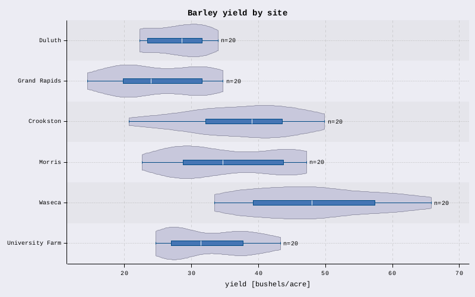
:::


### Grouped violins

A second grouping (here the year, coloured) dodges the violins inside each band, in legend order; with exactly
two groups `:position :mirror` draws split violins, one half per group. The year is a number, so
`:scales {:color {:type :categorical}}` declares it categorical: one colour per year instead of a gradient.

Source: [R Graph Gallery - Grouped violin plot](https://r-graph-gallery.com/violin_grouped_ggplot2.html). Data: Barley yields, Minnesota 1931-1932, R lattice package `barley` (Immer et al. 1934; Fisher 1971; Cleveland 1993); licence: GPL (>= 2) (lattice).


::: {.sourceClojure}
```clojure
(let [p {:data barley
         :mapping {:x :yield :y :site :color :year}
         :scales {:color {:type :categorical}}
         :labels {:x "yield [bushels/acre]" :y nil}}]
  (plot/render-image
   (plot/arrange [(assoc p :charts [(chart/violin {:inner :none})] :labels {:title "dodged" :x "yield" :y nil})
                  (assoc p :charts [(chart/violin {:position :mirror :inner :quartiles})]
                         :labels {:title "split (:position :mirror)" :x "yield" :y nil})]
                 {:columns 2})
   {:width 1000 :height 550}))
```
:::


::: {.clay-image}
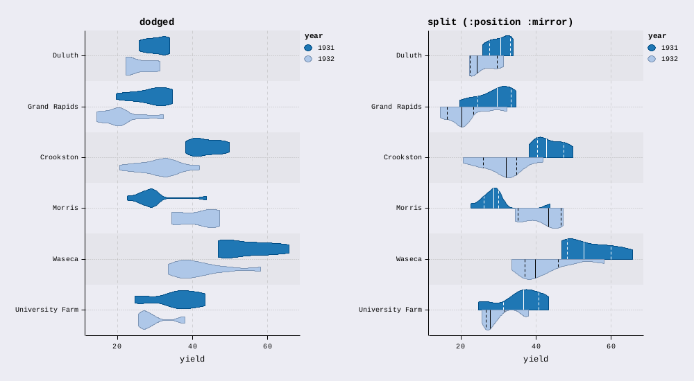
:::


### Inner marks

`:inner` chooses what a violin shows inside: a box (default), quartile lines, a rug or the points. The data is a
fixed 5% sample of chem97 (31022 rows), so the rug and the points stay readable.

Source: R Graph Gallery - Violin plot; seaborn violinplot ([1](https://r-graph-gallery.com/violin.html), [2](https://seaborn.pydata.org/generated/seaborn.violinplot.html)). Data: A-level chemistry scores, England 1997, R mlmRev package `Chem97` (Yang et al. 2002); licence: GPL (>= 2) (mlmRev).


::: {.sourceClojure}
```clojure
(def chem97-sample
  "A fixed 5% sample of chem97 (the full data has 31022 rows)."
  (let [rng (r/rng :mersenne 3)] (filterv (fn [_] (< (r/drandom rng) 0.05)) chem97)))
```
:::


```{=html}
<div class="data-table"><table class="table table-hover table-responsive clay-table"><thead><tr><th>lea</th><th>school</th><th>student</th><th>score</th><th>gender</th><th>age</th><th>gcsescore</th><th>gcsecnt</th></tr></thead><tbody><tr><td>1</td><td>1</td><td>5</td><td>8</td><td>F</td><td>-1</td><td>6.444</td><td>0.15831571143033</td></tr><tr><td>1</td><td>1</td><td>8</td><td>8</td><td>F</td><td>4</td><td>6.909</td><td>0.62331571143033</td></tr><tr><td>1</td><td>2</td><td>32</td><td>10</td><td>M</td><td>2</td><td>6.833</td><td>0.54731571143033</td></tr><tr><td>1</td><td>2</td><td>39</td><td>8</td><td>M</td><td>-5</td><td>6</td><td>-0.28568428856967</td></tr><tr><td>2</td><td>5</td><td>52</td><td>8</td><td>M</td><td>5</td><td>6.25</td><td>-0.0356842885696702</td></tr><tr><td>2</td><td>6</td><td>74</td><td>10</td><td>F</td><td>1</td><td>7.875</td><td>1.58931571143033</td></tr><tr><td>2</td><td>6</td><td>78</td><td>0</td><td>F</td><td>2</td><td>5.666</td><td>-0.61968428856967</td></tr><tr><td>2</td><td>8</td><td>86</td><td>10</td><td>F</td><td>0</td><td>7.111</td><td>0.82531571143033</td></tr><tr><td>2</td><td>9</td><td>98</td><td>6</td><td>M</td><td>-1</td><td>5.875</td><td>-0.41068428856967</td></tr><tr><td>2</td><td>9</td><td>119</td><td>10</td><td>M</td><td>3</td><td>8</td><td>1.71431571143033</td></tr><tr><td>3</td><td>23</td><td>235</td><td>6</td><td>M</td><td>-6</td><td>3.555</td><td>-2.73068428856967</td></tr><tr><td>4</td><td>27</td><td>251</td><td>10</td><td>M</td><td>-2</td><td>6.625</td><td>0.33931571143033</td></tr><tr><td>5</td><td>32</td><td>335</td><td>8</td><td>F</td><td>-6</td><td>6.625</td><td>0.33931571143033</td></tr><tr><td>5</td><td>32</td><td>341</td><td>8</td><td>F</td><td>-1</td><td>6.625</td><td>0.33931571143033</td></tr><tr><td>5</td><td>33</td><td>367</td><td>10</td><td>M</td><td>0</td><td>7.4</td><td>1.11431571143033</td></tr><tr><td>5</td><td>33</td><td>370</td><td>10</td><td>M</td><td>1</td><td>6.7</td><td>0.41431571143033</td></tr><tr><td>5</td><td>33</td><td>376</td><td>10</td><td>M</td><td>5</td><td>7.5</td><td>1.21431571143033</td></tr><tr><td>5</td><td>34</td><td>382</td><td>2</td><td>F</td><td>-2</td><td>6.444</td><td>0.15831571143033</td></tr><tr><td>6</td><td>36</td><td>389</td><td>4</td><td>F</td><td>-6</td><td>6.555</td><td>0.26931571143033</td></tr><tr><td>7</td><td>41</td><td>431</td><td>8</td><td>F</td><td>-6</td><td>7.25</td><td>0.96431571143033</td></tr><tr><td>7</td><td>51</td><td>479</td><td>2</td><td>M</td><td>-4</td><td>5.5</td><td>-0.78568428856967</td></tr><tr><td>7</td><td>54</td><td>493</td><td>4</td><td>F</td><td>1</td><td>6.5</td><td>0.21431571143033</td></tr><tr><td>8</td><td>55</td><td>497</td><td>6</td><td>F</td><td>-6</td><td>6.25</td><td>-0.0356842885696702</td></tr><tr><td>9</td><td>57</td><td>509</td><td>2</td><td>F</td><td>5</td><td>5.444</td><td>-0.84168428856967</td></tr><tr><td>9</td><td>61</td><td>535</td><td>2</td><td>M</td><td>-2</td><td>5.375</td><td>-0.91068428856967</td></tr><tr><td>9</td><td>61</td><td>539</td><td>8</td><td>M</td><td>2</td><td>6.875</td><td>0.58931571143033</td></tr><tr><td>9</td><td>62</td><td>557</td><td>6</td><td>F</td><td>-3</td><td>6.444</td><td>0.15831571143033</td></tr><tr><td>9</td><td>63</td><td>565</td><td>0</td><td>M</td><td>-1</td><td>4.285</td><td>-2.00068428856967</td></tr><tr><td>9</td><td>65</td><td>590</td><td>10</td><td>M</td><td>-1</td><td>7.222</td><td>0.93631571143033</td></tr><tr><td>10</td><td>67</td><td>621</td><td>8</td><td>M</td><td>3</td><td>6.916</td><td>0.63031571143033</td></tr><tr><td>10</td><td>67</td><td>626</td><td>10</td><td>M</td><td>3</td><td>6.916</td><td>0.63031571143033</td></tr><tr><td>10</td><td>67</td><td>642</td><td>10</td><td>M</td><td>-2</td><td>7.583</td><td>1.29731571143033</td></tr><tr><td>10</td><td>68</td><td>651</td><td>10</td><td>F</td><td>0</td><td>7.5</td><td>1.21431571143033</td></tr><tr><td>11</td><td>75</td><td>708</td><td>4</td><td>F</td><td>-4</td><td>5.125</td><td>-1.16068428856967</td></tr><tr><td>12</td><td>77</td><td>731</td><td>8</td><td>M</td><td>1</td><td>6.125</td><td>-0.16068428856967</td></tr><tr><td>12</td><td>77</td><td>740</td><td>2</td><td>F</td><td>1</td><td>5.625</td><td>-0.66068428856967</td></tr><tr><td>12</td><td>78</td><td>745</td><td>10</td><td>F</td><td>-1</td><td>7.25</td><td>0.96431571143033</td></tr><tr><td>12</td><td>86</td><td>801</td><td>4</td><td>F</td><td>-6</td><td>5.555</td><td>-0.73068428856967</td></tr><tr><td>13</td><td>88</td><td>819</td><td>8</td><td>F</td><td>-6</td><td>6.5</td><td>0.21431571143033</td></tr><tr><td>13</td><td>88</td><td>828</td><td>4</td><td>F</td><td>-4</td><td>6.444</td><td>0.15831571143033</td></tr><tr><td>13</td><td>90</td><td>840</td><td>8</td><td>F</td><td>-1</td><td>6.125</td><td>-0.16068428856967</td></tr><tr><td>13</td><td>94</td><td>849</td><td>8</td><td>F</td><td>-4</td><td>7.5</td><td>1.21431571143033</td></tr><tr><td>13</td><td>97</td><td>882</td><td>8</td><td>F</td><td>4</td><td>7.555</td><td>1.26931571143033</td></tr><tr><td>13</td><td>97</td><td>898</td><td>10</td><td>F</td><td>3</td><td>7.777</td><td>1.49131571143033</td></tr><tr><td>14</td><td>100</td><td>927</td><td>4</td><td>F</td><td>-2</td><td>6.875</td><td>0.58931571143033</td></tr><tr><td>14</td><td>104</td><td>943</td><td>4</td><td>M</td><td>0</td><td>5.625</td><td>-0.66068428856967</td></tr><tr><td>15</td><td>110</td><td>969</td><td>4</td><td>F</td><td>-5</td><td>5.888</td><td>-0.39768428856967</td></tr><tr><td>15</td><td>110</td><td>970</td><td>4</td><td>F</td><td>4</td><td>6.333</td><td>0.04731571143033</td></tr><tr><td>15</td><td>111</td><td>1005</td><td>2</td><td>M</td><td>3</td><td>5.888</td><td>-0.39768428856967</td></tr><tr><td>15</td><td>113</td><td>1051</td><td>10</td><td>F</td><td>-1</td><td>7.5</td><td>1.21431571143033</td></tr><tr><td>15</td><td>122</td><td>1150</td><td>2</td><td>M</td><td>1</td><td>6.222</td><td>-0.0636842885696698</td></tr><tr><td>15</td><td>124</td><td>1174</td><td>2</td><td>M</td><td>-4</td><td>5.25</td><td>-1.03568428856967</td></tr><tr><td>15</td><td>125</td><td>1179</td><td>4</td><td>M</td><td>4</td><td>6.777</td><td>0.49131571143033</td></tr><tr><td>15</td><td>130</td><td>1230</td><td>2</td><td>M</td><td>-2</td><td>5.125</td><td>-1.16068428856967</td></tr><tr><td>15</td><td>131</td><td>1244</td><td>8</td><td>F</td><td>-4</td><td>6.555</td><td>0.26931571143033</td></tr><tr><td>15</td><td>132</td><td>1251</td><td>0</td><td>M</td><td>0</td><td>5.75</td><td>-0.53568428856967</td></tr><tr><td>15</td><td>133</td><td>1258</td><td>0</td><td>F</td><td>3</td><td>6.125</td><td>-0.16068428856967</td></tr><tr><td>15</td><td>133</td><td>1273</td><td>6</td><td>M</td><td>-6</td><td>6.375</td><td>0.0893157114303298</td></tr><tr><td>16</td><td>135</td><td>1329</td><td>8</td><td>F</td><td>2</td><td>6.111</td><td>-0.17468428856967</td></tr><tr><td>16</td><td>136</td><td>1346</td><td>10</td><td>M</td><td>-3</td><td>7</td><td>0.71431571143033</td></tr><tr><td>16</td><td>136</td><td>1352</td><td>10</td><td>F</td><td>-3</td><td>7.5</td><td>1.21431571143033</td></tr><tr><td>16</td><td>136</td><td>1353</td><td>8</td><td>F</td><td>-5</td><td>6.375</td><td>0.0893157114303298</td></tr><tr><td>17</td><td>142</td><td>1388</td><td>2</td><td>F</td><td>-6</td><td>6.222</td><td>-0.0636842885696698</td></tr><tr><td>17</td><td>144</td><td>1395</td><td>6</td><td>F</td><td>-3</td><td>6.375</td><td>0.0893157114303298</td></tr><tr><td>17</td><td>148</td><td>1441</td><td>0</td><td>M</td><td>4</td><td>4.25</td><td>-2.03568428856967</td></tr><tr><td>17</td><td>152</td><td>1449</td><td>0</td><td>F</td><td>1</td><td>5.444</td><td>-0.84168428856967</td></tr><tr><td>17</td><td>153</td><td>1459</td><td>8</td><td>F</td><td>-5</td><td>4.875</td><td>-1.41068428856967</td></tr><tr><td>18</td><td>158</td><td>1503</td><td>0</td><td>M</td><td>-3</td><td>5</td><td>-1.28568428856967</td></tr><tr><td>18</td><td>158</td><td>1507</td><td>8</td><td>M</td><td>4</td><td>7.555</td><td>1.26931571143033</td></tr><tr><td>18</td><td>160</td><td>1517</td><td>8</td><td>F</td><td>5</td><td>6.333</td><td>0.04731571143033</td></tr><tr><td>18</td><td>161</td><td>1538</td><td>0</td><td>M</td><td>4</td><td>5</td><td>-1.28568428856967</td></tr><tr><td>18</td><td>161</td><td>1540</td><td>0</td><td>M</td><td>-6</td><td>5.5</td><td>-0.78568428856967</td></tr><tr><td>18</td><td>164</td><td>1554</td><td>8</td><td>M</td><td>-4</td><td>6.625</td><td>0.33931571143033</td></tr><tr><td>18</td><td>164</td><td>1557</td><td>2</td><td>F</td><td>0</td><td>6.1</td><td>-0.185684288569671</td></tr><tr><td>18</td><td>165</td><td>1587</td><td>10</td><td>M</td><td>-6</td><td>7.4</td><td>1.11431571143033</td></tr><tr><td>18</td><td>168</td><td>1608</td><td>0</td><td>M</td><td>4</td><td>5.444</td><td>-0.84168428856967</td></tr><tr><td>18</td><td>169</td><td>1612</td><td>6</td><td>F</td><td>-6</td><td>6</td><td>-0.28568428856967</td></tr><tr><td>18</td><td>169</td><td>1617</td><td>0</td><td>M</td><td>2</td><td>6.375</td><td>0.0893157114303298</td></tr><tr><td>18</td><td>169</td><td>1620</td><td>6</td><td>F</td><td>-4</td><td>6.625</td><td>0.33931571143033</td></tr><tr><td>18</td><td>173</td><td>1634</td><td>4</td><td>F</td><td>-6</td><td>5.777</td><td>-0.50868428856967</td></tr><tr><td>18</td><td>175</td><td>1646</td><td>6</td><td>F</td><td>-2</td><td>6.625</td><td>0.33931571143033</td></tr><tr><td>18</td><td>175</td><td>1649</td><td>4</td><td>F</td><td>5</td><td>6.888</td><td>0.60231571143033</td></tr><tr><td>18</td><td>176</td><td>1675</td><td>10</td><td>M</td><td>-2</td><td>7.5</td><td>1.21431571143033</td></tr><tr><td>18</td><td>178</td><td>1683</td><td>0</td><td>F</td><td>-5</td><td>5</td><td>-1.28568428856967</td></tr><tr><td>18</td><td>178</td><td>1684</td><td>0</td><td>F</td><td>3</td><td>5.333</td><td>-0.95268428856967</td></tr><tr><td>18</td><td>178</td><td>1695</td><td>0</td><td>M</td><td>-3</td><td>5.5</td><td>-0.78568428856967</td></tr><tr><td>19</td><td>179</td><td>1703</td><td>0</td><td>F</td><td>0</td><td>6</td><td>-0.28568428856967</td></tr><tr><td>19</td><td>180</td><td>1707</td><td>8</td><td>M</td><td>-4</td><td>6.444</td><td>0.15831571143033</td></tr><tr><td>19</td><td>181</td><td>1709</td><td>0</td><td>F</td><td>-6</td><td>5.4</td><td>-0.88568428856967</td></tr><tr><td>19</td><td>181</td><td>1714</td><td>4</td><td>F</td><td>4</td><td>7</td><td>0.71431571143033</td></tr><tr><td>19</td><td>185</td><td>1754</td><td>4</td><td>M</td><td>-3</td><td>5.545</td><td>-0.74068428856967</td></tr><tr><td>19</td><td>186</td><td>1794</td><td>8</td><td>M</td><td>3</td><td>6.272</td><td>-0.01368428856967</td></tr><tr><td>19</td><td>186</td><td>1799</td><td>10</td><td>M</td><td>4</td><td>6.909</td><td>0.62331571143033</td></tr><tr><td>19</td><td>187</td><td>1812</td><td>6</td><td>F</td><td>-1</td><td>6.555</td><td>0.26931571143033</td></tr><tr><td>19</td><td>188</td><td>1830</td><td>10</td><td>F</td><td>1</td><td>7.4</td><td>1.11431571143033</td></tr><tr><td>19</td><td>193</td><td>1888</td><td>8</td><td>M</td><td>-5</td><td>6.25</td><td>-0.0356842885696702</td></tr><tr><td>19</td><td>193</td><td>1891</td><td>0</td><td>F</td><td>5</td><td>5.125</td><td>-1.16068428856967</td></tr><tr><td>19</td><td>193</td><td>1909</td><td>6</td><td>M</td><td>-3</td><td>4.636</td><td>-1.64968428856967</td></tr><tr><td>19</td><td>193</td><td>1912</td><td>8</td><td>M</td><td>-2</td><td>5.8</td><td>-0.48568428856967</td></tr><tr><td>20</td><td>197</td><td>1950</td><td>0</td><td>M</td><td>-3</td><td>3.888</td><td>-2.39768428856967</td></tr><tr><td>…</td><td>…</td><td>…</td><td>…</td><td>…</td><td>…</td><td>…</td><td>…</td></tr></tbody></table></div>
```


::: {.sourceClojure}
```clojure
(plot/render-image
 (plot/arrange (for [inner [:box :quartiles :rug :points]]
                 {:data chem97-sample
                  :mapping {:x :gcsescore :y :score}
                  :scales {:y {:type :categorical}}
                  :charts [(chart/violin {:inner inner})]
                  :labels {:title (str ":inner " inner) :x "GCSE score"}})
               {:columns 2})
 {:width 1000 :height 800})
```
:::


::: {.clay-image}

:::


## Density

A kernel density estimate (fastmath) of the values, per panel and group.


### Basic density

`:bandwidth` is a number or a fastmath rule (`:nrd0` by default, as R); `:kernel` any fastmath kernel.

Source: [R Graph Gallery - Density plot](https://r-graph-gallery.com/21-distribution-plot-using-ggplot2.html). Data: Old Faithful geyser eruptions, R datasets package `faithful` (Härdle 1991; Azzalini & Bowman 1990); licence: Part of R (GPL-2 | GPL-3).


::: {.sourceClojure}
```clojure
(plot/render-image
 (plot/arrange (for [[title opts] [["default (:nrd0)" {}]
                                   [":bandwidth 0.1" {:bandwidth 0.1}]
                                   [":bandwidth 0.6" {:bandwidth 0.6}]
                                   [":kernel :epanechnikov" {:kernel :epanechnikov}]]]
                 {:data faithful
                  :mapping {:x :eruptions}
                  :charts [(chart/density (assoc opts :fill [0 114 178 60]))]
                  :labels {:title title :x "eruption time [min]"}})
               {:columns 2})
 {:width 900 :height 600})
```
:::


::: {.clay-image}
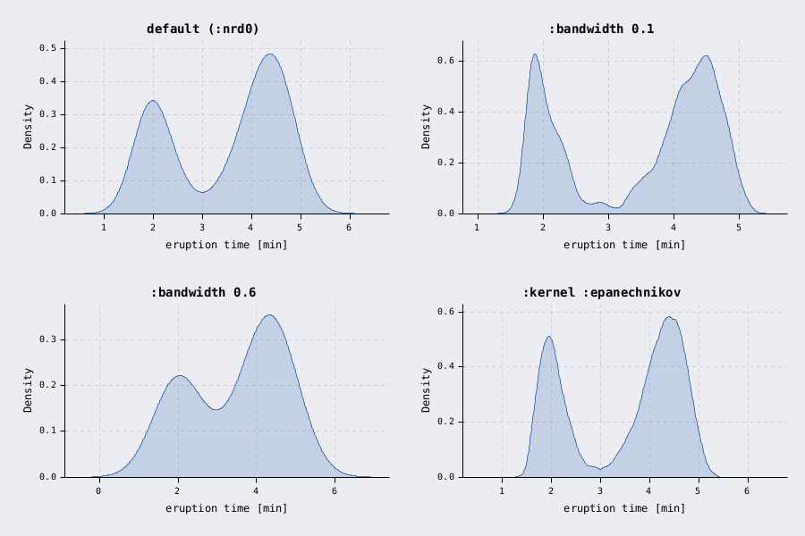
:::


### Mirror density

Two groups, the second drawn downward, with the y = 0 line (`:zero-line`, on by default). `:symmetric` puts
both halves on one range so they compare by height.

Source: [R Graph Gallery - Mirror density chart](https://r-graph-gallery.com/density_mirror_ggplot2.html). Data: A-level chemistry scores, England 1997, R mlmRev package `Chem97` (Yang et al. 2002); licence: GPL (>= 2) (mlmRev).


::: {.sourceClojure}
```clojure
(plot/render-image
 (plot/arrange [{:data chem97
                 :mapping {:x :gcsescore :color :gender}
                 :charts [(chart/density {:position :mirror :fill :color})]
                 :labels {:title "GCSE score: F up, M down" :x "GCSE score"}}
                {:data chem97
                 :mapping {:x :age :color :gender}
                 :charts [(chart/density {:position :mirror :symmetric true})]
                 :labels {:title "age, :symmetric" :x "age [months, centred]"}}]
               {:columns 2})
 {:width 1000 :height 450})
```
:::


::: {.clay-image}
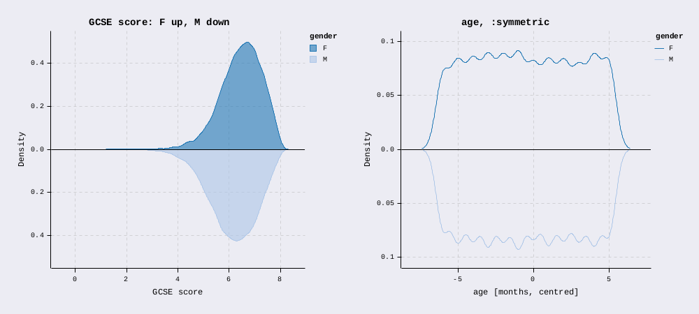
:::


### Several groups

Groups from a colour mapping, overlaid. The line takes the group colour; `:fill :color` fills each area with
its group colour at opacity `:alpha`, a fixed `:fill` colour fills every area alike.

Source: [R Graph Gallery - Density with multiple groups](https://r-graph-gallery.com/density-plot.html). Data: Edgar Anderson's iris measurements, R datasets package `iris` (Anderson 1935; Fisher 1936); licence: Part of R (GPL-2 | GPL-3).


::: {.sourceClojure}
```clojure
(plot/render-image
 (plot/arrange [{:data iris
                 :mapping {:x :sepal-length :color :species}
                 :charts [(chart/density {:line-width 2})]
                 :labels {:title "lines" :x "sepal length [cm]"}}
                {:data iris
                 :mapping {:x :sepal-length :color :species}
                 :charts [(chart/density {:fill :color :alpha 0.4})]
                 :labels {:title ":fill :color, :alpha 0.4" :x "sepal length [cm]"}}
                {:data iris
                 :mapping {:x :petal-length :color :species}
                 :charts [(chart/density {:fill [0 0 0 30]})]
                 :labels {:title ":fill [0 0 0 30]" :x "petal length [cm]"}}]
               {:columns 3})
 {:width 1000 :height 400})
```
:::


::: {.clay-image}
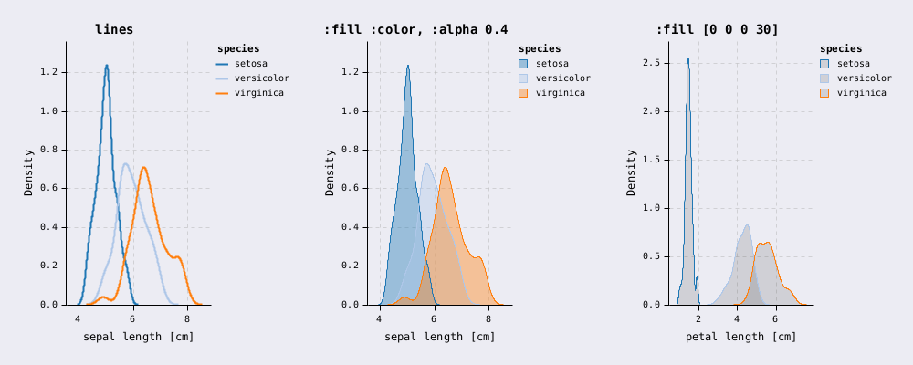
:::


### Annotated density

Annotation charts take literal positions: a rule at the mean, a text label and a band (`chart/rect`) over the
central 50% of the values.

Source: [R Graph Gallery - Density chart with annotation](https://r-graph-gallery.com/density-plot.html). Data: Old Faithful geyser eruptions, R datasets package `faithful` (Härdle 1991; Azzalini & Bowman 1990); licence: Part of R (GPL-2 | GPL-3).


::: {.sourceClojure}
```clojure
(let [xs (map :eruptions faithful)
      mean (stats/mean xs)
      [q1 q3] (stats/quantiles xs [0.25 0.75])]
  (plot/render-image
   {:data faithful
    :mapping {:x :eruptions}
    :charts [(chart/rect {:x [q1 q3] :fill [0 114 178 40]})
             (chart/density)
             (chart/rule {:x mean :dash [5.0 3.0] :color :red})
             (chart/text {:x mean :y [:panel 0.95] :text (format "mean %.2f" mean) :anchor [:left :top]
                          :offset [4 0] :color :red})
             (chart/text {:x (* 0.5 (+ q1 q3)) :y [:panel 0.05] :text "IQR" :anchor [:center :bottom]})]
    :labels {:title "Old Faithful eruption times" :x "eruption time [min]"}}
   {:width 800 :height 450}))
```
:::


::: {.clay-image}

:::


### Small multiples

A facet mapping gives one panel per level; the colour still groups inside each panel.

Source: [R Graph Gallery - Density small multiples](https://r-graph-gallery.com/density-plot.html). Data: A-level chemistry scores, England 1997, R mlmRev package `Chem97` (Yang et al. 2002); licence: GPL (>= 2) (mlmRev).


::: {.sourceClojure}
```clojure
(plot/render-image
 {:data chem97
  :mapping {:x :gcsescore :facet :score :color :gender}
  :charts [(chart/density)]
  :labels {:title "GCSE score by A-level score and gender" :x "GCSE score"}}
 {:width 900 :height 600})
```
:::


::: {.clay-image}

:::


### Stacked density

`:position :stack` piles the group densities on one common grid; `:normalize` shows each group's share.

Source: [R Graph Gallery - Stacked density chart](https://r-graph-gallery.com/135-stacked-density-graph.html). Data: Prices and attributes of round cut diamonds, R ggplot2 package `diamonds` (Wickham et al.); licence: MIT (ggplot2).


::: {.sourceClojure}
```clojure
(let [p {:data diamonds
         :mapping {:x :price :color :cut}
         :scales {:color {:domain ["Fair" "Good" "Very Good" "Premium" "Ideal"]}}}]
  (plot/render-image
   (plot/arrange [(assoc p :charts [(chart/density {:position :stack})] :labels {:title ":stack" :x "price [USD]"})
                  (assoc p :charts [(chart/density {:position :normalize})] :labels {:title ":normalize" :x "price [USD]"})]
                 {:columns 2})
   {:width 1000 :height 450}))
```
:::


::: {.clay-image}
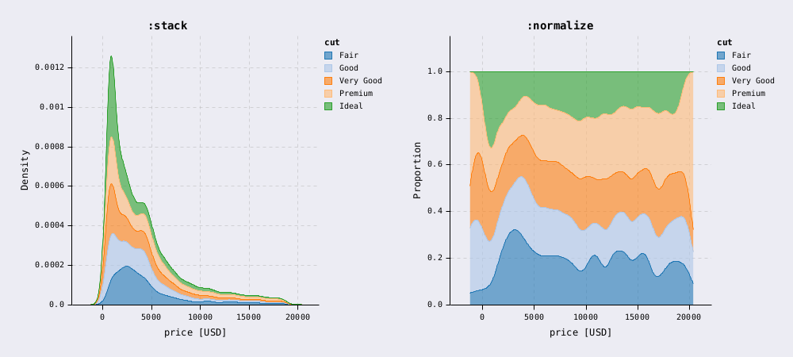
:::


### Marginal density

`:margins` adds charts beside the panel: the top margin shares the horizontal axis, the right margin the
vertical one. Margin charts read the plot's data and colour mapping, with `:x` mapped to the shared dimension
for them; they have no axes of their own, so the scatter keeps the only x and y axes.

Source: [R Graph Gallery - Marginal distribution](https://r-graph-gallery.com/277-marginal-histogram-for-ggplot2.html). Data: Edgar Anderson's iris measurements, R datasets package `iris` (Anderson 1935; Fisher 1936); licence: Part of R (GPL-2 | GPL-3).


::: {.sourceClojure}
```clojure
(plot/render-image
 {:data iris
  :mapping {:x :sepal-length :y :sepal-width :color :species}
  :charts [(chart/scatter)]
  :margins {:top (chart/density {:fill :color :alpha 0.4})
            :right (chart/density {:fill :color :alpha 0.4})}
  :labels {:title "Iris sepals with marginal densities" :x "sepal length [cm]" :y "sepal width [cm]"}}
 {:width 750 :height 650})
```
:::


::: {.clay-image}
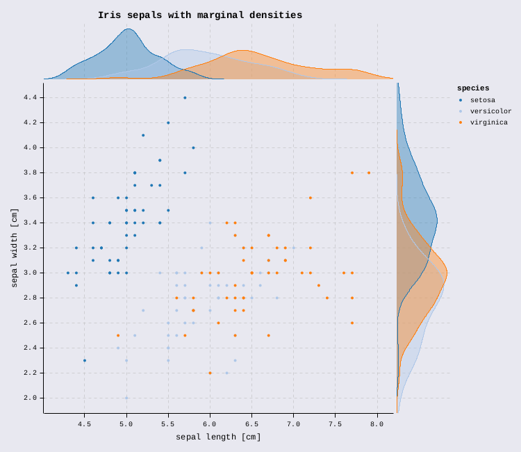
:::


## Histogram

Counts of the values in bins shared by all panels and groups.


### Basic histogram

`:y` chooses the bar height: percent of the total (default), count, density (area 1) or probability.

Source: [R Graph Gallery - Histogram](https://r-graph-gallery.com/220-basic-ggplot2-histogram.html). Data: Old Faithful geyser eruptions, R datasets package `faithful` (Härdle 1991; Azzalini & Bowman 1990); licence: Part of R (GPL-2 | GPL-3).


::: {.sourceClojure}
```clojure
(plot/render-image
 (plot/arrange (for [y [:percent :count :density :pmf]]
                 {:data faithful
                  :mapping {:x :waiting}
                  :charts [(chart/histogram {:y y})]
                  :labels {:title (str ":y " y) :x "waiting [min]"}})
               {:columns 2})
 {:width 900 :height 600})
```
:::


::: {.clay-image}
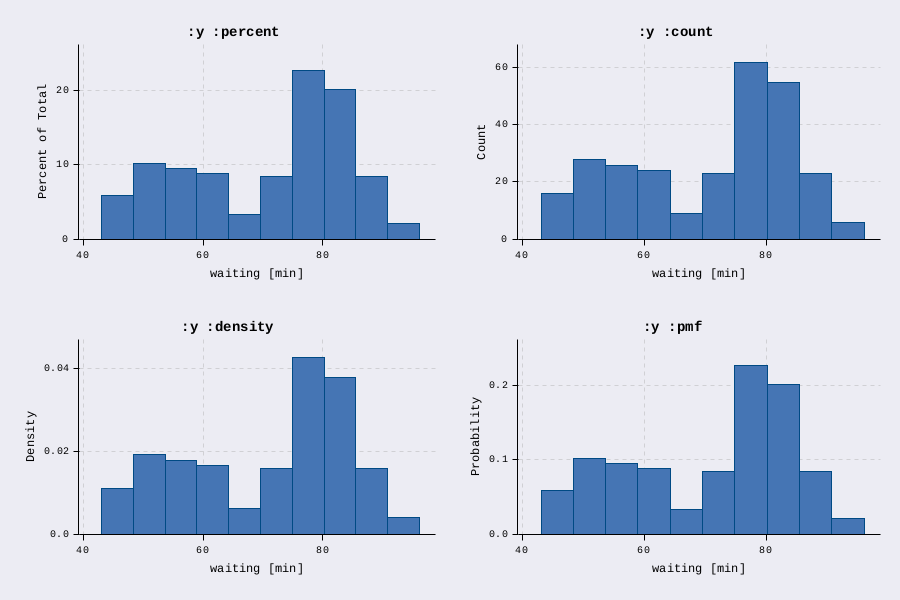
:::


### Bin size

`:bins` takes a fastmath estimation rule, a number of equal bins or explicit breaks.

Source: [R Graph Gallery - Histogram bin size](https://r-graph-gallery.com/220-basic-ggplot2-histogram.html). Data: Old Faithful geyser eruptions, R datasets package `faithful` (Härdle 1991; Azzalini & Bowman 1990); licence: Part of R (GPL-2 | GPL-3).


::: {.sourceClojure}
```clojure
(plot/render-image
 (plot/arrange (for [bins [:sturges 5 40 [1.5 2.5 3.5 4 4.5 5.5]]]
                 {:data faithful
                  :mapping {:x :eruptions}
                  :charts [(chart/histogram {:bins bins})]
                  :labels {:title (str ":bins " bins) :x "eruption time [min]"}})
               {:columns 2})
 {:width 900 :height 600})
```
:::


::: {.clay-image}

:::


### Mirror histogram

Two groups back to back. Bars are filled by the group colour and outlined by `:stroke-color` - a colour,
`:none` or `:darker` (the darkened fill, default); `:symmetric` gives both halves one range.

Source: [R Graph Gallery - Mirror histogram](https://r-graph-gallery.com/190-mirrored-histogram.html). Data: A-level chemistry scores, England 1997, R mlmRev package `Chem97` (Yang et al. 2002); licence: GPL (>= 2) (mlmRev).


::: {.sourceClojure}
```clojure
(plot/render-image
 (plot/arrange [{:data chem97 :mapping {:x :gcsescore :color :gender}
                 :charts [(chart/histogram {:position :mirror :bins 30})]
                 :labels {:title "default outline" :x "GCSE score"}}
                {:data chem97 :mapping {:x :gcsescore :color :gender}
                 :charts [(chart/histogram {:position :mirror :bins 30 :stroke-color :white :symmetric true})]
                 :labels {:title "white outline, :symmetric" :x "GCSE score"}}]
               {:columns 2})
 {:width 1000 :height 450})
```
:::


::: {.clay-image}
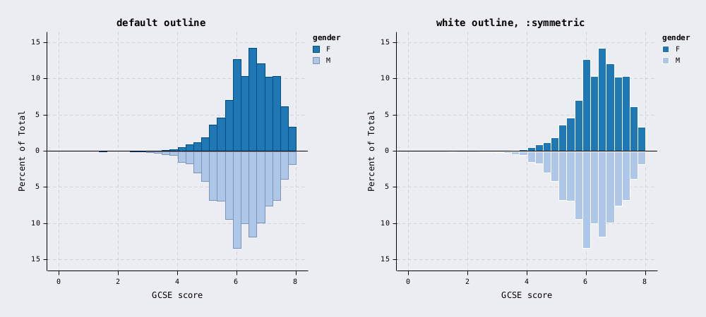
:::


### Groups on one axis

`:position` places the groups' bars: over each other (translucent), side by side, stacked or normalized.

Source: [R Graph Gallery - Histogram with several groups](https://r-graph-gallery.com/histogram_several_group.html). Data: Edgar Anderson's iris measurements, R datasets package `iris` (Anderson 1935; Fisher 1936); licence: Part of R (GPL-2 | GPL-3).


::: {.sourceClojure}
```clojure
(plot/render-image
 (plot/arrange (for [position [:overlay :dodge :stack :normalize]]
                 {:data iris
                  :mapping {:x :sepal-length :color :species}
                  :charts [(chart/histogram {:position position :bins 15})]
                  :labels {:title (str ":position " position) :x "sepal length [cm]"}})
               {:columns 2})
 {:width 1000 :height 650})
```
:::


::: {.clay-image}
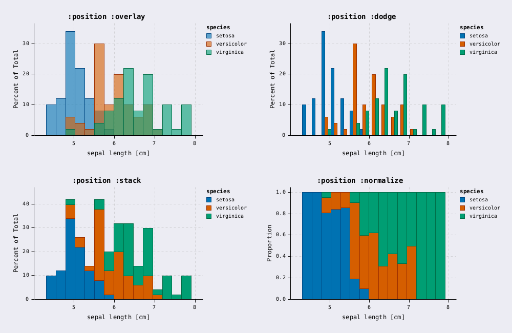
:::


### Small multiples

Source: [R Graph Gallery - Histogram small multiples](https://r-graph-gallery.com/histogram.html). Data: Prices and attributes of round cut diamonds, R ggplot2 package `diamonds` (Wickham et al.); licence: MIT (ggplot2).


::: {.sourceClojure}
```clojure
(plot/render-image
 {:data diamonds
  :mapping {:x :price :facet :cut}
  :scales {:facet {:domain ["Fair" "Good" "Very Good" "Premium" "Ideal"]}}
  :charts [(chart/histogram {:bins 30})]
  :labels {:title "Diamond prices by cut" :x "price [USD]"}}
 {:width 900 :height 600})
```
:::


::: {.clay-image}
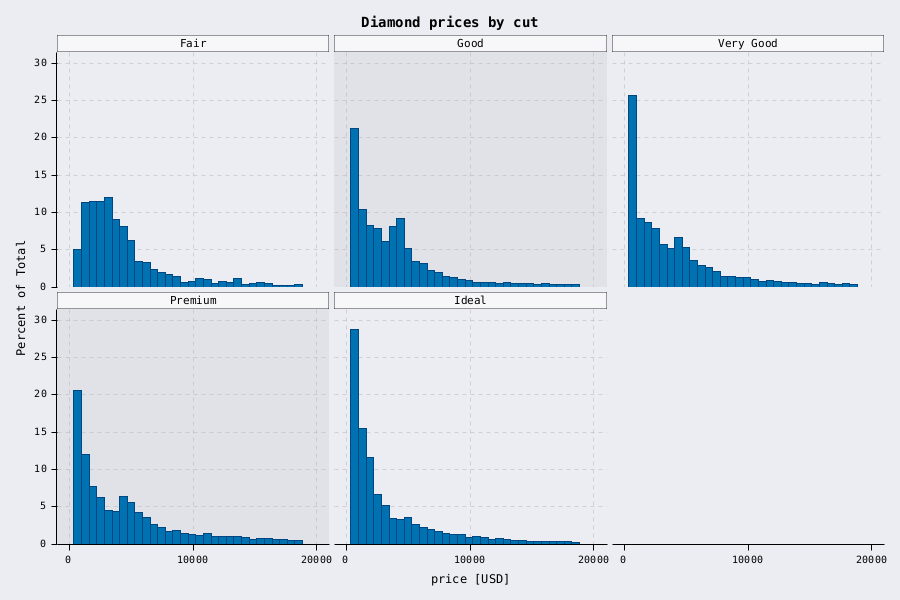
:::


### Marginal histogram

A margin may hold several charts, `:size` sets its thickness in pixels and `:axis true` shows the magnitude
(count, density) of a histogram or density margin; strips (boxes, rugs, ...) work in margins too.

Source: [R Graph Gallery - Marginal histogram](https://r-graph-gallery.com/277-marginal-histogram-for-ggplot2.html). Data: Edgar Anderson's iris measurements, R datasets package `iris` (Anderson 1935; Fisher 1936); licence: Part of R (GPL-2 | GPL-3).


::: {.sourceClojure}
```clojure
(plot/render-image
 {:data iris
  :mapping {:x :petal-length :y :petal-width :color :species}
  :charts [(chart/scatter)]
  :margins {:top {:charts (chart/histogram {:bins 25 :position :stack :y :count}) :axis true}
            :right {:charts [(chart/box {:outliers false}) (chart/rug)] :size 70}}
  :labels {:title "Iris petals: stacked histogram on top, boxes and a rug on the right"
           :x "petal length [cm]" :y "petal width [cm]"}}
 {:width 750 :height 650})
```
:::


::: {.clay-image}

:::


### Strips on a histogram

Any strip chart (box, violin, rug, stripplot, beeswarm, extent) layers on a histogram or density:
`{:at v}` centres it on y = v; `:place :bottom` draws it below y = 0 in room the chart asks for.

Source: R Graph Gallery - Histogram with boxplot on top; lattice Fig 3.1 ([1](https://r-graph-gallery.com/82-boxplot-on-top-of-histogram.html), [2](http://lmdvr.r-forge.r-project.org/figures/figures.html)). Data: Old Faithful geyser eruptions, R datasets package `faithful` (Härdle 1991; Azzalini & Bowman 1990); licence: Part of R (GPL-2 | GPL-3).


::: {.sourceClojure}
```clojure
(plot/render-image
 (plot/arrange [{:data faithful :mapping {:x :eruptions}
                 :charts [(chart/histogram {:bins 20}) (chart/box {:place {:at 14.5} :thickness 16})]
                 :labels {:title "box above ({:at 14.5})" :x "eruption time [min]"}}
                {:data faithful :mapping {:x :eruptions}
                 :charts [(chart/density) (chart/rug {:place :bottom :width 1.0})]
                 :labels {:title "rug below (:bottom)" :x "eruption time [min]"}}
                {:data faithful :mapping {:x :eruptions}
                 :charts [(chart/density) (chart/stripplot {:place :bottom :rng (r/rng :mersenne 2) :size 6})]
                 :labels {:title "jittered points below" :x "eruption time [min]"}}
                {:data faithful :mapping {:x :eruptions}
                 :charts [(chart/histogram {:bins 20}) (chart/beeswarm {:place :bottom :size 4 :bottom-share 0.3})]
                 :labels {:title "beeswarm below" :x "eruption time [min]"}}]
               {:columns 2})
 {:width 1000 :height 700})
```
:::


::: {.clay-image}
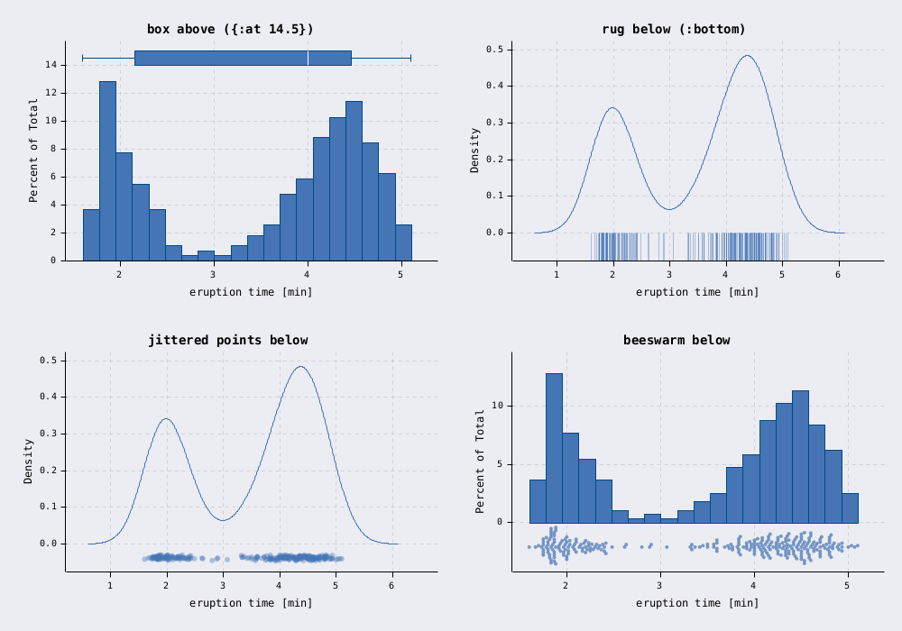
:::


## Boxplot

A Tukey box per group: quartiles, whiskers to the most extreme values within 1.5 IQR, outliers beyond.


### Basic boxplot

Source: [R Graph Gallery - Boxplot](https://r-graph-gallery.com/262-basic-boxplot-with-ggplot2.html). Data: Motor Trend car road tests (1974), R datasets package `mtcars` (Henderson & Velleman 1981); licence: Part of R (GPL-2 | GPL-3).


::: {.sourceClojure}
```clojure
(plot/render-image
 {:data mtcars
  :mapping {:x :mpg :y :cyl}
  :scales {:y {:type :categorical}}
  :charts [(chart/box)]
  :labels {:title "Fuel economy by number of cylinders" :x "miles per gallon" :y "cylinders"}}
 {:width 800 :height 400})
```
:::


::: {.clay-image}

:::


The cylinder count is a number, so it is declared categorical - one band per value instead of a numeric axis -
with `:scales {:y {:type :categorical}}`; strings and keywords are categorical by themselves.


### Boxplot with jittered points

Source: [R Graph Gallery - Boxplot with jitter](https://r-graph-gallery.com/96-boxplot-with-jitter.html). Data: Motor Trend car road tests (1974), R datasets package `mtcars` (Henderson & Velleman 1981); licence: Part of R (GPL-2 | GPL-3).


::: {.sourceClojure}
```clojure
(plot/render-image
 {:data mtcars
  :mapping {:x :mpg :y :cyl}
  :scales {:y {:type :categorical}}
  :charts [(chart/box {:outliers false :color [210 210 225]})
           (chart/stripplot {:rng (r/rng :mersenne 7) :jitter 0.2 :size 8 :color [215 48 39 160]})]
  :labels {:title "Box with every car" :x "miles per gallon" :y "cylinders"}}
 {:width 800 :height 400})
```
:::


::: {.clay-image}
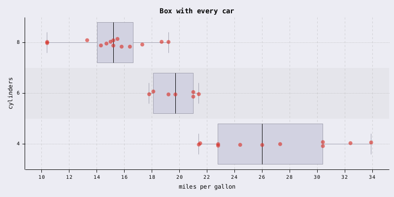
:::


### Group order

The band scale's `:order-by` orders the levels by a function of each level's rows, from the bottom up;
`:descending true` reverses it.

Source: [R Graph Gallery - Reorder boxplot](https://r-graph-gallery.com/267-reorder-a-variable-in-ggplot2.html). Data: Barley yields, Minnesota 1931-1932, R lattice package `barley` (Immer et al. 1934; Fisher 1971; Cleveland 1993); licence: GPL (>= 2) (lattice).


::: {.sourceClojure}
```clojure
(plot/render-image
 (plot/arrange [{:data barley :mapping {:x :yield :y :variety}
                 :scales {:y {:order-by #(stats/median (map :yield %))}}
                 :charts [(chart/box)]
                 :labels {:title "by median (largest on top)" :x "yield" :y nil}}
                {:data barley :mapping {:x :yield :y :variety}
                 :scales {:y {:order-by #(stats/mean (map :yield %)) :descending true}}
                 :charts [(chart/box)]
                 :labels {:title "by mean, :descending (largest at the bottom)" :x "yield" :y nil}}]
               {:columns 2})
 {:width 1000 :height 500})
```
:::


::: {.clay-image}

:::


### Highlight a group

A derived column and an explicit colour scale: grey for the rest, red for the group in focus. Each band holds one
colour group, so every box stays on its band's centre line.

Source: [R Graph Gallery - Highlight a group in boxplot](https://r-graph-gallery.com/23-add-colors-to-specific-groups-of-a-boxplot.html). Data: Motor Trend car road tests (1974), R datasets package `mtcars` (Henderson & Velleman 1981); licence: Part of R (GPL-2 | GPL-3).


::: {.sourceClojure}
```clojure
(plot/render-image
 {:data (map #(assoc % :focus (if (= 6 (:cyl %)) "6 cylinders" "other")) mtcars)
  :mapping {:x :hp :y :cyl :color :focus}
  :scales {:y {:type :categorical}
           :color {:domain ["other" "6 cylinders"] :range [[190 190 190] [215 48 39]]}}
  :charts [(chart/box)]
  :labels {:title "Horse power, 6 cylinders highlighted" :x "horse power" :y "cylinders"}}
 {:width 800 :height 400})
```
:::


::: {.clay-image}
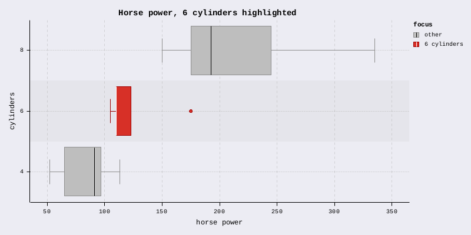
:::


### Grouped boxplot

Source: [R Graph Gallery - Grouped boxplot](https://r-graph-gallery.com/265-grouped-boxplot-with-ggplot2.html). Data: Barley yields, Minnesota 1931-1932, R lattice package `barley` (Immer et al. 1934; Fisher 1971; Cleveland 1993); licence: GPL (>= 2) (lattice).


::: {.sourceClojure}
```clojure
(plot/render-image
 {:data barley
  :mapping {:x :yield :y :site :color :year}
  :scales {:color {:type :categorical}}
  :charts [(chart/box)]
  :labels {:title "Barley yield by site and year" :x "yield [bushels/acre]" :y nil}}
 {:width 800 :height 500})
```
:::


::: {.clay-image}
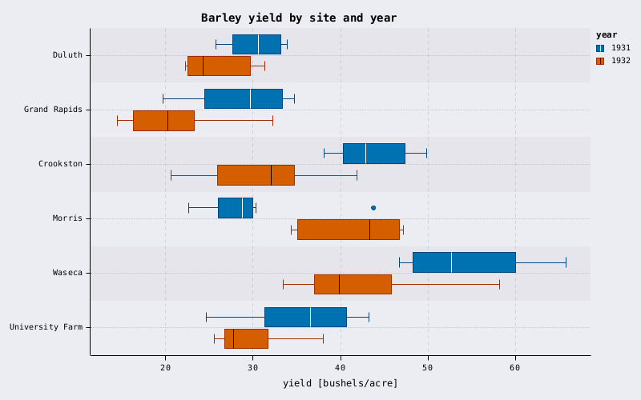
:::


### Faceted boxplot

Source: [R Graph Gallery - Boxplot small multiples](https://r-graph-gallery.com/boxplot.html). Data: Barley yields, Minnesota 1931-1932, R lattice package `barley` (Immer et al. 1934; Fisher 1971; Cleveland 1993); licence: GPL (>= 2) (lattice).


::: {.sourceClojure}
```clojure
(plot/render-image
 {:data barley
  :mapping {:x :yield :y :year :facet :site}
  :scales {:y {:type :categorical}}
  :charts [(chart/box)]
  :labels {:title "Yield by year, one panel per site" :x "yield" :y nil}}
 {:width 900 :height 500})
```
:::


::: {.clay-image}
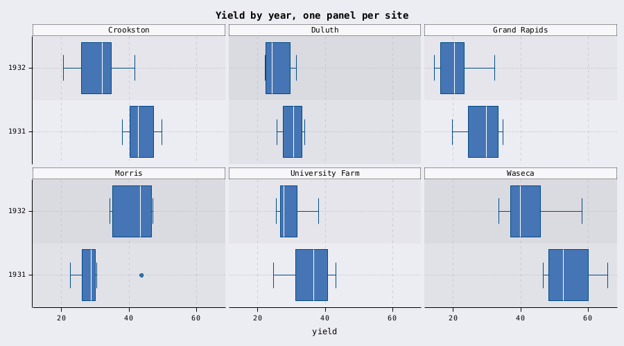
:::


### Variable width

`:varwidth` makes each box's width proportional to the square root of its count.

Source: [R Graph Gallery - Boxplot with variable width](https://r-graph-gallery.com/266-ggplot2-boxplot-with-variable-width.html). Data: A-level chemistry scores, England 1997, R mlmRev package `Chem97` (Yang et al. 2002); licence: GPL (>= 2) (mlmRev).


::: {.sourceClojure}
```clojure
(plot/render-image
 {:data chem97
  :mapping {:x :gcsescore :y :score}
  :scales {:y {:type :categorical}}
  :charts [(chart/box {:varwidth true :n-label true})]
  :labels {:title "GCSE score by A-level score" :x "GCSE score" :y "A-level score"}}
 {:width 800 :height 550})
```
:::


::: {.clay-image}
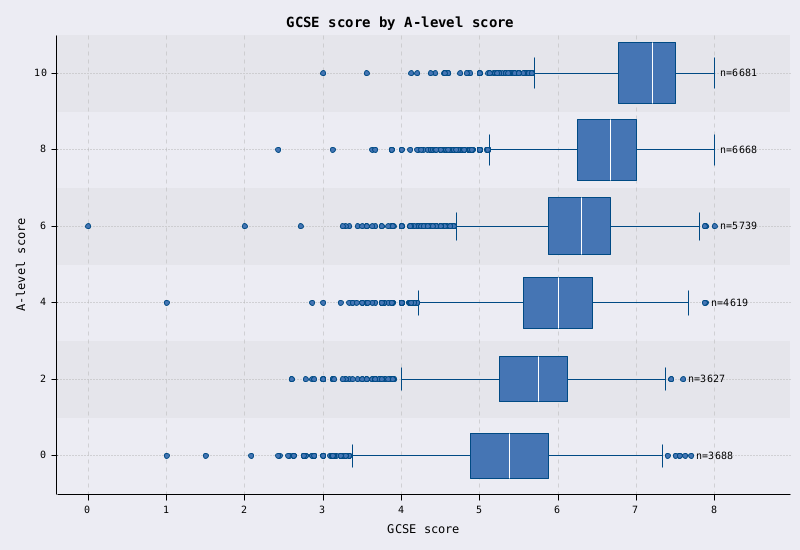
:::


### Binned continuous variable

`levels/bin` cuts a numeric column into half-open interval bins; the bins are ordered levels for the boxes.

Source: [R Graph Gallery - Boxplot from continuous variable](https://r-graph-gallery.com/268-ggplot2-boxplot-from-continuous-variable.html). Data: Prices and attributes of round cut diamonds, R ggplot2 package `diamonds` (Wickham et al.); licence: MIT (ggplot2).


::: {.sourceClojure}
```clojure
(plot/render-image
 {:data (levels/bin diamonds :carat {:as :carat-bin :bins [0 0.5 1 1.5 2 2.5 5.01]})
  :mapping {:x :price :y :carat-bin}
  :charts [(chart/box {:outliers false :n-label true})]
  :labels {:title "Diamond price by carat" :x "price [USD]" :y "carat"}}
 {:width 800 :height 500})
```
:::


::: {.clay-image}

:::


### Mean marker

The categorical declaration can also sit on the mapping: `(levels/categorical :gear)` reads `:gear` as usual
and makes its dimension categorical, here instead of a `:scales` entry.

Source: [R Graph Gallery - Boxplot with mean](https://r-graph-gallery.com/269-ggplot2-boxplot-with-average-value.html). Data: Motor Trend car road tests (1974), R datasets package `mtcars` (Henderson & Velleman 1981); licence: Part of R (GPL-2 | GPL-3).


::: {.sourceClojure}
```clojure
(plot/render-image
 {:data mtcars
  :mapping {:x :qsec :y (levels/categorical :gear)}
  :charts [(chart/box {:mean true})]
  :labels {:title "Quarter mile time by gears, mean marked" :x "quarter mile [s]" :y "gears"}}
 {:width 800 :height 400})
```
:::


::: {.clay-image}
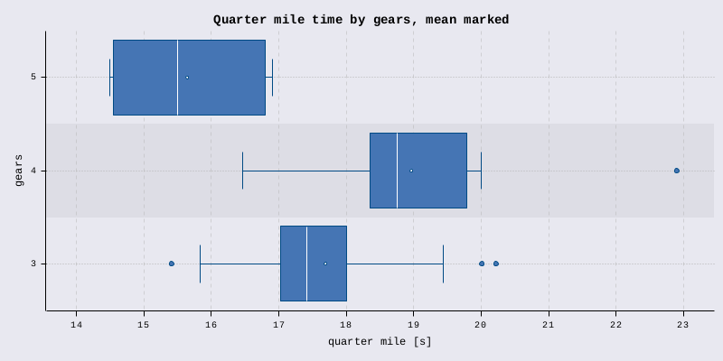
:::


### Sample size

`:n-label` with `:n-format` (a format string for the count).

Source: [R Graph Gallery - Boxplot with sample size](https://r-graph-gallery.com/26-add-text-over-a-boxplot.html). Data: Barley yields, Minnesota 1931-1932, R lattice package `barley` (Immer et al. 1934; Fisher 1971; Cleveland 1993); licence: GPL (>= 2) (lattice).


::: {.sourceClojure}
```clojure
(plot/render-image
 {:data barley
  :mapping {:x :yield :y :variety :color :year}
  :scales {:color {:type :categorical}}
  :charts [(chart/box {:n-label true :n-format "%d obs"})]
  :labels {:title "Yield by variety and year" :x "yield" :y nil}}
 {:width 900 :height 650})
```
:::


::: {.clay-image}
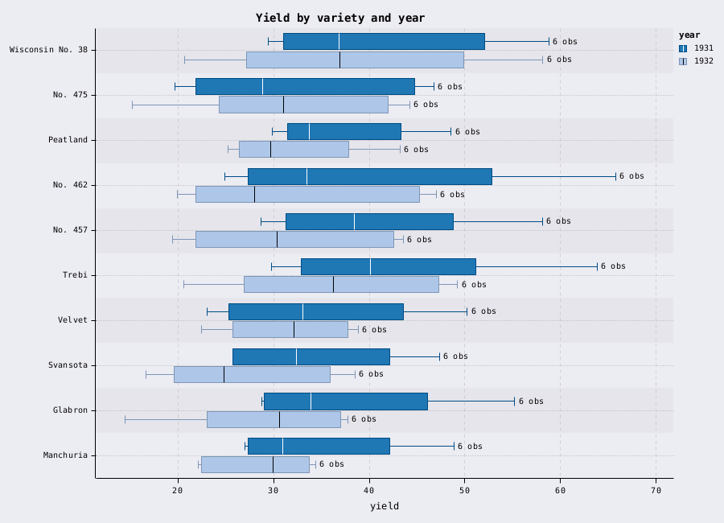
:::


### Horizontal and vertical

Source: [R Graph Gallery - Horizontal boxplot](https://r-graph-gallery.com/boxplot.html). Data: Motor Trend car road tests (1974), R datasets package `mtcars` (Henderson & Velleman 1981); licence: Part of R (GPL-2 | GPL-3).


::: {.sourceClojure}
```clojure
(let [p {:data mtcars :mapping {:x :wt :y :am} :scales {:y {:type :categorical}} :charts [(chart/box)]
         :labels {:x "weight [1000 lbs]" :y "manual transmission"}}]
  (plot/render-image
   (plot/arrange [(assoc-in p [:labels :title] "horizontal")
                  (-> p (assoc :flip true) (assoc-in [:labels :title] ":flip true"))]
                 {:columns 2})
   {:width 900 :height 400}))
```
:::


::: {.clay-image}
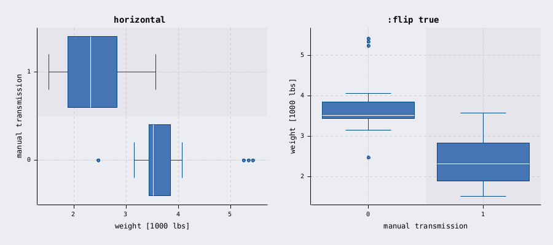
:::


### Intervals

`chart/extent` draws an interval per group from fastmath.stats: here the 95% confidence interval of the mean,
mean ± standard deviation and a bootstrap percentile interval.

Source: seaborn - pointplot (confidence intervals); cljplot - extents ([1](https://seaborn.pydata.org/generated/seaborn.pointplot.html), [2](https://github.com/generateme/cljplot/blob/master/sketches/examples.clj)). Data: Barley yields, Minnesota 1931-1932, R lattice package `barley` (Immer et al. 1934; Fisher 1971; Cleveland 1993); licence: GPL (>= 2) (lattice).


::: {.sourceClojure}
```clojure
(plot/render-image
 (plot/arrange (for [[title opts] [[":ci" {:method :ci}]
                                   [":stddev" {:method :stddev}]
                                   [":bootstrap-percentile" {:method :bootstrap-percentile :rng (r/rng :mersenne 1)}]]]
                 {:data barley :mapping {:x :yield :y :site}
                  :charts [(chart/extent opts)]
                  :labels {:title title :x "yield" :y nil}})
               {:columns 3})
 {:width 1000 :height 400})
```
:::


::: {.clay-image}
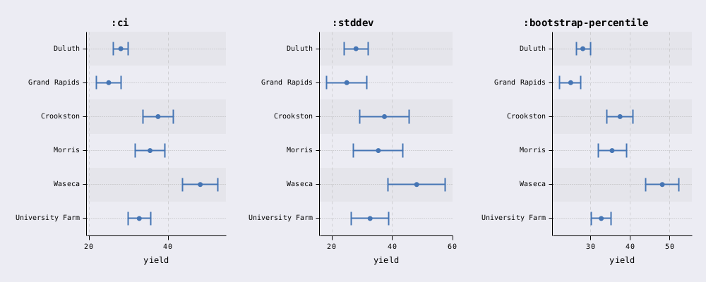
:::


## Ridgeline

Histograms and densities with a categorical `:y` become ridgelines: one profile per level, growing toward the
next level, all on one height scale (`:overlap` - the tallest profile in band steps).


### Basic ridgeline


::: {.sourceClojure}
```clojure
(def months ["January" "February" "March" "April" "May" "June" "July" "August" "September" "October" "November"
             "December"])
```
:::


Source: [R Graph Gallery - Ridgeline chart](https://r-graph-gallery.com/294-basic-ridgeline-plot.html). Data: Weather in Lincoln, Nebraska, 2016, R ggridges package `lincoln_weather` (Weather Underground, via Wilke); licence: GPL-2 (ggridges).


::: {.sourceClojure}
```clojure
(plot/render-image
 {:data lincoln
  :mapping {:x :mean-temp :y :month}
  :scales {:y {:domain months :reverse true}}
  :charts [(chart/density {:overlap 1.5})]
  :labels {:title "Mean temperature in Lincoln, 2016" :x "mean temperature [F]" :y nil}}
 {:width 800 :height 650})
```
:::


::: {.clay-image}

:::


### Ridge shapes

Histograms make ridgelines too; any strip chart can share the bands.

Source: [R Graph Gallery - Ridgeline chart](https://r-graph-gallery.com/294-basic-ridgeline-plot.html). Data: Prices and attributes of round cut diamonds, R ggplot2 package `diamonds` (Wickham et al.); licence: MIT (ggplot2).


::: {.sourceClojure}
```clojure
(let [p {:data diamonds
         :mapping {:x :price :y :cut}
         :scales {:y {:domain ["Fair" "Good" "Very Good" "Premium" "Ideal"]}}}]
  (plot/render-image
   (plot/arrange [(assoc p :charts [(chart/histogram {:bins 40})] :labels {:title "histogram ridges" :x "price" :y nil})
                  (assoc p :data (take-nth 25 diamonds)
                         :charts [(chart/density {:overlap 0.7}) (chart/stripplot {:rng (r/rng :mersenne 4) :size 3 :jitter 0.2})]
                         :labels {:title "density ridges with points (4% sample)" :x "price" :y nil})]
                 {:columns 2})
   {:width 1000 :height 550}))
```
:::


::: {.clay-image}

:::


### Gradient fill

`:fill-gradient` colours the area along `:x` with a clojure2d gradient.

Source: [R Graph Gallery - Ridgeline with gradient](https://r-graph-gallery.com/294-basic-ridgeline-plot.html). Data: Weather in Lincoln, Nebraska, 2016, R ggridges package `lincoln_weather` (Weather Underground, via Wilke); licence: GPL-2 (ggridges).


::: {.sourceClojure}
```clojure
(plot/render-image
 {:data lincoln
  :mapping {:x :max-temp :y :month}
  :scales {:y {:domain months :reverse true}}
  :charts [(chart/density {:overlap 1.5 :fill-gradient :mpl/plasma})]
  :labels {:title "Daily maximum temperature" :x "max temperature [F]" :y nil}}
 {:width 800 :height 650})
```
:::


::: {.clay-image}
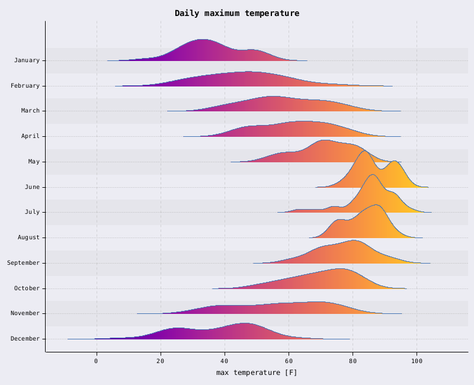
:::


### Double ridgeline

With two groups, `:position :mirror` grows the second group away from the next level.

Source: [R Graph Gallery - Ridgeline (two groups)](https://r-graph-gallery.com/web-double-ridgeline-plot.html). Data: A-level chemistry scores, England 1997, R mlmRev package `Chem97` (Yang et al. 2002); licence: GPL (>= 2) (mlmRev).


::: {.sourceClojure}
```clojure
(plot/render-image
 {:data chem97
  :mapping {:x :gcsescore :y :score :color :gender}
  :scales {:y {:type :categorical}}
  :charts [(chart/density {:position :mirror :overlap 0.45})]
  :labels {:title "GCSE score: F up, M down, by A-level score" :x "GCSE score" :y "A-level score"}}
 {:width 800 :height 650})
```
:::


::: {.clay-image}
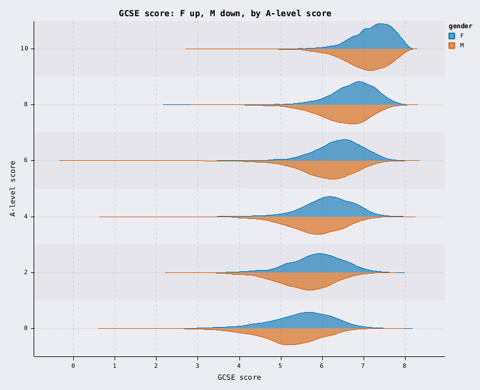
:::


## Beeswarm

Points packed across their band so none overlap (`:fit` squeezes a swarm that is too wide into its band).
A colour mapping makes groups - here each species is alone in its band, so the swarm stays centred - and the box
opts out of the colour with `:mapping {:color nil}`.

Source: R Graph Gallery - Beeswarm ([1](https://r-graph-gallery.com/370-basic-beeswarm-plot.html), [2](https://r-graph-gallery.com/371-custom-dots-beeswarm.html), [3](https://r-graph-gallery.com/372-grouped-beeswarm.html)). Data: Edgar Anderson's iris measurements, R datasets package `iris` (Anderson 1935; Fisher 1936); licence: Part of R (GPL-2 | GPL-3).


::: {.sourceClojure}
```clojure
(plot/render-image
 (plot/arrange [{:data iris :mapping {:x :sepal-length :y :species}
                 :charts [(chart/beeswarm {:size 6})]
                 :labels {:title "basic" :x "sepal length" :y nil}}
                {:data iris :mapping {:x :sepal-length :y :species} :flip true
                 :charts [(chart/beeswarm {:size 6})]
                 :labels {:title "vertical (:flip)" :x "sepal length" :y nil}}
                {:data mtcars :mapping {:x :mpg :y :cyl} :scales {:y {:type :categorical}}
                 :charts [(chart/beeswarm {:size 12 :shape \A :color [215 48 39 200]})]
                 :labels {:title "dot style (:shape, :size)" :x "mpg" :y "cylinders"}}
                {:data iris :mapping {:x :petal-length :y :species :color :species}
                 :charts [(chart/box {:outliers false :color [235 235 240] :width 0.6 :mapping {:color nil}})
                          (chart/beeswarm {:size 5})]
                 :labels {:title "coloured, over boxes" :x "petal length" :y nil}}]
               {:columns 2})
 {:width 1000 :height 700})
```
:::


::: {.clay-image}

:::


## Strip plot and rug


### Strip plot

Jittered points; `:rng` makes the jitter reproducible.

Source: lattice stripplot; seaborn stripplot ([1](http://lmdvr.r-forge.r-project.org/figures/figures.html), [2](https://seaborn.pydata.org/generated/seaborn.stripplot.html)). Data: Barley yields, Minnesota 1931-1932, R lattice package `barley` (Immer et al. 1934; Fisher 1971; Cleveland 1993); licence: GPL (>= 2) (lattice).


::: {.sourceClojure}
```clojure
(plot/render-image
 {:data barley
  :mapping {:x :yield :y :variety :color :year}
  :scales {:color {:type :categorical}}
  :charts [(chart/stripplot {:rng (r/rng :mersenne 1) :size 8 :jitter 0.1})]
  :labels {:title "Barley yield by variety, dodged by year" :x "yield" :y nil}}
 {:width 800 :height 550})
```
:::


::: {.clay-image}

:::


### Rug

One line per value along the panel edge (`:edge`, the default without `:y`) or below y = 0 (`:bottom`).

Source: seaborn rugplot; lattice densityplot ([1](https://seaborn.pydata.org/generated/seaborn.rugplot.html), [2](http://lmdvr.r-forge.r-project.org/figures/figures.html)). Data: Old Faithful geyser eruptions, R datasets package `faithful` (Härdle 1991; Azzalini & Bowman 1990); licence: Part of R (GPL-2 | GPL-3).


::: {.sourceClojure}
```clojure
(plot/render-image
 (plot/arrange [{:data faithful :mapping {:x :waiting} :charts [(chart/density) (chart/rug)]
                 :labels {:title "rug on the edge" :x "waiting [min]"}}
                {:data faithful :mapping {:x :waiting} :charts [(chart/density) (chart/rug {:place :bottom :width 1.0})]
                 :labels {:title "rug below zero (:bottom)" :x "waiting [min]"}}]
               {:columns 2})
 {:width 900 :height 400})
```
:::


::: {.clay-image}

:::


## 1d strips

Every strip chart also works on one variable alone: without `:y` it is placed in the middle of the panel (the
rug, on the panel's edge by default, takes `:place :center`) and the plot has no y axis.

Source: seaborn boxplot, swarmplot (1d) ([1](https://seaborn.pydata.org/generated/seaborn.boxplot.html), [2](https://seaborn.pydata.org/generated/seaborn.swarmplot.html)). Data: Old Faithful geyser eruptions, R datasets package `faithful` (Härdle 1991; Azzalini & Bowman 1990); licence: Part of R (GPL-2 | GPL-3).


::: {.sourceClojure}
```clojure
(plot/render-image
 (plot/arrange (for [[title c] [["box" (chart/box)]
                                ["violin" (chart/violin)]
                                ["stripplot" (chart/stripplot {:rng (r/rng :mersenne 5) :jitter 0.3 :size 6})]
                                ["beeswarm" (chart/beeswarm {:size 5})]
                                ["rug" (chart/rug {:place :center :width 0.6})]
                                ["extent :stddev" (chart/extent {:method :stddev})]]]
                 {:data faithful
                  :mapping {:x :waiting}
                  :charts [c]
                  :labels {:title title :x "waiting [min]"}})
               {:columns 2})
 {:width 900 :height 650})
```
:::


::: {.clay-image}
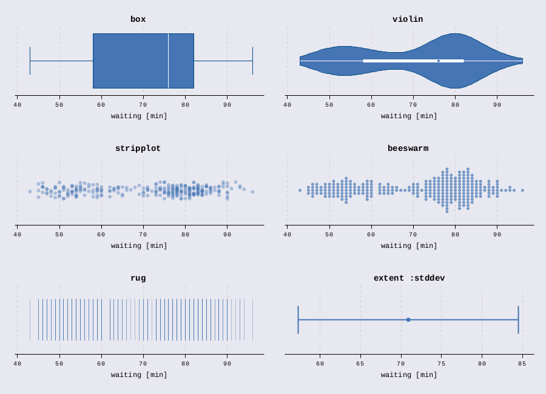
:::


## Empirical cumulative distribution

Source: lattice ecdfplot; seaborn ecdfplot ([1](http://lmdvr.r-forge.r-project.org/figures/figures.html), [2](https://seaborn.pydata.org/generated/seaborn.ecdfplot.html)). Data: Edgar Anderson's iris measurements, R datasets package `iris` (Anderson 1935; Fisher 1936); licence: Part of R (GPL-2 | GPL-3).


::: {.sourceClojure}
```clojure
(plot/render-image
 {:data iris
  :mapping {:x :petal-length :color :species}
  :charts [(chart/ecdf {:line-width 2})]
  :labels {:title "ECDF of petal length by species" :x "petal length [cm]"}}
 {:width 800 :height 450})
```
:::


::: {.clay-image}
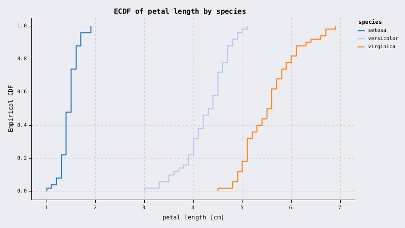
:::


```{=html}
<div style="background-color:grey;height:2px;width:100%;"></div>
```


```{=html}
<div><pre><small><small>source: notebooks/use_cases/distribution.clj</small></small></pre></div>
```