---
format:
  html:
    toc: true
    toc-location: right
    toc-depth: 4
    theme: cosmo
    include-in-header:
      text: |-
        <style>
        .data-table { width: fit-content; max-width: 100%; max-height: 15rem; overflow: auto; margin: 0 0 1rem 0; }
        .data-table .table-responsive { overflow: visible; }
        .data-table table { font-size: 0.75rem; width: auto; margin: 0; }
        .data-table th, .data-table td { padding: 0.1rem 0.45rem !important; white-space: nowrap; }
        .data-table thead th { position: sticky; top: 0; background: var(--bs-body-bg, #fff); }
        </style>
code-block-background: true

---
<style></style><style>.printedClojure .sourceCode {
  background-color: transparent;
  border-style: none;
}
</style><style>.clay-limit-image-width .clay-image {max-width: 100%}
.clay-side-by-side .sourceCode {margin: 0}
.clay-side-by-side {margin: 1em 0}
</style>
<script src="https://code.jquery.com/jquery-3.6.0.min.js" type="text/javascript"></script><script src="https://code.jquery.com/ui/1.13.1/jquery-ui.min.js" type="text/javascript"></script>

# Evolution

Values over time and other ordered variables: lines, time axes, smoothing and uncertainty, many lines, areas and
marks for evolution (the [R Graph Gallery](https://r-graph-gallery.com/time-series.html) evolution pages and the
[data-to-viz](https://www.data-to-viz.com/caveats.html) caveats).

Dates are `java.time` values: a datetime scale places `LocalDate`, `LocalDateTime`, `Instant` and the other
temporal types; curves and fits work in epoch milliseconds.


::: {.sourceClojure}
```clojure
(ns use-cases.evolution
  (:require [fastmath.core :as m]
            [fastmath.kernel :as kernel]
            [fastmath.random :as r]
            [fastmath.stats :as stats]
            [cljplot2.chart :as chart]
            [cljplot2.core :as plot]
            [cljplot2.data.levels :as levels]
            [notebook-utils :as nu])
  (:import [java.time LocalDate]
           [java.time.format DateTimeFormatter]))
```
:::


::: {.sourceClojure}
```clojure
(defn- with-dates
  "Rows with the ISO string `:date` parsed to a `LocalDate`."
  [rows]
  (mapv #(update % :date (fn [d] (LocalDate/parse d))) rows))
```
:::


::: {.printedClojure}
```clojure
#'use-cases.evolution/with-dates

```
:::


::: {.sourceClojure}
```clojure
(def economics (with-dates (nu/dataset :economics)))
```
:::


```{=html}
<div class="data-table"><table class="table table-hover table-responsive clay-table"><thead><tr><th>date</th><th>pce</th><th>pop</th><th>psavert</th><th>uempmed</th><th>unemploy</th></tr></thead><tbody><tr><td>1967-07-01</td><td>506.7</td><td>198712</td><td>12.6</td><td>4.5</td><td>2944</td></tr><tr><td>1967-08-01</td><td>509.8</td><td>198911</td><td>12.6</td><td>4.7</td><td>2945</td></tr><tr><td>1967-09-01</td><td>515.6</td><td>199113</td><td>11.9</td><td>4.6</td><td>2958</td></tr><tr><td>1967-10-01</td><td>512.2</td><td>199311</td><td>12.9</td><td>4.9</td><td>3143</td></tr><tr><td>1967-11-01</td><td>517.4</td><td>199498</td><td>12.8</td><td>4.7</td><td>3066</td></tr><tr><td>1967-12-01</td><td>525.1</td><td>199657</td><td>11.8</td><td>4.8</td><td>3018</td></tr><tr><td>1968-01-01</td><td>530.9</td><td>199808</td><td>11.7</td><td>5.1</td><td>2878</td></tr><tr><td>1968-02-01</td><td>533.6</td><td>199920</td><td>12.3</td><td>4.5</td><td>3001</td></tr><tr><td>1968-03-01</td><td>544.3</td><td>200056</td><td>11.7</td><td>4.1</td><td>2877</td></tr><tr><td>1968-04-01</td><td>544</td><td>200208</td><td>12.3</td><td>4.6</td><td>2709</td></tr><tr><td>1968-05-01</td><td>549.8</td><td>200361</td><td>12</td><td>4.4</td><td>2740</td></tr><tr><td>1968-06-01</td><td>556.3</td><td>200536</td><td>11.7</td><td>4.4</td><td>2938</td></tr><tr><td>1968-07-01</td><td>563.2</td><td>200706</td><td>10.7</td><td>4.5</td><td>2883</td></tr><tr><td>1968-08-01</td><td>567</td><td>200898</td><td>10.5</td><td>4.2</td><td>2768</td></tr><tr><td>1968-09-01</td><td>568.2</td><td>201095</td><td>10.6</td><td>4.6</td><td>2686</td></tr><tr><td>1968-10-01</td><td>571.6</td><td>201290</td><td>10.8</td><td>4.8</td><td>2689</td></tr><tr><td>1968-11-01</td><td>576.7</td><td>201466</td><td>10.6</td><td>4.4</td><td>2715</td></tr><tr><td>1968-12-01</td><td>576.5</td><td>201621</td><td>11.1</td><td>4.4</td><td>2685</td></tr><tr><td>1969-01-01</td><td>583.5</td><td>201760</td><td>10.3</td><td>4.4</td><td>2718</td></tr><tr><td>1969-02-01</td><td>588.7</td><td>201881</td><td>9.7</td><td>4.9</td><td>2692</td></tr><tr><td>1969-03-01</td><td>588.9</td><td>202023</td><td>10.2</td><td>4</td><td>2712</td></tr><tr><td>1969-04-01</td><td>593.9</td><td>202161</td><td>9.7</td><td>4</td><td>2758</td></tr><tr><td>1969-05-01</td><td>600.3</td><td>202331</td><td>10.1</td><td>4.2</td><td>2713</td></tr><tr><td>1969-06-01</td><td>600.9</td><td>202507</td><td>11.1</td><td>4.4</td><td>2816</td></tr><tr><td>1969-07-01</td><td>602.7</td><td>202677</td><td>11.8</td><td>4.4</td><td>2868</td></tr><tr><td>1969-08-01</td><td>609.9</td><td>202877</td><td>11.5</td><td>4.4</td><td>2856</td></tr><tr><td>1969-09-01</td><td>613.2</td><td>203090</td><td>11.6</td><td>4.7</td><td>3040</td></tr><tr><td>1969-10-01</td><td>618.5</td><td>203302</td><td>11.4</td><td>4.5</td><td>3049</td></tr><tr><td>1969-11-01</td><td>620.5</td><td>203500</td><td>11.6</td><td>4.8</td><td>2856</td></tr><tr><td>1969-12-01</td><td>622.8</td><td>203675</td><td>11.8</td><td>4.6</td><td>2884</td></tr><tr><td>1970-01-01</td><td>628.7</td><td>203849</td><td>11.8</td><td>4.6</td><td>3201</td></tr><tr><td>1970-02-01</td><td>634</td><td>204008</td><td>11.7</td><td>4.5</td><td>3453</td></tr><tr><td>1970-03-01</td><td>632.3</td><td>204156</td><td>12.4</td><td>4.6</td><td>3635</td></tr><tr><td>1970-04-01</td><td>636</td><td>204401</td><td>13.3</td><td>4.1</td><td>3797</td></tr><tr><td>1970-05-01</td><td>642.4</td><td>204607</td><td>12.4</td><td>4.7</td><td>3919</td></tr><tr><td>1970-06-01</td><td>646.3</td><td>204830</td><td>12.3</td><td>4.9</td><td>4071</td></tr><tr><td>1970-07-01</td><td>648.5</td><td>205052</td><td>13.5</td><td>5.1</td><td>4175</td></tr><tr><td>1970-08-01</td><td>652.9</td><td>205295</td><td>13.4</td><td>5.4</td><td>4256</td></tr><tr><td>1970-09-01</td><td>659.1</td><td>205540</td><td>12.9</td><td>5.2</td><td>4456</td></tr><tr><td>1970-10-01</td><td>658.3</td><td>205788</td><td>13.1</td><td>5.2</td><td>4591</td></tr><tr><td>1970-11-01</td><td>656.6</td><td>206024</td><td>13.6</td><td>5.6</td><td>4898</td></tr><tr><td>1970-12-01</td><td>665.6</td><td>206238</td><td>13.2</td><td>5.9</td><td>5076</td></tr><tr><td>1971-01-01</td><td>676.1</td><td>206466</td><td>13.3</td><td>6.2</td><td>4986</td></tr><tr><td>1971-02-01</td><td>679.4</td><td>206668</td><td>13.3</td><td>6.3</td><td>4903</td></tr><tr><td>1971-03-01</td><td>682</td><td>206855</td><td>13.5</td><td>6.4</td><td>4987</td></tr><tr><td>1971-04-01</td><td>688.8</td><td>207065</td><td>13.2</td><td>6.5</td><td>4959</td></tr><tr><td>1971-05-01</td><td>691.1</td><td>207260</td><td>13.6</td><td>6.7</td><td>4996</td></tr><tr><td>1971-06-01</td><td>699.8</td><td>207462</td><td>14.7</td><td>5.7</td><td>4949</td></tr><tr><td>1971-07-01</td><td>698.9</td><td>207661</td><td>13.8</td><td>6.2</td><td>5035</td></tr><tr><td>1971-08-01</td><td>704.9</td><td>207881</td><td>13.6</td><td>6.4</td><td>5134</td></tr><tr><td>1971-09-01</td><td>713</td><td>208114</td><td>13.3</td><td>5.8</td><td>5042</td></tr><tr><td>1971-10-01</td><td>715.8</td><td>208345</td><td>13.3</td><td>6.5</td><td>4954</td></tr><tr><td>1971-11-01</td><td>720.9</td><td>208555</td><td>13.1</td><td>6.4</td><td>5161</td></tr><tr><td>1971-12-01</td><td>728.4</td><td>208740</td><td>13</td><td>6.2</td><td>5154</td></tr><tr><td>1972-01-01</td><td>731.5</td><td>208917</td><td>12.5</td><td>6.2</td><td>5019</td></tr><tr><td>1972-02-01</td><td>736.2</td><td>209061</td><td>12.8</td><td>6.6</td><td>4928</td></tr><tr><td>1972-03-01</td><td>749.2</td><td>209212</td><td>11.8</td><td>6.6</td><td>5038</td></tr><tr><td>1972-04-01</td><td>752.5</td><td>209386</td><td>11.5</td><td>6.7</td><td>4959</td></tr><tr><td>1972-05-01</td><td>758</td><td>209545</td><td>11.7</td><td>6.6</td><td>4922</td></tr><tr><td>1972-06-01</td><td>761.6</td><td>209725</td><td>11.7</td><td>5.4</td><td>4923</td></tr><tr><td>1972-07-01</td><td>769.9</td><td>209896</td><td>11.7</td><td>6.1</td><td>4913</td></tr><tr><td>1972-08-01</td><td>776.3</td><td>210075</td><td>12</td><td>6</td><td>4939</td></tr><tr><td>1972-09-01</td><td>781.1</td><td>210278</td><td>12.2</td><td>5.6</td><td>4849</td></tr><tr><td>1972-10-01</td><td>794.9</td><td>210479</td><td>13</td><td>5.7</td><td>4875</td></tr><tr><td>1972-11-01</td><td>800.5</td><td>210656</td><td>13.6</td><td>5.7</td><td>4602</td></tr><tr><td>1972-12-01</td><td>806.1</td><td>210821</td><td>13.7</td><td>6.1</td><td>4543</td></tr><tr><td>1973-01-01</td><td>816.5</td><td>210985</td><td>12.4</td><td>5.7</td><td>4326</td></tr><tr><td>1973-02-01</td><td>825.8</td><td>211120</td><td>12.5</td><td>5.2</td><td>4452</td></tr><tr><td>1973-03-01</td><td>832.8</td><td>211254</td><td>12.7</td><td>5.5</td><td>4394</td></tr><tr><td>1973-04-01</td><td>835.7</td><td>211420</td><td>13.2</td><td>5</td><td>4459</td></tr><tr><td>1973-05-01</td><td>841.6</td><td>211577</td><td>13.2</td><td>4.9</td><td>4329</td></tr><tr><td>1973-06-01</td><td>844.3</td><td>211746</td><td>13.6</td><td>5</td><td>4363</td></tr><tr><td>1973-07-01</td><td>854.1</td><td>211909</td><td>13.2</td><td>5.2</td><td>4305</td></tr><tr><td>1973-08-01</td><td>853.3</td><td>212092</td><td>13.9</td><td>4.9</td><td>4305</td></tr><tr><td>1973-09-01</td><td>869.2</td><td>212289</td><td>13.1</td><td>5.4</td><td>4350</td></tr><tr><td>1973-10-01</td><td>868.2</td><td>212475</td><td>14.4</td><td>5.5</td><td>4144</td></tr><tr><td>1973-11-01</td><td>876.9</td><td>212634</td><td>14.4</td><td>5.1</td><td>4396</td></tr><tr><td>1973-12-01</td><td>876.6</td><td>212785</td><td>14.8</td><td>4.7</td><td>4489</td></tr><tr><td>1974-01-01</td><td>884.5</td><td>212932</td><td>14.3</td><td>5</td><td>4644</td></tr><tr><td>1974-02-01</td><td>889.7</td><td>213074</td><td>14.2</td><td>5.1</td><td>4731</td></tr><tr><td>1974-03-01</td><td>901.4</td><td>213211</td><td>13.4</td><td>4.8</td><td>4634</td></tr><tr><td>1974-04-01</td><td>910.8</td><td>213361</td><td>13.1</td><td>5</td><td>4618</td></tr><tr><td>1974-05-01</td><td>922.4</td><td>213513</td><td>12.8</td><td>4.6</td><td>4705</td></tr><tr><td>1974-06-01</td><td>928</td><td>213686</td><td>12.8</td><td>5.3</td><td>4927</td></tr><tr><td>1974-07-01</td><td>937.9</td><td>213854</td><td>12.8</td><td>5.7</td><td>5063</td></tr><tr><td>1974-08-01</td><td>954.8</td><td>214042</td><td>12.1</td><td>5</td><td>5022</td></tr><tr><td>1974-09-01</td><td>955.1</td><td>214246</td><td>12.9</td><td>5.3</td><td>5437</td></tr><tr><td>1974-10-01</td><td>959.2</td><td>214451</td><td>13.4</td><td>5.5</td><td>5523</td></tr><tr><td>1974-11-01</td><td>956.2</td><td>214625</td><td>13.8</td><td>5.2</td><td>6140</td></tr><tr><td>1974-12-01</td><td>961.8</td><td>214782</td><td>14</td><td>5.7</td><td>6636</td></tr><tr><td>1975-01-01</td><td>975.6</td><td>214931</td><td>13.2</td><td>6.3</td><td>7501</td></tr><tr><td>1975-02-01</td><td>989.4</td><td>215065</td><td>12.5</td><td>7.1</td><td>7520</td></tr><tr><td>1975-03-01</td><td>990.6</td><td>215198</td><td>12.7</td><td>7.2</td><td>7978</td></tr><tr><td>1975-04-01</td><td>995</td><td>215353</td><td>14.2</td><td>8.7</td><td>8210</td></tr><tr><td>1975-05-01</td><td>1018.9</td><td>215523</td><td>17.3</td><td>9.4</td><td>8433</td></tr><tr><td>1975-06-01</td><td>1026.8</td><td>215768</td><td>14.3</td><td>8.8</td><td>8220</td></tr><tr><td>1975-07-01</td><td>1039.8</td><td>215973</td><td>12.6</td><td>8.6</td><td>8127</td></tr><tr><td>1975-08-01</td><td>1047</td><td>216195</td><td>13</td><td>9.2</td><td>7928</td></tr><tr><td>1975-09-01</td><td>1054.8</td><td>216393</td><td>13</td><td>9.2</td><td>7923</td></tr><tr><td>1975-10-01</td><td>1060.9</td><td>216587</td><td>13.4</td><td>8.6</td><td>7897</td></tr><tr><td>…</td><td>…</td><td>…</td><td>…</td><td>…</td><td>…</td></tr></tbody></table></div>
```


::: {.sourceClojure}
```clojure
(def air (with-dates (nu/dataset :air-passengers)))
```
:::


```{=html}
<div class="data-table"><table class="table table-hover table-responsive clay-table"><thead><tr><th>date</th><th>year</th><th>month</th><th>passengers</th></tr></thead><tbody><tr><td>1949-01-01</td><td>1949</td><td>Jan</td><td>112</td></tr><tr><td>1949-02-01</td><td>1949</td><td>Feb</td><td>118</td></tr><tr><td>1949-03-01</td><td>1949</td><td>Mar</td><td>132</td></tr><tr><td>1949-04-01</td><td>1949</td><td>Apr</td><td>129</td></tr><tr><td>1949-05-01</td><td>1949</td><td>May</td><td>121</td></tr><tr><td>1949-06-01</td><td>1949</td><td>Jun</td><td>135</td></tr><tr><td>1949-07-01</td><td>1949</td><td>Jul</td><td>148</td></tr><tr><td>1949-08-01</td><td>1949</td><td>Aug</td><td>148</td></tr><tr><td>1949-09-01</td><td>1949</td><td>Sep</td><td>136</td></tr><tr><td>1949-10-01</td><td>1949</td><td>Oct</td><td>119</td></tr><tr><td>1949-11-01</td><td>1949</td><td>Nov</td><td>104</td></tr><tr><td>1949-12-01</td><td>1949</td><td>Dec</td><td>118</td></tr><tr><td>1950-01-01</td><td>1950</td><td>Jan</td><td>115</td></tr><tr><td>1950-02-01</td><td>1950</td><td>Feb</td><td>126</td></tr><tr><td>1950-03-01</td><td>1950</td><td>Mar</td><td>141</td></tr><tr><td>1950-04-01</td><td>1950</td><td>Apr</td><td>135</td></tr><tr><td>1950-05-01</td><td>1950</td><td>May</td><td>125</td></tr><tr><td>1950-06-01</td><td>1950</td><td>Jun</td><td>149</td></tr><tr><td>1950-07-01</td><td>1950</td><td>Jul</td><td>170</td></tr><tr><td>1950-08-01</td><td>1950</td><td>Aug</td><td>170</td></tr><tr><td>1950-09-01</td><td>1950</td><td>Sep</td><td>158</td></tr><tr><td>1950-10-01</td><td>1950</td><td>Oct</td><td>133</td></tr><tr><td>1950-11-01</td><td>1950</td><td>Nov</td><td>114</td></tr><tr><td>1950-12-01</td><td>1950</td><td>Dec</td><td>140</td></tr><tr><td>1951-01-01</td><td>1951</td><td>Jan</td><td>145</td></tr><tr><td>1951-02-01</td><td>1951</td><td>Feb</td><td>150</td></tr><tr><td>1951-03-01</td><td>1951</td><td>Mar</td><td>178</td></tr><tr><td>1951-04-01</td><td>1951</td><td>Apr</td><td>163</td></tr><tr><td>1951-05-01</td><td>1951</td><td>May</td><td>172</td></tr><tr><td>1951-06-01</td><td>1951</td><td>Jun</td><td>178</td></tr><tr><td>1951-07-01</td><td>1951</td><td>Jul</td><td>199</td></tr><tr><td>1951-08-01</td><td>1951</td><td>Aug</td><td>199</td></tr><tr><td>1951-09-01</td><td>1951</td><td>Sep</td><td>184</td></tr><tr><td>1951-10-01</td><td>1951</td><td>Oct</td><td>162</td></tr><tr><td>1951-11-01</td><td>1951</td><td>Nov</td><td>146</td></tr><tr><td>1951-12-01</td><td>1951</td><td>Dec</td><td>166</td></tr><tr><td>1952-01-01</td><td>1952</td><td>Jan</td><td>171</td></tr><tr><td>1952-02-01</td><td>1952</td><td>Feb</td><td>180</td></tr><tr><td>1952-03-01</td><td>1952</td><td>Mar</td><td>193</td></tr><tr><td>1952-04-01</td><td>1952</td><td>Apr</td><td>181</td></tr><tr><td>1952-05-01</td><td>1952</td><td>May</td><td>183</td></tr><tr><td>1952-06-01</td><td>1952</td><td>Jun</td><td>218</td></tr><tr><td>1952-07-01</td><td>1952</td><td>Jul</td><td>230</td></tr><tr><td>1952-08-01</td><td>1952</td><td>Aug</td><td>242</td></tr><tr><td>1952-09-01</td><td>1952</td><td>Sep</td><td>209</td></tr><tr><td>1952-10-01</td><td>1952</td><td>Oct</td><td>191</td></tr><tr><td>1952-11-01</td><td>1952</td><td>Nov</td><td>172</td></tr><tr><td>1952-12-01</td><td>1952</td><td>Dec</td><td>194</td></tr><tr><td>1953-01-01</td><td>1953</td><td>Jan</td><td>196</td></tr><tr><td>1953-02-01</td><td>1953</td><td>Feb</td><td>196</td></tr><tr><td>1953-03-01</td><td>1953</td><td>Mar</td><td>236</td></tr><tr><td>1953-04-01</td><td>1953</td><td>Apr</td><td>235</td></tr><tr><td>1953-05-01</td><td>1953</td><td>May</td><td>229</td></tr><tr><td>1953-06-01</td><td>1953</td><td>Jun</td><td>243</td></tr><tr><td>1953-07-01</td><td>1953</td><td>Jul</td><td>264</td></tr><tr><td>1953-08-01</td><td>1953</td><td>Aug</td><td>272</td></tr><tr><td>1953-09-01</td><td>1953</td><td>Sep</td><td>237</td></tr><tr><td>1953-10-01</td><td>1953</td><td>Oct</td><td>211</td></tr><tr><td>1953-11-01</td><td>1953</td><td>Nov</td><td>180</td></tr><tr><td>1953-12-01</td><td>1953</td><td>Dec</td><td>201</td></tr><tr><td>1954-01-01</td><td>1954</td><td>Jan</td><td>204</td></tr><tr><td>1954-02-01</td><td>1954</td><td>Feb</td><td>188</td></tr><tr><td>1954-03-01</td><td>1954</td><td>Mar</td><td>235</td></tr><tr><td>1954-04-01</td><td>1954</td><td>Apr</td><td>227</td></tr><tr><td>1954-05-01</td><td>1954</td><td>May</td><td>234</td></tr><tr><td>1954-06-01</td><td>1954</td><td>Jun</td><td>264</td></tr><tr><td>1954-07-01</td><td>1954</td><td>Jul</td><td>302</td></tr><tr><td>1954-08-01</td><td>1954</td><td>Aug</td><td>293</td></tr><tr><td>1954-09-01</td><td>1954</td><td>Sep</td><td>259</td></tr><tr><td>1954-10-01</td><td>1954</td><td>Oct</td><td>229</td></tr><tr><td>1954-11-01</td><td>1954</td><td>Nov</td><td>203</td></tr><tr><td>1954-12-01</td><td>1954</td><td>Dec</td><td>229</td></tr><tr><td>1955-01-01</td><td>1955</td><td>Jan</td><td>242</td></tr><tr><td>1955-02-01</td><td>1955</td><td>Feb</td><td>233</td></tr><tr><td>1955-03-01</td><td>1955</td><td>Mar</td><td>267</td></tr><tr><td>1955-04-01</td><td>1955</td><td>Apr</td><td>269</td></tr><tr><td>1955-05-01</td><td>1955</td><td>May</td><td>270</td></tr><tr><td>1955-06-01</td><td>1955</td><td>Jun</td><td>315</td></tr><tr><td>1955-07-01</td><td>1955</td><td>Jul</td><td>364</td></tr><tr><td>1955-08-01</td><td>1955</td><td>Aug</td><td>347</td></tr><tr><td>1955-09-01</td><td>1955</td><td>Sep</td><td>312</td></tr><tr><td>1955-10-01</td><td>1955</td><td>Oct</td><td>274</td></tr><tr><td>1955-11-01</td><td>1955</td><td>Nov</td><td>237</td></tr><tr><td>1955-12-01</td><td>1955</td><td>Dec</td><td>278</td></tr><tr><td>1956-01-01</td><td>1956</td><td>Jan</td><td>284</td></tr><tr><td>1956-02-01</td><td>1956</td><td>Feb</td><td>277</td></tr><tr><td>1956-03-01</td><td>1956</td><td>Mar</td><td>317</td></tr><tr><td>1956-04-01</td><td>1956</td><td>Apr</td><td>313</td></tr><tr><td>1956-05-01</td><td>1956</td><td>May</td><td>318</td></tr><tr><td>1956-06-01</td><td>1956</td><td>Jun</td><td>374</td></tr><tr><td>1956-07-01</td><td>1956</td><td>Jul</td><td>413</td></tr><tr><td>1956-08-01</td><td>1956</td><td>Aug</td><td>405</td></tr><tr><td>1956-09-01</td><td>1956</td><td>Sep</td><td>355</td></tr><tr><td>1956-10-01</td><td>1956</td><td>Oct</td><td>306</td></tr><tr><td>1956-11-01</td><td>1956</td><td>Nov</td><td>271</td></tr><tr><td>1956-12-01</td><td>1956</td><td>Dec</td><td>306</td></tr><tr><td>1957-01-01</td><td>1957</td><td>Jan</td><td>315</td></tr><tr><td>1957-02-01</td><td>1957</td><td>Feb</td><td>301</td></tr><tr><td>1957-03-01</td><td>1957</td><td>Mar</td><td>356</td></tr><tr><td>1957-04-01</td><td>1957</td><td>Apr</td><td>348</td></tr><tr><td>…</td><td>…</td><td>…</td><td>…</td></tr></tbody></table></div>
```


::: {.sourceClojure}
```clojure
(def chicks (nu/dataset :chick-weight))
```
:::


```{=html}
<div class="data-table"><table class="table table-hover table-responsive clay-table"><thead><tr><th>weight</th><th>time</th><th>chick</th><th>diet</th></tr></thead><tbody><tr><td>42</td><td>0</td><td>1</td><td>1</td></tr><tr><td>51</td><td>2</td><td>1</td><td>1</td></tr><tr><td>59</td><td>4</td><td>1</td><td>1</td></tr><tr><td>64</td><td>6</td><td>1</td><td>1</td></tr><tr><td>76</td><td>8</td><td>1</td><td>1</td></tr><tr><td>93</td><td>10</td><td>1</td><td>1</td></tr><tr><td>106</td><td>12</td><td>1</td><td>1</td></tr><tr><td>125</td><td>14</td><td>1</td><td>1</td></tr><tr><td>149</td><td>16</td><td>1</td><td>1</td></tr><tr><td>171</td><td>18</td><td>1</td><td>1</td></tr><tr><td>199</td><td>20</td><td>1</td><td>1</td></tr><tr><td>205</td><td>21</td><td>1</td><td>1</td></tr><tr><td>40</td><td>0</td><td>2</td><td>1</td></tr><tr><td>49</td><td>2</td><td>2</td><td>1</td></tr><tr><td>58</td><td>4</td><td>2</td><td>1</td></tr><tr><td>72</td><td>6</td><td>2</td><td>1</td></tr><tr><td>84</td><td>8</td><td>2</td><td>1</td></tr><tr><td>103</td><td>10</td><td>2</td><td>1</td></tr><tr><td>122</td><td>12</td><td>2</td><td>1</td></tr><tr><td>138</td><td>14</td><td>2</td><td>1</td></tr><tr><td>162</td><td>16</td><td>2</td><td>1</td></tr><tr><td>187</td><td>18</td><td>2</td><td>1</td></tr><tr><td>209</td><td>20</td><td>2</td><td>1</td></tr><tr><td>215</td><td>21</td><td>2</td><td>1</td></tr><tr><td>43</td><td>0</td><td>3</td><td>1</td></tr><tr><td>39</td><td>2</td><td>3</td><td>1</td></tr><tr><td>55</td><td>4</td><td>3</td><td>1</td></tr><tr><td>67</td><td>6</td><td>3</td><td>1</td></tr><tr><td>84</td><td>8</td><td>3</td><td>1</td></tr><tr><td>99</td><td>10</td><td>3</td><td>1</td></tr><tr><td>115</td><td>12</td><td>3</td><td>1</td></tr><tr><td>138</td><td>14</td><td>3</td><td>1</td></tr><tr><td>163</td><td>16</td><td>3</td><td>1</td></tr><tr><td>187</td><td>18</td><td>3</td><td>1</td></tr><tr><td>198</td><td>20</td><td>3</td><td>1</td></tr><tr><td>202</td><td>21</td><td>3</td><td>1</td></tr><tr><td>42</td><td>0</td><td>4</td><td>1</td></tr><tr><td>49</td><td>2</td><td>4</td><td>1</td></tr><tr><td>56</td><td>4</td><td>4</td><td>1</td></tr><tr><td>67</td><td>6</td><td>4</td><td>1</td></tr><tr><td>74</td><td>8</td><td>4</td><td>1</td></tr><tr><td>87</td><td>10</td><td>4</td><td>1</td></tr><tr><td>102</td><td>12</td><td>4</td><td>1</td></tr><tr><td>108</td><td>14</td><td>4</td><td>1</td></tr><tr><td>136</td><td>16</td><td>4</td><td>1</td></tr><tr><td>154</td><td>18</td><td>4</td><td>1</td></tr><tr><td>160</td><td>20</td><td>4</td><td>1</td></tr><tr><td>157</td><td>21</td><td>4</td><td>1</td></tr><tr><td>41</td><td>0</td><td>5</td><td>1</td></tr><tr><td>42</td><td>2</td><td>5</td><td>1</td></tr><tr><td>48</td><td>4</td><td>5</td><td>1</td></tr><tr><td>60</td><td>6</td><td>5</td><td>1</td></tr><tr><td>79</td><td>8</td><td>5</td><td>1</td></tr><tr><td>106</td><td>10</td><td>5</td><td>1</td></tr><tr><td>141</td><td>12</td><td>5</td><td>1</td></tr><tr><td>164</td><td>14</td><td>5</td><td>1</td></tr><tr><td>197</td><td>16</td><td>5</td><td>1</td></tr><tr><td>199</td><td>18</td><td>5</td><td>1</td></tr><tr><td>220</td><td>20</td><td>5</td><td>1</td></tr><tr><td>223</td><td>21</td><td>5</td><td>1</td></tr><tr><td>41</td><td>0</td><td>6</td><td>1</td></tr><tr><td>49</td><td>2</td><td>6</td><td>1</td></tr><tr><td>59</td><td>4</td><td>6</td><td>1</td></tr><tr><td>74</td><td>6</td><td>6</td><td>1</td></tr><tr><td>97</td><td>8</td><td>6</td><td>1</td></tr><tr><td>124</td><td>10</td><td>6</td><td>1</td></tr><tr><td>141</td><td>12</td><td>6</td><td>1</td></tr><tr><td>148</td><td>14</td><td>6</td><td>1</td></tr><tr><td>155</td><td>16</td><td>6</td><td>1</td></tr><tr><td>160</td><td>18</td><td>6</td><td>1</td></tr><tr><td>160</td><td>20</td><td>6</td><td>1</td></tr><tr><td>157</td><td>21</td><td>6</td><td>1</td></tr><tr><td>41</td><td>0</td><td>7</td><td>1</td></tr><tr><td>49</td><td>2</td><td>7</td><td>1</td></tr><tr><td>57</td><td>4</td><td>7</td><td>1</td></tr><tr><td>71</td><td>6</td><td>7</td><td>1</td></tr><tr><td>89</td><td>8</td><td>7</td><td>1</td></tr><tr><td>112</td><td>10</td><td>7</td><td>1</td></tr><tr><td>146</td><td>12</td><td>7</td><td>1</td></tr><tr><td>174</td><td>14</td><td>7</td><td>1</td></tr><tr><td>218</td><td>16</td><td>7</td><td>1</td></tr><tr><td>250</td><td>18</td><td>7</td><td>1</td></tr><tr><td>288</td><td>20</td><td>7</td><td>1</td></tr><tr><td>305</td><td>21</td><td>7</td><td>1</td></tr><tr><td>42</td><td>0</td><td>8</td><td>1</td></tr><tr><td>50</td><td>2</td><td>8</td><td>1</td></tr><tr><td>61</td><td>4</td><td>8</td><td>1</td></tr><tr><td>71</td><td>6</td><td>8</td><td>1</td></tr><tr><td>84</td><td>8</td><td>8</td><td>1</td></tr><tr><td>93</td><td>10</td><td>8</td><td>1</td></tr><tr><td>110</td><td>12</td><td>8</td><td>1</td></tr><tr><td>116</td><td>14</td><td>8</td><td>1</td></tr><tr><td>126</td><td>16</td><td>8</td><td>1</td></tr><tr><td>134</td><td>18</td><td>8</td><td>1</td></tr><tr><td>125</td><td>20</td><td>8</td><td>1</td></tr><tr><td>42</td><td>0</td><td>9</td><td>1</td></tr><tr><td>51</td><td>2</td><td>9</td><td>1</td></tr><tr><td>59</td><td>4</td><td>9</td><td>1</td></tr><tr><td>68</td><td>6</td><td>9</td><td>1</td></tr><tr><td>85</td><td>8</td><td>9</td><td>1</td></tr><tr><td>…</td><td>…</td><td>…</td><td>…</td></tr></tbody></table></div>
```


::: {.sourceClojure}
```clojure
(def mtcars (nu/dataset :mtcars))
```
:::


```{=html}
<div class="data-table"><table class="table table-hover table-responsive clay-table"><thead><tr><th>model</th><th>mpg</th><th>cyl</th><th>disp</th><th>hp</th><th>drat</th><th>wt</th><th>qsec</th><th>vs</th><th>am</th><th>gear</th><th>carb</th></tr></thead><tbody><tr><td>Mazda RX4</td><td>21</td><td>6</td><td>160</td><td>110</td><td>3.9</td><td>2.62</td><td>16.46</td><td>0</td><td>1</td><td>4</td><td>4</td></tr><tr><td>Mazda RX4 Wag</td><td>21</td><td>6</td><td>160</td><td>110</td><td>3.9</td><td>2.875</td><td>17.02</td><td>0</td><td>1</td><td>4</td><td>4</td></tr><tr><td>Datsun 710</td><td>22.8</td><td>4</td><td>108</td><td>93</td><td>3.85</td><td>2.32</td><td>18.61</td><td>1</td><td>1</td><td>4</td><td>1</td></tr><tr><td>Hornet 4 Drive</td><td>21.4</td><td>6</td><td>258</td><td>110</td><td>3.08</td><td>3.215</td><td>19.44</td><td>1</td><td>0</td><td>3</td><td>1</td></tr><tr><td>Hornet Sportabout</td><td>18.7</td><td>8</td><td>360</td><td>175</td><td>3.15</td><td>3.44</td><td>17.02</td><td>0</td><td>0</td><td>3</td><td>2</td></tr><tr><td>Valiant</td><td>18.1</td><td>6</td><td>225</td><td>105</td><td>2.76</td><td>3.46</td><td>20.22</td><td>1</td><td>0</td><td>3</td><td>1</td></tr><tr><td>Duster 360</td><td>14.3</td><td>8</td><td>360</td><td>245</td><td>3.21</td><td>3.57</td><td>15.84</td><td>0</td><td>0</td><td>3</td><td>4</td></tr><tr><td>Merc 240D</td><td>24.4</td><td>4</td><td>146.7</td><td>62</td><td>3.69</td><td>3.19</td><td>20</td><td>1</td><td>0</td><td>4</td><td>2</td></tr><tr><td>Merc 230</td><td>22.8</td><td>4</td><td>140.8</td><td>95</td><td>3.92</td><td>3.15</td><td>22.9</td><td>1</td><td>0</td><td>4</td><td>2</td></tr><tr><td>Merc 280</td><td>19.2</td><td>6</td><td>167.6</td><td>123</td><td>3.92</td><td>3.44</td><td>18.3</td><td>1</td><td>0</td><td>4</td><td>4</td></tr><tr><td>Merc 280C</td><td>17.8</td><td>6</td><td>167.6</td><td>123</td><td>3.92</td><td>3.44</td><td>18.9</td><td>1</td><td>0</td><td>4</td><td>4</td></tr><tr><td>Merc 450SE</td><td>16.4</td><td>8</td><td>275.8</td><td>180</td><td>3.07</td><td>4.07</td><td>17.4</td><td>0</td><td>0</td><td>3</td><td>3</td></tr><tr><td>Merc 450SL</td><td>17.3</td><td>8</td><td>275.8</td><td>180</td><td>3.07</td><td>3.73</td><td>17.6</td><td>0</td><td>0</td><td>3</td><td>3</td></tr><tr><td>Merc 450SLC</td><td>15.2</td><td>8</td><td>275.8</td><td>180</td><td>3.07</td><td>3.78</td><td>18</td><td>0</td><td>0</td><td>3</td><td>3</td></tr><tr><td>Cadillac Fleetwood</td><td>10.4</td><td>8</td><td>472</td><td>205</td><td>2.93</td><td>5.25</td><td>17.98</td><td>0</td><td>0</td><td>3</td><td>4</td></tr><tr><td>Lincoln Continental</td><td>10.4</td><td>8</td><td>460</td><td>215</td><td>3</td><td>5.424</td><td>17.82</td><td>0</td><td>0</td><td>3</td><td>4</td></tr><tr><td>Chrysler Imperial</td><td>14.7</td><td>8</td><td>440</td><td>230</td><td>3.23</td><td>5.345</td><td>17.42</td><td>0</td><td>0</td><td>3</td><td>4</td></tr><tr><td>Fiat 128</td><td>32.4</td><td>4</td><td>78.7</td><td>66</td><td>4.08</td><td>2.2</td><td>19.47</td><td>1</td><td>1</td><td>4</td><td>1</td></tr><tr><td>Honda Civic</td><td>30.4</td><td>4</td><td>75.7</td><td>52</td><td>4.93</td><td>1.615</td><td>18.52</td><td>1</td><td>1</td><td>4</td><td>2</td></tr><tr><td>Toyota Corolla</td><td>33.9</td><td>4</td><td>71.1</td><td>65</td><td>4.22</td><td>1.835</td><td>19.9</td><td>1</td><td>1</td><td>4</td><td>1</td></tr><tr><td>Toyota Corona</td><td>21.5</td><td>4</td><td>120.1</td><td>97</td><td>3.7</td><td>2.465</td><td>20.01</td><td>1</td><td>0</td><td>3</td><td>1</td></tr><tr><td>Dodge Challenger</td><td>15.5</td><td>8</td><td>318</td><td>150</td><td>2.76</td><td>3.52</td><td>16.87</td><td>0</td><td>0</td><td>3</td><td>2</td></tr><tr><td>AMC Javelin</td><td>15.2</td><td>8</td><td>304</td><td>150</td><td>3.15</td><td>3.435</td><td>17.3</td><td>0</td><td>0</td><td>3</td><td>2</td></tr><tr><td>Camaro Z28</td><td>13.3</td><td>8</td><td>350</td><td>245</td><td>3.73</td><td>3.84</td><td>15.41</td><td>0</td><td>0</td><td>3</td><td>4</td></tr><tr><td>Pontiac Firebird</td><td>19.2</td><td>8</td><td>400</td><td>175</td><td>3.08</td><td>3.845</td><td>17.05</td><td>0</td><td>0</td><td>3</td><td>2</td></tr><tr><td>Fiat X1-9</td><td>27.3</td><td>4</td><td>79</td><td>66</td><td>4.08</td><td>1.935</td><td>18.9</td><td>1</td><td>1</td><td>4</td><td>1</td></tr><tr><td>Porsche 914-2</td><td>26</td><td>4</td><td>120.3</td><td>91</td><td>4.43</td><td>2.14</td><td>16.7</td><td>0</td><td>1</td><td>5</td><td>2</td></tr><tr><td>Lotus Europa</td><td>30.4</td><td>4</td><td>95.1</td><td>113</td><td>3.77</td><td>1.513</td><td>16.9</td><td>1</td><td>1</td><td>5</td><td>2</td></tr><tr><td>Ford Pantera L</td><td>15.8</td><td>8</td><td>351</td><td>264</td><td>4.22</td><td>3.17</td><td>14.5</td><td>0</td><td>1</td><td>5</td><td>4</td></tr><tr><td>Ferrari Dino</td><td>19.7</td><td>6</td><td>145</td><td>175</td><td>3.62</td><td>2.77</td><td>15.5</td><td>0</td><td>1</td><td>5</td><td>6</td></tr><tr><td>Maserati Bora</td><td>15</td><td>8</td><td>301</td><td>335</td><td>3.54</td><td>3.57</td><td>14.6</td><td>0</td><td>1</td><td>5</td><td>8</td></tr><tr><td>Volvo 142E</td><td>21.4</td><td>4</td><td>121</td><td>109</td><td>4.11</td><td>2.78</td><td>18.6</td><td>1</td><td>1</td><td>4</td><td>2</td></tr></tbody></table></div>
```


::: {.sourceClojure}
```clojure
(def lincoln
  "Lincoln weather with `:date` parsed (`2016-1-1` - not ISO)."
  (let [f (DateTimeFormatter/ofPattern "yyyy-M-d")]
    (mapv #(update % :date (fn [d] (LocalDate/parse d f))) (nu/dataset :lincoln-weather))))
```
:::


```{=html}
<div class="data-table"><table class="table table-hover table-responsive clay-table"><thead><tr><th>date</th><th>month</th><th>mean-temp</th><th>max-temp</th><th>min-temp</th></tr></thead><tbody><tr><td>2016-01-01</td><td>January</td><td>24</td><td>37</td><td>11</td></tr><tr><td>2016-01-02</td><td>January</td><td>23</td><td>41</td><td>5</td></tr><tr><td>2016-01-03</td><td>January</td><td>23</td><td>37</td><td>8</td></tr><tr><td>2016-01-04</td><td>January</td><td>17</td><td>30</td><td>4</td></tr><tr><td>2016-01-05</td><td>January</td><td>29</td><td>38</td><td>19</td></tr><tr><td>2016-01-06</td><td>January</td><td>33</td><td>34</td><td>32</td></tr><tr><td>2016-01-07</td><td>January</td><td>30</td><td>33</td><td>27</td></tr><tr><td>2016-01-08</td><td>January</td><td>25</td><td>28</td><td>22</td></tr><tr><td>2016-01-09</td><td>January</td><td>9</td><td>22</td><td>-4</td></tr><tr><td>2016-01-10</td><td>January</td><td>11</td><td>31</td><td>-9</td></tr><tr><td>2016-01-11</td><td>January</td><td>28</td><td>37</td><td>18</td></tr><tr><td>2016-01-12</td><td>January</td><td>24</td><td>34</td><td>14</td></tr><tr><td>2016-01-13</td><td>January</td><td>33</td><td>47</td><td>19</td></tr><tr><td>2016-01-14</td><td>January</td><td>40</td><td>51</td><td>28</td></tr><tr><td>2016-01-15</td><td>January</td><td>29</td><td>35</td><td>23</td></tr><tr><td>2016-01-16</td><td>January</td><td>19</td><td>30</td><td>7</td></tr><tr><td>2016-01-17</td><td>January</td><td>5</td><td>15</td><td>-5</td></tr><tr><td>2016-01-18</td><td>January</td><td>11</td><td>26</td><td>-4</td></tr><tr><td>2016-01-19</td><td>January</td><td>22</td><td>25</td><td>19</td></tr><tr><td>2016-01-20</td><td>January</td><td>28</td><td>32</td><td>24</td></tr><tr><td>2016-01-21</td><td>January</td><td>25</td><td>29</td><td>21</td></tr><tr><td>2016-01-22</td><td>January</td><td>22</td><td>25</td><td>19</td></tr><tr><td>2016-01-23</td><td>January</td><td>28</td><td>36</td><td>20</td></tr><tr><td>2016-01-24</td><td>January</td><td>30</td><td>41</td><td>19</td></tr><tr><td>2016-01-25</td><td>January</td><td>26</td><td>30</td><td>22</td></tr><tr><td>2016-01-26</td><td>January</td><td>29</td><td>42</td><td>15</td></tr><tr><td>2016-01-27</td><td>January</td><td>33</td><td>49</td><td>17</td></tr><tr><td>2016-01-28</td><td>January</td><td>41</td><td>51</td><td>31</td></tr><tr><td>2016-01-29</td><td>January</td><td>41</td><td>54</td><td>27</td></tr><tr><td>2016-01-30</td><td>January</td><td>39</td><td>49</td><td>28</td></tr><tr><td>2016-01-31</td><td>January</td><td>35</td><td>47</td><td>22</td></tr><tr><td>2016-02-01</td><td>February</td><td>31</td><td>42</td><td>20</td></tr><tr><td>2016-02-02</td><td>February</td><td>27</td><td>32</td><td>21</td></tr><tr><td>2016-02-03</td><td>February</td><td>17</td><td>27</td><td>6</td></tr><tr><td>2016-02-04</td><td>February</td><td>18</td><td>33</td><td>2</td></tr><tr><td>2016-02-05</td><td>February</td><td>28</td><td>39</td><td>17</td></tr><tr><td>2016-02-06</td><td>February</td><td>24</td><td>39</td><td>10</td></tr><tr><td>2016-02-07</td><td>February</td><td>36</td><td>42</td><td>30</td></tr><tr><td>2016-02-08</td><td>February</td><td>31</td><td>36</td><td>25</td></tr><tr><td>2016-02-09</td><td>February</td><td>26</td><td>29</td><td>22</td></tr><tr><td>2016-02-10</td><td>February</td><td>37</td><td>56</td><td>17</td></tr><tr><td>2016-02-11</td><td>February</td><td>32</td><td>38</td><td>26</td></tr><tr><td>2016-02-12</td><td>February</td><td>23</td><td>29</td><td>17</td></tr><tr><td>2016-02-13</td><td>February</td><td>19</td><td>23</td><td>15</td></tr><tr><td>2016-02-14</td><td>February</td><td>35</td><td>49</td><td>20</td></tr><tr><td>2016-02-15</td><td>February</td><td>36</td><td>49</td><td>23</td></tr><tr><td>2016-02-16</td><td>February</td><td>41</td><td>47</td><td>34</td></tr><tr><td>2016-02-17</td><td>February</td><td>41</td><td>57</td><td>25</td></tr><tr><td>2016-02-18</td><td>February</td><td>48</td><td>62</td><td>33</td></tr><tr><td>2016-02-19</td><td>February</td><td>52</td><td>67</td><td>37</td></tr><tr><td>2016-02-20</td><td>February</td><td>42</td><td>58</td><td>26</td></tr><tr><td>2016-02-21</td><td>February</td><td>40</td><td>50</td><td>29</td></tr><tr><td>2016-02-22</td><td>February</td><td>35</td><td>47</td><td>23</td></tr><tr><td>2016-02-23</td><td>February</td><td>36</td><td>48</td><td>23</td></tr><tr><td>2016-02-24</td><td>February</td><td>35</td><td>50</td><td>20</td></tr><tr><td>2016-02-25</td><td>February</td><td>31</td><td>40</td><td>22</td></tr><tr><td>2016-02-26</td><td>February</td><td>39</td><td>58</td><td>19</td></tr><tr><td>2016-02-27</td><td>February</td><td>50</td><td>75</td><td>24</td></tr><tr><td>2016-02-28</td><td>February</td><td>44</td><td>58</td><td>29</td></tr><tr><td>2016-02-29</td><td>February</td><td>34</td><td>50</td><td>18</td></tr><tr><td>2016-03-01</td><td>March</td><td>32</td><td>48</td><td>16</td></tr><tr><td>2016-03-02</td><td>March</td><td>39</td><td>54</td><td>24</td></tr><tr><td>2016-03-03</td><td>March</td><td>38</td><td>47</td><td>29</td></tr><tr><td>2016-03-04</td><td>March</td><td>45</td><td>63</td><td>27</td></tr><tr><td>2016-03-05</td><td>March</td><td>45</td><td>70</td><td>20</td></tr><tr><td>2016-03-06</td><td>March</td><td>56</td><td>72</td><td>39</td></tr><tr><td>2016-03-07</td><td>March</td><td>55</td><td>79</td><td>30</td></tr><tr><td>2016-03-08</td><td>March</td><td>45</td><td>55</td><td>34</td></tr><tr><td>2016-03-09</td><td>March</td><td>43</td><td>65</td><td>20</td></tr><tr><td>2016-03-10</td><td>March</td><td>46</td><td>63</td><td>28</td></tr><tr><td>2016-03-11</td><td>March</td><td>50</td><td>73</td><td>27</td></tr><tr><td>2016-03-12</td><td>March</td><td>46</td><td>64</td><td>28</td></tr><tr><td>2016-03-13</td><td>March</td><td>55</td><td>71</td><td>39</td></tr><tr><td>2016-03-14</td><td>March</td><td>53</td><td>75</td><td>30</td></tr><tr><td>2016-03-15</td><td>March</td><td>45</td><td>57</td><td>33</td></tr><tr><td>2016-03-16</td><td>March</td><td>40</td><td>54</td><td>25</td></tr><tr><td>2016-03-17</td><td>March</td><td>37</td><td>54</td><td>20</td></tr><tr><td>2016-03-18</td><td>March</td><td>31</td><td>44</td><td>18</td></tr><tr><td>2016-03-19</td><td>March</td><td>30</td><td>38</td><td>21</td></tr><tr><td>2016-03-20</td><td>March</td><td>33</td><td>50</td><td>15</td></tr><tr><td>2016-03-21</td><td>March</td><td>55</td><td>79</td><td>30</td></tr><tr><td>2016-03-22</td><td>March</td><td>58</td><td>71</td><td>44</td></tr><tr><td>2016-03-23</td><td>March</td><td>40</td><td>50</td><td>29</td></tr><tr><td>2016-03-24</td><td>March</td><td>30</td><td>41</td><td>18</td></tr><tr><td>2016-03-25</td><td>March</td><td>38</td><td>55</td><td>21</td></tr><tr><td>2016-03-26</td><td>March</td><td>31</td><td>38</td><td>23</td></tr><tr><td>2016-03-27</td><td>March</td><td>37</td><td>58</td><td>15</td></tr><tr><td>2016-03-28</td><td>March</td><td>45</td><td>66</td><td>23</td></tr><tr><td>2016-03-29</td><td>March</td><td>50</td><td>58</td><td>41</td></tr><tr><td>2016-03-30</td><td>March</td><td>47</td><td>56</td><td>38</td></tr><tr><td>2016-03-31</td><td>March</td><td>39</td><td>45</td><td>33</td></tr><tr><td>2016-04-01</td><td>April</td><td>35</td><td>42</td><td>28</td></tr><tr><td>2016-04-02</td><td>April</td><td>48</td><td>63</td><td>33</td></tr><tr><td>2016-04-03</td><td>April</td><td>60</td><td>78</td><td>41</td></tr><tr><td>2016-04-04</td><td>April</td><td>49</td><td>61</td><td>37</td></tr><tr><td>2016-04-05</td><td>April</td><td>56</td><td>70</td><td>42</td></tr><tr><td>2016-04-06</td><td>April</td><td>52</td><td>65</td><td>39</td></tr><tr><td>2016-04-07</td><td>April</td><td>45</td><td>58</td><td>31</td></tr><tr><td>2016-04-08</td><td>April</td><td>42</td><td>59</td><td>25</td></tr><tr><td>2016-04-09</td><td>April</td><td>46</td><td>65</td><td>26</td></tr><tr><td>…</td><td>…</td><td>…</td><td>…</td><td>…</td></tr></tbody></table></div>
```


::: {.sourceClojure}
```clojure
(def economics-long
  "Economics in long form - `:variable`, `:value` and `:value01` (the value rescaled to 0..1 per variable), as
  ggplot2's `economics_long`."
  (vec (for [k [:pce :pop :psavert :uempmed :unemploy]
             :let [vs (map k economics) lo (double (reduce min vs)) hi (double (reduce max vs))]
             row economics]
         {:date (:date row) :variable (name k) :value (k row) :value01 (/ (- (double (k row)) lo) (- hi lo))})))
```
:::


```{=html}
<div class="data-table"><table class="table table-hover table-responsive clay-table"><thead><tr><th>date</th><th>variable</th><th>value</th><th>value01</th></tr></thead><tbody><tr><td>1967-07-01</td><td>pce</td><td>506.7</td><td>0.0</td></tr><tr><td>1967-08-01</td><td>pce</td><td>509.8</td><td>2.652497197765077E-4</td></tr><tr><td>1967-09-01</td><td>pce</td><td>515.6</td><td>7.615233890357775E-4</td></tr><tr><td>1967-10-01</td><td>pce</td><td>512.2</td><td>4.7060434153896666E-4</td></tr><tr><td>1967-11-01</td><td>pce</td><td>517.4</td><td>9.155393553576157E-4</td></tr><tr><td>1967-12-01</td><td>pce</td><td>525.1</td><td>0.001574385433512166</td></tr><tr><td>1968-01-01</td><td>pce</td><td>530.9</td><td>0.002070659102771431</td></tr><tr><td>1968-02-01</td><td>pce</td><td>533.6</td><td>0.002301683052254198</td></tr><tr><td>1968-03-01</td><td>pce</td><td>544.3</td><td>0.003217222407611809</td></tr><tr><td>1968-04-01</td><td>pce</td><td>544</td><td>0.0031915530798915055</td></tr><tr><td>1968-05-01</td><td>pce</td><td>549.8</td><td>0.0036878267491507704</td></tr><tr><td>1968-06-01</td><td>pce</td><td>556.3</td><td>0.004243995516424089</td></tr><tr><td>1968-07-01</td><td>pce</td><td>563.2</td><td>0.004834390053991158</td></tr><tr><td>1968-08-01</td><td>pce</td><td>567</td><td>0.00515953487178171</td></tr><tr><td>1968-09-01</td><td>pce</td><td>568.2</td><td>0.005262212182662942</td></tr><tr><td>1968-10-01</td><td>pce</td><td>571.6</td><td>0.005553131230159753</td></tr><tr><td>1968-11-01</td><td>pce</td><td>576.7</td><td>0.005989509801404973</td></tr><tr><td>1968-12-01</td><td>pce</td><td>576.5</td><td>0.0059723969162580985</td></tr><tr><td>1969-01-01</td><td>pce</td><td>583.5</td><td>0.006571347896398595</td></tr><tr><td>1969-02-01</td><td>pce</td><td>588.7</td><td>0.0070162829102172536</td></tr><tr><td>1969-03-01</td><td>pce</td><td>588.9</td><td>0.00703339579536412</td></tr><tr><td>1969-04-01</td><td>pce</td><td>593.9</td><td>0.0074612179240359025</td></tr><tr><td>1969-05-01</td><td>pce</td><td>600.3</td><td>0.008008830248735783</td></tr><tr><td>1969-06-01</td><td>pce</td><td>600.9</td><td>0.0080601689041764</td></tr><tr><td>1969-07-01</td><td>pce</td><td>602.7</td><td>0.008214184870498248</td></tr><tr><td>1969-08-01</td><td>pce</td><td>609.9</td><td>0.00883024873578561</td></tr><tr><td>1969-09-01</td><td>pce</td><td>613.2</td><td>0.009112611340708994</td></tr><tr><td>1969-10-01</td><td>pce</td><td>618.5</td><td>0.00956610279710108</td></tr><tr><td>1969-11-01</td><td>pce</td><td>620.5</td><td>0.009737231648569792</td></tr><tr><td>1969-12-01</td><td>pce</td><td>622.8</td><td>0.00993402982775881</td></tr><tr><td>1970-01-01</td><td>pce</td><td>628.7</td><td>0.010438859939591521</td></tr><tr><td>1970-02-01</td><td>pce</td><td>634</td><td>0.010892351395983609</td></tr><tr><td>1970-03-01</td><td>pce</td><td>632.3</td><td>0.010746891872235199</td></tr><tr><td>1970-04-01</td><td>pce</td><td>636</td><td>0.011063480247452321</td></tr><tr><td>1970-05-01</td><td>pce</td><td>642.4</td><td>0.011611092572152202</td></tr><tr><td>1970-06-01</td><td>pce</td><td>646.3</td><td>0.011944793832516192</td></tr><tr><td>1970-07-01</td><td>pce</td><td>648.5</td><td>0.01213303556913178</td></tr><tr><td>1970-08-01</td><td>pce</td><td>652.9</td><td>0.012509519042362948</td></tr><tr><td>1970-09-01</td><td>pce</td><td>659.1</td><td>0.013040018481915962</td></tr><tr><td>1970-10-01</td><td>pce</td><td>658.3</td><td>0.012971566941328472</td></tr><tr><td>1970-11-01</td><td>pce</td><td>656.6</td><td>0.012826107417580071</td></tr><tr><td>1970-12-01</td><td>pce</td><td>665.6</td><td>0.013596187249189281</td></tr><tr><td>1971-01-01</td><td>pce</td><td>676.1</td><td>0.014494613719400027</td></tr><tr><td>1971-02-01</td><td>pce</td><td>679.4</td><td>0.0147769763243234</td></tr><tr><td>1971-03-01</td><td>pce</td><td>682</td><td>0.01499944383123273</td></tr><tr><td>1971-04-01</td><td>pce</td><td>688.8</td><td>0.015581281926226351</td></tr><tr><td>1971-05-01</td><td>pce</td><td>691.1</td><td>0.015778080105415378</td></tr><tr><td>1971-06-01</td><td>pce</td><td>699.8</td><td>0.016522490609304274</td></tr><tr><td>1971-07-01</td><td>pce</td><td>698.9</td><td>0.016445482626143357</td></tr><tr><td>1971-08-01</td><td>pce</td><td>704.9</td><td>0.016958869180549497</td></tr><tr><td>1971-09-01</td><td>pce</td><td>713</td><td>0.017651941028997788</td></tr><tr><td>1971-10-01</td><td>pce</td><td>715.8</td><td>0.01789152142105398</td></tr><tr><td>1971-11-01</td><td>pce</td><td>720.9</td><td>0.018327899992299203</td></tr><tr><td>1971-12-01</td><td>pce</td><td>728.4</td><td>0.018969633185306877</td></tr><tr><td>1972-01-01</td><td>pce</td><td>731.5</td><td>0.019234882905083385</td></tr><tr><td>1972-02-01</td><td>pce</td><td>736.2</td><td>0.019637035706034867</td></tr><tr><td>1972-03-01</td><td>pce</td><td>749.2</td><td>0.020749373240581504</td></tr><tr><td>1972-04-01</td><td>pce</td><td>752.5</td><td>0.021031735845504877</td></tr><tr><td>1972-05-01</td><td>pce</td><td>758</td><td>0.021502340187043837</td></tr><tr><td>1972-06-01</td><td>pce</td><td>761.6</td><td>0.021810372119687525</td></tr><tr><td>1972-07-01</td><td>pce</td><td>769.9</td><td>0.02252055685328268</td></tr><tr><td>1972-08-01</td><td>pce</td><td>776.3</td><td>0.023068169177982562</td></tr><tr><td>1972-09-01</td><td>pce</td><td>781.1</td><td>0.02347887842150748</td></tr><tr><td>1972-10-01</td><td>pce</td><td>794.9</td><td>0.0246596674966416</td></tr><tr><td>1972-11-01</td><td>pce</td><td>800.5</td><td>0.025138828280754</td></tr><tr><td>1972-12-01</td><td>pce</td><td>806.1</td><td>0.025617989064866398</td></tr><tr><td>1973-01-01</td><td>pce</td><td>816.5</td><td>0.026507859092503704</td></tr><tr><td>1973-02-01</td><td>pce</td><td>825.8</td><td>0.027303608251833218</td></tr><tr><td>1973-03-01</td><td>pce</td><td>832.8</td><td>0.027902559231973715</td></tr><tr><td>1973-04-01</td><td>pce</td><td>835.7</td><td>0.028150696066603358</td></tr><tr><td>1973-05-01</td><td>pce</td><td>841.6</td><td>0.028655526178436058</td></tr><tr><td>1973-06-01</td><td>pce</td><td>844.3</td><td>0.02888655012791882</td></tr><tr><td>1973-07-01</td><td>pce</td><td>854.1</td><td>0.02972508150011552</td></tr><tr><td>1973-08-01</td><td>pce</td><td>853.3</td><td>0.029656629959528027</td></tr><tr><td>1973-09-01</td><td>pce</td><td>869.2</td><td>0.031017104328704307</td></tr><tr><td>1973-10-01</td><td>pce</td><td>868.2</td><td>0.03093153990296995</td></tr><tr><td>1973-11-01</td><td>pce</td><td>876.9</td><td>0.03167595040685885</td></tr><tr><td>1973-12-01</td><td>pce</td><td>876.6</td><td>0.031650281079138545</td></tr><tr><td>1974-01-01</td><td>pce</td><td>884.5</td><td>0.03232624004243996</td></tr><tr><td>1974-02-01</td><td>pce</td><td>889.7</td><td>0.032771175056258615</td></tr><tr><td>1974-03-01</td><td>pce</td><td>901.4</td><td>0.03377227883735059</td></tr><tr><td>1974-04-01</td><td>pce</td><td>910.8</td><td>0.03457658443925354</td></tr><tr><td>1974-05-01</td><td>pce</td><td>922.4</td><td>0.03556913177777208</td></tr><tr><td>1974-06-01</td><td>pce</td><td>928</td><td>0.03604829256188448</td></tr><tr><td>1974-07-01</td><td>pce</td><td>937.9</td><td>0.03689538037665461</td></tr><tr><td>1974-08-01</td><td>pce</td><td>954.8</td><td>0.03834141917156523</td></tr><tr><td>1974-09-01</td><td>pce</td><td>955.1</td><td>0.038367088499285544</td></tr><tr><td>1974-10-01</td><td>pce</td><td>959.2</td><td>0.03871790264479641</td></tr><tr><td>1974-11-01</td><td>pce</td><td>956.2</td><td>0.03846120936759334</td></tr><tr><td>1974-12-01</td><td>pce</td><td>961.8</td><td>0.038940370151705726</td></tr><tr><td>1975-01-01</td><td>pce</td><td>975.6</td><td>0.040121159226839856</td></tr><tr><td>1975-02-01</td><td>pce</td><td>989.4</td><td>0.04130194830197398</td></tr><tr><td>1975-03-01</td><td>pce</td><td>990.6</td><td>0.041404625612855205</td></tr><tr><td>1975-04-01</td><td>pce</td><td>995</td><td>0.04178110908608638</td></tr><tr><td>1975-05-01</td><td>pce</td><td>1018.9</td><td>0.0438260988611375</td></tr><tr><td>1975-06-01</td><td>pce</td><td>1026.8</td><td>0.04450205782443891</td></tr><tr><td>1975-07-01</td><td>pce</td><td>1039.8</td><td>0.045614395358985545</td></tr><tr><td>1975-08-01</td><td>pce</td><td>1047</td><td>0.04623045922427292</td></tr><tr><td>1975-09-01</td><td>pce</td><td>1054.8</td><td>0.04689786174500089</td></tr><tr><td>1975-10-01</td><td>pce</td><td>1060.9</td><td>0.04741980474198049</td></tr><tr><td>…</td><td>…</td><td>…</td><td>…</td></tr></tbody></table></div>
```


## Lines

A line joins points in x order; dates on x give a datetime axis.


### Basic line with dates

Source: R Graph Gallery - Line chart with ggplot2; Time series ([1](https://r-graph-gallery.com/line-chart-ggplot2.html), [2](https://r-graph-gallery.com/279-plotting-time-series-with-ggplot2.html)). Data: US economic time series, 1967-2015, R ggplot2 package `economics` (Federal Reserve Bank of St. Louis, FRED); licence: MIT (ggplot2).


::: {.sourceClojure}
```clojure
(plot/render-image
 {:data economics
  :mapping {:x :date :y :unemploy}
  :charts [(chart/line)]
  :labels {:title "Unemployed persons in the US" :x nil :y "thousands"}}
 {:width 800 :height 400})
```
:::


::: {.clay-image}
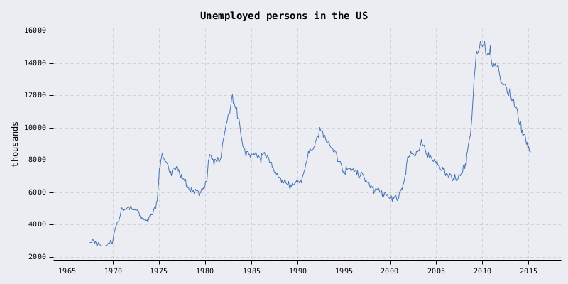
:::


### Line styling

Width, colour and points are chart options; `:dash` mapped to a variable takes the named dash styles in order
(`:solid`, `:dashed`, `:dotted`, ...), so lines read apart without colour.

Source: [R Graph Gallery - Line chart with ggplot2 (customization)](https://r-graph-gallery.com/line-chart-ggplot2.html). Data: US economic time series, 1967-2015, R ggplot2 package `economics` (Federal Reserve Bank of St. Louis, FRED); licence: MIT (ggplot2).


::: {.sourceClojure}
```clojure
(let [recent (filter #(.isAfter ^LocalDate (:date %) (LocalDate/of 2010 1 1)) economics)
      recent-long (filter #(and (.isAfter ^LocalDate (:date %) (LocalDate/of 2010 1 1))
                                (#{"psavert" "uempmed" "unemploy"} (:variable %)))
                          economics-long)]
  (plot/render-image
   (plot/arrange
    [{:data recent :mapping {:x :date :y :psavert}
      :charts [(chart/line {:line-width 2 :color [215 48 39]}) (chart/scatter {:size 5 :color [215 48 39]})]
      :labels {:title "width, colour, points" :x nil :y "savings rate, %"}}
     {:data recent-long :mapping {:x :date :y :value01 :dash :variable}
      :charts [(chart/line {:line-width 1.5 :color :black})]
      :labels {:title ":dash by variable" :x nil :y "rescaled"}}]
    {:columns 2})
   {:width 1000 :height 400}))
```
:::


::: {.clay-image}
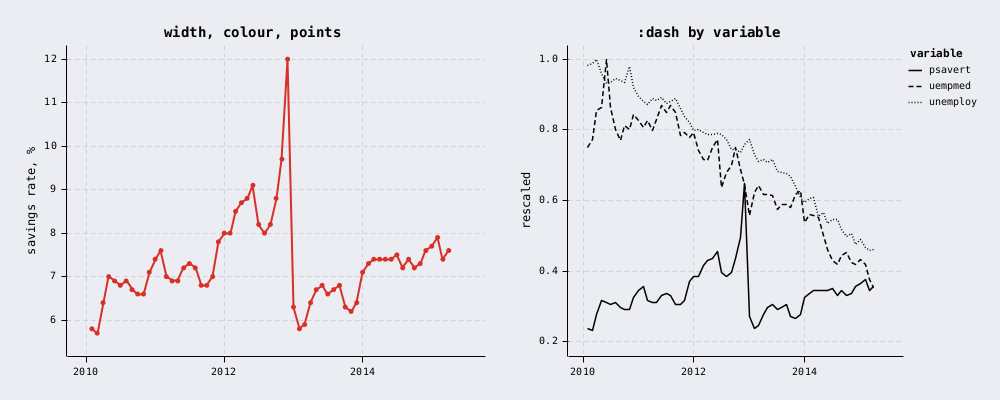
:::


### Log scale

Growth at a steady rate is a straight line on a log axis; `:pow`, `:symlog` and `:radial` (square-root like) are
the other continuous transforms ([scale kinds](reference.scales_axes_coords.html#scale-kinds)).

Source: [R Graph Gallery - Line plot with log scale](https://r-graph-gallery.com/line-plot-log-scale.html). Data: US economic time series, 1967-2015, R ggplot2 package `economics` (Federal Reserve Bank of St. Louis, FRED); licence: MIT (ggplot2).


::: {.sourceClojure}
```clojure
(plot/render-image
 (plot/arrange
  [{:data economics :mapping {:x :date :y :pce} :charts [(chart/line)]
    :labels {:title "linear" :x nil :y "consumption, billions USD"}}
   {:data economics :mapping {:x :date :y :pce} :scales {:y {:kind :log}} :charts [(chart/line)]
    :labels {:title ":log" :x nil :y "consumption, billions USD"}}]
  {:columns 2})
 {:width 1000 :height 400})
```
:::


::: {.clay-image}

:::


### Several groups

One line per level of `:color`; values on different units are rescaled to 0..1 to share an axis.

Source: [R Graph Gallery - Line chart with several groups](https://r-graph-gallery.com/line-chart-several-groups-ggplot2.html). Data: US economic time series, 1967-2015, R ggplot2 package `economics` (Federal Reserve Bank of St. Louis, FRED); licence: MIT (ggplot2).


::: {.sourceClojure}
```clojure
(plot/render-image
 {:data economics-long
  :mapping {:x :date :y :value01 :color :variable}
  :charts [(chart/line)]
  :labels {:title "Five economic series, rescaled" :x nil :y "value (0..1)"}}
 {:width 900 :height 450})
```
:::


::: {.clay-image}

:::


### Steps and interpolated lines

`:interpolator` takes any fastmath one-dimensional method: steps, monotone (no overshoot) or cubic curves through
the points.

Source: R Graph Gallery - Line plot; data-to-viz - Line plot ([1](https://r-graph-gallery.com/line-plot.html), [2](https://www.data-to-viz.com/graph/line.html)). Data: Monthly airline passengers, 1949-1960, R datasets package `AirPassengers` (Box & Jenkins 1976); licence: Part of R (GPL-2 | GPL-3).


::: {.sourceClojure}
```clojure
(let [year (filter #(= 1955 (:year %)) air)
      panel (fn [title opts] {:data year :mapping {:x :date :y :passengers}
                              :charts [(chart/line opts) (chart/scatter {:size 5})]
                              :labels {:title title :x nil :y "passengers, thousands"}})]
  (plot/render-image
   (plot/arrange [(panel ":step-after" {:interpolator :step-after})
                  (panel ":monotone" {:interpolator :monotone})
                  (panel ":cubic" {:interpolator :cubic})]
                 {:columns 3})
   {:width 1000 :height 350}))
```
:::


::: {.clay-image}
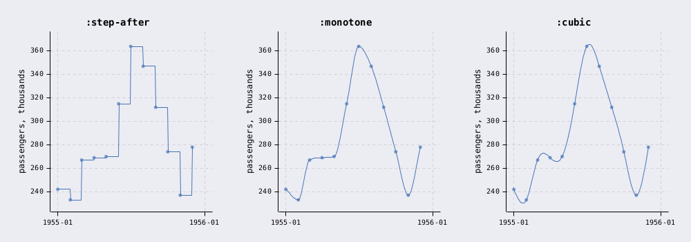
:::


### Sampling step

An interpolated line is evaluated every `:sample-step` pixels (default 1) or at `{:count n}` positions per run - a
coarse count shows the polyline behind a curve.

Data: Monthly airline passengers, 1949-1960, R datasets package `AirPassengers` (Box & Jenkins 1976); licence: Part of R (GPL-2 | GPL-3).


::: {.sourceClojure}
```clojure
(let [years (filter #(<= 1958 (:year %)) air)
      panel (fn [title step] {:data years :mapping {:x :date :y :passengers}
                              :charts [(chart/line {:interpolator :cubic :sample-step step}) (chart/scatter {:size 4})]
                              :labels {:title title :x nil :y "passengers, thousands"}})]
  (plot/render-image
   (plot/arrange [(panel "every pixel (default)" 1) (panel "{:count 12} per run" {:count 12})] {:columns 2})
   {:width 1000 :height 380}))
```
:::


::: {.clay-image}

:::


### Missing values

A missing (`nil`) value breaks the line (`:gaps :break`, default); `:gaps :bridge` joins the ends with a dimmed
segment, so the gap stays visible.

Data: US economic time series, 1967-2015, R ggplot2 package `economics` (Federal Reserve Bank of St. Louis, FRED); licence: MIT (ggplot2).


::: {.sourceClojure}
```clojure
(let [gappy (map (fn [row] (if (<= 1990 (.getYear ^LocalDate (:date row)) 1992) (assoc row :psavert nil) row))
                 (filter #(<= 1985 (.getYear ^LocalDate (:date %)) 1997) economics))
      panel (fn [title gaps] {:data gappy :mapping {:x :date :y :psavert}
                              :charts [(chart/line {:gaps gaps :line-width 1.5})]
                              :labels {:title title :x nil :y "savings rate, %"}})]
  (plot/render-image
   (plot/arrange [(panel ":gaps :break" :break) (panel ":gaps :bridge" :bridge)] {:columns 2})
   {:width 1000 :height 380}))
```
:::


::: {.clay-image}

:::


## Time axes

Datetime ticks fall on calendar units; the formatter is a function or a `java.time` pattern string.


### Date format and breaks

Source: R Graph Gallery - Time series with ggplot2; Manage dates ([1](https://r-graph-gallery.com/279-plotting-time-series-with-ggplot2.html), [2](https://r-graph-gallery.com/191-manage-date-data.html)). Data: US economic time series, 1967-2015, R ggplot2 package `economics` (Federal Reserve Bank of St. Louis, FRED); licence: MIT (ggplot2).


::: {.sourceClojure}
```clojure
(plot/render-image
 (plot/arrange
  [{:data economics :mapping {:x :date :y :uempmed}
    :scales {:x {:ticks-params {:unit :years :step 5} :formatter "yyyy"}}
    :charts [(chart/line)] :labels {:title "every 5 years, \"yyyy\"" :x nil :y "weeks"}}
   {:data (filter #(= 2008 (.getYear ^LocalDate (:date %))) economics) :mapping {:x :date :y :uempmed}
    :scales {:x {:ticks-params {:unit :months :step 2} :formatter "MMM"}}
    :charts [(chart/line) (chart/scatter {:size 5})] :labels {:title "2008, every 2 months, \"MMM\"" :x nil :y "weeks"}}]
  {:columns 2})
 {:width 1000 :height 400})
```
:::


::: {.clay-image}
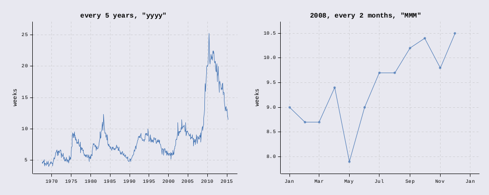
:::


### Time window

An explicit `:domain` of dates shows one window of a long series; the data outside is clipped by the panel.

Source: [R Graph Gallery - Time series with ggplot2 (select a time frame)](https://r-graph-gallery.com/279-plotting-time-series-with-ggplot2.html). Data: US economic time series, 1967-2015, R ggplot2 package `economics` (Federal Reserve Bank of St. Louis, FRED); licence: MIT (ggplot2).


::: {.sourceClojure}
```clojure
(plot/render-image
 {:data economics
  :mapping {:x :date :y :unemploy}
  :scales {:x {:domain [(LocalDate/of 2000 1 1) (LocalDate/of 2010 1 1)]} :y {:domain [4000 16000]}}
  :charts [(chart/line {:line-width 1.5})]
  :labels {:title "Unemployment, 2000-2010" :x nil :y "thousands"}}
 {:width 800 :height 400})
```
:::


::: {.clay-image}

:::


### Annotations

Literal rects, rules and texts take dates as positions: recessions shaded behind the line, a rule and a label.

Source: [R Graph Gallery - Line chart annotation](https://r-graph-gallery.com/line_chart_annotation.html). Data: US economic time series, 1967-2015, R ggplot2 package `economics` (Federal Reserve Bank of St. Louis, FRED); licence: MIT (ggplot2).


::: {.sourceClojure}
```clojure
(let [d (fn [y mo] (LocalDate/of (int y) (int mo) 1))
      recessions [[(d 1969 12) (d 1970 11)] [(d 1973 11) (d 1975 3)] [(d 1980 1) (d 1980 7)] [(d 1981 7) (d 1982 11)]
                  [(d 1990 7) (d 1991 3)] [(d 2001 3) (d 2001 11)] [(d 2007 12) (d 2009 6)]]]
  (plot/render-image
   {:data economics
    :mapping {:x :date :y :unemploy}
    :charts [(chart/rect {:x recessions :fill [0 0 0 35]})
             (chart/line {:line-width 1.5})
             (chart/rule {:x (d 2008 9) :dash :dashed :color [215 48 39]})
             (chart/text {:x (d 2008 9) :y 14500 :text "Lehman Brothers" :anchor [:right :middle] :offset [-5 0]
                          :color [215 48 39]})]
    :labels {:title "Unemployment and US recessions (NBER)" :x nil :y "thousands"}}
   {:width 900 :height 450}))
```
:::


::: {.clay-image}

:::


### Time heatmap

Year × month as two categorical axes, the value as a linear colour: seasonality and growth at once - a
[tile](reference.charts_grids_fields.html#tile) per month (categories in data order: January to December, the
years upward).

Source: [R Graph Gallery - The hourly heatmap](https://r-graph-gallery.com/283-the-hourly-heatmap.html). Data: Monthly airline passengers, 1949-1960, R datasets package `AirPassengers` (Box & Jenkins 1976); licence: Part of R (GPL-2 | GPL-3).


::: {.sourceClojure}
```clojure
(plot/render-image
 {:data air
  :mapping {:x :month :y #(str (:year %)) :color :passengers}
  :scales {:color {:range :viridis/viridis :title "passengers"}}
  :charts [(chart/tile {:stroke-color :white})]
  :labels {:title "Airline passengers by month (thousands)" :x nil :y nil}}
 {:width 800 :height 500})
```
:::


::: {.clay-image}
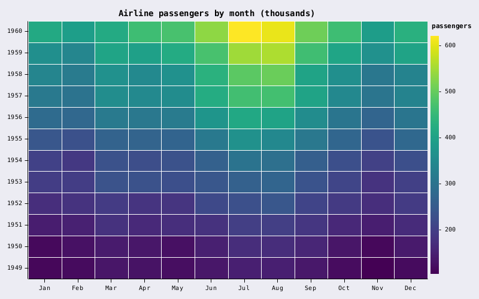
:::


## Smoothing and uncertainty

`chart/smooth` fits a curve per group with a band; `chart/ribbon` draws any band given as `:ymin` / `:ymax`.


### Smoothers with confidence bands

Loess (default) with nested 50% / 95% bands; a linear model per diet; a Gaussian process (mean ± z·σ). The loess
defaults are ggplot2's `geom_smooth` ones - 75% of the points, local quadratic fits - with fastmath's two robustness
iterations (`:method-params {:iters 0}` is ggplot2's plain fit; the robust bands are a little wider). The bands
of the plain fit (`:iters 0`) equal R's `predict(se = TRUE)`; with 144 or 220 points they are narrow. On a date axis the fit
works in epoch milliseconds - a kernel's scale too (here three months).

Source: R Graph Gallery - Scatterplot with ggplot2 (smoothing); Polynomial curve fitting ([1](https://r-graph-gallery.com/50-51-52-scatter-plot-with-ggplot2.html), [2](https://r-graph-gallery.com/44-polynomial-curve-fitting.html)). Data: Monthly airline passengers, 1949-1960, R datasets package `AirPassengers` (Box & Jenkins 1976); licence: Part of R (GPL-2 | GPL-3).


::: {.sourceClojure}
```clojure
(let [year-ms (* 365.25 86400000.0)]
  (plot/render-image
   (plot/arrange
    [{:data air :mapping {:x :date :y :passengers}
      :charts [(chart/scatter {:size 3}) (chart/smooth {:level [0.5 0.95]})]
      :labels {:title "loess, 50% / 95%" :x nil :y "passengers"}}
     {:data chicks :mapping {:x :time :y :weight :color :diet}
      :charts [(chart/scatter {:size 3}) (chart/smooth {:method :lm})]
      :labels {:title "lm per diet" :x "days" :y "weight, g"}}
     {:data (filter #(<= 1956 (:year %)) air) :mapping {:x :date :y :passengers}
      :charts [(chart/smooth {:method :gp :level [0.5 0.95]
                              :method-params {:kernel (kernel/kernel :gaussian {:sigma (* 0.25 year-ms)})
                                              :noise 0.05 :normalize? true}})
               (chart/scatter {:size 4})]
      :labels {:title "Gaussian process" :x nil :y "passengers"}}]
    {:columns 3})
   {:width 1000 :height 380}))
```
:::


::: {.clay-image}

:::


### Ribbon

Daily minimum and maximum temperatures as a band, the mean as a line.

Source: [R Graph Gallery - Lines with error envelopes](https://r-graph-gallery.com/104-plot-lines-with-error-envelopes-ggplot2.html). Data: Weather in Lincoln, Nebraska, 2016, R ggridges package `lincoln_weather` (Weather Underground, via Wilke); licence: GPL-2 (ggridges).


::: {.sourceClojure}
```clojure
(plot/render-image
 {:data lincoln
  :mapping {:x :date}
  :scales {:x {:formatter "MMM"}}
  :charts [(chart/ribbon {:mapping {:ymin :min-temp :ymax :max-temp} :color [215 48 39]})
           (chart/line {:mapping {:y :mean-temp} :color [150 30 20]})]
  :labels {:title "Lincoln, Nebraska, 2016: daily min-max and mean" :x nil :y "temperature, F"}}
 {:width 900 :height 420})
```
:::


::: {.clay-image}
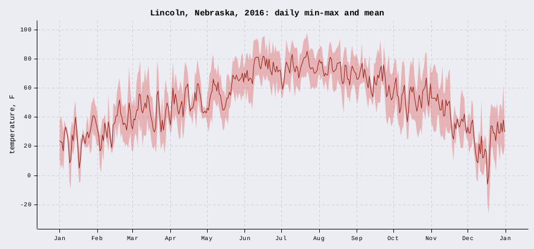
:::


## Many lines

Fifty chicks are a spaghetti plot; highlighting, small multiples and labels make it readable.


### Highlighting one line

All lines in grey (`:group`, no colour), then the one of interest from its own `:data` in colour.

Source: data-to-viz - Spaghetti plot; R Graph Gallery - Highlight elements in a line chart ([1](https://www.data-to-viz.com/caveat/spaghetti.html), [2](https://r-graph-gallery.com/354-highlight-specific-elements-in-line-chart.html)). Data: Weight versus age of chicks on four diets, R datasets package `ChickWeight` (Crowder & Hand 1990); licence: Part of R (GPL-2 | GPL-3).


::: {.sourceClojure}
```clojure
(plot/render-image
 {:data chicks
  :mapping {:x :time :y :weight}
  :charts [(chart/line {:mapping {:group :chick} :color [190 190 190]})
           (chart/line {:data (filter #(= "21" (:chick %)) chicks) :line-width 2.5 :color [215 48 39]})
           (chart/text {:data (filter #(= "21" (:chick %)) chicks) :mapping {:x :time :y :weight :label :chick}
                        :select :last :color [215 48 39]})]
  :labels {:title "Chick 21 among all fifty" :x "days" :y "weight, g"}}
 {:width 800 :height 450})
```
:::


::: {.clay-image}
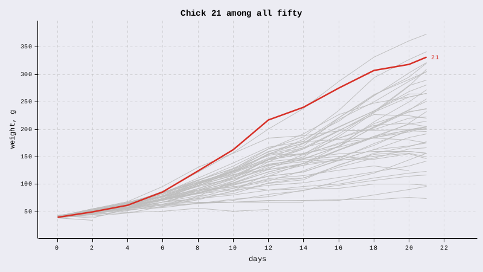
:::


### Small multiples with the others greyed

A chart whose mapping sets the facet key to `nil` is drawn in every panel: all chicks in grey behind each diet's
own.

Source: [R Graph Gallery - Small multiple line chart, all groups greyed out](https://r-graph-gallery.com/web-line-chart-small-multiple-all-group-greyed-out.html). Data: Weight versus age of chicks on four diets, R datasets package `ChickWeight` (Crowder & Hand 1990); licence: Part of R (GPL-2 | GPL-3).


::: {.sourceClojure}
```clojure
(plot/render-image
 {:data chicks
  :mapping {:x :time :y :weight :group :chick :facet :diet}
  :charts [(chart/line {:mapping {:facet nil} :color [175 175 175]})
           (chart/line {:color [33 102 172]})]
  :labels {:title "Chicks per diet, all chicks in grey" :x "days" :y "weight, g"}}
 {:width 900 :height 600})
```
:::


::: {.clay-image}

:::


### Labels at line ends

`chart/text` with `:select :last` keeps one label per series at its last point and makes room for it.

Source: [R Graph Gallery - Line chart with labels at end of lines](https://r-graph-gallery.com/web-line-chart-with-labels-at-end-of-line.html). Data: US economic time series, 1967-2015, R ggplot2 package `economics` (Federal Reserve Bank of St. Louis, FRED); licence: MIT (ggplot2).


::: {.sourceClojure}
```clojure
(let [recent (filter #(and (.isAfter ^LocalDate (:date %) (LocalDate/of 2005 1 1))
                            (#{"pce" "psavert" "unemploy"} (:variable %)))
                      economics-long)]
  (plot/render-image
   {:data recent
    :mapping {:x :date :y :value01 :color :variable}
    :charts [(chart/line {:line-width 1.5})
             (chart/text {:mapping {:x :date :y :value01 :label :variable :color :variable} :select :last})]
    :legend false
    :labels {:title "Three economic series since 2005, labelled at the end" :x nil :y "value (0..1)"}}
   {:width 900 :height 450}))
```
:::


::: {.clay-image}

:::


### Bump chart

Ranks instead of values: `levels/rank-rows` ranks the chicks at every weighing (1 - the heaviest; ties by data
order with `:ties :first`), a monotone line joins the ranks on a reversed axis.

Source: [R Graph Gallery - Basic bump plot](https://r-graph-gallery.com/408-basic-bump-plot.html). Data: Weight versus age of chicks on four diets, R datasets package `ChickWeight` (Crowder & Hand 1990); licence: Part of R (GPL-2 | GPL-3).


::: {.sourceClojure}
```clojure
(let [eight (set (map str (range 1 9)))
      ranked (levels/rank-rows (filter #(and (eight (:chick %)) (zero? (mod (:time %) 4))) chicks) :time :weight
                              {:ties :first})]
  (plot/render-image
   {:data ranked
    :mapping {:x :time :y :rank :color :chick}
    :scales {:y {:domain [8.5 0.5] :nice false :ticks (vec (range 1 9))}}
    :charts [(chart/line {:interpolator :monotone :line-width 3})
             (chart/scatter {:size 9})
             (chart/text {:mapping {:x :time :y :rank :label :chick :color :chick} :select :last})]
    :legend false
    :labels {:title "Weight rank of chicks 1-8 on diet 1" :x "days" :y "rank"}}
   {:width 800 :height 450}))
```
:::


::: {.clay-image}

:::


## Areas

An area fills between a line and zero, or between stacked lines.


### Area chart

Source: R Graph Gallery - Area chart with ggplot2; data-to-viz - Area chart ([1](https://r-graph-gallery.com/164-area-chart-ggplot2.html), [2](https://www.data-to-viz.com/graph/area.html)). Data: US economic time series, 1967-2015, R ggplot2 package `economics` (Federal Reserve Bank of St. Louis, FRED); licence: MIT (ggplot2).


::: {.sourceClojure}
```clojure
(plot/render-image
 {:data economics
  :mapping {:x :date :y :psavert}
  :charts [(chart/line {:fill :color :alpha 0.4 :line-width 1.5})]
  :labels {:title "Personal savings rate" :x nil :y "%"}}
 {:width 800 :height 400})
```
:::


::: {.clay-image}

:::


### Gradient area

`:fill-gradient` colours the area along the y (or x) scale's range.

Source: [R Graph Gallery - Area chart with gradient](https://r-graph-gallery.com/357-area-chart-with-gradient.html). Data: US economic time series, 1967-2015, R ggplot2 package `economics` (Federal Reserve Bank of St. Louis, FRED); licence: MIT (ggplot2).


::: {.sourceClojure}
```clojure
(plot/render-image
 {:data economics
  :mapping {:x :date :y :psavert}
  :charts [(chart/line {:fill-gradient [[255 255 255 0] [33 102 172 200]] :fill-gradient-axis :y :line-width 1.5
                        :color [33 102 172]})]
  :labels {:title "Savings rate, gradient along y" :x nil :y "%"}}
 {:width 800 :height 400})
```
:::


::: {.clay-image}
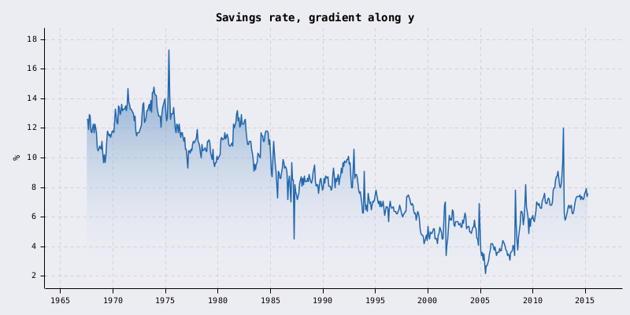
:::


::: {.sourceClojure}
```clojure
(def diet-means
  "Mean chick weight per diet and day."
  (vec (for [[[diet day] rows] (sort-by key (group-by (juxt :diet :time) chicks))]
         {:diet diet :time day :weight (stats/mean (map :weight rows))})))
```
:::


```{=html}
<div class="data-table"><table class="table table-hover table-responsive clay-table"><thead><tr><th>diet</th><th>time</th><th>weight</th></tr></thead><tbody><tr><td>1</td><td>0</td><td>41.4</td></tr><tr><td>1</td><td>2</td><td>47.25</td></tr><tr><td>1</td><td>4</td><td>56.473684210526315</td></tr><tr><td>1</td><td>6</td><td>66.78947368421052</td></tr><tr><td>1</td><td>8</td><td>79.6842105263158</td></tr><tr><td>1</td><td>10</td><td>93.05263157894737</td></tr><tr><td>1</td><td>12</td><td>108.52631578947368</td></tr><tr><td>1</td><td>14</td><td>123.38888888888889</td></tr><tr><td>1</td><td>16</td><td>144.64705882352942</td></tr><tr><td>1</td><td>18</td><td>158.94117647058823</td></tr><tr><td>1</td><td>20</td><td>170.41176470588235</td></tr><tr><td>1</td><td>21</td><td>177.75</td></tr><tr><td>2</td><td>0</td><td>40.7</td></tr><tr><td>2</td><td>2</td><td>49.4</td></tr><tr><td>2</td><td>4</td><td>59.8</td></tr><tr><td>2</td><td>6</td><td>75.4</td></tr><tr><td>2</td><td>8</td><td>91.7</td></tr><tr><td>2</td><td>10</td><td>108.5</td></tr><tr><td>2</td><td>12</td><td>131.3</td></tr><tr><td>2</td><td>14</td><td>141.9</td></tr><tr><td>2</td><td>16</td><td>164.7</td></tr><tr><td>2</td><td>18</td><td>187.7</td></tr><tr><td>2</td><td>20</td><td>205.6</td></tr><tr><td>2</td><td>21</td><td>214.7</td></tr><tr><td>3</td><td>0</td><td>40.8</td></tr><tr><td>3</td><td>2</td><td>50.4</td></tr><tr><td>3</td><td>4</td><td>62.2</td></tr><tr><td>3</td><td>6</td><td>77.9</td></tr><tr><td>3</td><td>8</td><td>98.4</td></tr><tr><td>3</td><td>10</td><td>117.1</td></tr><tr><td>3</td><td>12</td><td>144.4</td></tr><tr><td>3</td><td>14</td><td>164.5</td></tr><tr><td>3</td><td>16</td><td>197.4</td></tr><tr><td>3</td><td>18</td><td>233.1</td></tr><tr><td>3</td><td>20</td><td>258.9</td></tr><tr><td>3</td><td>21</td><td>270.3</td></tr><tr><td>4</td><td>0</td><td>41.0</td></tr><tr><td>4</td><td>2</td><td>51.8</td></tr><tr><td>4</td><td>4</td><td>64.5</td></tr><tr><td>4</td><td>6</td><td>83.9</td></tr><tr><td>4</td><td>8</td><td>105.6</td></tr><tr><td>4</td><td>10</td><td>126.0</td></tr><tr><td>4</td><td>12</td><td>151.4</td></tr><tr><td>4</td><td>14</td><td>161.8</td></tr><tr><td>4</td><td>16</td><td>182.0</td></tr><tr><td>4</td><td>18</td><td>202.9</td></tr><tr><td>4</td><td>20</td><td>233.88888888888889</td></tr><tr><td>4</td><td>21</td><td>238.55555555555554</td></tr></tbody></table></div>
```


### Stacked area

`:position :stack` aligns the groups on the union of their x values and stacks them; every band is filled.

Source: R Graph Gallery - Stacked area chart; data-to-viz - Stacked area ([1](https://r-graph-gallery.com/136-stacked-area-chart.html), [2](https://www.data-to-viz.com/graph/stackedarea.html)). Data: Weight versus age of chicks on four diets, R datasets package `ChickWeight` (Crowder & Hand 1990); licence: Part of R (GPL-2 | GPL-3).


::: {.sourceClojure}
```clojure
(plot/render-image
 {:data diet-means
  :mapping {:x :time :y :weight :color :diet}
  :charts [(chart/line {:position :stack})]
  :labels {:title "Mean chick weight per diet, stacked" :x "days" :y "weight, g"}}
 {:width 800 :height 420})
```
:::


::: {.clay-image}
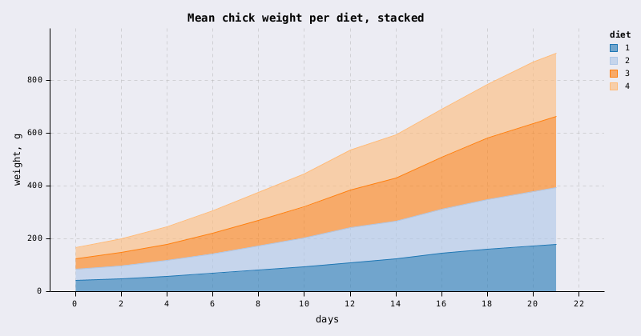
:::


### Percent stacked area

Source: [R Graph Gallery - Stacked area chart (proportion)](https://r-graph-gallery.com/136-stacked-area-chart.html). Data: Weight versus age of chicks on four diets, R datasets package `ChickWeight` (Crowder & Hand 1990); licence: Part of R (GPL-2 | GPL-3).


::: {.sourceClojure}
```clojure
(plot/render-image
 {:data diet-means
  :mapping {:x :time :y :weight :color :diet}
  :charts [(chart/line {:position :normalize})]
  :labels {:title "Share of each diet in the summed mean weight" :x "days"}}
 {:width 800 :height 420})
```
:::


::: {.clay-image}

:::


### Stacking order

Groups stack in the colour scale's order: an explicit `:domain` reorders the bands (and the legend).

Source: data-to-viz - Stacking caveat; R Graph Gallery - Reorder a variable ([1](https://www.data-to-viz.com/caveat/stacking.html), [2](https://r-graph-gallery.com/267-reorder-a-variable-in-ggplot2.html)). Data: Weight versus age of chicks on four diets, R datasets package `ChickWeight` (Crowder & Hand 1990); licence: Part of R (GPL-2 | GPL-3).


::: {.sourceClojure}
```clojure
(plot/render-image
 (plot/arrange
  [{:data diet-means :mapping {:x :time :y :weight :color :diet}
    :charts [(chart/line {:position :stack})] :labels {:title "diets 1, 2, 3, 4" :x "days" :y "weight, g"}}
   {:data diet-means :mapping {:x :time :y :weight :color :diet} :scales {:color {:domain ["3" "4" "2" "1"]}}
    :charts [(chart/line {:position :stack})] :labels {:title "diets 3, 4, 2, 1" :x "days" :y "weight, g"}}]
  {:columns 2})
 {:width 1000 :height 400})
```
:::


::: {.clay-image}

:::


### Streamgraph

Stacked around a moving baseline: `:silhouette` (symmetric around zero) and `:wiggle` (least slope); an
`:interpolator` smooths the bands.

Source: R Graph Gallery - Streamgraph; data-to-viz - Streamgraph ([1](https://r-graph-gallery.com/streamgraph.html), [2](https://www.data-to-viz.com/graph/streamgraph.html)). Data: Weight versus age of chicks on four diets, R datasets package `ChickWeight` (Crowder & Hand 1990); licence: Part of R (GPL-2 | GPL-3).


::: {.sourceClojure}
```clojure
(plot/render-image
 (plot/arrange
  [{:data diet-means :mapping {:x :time :y :weight :color :diet}
    :charts [(chart/line {:position :silhouette :interpolator :monotone})]
    :labels {:title ":silhouette" :x "days" :y nil}}
   {:data diet-means :mapping {:x :time :y :weight :color :diet}
    :charts [(chart/line {:position :wiggle :interpolator :monotone})]
    :labels {:title ":wiggle" :x "days" :y nil}}]
  {:columns 2})
 {:width 1000 :height 400})
```
:::


::: {.clay-image}
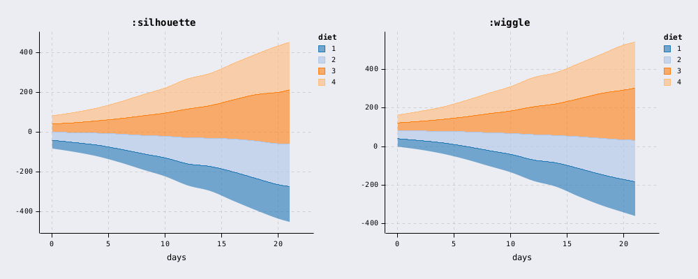
:::


## Other marks

Segments, candlesticks, colour along a line and paths through time.


### Lollipop

A segment from zero to each value (`(chart/segment {:yend 0})`) under a point, on any x: car models (flipped for
readable labels, ordered by the band scale's `:order-by` - each model's mpg) or dates.

Source: R Graph Gallery - Basic lollipop plot; data-to-viz - Lollipop ([1](https://r-graph-gallery.com/300-basic-lollipop-plot.html), [2](https://www.data-to-viz.com/graph/lollipop.html)). Data: Motor Trend car road tests (1974), R datasets package `mtcars` (Henderson & Velleman 1981); licence: Part of R (GPL-2 | GPL-3).


::: {.sourceClojure}
```clojure
(plot/render-image
 (plot/arrange
  [{:data mtcars
    :mapping {:x :model :y :mpg}
    :scales {:x {:order-by #(:mpg (first %))}}
    :flip true
    :charts [(chart/segment {:yend 0 :color [150 150 150]}) (chart/scatter {:size 7 :color [33 102 172]})]
    :labels {:title "Fuel economy of 32 cars" :x nil :y "miles per gallon"}}
   {:data (filter #(= 1959 (:year %)) air)
    :mapping {:x :date :y :passengers}
    :charts [(chart/segment {:yend 0 :color [150 150 150]}) (chart/scatter {:size 7 :color [33 102 172]})]
    :labels {:title "Passengers in 1959" :x nil :y "thousands"}}]
  {:columns 2})
 {:width 1000 :height 700})
```
:::


::: {.clay-image}

:::


### Candlestick

Open-high-low-close per day: the wick from low to high, the body from open to close, green up and red down; OHLC
bars as the alternative. The prices are a seeded random walk.

Source: [Wikipedia - Candlestick chart](https://en.wikipedia.org/wiki/Candlestick_chart).


::: {.sourceClojure}
```clojure
(def prices
  "Daily open / high / low / close of a random walk over 40 trading days."
  (let [rng (r/rng :mersenne 21)
        start (LocalDate/of 2024 3 1)]
    (vec (map-indexed (fn [i close]
                        (let [open (+ close (* 1.2 (r/grandom rng)))
                              spread (m/abs (* 0.8 (double (r/grandom rng))))]
                          {:date (.plusDays start i) :open open :close close
                           :high (+ (max open close) spread) :low (- (min open close) spread)}))
                      (take 40 (reductions + 50.0 (repeatedly #(r/grandom rng))))))))
```
:::


```{=html}
<div class="data-table"><table class="table table-hover table-responsive clay-table"><thead><tr><th>date</th><th>open</th><th>close</th><th>high</th><th>low</th></tr></thead><tbody><tr><td>2024-03-01</td><td>47.632548030053506</td><td>50.0</td><td>50.3286977642804</td><td>47.30385026577311</td></tr><tr><td>2024-03-02</td><td>49.59853547913083</td><td>50.13074905926286</td><td>50.849707159246314</td><td>48.87957737914738</td></tr><tr><td>2024-03-03</td><td>49.85964964035673</td><td>50.164925774380706</td><td>50.279031427100506</td><td>49.74554398763693</td></tr><tr><td>2024-03-04</td><td>50.113320837937856</td><td>50.349991952731706</td><td>50.58741357428397</td><td>49.87589921638559</td></tr><tr><td>2024-03-05</td><td>52.25208184068009</td><td>51.52423795803585</td><td>52.704142448207214</td><td>51.072177350508724</td></tr><tr><td>2024-03-06</td><td>48.62515032006433</td><td>49.926852284301525</td><td>50.1456935307793</td><td>48.406309073586556</td></tr><tr><td>2024-03-07</td><td>51.41949072012316</td><td>50.810355354606294</td><td>51.561443697255</td><td>50.66840237747445</td></tr><tr><td>2024-03-08</td><td>50.83730269968272</td><td>50.897941387702105</td><td>51.04705044932875</td><td>50.68819363805608</td></tr><tr><td>2024-03-09</td><td>49.79245191479805</td><td>49.844583588212785</td><td>50.457704237195586</td><td>49.17933126581525</td></tr><tr><td>2024-03-10</td><td>52.11272318746326</td><td>50.354760452323745</td><td>52.51758165578023</td><td>49.94990198400677</td></tr><tr><td>2024-03-11</td><td>50.78777657220132</td><td>50.04923547053897</td><td>51.8152982462539</td><td>49.02171379648638</td></tr><tr><td>2024-03-12</td><td>50.871536659373426</td><td>50.185507073661874</td><td>51.89775874581844</td><td>49.15928498721686</td></tr><tr><td>2024-03-13</td><td>50.897790041859025</td><td>50.51837339991901</td><td>52.0779266255956</td><td>49.33823681618243</td></tr><tr><td>2024-03-14</td><td>49.903006876881335</td><td>51.17463629759976</td><td>52.52318359859172</td><td>48.554459575889375</td></tr><tr><td>2024-03-15</td><td>47.576601017504466</td><td>50.01826907744722</td><td>50.43658287583983</td><td>47.158287219111855</td></tr><tr><td>2024-03-16</td><td>50.05479355601661</td><td>49.903536289257374</td><td>51.42156434025841</td><td>48.53676550501557</td></tr><tr><td>2024-03-17</td><td>51.367209395295305</td><td>50.61400136594374</td><td>52.55248818394688</td><td>49.42872257729217</td></tr><tr><td>2024-03-18</td><td>52.10509462728763</td><td>52.304673004646936</td><td>53.38289468630413</td><td>51.02687294563044</td></tr><tr><td>2024-03-19</td><td>53.05672973292597</td><td>52.181533109987356</td><td>53.353207165520104</td><td>51.885055677393225</td></tr><tr><td>2024-03-20</td><td>53.42799936197863</td><td>51.65871212739008</td><td>53.71266436220612</td><td>51.37404712716259</td></tr><tr><td>2024-03-21</td><td>56.49851254967236</td><td>53.39748128958453</td><td>57.189633568274125</td><td>52.70636027098277</td></tr><tr><td>2024-03-22</td><td>52.544694099577484</td><td>53.737660836453024</td><td>53.75791021304482</td><td>52.524444722985685</td></tr><tr><td>2024-03-23</td><td>52.6969152281411</td><td>52.89226687364923</td><td>53.671817155594404</td><td>51.917364946195924</td></tr><tr><td>2024-03-24</td><td>52.875851207803926</td><td>53.05708637368157</td><td>53.391090799734236</td><td>52.54184678175126</td></tr><tr><td>2024-03-25</td><td>49.93578283424558</td><td>51.106243521310944</td><td>52.50392093089916</td><td>48.53810542465736</td></tr><tr><td>2024-03-26</td><td>49.014635230837115</td><td>51.09317848320589</td><td>52.65203438806887</td><td>47.455779325974135</td></tr><tr><td>2024-03-27</td><td>52.535220062486324</td><td>51.96895173211941</td><td>52.95975564483152</td><td>51.544416149774214</td></tr><tr><td>2024-03-28</td><td>51.18977618228914</td><td>51.19727609700252</td><td>51.65773077350881</td><td>50.72932150578285</td></tr><tr><td>2024-03-29</td><td>52.17032047684884</td><td>52.21839198373194</td><td>53.239600530855526</td><td>51.14911192972526</td></tr><tr><td>2024-03-30</td><td>52.06274248419599</td><td>51.36402226409783</td><td>53.16079893770136</td><td>50.265965810592455</td></tr><tr><td>2024-03-31</td><td>53.163607037448976</td><td>53.10427153844901</td><td>53.50413439691346</td><td>52.76374417898453</td></tr><tr><td>2024-04-01</td><td>54.67267052712853</td><td>53.86913314270853</td><td>55.55133055074569</td><td>52.99047311909137</td></tr><tr><td>2024-04-02</td><td>54.6609377300407</td><td>53.15120173078838</td><td>55.76366272761407</td><td>52.04847673321501</td></tr><tr><td>2024-04-03</td><td>54.761404104331106</td><td>53.08579096970526</td><td>54.90249888847253</td><td>52.944696185563835</td></tr><tr><td>2024-04-04</td><td>53.895327056650466</td><td>51.4048111816092</td><td>54.949352734076214</td><td>50.35078550418345</td></tr><tr><td>2024-04-05</td><td>53.08471033063695</td><td>52.91400580583511</td><td>53.09317800271896</td><td>52.905538133753105</td></tr><tr><td>2024-04-06</td><td>54.0340638360606</td><td>53.880941616549315</td><td>54.56854803674665</td><td>53.34645741586326</td></tr><tr><td>2024-04-07</td><td>53.66050127708517</td><td>53.05887978767572</td><td>54.15584080856096</td><td>52.56354025619993</td></tr><tr><td>2024-04-08</td><td>53.80372874961422</td><td>53.38908282814445</td><td>54.375145674105184</td><td>52.81766590365349</td></tr><tr><td>2024-04-09</td><td>53.13514114153314</td><td>52.48026246690437</td><td>53.82882939728739</td><td>51.78657421115012</td></tr></tbody></table></div>
```


::: {.sourceClojure}
```clojure
(plot/render-image
 (plot/arrange
  [{:data prices :mapping {:x :date :open :open :high :high :low :low :close :close}
    :charts [(chart/candlestick)] :labels {:title "candlestick" :x nil :y "price"}}
   {:data prices :mapping {:x :date :open :open :high :high :low :low :close :close}
    :charts [(chart/candlestick {:style :ohlc})] :labels {:title ":style :ohlc" :x nil :y "price"}}]
  {:columns 2})
 {:width 1000 :height 400})
```
:::


::: {.clay-image}

:::


### Line coloured by its value

A linear `:color` colours the line along its length; binned, it shows ranges (see also the
[Colours](use_cases.colors.html) chapter).

Source: [R Graph Gallery - Line plot colour following y value](https://r-graph-gallery.com/200-change-color-in-lineplot-following-y-value.html). Data: Weather in Lincoln, Nebraska, 2016, R ggridges package `lincoln_weather` (Weather Underground, via Wilke); licence: GPL-2 (ggridges).


::: {.sourceClojure}
```clojure
(plot/render-image
 (plot/arrange
  [{:data lincoln :mapping {:x :date :y :mean-temp :color :mean-temp} :scales {:color {:range :RColorBrewer/RdYlBu :reverse true :title "F"}}
    :charts [(chart/line {:line-width 2})] :labels {:title "linear" :x nil :y "mean temperature, F"}}
   {:data lincoln :mapping {:x :date :y :mean-temp :color :mean-temp}
    :scales {:color {:range :RColorBrewer/RdYlBu :kind :binned :reverse true :bins [20 40 60 80] :title "F"}}
    :charts [(chart/line {:line-width 2})] :labels {:title "binned" :x nil :y "mean temperature, F"}}]
  {:columns 2})
 {:width 1000 :height 400})
```
:::


::: {.clay-image}
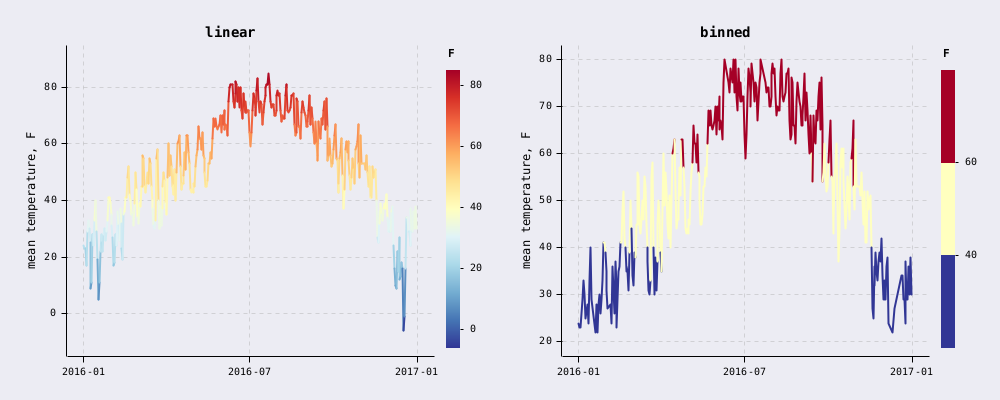
:::


### Connected scatter coloured by time

Two variables against each other, joined in time order (`:order :data`): the
[Correlation](use_cases.correlation.html#connected-scatter-with-dates) chapter labels some years on the path; here
the time itself colours the line along its length - quarterly means through the 2008 crisis: unemployment spells
grow longer while people save more; later the spells shorten again, while saving stays about twice its 2005
level.

Source: R Graph Gallery - Connected scatterplot with ggplot2; data-to-viz - Connected scatter ([1](https://r-graph-gallery.com/connected_scatterplot_ggplot2.html), [2](https://www.data-to-viz.com/graph/connectedscatter.html)). Data: US economic time series, 1967-2015, R ggplot2 package `economics` (Federal Reserve Bank of St. Louis, FRED); licence: MIT (ggplot2).


::: {.sourceClojure}
```clojure
(let [quarter-of (fn [{:keys [^LocalDate date]}] (+ (.getYear date) (/ (quot (dec (.getMonthValue date)) 3) 4.0)))
      quarterly (vec (for [[quarter rows] (sort-by key (group-by quarter-of economics))
                           :when (<= 2005.0 (double quarter) 2014.75)]
                       {:quarter quarter :uempmed (stats/mean (map :uempmed rows)) :psavert (stats/mean (map :psavert rows))}))]
  (plot/render-image
   {:data quarterly
    :mapping {:x :uempmed :y :psavert :color :quarter}
    :scales {:color {:range :viridis/viridis :title "year" :formatter #(str (long %))}}
    :charts [(chart/line {:order :data :line-width 2.5})]
    :labels {:title "Unemployment duration vs savings rate, quarterly 2005-2014" :x "median unemployment, weeks"
             :y "savings rate, %"}}
   {:width 800 :height 550}))
```
:::


::: {.clay-image}
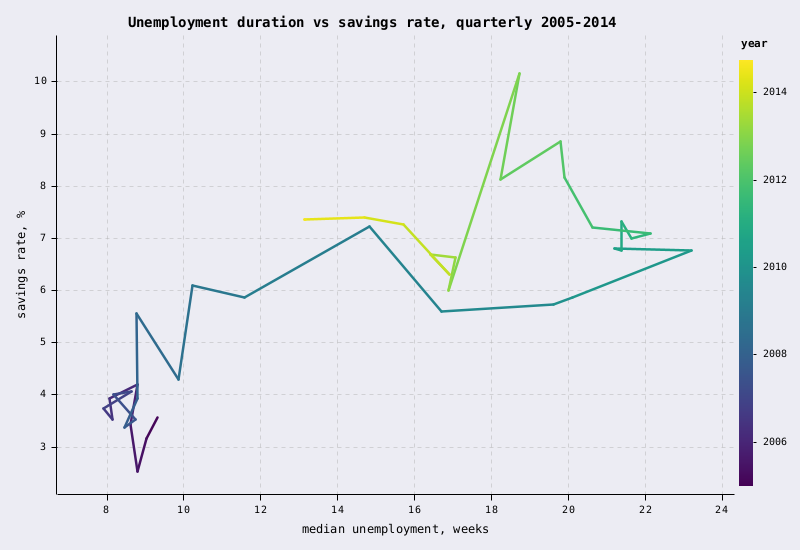
:::


## Functions

`chart/function` samples functions across the panel. Several functions - a vector, `[label f]` pairs or a map -
are one group each: `{:mapping {:color :function}}` colours them and gives the legend, labels in the given
order. `:y-limits` keeps asymptotes from flattening the curve: samples outside the limits don't count for the y
extent; a jump between opposite panel edges cuts the curve.


### Many functions with a legend


::: {.sourceClojure}
```clojure
(plot/render-image
 (plot/arrange
  [{:charts [(chart/function {:f (mapv (fn [k] [(str "sin " k "x") (fn [x] (m/sin (* k (double x))))]) (range 1 11))
                              :domain [0 m/PI] :mapping {:color :function}})]
    :scales {:color {:title nil}}
    :labels {:title "ten [label f] pairs" :x "x" :y "y"}}
   {:charts [(chart/function {:f m/tan :domain [(- m/PI) m/PI] :y-limits [-5 5]})]
    :labels {:title "tan with :y-limits [-5 5]" :x "x" :y "y"}}]
  {:columns 2})
 {:width 1000 :height 400})
```
:::


::: {.clay-image}

:::


### Parametric curves

`:parametric` - `(fn [t] [x y])` over `:t [lo hi]`, sampled by count; Lissajous figures on an isometric aspect.

Source: [Wikipedia - Lissajous curve](https://en.wikipedia.org/wiki/Lissajous_curve).


::: {.sourceClojure}
```clojure
(plot/render-image
 (plot/arrange
  (vec (for [[a b] [[1 2] [3 2] [3 4] [5 4]]]
         {:aspect :iso
          :charts [(chart/function {:parametric (fn [t] [(m/sin (* a (double t))) (m/sin (* b (double t)))])
                                    :t [0 m/TWO_PI] :sample-step {:count 1000}})]
          :labels {:title (str "a = " a ", b = " b) :x nil :y nil}}))
  {:columns 4})
 {:width 1000 :height 300})
```
:::


::: {.clay-image}
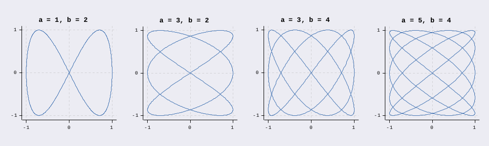
:::


## Caveats


### Cutting the y axis; aspect ratio

Starting y at zero shows changes against the whole; a cut axis magnifies them. A wide panel flattens slopes, a
narrow one steepens them - the same data.

Source: data-to-viz - Cut y axis; Aspect ratio ([1](https://www.data-to-viz.com/caveat/cut_y_axis.html), [2](https://www.data-to-viz.com/caveat/aspect_ratio.html)). Data: US economic time series, 1967-2015, R ggplot2 package `economics` (Federal Reserve Bank of St. Louis, FRED); licence: MIT (ggplot2).


::: {.sourceClojure}
```clojure
(let [recent (filter #(.isAfter ^LocalDate (:date %) (LocalDate/of 2012 1 1)) economics)
      plot-of (fn [title y] {:data recent :mapping {:x :date :y :pop} :scales {:y y}
                             :charts [(chart/line {:line-width 1.5})] :labels {:title title :x nil :y "population, thousands"}})]
  (plot/render-image
   (plot/arrange [(plot/arrange [(plot-of "y from 0" {:domain [0 330000]}) (plot-of "y cut" {})] {:columns 2})
                  (plot/arrange [(plot-of "wide" {}) (plot-of "narrow" {})] {:columns 2 :widths [4 1]})]
                 {:columns 1})
   {:width 1000 :height 700}))
```
:::


::: {.clay-image}
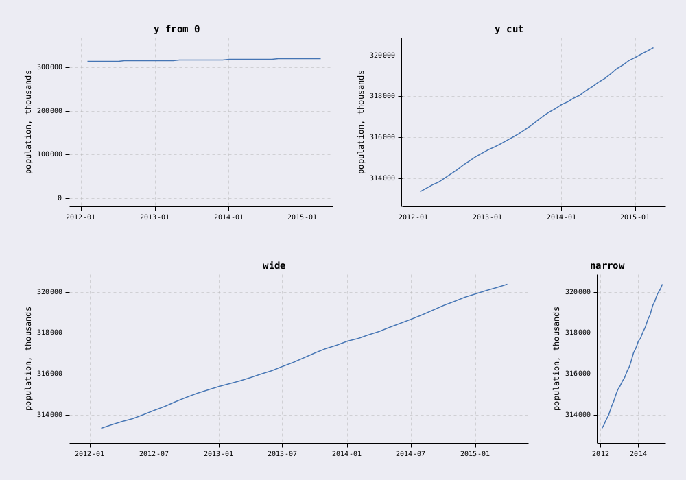
:::


```{=html}
<div style="background-color:grey;height:2px;width:100%;"></div>
```


```{=html}
<div><pre><small><small>source: notebooks/use_cases/evolution.clj</small></small></pre></div>
```