---
format:
  html: {toc: true, toc-location: right, toc-depth: 4, theme: cosmo}
code-block-background: true

---
<style></style><style>.printedClojure .sourceCode {
  background-color: transparent;
  border-style: none;
}
</style><style>.clay-limit-image-width .clay-image {max-width: 100%}
.clay-side-by-side .sourceCode {margin: 0}
.clay-side-by-side {margin: 1em 0}
</style>
<script src="https://code.jquery.com/jquery-3.6.0.min.js" type="text/javascript"></script><script src="https://code.jquery.com/ui/1.13.1/jquery-ui.min.js" type="text/javascript"></script>

# Evolution

Values over time and other ordered variables: lines, time axes, smoothing and uncertainty, many lines, areas and
marks for evolution (the [R Graph Gallery](https://r-graph-gallery.com/time-series.html) evolution pages and the
[data-to-viz](https://www.data-to-viz.com/caveats.html) caveats).

Dates are `java.time` values: a datetime scale places `LocalDate`, `LocalDateTime`, `Instant` and the other
temporal types; curves and fits work in epoch milliseconds.


::: {.sourceClojure}
```clojure
(ns use-cases.evolution
  (:require [fastmath.core :as m]
            [fastmath.kernel :as kernel]
            [fastmath.random :as r]
            [cljplot2.chart :as chart]
            [cljplot2.core :as plot]
            [cljplot2.data.levels :as levels]
            [notebook-utils :as nu])
  (:import [java.time LocalDate]
           [java.time.format DateTimeFormatter]))
```
:::


::: {.sourceClojure}
```clojure
(defn- with-dates
  "Rows with the ISO string `:date` parsed to a `LocalDate`."
  [rows]
  (mapv #(update % :date (fn [d] (LocalDate/parse d))) rows))
```
:::


::: {.printedClojure}
```clojure
#'use-cases.evolution/with-dates

```
:::


::: {.sourceClojure}
```clojure
(def economics (with-dates (nu/dataset :economics)))
```
:::


::: {.sourceClojure}
```clojure
(def air (with-dates (nu/dataset :air-passengers)))
```
:::


::: {.sourceClojure}
```clojure
(def chicks (nu/dataset :chick-weight))
```
:::


::: {.sourceClojure}
```clojure
(def mtcars (nu/dataset :mtcars))
```
:::


::: {.sourceClojure}
```clojure
(def lincoln
  "Lincoln weather with `:date` parsed (`2016-1-1` - not ISO)."
  (let [f (DateTimeFormatter/ofPattern "yyyy-M-d")]
    (mapv #(update % :date (fn [d] (LocalDate/parse d f))) (nu/dataset :lincoln-weather))))
```
:::


::: {.sourceClojure}
```clojure
(def economics-long
  "Economics in long form - `:variable`, `:value` and `:value01` (the value rescaled to 0..1 per variable), as
  ggplot2's `economics_long`."
  (vec (for [k [:pce :pop :psavert :uempmed :unemploy]
             :let [vs (map k economics) lo (double (reduce min vs)) hi (double (reduce max vs))]
             row economics]
         {:date (:date row) :variable (name k) :value (k row) :value01 (/ (- (double (k row)) lo) (- hi lo))})))
```
:::


## Lines

A line joins points in x order; dates on x give a datetime axis.


### Basic line with dates

Source: R Graph Gallery - Line chart with ggplot2; Time series ([1](https://r-graph-gallery.com/line-chart-ggplot2.html), [2](https://r-graph-gallery.com/279-plotting-time-series-with-ggplot2.html)). Data: US economic time series, 1967-2015, R ggplot2 package `economics` (Federal Reserve Bank of St. Louis, FRED); licence: MIT (ggplot2).


::: {.sourceClojure}
```clojure
(plot/render-image
 {:data economics
  :mapping {:x :date :y :unemploy}
  :charts [(chart/line)]
  :labels {:title "Unemployed persons in the US" :x nil :y "thousands"}}
 {:width 800 :height 400})
```
:::


::: {.clay-image}

:::


### Line styling

Width, colour and points are chart options; `:dash` mapped to a variable takes the named dash styles in order
(`:solid`, `:dashed`, `:dotted`, ...), so lines read apart without colour.

Source: [R Graph Gallery - Line chart with ggplot2 (customization)](https://r-graph-gallery.com/line-chart-ggplot2.html). Data: US economic time series, 1967-2015, R ggplot2 package `economics` (Federal Reserve Bank of St. Louis, FRED); licence: MIT (ggplot2).


::: {.sourceClojure}
```clojure
(let [recent (filter #(.isAfter ^LocalDate (:date %) (LocalDate/of 2010 1 1)) economics)
      recent-long (filter #(and (.isAfter ^LocalDate (:date %) (LocalDate/of 2010 1 1))
                                (#{"psavert" "uempmed" "unemploy"} (:variable %)))
                          economics-long)]
  (plot/render-image
   (plot/arrange
    [{:data recent :mapping {:x :date :y :psavert}
      :charts [(chart/line {:width 2 :color [215 48 39]}) (chart/scatter {:size 5 :color [215 48 39]})]
      :labels {:title "width, colour, points" :x nil :y "savings rate, %"}}
     {:data recent-long :mapping {:x :date :y :value01 :dash :variable}
      :charts [(chart/line {:width 1.5 :color :black})]
      :labels {:title ":dash by variable" :x nil :y "rescaled"}}]
    {:columns 2})
   {:width 1000 :height 400}))
```
:::


::: {.clay-image}

:::


### Log scale

Growth at a steady rate is a straight line on a log axis; `:sqrt`, `:pow` and `:symlog` are the other
continuous transforms (wadogo scales).

Source: [R Graph Gallery - Line plot with log scale](https://r-graph-gallery.com/line-plot-log-scale.html). Data: US economic time series, 1967-2015, R ggplot2 package `economics` (Federal Reserve Bank of St. Louis, FRED); licence: MIT (ggplot2).


::: {.sourceClojure}
```clojure
(plot/render-image
 (plot/arrange
  [{:data economics :mapping {:x :date :y :pce} :charts [(chart/line)]
    :labels {:title "linear" :x nil :y "consumption, billions USD"}}
   {:data economics :mapping {:x :date :y :pce} :scales {:y {:kind :log}} :charts [(chart/line)]
    :labels {:title ":log" :x nil :y "consumption, billions USD"}}]
  {:columns 2})
 {:width 1000 :height 400})
```
:::


::: {.clay-image}
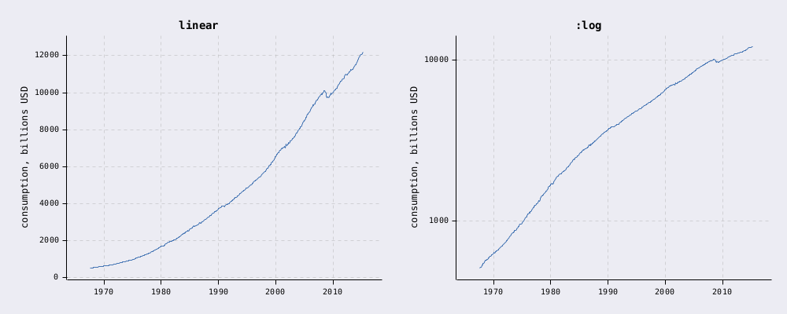
:::


### Several groups

One line per level of `:color`; values on different units are rescaled to 0..1 to share an axis.

Source: [R Graph Gallery - Line chart with several groups](https://r-graph-gallery.com/line-chart-several-groups-ggplot2.html). Data: US economic time series, 1967-2015, R ggplot2 package `economics` (Federal Reserve Bank of St. Louis, FRED); licence: MIT (ggplot2).


::: {.sourceClojure}
```clojure
(plot/render-image
 {:data economics-long
  :mapping {:x :date :y :value01 :color :variable}
  :charts [(chart/line)]
  :labels {:title "Five economic series, rescaled" :x nil :y "value (0..1)"}}
 {:width 900 :height 450})
```
:::


::: {.clay-image}
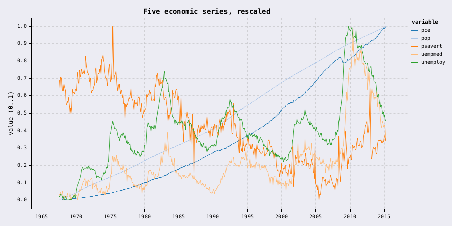
:::


### Steps and interpolated lines

`:interpolator` takes any fastmath one-dimensional method: steps, monotone (no overshoot) or cubic curves through
the points.

Source: R Graph Gallery - Line plot; data-to-viz - Line plot ([1](https://r-graph-gallery.com/line-plot.html), [2](https://www.data-to-viz.com/graph/line.html)). Data: Monthly airline passengers, 1949-1960, R datasets package `AirPassengers` (Box & Jenkins 1976); licence: Part of R (GPL-2 | GPL-3).


::: {.sourceClojure}
```clojure
(let [year (filter #(= 1955 (:year %)) air)
      panel (fn [title opts] {:data year :mapping {:x :date :y :passengers}
                              :charts [(chart/line opts) (chart/scatter {:size 5})]
                              :labels {:title title :x nil :y "passengers, thousands"}})]
  (plot/render-image
   (plot/arrange [(panel ":step-after" {:interpolator :step-after})
                  (panel ":monotone" {:interpolator :monotone})
                  (panel ":cubic" {:interpolator :cubic})]
                 {:columns 3})
   {:width 1000 :height 350}))
```
:::


::: {.clay-image}

:::


### Sampling step

An interpolated line is evaluated every `:sample-step` pixels (default 1) or at `{:count n}` positions per run - a
coarse count shows the polyline behind a curve.

Source: cljplot2 - line :sample-step. Data: Monthly airline passengers, 1949-1960, R datasets package `AirPassengers` (Box & Jenkins 1976); licence: Part of R (GPL-2 | GPL-3).


::: {.sourceClojure}
```clojure
(let [years (filter #(<= 1958 (:year %)) air)
      panel (fn [title step] {:data years :mapping {:x :date :y :passengers}
                              :charts [(chart/line {:interpolator :cubic :sample-step step}) (chart/scatter {:size 4})]
                              :labels {:title title :x nil :y "passengers, thousands"}})]
  (plot/render-image
   (plot/arrange [(panel "every pixel (default)" 1) (panel "{:count 12} per run" {:count 12})] {:columns 2})
   {:width 1000 :height 380}))
```
:::


::: {.clay-image}
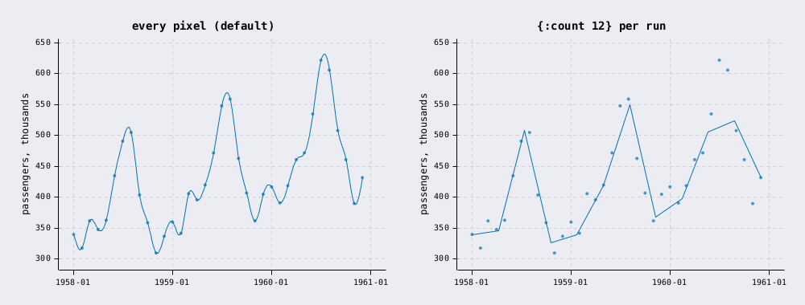
:::


### Missing values

A missing (`nil`) value breaks the line (`:gaps :break`, default); `:gaps :bridge` joins the ends with a dimmed
segment, so the gap stays visible.

Source: cljplot2 - line :gaps. Data: US economic time series, 1967-2015, R ggplot2 package `economics` (Federal Reserve Bank of St. Louis, FRED); licence: MIT (ggplot2).


::: {.sourceClojure}
```clojure
(let [gappy (map (fn [row] (if (<= 1990 (.getYear ^LocalDate (:date row)) 1992) (assoc row :psavert nil) row))
                 (filter #(<= 1985 (.getYear ^LocalDate (:date %)) 1997) economics))
      panel (fn [title gaps] {:data gappy :mapping {:x :date :y :psavert}
                              :charts [(chart/line {:gaps gaps :width 1.5})]
                              :labels {:title title :x nil :y "savings rate, %"}})]
  (plot/render-image
   (plot/arrange [(panel ":gaps :break" :break) (panel ":gaps :bridge" :bridge)] {:columns 2})
   {:width 1000 :height 380}))
```
:::


::: {.clay-image}
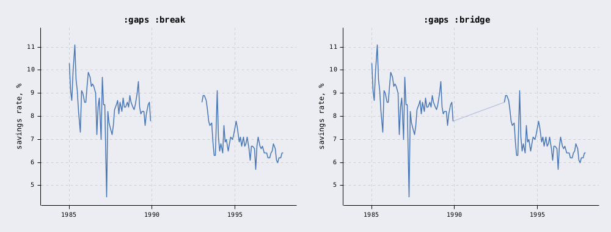
:::


## Time axes

Datetime ticks fall on calendar units; the formatter is a function or a `java.time` pattern string.


### Date format and breaks

Source: R Graph Gallery - Time series with ggplot2; Manage dates ([1](https://r-graph-gallery.com/279-plotting-time-series-with-ggplot2.html), [2](https://r-graph-gallery.com/191-manage-date-data.html)). Data: US economic time series, 1967-2015, R ggplot2 package `economics` (Federal Reserve Bank of St. Louis, FRED); licence: MIT (ggplot2).


::: {.sourceClojure}
```clojure
(plot/render-image
 (plot/arrange
  [{:data economics :mapping {:x :date :y :uempmed}
    :scales {:x {:ticks-params {:unit :years :step 5} :formatter "yyyy"}}
    :charts [(chart/line)] :labels {:title "every 5 years, \"yyyy\"" :x nil :y "weeks"}}
   {:data (filter #(= 2008 (.getYear ^LocalDate (:date %))) economics) :mapping {:x :date :y :uempmed}
    :scales {:x {:ticks-params {:unit :months :step 2} :formatter "MMM"}}
    :charts [(chart/line) (chart/scatter {:size 5})] :labels {:title "2008, every 2 months, \"MMM\"" :x nil :y "weeks"}}]
  {:columns 2})
 {:width 1000 :height 400})
```
:::


::: {.clay-image}

:::


### Time window

An explicit `:domain` of dates shows one window of a long series; the data outside is clipped by the panel.

Source: [R Graph Gallery - Time series with ggplot2 (select a time frame)](https://r-graph-gallery.com/279-plotting-time-series-with-ggplot2.html). Data: US economic time series, 1967-2015, R ggplot2 package `economics` (Federal Reserve Bank of St. Louis, FRED); licence: MIT (ggplot2).


::: {.sourceClojure}
```clojure
(plot/render-image
 {:data economics
  :mapping {:x :date :y :unemploy}
  :scales {:x {:domain [(LocalDate/of 2000 1 1) (LocalDate/of 2010 1 1)]} :y {:domain [4000 16000]}}
  :charts [(chart/line {:width 1.5})]
  :labels {:title "Unemployment, 2000-2010" :x nil :y "thousands"}}
 {:width 800 :height 400})
```
:::


::: {.clay-image}
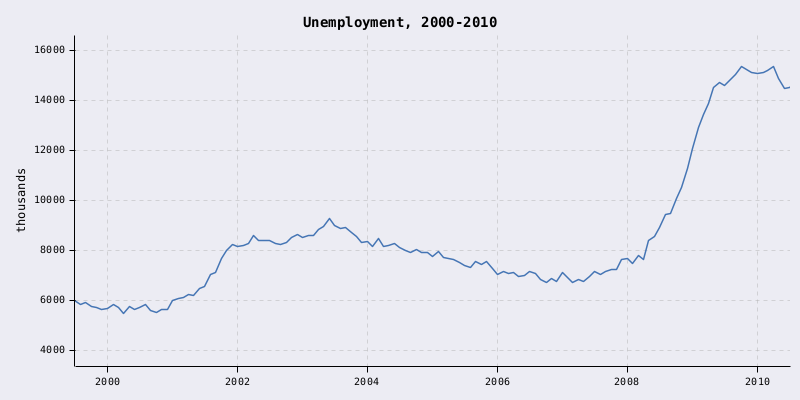
:::


### Annotations

Literal rects, rules and texts take dates as positions: recessions shaded behind the line, a rule and a label.

Source: [R Graph Gallery - Line chart annotation](https://r-graph-gallery.com/line_chart_annotation.html). Data: US economic time series, 1967-2015, R ggplot2 package `economics` (Federal Reserve Bank of St. Louis, FRED); licence: MIT (ggplot2).


::: {.sourceClojure}
```clojure
(let [d (fn [y mo] (LocalDate/of (int y) (int mo) 1))
      recessions [[(d 1969 12) (d 1970 11)] [(d 1973 11) (d 1975 3)] [(d 1980 1) (d 1980 7)] [(d 1981 7) (d 1982 11)]
                  [(d 1990 7) (d 1991 3)] [(d 2001 3) (d 2001 11)] [(d 2007 12) (d 2009 6)]]]
  (plot/render-image
   {:data economics
    :mapping {:x :date :y :unemploy}
    :charts [(chart/rect {:x recessions :fill [0 0 0 35]})
             (chart/line {:width 1.5})
             (chart/rule {:x (d 2008 9) :dash :dashed :color [215 48 39]})
             (chart/text {:x (d 2008 9) :y 14500 :text "Lehman Brothers" :anchor [:right :middle] :offset [-5 0]
                          :color [215 48 39]})]
    :labels {:title "Unemployment and US recessions (NBER)" :x nil :y "thousands"}}
   {:width 900 :height 450}))
```
:::


::: {.clay-image}
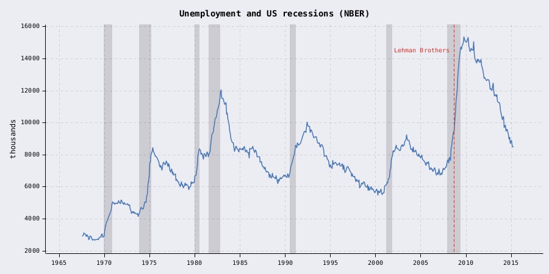
:::


### Time heatmap

Year × month as two categorical axes, the value as a linear colour: seasonality and growth at once. A rect whose
ends are levels covers the level's band.

Source: [R Graph Gallery - The hourly heatmap](https://r-graph-gallery.com/283-the-hourly-heatmap.html). Data: Monthly airline passengers, 1949-1960, R datasets package `AirPassengers` (Box & Jenkins 1976); licence: Part of R (GPL-2 | GPL-3).


::: {.sourceClojure}
```clojure
(let [months ["Jan" "Feb" "Mar" "Apr" "May" "Jun" "Jul" "Aug" "Sep" "Oct" "Nov" "Dec"]
      rows (map #(assoc % :year-level (str (:year %))) air)]
  (plot/render-image
   {:data rows
    :scales {:x {:domain months} :color {:range :viridis/viridis :title "passengers"}}
    :charts [(chart/rect {:mapping {:x0 :month :x1 :month :y0 :year-level :y1 :year-level :color :passengers}
                          :stroke-color :white})]
    :labels {:title "Airline passengers by month (thousands)" :x nil :y nil}}
   {:width 800 :height 500}))
```
:::


::: {.clay-image}

:::


## Smoothing and uncertainty

`chart/smooth` fits a curve per group with a band; `chart/ribbon` draws any band given as `:ymin` / `:ymax`.


### Smoothers with confidence bands

Loess (default) with nested 50% / 95% bands; a linear model per diet; a Gaussian process (mean ± z·σ). The loess
defaults are ggplot2's `geom_smooth` ones - 75% of the points, local quadratic fits - with fastmath's two robustness
iterations (`:method-params {:iters 0}` is ggplot2's plain fit; the robust bands are a little wider). The bands
of the plain fit (`:iters 0`) equal R's `predict(se = TRUE)`; with 144 or 220 points they are narrow. On a date axis the fit
works in epoch milliseconds - a kernel's scale too (here three months).

Source: R Graph Gallery - Scatterplot with ggplot2 (smoothing); Polynomial curve fitting ([1](https://r-graph-gallery.com/50-51-52-scatter-plot-with-ggplot2.html), [2](https://r-graph-gallery.com/44-polynomial-curve-fitting.html)). Data: Monthly airline passengers, 1949-1960, R datasets package `AirPassengers` (Box & Jenkins 1976); licence: Part of R (GPL-2 | GPL-3).


::: {.sourceClojure}
```clojure
(let [year-ms (* 365.25 86400000.0)]
  (plot/render-image
   (plot/arrange
    [{:data air :mapping {:x :date :y :passengers}
      :charts [(chart/scatter {:size 3}) (chart/smooth {:level [0.5 0.95]})]
      :labels {:title "loess, 50% / 95%" :x nil :y "passengers"}}
     {:data chicks :mapping {:x :time :y :weight :color :diet}
      :charts [(chart/scatter {:size 3}) (chart/smooth {:method :lm})]
      :labels {:title "lm per diet" :x "days" :y "weight, g"}}
     {:data (filter #(<= 1956 (:year %)) air) :mapping {:x :date :y :passengers}
      :charts [(chart/smooth {:method :gp :level [0.5 0.95]
                              :method-params {:kernel (kernel/kernel :gaussian {:sigma (* 0.25 year-ms)})
                                              :noise 0.05 :normalize? true}})
               (chart/scatter {:size 4})]
      :labels {:title "Gaussian process" :x nil :y "passengers"}}]
    {:columns 3})
   {:width 1000 :height 380}))
```
:::


::: {.clay-image}
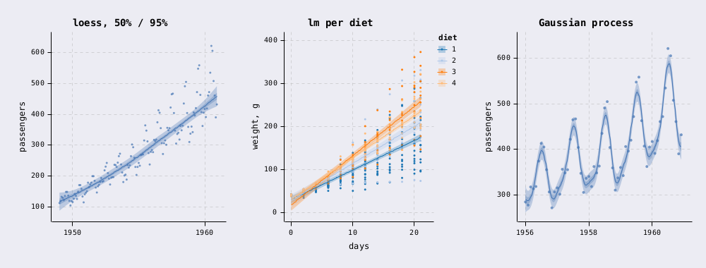
:::


### Ribbon

Daily minimum and maximum temperatures as a band, the mean as a line.

Source: [R Graph Gallery - Lines with error envelopes](https://r-graph-gallery.com/104-plot-lines-with-error-envelopes-ggplot2.html). Data: Weather in Lincoln, Nebraska, 2016, R ggridges package `lincoln_weather` (Weather Underground, via Wilke); licence: GPL-2 (ggridges).


::: {.sourceClojure}
```clojure
(plot/render-image
 {:data lincoln
  :mapping {:x :date}
  :scales {:x {:formatter "MMM"}}
  :charts [(chart/ribbon {:mapping {:ymin :min-temp :ymax :max-temp} :color [215 48 39]})
           (chart/line {:mapping {:y :mean-temp} :color [150 30 20]})]
  :labels {:title "Lincoln, Nebraska, 2016: daily min-max and mean" :x nil :y "temperature, F"}}
 {:width 900 :height 420})
```
:::


::: {.clay-image}

:::


## Many lines

Fifty chicks are a spaghetti plot; highlighting, small multiples and labels make it readable.


### Highlighting one line

All lines in grey (`:group`, no colour), then the one of interest from its own `:data` in colour.

Source: data-to-viz - Spaghetti plot; R Graph Gallery - Highlight elements in a line chart ([1](https://www.data-to-viz.com/caveat/spaghetti.html), [2](https://r-graph-gallery.com/354-highlight-specific-elements-in-line-chart.html)). Data: Weight versus age of chicks on four diets, R datasets package `ChickWeight` (Crowder & Hand 1990); licence: Part of R (GPL-2 | GPL-3).


::: {.sourceClojure}
```clojure
(plot/render-image
 {:data chicks
  :mapping {:x :time :y :weight}
  :charts [(chart/line {:mapping {:group :chick} :color [190 190 190]})
           (chart/line {:data (filter #(= "21" (:chick %)) chicks) :width 2.5 :color [215 48 39]})
           (chart/text {:data (filter #(= "21" (:chick %)) chicks) :mapping {:x :time :y :weight :label :chick}
                        :select :last :color [215 48 39]})]
  :labels {:title "Chick 21 among all fifty" :x "days" :y "weight, g"}}
 {:width 800 :height 450})
```
:::


::: {.clay-image}

:::


### Small multiples with the others greyed

A chart whose mapping sets the facet key to `nil` is drawn in every panel: all chicks in grey behind each diet's
own.

Source: [R Graph Gallery - Small multiple line chart, all groups greyed out](https://r-graph-gallery.com/web-line-chart-small-multiple-all-group-greyed-out.html). Data: Weight versus age of chicks on four diets, R datasets package `ChickWeight` (Crowder & Hand 1990); licence: Part of R (GPL-2 | GPL-3).


::: {.sourceClojure}
```clojure
(plot/render-image
 {:data chicks
  :mapping {:x :time :y :weight :group :chick :facet :diet}
  :charts [(chart/line {:mapping {:facet nil} :color [175 175 175]})
           (chart/line {:color [33 102 172]})]
  :labels {:title "Chicks per diet, all chicks in grey" :x "days" :y "weight, g"}}
 {:width 900 :height 600})
```
:::


::: {.clay-image}
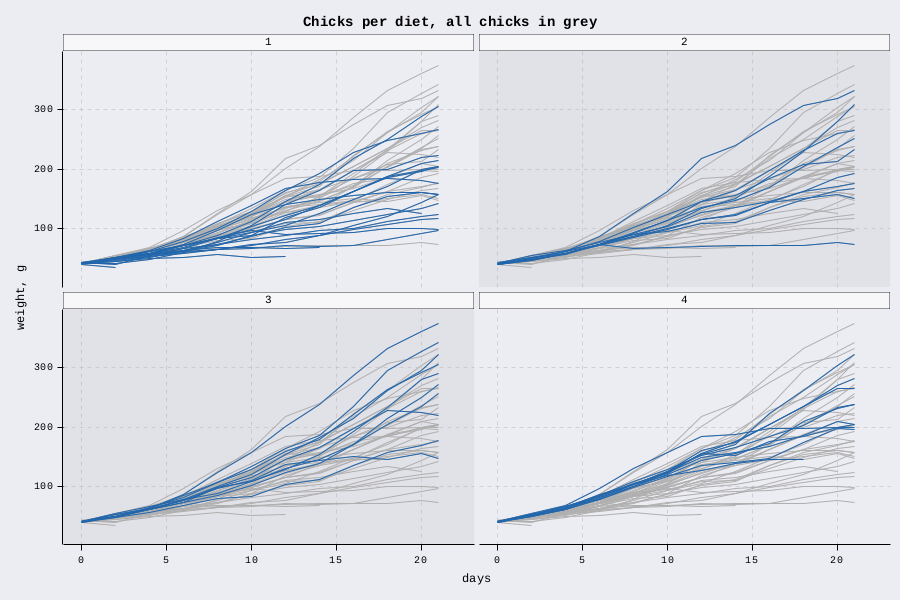
:::


### Labels at line ends

`chart/text` with `:select :last` keeps one label per series at its last point and makes room for it.

Source: [R Graph Gallery - Line chart with labels at end of lines](https://r-graph-gallery.com/web-line-chart-with-labels-at-end-of-line.html). Data: US economic time series, 1967-2015, R ggplot2 package `economics` (Federal Reserve Bank of St. Louis, FRED); licence: MIT (ggplot2).


::: {.sourceClojure}
```clojure
(let [recent (filter #(and (.isAfter ^LocalDate (:date %) (LocalDate/of 2005 1 1))
                            (#{"pce" "psavert" "unemploy"} (:variable %)))
                      economics-long)]
  (plot/render-image
   {:data recent
    :mapping {:x :date :y :value01 :color :variable}
    :charts [(chart/line {:width 1.5})
             (chart/text {:mapping {:x :date :y :value01 :label :variable :color :variable} :select :last})]
    :legend false
    :labels {:title "Three economic series since 2005, labelled at the end" :x nil :y "value (0..1)"}}
   {:width 900 :height 450}))
```
:::


::: {.clay-image}
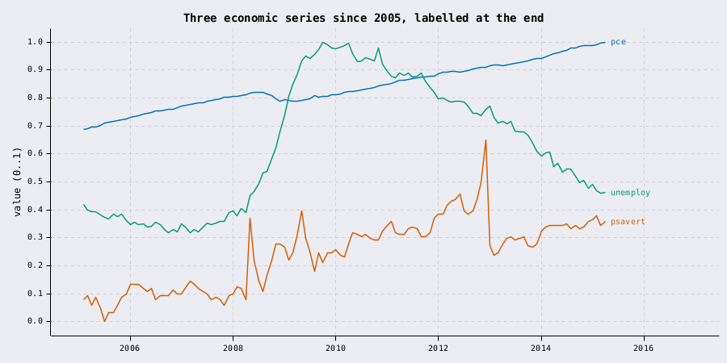
:::


### Bump chart

Ranks instead of values: `levels/rank-rows` ranks the chicks at every weighing (1 - the heaviest; ties by data
order with `:ties :first`), a monotone line joins the ranks on a reversed axis.

Source: [R Graph Gallery - Basic bump plot](https://r-graph-gallery.com/408-basic-bump-plot.html). Data: Weight versus age of chicks on four diets, R datasets package `ChickWeight` (Crowder & Hand 1990); licence: Part of R (GPL-2 | GPL-3).


::: {.sourceClojure}
```clojure
(let [eight (set (map str (range 1 9)))
      ranked (levels/rank-rows (filter #(and (eight (:chick %)) (zero? (mod (:time %) 4))) chicks) :time :weight
                              {:ties :first})]
  (plot/render-image
   {:data ranked
    :mapping {:x :time :y :rank :color :chick}
    :scales {:y {:domain [8.5 0.5] :nice false :ticks (vec (range 1 9))}}
    :charts [(chart/line {:interpolator :monotone :width 3})
             (chart/scatter {:size 9})
             (chart/text {:mapping {:x :time :y :rank :label :chick :color :chick} :select :last})]
    :legend false
    :labels {:title "Weight rank of chicks 1-8 on diet 1" :x "days" :y "rank"}}
   {:width 800 :height 450}))
```
:::


::: {.clay-image}
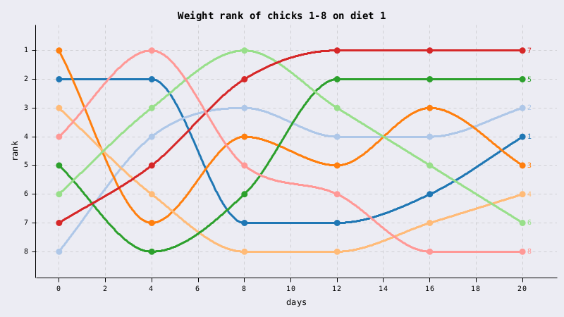
:::


## Areas

An area fills between a line and zero, or between stacked lines.


### Area chart

Source: R Graph Gallery - Area chart with ggplot2; data-to-viz - Area chart ([1](https://r-graph-gallery.com/164-area-chart-ggplot2.html), [2](https://www.data-to-viz.com/graph/area.html)). Data: US economic time series, 1967-2015, R ggplot2 package `economics` (Federal Reserve Bank of St. Louis, FRED); licence: MIT (ggplot2).


::: {.sourceClojure}
```clojure
(plot/render-image
 {:data economics
  :mapping {:x :date :y :psavert}
  :charts [(chart/line {:fill :color :alpha 0.4 :width 1.5})]
  :labels {:title "Personal savings rate" :x nil :y "%"}}
 {:width 800 :height 400})
```
:::


::: {.clay-image}
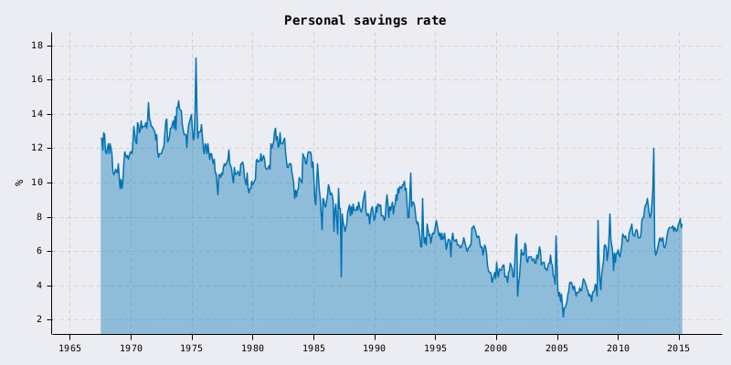
:::


### Gradient area

`:fill-gradient` colours the area along the y (or x) scale's range.

Source: [R Graph Gallery - Area chart with gradient](https://r-graph-gallery.com/357-area-chart-with-gradient.html). Data: US economic time series, 1967-2015, R ggplot2 package `economics` (Federal Reserve Bank of St. Louis, FRED); licence: MIT (ggplot2).


::: {.sourceClojure}
```clojure
(plot/render-image
 {:data economics
  :mapping {:x :date :y :psavert}
  :charts [(chart/line {:fill-gradient [[255 255 255 0] [33 102 172 200]] :fill-gradient-axis :y :width 1.5
                        :color [33 102 172]})]
  :labels {:title "Savings rate, gradient along y" :x nil :y "%"}}
 {:width 800 :height 400})
```
:::


::: {.clay-image}

:::


::: {.sourceClojure}
```clojure
(def diet-means
  "Mean chick weight per diet and day."
  (vec (for [[[diet time] rows] (sort-by key (group-by (juxt :diet :time) chicks))]
         {:diet diet :time time :weight (/ (double (reduce + (map :weight rows))) (count rows))})))
```
:::


### Stacked area

`:position :stack` aligns the groups on the union of their x values and stacks them; every band is filled.

Source: R Graph Gallery - Stacked area chart; data-to-viz - Stacked area ([1](https://r-graph-gallery.com/136-stacked-area-chart.html), [2](https://www.data-to-viz.com/graph/stackedarea.html)). Data: Weight versus age of chicks on four diets, R datasets package `ChickWeight` (Crowder & Hand 1990); licence: Part of R (GPL-2 | GPL-3).


::: {.sourceClojure}
```clojure
(plot/render-image
 {:data diet-means
  :mapping {:x :time :y :weight :color :diet}
  :charts [(chart/line {:position :stack})]
  :labels {:title "Mean chick weight per diet, stacked" :x "days" :y "weight, g"}}
 {:width 800 :height 420})
```
:::


::: {.clay-image}

:::


### Percent stacked area

Source: [R Graph Gallery - Stacked area chart (proportion)](https://r-graph-gallery.com/136-stacked-area-chart.html). Data: Weight versus age of chicks on four diets, R datasets package `ChickWeight` (Crowder & Hand 1990); licence: Part of R (GPL-2 | GPL-3).


::: {.sourceClojure}
```clojure
(plot/render-image
 {:data diet-means
  :mapping {:x :time :y :weight :color :diet}
  :charts [(chart/line {:position :normalize})]
  :labels {:title "Share of each diet in the summed mean weight" :x "days"}}
 {:width 800 :height 420})
```
:::


::: {.clay-image}
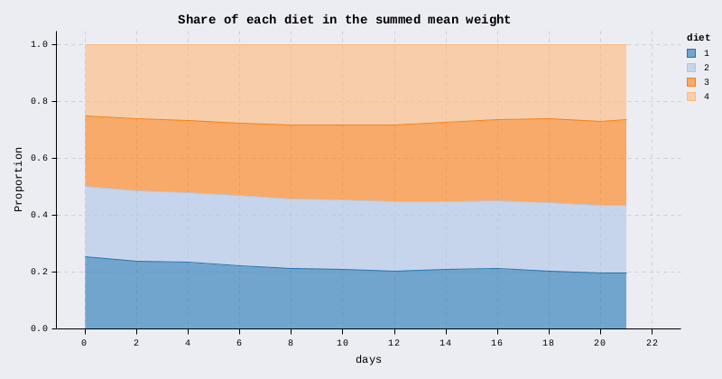
:::


### Stacking order

Groups stack in the colour scale's order: an explicit `:domain` reorders the bands (and the legend).

Source: data-to-viz - Stacking caveat; R Graph Gallery - Reorder a variable ([1](https://www.data-to-viz.com/caveat/stacking.html), [2](https://r-graph-gallery.com/267-reorder-a-variable-in-ggplot2.html)). Data: Weight versus age of chicks on four diets, R datasets package `ChickWeight` (Crowder & Hand 1990); licence: Part of R (GPL-2 | GPL-3).


::: {.sourceClojure}
```clojure
(plot/render-image
 (plot/arrange
  [{:data diet-means :mapping {:x :time :y :weight :color :diet}
    :charts [(chart/line {:position :stack})] :labels {:title "diets 1, 2, 3, 4" :x "days" :y "weight, g"}}
   {:data diet-means :mapping {:x :time :y :weight :color :diet} :scales {:color {:domain ["3" "4" "2" "1"]}}
    :charts [(chart/line {:position :stack})] :labels {:title "diets 3, 4, 2, 1" :x "days" :y "weight, g"}}]
  {:columns 2})
 {:width 1000 :height 400})
```
:::


::: {.clay-image}
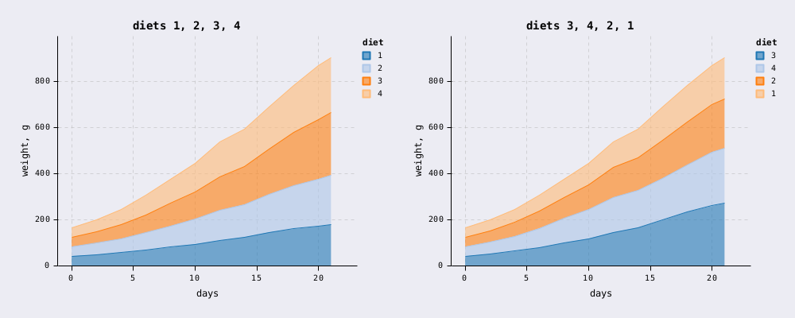
:::


### Streamgraph

Stacked around a moving baseline: `:silhouette` (symmetric around zero) and `:wiggle` (least slope); an
`:interpolator` smooths the bands.

Source: R Graph Gallery - Streamgraph; data-to-viz - Streamgraph ([1](https://r-graph-gallery.com/streamgraph.html), [2](https://www.data-to-viz.com/graph/streamgraph.html)). Data: Weight versus age of chicks on four diets, R datasets package `ChickWeight` (Crowder & Hand 1990); licence: Part of R (GPL-2 | GPL-3).


::: {.sourceClojure}
```clojure
(plot/render-image
 (plot/arrange
  [{:data diet-means :mapping {:x :time :y :weight :color :diet}
    :charts [(chart/line {:position :silhouette :interpolator :monotone})]
    :labels {:title ":silhouette" :x "days" :y nil}}
   {:data diet-means :mapping {:x :time :y :weight :color :diet}
    :charts [(chart/line {:position :wiggle :interpolator :monotone})]
    :labels {:title ":wiggle" :x "days" :y nil}}]
  {:columns 2})
 {:width 1000 :height 400})
```
:::


::: {.clay-image}

:::


## Other marks

Segments, candlesticks, colour along a line and paths through time.


### Lollipop

A segment from zero to each value (`(chart/segment {:yend 0})`) under a point, on any x: car models (flipped for
readable labels) or dates.

Source: R Graph Gallery - Basic lollipop plot; data-to-viz - Lollipop ([1](https://r-graph-gallery.com/300-basic-lollipop-plot.html), [2](https://www.data-to-viz.com/graph/lollipop.html)). Data: Motor Trend car road tests (1974), R datasets package `mtcars` (Henderson & Velleman 1981); licence: Part of R (GPL-2 | GPL-3).


::: {.sourceClojure}
```clojure
(let [ordered (sort-by :mpg mtcars)]
  (plot/render-image
   (plot/arrange
    [{:data ordered
      :mapping {:x :model :y :mpg}
      :scales {:x {:domain (mapv :model ordered)}}
      :flip true
      :charts [(chart/segment {:yend 0 :color [150 150 150]}) (chart/scatter {:size 7 :color [33 102 172]})]
      :labels {:title "Fuel economy of 32 cars" :x nil :y "miles per gallon"}}
     {:data (filter #(= 1959 (:year %)) air)
      :mapping {:x :date :y :passengers}
      :charts [(chart/segment {:yend 0 :color [150 150 150]}) (chart/scatter {:size 7 :color [33 102 172]})]
      :labels {:title "Passengers in 1959" :x nil :y "thousands"}}]
    {:columns 2})
   {:width 1000 :height 700}))
```
:::


::: {.clay-image}
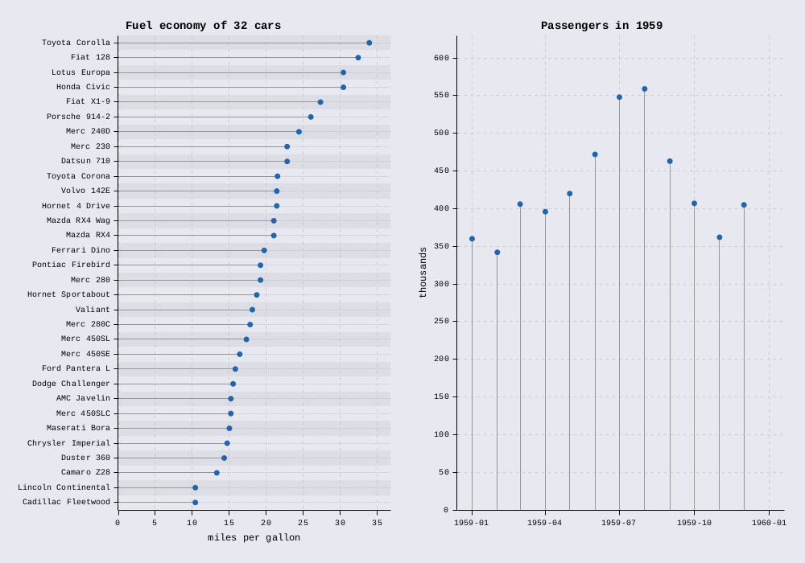
:::


### Candlestick

Open-high-low-close per day: the wick from low to high, the body from open to close, green up and red down; OHLC
bars as the alternative. The prices are a seeded random walk.

Source: [Wikipedia - Candlestick chart](https://en.wikipedia.org/wiki/Candlestick_chart).


::: {.sourceClojure}
```clojure
(def prices
  "Daily open / high / low / close of a random walk over 40 trading days."
  (let [rng (r/rng :mersenne 21)
        start (LocalDate/of 2024 3 1)]
    (vec (map-indexed (fn [i close]
                        (let [open (+ close (* 1.2 (r/grandom rng)))
                              spread (m/abs (* 0.8 (double (r/grandom rng))))]
                          {:date (.plusDays start i) :open open :close close
                           :high (+ (max open close) spread) :low (- (min open close) spread)}))
                      (take 40 (reductions + 50.0 (repeatedly #(r/grandom rng))))))))
```
:::


::: {.sourceClojure}
```clojure
(plot/render-image
 (plot/arrange
  [{:data prices :mapping {:x :date :open :open :high :high :low :low :close :close}
    :charts [(chart/candlestick)] :labels {:title "candlestick" :x nil :y "price"}}
   {:data prices :mapping {:x :date :open :open :high :high :low :low :close :close}
    :charts [(chart/candlestick {:style :ohlc})] :labels {:title ":style :ohlc" :x nil :y "price"}}]
  {:columns 2})
 {:width 1000 :height 400})
```
:::


::: {.clay-image}
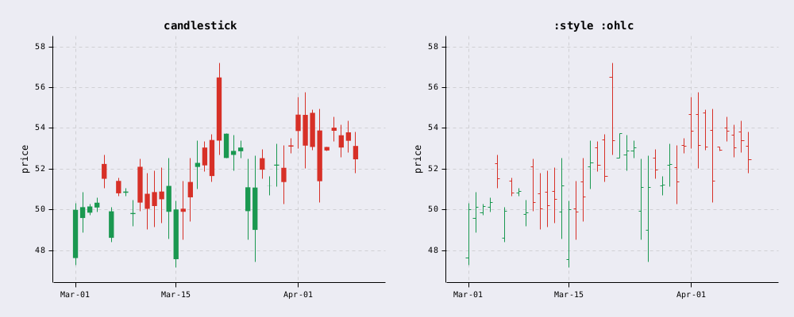
:::


### Line coloured by its value

A linear `:color` colours the line along its length; binned, it shows ranges (see also the Colors chapter).

Source: [R Graph Gallery - Line plot colour following y value](https://r-graph-gallery.com/200-change-color-in-lineplot-following-y-value.html). Data: Weather in Lincoln, Nebraska, 2016, R ggridges package `lincoln_weather` (Weather Underground, via Wilke); licence: GPL-2 (ggridges).


::: {.sourceClojure}
```clojure
(plot/render-image
 (plot/arrange
  [{:data lincoln :mapping {:x :date :y :mean-temp :color :mean-temp} :scales {:color {:range :RColorBrewer/RdYlBu :reverse true :title "F"}}
    :charts [(chart/line {:width 2})] :labels {:title "linear" :x nil :y "mean temperature, F"}}
   {:data lincoln :mapping {:x :date :y :mean-temp :color :mean-temp}
    :scales {:color {:range :RColorBrewer/RdYlBu :kind :binned :reverse true :bins [20 40 60 80] :title "F"}}
    :charts [(chart/line {:width 2})] :labels {:title "binned" :x nil :y "mean temperature, F"}}]
  {:columns 2})
 {:width 1000 :height 400})
```
:::


::: {.clay-image}

:::


### Connected scatter

Two variables against each other, joined in time order (`:sort false`); `:curve :bezier` passes a smooth path
through the points, labels mark some years.

Source: R Graph Gallery - Connected scatterplot with ggplot2; data-to-viz - Connected scatter ([1](https://r-graph-gallery.com/connected_scatterplot_ggplot2.html), [2](https://www.data-to-viz.com/graph/connectedscatter.html)). Data: US economic time series, 1967-2015, R ggplot2 package `economics` (Federal Reserve Bank of St. Louis, FRED); licence: MIT (ggplot2).


::: {.sourceClojure}
```clojure
(let [yearly (vec (for [[year rows] (sort-by key (group-by #(.getYear ^LocalDate (:date %)) economics))
                        :when (<= 2000 year 2014)]
                    {:year year
                     :uempmed (/ (double (reduce + (map :uempmed rows))) (count rows))
                     :psavert (/ (double (reduce + (map :psavert rows))) (count rows))}))]
  (plot/render-image
   {:data yearly
    :mapping {:x :uempmed :y :psavert}
    :charts [(chart/line {:sort false :curve :bezier :color [33 102 172]})
             (chart/scatter {:size 6 :color [33 102 172]})
             (chart/text {:data (filter #(#{2000 2003 2006 2009 2012 2014} (:year %)) yearly) :mapping {:x :uempmed :y :psavert :label :year}
                          :anchor [:left :bottom] :offset [4 4]})]
    :labels {:title "Unemployment duration vs savings rate, 2000-2014" :x "median unemployment, weeks" :y "savings rate, %"}}
   {:width 800 :height 550}))
```
:::


::: {.clay-image}

:::


## Functions

`chart/function` samples functions across the panel. Several functions - a vector, `[label f]` pairs or a map -
are one group each: `{:mapping {:color :function}}` colours them and gives the legend, labels in the given
order. `:y-limits` keeps asymptotes from flattening the curve (segments across a limit are cut).


### Many functions with a legend

Source: cljplot2 - chart/function.


::: {.sourceClojure}
```clojure
(plot/render-image
 (plot/arrange
  [{:charts [(chart/function {:f (mapv (fn [k] [(str "sin " k "x") (fn [x] (m/sin (* k (double x))))]) (range 1 11))
                              :domain [0 m/PI] :mapping {:color :function}})]
    :scales {:color {:title nil}}
    :labels {:title "ten [label f] pairs" :x "x" :y "y"}}
   {:charts [(chart/function {:f m/tan :domain [(- m/PI) m/PI] :y-limits [-5 5]})]
    :labels {:title "tan with :y-limits [-5 5]" :x "x" :y "y"}}]
  {:columns 2})
 {:width 1000 :height 400})
```
:::


::: {.clay-image}
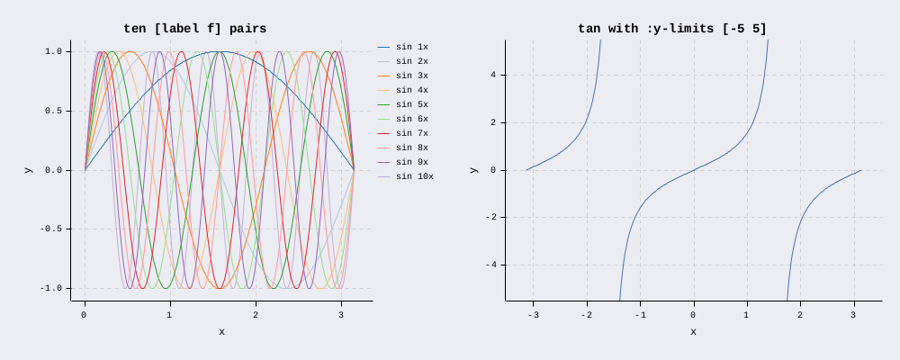
:::


### Parametric curves

`:parametric` - `(fn [t] [x y])` over `:t [lo hi]`, sampled by count; Lissajous figures on an isometric aspect.

Source: [Wikipedia - Lissajous curve](https://en.wikipedia.org/wiki/Lissajous_curve).


::: {.sourceClojure}
```clojure
(plot/render-image
 (plot/arrange
  (vec (for [[a b] [[1 2] [3 2] [3 4] [5 4]]]
         {:aspect :iso
          :charts [(chart/function {:parametric (fn [t] [(m/sin (* a (double t))) (m/sin (* b (double t)))])
                                    :t [0 m/TWO_PI] :sample-step {:count 1000}})]
          :labels {:title (str "a = " a ", b = " b) :x nil :y nil}}))
  {:columns 4})
 {:width 1000 :height 300})
```
:::


::: {.clay-image}

:::


## Caveats


### Cutting the y axis; aspect ratio

Starting y at zero shows changes against the whole; a cut axis magnifies them. A wide panel flattens slopes, a
narrow one steepens them - the same data.

Source: data-to-viz - Cut y axis; Aspect ratio ([1](https://www.data-to-viz.com/caveat/cut_y_axis.html), [2](https://www.data-to-viz.com/caveat/aspect_ratio.html)). Data: US economic time series, 1967-2015, R ggplot2 package `economics` (Federal Reserve Bank of St. Louis, FRED); licence: MIT (ggplot2).


::: {.sourceClojure}
```clojure
(let [recent (filter #(.isAfter ^LocalDate (:date %) (LocalDate/of 2012 1 1)) economics)
      plot-of (fn [title y] {:data recent :mapping {:x :date :y :pop} :scales {:y y}
                             :charts [(chart/line {:width 1.5})] :labels {:title title :x nil :y "population, thousands"}})]
  (plot/render-image
   (plot/arrange [(plot/arrange [(plot-of "y from 0" {:domain [0 330000]}) (plot-of "y cut" {})] {:columns 2})
                  (plot/arrange [(plot-of "wide" {}) (plot-of "narrow" {})] {:columns 2 :widths [4 1]})]
                 {:columns 1})
   {:width 1000 :height 700}))
```
:::


::: {.clay-image}

:::


```{=html}
<div style="background-color:grey;height:2px;width:100%;"></div>
```


```{=html}
<div><pre><small><small>source: notebooks/use_cases/evolution.clj</small></small></pre></div>
```