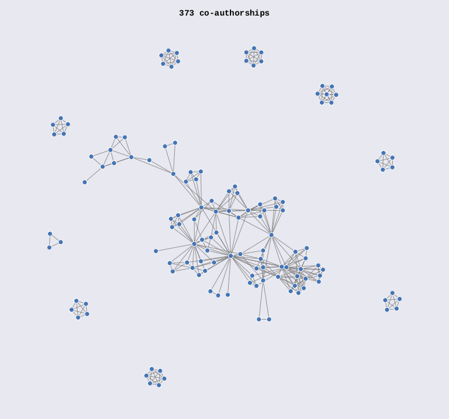
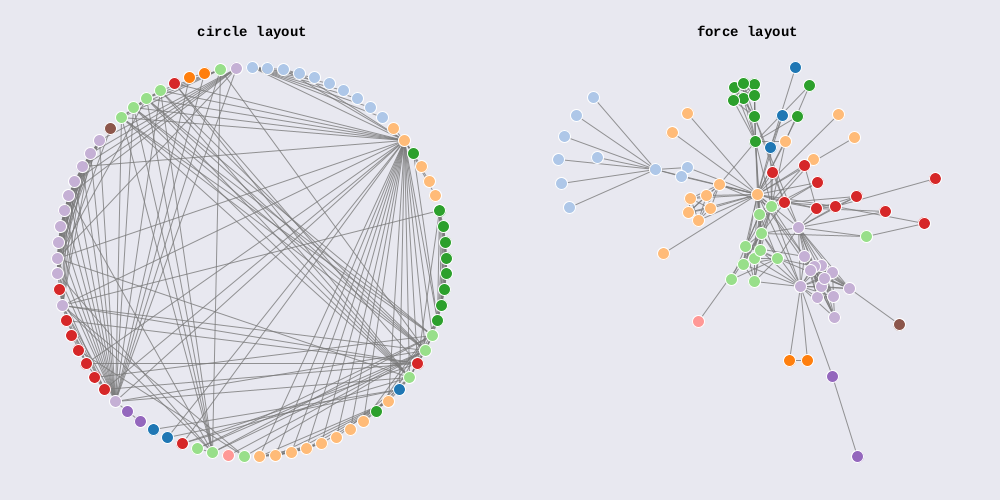
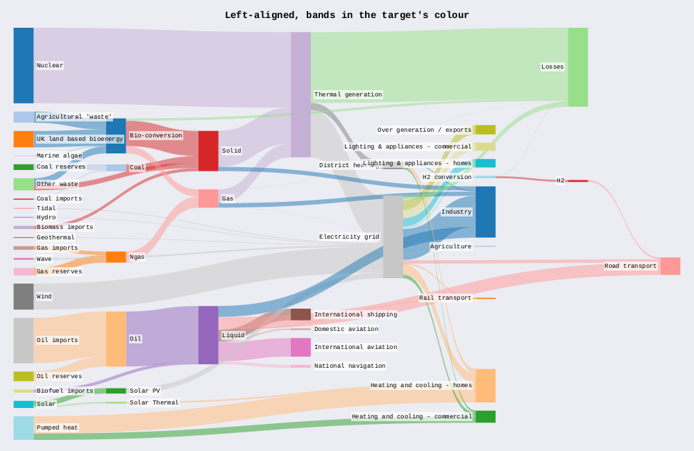
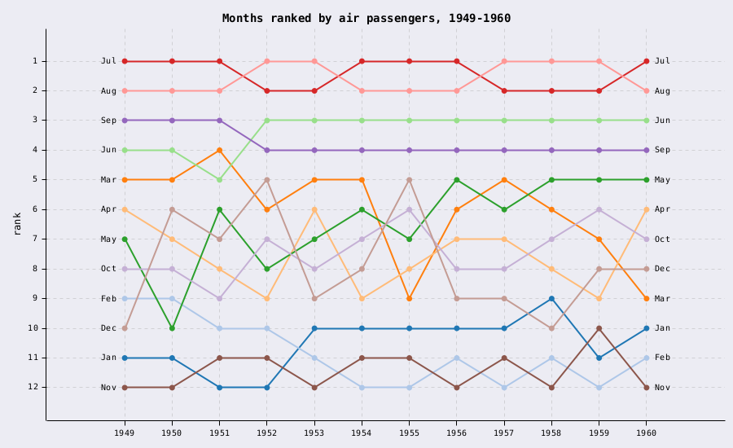
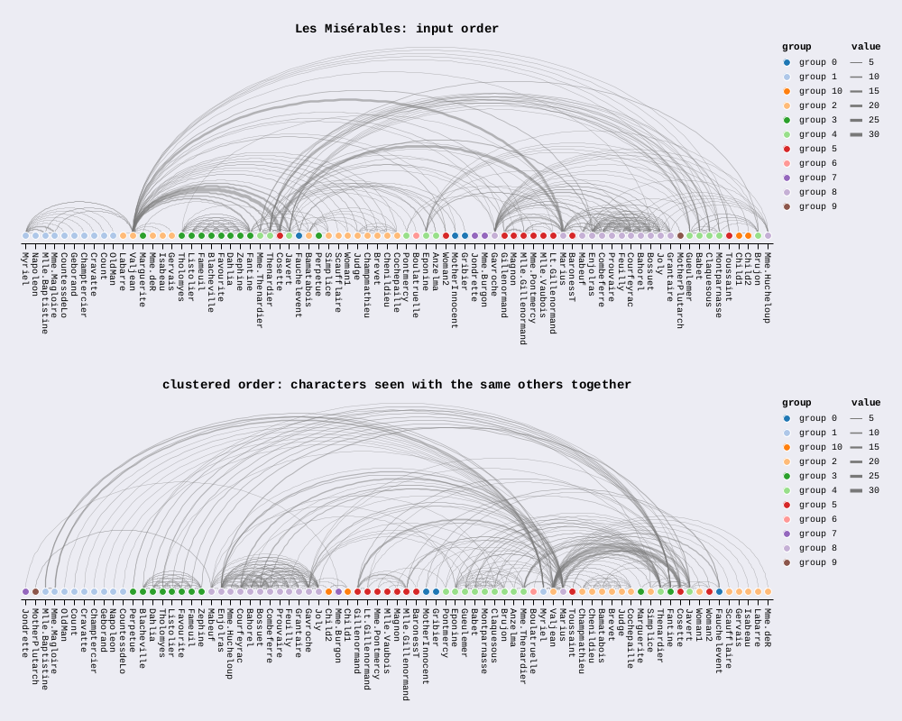
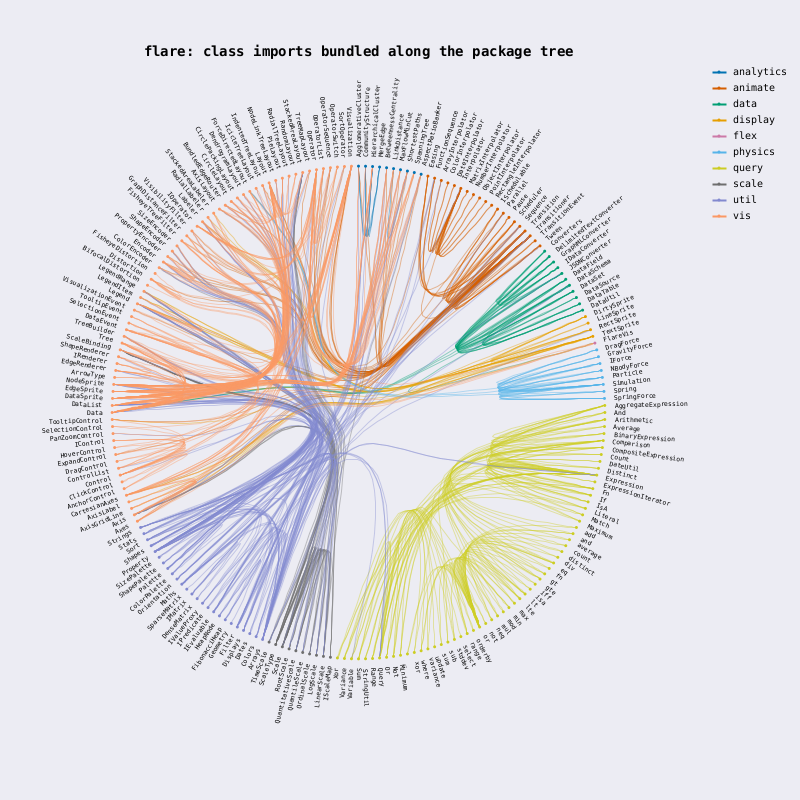
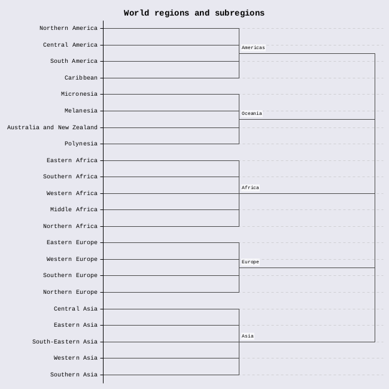
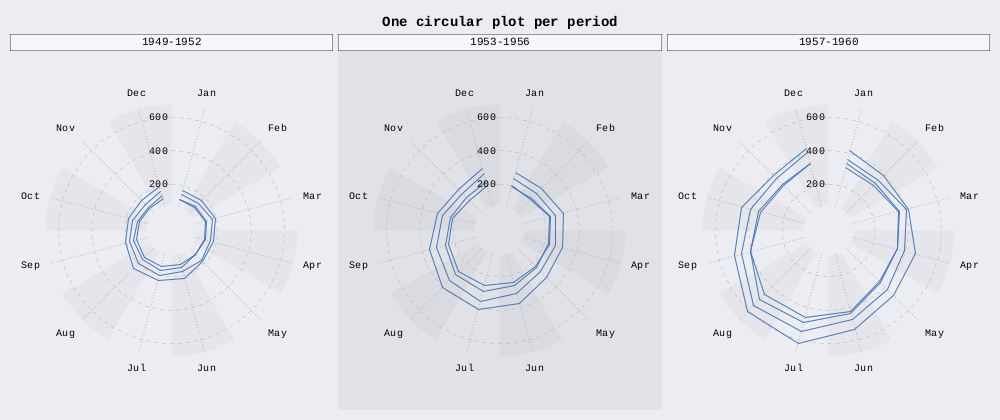

---
format:
  html:
    toc: true
    toc-location: right
    toc-depth: 4
    theme: cosmo
    include-in-header:
      text: |-
        <style>
        .data-table { width: fit-content; max-width: 100%; max-height: 15rem; overflow: auto; margin: 0 auto 1rem; }
        .data-table .table-responsive { overflow: visible; }
        .data-table table { font-size: 0.75rem; width: auto; margin: 0; }
        .data-table th, .data-table td { padding: 0.1rem 0.45rem !important; white-space: nowrap; }
        .data-table thead th { position: sticky; top: 0; background: var(--bs-body-bg, #fff); }
        </style>
code-block-background: true

---
<style></style><style>.printedClojure .sourceCode {
  background-color: transparent;
  border-style: none;
}
</style><style>.clay-limit-image-width .clay-image {max-width: 100%}
.clay-side-by-side .sourceCode {margin: 0}
.clay-side-by-side {margin: 1em 0}
</style>
<script src="https://code.jquery.com/jquery-3.6.0.min.js" type="text/javascript"></script><script src="https://code.jquery.com/ui/1.13.1/jquery-ui.min.js" type="text/javascript"></script>

# Flow

Connections and flows between entities: chord diagrams, networks, sankey and alluvial diagrams, bump charts, arc
diagrams, hierarchical edge bundling, dendrograms, clustered heatmaps, circular plots and flow sunbursts (the
[R Graph Gallery](https://r-graph-gallery.com/) flow pages and [data-to-viz](https://www.data-to-viz.com/)). Every
layout is a function returning rows, drawn by ordinary charts; the `plot/...` builders return plain plot maps.

Not here: interactivity, multi-track circular plots, gradient ribbons and links, cyclic sankeys, crossing
minimization beyond clustering, arcs below the line and label repel.


::: {.sourceClojure}
```clojure
(ns use-cases.flow
  (:require [clojure.string :as str]
            [fastmath.ml.clustering :as cl]
            [fastmath.random :as r]
            [fastmath.stats :as stats]
            [cljplot2.chart :as chart]
            [cljplot2.core :as plot]
            [cljplot2.data.graph :as graph]
            [cljplot2.data.tree :as tree]
            [notebook-utils :as nu]))
```
:::


::: {.sourceClojure}
```clojure
(def migration
  "Flows between regions without the zeros and the diagonal; the file spells some names with dots."
  (let [region #(str/replace % "." " ")]
    (vec (for [{:keys [from to value]} (nu/dataset :migration)
               :when (and (pos? (double value)) (not= (region from) (region to)))]
           {:from (region from) :to (region to) :value value}))))
```
:::


::: {.sourceClojure}
```clojure
(def characters
  (mapv (fn [{:keys [name group]}] {:id name :group (str "group " group)}) (nu/dataset :miserables-characters)))
```
:::


::: {.sourceClojure}
```clojure
(def co-occurrences (nu/dataset :miserables-links))
```
:::


::: {.sourceClojure}
```clojure
(def mtcars (nu/dataset :mtcars))
```
:::


::: {.sourceClojure}
```clojure
(def mtcars-variables [:mpg :cyl :disp :hp :drat :wt :qsec :vs :am :gear :carb])
```
:::


::: {.sourceClojure}
```clojure
(def standardized
  "mtcars columns as z-scores, one row vector per car."
  (let [moments (into {} (for [k mtcars-variables :let [vs (map k mtcars)]] [k [(stats/mean vs) (stats/stddev vs)]]))]
    (mapv (fn [car] (mapv (fn [k] (let [[mu sd] (moments k)] (/ (- (double (k car)) (double mu)) (double sd))))
                          mtcars-variables))
          mtcars)))
```
:::


::: {.sourceClojure}
```clojure
(def air-passengers (nu/dataset :air-passengers))
```
:::


## Chord diagram

Flows between groups around a circle: a ring sector per group, sized by its flow, and a ribbon per link.


### Chord diagram from an edge list

Migration between ten world regions: directed - a ribbon per flow, as wide as the flow at both ends, the sectors
holding the flows out and in - and undirected, a ribbon per pair of regions, as wide as their exchange.

Source: R Graph Gallery - Chord diagram; data-to-viz - Chord diagram ([1](https://r-graph-gallery.com/chord-diagram.html), [2](https://www.data-to-viz.com/graph/chord.html)). Data: Migration flows between world regions, data-to-viz example dataset `13_AdjacencyDirectedWeighted` (long form; Yan Holtz, after Abel & Sander 2014); licence: MIT (data_to_viz repository).


::: {.sourceClojure}
```clojure
(plot/render-image
 (plot/arrange [(plot/chord migration {:directed? true :min-value 0.1 :title "directed flows"})
                (plot/chord migration {:min-value 0.1 :title "exchange between regions"})]
               {:columns 2})
 {:width 1000 :height 520})
```
:::


::: {.clay-image}

:::


### Colours, gaps, order and weak links

`:min-value` drops the weak flows that clutter the middle, `:pad` widens the gaps, `:order :cluster` puts regions
with similar partners side by side, and the palette is a plot scale like any other.

Source: R Graph Gallery - Advanced chord diagram with circlize; data-to-viz - Chord diagram ([1](https://r-graph-gallery.com/123-circular-plot-circlize-package-2.html), [2](https://www.data-to-viz.com/graph/chord.html)). Data: Migration flows between world regions, data-to-viz example dataset `13_AdjacencyDirectedWeighted` (long form; Yan Holtz, after Abel & Sander 2014); licence: MIT (data_to_viz repository).


::: {.sourceClojure}
```clojure
(plot/render-image
 (plot/chord migration {:directed? true :min-value 0.5 :pad 4 :order :cluster
                        :scales {:color {:range :category10}}
                        :title "Flows of at least 0.5 million, clustered order"})
 {:width 700 :height 700})
```
:::


::: {.clay-image}

:::


## Network

Nodes and the edges between them, placed by a layout; colour, size and width carry node and edge variables.


### From an adjacency table

Co-authorships between researchers come as a table - a row per author, a column per author, 1 for a joint paper.
The table isn't square, so its cells become edge rows directly (`graph/adjacency->edges` reads square matrices,
see the correlation network below); the force layout places them, seeded for a stable picture. Groups of authors
without joint papers between them are laid out apart and packed in rows, the largest first.

Source: R Graph Gallery - Input formats for network charts; data-to-viz - Network ([1](https://r-graph-gallery.com/257-input-formats-for-network-charts.html), [2](https://www.data-to-viz.com/graph/network.html)). Data: Co-authorships between researchers, data-to-viz example dataset `13_AdjacencyUndirectedUnweighted` (Yan Holtz); licence: MIT (data_to_viz repository).


::: {.sourceClojure}
```clojure
(def coauthor-edges
  "One edge per co-author pair (the table lists some pairs both ways)."
  (->> (nu/dataset :coauthors)
       (mapcat (fn [{:keys [from] :as row}]
                 (for [[k v] (dissoc row :from) :when (= 1 v)] (vec (sort [from (name k)])))))
       (remove (fn [[a b]] (= a b)))
       (distinct)
       (mapv (fn [[a b]] {:from a :to b}))))
```
:::


::: {.sourceClojure}
```clojure
(plot/render-image
 (plot/network coauthor-edges {:rng (r/rng :mersenne 11) :node-style {:size 8}
                               :title (str (count coauthor-edges) " co-authorships")})
 {:width 750 :height 700})
```
:::


::: {.clay-image}

:::


### Layouts

The same graph on a circle and with the Fruchterman-Reingold force layout: groups of characters that appear
together only come out of the force layout.

Source: R Graph Gallery - Network layouts; data-to-viz - Network ([1](https://r-graph-gallery.com/247-network-chart-layouts.html), [2](https://www.data-to-viz.com/graph/network.html)). Data: Les Misérables character co-occurrences, vega-datasets `miserables.json` (D. E. Knuth, The Stanford GraphBase, 1993); licence: Not specified (vega-datasets lists it as notspecified).


::: {.sourceClojure}
```clojure
(plot/render-image
 (plot/arrange (vec (for [[layout title] [[:circle "circle layout"] [:force "force layout"]]]
                      (plot/network co-occurrences {:nodes characters :layout layout :rng (r/rng :mersenne 3)
                                                    :mapping {:color :group} :scales {:color {:legend false}}
                                                    :title title})))
               {:columns 2})
 {:width 1000 :height 500})
```
:::


::: {.clay-image}

:::


### Node colour, size by degree

Nodes coloured by their group and sized by their number of links (`:degree`, computed with the graph); labels for
the main characters. One size scale serves one variable, so edge widths (below, for migration flows) and node
sizes don't go together.

Source: R Graph Gallery - igraph plotting parameters, map a colour, node size by edges number ([1](https://r-graph-gallery.com/248-igraph-plotting-parameters.html), [2](https://r-graph-gallery.com/249-igraph-network-map-a-color.html), [3](https://r-graph-gallery.com/251-network-with-node-size-based-on-edges-number.html)). Data: Les Misérables character co-occurrences, vega-datasets `miserables.json` (D. E. Knuth, The Stanford GraphBase, 1993); licence: Not specified (vega-datasets lists it as notspecified).


::: {.sourceClojure}
```clojure
(plot/render-image
 (plot/network co-occurrences {:nodes characters :rng (r/rng :mersenne 3)
                               :mapping {:color :group :size :degree}
                               :scales {:size {:title "links"}}
                               :labels #(when (>= (long (:degree %)) 10) (:id %))
                               :title "Les Misérables: characters appearing together"})
 {:width 900 :height 750})
```
:::


::: {.clay-image}

:::


### Correlation network

Variables linked when their correlation is strong (|r| > 0.7): the matrix becomes edges with
`graph/adjacency->edges`, the weight is |r| and the colour its sign.

Source: [R Graph Gallery - Correlation network with igraph](https://r-graph-gallery.com/250-correlation-network-with-igraph.html). Data: Motor Trend car road tests (1974), R datasets package `mtcars` (Henderson & Velleman 1981); licence: Part of R (GPL-2 | GPL-3).


::: {.sourceClojure}
```clojure
(def correlation-edges
  (let [names (mapv name mtcars-variables)
        r (stats/correlation-matrix (mapv (fn [k] (mapv k mtcars)) mtcars-variables))
        strong (mapv (fn [row] (mapv #(if (> (Math/abs (double %)) 0.7) % 0) row)) r)]
    (mapv #(assoc % :r (:value %) :value (Math/abs (double (:value %))))
          (graph/adjacency->edges strong names {:directed? false}))))
```
:::


::: {.sourceClojure}
```clojure
(plot/render-image
 (plot/network correlation-edges {:nodes (mapv (fn [k] {:id (name k)}) mtcars-variables) :rng (r/rng :mersenne 5)
                                  :labels true
                                  :edge-mapping {:color #(if (pos? (double (:r %))) "positive" "negative")}
                                  :scales {:color {:range {"positive" [33 102 172] "negative" [178 24 43]} :title "r"}}
                                  :title "mtcars variables with |r| > 0.7"})
 {:width 700 :height 600})
```
:::


::: {.clay-image}

:::


### Directed, weighted edges

Migration flows as arrows ending at the target's edge, edge widths from the flows' size scale.

Source: [data-to-viz - Network](https://www.data-to-viz.com/graph/network.html). Data: Migration flows between world regions, data-to-viz example dataset `13_AdjacencyDirectedWeighted` (long form; Yan Holtz, after Abel & Sander 2014); licence: MIT (data_to_viz repository).


::: {.sourceClojure}
```clojure
(plot/render-image
 (plot/network migration {:directed? true :layout :circle :labels true
                          :edge-mapping {:size :value}
                          :scales {:size {:range [0.5 6] :title "migrants, M"}}
                          :title "Migration between world regions"})
 {:width 750 :height 650})
```
:::


::: {.clay-image}

:::


## Sankey

Flows through stages: nodes in columns, as tall as their flow, bands between them as wide as the flow.


### Sankey diagram, node and link colours

The UK energy flows of a 2050 scenario: sources on the left, uses on the right (`:align :justify`, the default),
bands in their source's colour; then every node as far left as it can go, bands in their target's colour.

Source: R Graph Gallery - Sankey diagram with networkD3, custom colours; data-to-viz - Sankey ([1](https://r-graph-gallery.com/323-sankey-diagram-with-the-networkd3-library.html), [2](https://r-graph-gallery.com/322-custom-colours-in-sankey-diagram.html), [3](https://www.data-to-viz.com/graph/sankey.html)). Data: UK energy flows in 2050 (a DECC scenario), networkD3 `JSONdata/energy.json` (the d3 sankey example; UK Department of Energy & Climate Change 2050 Calculator); licence: networkD3 is GPL-3; the data's licence isn't stated.


::: {.sourceClojure}
```clojure
(def energy-flows (nu/dataset :energy))
```
:::


::: {.sourceClojure}
```clojure
(plot/render-image
 (plot/sankey energy-flows {:title "UK energy flows in 2050 (TWh)"})
 {:width 1000 :height 650})
```
:::


::: {.clay-image}

:::


::: {.sourceClojure}
```clojure
(plot/render-image
 (plot/sankey energy-flows {:align :left :link-color :target :title "Left-aligned, bands in the target's colour"})
 {:width 1000 :height 650})
```
:::


::: {.clay-image}

:::


### Alluvial diagram

A column per variable, a stratum per level and strands between neighbouring columns, coloured by the class all
the way through.

Source: [R Graph Gallery - Sankey diagram (alluvial section)](https://r-graph-gallery.com/sankey-diagram.html). Data: Titanic passengers and crew by class, sex, age and survival, R datasets package `Titanic` (Dawson 1995); licence: Part of R (GPL-2 | GPL-3).


::: {.sourceClojure}
```clojure
(plot/render-image
 (plot/alluvial (nu/dataset :titanic) {:axes [:class :sex :age :survived] :value :n :fill :class
                                       :theme {:palette {:color :set1}}
                                       :title "Titanic: 2201 people by class, sex, age and survival"})
 {:width 900 :height 600})
```
:::


::: {.clay-image}

:::


### Bump chart

Ranks over time: the months ranked by passengers within each year. The summer months climb to the top as air
travel grows; November stays near the bottom.

Source: [R Graph Gallery - Sankey diagram (bump chart section)](https://r-graph-gallery.com/sankey-diagram.html). Data: Monthly airline passengers, 1949-1960, R datasets package `AirPassengers` (Box & Jenkins 1976); licence: Part of R (GPL-2 | GPL-3).


::: {.sourceClojure}
```clojure
(def month-ranks
  (vec (for [[year rows] (group-by :year air-passengers)
             [rank row] (map-indexed vector (sort-by :passengers > rows))]
         (assoc row :rank (inc rank)))))
```
:::


::: {.sourceClojure}
```clojure
(plot/render-image
 {:data month-ranks :mapping {:x :year :y :rank :color :month}
  :charts [(chart/line {:width 2})
           (chart/scatter {:size 7})
           (chart/text {:data (filter #(= 1949 (:year %)) month-ranks) :mapping {:x :year :y :rank :label :month}
                        :anchor [:right :middle] :offset [-8 0]})
           (chart/text {:data (filter #(= 1960 (:year %)) month-ranks) :mapping {:x :year :y :rank :label :month}
                        :anchor [:left :middle] :offset [8 0]})]
  :scales {:y {:domain [12.5 0.5] :nice false :ticks (vec (range 1 13))}
           :x {:domain [1948 1961] :nice false :ticks (vec (range 1949 1961))}
           :color {:domain ["Jan" "Feb" "Mar" "Apr" "May" "Jun" "Jul" "Aug" "Sep" "Oct" "Nov" "Dec"]
                   :range :category20 :legend false}}
  :labels {:title "Months ranked by air passengers, 1949-1960" :x nil :y "rank"}}
 {:width 900 :height 550})
```
:::


::: {.clay-image}

:::


## Arc diagram

Nodes on a line, every link a semicircle above it: readable when the order puts linked nodes close together.

Source: [data-to-viz - Arc diagram](https://www.data-to-viz.com/graph/arc.html). Data: Les Misérables character co-occurrences, vega-datasets `miserables.json` (D. E. Knuth, The Stanford GraphBase, 1993); licence: Not specified (vega-datasets lists it as notspecified).


::: {.sourceClojure}
```clojure
(plot/render-image
 (plot/arrange [(plot/arc co-occurrences {:nodes characters :mapping {:color :group}
                                          :title "Les Misérables: input order"})
                (plot/arc co-occurrences {:nodes characters :mapping {:color :group} :order :cluster
                                          :title "clustered order: characters seen with the same others together"})]
               {:columns 1})
 {:width 1000 :height 800})
```
:::


::: {.clay-image}

:::


## Edge bundling

Links between the leaves of a hierarchy routed along it: the bundles show which packages depend on which.


### Hierarchical edge bundling

The classes of the flare library around a circle, grouped by package, each import a curve through the package
tree, coloured by the importing class's top-level package.

Source: R Graph Gallery - Hierarchical edge bundling, custom, labels; data-to-viz - Edge bundling ([1](https://r-graph-gallery.com/309-intro-to-hierarchical-edge-bundling.html), [2](https://r-graph-gallery.com/310-custom-hierarchical-edge-bundling.html), [3](https://r-graph-gallery.com/311-add-labels-to-hierarchical-edge-bundling.html), [4](https://www.data-to-viz.com/graph/edge_bundling.html)). Data: Flare visualization toolkit class hierarchy, vega-datasets `flare.json` (the Flare ActionScript library's packages and classes); licence: Not documented.


::: {.sourceClojure}
```clojure
(def flare-tree (tree/from-parents (nu/dataset :flare) {:name :name}))
```
:::


::: {.sourceClojure}
```clojure
(def flare-imports (nu/dataset :flare-dependencies))
```
:::


::: {.sourceClojure}
```clojure
(plot/render-image
 (plot/bundle flare-imports flare-tree {:from :source :to :target
                                        :title "flare: class imports bundled along the package tree"})
 {:width 800 :height 800})
```
:::


::: {.clay-image}

:::


### Bundling strength

`:beta` straightens the curves: 0 draws straight lines, 1 follows the tree exactly.

Source: [R Graph Gallery - Custom hierarchical edge bundling](https://r-graph-gallery.com/310-custom-hierarchical-edge-bundling.html). Data: Flare visualization toolkit class hierarchy, vega-datasets `flare.json` (the Flare ActionScript library's packages and classes); licence: Not documented.


::: {.sourceClojure}
```clojure
(plot/render-image
 (plot/arrange (vec (for [beta [0.0 0.5 1.0]]
                      (plot/bundle flare-imports flare-tree {:from :source :to :target :beta beta :labels? false
                                                             :scales {:color {:legend false}}
                                                             :title (str ":beta " beta)})))
               {:columns 3})
 {:width 1000 :height 380})
```
:::


::: {.clay-image}

:::


## Dendrogram

A hierarchy as a tree of branches: from data with levels, or from hierarchical clustering, where the height of a
merge is the distance between the groups.


### From hierarchical data

World regions and their subregions, the tree drawn from the levels of the rows.

Source: R Graph Gallery - Dendrogram with ggraph; data-to-viz - Dendrogram ([1](https://r-graph-gallery.com/334-basic-dendrogram-with-ggraph.html), [2](https://www.data-to-viz.com/graph/dendrogram.html)). Data: World population by region, subregion and country, data-to-viz example dataset `11_SevCatOneNumNestedOneObsPerGroup` (Yan Holtz; Wikipedia); licence: MIT (data_to_viz repository).


::: {.sourceClojure}
```clojure
(plot/render-image
 (plot/dendrogram (tree/from-levels (nu/dataset :world-population) {:hierarchy [:region :subregion]})
                  {:horizontal true :group-labels? true :title "World regions and subregions"})
 {:width 650 :height 650})
```
:::


::: {.clay-image}

:::


### From clustering, coloured clusters, circular

Complete-linkage clustering of the standardized cars (fastmath `hclust`), cut into 3 clusters; the same tree
around a circle.

Source: R Graph Gallery - Basic dendrogram, custom colours, circular dendrogram, dendextend ([1](https://r-graph-gallery.com/29-basic-dendrogram.html), [2](https://r-graph-gallery.com/31-custom-colors-in-dendrogram.html), [3](https://r-graph-gallery.com/339-circular-dendrogram-with-ggraph.html), [4](https://r-graph-gallery.com/340-custom-your-dendrogram-with-dendextend.html)). Data: Motor Trend car road tests (1974), R datasets package `mtcars` (Henderson & Velleman 1981); licence: Part of R (GPL-2 | GPL-3).


::: {.sourceClojure}
```clojure
(def car-clustering (cl/hclust standardized {:method :complete}))
```
:::


::: {.sourceClojure}
```clojure
(def cars (mapv :model mtcars))
```
:::


::: {.sourceClojure}
```clojure
(plot/render-image
 (plot/dendrogram car-clustering {:labels cars :k 3 :theme {:palette {:color :set1}}
                                  :title "mtcars: complete-linkage clustering, 3 clusters"})
 {:width 1000 :height 500})
```
:::


::: {.clay-image}

:::


::: {.sourceClojure}
```clojure
(plot/render-image
 (plot/dendrogram car-clustering {:labels cars :k 3 :circular true :theme {:palette {:color :set1}}
                                  :title "The same clustering, circular"})
 {:width 700 :height 700})
```
:::


::: {.clay-image}

:::


## Clustered heatmap

Rows and columns of a heatmap ordered by clustering, their dendrograms beside it: similar cars and similar
variables come together.

Source: [R Graph Gallery - The heatmap function](https://r-graph-gallery.com/215-the-heatmap-function.html). Data: Motor Trend car road tests (1974), R datasets package `mtcars` (Henderson & Velleman 1981); licence: Part of R (GPL-2 | GPL-3).


::: {.sourceClojure}
```clojure
(plot/render-image
 (plot/clustered-heatmap (vec (for [[car row] (map vector cars standardized) [k v] (map vector mtcars-variables row)]
                                {:car car :variable (name k) :z v}))
                         {:row :car :col :variable :value :z
                          :scales {:color {:range :RColorBrewer/RdBu :midpoint 0 :reverse true :title "z-score"}}
                          :title "mtcars: cars and variables ordered by clustering"})
 {:width 900 :height 800})
```
:::


::: {.clay-image}

:::


## Circular plots

Ordinary charts in polar coordinates: the angle runs along a variable, the radius along another; `:start`,
`:direction`, `:inner` and `:span` shape the circle.


### Basic, customised, part of the circle

Air passengers by month around the circle, a ring per year: the default circle, then a hole, a start at 3 o'clock
counter-clockwise, and half a circle.

Source: R Graph Gallery - Basic circular plot, custom a track, part of the circular plot ([1](https://r-graph-gallery.com/224-basic-circular-plot.html), [2](https://r-graph-gallery.com/225-circular-plot-custom-a-track.html), [3](https://r-graph-gallery.com/230-draw-part-of-the-circular-plot-only.html)). Data: Monthly airline passengers, 1949-1960, R datasets package `AirPassengers` (Box & Jenkins 1976); licence: Part of R (GPL-2 | GPL-3).


::: {.sourceClojure}
```clojure
(def months ["Jan" "Feb" "Mar" "Apr" "May" "Jun" "Jul" "Aug" "Sep" "Oct" "Nov" "Dec"])
```
:::


::: {.sourceClojure}
```clojure
(plot/render-image
 (plot/arrange (vec (for [[coord title] [[{:kind :polar} "default"]
                                         [{:kind :polar :inner 0.3 :start 90 :direction :counter-clockwise} "hole, start, direction"]
                                         [{:kind :polar :span 180 :start -90} "half a circle"]]]
                      {:data air-passengers :mapping {:x :month :y :passengers :color :year}
                       :charts [(chart/scatter {:size 5})]
                       :coord coord
                       :scales {:x {:domain months}}
                       :legend false
                       :labels {:title title :x nil :y nil}}))
               {:columns 3})
 {:width 1000 :height 400})
```
:::


::: {.clay-image}

:::


### Chart types, several plots

Points, a line per year and bars of the monthly totals in the same circle, and one circular plot per period.

Source: R Graph Gallery - Plot types for circular plot, several circular plots in a figure ([1](https://r-graph-gallery.com/226-plot-types-for-circular-plot.html), [2](https://r-graph-gallery.com/229-several-circular-plots-in-a-figure.html)). Data: Monthly airline passengers, 1949-1960, R datasets package `AirPassengers` (Box & Jenkins 1976); licence: Part of R (GPL-2 | GPL-3).


::: {.sourceClojure}
```clojure
(def periods
  (mapv #(assoc % :period (cond (<= (long (:year %)) 1952) "1949-1952" (<= (long (:year %)) 1956) "1953-1956" :else "1957-1960"))
        air-passengers))
```
:::


::: {.sourceClojure}
```clojure
(plot/render-image
 (plot/arrange
  [{:data air-passengers :mapping {:x :month :y :passengers}
    :charts [(chart/scatter {:size 4})] :coord {:kind :polar :inner 0.2} :scales {:x {:domain months}}
    :labels {:title "points" :x nil :y nil}}
   {:data air-passengers :mapping {:x :month :y :passengers :group :year}
    :charts [(chart/line {:sort false :color [70 130 180 150]})] :coord {:kind :polar :inner 0.2} :scales {:x {:domain months}}
    :labels {:title "a line per year" :x nil :y nil}}
   {:data air-passengers :mapping {:x :month :y :passengers}
    :charts [(chart/bar {:stat :sum})] :coord {:kind :polar :inner 0.2} :scales {:x {:domain months}}
    :labels {:title "bars: monthly totals" :x nil :y nil}}]
  {:columns 3})
 {:width 1000 :height 400})
```
:::


::: {.clay-image}

:::


::: {.sourceClojure}
```clojure
(plot/render-image
 {:data periods :mapping {:x :month :y :passengers :group :year :facet :period}
  :charts [(chart/line {:sort false})]
  :coord {:kind :polar :inner 0.2}
  :scales {:x {:domain months}}
  :labels {:title "One circular plot per period" :x nil :y nil}}
 {:width 1000 :height 420})
```
:::


::: {.clay-image}

:::


## Flow sunburst

Sequences of steps (website visits, here 2000 synthetic sessions) as rings from the centre: every step coloured by
its page wherever it occurs, `end` where a session stops.

Source: [data-to-viz - Sunburst](https://www.data-to-viz.com/graph/sunburst.html).


::: {.sourceClojure}
```clojure
(def pages ["home" "search" "product" "account" "cart" "help"])
```
:::


::: {.sourceClojure}
```clojure
(def visits
  "2000 sessions starting at home: each step to another page or the end (more likely the longer the session), at
  most 6 pages; a seeded random walk."
  (let [g (r/rng :mersenne 7)
        weights {"home" [0 5 3 2 0 1] "search" [1 2 6 0 1 1] "product" [1 2 2 1 4 1]
                 "account" [2 0 1 1 1 2] "cart" [0 0 2 2 0 1] "help" [2 2 0 2 0 1]}
        pick (fn [ws] (let [total (double (reduce + ws)) u (* total (r/drandom g))]
                        (loop [i 0 acc 0.0]
                          (let [acc (+ acc (double (ws i)))]
                            (if (or (< u acc) (= i (dec (count ws)))) i (recur (inc i) acc))))))]
    (vec (for [_ (range 2000)]
           {:sequence (str/join "-" (loop [path ["home"]]
                                      (if (or (= 6 (count path)) (< (r/drandom g) (* 0.12 (count path))))
                                        (conj path "end")
                                        (recur (conj path (pages (pick (weights (peek path)))))))))}))))
```
:::


::: {.sourceClojure}
```clojure
(plot/render-image
 (plot/sequences visits {:scales {:color {:domain (conj pages "end")}}
                         :title "2000 website visits: pages in order from the centre"})
 {:width 700 :height 650})
```
:::


::: {.clay-image}

:::


## Caveats


- A network of many nodes and links becomes a hairball: filter weak links, or show the graph as an arc diagram or
  an adjacency heatmap instead.

- Order changes the reading of chord and arc diagrams: `:order :cluster` puts nodes with the same partners
  together; input order may scatter them.

- Weak links clutter chord and sankey diagrams; `:min-value` leaves them out (and the layout says how many).
- Sankey diagrams show flows that go one way: a flow back to an earlier node is a cycle the layout refuses.
- Widths and areas encode values: a band twice as wide is twice the flow, a sector twice as long twice the total.

Source: data-to-viz - Caveats: spaghetti plot, order your data ([1](https://www.data-to-viz.com/caveat/spaghetti.html), [2](https://www.data-to-viz.com/caveat/order_data.html)).


```{=html}
<div style="background-color:grey;height:2px;width:100%;"></div>
```


```{=html}
<div><pre><small><small>source: notebooks/use_cases/flow.clj</small></small></pre></div>
```