---
format:
  html:
    toc: true
    toc-location: right
    toc-depth: 4
    theme: cosmo
    include-in-header:
      text: |-
        <style>
        .data-table { width: fit-content; max-width: 100%; max-height: 15rem; overflow: auto; margin: 0 0 1rem 0; }
        .data-table .table-responsive { overflow: visible; }
        .data-table table { font-size: 0.75rem; width: auto; margin: 0; }
        .data-table th, .data-table td { padding: 0.1rem 0.45rem !important; white-space: nowrap; }
        .data-table thead th { position: sticky; top: 0; background: var(--bs-body-bg, #fff); }
        </style>
code-block-background: true

---
<style></style><style>.printedClojure .sourceCode {
  background-color: transparent;
  border-style: none;
}
</style><style>.clay-limit-image-width .clay-image {max-width: 100%}
.clay-side-by-side .sourceCode {margin: 0}
.clay-side-by-side {margin: 1em 0}
</style>
<script src="https://code.jquery.com/jquery-3.6.0.min.js" type="text/javascript"></script><script src="https://code.jquery.com/ui/1.13.1/jquery-ui.min.js" type="text/javascript"></script>

# Flow

Connections and flows between entities: chord diagrams, networks, sankey and alluvial diagrams, bump charts, arc
diagrams, hierarchical edge bundling, dendrograms, clustered heatmaps, circular plots and flow sunbursts (the
[R Graph Gallery](https://r-graph-gallery.com/) flow pages and [data-to-viz](https://www.data-to-viz.com/)). Every
layout is a function returning rows, drawn by ordinary charts; the `plot/...` builders return plain plot maps.

Not here: interactivity, multi-track circular plots, gradient ribbons and links, cyclic sankeys, crossing
minimization beyond clustering, arcs below the line and label repel.


::: {.sourceClojure}
```clojure
(ns use-cases.flow
  (:require [clojure.string :as str]
            [fastmath.ml.clustering :as cl]
            [fastmath.random :as r]
            [fastmath.stats :as stats]
            [cljplot2.chart :as chart]
            [cljplot2.core :as plot]
            [cljplot2.data.graph :as graph]
            [cljplot2.data.tree :as tree]
            [notebook-utils :as nu]))
```
:::


::: {.sourceClojure}
```clojure
(def migration
  "Flows between regions without the zeros and the diagonal; the file spells some names with dots."
  (let [region #(str/replace % "." " ")]
    (vec (for [{:keys [from to value]} (nu/dataset :migration)
               :when (and (pos? (double value)) (not= (region from) (region to)))]
           {:from (region from) :to (region to) :value value}))))
```
:::


```{=html}
<div class="data-table"><table class="table table-hover table-responsive clay-table"><thead><tr><th>from</th><th>to</th><th>value</th></tr></thead><tbody><tr><td>South Asia</td><td>East Asia</td><td>0.525881</td></tr><tr><td>South East Asia</td><td>East Asia</td><td>0.145264</td></tr><tr><td>Africa</td><td>Europe</td><td>2.107883</td></tr><tr><td>East Asia</td><td>Europe</td><td>0.601265</td></tr><tr><td>Latin America</td><td>Europe</td><td>1.762587</td></tr><tr><td>North America</td><td>Europe</td><td>1.215929</td></tr><tr><td>Oceania</td><td>Europe</td><td>0.17037</td></tr><tr><td>South Asia</td><td>Europe</td><td>1.390272</td></tr><tr><td>South East Asia</td><td>Europe</td><td>0.468762</td></tr><tr><td>Soviet Union</td><td>Europe</td><td>0.60923</td></tr><tr><td>West Asia</td><td>Europe</td><td>0.449623</td></tr><tr><td>North America</td><td>Latin America</td><td>0.276908</td></tr><tr><td>Africa</td><td>North America</td><td>0.540887</td></tr><tr><td>East Asia</td><td>North America</td><td>0.97306</td></tr><tr><td>Latin America</td><td>North America</td><td>3.627847</td></tr><tr><td>South Asia</td><td>North America</td><td>1.508008</td></tr><tr><td>South East Asia</td><td>North America</td><td>1.057904</td></tr><tr><td>West Asia</td><td>North America</td><td>0.169274</td></tr><tr><td>Africa</td><td>Oceania</td><td>0.155988</td></tr><tr><td>East Asia</td><td>Oceania</td><td>0.333608</td></tr><tr><td>South Asia</td><td>Oceania</td><td>0.34742</td></tr><tr><td>South East Asia</td><td>Oceania</td><td>0.278746</td></tr><tr><td>East Asia</td><td>South East Asia</td><td>0.380388</td></tr><tr><td>Africa</td><td>West Asia</td><td>0.673004</td></tr><tr><td>East Asia</td><td>West Asia</td><td>0.869311</td></tr><tr><td>South Asia</td><td>West Asia</td><td>4.902081</td></tr></tbody></table></div>
```


::: {.sourceClojure}
```clojure
(def characters
  (mapv (fn [{:keys [name group]}] {:id name :group (str "group " group)}) (nu/dataset :miserables-characters)))
```
:::


```{=html}
<div class="data-table"><table class="table table-hover table-responsive clay-table"><thead><tr><th>id</th><th>group</th></tr></thead><tbody><tr><td>Myriel</td><td>group 1</td></tr><tr><td>Napoleon</td><td>group 1</td></tr><tr><td>Mlle.Baptistine</td><td>group 1</td></tr><tr><td>Mme.Magloire</td><td>group 1</td></tr><tr><td>CountessdeLo</td><td>group 1</td></tr><tr><td>Geborand</td><td>group 1</td></tr><tr><td>Champtercier</td><td>group 1</td></tr><tr><td>Cravatte</td><td>group 1</td></tr><tr><td>Count</td><td>group 1</td></tr><tr><td>OldMan</td><td>group 1</td></tr><tr><td>Labarre</td><td>group 2</td></tr><tr><td>Valjean</td><td>group 2</td></tr><tr><td>Marguerite</td><td>group 3</td></tr><tr><td>Mme.deR</td><td>group 2</td></tr><tr><td>Isabeau</td><td>group 2</td></tr><tr><td>Gervais</td><td>group 2</td></tr><tr><td>Tholomyes</td><td>group 3</td></tr><tr><td>Listolier</td><td>group 3</td></tr><tr><td>Fameuil</td><td>group 3</td></tr><tr><td>Blacheville</td><td>group 3</td></tr><tr><td>Favourite</td><td>group 3</td></tr><tr><td>Dahlia</td><td>group 3</td></tr><tr><td>Zephine</td><td>group 3</td></tr><tr><td>Fantine</td><td>group 3</td></tr><tr><td>Mme.Thenardier</td><td>group 4</td></tr><tr><td>Thenardier</td><td>group 4</td></tr><tr><td>Cosette</td><td>group 5</td></tr><tr><td>Javert</td><td>group 4</td></tr><tr><td>Fauchelevent</td><td>group 0</td></tr><tr><td>Bamatabois</td><td>group 2</td></tr><tr><td>Perpetue</td><td>group 3</td></tr><tr><td>Simplice</td><td>group 2</td></tr><tr><td>Scaufflaire</td><td>group 2</td></tr><tr><td>Woman1</td><td>group 2</td></tr><tr><td>Judge</td><td>group 2</td></tr><tr><td>Champmathieu</td><td>group 2</td></tr><tr><td>Brevet</td><td>group 2</td></tr><tr><td>Chenildieu</td><td>group 2</td></tr><tr><td>Cochepaille</td><td>group 2</td></tr><tr><td>Pontmercy</td><td>group 4</td></tr><tr><td>Boulatruelle</td><td>group 6</td></tr><tr><td>Eponine</td><td>group 4</td></tr><tr><td>Anzelma</td><td>group 4</td></tr><tr><td>Woman2</td><td>group 5</td></tr><tr><td>MotherInnocent</td><td>group 0</td></tr><tr><td>Gribier</td><td>group 0</td></tr><tr><td>Jondrette</td><td>group 7</td></tr><tr><td>Mme.Burgon</td><td>group 7</td></tr><tr><td>Gavroche</td><td>group 8</td></tr><tr><td>Gillenormand</td><td>group 5</td></tr><tr><td>Magnon</td><td>group 5</td></tr><tr><td>Mlle.Gillenormand</td><td>group 5</td></tr><tr><td>Mme.Pontmercy</td><td>group 5</td></tr><tr><td>Mlle.Vaubois</td><td>group 5</td></tr><tr><td>Lt.Gillenormand</td><td>group 5</td></tr><tr><td>Marius</td><td>group 8</td></tr><tr><td>BaronessT</td><td>group 5</td></tr><tr><td>Mabeuf</td><td>group 8</td></tr><tr><td>Enjolras</td><td>group 8</td></tr><tr><td>Combeferre</td><td>group 8</td></tr><tr><td>Prouvaire</td><td>group 8</td></tr><tr><td>Feuilly</td><td>group 8</td></tr><tr><td>Courfeyrac</td><td>group 8</td></tr><tr><td>Bahorel</td><td>group 8</td></tr><tr><td>Bossuet</td><td>group 8</td></tr><tr><td>Joly</td><td>group 8</td></tr><tr><td>Grantaire</td><td>group 8</td></tr><tr><td>MotherPlutarch</td><td>group 9</td></tr><tr><td>Gueulemer</td><td>group 4</td></tr><tr><td>Babet</td><td>group 4</td></tr><tr><td>Claquesous</td><td>group 4</td></tr><tr><td>Montparnasse</td><td>group 4</td></tr><tr><td>Toussaint</td><td>group 5</td></tr><tr><td>Child1</td><td>group 10</td></tr><tr><td>Child2</td><td>group 10</td></tr><tr><td>Brujon</td><td>group 4</td></tr><tr><td>Mme.Hucheloup</td><td>group 8</td></tr></tbody></table></div>
```


::: {.sourceClojure}
```clojure
(def co-occurrences (nu/dataset :miserables-links))
```
:::


```{=html}
<div class="data-table"><table class="table table-hover table-responsive clay-table"><thead><tr><th>from</th><th>to</th><th>value</th></tr></thead><tbody><tr><td>Napoleon</td><td>Myriel</td><td>1</td></tr><tr><td>Mlle.Baptistine</td><td>Myriel</td><td>8</td></tr><tr><td>Mme.Magloire</td><td>Myriel</td><td>10</td></tr><tr><td>Mme.Magloire</td><td>Mlle.Baptistine</td><td>6</td></tr><tr><td>CountessdeLo</td><td>Myriel</td><td>1</td></tr><tr><td>Geborand</td><td>Myriel</td><td>1</td></tr><tr><td>Champtercier</td><td>Myriel</td><td>1</td></tr><tr><td>Cravatte</td><td>Myriel</td><td>1</td></tr><tr><td>Count</td><td>Myriel</td><td>2</td></tr><tr><td>OldMan</td><td>Myriel</td><td>1</td></tr><tr><td>Valjean</td><td>Labarre</td><td>1</td></tr><tr><td>Valjean</td><td>Mme.Magloire</td><td>3</td></tr><tr><td>Valjean</td><td>Mlle.Baptistine</td><td>3</td></tr><tr><td>Valjean</td><td>Myriel</td><td>5</td></tr><tr><td>Marguerite</td><td>Valjean</td><td>1</td></tr><tr><td>Mme.deR</td><td>Valjean</td><td>1</td></tr><tr><td>Isabeau</td><td>Valjean</td><td>1</td></tr><tr><td>Gervais</td><td>Valjean</td><td>1</td></tr><tr><td>Listolier</td><td>Tholomyes</td><td>4</td></tr><tr><td>Fameuil</td><td>Tholomyes</td><td>4</td></tr><tr><td>Fameuil</td><td>Listolier</td><td>4</td></tr><tr><td>Blacheville</td><td>Tholomyes</td><td>4</td></tr><tr><td>Blacheville</td><td>Listolier</td><td>4</td></tr><tr><td>Blacheville</td><td>Fameuil</td><td>4</td></tr><tr><td>Favourite</td><td>Tholomyes</td><td>3</td></tr><tr><td>Favourite</td><td>Listolier</td><td>3</td></tr><tr><td>Favourite</td><td>Fameuil</td><td>3</td></tr><tr><td>Favourite</td><td>Blacheville</td><td>4</td></tr><tr><td>Dahlia</td><td>Tholomyes</td><td>3</td></tr><tr><td>Dahlia</td><td>Listolier</td><td>3</td></tr><tr><td>Dahlia</td><td>Fameuil</td><td>3</td></tr><tr><td>Dahlia</td><td>Blacheville</td><td>3</td></tr><tr><td>Dahlia</td><td>Favourite</td><td>5</td></tr><tr><td>Zephine</td><td>Tholomyes</td><td>3</td></tr><tr><td>Zephine</td><td>Listolier</td><td>3</td></tr><tr><td>Zephine</td><td>Fameuil</td><td>3</td></tr><tr><td>Zephine</td><td>Blacheville</td><td>3</td></tr><tr><td>Zephine</td><td>Favourite</td><td>4</td></tr><tr><td>Zephine</td><td>Dahlia</td><td>4</td></tr><tr><td>Fantine</td><td>Tholomyes</td><td>3</td></tr><tr><td>Fantine</td><td>Listolier</td><td>3</td></tr><tr><td>Fantine</td><td>Fameuil</td><td>3</td></tr><tr><td>Fantine</td><td>Blacheville</td><td>3</td></tr><tr><td>Fantine</td><td>Favourite</td><td>4</td></tr><tr><td>Fantine</td><td>Dahlia</td><td>4</td></tr><tr><td>Fantine</td><td>Zephine</td><td>4</td></tr><tr><td>Fantine</td><td>Marguerite</td><td>2</td></tr><tr><td>Fantine</td><td>Valjean</td><td>9</td></tr><tr><td>Mme.Thenardier</td><td>Fantine</td><td>2</td></tr><tr><td>Mme.Thenardier</td><td>Valjean</td><td>7</td></tr><tr><td>Thenardier</td><td>Mme.Thenardier</td><td>13</td></tr><tr><td>Thenardier</td><td>Fantine</td><td>1</td></tr><tr><td>Thenardier</td><td>Valjean</td><td>12</td></tr><tr><td>Cosette</td><td>Mme.Thenardier</td><td>4</td></tr><tr><td>Cosette</td><td>Valjean</td><td>31</td></tr><tr><td>Cosette</td><td>Tholomyes</td><td>1</td></tr><tr><td>Cosette</td><td>Thenardier</td><td>1</td></tr><tr><td>Javert</td><td>Valjean</td><td>17</td></tr><tr><td>Javert</td><td>Fantine</td><td>5</td></tr><tr><td>Javert</td><td>Thenardier</td><td>5</td></tr><tr><td>Javert</td><td>Mme.Thenardier</td><td>1</td></tr><tr><td>Javert</td><td>Cosette</td><td>1</td></tr><tr><td>Fauchelevent</td><td>Valjean</td><td>8</td></tr><tr><td>Fauchelevent</td><td>Javert</td><td>1</td></tr><tr><td>Bamatabois</td><td>Fantine</td><td>1</td></tr><tr><td>Bamatabois</td><td>Javert</td><td>1</td></tr><tr><td>Bamatabois</td><td>Valjean</td><td>2</td></tr><tr><td>Perpetue</td><td>Fantine</td><td>1</td></tr><tr><td>Simplice</td><td>Perpetue</td><td>2</td></tr><tr><td>Simplice</td><td>Valjean</td><td>3</td></tr><tr><td>Simplice</td><td>Fantine</td><td>2</td></tr><tr><td>Simplice</td><td>Javert</td><td>1</td></tr><tr><td>Scaufflaire</td><td>Valjean</td><td>1</td></tr><tr><td>Woman1</td><td>Valjean</td><td>2</td></tr><tr><td>Woman1</td><td>Javert</td><td>1</td></tr><tr><td>Judge</td><td>Valjean</td><td>3</td></tr><tr><td>Judge</td><td>Bamatabois</td><td>2</td></tr><tr><td>Champmathieu</td><td>Valjean</td><td>3</td></tr><tr><td>Champmathieu</td><td>Judge</td><td>3</td></tr><tr><td>Champmathieu</td><td>Bamatabois</td><td>2</td></tr><tr><td>Brevet</td><td>Judge</td><td>2</td></tr><tr><td>Brevet</td><td>Champmathieu</td><td>2</td></tr><tr><td>Brevet</td><td>Valjean</td><td>2</td></tr><tr><td>Brevet</td><td>Bamatabois</td><td>1</td></tr><tr><td>Chenildieu</td><td>Judge</td><td>2</td></tr><tr><td>Chenildieu</td><td>Champmathieu</td><td>2</td></tr><tr><td>Chenildieu</td><td>Brevet</td><td>2</td></tr><tr><td>Chenildieu</td><td>Valjean</td><td>2</td></tr><tr><td>Chenildieu</td><td>Bamatabois</td><td>1</td></tr><tr><td>Cochepaille</td><td>Judge</td><td>2</td></tr><tr><td>Cochepaille</td><td>Champmathieu</td><td>2</td></tr><tr><td>Cochepaille</td><td>Brevet</td><td>2</td></tr><tr><td>Cochepaille</td><td>Chenildieu</td><td>2</td></tr><tr><td>Cochepaille</td><td>Valjean</td><td>2</td></tr><tr><td>Cochepaille</td><td>Bamatabois</td><td>1</td></tr><tr><td>Pontmercy</td><td>Thenardier</td><td>1</td></tr><tr><td>Boulatruelle</td><td>Thenardier</td><td>1</td></tr><tr><td>Eponine</td><td>Mme.Thenardier</td><td>2</td></tr><tr><td>Eponine</td><td>Thenardier</td><td>3</td></tr><tr><td>Anzelma</td><td>Eponine</td><td>2</td></tr><tr><td>…</td><td>…</td><td>…</td></tr></tbody></table></div>
```


::: {.sourceClojure}
```clojure
(def mtcars (nu/dataset :mtcars))
```
:::


```{=html}
<div class="data-table"><table class="table table-hover table-responsive clay-table"><thead><tr><th>model</th><th>mpg</th><th>cyl</th><th>disp</th><th>hp</th><th>drat</th><th>wt</th><th>qsec</th><th>vs</th><th>am</th><th>gear</th><th>carb</th></tr></thead><tbody><tr><td>Mazda RX4</td><td>21</td><td>6</td><td>160</td><td>110</td><td>3.9</td><td>2.62</td><td>16.46</td><td>0</td><td>1</td><td>4</td><td>4</td></tr><tr><td>Mazda RX4 Wag</td><td>21</td><td>6</td><td>160</td><td>110</td><td>3.9</td><td>2.875</td><td>17.02</td><td>0</td><td>1</td><td>4</td><td>4</td></tr><tr><td>Datsun 710</td><td>22.8</td><td>4</td><td>108</td><td>93</td><td>3.85</td><td>2.32</td><td>18.61</td><td>1</td><td>1</td><td>4</td><td>1</td></tr><tr><td>Hornet 4 Drive</td><td>21.4</td><td>6</td><td>258</td><td>110</td><td>3.08</td><td>3.215</td><td>19.44</td><td>1</td><td>0</td><td>3</td><td>1</td></tr><tr><td>Hornet Sportabout</td><td>18.7</td><td>8</td><td>360</td><td>175</td><td>3.15</td><td>3.44</td><td>17.02</td><td>0</td><td>0</td><td>3</td><td>2</td></tr><tr><td>Valiant</td><td>18.1</td><td>6</td><td>225</td><td>105</td><td>2.76</td><td>3.46</td><td>20.22</td><td>1</td><td>0</td><td>3</td><td>1</td></tr><tr><td>Duster 360</td><td>14.3</td><td>8</td><td>360</td><td>245</td><td>3.21</td><td>3.57</td><td>15.84</td><td>0</td><td>0</td><td>3</td><td>4</td></tr><tr><td>Merc 240D</td><td>24.4</td><td>4</td><td>146.7</td><td>62</td><td>3.69</td><td>3.19</td><td>20</td><td>1</td><td>0</td><td>4</td><td>2</td></tr><tr><td>Merc 230</td><td>22.8</td><td>4</td><td>140.8</td><td>95</td><td>3.92</td><td>3.15</td><td>22.9</td><td>1</td><td>0</td><td>4</td><td>2</td></tr><tr><td>Merc 280</td><td>19.2</td><td>6</td><td>167.6</td><td>123</td><td>3.92</td><td>3.44</td><td>18.3</td><td>1</td><td>0</td><td>4</td><td>4</td></tr><tr><td>Merc 280C</td><td>17.8</td><td>6</td><td>167.6</td><td>123</td><td>3.92</td><td>3.44</td><td>18.9</td><td>1</td><td>0</td><td>4</td><td>4</td></tr><tr><td>Merc 450SE</td><td>16.4</td><td>8</td><td>275.8</td><td>180</td><td>3.07</td><td>4.07</td><td>17.4</td><td>0</td><td>0</td><td>3</td><td>3</td></tr><tr><td>Merc 450SL</td><td>17.3</td><td>8</td><td>275.8</td><td>180</td><td>3.07</td><td>3.73</td><td>17.6</td><td>0</td><td>0</td><td>3</td><td>3</td></tr><tr><td>Merc 450SLC</td><td>15.2</td><td>8</td><td>275.8</td><td>180</td><td>3.07</td><td>3.78</td><td>18</td><td>0</td><td>0</td><td>3</td><td>3</td></tr><tr><td>Cadillac Fleetwood</td><td>10.4</td><td>8</td><td>472</td><td>205</td><td>2.93</td><td>5.25</td><td>17.98</td><td>0</td><td>0</td><td>3</td><td>4</td></tr><tr><td>Lincoln Continental</td><td>10.4</td><td>8</td><td>460</td><td>215</td><td>3</td><td>5.424</td><td>17.82</td><td>0</td><td>0</td><td>3</td><td>4</td></tr><tr><td>Chrysler Imperial</td><td>14.7</td><td>8</td><td>440</td><td>230</td><td>3.23</td><td>5.345</td><td>17.42</td><td>0</td><td>0</td><td>3</td><td>4</td></tr><tr><td>Fiat 128</td><td>32.4</td><td>4</td><td>78.7</td><td>66</td><td>4.08</td><td>2.2</td><td>19.47</td><td>1</td><td>1</td><td>4</td><td>1</td></tr><tr><td>Honda Civic</td><td>30.4</td><td>4</td><td>75.7</td><td>52</td><td>4.93</td><td>1.615</td><td>18.52</td><td>1</td><td>1</td><td>4</td><td>2</td></tr><tr><td>Toyota Corolla</td><td>33.9</td><td>4</td><td>71.1</td><td>65</td><td>4.22</td><td>1.835</td><td>19.9</td><td>1</td><td>1</td><td>4</td><td>1</td></tr><tr><td>Toyota Corona</td><td>21.5</td><td>4</td><td>120.1</td><td>97</td><td>3.7</td><td>2.465</td><td>20.01</td><td>1</td><td>0</td><td>3</td><td>1</td></tr><tr><td>Dodge Challenger</td><td>15.5</td><td>8</td><td>318</td><td>150</td><td>2.76</td><td>3.52</td><td>16.87</td><td>0</td><td>0</td><td>3</td><td>2</td></tr><tr><td>AMC Javelin</td><td>15.2</td><td>8</td><td>304</td><td>150</td><td>3.15</td><td>3.435</td><td>17.3</td><td>0</td><td>0</td><td>3</td><td>2</td></tr><tr><td>Camaro Z28</td><td>13.3</td><td>8</td><td>350</td><td>245</td><td>3.73</td><td>3.84</td><td>15.41</td><td>0</td><td>0</td><td>3</td><td>4</td></tr><tr><td>Pontiac Firebird</td><td>19.2</td><td>8</td><td>400</td><td>175</td><td>3.08</td><td>3.845</td><td>17.05</td><td>0</td><td>0</td><td>3</td><td>2</td></tr><tr><td>Fiat X1-9</td><td>27.3</td><td>4</td><td>79</td><td>66</td><td>4.08</td><td>1.935</td><td>18.9</td><td>1</td><td>1</td><td>4</td><td>1</td></tr><tr><td>Porsche 914-2</td><td>26</td><td>4</td><td>120.3</td><td>91</td><td>4.43</td><td>2.14</td><td>16.7</td><td>0</td><td>1</td><td>5</td><td>2</td></tr><tr><td>Lotus Europa</td><td>30.4</td><td>4</td><td>95.1</td><td>113</td><td>3.77</td><td>1.513</td><td>16.9</td><td>1</td><td>1</td><td>5</td><td>2</td></tr><tr><td>Ford Pantera L</td><td>15.8</td><td>8</td><td>351</td><td>264</td><td>4.22</td><td>3.17</td><td>14.5</td><td>0</td><td>1</td><td>5</td><td>4</td></tr><tr><td>Ferrari Dino</td><td>19.7</td><td>6</td><td>145</td><td>175</td><td>3.62</td><td>2.77</td><td>15.5</td><td>0</td><td>1</td><td>5</td><td>6</td></tr><tr><td>Maserati Bora</td><td>15</td><td>8</td><td>301</td><td>335</td><td>3.54</td><td>3.57</td><td>14.6</td><td>0</td><td>1</td><td>5</td><td>8</td></tr><tr><td>Volvo 142E</td><td>21.4</td><td>4</td><td>121</td><td>109</td><td>4.11</td><td>2.78</td><td>18.6</td><td>1</td><td>1</td><td>4</td><td>2</td></tr></tbody></table></div>
```


::: {.sourceClojure}
```clojure
(def mtcars-variables [:mpg :cyl :disp :hp :drat :wt :qsec :vs :am :gear :carb])
```
:::


::: {.sourceClojure}
```clojure
(def standardized
  "mtcars columns as z-scores, one row vector per car."
  (let [moments (into {} (for [k mtcars-variables :let [vs (map k mtcars)]] [k [(stats/mean vs) (stats/stddev vs)]]))]
    (mapv (fn [car] (mapv (fn [k] (let [[mu sd] (moments k)] (/ (- (double (k car)) (double mu)) (double sd))))
                          mtcars-variables))
          mtcars)))
```
:::


::: {.sourceClojure}
```clojure
(def air-passengers (nu/dataset :air-passengers))
```
:::


```{=html}
<div class="data-table"><table class="table table-hover table-responsive clay-table"><thead><tr><th>date</th><th>year</th><th>month</th><th>passengers</th></tr></thead><tbody><tr><td>1949-01-01</td><td>1949</td><td>Jan</td><td>112</td></tr><tr><td>1949-02-01</td><td>1949</td><td>Feb</td><td>118</td></tr><tr><td>1949-03-01</td><td>1949</td><td>Mar</td><td>132</td></tr><tr><td>1949-04-01</td><td>1949</td><td>Apr</td><td>129</td></tr><tr><td>1949-05-01</td><td>1949</td><td>May</td><td>121</td></tr><tr><td>1949-06-01</td><td>1949</td><td>Jun</td><td>135</td></tr><tr><td>1949-07-01</td><td>1949</td><td>Jul</td><td>148</td></tr><tr><td>1949-08-01</td><td>1949</td><td>Aug</td><td>148</td></tr><tr><td>1949-09-01</td><td>1949</td><td>Sep</td><td>136</td></tr><tr><td>1949-10-01</td><td>1949</td><td>Oct</td><td>119</td></tr><tr><td>1949-11-01</td><td>1949</td><td>Nov</td><td>104</td></tr><tr><td>1949-12-01</td><td>1949</td><td>Dec</td><td>118</td></tr><tr><td>1950-01-01</td><td>1950</td><td>Jan</td><td>115</td></tr><tr><td>1950-02-01</td><td>1950</td><td>Feb</td><td>126</td></tr><tr><td>1950-03-01</td><td>1950</td><td>Mar</td><td>141</td></tr><tr><td>1950-04-01</td><td>1950</td><td>Apr</td><td>135</td></tr><tr><td>1950-05-01</td><td>1950</td><td>May</td><td>125</td></tr><tr><td>1950-06-01</td><td>1950</td><td>Jun</td><td>149</td></tr><tr><td>1950-07-01</td><td>1950</td><td>Jul</td><td>170</td></tr><tr><td>1950-08-01</td><td>1950</td><td>Aug</td><td>170</td></tr><tr><td>1950-09-01</td><td>1950</td><td>Sep</td><td>158</td></tr><tr><td>1950-10-01</td><td>1950</td><td>Oct</td><td>133</td></tr><tr><td>1950-11-01</td><td>1950</td><td>Nov</td><td>114</td></tr><tr><td>1950-12-01</td><td>1950</td><td>Dec</td><td>140</td></tr><tr><td>1951-01-01</td><td>1951</td><td>Jan</td><td>145</td></tr><tr><td>1951-02-01</td><td>1951</td><td>Feb</td><td>150</td></tr><tr><td>1951-03-01</td><td>1951</td><td>Mar</td><td>178</td></tr><tr><td>1951-04-01</td><td>1951</td><td>Apr</td><td>163</td></tr><tr><td>1951-05-01</td><td>1951</td><td>May</td><td>172</td></tr><tr><td>1951-06-01</td><td>1951</td><td>Jun</td><td>178</td></tr><tr><td>1951-07-01</td><td>1951</td><td>Jul</td><td>199</td></tr><tr><td>1951-08-01</td><td>1951</td><td>Aug</td><td>199</td></tr><tr><td>1951-09-01</td><td>1951</td><td>Sep</td><td>184</td></tr><tr><td>1951-10-01</td><td>1951</td><td>Oct</td><td>162</td></tr><tr><td>1951-11-01</td><td>1951</td><td>Nov</td><td>146</td></tr><tr><td>1951-12-01</td><td>1951</td><td>Dec</td><td>166</td></tr><tr><td>1952-01-01</td><td>1952</td><td>Jan</td><td>171</td></tr><tr><td>1952-02-01</td><td>1952</td><td>Feb</td><td>180</td></tr><tr><td>1952-03-01</td><td>1952</td><td>Mar</td><td>193</td></tr><tr><td>1952-04-01</td><td>1952</td><td>Apr</td><td>181</td></tr><tr><td>1952-05-01</td><td>1952</td><td>May</td><td>183</td></tr><tr><td>1952-06-01</td><td>1952</td><td>Jun</td><td>218</td></tr><tr><td>1952-07-01</td><td>1952</td><td>Jul</td><td>230</td></tr><tr><td>1952-08-01</td><td>1952</td><td>Aug</td><td>242</td></tr><tr><td>1952-09-01</td><td>1952</td><td>Sep</td><td>209</td></tr><tr><td>1952-10-01</td><td>1952</td><td>Oct</td><td>191</td></tr><tr><td>1952-11-01</td><td>1952</td><td>Nov</td><td>172</td></tr><tr><td>1952-12-01</td><td>1952</td><td>Dec</td><td>194</td></tr><tr><td>1953-01-01</td><td>1953</td><td>Jan</td><td>196</td></tr><tr><td>1953-02-01</td><td>1953</td><td>Feb</td><td>196</td></tr><tr><td>1953-03-01</td><td>1953</td><td>Mar</td><td>236</td></tr><tr><td>1953-04-01</td><td>1953</td><td>Apr</td><td>235</td></tr><tr><td>1953-05-01</td><td>1953</td><td>May</td><td>229</td></tr><tr><td>1953-06-01</td><td>1953</td><td>Jun</td><td>243</td></tr><tr><td>1953-07-01</td><td>1953</td><td>Jul</td><td>264</td></tr><tr><td>1953-08-01</td><td>1953</td><td>Aug</td><td>272</td></tr><tr><td>1953-09-01</td><td>1953</td><td>Sep</td><td>237</td></tr><tr><td>1953-10-01</td><td>1953</td><td>Oct</td><td>211</td></tr><tr><td>1953-11-01</td><td>1953</td><td>Nov</td><td>180</td></tr><tr><td>1953-12-01</td><td>1953</td><td>Dec</td><td>201</td></tr><tr><td>1954-01-01</td><td>1954</td><td>Jan</td><td>204</td></tr><tr><td>1954-02-01</td><td>1954</td><td>Feb</td><td>188</td></tr><tr><td>1954-03-01</td><td>1954</td><td>Mar</td><td>235</td></tr><tr><td>1954-04-01</td><td>1954</td><td>Apr</td><td>227</td></tr><tr><td>1954-05-01</td><td>1954</td><td>May</td><td>234</td></tr><tr><td>1954-06-01</td><td>1954</td><td>Jun</td><td>264</td></tr><tr><td>1954-07-01</td><td>1954</td><td>Jul</td><td>302</td></tr><tr><td>1954-08-01</td><td>1954</td><td>Aug</td><td>293</td></tr><tr><td>1954-09-01</td><td>1954</td><td>Sep</td><td>259</td></tr><tr><td>1954-10-01</td><td>1954</td><td>Oct</td><td>229</td></tr><tr><td>1954-11-01</td><td>1954</td><td>Nov</td><td>203</td></tr><tr><td>1954-12-01</td><td>1954</td><td>Dec</td><td>229</td></tr><tr><td>1955-01-01</td><td>1955</td><td>Jan</td><td>242</td></tr><tr><td>1955-02-01</td><td>1955</td><td>Feb</td><td>233</td></tr><tr><td>1955-03-01</td><td>1955</td><td>Mar</td><td>267</td></tr><tr><td>1955-04-01</td><td>1955</td><td>Apr</td><td>269</td></tr><tr><td>1955-05-01</td><td>1955</td><td>May</td><td>270</td></tr><tr><td>1955-06-01</td><td>1955</td><td>Jun</td><td>315</td></tr><tr><td>1955-07-01</td><td>1955</td><td>Jul</td><td>364</td></tr><tr><td>1955-08-01</td><td>1955</td><td>Aug</td><td>347</td></tr><tr><td>1955-09-01</td><td>1955</td><td>Sep</td><td>312</td></tr><tr><td>1955-10-01</td><td>1955</td><td>Oct</td><td>274</td></tr><tr><td>1955-11-01</td><td>1955</td><td>Nov</td><td>237</td></tr><tr><td>1955-12-01</td><td>1955</td><td>Dec</td><td>278</td></tr><tr><td>1956-01-01</td><td>1956</td><td>Jan</td><td>284</td></tr><tr><td>1956-02-01</td><td>1956</td><td>Feb</td><td>277</td></tr><tr><td>1956-03-01</td><td>1956</td><td>Mar</td><td>317</td></tr><tr><td>1956-04-01</td><td>1956</td><td>Apr</td><td>313</td></tr><tr><td>1956-05-01</td><td>1956</td><td>May</td><td>318</td></tr><tr><td>1956-06-01</td><td>1956</td><td>Jun</td><td>374</td></tr><tr><td>1956-07-01</td><td>1956</td><td>Jul</td><td>413</td></tr><tr><td>1956-08-01</td><td>1956</td><td>Aug</td><td>405</td></tr><tr><td>1956-09-01</td><td>1956</td><td>Sep</td><td>355</td></tr><tr><td>1956-10-01</td><td>1956</td><td>Oct</td><td>306</td></tr><tr><td>1956-11-01</td><td>1956</td><td>Nov</td><td>271</td></tr><tr><td>1956-12-01</td><td>1956</td><td>Dec</td><td>306</td></tr><tr><td>1957-01-01</td><td>1957</td><td>Jan</td><td>315</td></tr><tr><td>1957-02-01</td><td>1957</td><td>Feb</td><td>301</td></tr><tr><td>1957-03-01</td><td>1957</td><td>Mar</td><td>356</td></tr><tr><td>1957-04-01</td><td>1957</td><td>Apr</td><td>348</td></tr><tr><td>…</td><td>…</td><td>…</td><td>…</td></tr></tbody></table></div>
```


## Chord diagram

Flows between groups around a circle: a ring sector per group, sized by its flow, and a ribbon per link.


### Chord diagram from an edge list

Migration between ten world regions: directed - a ribbon per flow, as wide as the flow at both ends, the sectors
holding the flows out and in - and undirected, a ribbon per pair of regions, as wide as their exchange.

Source: R Graph Gallery - Chord diagram; data-to-viz - Chord diagram ([1](https://r-graph-gallery.com/chord-diagram.html), [2](https://www.data-to-viz.com/graph/chord.html)). Data: Migration flows between world regions, data-to-viz example dataset `13_AdjacencyDirectedWeighted` (long form; Yan Holtz, after Abel & Sander 2014); licence: MIT (data_to_viz repository).


::: {.sourceClojure}
```clojure
(plot/render-image
 (plot/arrange [(plot/chord migration {:directed true :min-value 0.1 :title "directed flows"})
                (plot/chord migration {:min-value 0.1 :title "exchange between regions"})]
               {:columns 2})
 {:width 1000 :height 520})
```
:::


::: {.clay-image}
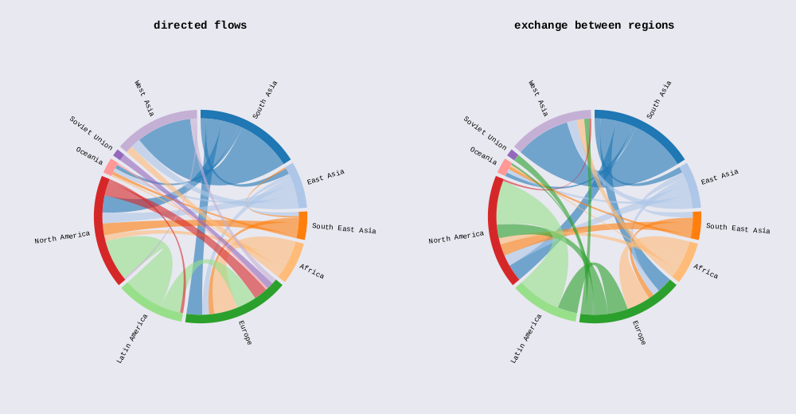
:::


### Colours, gaps, order and weak links

`:min-value` drops the weak flows that clutter the middle, `:gap-angle` widens the gaps, `:order :cluster` puts regions
with similar partners side by side, and the palette is a plot scale like any other.

Source: R Graph Gallery - Advanced chord diagram with circlize; data-to-viz - Chord diagram ([1](https://r-graph-gallery.com/123-circular-plot-circlize-package-2.html), [2](https://www.data-to-viz.com/graph/chord.html)). Data: Migration flows between world regions, data-to-viz example dataset `13_AdjacencyDirectedWeighted` (long form; Yan Holtz, after Abel & Sander 2014); licence: MIT (data_to_viz repository).


::: {.sourceClojure}
```clojure
(plot/render-image
 (plot/chord migration {:directed true :min-value 0.5 :gap-angle 4 :order :cluster
                        :scales {:color {:range :category10}}
                        :title "Flows of at least 0.5 million, clustered order"})
 {:width 700 :height 700})
```
:::


::: {.clay-image}
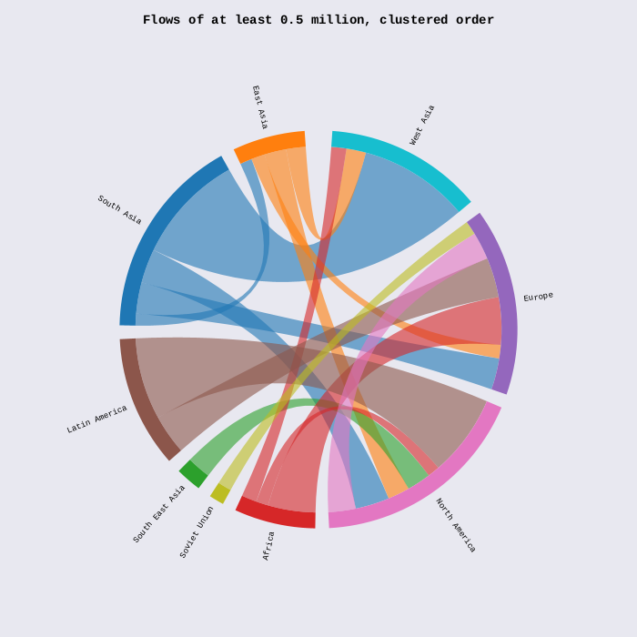
:::


## Network

Nodes and the edges between them, placed by a layout; colour, size and width carry node and edge variables.


### From an adjacency table

Co-authorships between researchers come as a table - a row per author, a column per author, 1 for a joint paper.
The table isn't square, so its cells become edge rows directly (`graph/adjacency->edges` reads square matrices,
see the correlation network below); the force layout places them, seeded for a stable picture. Groups of authors
without joint papers between them are laid out apart and packed in rows, the largest first.

Source: R Graph Gallery - Input formats for network charts; data-to-viz - Network ([1](https://r-graph-gallery.com/257-input-formats-for-network-charts.html), [2](https://www.data-to-viz.com/graph/network.html)). Data: Co-authorships between researchers, data-to-viz example dataset `13_AdjacencyUndirectedUnweighted` (Yan Holtz); licence: MIT (data_to_viz repository).


::: {.sourceClojure}
```clojure
(def coauthor-edges
  "One edge per co-author pair (the table lists some pairs both ways)."
  (->> (nu/dataset :coauthors)
       (mapcat (fn [{:keys [from] :as row}]
                 (for [[k v] (dissoc row :from) :when (= 1 v)] (vec (sort [from (name k)])))))
       (remove (fn [[a b]] (= a b)))
       (distinct)
       (mapv (fn [[a b]] {:from a :to b}))))
```
:::


```{=html}
<div class="data-table"><table class="table table-hover table-responsive clay-table"><thead><tr><th>from</th><th>to</th></tr></thead><tbody><tr><td>A Armero</td><td>A Breil</td></tr><tr><td>A Armero</td><td>A Dereeper</td></tr><tr><td>A Armero</td><td>F De Lamotte</td></tr><tr><td>A Armero</td><td>FC Baurens</td></tr><tr><td>A Armero</td><td>G Droc</td></tr><tr><td>A Armero</td><td>S Bocs</td></tr><tr><td>A Bateman</td><td>D Durand</td></tr><tr><td>A Bateman</td><td>T Lengauer</td></tr><tr><td>A Bateman</td><td>UK Hinxton</td></tr><tr><td>A Bateman</td><td>Y Moreau</td></tr><tr><td>A Besnard</td><td>G Poux</td></tr><tr><td>A Besnard</td><td>P Leroy</td></tr><tr><td>A Besnard</td><td>P Roumet</td></tr><tr><td>A Besnard</td><td>V Viader</td></tr><tr><td>A Breil</td><td>A Dereeper</td></tr><tr><td>A Breil</td><td>F De Lamotte</td></tr><tr><td>A Breil</td><td>G Droc</td></tr><tr><td>A Cenci</td><td>C Guilhaumon</td></tr><tr><td>A Cenci</td><td>S Santoni</td></tr><tr><td>A Chifolleau</td><td>V Berry</td></tr><tr><td>A Criscuolo</td><td>C Scornavacca</td></tr><tr><td>A Criscuolo</td><td>EJP Douzery</td></tr><tr><td>A Criscuolo</td><td>PH Fabre</td></tr><tr><td>A Criscuolo</td><td>S Guillemot</td></tr><tr><td>A Dassouli</td><td>B Noel</td></tr><tr><td>A Dassouli</td><td>B Vacherie</td></tr><tr><td>A Dellagi</td><td>D Expert</td></tr><tr><td>A Dellagi</td><td>F Gosti</td></tr><tr><td>A Dereeper</td><td>G Droc</td></tr><tr><td>A Regnault</td><td>M Crampes</td></tr><tr><td>A Serra</td><td>D Pot</td></tr><tr><td>A Serra</td><td>N Chantret</td></tr><tr><td>AMA Chifolleau</td><td>JP Doyon</td></tr><tr><td>AMA Chifolleau</td><td>V Berry</td></tr><tr><td>B Boussau</td><td>JY Dutheil</td></tr><tr><td>B Duthil</td><td>J Montmain</td></tr><tr><td>B Duthil</td><td>MF Sy</td></tr><tr><td>B Duthil</td><td>P Augereau</td></tr><tr><td>B Martret</td><td>J Alassimone</td></tr><tr><td>B Noel</td><td>B Vacherie</td></tr><tr><td>B Roure</td><td>D Baurain</td></tr><tr><td>B Roure</td><td>F Delsuc</td></tr><tr><td>C Burgarella</td><td>M Ardisson</td></tr><tr><td>C Burgarella</td><td>V Viader</td></tr><tr><td>C Douady</td><td>EJPDNLH Philippe</td></tr><tr><td>B Martret</td><td>C Fizames</td></tr><tr><td>C Fizames</td><td>J Alassimone</td></tr><tr><td>C Fizames</td><td>L Marquès</td></tr><tr><td>C Guilhaumon</td><td>S Santoni</td></tr><tr><td>A Cenci</td><td>C Scornavacca</td></tr><tr><td>C Burgarella</td><td>C Scornavacca</td></tr><tr><td>C Guilhaumon</td><td>C Scornavacca</td></tr><tr><td>C Scornavacca</td><td>EJP Douzery</td></tr><tr><td>C Scornavacca</td><td>F Delsuc</td></tr><tr><td>C Scornavacca</td><td>GJ Szöllősi</td></tr><tr><td>C Scornavacca</td><td>J Dainat</td></tr><tr><td>C Scornavacca</td><td>J Romiguier</td></tr><tr><td>C Scornavacca</td><td>JP Doyon</td></tr><tr><td>C Scornavacca</td><td>K Belkhir</td></tr><tr><td>C Scornavacca</td><td>KY Gorbunov</td></tr><tr><td>C Scornavacca</td><td>M Ardisson</td></tr><tr><td>C Scornavacca</td><td>N Galtier</td></tr><tr><td>C Scornavacca</td><td>S Santoni</td></tr><tr><td>C Scornavacca</td><td>V Berry</td></tr><tr><td>C Scornavacca</td><td>V Daubin</td></tr><tr><td>C Scornavacca</td><td>V Lefort</td></tr><tr><td>C Scornavacca</td><td>V Viader</td></tr><tr><td>C Scornavacca</td><td>W Paprotny</td></tr><tr><td>CP Meyer</td><td>JT Boehm</td></tr><tr><td>CP Meyer</td><td>N Agudelo</td></tr><tr><td>CP Meyer</td><td>SC Mills</td></tr><tr><td>CW Kilpatrick</td><td>PD Jenkins</td></tr><tr><td>D Baurain</td><td>F Delsuc</td></tr><tr><td>D Expert</td><td>F Gosti</td></tr><tr><td>CW Kilpatrick</td><td>D Huchon</td></tr><tr><td>D Huchon</td><td>P Chevret</td></tr><tr><td>D Huchon</td><td>PD Jenkins</td></tr><tr><td>D Huchon</td><td>U Jordan</td></tr><tr><td>D Pot</td><td>N Chantret</td></tr><tr><td>A Dellagi</td><td>D Vile</td></tr><tr><td>D Expert</td><td>D Vile</td></tr><tr><td>D Vile</td><td>F Gosti</td></tr><tr><td>D Vile</td><td>MC SOULIE</td></tr><tr><td>B Roure</td><td>DMD Vienne</td></tr><tr><td>D Baurain</td><td>DMD Vienne</td></tr><tr><td>DMD Vienne</td><td>F Delsuc</td></tr><tr><td>E Bazin</td><td>K Belkhir</td></tr><tr><td>E Bazin</td><td>N Galtier</td></tr><tr><td>E Bazin</td><td>S Glémin</td></tr><tr><td>A Dassouli</td><td>E Cornillot</td></tr><tr><td>B Noel</td><td>E Cornillot</td></tr><tr><td>B Vacherie</td><td>E Cornillot</td></tr><tr><td>E Cornillot</td><td>K Hadj-Kaddour</td></tr><tr><td>B Boussau</td><td>E Figuet</td></tr><tr><td>E Figuet</td><td>EJP Douzery</td></tr><tr><td>E Figuet</td><td>JY Dutheil</td></tr><tr><td>E Figuet</td><td>N Galtier</td></tr><tr><td>C Scornavacca</td><td>E Jacox</td></tr><tr><td>B Boussau</td><td>EJP Douzery</td></tr><tr><td>EJP Douzery</td><td>F Delsuc</td></tr><tr><td>…</td><td>…</td></tr></tbody></table></div>
```


::: {.sourceClojure}
```clojure
(plot/render-image
 (plot/network coauthor-edges {:rng (r/rng :mersenne 11) :node-style {:size 8}
                               :title (str (count coauthor-edges) " co-authorships")})
 {:width 750 :height 700})
```
:::


::: {.clay-image}

:::


### Layouts

The same graph on a circle and with the Fruchterman-Reingold force layout: groups of characters that appear
together only come out of the force layout.

Source: R Graph Gallery - Network layouts; data-to-viz - Network ([1](https://r-graph-gallery.com/247-network-chart-layouts.html), [2](https://www.data-to-viz.com/graph/network.html)). Data: Les Misérables character co-occurrences, vega-datasets `miserables.json` (D. E. Knuth, The Stanford GraphBase, 1993); licence: Not specified (vega-datasets lists it as notspecified).


::: {.sourceClojure}
```clojure
(plot/render-image
 (plot/arrange (vec (for [[layout title] [[:circle "circle layout"] [:force "force layout"]]]
                      (plot/network co-occurrences {:nodes characters :layout layout :rng (r/rng :mersenne 3)
                                                    :mapping {:color :group} :scales {:color {:legend false}}
                                                    :title title})))
               {:columns 2})
 {:width 1000 :height 500})
```
:::


::: {.clay-image}

:::


### Node colour, size by degree

Nodes coloured by their group and sized by their number of links (`:degree`, computed with the graph); labels for
the main characters. One size scale serves one variable, so edge widths (below, for migration flows) and node
sizes don't go together.

Source: R Graph Gallery - igraph plotting parameters, map a colour, node size by edges number ([1](https://r-graph-gallery.com/248-igraph-plotting-parameters.html), [2](https://r-graph-gallery.com/249-igraph-network-map-a-color.html), [3](https://r-graph-gallery.com/251-network-with-node-size-based-on-edges-number.html)). Data: Les Misérables character co-occurrences, vega-datasets `miserables.json` (D. E. Knuth, The Stanford GraphBase, 1993); licence: Not specified (vega-datasets lists it as notspecified).


::: {.sourceClojure}
```clojure
(plot/render-image
 (plot/network co-occurrences {:nodes characters :rng (r/rng :mersenne 3)
                               :mapping {:color :group :size :degree}
                               :scales {:size {:title "links"}}
                               :labels #(when (>= (long (:degree %)) 10) (:id %))
                               :title "Les Misérables: characters appearing together"})
 {:width 900 :height 750})
```
:::


::: {.clay-image}
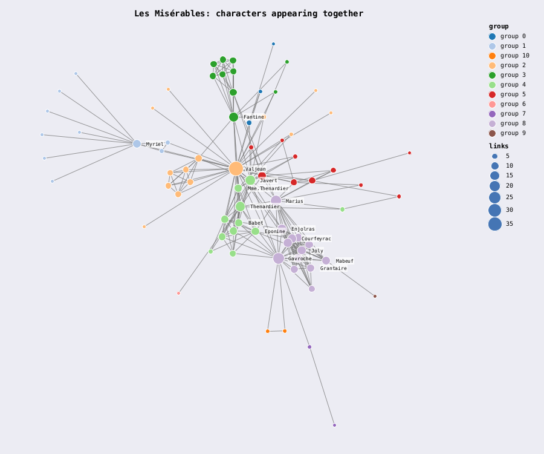
:::


### Correlation network

Variables linked when their correlation is strong (|r| > 0.7): the matrix becomes edges with
`graph/adjacency->edges`, the weight is |r| and the colour its sign.

Source: [R Graph Gallery - Correlation network with igraph](https://r-graph-gallery.com/250-correlation-network-with-igraph.html). Data: Motor Trend car road tests (1974), R datasets package `mtcars` (Henderson & Velleman 1981); licence: Part of R (GPL-2 | GPL-3).


::: {.sourceClojure}
```clojure
(def correlation-edges
  (let [names (mapv name mtcars-variables)
        r (stats/correlation-matrix (mapv (fn [k] (mapv k mtcars)) mtcars-variables))
        strong (mapv (fn [row] (mapv #(if (> (Math/abs (double %)) 0.7) % 0) row)) r)]
    (mapv #(assoc % :r (:value %) :value (Math/abs (double (:value %))))
          (graph/adjacency->edges strong names {:whole-matrix false}))))
```
:::


```{=html}
<div class="data-table"><table class="table table-hover table-responsive clay-table"><thead><tr><th>from</th><th>to</th><th>value</th><th>r</th></tr></thead><tbody><tr><td>mpg</td><td>mpg</td><td>1.0</td><td>1.0</td></tr><tr><td>mpg</td><td>cyl</td><td>0.8521619594266129</td><td>-0.8521619594266129</td></tr><tr><td>mpg</td><td>disp</td><td>0.8475513792624786</td><td>-0.8475513792624786</td></tr><tr><td>mpg</td><td>hp</td><td>0.7761683718265864</td><td>-0.7761683718265864</td></tr><tr><td>mpg</td><td>wt</td><td>0.8676593765172276</td><td>-0.8676593765172276</td></tr><tr><td>cyl</td><td>cyl</td><td>1.0</td><td>1.0</td></tr><tr><td>cyl</td><td>disp</td><td>0.9020328721469987</td><td>0.9020328721469987</td></tr><tr><td>cyl</td><td>hp</td><td>0.8324474527218193</td><td>0.8324474527218193</td></tr><tr><td>cyl</td><td>wt</td><td>0.7824957944632407</td><td>0.7824957944632407</td></tr><tr><td>cyl</td><td>vs</td><td>0.8108117960830052</td><td>-0.8108117960830052</td></tr><tr><td>disp</td><td>disp</td><td>1.0</td><td>1.0</td></tr><tr><td>disp</td><td>hp</td><td>0.7909485863698064</td><td>0.7909485863698064</td></tr><tr><td>disp</td><td>drat</td><td>0.7102139271692701</td><td>-0.7102139271692701</td></tr><tr><td>disp</td><td>wt</td><td>0.8879799220581379</td><td>0.8879799220581379</td></tr><tr><td>disp</td><td>vs</td><td>0.7104158907905997</td><td>-0.7104158907905997</td></tr><tr><td>hp</td><td>hp</td><td>1.0</td><td>1.0</td></tr><tr><td>hp</td><td>qsec</td><td>0.7082233888619535</td><td>-0.7082233888619535</td></tr><tr><td>hp</td><td>vs</td><td>0.7230967373524496</td><td>-0.7230967373524496</td></tr><tr><td>hp</td><td>carb</td><td>0.7498124715491103</td><td>0.7498124715491103</td></tr><tr><td>drat</td><td>drat</td><td>1.0</td><td>1.0</td></tr><tr><td>drat</td><td>wt</td><td>0.7124406466973717</td><td>-0.7124406466973717</td></tr><tr><td>drat</td><td>am</td><td>0.7127111272262697</td><td>0.7127111272262697</td></tr><tr><td>wt</td><td>wt</td><td>1.0</td><td>1.0</td></tr><tr><td>qsec</td><td>qsec</td><td>1.0</td><td>1.0</td></tr><tr><td>qsec</td><td>vs</td><td>0.7445354435262542</td><td>0.7445354435262542</td></tr><tr><td>vs</td><td>vs</td><td>1.0</td><td>1.0</td></tr><tr><td>am</td><td>am</td><td>1.0</td><td>1.0</td></tr><tr><td>am</td><td>gear</td><td>0.7940587602563435</td><td>0.7940587602563435</td></tr><tr><td>gear</td><td>gear</td><td>1.0</td><td>1.0</td></tr><tr><td>carb</td><td>carb</td><td>1.0</td><td>1.0</td></tr></tbody></table></div>
```


::: {.sourceClojure}
```clojure
(plot/render-image
 (plot/network correlation-edges {:nodes (mapv (fn [k] {:id (name k)}) mtcars-variables) :rng (r/rng :mersenne 5)
                                  :labels true
                                  :edge-mapping {:color #(if (pos? (double (:r %))) "positive" "negative")}
                                  :scales {:color {:range {"positive" [33 102 172] "negative" [178 24 43]} :title "r"}}
                                  :title "mtcars variables with |r| > 0.7"})
 {:width 700 :height 600})
```
:::


::: {.clay-image}
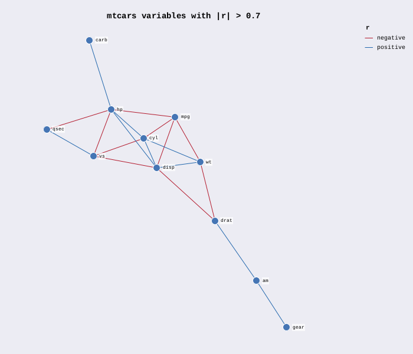
:::


### Directed, weighted edges

Migration flows as arrows ending at the target's edge, edge widths from the flows' size scale.

Source: [data-to-viz - Network](https://www.data-to-viz.com/graph/network.html). Data: Migration flows between world regions, data-to-viz example dataset `13_AdjacencyDirectedWeighted` (long form; Yan Holtz, after Abel & Sander 2014); licence: MIT (data_to_viz repository).


::: {.sourceClojure}
```clojure
(plot/render-image
 (plot/network migration {:directed true :layout :circle :labels true
                          :edge-mapping {:size :value}
                          :scales {:size {:range [0.5 6] :title "migrants, M"}}
                          :title "Migration between world regions"})
 {:width 750 :height 650})
```
:::


::: {.clay-image}
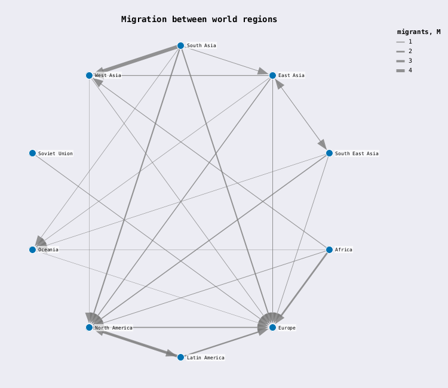
:::


## Sankey

Flows through stages: nodes in columns, as tall as their flow, bands between them as wide as the flow.


### Sankey diagram, node and link colours

The UK energy flows of a 2050 scenario: sources on the left, uses on the right (`:align :justify`, the default),
bands in their source's colour; then every node as far left as it can go, bands in their target's colour.

Source: R Graph Gallery - Sankey diagram with networkD3, custom colours; data-to-viz - Sankey ([1](https://r-graph-gallery.com/323-sankey-diagram-with-the-networkd3-library.html), [2](https://r-graph-gallery.com/322-custom-colours-in-sankey-diagram.html), [3](https://www.data-to-viz.com/graph/sankey.html)). Data: UK energy flows in 2050 (a DECC scenario), networkD3 `JSONdata/energy.json` (the d3 sankey example; UK Department of Energy & Climate Change 2050 Calculator); licence: networkD3 is GPL-3; the data's licence isn't stated.


::: {.sourceClojure}
```clojure
(def energy-flows (nu/dataset :energy))
```
:::


```{=html}
<div class="data-table"><table class="table table-hover table-responsive clay-table"><thead><tr><th>from</th><th>to</th><th>value</th></tr></thead><tbody><tr><td>Agricultural 'waste'</td><td>Bio-conversion</td><td>124.729</td></tr><tr><td>Bio-conversion</td><td>Liquid</td><td>0.597</td></tr><tr><td>Bio-conversion</td><td>Losses</td><td>26.862</td></tr><tr><td>Bio-conversion</td><td>Solid</td><td>280.322</td></tr><tr><td>Bio-conversion</td><td>Gas</td><td>81.144</td></tr><tr><td>Biofuel imports</td><td>Liquid</td><td>35</td></tr><tr><td>Biomass imports</td><td>Solid</td><td>35</td></tr><tr><td>Coal imports</td><td>Coal</td><td>11.606</td></tr><tr><td>Coal reserves</td><td>Coal</td><td>63.965</td></tr><tr><td>Coal</td><td>Solid</td><td>75.571</td></tr><tr><td>District heating</td><td>Industry</td><td>10.639</td></tr><tr><td>District heating</td><td>Heating and cooling - commercial</td><td>22.505</td></tr><tr><td>District heating</td><td>Heating and cooling - homes</td><td>46.184</td></tr><tr><td>Electricity grid</td><td>Over generation / exports</td><td>104.453</td></tr><tr><td>Electricity grid</td><td>Heating and cooling - homes</td><td>113.726</td></tr><tr><td>Electricity grid</td><td>H2 conversion</td><td>27.14</td></tr><tr><td>Electricity grid</td><td>Industry</td><td>342.165</td></tr><tr><td>Electricity grid</td><td>Road transport</td><td>37.797</td></tr><tr><td>Electricity grid</td><td>Agriculture</td><td>4.412</td></tr><tr><td>Electricity grid</td><td>Heating and cooling - commercial</td><td>40.858</td></tr><tr><td>Electricity grid</td><td>Losses</td><td>56.691</td></tr><tr><td>Electricity grid</td><td>Rail transport</td><td>7.863</td></tr><tr><td>Electricity grid</td><td>Lighting & appliances - commercial</td><td>90.008</td></tr><tr><td>Electricity grid</td><td>Lighting & appliances - homes</td><td>93.494</td></tr><tr><td>Gas imports</td><td>Ngas</td><td>40.719</td></tr><tr><td>Gas reserves</td><td>Ngas</td><td>82.233</td></tr><tr><td>Gas</td><td>Heating and cooling - commercial</td><td>0.129</td></tr><tr><td>Gas</td><td>Losses</td><td>1.401</td></tr><tr><td>Gas</td><td>Thermal generation</td><td>151.891</td></tr><tr><td>Gas</td><td>Agriculture</td><td>2.096</td></tr><tr><td>Gas</td><td>Industry</td><td>48.58</td></tr><tr><td>Geothermal</td><td>Electricity grid</td><td>7.013</td></tr><tr><td>H2 conversion</td><td>H2</td><td>20.897</td></tr><tr><td>H2 conversion</td><td>Losses</td><td>6.242</td></tr><tr><td>H2</td><td>Road transport</td><td>20.897</td></tr><tr><td>Hydro</td><td>Electricity grid</td><td>6.995</td></tr><tr><td>Liquid</td><td>Industry</td><td>121.066</td></tr><tr><td>Liquid</td><td>International shipping</td><td>128.69</td></tr><tr><td>Liquid</td><td>Road transport</td><td>135.835</td></tr><tr><td>Liquid</td><td>Domestic aviation</td><td>14.458</td></tr><tr><td>Liquid</td><td>International aviation</td><td>206.267</td></tr><tr><td>Liquid</td><td>Agriculture</td><td>3.64</td></tr><tr><td>Liquid</td><td>National navigation</td><td>33.218</td></tr><tr><td>Liquid</td><td>Rail transport</td><td>4.413</td></tr><tr><td>Marine algae</td><td>Bio-conversion</td><td>4.375</td></tr><tr><td>Ngas</td><td>Gas</td><td>122.952</td></tr><tr><td>Nuclear</td><td>Thermal generation</td><td>839.978</td></tr><tr><td>Oil imports</td><td>Oil</td><td>504.287</td></tr><tr><td>Oil reserves</td><td>Oil</td><td>107.703</td></tr><tr><td>Oil</td><td>Liquid</td><td>611.99</td></tr><tr><td>Other waste</td><td>Solid</td><td>56.587</td></tr><tr><td>Other waste</td><td>Bio-conversion</td><td>77.81</td></tr><tr><td>Pumped heat</td><td>Heating and cooling - homes</td><td>193.026</td></tr><tr><td>Pumped heat</td><td>Heating and cooling - commercial</td><td>70.672</td></tr><tr><td>Solar PV</td><td>Electricity grid</td><td>59.901</td></tr><tr><td>Solar Thermal</td><td>Heating and cooling - homes</td><td>19.263</td></tr><tr><td>Solar</td><td>Solar Thermal</td><td>19.263</td></tr><tr><td>Solar</td><td>Solar PV</td><td>59.901</td></tr><tr><td>Solid</td><td>Agriculture</td><td>0.882</td></tr><tr><td>Solid</td><td>Thermal generation</td><td>400.12</td></tr><tr><td>Solid</td><td>Industry</td><td>46.477</td></tr><tr><td>Thermal generation</td><td>Electricity grid</td><td>525.531</td></tr><tr><td>Thermal generation</td><td>Losses</td><td>787.129</td></tr><tr><td>Thermal generation</td><td>District heating</td><td>79.329</td></tr><tr><td>Tidal</td><td>Electricity grid</td><td>9.452</td></tr><tr><td>UK land based bioenergy</td><td>Bio-conversion</td><td>182.01</td></tr><tr><td>Wave</td><td>Electricity grid</td><td>19.013</td></tr><tr><td>Wind</td><td>Electricity grid</td><td>289.366</td></tr></tbody></table></div>
```


::: {.sourceClojure}
```clojure
(plot/render-image
 (plot/sankey energy-flows {:title "UK energy flows in 2050 (TWh)"})
 {:width 1000 :height 650})
```
:::


::: {.clay-image}
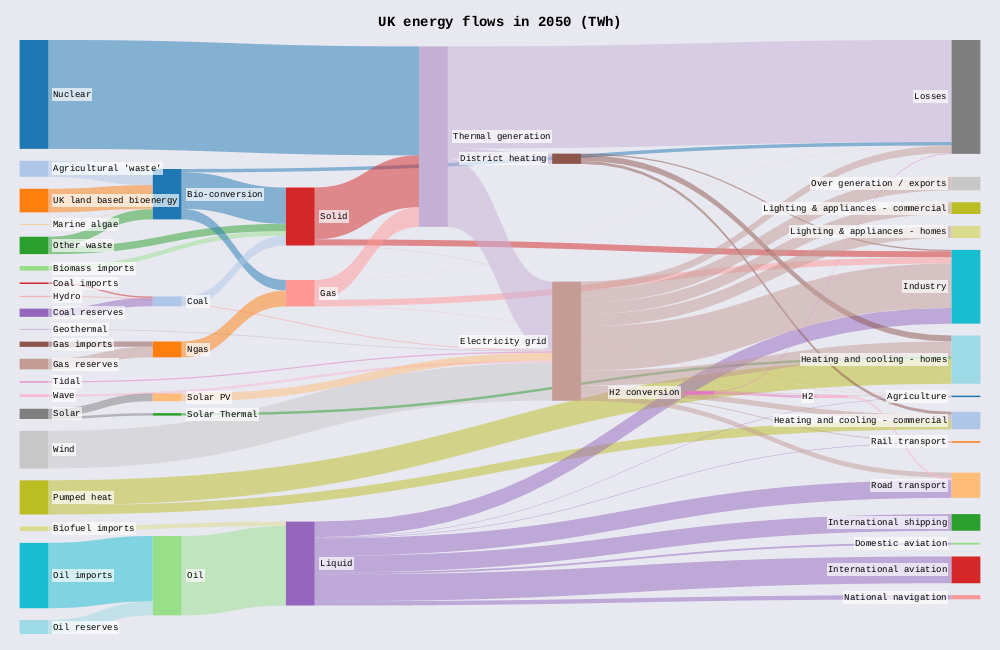
:::


::: {.sourceClojure}
```clojure
(plot/render-image
 (plot/sankey energy-flows {:align :left :link-color :target :title "Left-aligned, bands in the target's colour"})
 {:width 1000 :height 650})
```
:::


::: {.clay-image}

:::


### Alluvial diagram

A column per variable, a stratum per level and strands between neighbouring columns, coloured by the class all
the way through.

Source: [R Graph Gallery - Sankey diagram (alluvial section)](https://r-graph-gallery.com/sankey-diagram.html). Data: Titanic passengers and crew by class, sex, age and survival, R datasets package `Titanic` (Dawson 1995); licence: Part of R (GPL-2 | GPL-3).


```{=html}
<div class="data-table"><table class="table table-hover table-responsive clay-table"><thead><tr><th>class</th><th>sex</th><th>age</th><th>survived</th><th>n</th></tr></thead><tbody><tr><td>1st</td><td>Male</td><td>Child</td><td>No</td><td>0</td></tr><tr><td>2nd</td><td>Male</td><td>Child</td><td>No</td><td>0</td></tr><tr><td>3rd</td><td>Male</td><td>Child</td><td>No</td><td>35</td></tr><tr><td>Crew</td><td>Male</td><td>Child</td><td>No</td><td>0</td></tr><tr><td>1st</td><td>Female</td><td>Child</td><td>No</td><td>0</td></tr><tr><td>2nd</td><td>Female</td><td>Child</td><td>No</td><td>0</td></tr><tr><td>3rd</td><td>Female</td><td>Child</td><td>No</td><td>17</td></tr><tr><td>Crew</td><td>Female</td><td>Child</td><td>No</td><td>0</td></tr><tr><td>1st</td><td>Male</td><td>Adult</td><td>No</td><td>118</td></tr><tr><td>2nd</td><td>Male</td><td>Adult</td><td>No</td><td>154</td></tr><tr><td>3rd</td><td>Male</td><td>Adult</td><td>No</td><td>387</td></tr><tr><td>Crew</td><td>Male</td><td>Adult</td><td>No</td><td>670</td></tr><tr><td>1st</td><td>Female</td><td>Adult</td><td>No</td><td>4</td></tr><tr><td>2nd</td><td>Female</td><td>Adult</td><td>No</td><td>13</td></tr><tr><td>3rd</td><td>Female</td><td>Adult</td><td>No</td><td>89</td></tr><tr><td>Crew</td><td>Female</td><td>Adult</td><td>No</td><td>3</td></tr><tr><td>1st</td><td>Male</td><td>Child</td><td>Yes</td><td>5</td></tr><tr><td>2nd</td><td>Male</td><td>Child</td><td>Yes</td><td>11</td></tr><tr><td>3rd</td><td>Male</td><td>Child</td><td>Yes</td><td>13</td></tr><tr><td>Crew</td><td>Male</td><td>Child</td><td>Yes</td><td>0</td></tr><tr><td>1st</td><td>Female</td><td>Child</td><td>Yes</td><td>1</td></tr><tr><td>2nd</td><td>Female</td><td>Child</td><td>Yes</td><td>13</td></tr><tr><td>3rd</td><td>Female</td><td>Child</td><td>Yes</td><td>14</td></tr><tr><td>Crew</td><td>Female</td><td>Child</td><td>Yes</td><td>0</td></tr><tr><td>1st</td><td>Male</td><td>Adult</td><td>Yes</td><td>57</td></tr><tr><td>2nd</td><td>Male</td><td>Adult</td><td>Yes</td><td>14</td></tr><tr><td>3rd</td><td>Male</td><td>Adult</td><td>Yes</td><td>75</td></tr><tr><td>Crew</td><td>Male</td><td>Adult</td><td>Yes</td><td>192</td></tr><tr><td>1st</td><td>Female</td><td>Adult</td><td>Yes</td><td>140</td></tr><tr><td>2nd</td><td>Female</td><td>Adult</td><td>Yes</td><td>80</td></tr><tr><td>3rd</td><td>Female</td><td>Adult</td><td>Yes</td><td>76</td></tr><tr><td>Crew</td><td>Female</td><td>Adult</td><td>Yes</td><td>20</td></tr></tbody></table></div>
```


::: {.sourceClojure}
```clojure
(plot/render-image
 (plot/alluvial (nu/dataset :titanic) {:variables [:class :sex :age :survived] :value :n :strand-color :class
                                       :theme {:palette {:color :set1}}
                                       :title "Titanic: 2201 people by class, sex, age and survival"})
 {:width 900 :height 600})
```
:::


::: {.clay-image}
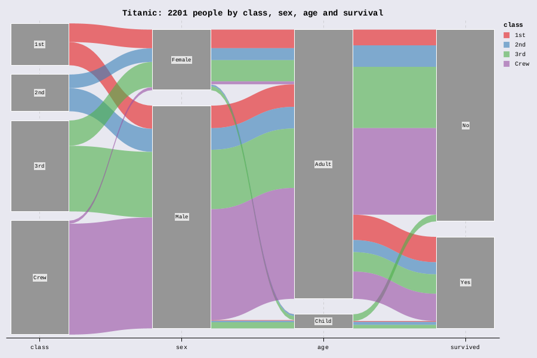
:::


### Bump chart

Ranks over time: the months ranked by passengers within each year. The summer months climb to the top as air
travel grows; November stays near the bottom.

Source: [R Graph Gallery - Sankey diagram (bump chart section)](https://r-graph-gallery.com/sankey-diagram.html). Data: Monthly airline passengers, 1949-1960, R datasets package `AirPassengers` (Box & Jenkins 1976); licence: Part of R (GPL-2 | GPL-3).


::: {.sourceClojure}
```clojure
(def month-ranks
  (vec (for [[year rows] (group-by :year air-passengers)
             [rank row] (map-indexed vector (sort-by :passengers > rows))]
         (assoc row :rank (inc rank)))))
```
:::


```{=html}
<div class="data-table"><table class="table table-hover table-responsive clay-table"><thead><tr><th>date</th><th>year</th><th>month</th><th>passengers</th><th>rank</th></tr></thead><tbody><tr><td>1952-08-01</td><td>1952</td><td>Aug</td><td>242</td><td>1</td></tr><tr><td>1952-07-01</td><td>1952</td><td>Jul</td><td>230</td><td>2</td></tr><tr><td>1952-06-01</td><td>1952</td><td>Jun</td><td>218</td><td>3</td></tr><tr><td>1952-09-01</td><td>1952</td><td>Sep</td><td>209</td><td>4</td></tr><tr><td>1952-12-01</td><td>1952</td><td>Dec</td><td>194</td><td>5</td></tr><tr><td>1952-03-01</td><td>1952</td><td>Mar</td><td>193</td><td>6</td></tr><tr><td>1952-10-01</td><td>1952</td><td>Oct</td><td>191</td><td>7</td></tr><tr><td>1952-05-01</td><td>1952</td><td>May</td><td>183</td><td>8</td></tr><tr><td>1952-04-01</td><td>1952</td><td>Apr</td><td>181</td><td>9</td></tr><tr><td>1952-02-01</td><td>1952</td><td>Feb</td><td>180</td><td>10</td></tr><tr><td>1952-11-01</td><td>1952</td><td>Nov</td><td>172</td><td>11</td></tr><tr><td>1952-01-01</td><td>1952</td><td>Jan</td><td>171</td><td>12</td></tr><tr><td>1949-07-01</td><td>1949</td><td>Jul</td><td>148</td><td>1</td></tr><tr><td>1949-08-01</td><td>1949</td><td>Aug</td><td>148</td><td>2</td></tr><tr><td>1949-09-01</td><td>1949</td><td>Sep</td><td>136</td><td>3</td></tr><tr><td>1949-06-01</td><td>1949</td><td>Jun</td><td>135</td><td>4</td></tr><tr><td>1949-03-01</td><td>1949</td><td>Mar</td><td>132</td><td>5</td></tr><tr><td>1949-04-01</td><td>1949</td><td>Apr</td><td>129</td><td>6</td></tr><tr><td>1949-05-01</td><td>1949</td><td>May</td><td>121</td><td>7</td></tr><tr><td>1949-10-01</td><td>1949</td><td>Oct</td><td>119</td><td>8</td></tr><tr><td>1949-02-01</td><td>1949</td><td>Feb</td><td>118</td><td>9</td></tr><tr><td>1949-12-01</td><td>1949</td><td>Dec</td><td>118</td><td>10</td></tr><tr><td>1949-01-01</td><td>1949</td><td>Jan</td><td>112</td><td>11</td></tr><tr><td>1949-11-01</td><td>1949</td><td>Nov</td><td>104</td><td>12</td></tr><tr><td>1953-08-01</td><td>1953</td><td>Aug</td><td>272</td><td>1</td></tr><tr><td>1953-07-01</td><td>1953</td><td>Jul</td><td>264</td><td>2</td></tr><tr><td>1953-06-01</td><td>1953</td><td>Jun</td><td>243</td><td>3</td></tr><tr><td>1953-09-01</td><td>1953</td><td>Sep</td><td>237</td><td>4</td></tr><tr><td>1953-03-01</td><td>1953</td><td>Mar</td><td>236</td><td>5</td></tr><tr><td>1953-04-01</td><td>1953</td><td>Apr</td><td>235</td><td>6</td></tr><tr><td>1953-05-01</td><td>1953</td><td>May</td><td>229</td><td>7</td></tr><tr><td>1953-10-01</td><td>1953</td><td>Oct</td><td>211</td><td>8</td></tr><tr><td>1953-12-01</td><td>1953</td><td>Dec</td><td>201</td><td>9</td></tr><tr><td>1953-01-01</td><td>1953</td><td>Jan</td><td>196</td><td>10</td></tr><tr><td>1953-02-01</td><td>1953</td><td>Feb</td><td>196</td><td>11</td></tr><tr><td>1953-11-01</td><td>1953</td><td>Nov</td><td>180</td><td>12</td></tr><tr><td>1958-08-01</td><td>1958</td><td>Aug</td><td>505</td><td>1</td></tr><tr><td>1958-07-01</td><td>1958</td><td>Jul</td><td>491</td><td>2</td></tr><tr><td>1958-06-01</td><td>1958</td><td>Jun</td><td>435</td><td>3</td></tr><tr><td>1958-09-01</td><td>1958</td><td>Sep</td><td>404</td><td>4</td></tr><tr><td>1958-05-01</td><td>1958</td><td>May</td><td>363</td><td>5</td></tr><tr><td>1958-03-01</td><td>1958</td><td>Mar</td><td>362</td><td>6</td></tr><tr><td>1958-10-01</td><td>1958</td><td>Oct</td><td>359</td><td>7</td></tr><tr><td>1958-04-01</td><td>1958</td><td>Apr</td><td>348</td><td>8</td></tr><tr><td>1958-01-01</td><td>1958</td><td>Jan</td><td>340</td><td>9</td></tr><tr><td>1958-12-01</td><td>1958</td><td>Dec</td><td>337</td><td>10</td></tr><tr><td>1958-02-01</td><td>1958</td><td>Feb</td><td>318</td><td>11</td></tr><tr><td>1958-11-01</td><td>1958</td><td>Nov</td><td>310</td><td>12</td></tr><tr><td>1956-07-01</td><td>1956</td><td>Jul</td><td>413</td><td>1</td></tr><tr><td>1956-08-01</td><td>1956</td><td>Aug</td><td>405</td><td>2</td></tr><tr><td>1956-06-01</td><td>1956</td><td>Jun</td><td>374</td><td>3</td></tr><tr><td>1956-09-01</td><td>1956</td><td>Sep</td><td>355</td><td>4</td></tr><tr><td>1956-05-01</td><td>1956</td><td>May</td><td>318</td><td>5</td></tr><tr><td>1956-03-01</td><td>1956</td><td>Mar</td><td>317</td><td>6</td></tr><tr><td>1956-04-01</td><td>1956</td><td>Apr</td><td>313</td><td>7</td></tr><tr><td>1956-10-01</td><td>1956</td><td>Oct</td><td>306</td><td>8</td></tr><tr><td>1956-12-01</td><td>1956</td><td>Dec</td><td>306</td><td>9</td></tr><tr><td>1956-01-01</td><td>1956</td><td>Jan</td><td>284</td><td>10</td></tr><tr><td>1956-02-01</td><td>1956</td><td>Feb</td><td>277</td><td>11</td></tr><tr><td>1956-11-01</td><td>1956</td><td>Nov</td><td>271</td><td>12</td></tr><tr><td>1950-07-01</td><td>1950</td><td>Jul</td><td>170</td><td>1</td></tr><tr><td>1950-08-01</td><td>1950</td><td>Aug</td><td>170</td><td>2</td></tr><tr><td>1950-09-01</td><td>1950</td><td>Sep</td><td>158</td><td>3</td></tr><tr><td>1950-06-01</td><td>1950</td><td>Jun</td><td>149</td><td>4</td></tr><tr><td>1950-03-01</td><td>1950</td><td>Mar</td><td>141</td><td>5</td></tr><tr><td>1950-12-01</td><td>1950</td><td>Dec</td><td>140</td><td>6</td></tr><tr><td>1950-04-01</td><td>1950</td><td>Apr</td><td>135</td><td>7</td></tr><tr><td>1950-10-01</td><td>1950</td><td>Oct</td><td>133</td><td>8</td></tr><tr><td>1950-02-01</td><td>1950</td><td>Feb</td><td>126</td><td>9</td></tr><tr><td>1950-05-01</td><td>1950</td><td>May</td><td>125</td><td>10</td></tr><tr><td>1950-01-01</td><td>1950</td><td>Jan</td><td>115</td><td>11</td></tr><tr><td>1950-11-01</td><td>1950</td><td>Nov</td><td>114</td><td>12</td></tr><tr><td>1954-07-01</td><td>1954</td><td>Jul</td><td>302</td><td>1</td></tr><tr><td>1954-08-01</td><td>1954</td><td>Aug</td><td>293</td><td>2</td></tr><tr><td>1954-06-01</td><td>1954</td><td>Jun</td><td>264</td><td>3</td></tr><tr><td>1954-09-01</td><td>1954</td><td>Sep</td><td>259</td><td>4</td></tr><tr><td>1954-03-01</td><td>1954</td><td>Mar</td><td>235</td><td>5</td></tr><tr><td>1954-05-01</td><td>1954</td><td>May</td><td>234</td><td>6</td></tr><tr><td>1954-10-01</td><td>1954</td><td>Oct</td><td>229</td><td>7</td></tr><tr><td>1954-12-01</td><td>1954</td><td>Dec</td><td>229</td><td>8</td></tr><tr><td>1954-04-01</td><td>1954</td><td>Apr</td><td>227</td><td>9</td></tr><tr><td>1954-01-01</td><td>1954</td><td>Jan</td><td>204</td><td>10</td></tr><tr><td>1954-11-01</td><td>1954</td><td>Nov</td><td>203</td><td>11</td></tr><tr><td>1954-02-01</td><td>1954</td><td>Feb</td><td>188</td><td>12</td></tr><tr><td>1957-08-01</td><td>1957</td><td>Aug</td><td>467</td><td>1</td></tr><tr><td>1957-07-01</td><td>1957</td><td>Jul</td><td>465</td><td>2</td></tr><tr><td>1957-06-01</td><td>1957</td><td>Jun</td><td>422</td><td>3</td></tr><tr><td>1957-09-01</td><td>1957</td><td>Sep</td><td>404</td><td>4</td></tr><tr><td>1957-03-01</td><td>1957</td><td>Mar</td><td>356</td><td>5</td></tr><tr><td>1957-05-01</td><td>1957</td><td>May</td><td>355</td><td>6</td></tr><tr><td>1957-04-01</td><td>1957</td><td>Apr</td><td>348</td><td>7</td></tr><tr><td>1957-10-01</td><td>1957</td><td>Oct</td><td>347</td><td>8</td></tr><tr><td>1957-12-01</td><td>1957</td><td>Dec</td><td>336</td><td>9</td></tr><tr><td>1957-01-01</td><td>1957</td><td>Jan</td><td>315</td><td>10</td></tr><tr><td>1957-11-01</td><td>1957</td><td>Nov</td><td>305</td><td>11</td></tr><tr><td>1957-02-01</td><td>1957</td><td>Feb</td><td>301</td><td>12</td></tr><tr><td>1955-07-01</td><td>1955</td><td>Jul</td><td>364</td><td>1</td></tr><tr><td>1955-08-01</td><td>1955</td><td>Aug</td><td>347</td><td>2</td></tr><tr><td>1955-06-01</td><td>1955</td><td>Jun</td><td>315</td><td>3</td></tr><tr><td>1955-09-01</td><td>1955</td><td>Sep</td><td>312</td><td>4</td></tr><tr><td>…</td><td>…</td><td>…</td><td>…</td><td>…</td></tr></tbody></table></div>
```


::: {.sourceClojure}
```clojure
(plot/render-image
 {:data month-ranks :mapping {:x :year :y :rank :color :month}
  :charts [(chart/line {:line-width 2})
           (chart/scatter {:size 7})
           (chart/text {:data (filter #(= 1949 (:year %)) month-ranks) :mapping {:x :year :y :rank :label :month}
                        :anchor [:right :middle] :offset [-8 0]})
           (chart/text {:data (filter #(= 1960 (:year %)) month-ranks) :mapping {:x :year :y :rank :label :month}
                        :anchor [:left :middle] :offset [8 0]})]
  :scales {:y {:domain [12.5 0.5] :nice false :ticks (vec (range 1 13))}
           :x {:domain [1948 1961] :nice false :ticks (vec (range 1949 1961))}
           :color {:domain ["Jan" "Feb" "Mar" "Apr" "May" "Jun" "Jul" "Aug" "Sep" "Oct" "Nov" "Dec"]
                   :range :category20 :legend false}}
  :labels {:title "Months ranked by air passengers, 1949-1960" :x nil :y "rank"}}
 {:width 900 :height 550})
```
:::


::: {.clay-image}

:::


## Arc diagram

Nodes on a line, every link a semicircle above it: readable when the order puts linked nodes close together.

Source: [data-to-viz - Arc diagram](https://www.data-to-viz.com/graph/arc.html). Data: Les Misérables character co-occurrences, vega-datasets `miserables.json` (D. E. Knuth, The Stanford GraphBase, 1993); licence: Not specified (vega-datasets lists it as notspecified).


::: {.sourceClojure}
```clojure
(plot/render-image
 (plot/arrange [(plot/arc co-occurrences {:nodes characters :mapping {:color :group}
                                          :title "Les Misérables: input order"})
                (plot/arc co-occurrences {:nodes characters :mapping {:color :group} :order :cluster
                                          :title "clustered order: characters seen with the same others together"})]
               {:columns 1})
 {:width 1000 :height 800})
```
:::


::: {.clay-image}

:::


## Edge bundling

Links between the leaves of a hierarchy routed along it: the bundles show which packages depend on which.


### Hierarchical edge bundling

The classes of the flare library around a circle, grouped by package, each import a curve through the package
tree, coloured by the importing class's top-level package.

Source: R Graph Gallery - Hierarchical edge bundling, custom, labels; data-to-viz - Edge bundling ([1](https://r-graph-gallery.com/309-intro-to-hierarchical-edge-bundling.html), [2](https://r-graph-gallery.com/310-custom-hierarchical-edge-bundling.html), [3](https://r-graph-gallery.com/311-add-labels-to-hierarchical-edge-bundling.html), [4](https://www.data-to-viz.com/graph/edge_bundling.html)). Data: Flare visualization toolkit class hierarchy, vega-datasets `flare.json` (the Flare ActionScript library's packages and classes); licence: Not documented.


```{=html}
<div class="data-table"><table class="table table-hover table-responsive clay-table"><thead><tr><th>id</th><th>name</th><th>parent</th><th>size</th></tr></thead><tbody><tr><td>1</td><td>flare</td><td></td><td></td></tr><tr><td>2</td><td>analytics</td><td>1</td><td></td></tr><tr><td>3</td><td>cluster</td><td>2</td><td></td></tr><tr><td>4</td><td>AgglomerativeCluster</td><td>3</td><td>3938</td></tr><tr><td>5</td><td>CommunityStructure</td><td>3</td><td>3812</td></tr><tr><td>6</td><td>HierarchicalCluster</td><td>3</td><td>6714</td></tr><tr><td>7</td><td>MergeEdge</td><td>3</td><td>743</td></tr><tr><td>8</td><td>graph</td><td>2</td><td></td></tr><tr><td>9</td><td>BetweennessCentrality</td><td>8</td><td>3534</td></tr><tr><td>10</td><td>LinkDistance</td><td>8</td><td>5731</td></tr><tr><td>11</td><td>MaxFlowMinCut</td><td>8</td><td>7840</td></tr><tr><td>12</td><td>ShortestPaths</td><td>8</td><td>5914</td></tr><tr><td>13</td><td>SpanningTree</td><td>8</td><td>3416</td></tr><tr><td>14</td><td>optimization</td><td>2</td><td></td></tr><tr><td>15</td><td>AspectRatioBanker</td><td>14</td><td>7074</td></tr><tr><td>16</td><td>animate</td><td>1</td><td></td></tr><tr><td>17</td><td>Easing</td><td>16</td><td>17010</td></tr><tr><td>18</td><td>FunctionSequence</td><td>16</td><td>5842</td></tr><tr><td>19</td><td>interpolate</td><td>16</td><td></td></tr><tr><td>20</td><td>ArrayInterpolator</td><td>19</td><td>1983</td></tr><tr><td>21</td><td>ColorInterpolator</td><td>19</td><td>2047</td></tr><tr><td>22</td><td>DateInterpolator</td><td>19</td><td>1375</td></tr><tr><td>23</td><td>Interpolator</td><td>19</td><td>8746</td></tr><tr><td>24</td><td>MatrixInterpolator</td><td>19</td><td>2202</td></tr><tr><td>25</td><td>NumberInterpolator</td><td>19</td><td>1382</td></tr><tr><td>26</td><td>ObjectInterpolator</td><td>19</td><td>1629</td></tr><tr><td>27</td><td>PointInterpolator</td><td>19</td><td>1675</td></tr><tr><td>28</td><td>RectangleInterpolator</td><td>19</td><td>2042</td></tr><tr><td>29</td><td>ISchedulable</td><td>16</td><td>1041</td></tr><tr><td>30</td><td>Parallel</td><td>16</td><td>5176</td></tr><tr><td>31</td><td>Pause</td><td>16</td><td>449</td></tr><tr><td>32</td><td>Scheduler</td><td>16</td><td>5593</td></tr><tr><td>33</td><td>Sequence</td><td>16</td><td>5534</td></tr><tr><td>34</td><td>Transition</td><td>16</td><td>9201</td></tr><tr><td>35</td><td>Transitioner</td><td>16</td><td>19975</td></tr><tr><td>36</td><td>TransitionEvent</td><td>16</td><td>1116</td></tr><tr><td>37</td><td>Tween</td><td>16</td><td>6006</td></tr><tr><td>38</td><td>data</td><td>1</td><td></td></tr><tr><td>39</td><td>converters</td><td>38</td><td></td></tr><tr><td>40</td><td>Converters</td><td>39</td><td>721</td></tr><tr><td>41</td><td>DelimitedTextConverter</td><td>39</td><td>4294</td></tr><tr><td>42</td><td>GraphMLConverter</td><td>39</td><td>9800</td></tr><tr><td>43</td><td>IDataConverter</td><td>39</td><td>1314</td></tr><tr><td>44</td><td>JSONConverter</td><td>39</td><td>2220</td></tr><tr><td>45</td><td>DataField</td><td>38</td><td>1759</td></tr><tr><td>46</td><td>DataSchema</td><td>38</td><td>2165</td></tr><tr><td>47</td><td>DataSet</td><td>38</td><td>586</td></tr><tr><td>48</td><td>DataSource</td><td>38</td><td>3331</td></tr><tr><td>49</td><td>DataTable</td><td>38</td><td>772</td></tr><tr><td>50</td><td>DataUtil</td><td>38</td><td>3322</td></tr><tr><td>51</td><td>display</td><td>1</td><td></td></tr><tr><td>52</td><td>DirtySprite</td><td>51</td><td>8833</td></tr><tr><td>53</td><td>LineSprite</td><td>51</td><td>1732</td></tr><tr><td>54</td><td>RectSprite</td><td>51</td><td>3623</td></tr><tr><td>55</td><td>TextSprite</td><td>51</td><td>10066</td></tr><tr><td>56</td><td>flex</td><td>1</td><td></td></tr><tr><td>57</td><td>FlareVis</td><td>56</td><td>4116</td></tr><tr><td>58</td><td>physics</td><td>1</td><td></td></tr><tr><td>59</td><td>DragForce</td><td>58</td><td>1082</td></tr><tr><td>60</td><td>GravityForce</td><td>58</td><td>1336</td></tr><tr><td>61</td><td>IForce</td><td>58</td><td>319</td></tr><tr><td>62</td><td>NBodyForce</td><td>58</td><td>10498</td></tr><tr><td>63</td><td>Particle</td><td>58</td><td>2822</td></tr><tr><td>64</td><td>Simulation</td><td>58</td><td>9983</td></tr><tr><td>65</td><td>Spring</td><td>58</td><td>2213</td></tr><tr><td>66</td><td>SpringForce</td><td>58</td><td>1681</td></tr><tr><td>67</td><td>query</td><td>1</td><td></td></tr><tr><td>68</td><td>AggregateExpression</td><td>67</td><td>1616</td></tr><tr><td>69</td><td>And</td><td>67</td><td>1027</td></tr><tr><td>70</td><td>Arithmetic</td><td>67</td><td>3891</td></tr><tr><td>71</td><td>Average</td><td>67</td><td>891</td></tr><tr><td>72</td><td>BinaryExpression</td><td>67</td><td>2893</td></tr><tr><td>73</td><td>Comparison</td><td>67</td><td>5103</td></tr><tr><td>74</td><td>CompositeExpression</td><td>67</td><td>3677</td></tr><tr><td>75</td><td>Count</td><td>67</td><td>781</td></tr><tr><td>76</td><td>DateUtil</td><td>67</td><td>4141</td></tr><tr><td>77</td><td>Distinct</td><td>67</td><td>933</td></tr><tr><td>78</td><td>Expression</td><td>67</td><td>5130</td></tr><tr><td>79</td><td>ExpressionIterator</td><td>67</td><td>3617</td></tr><tr><td>80</td><td>Fn</td><td>67</td><td>3240</td></tr><tr><td>81</td><td>If</td><td>67</td><td>2732</td></tr><tr><td>82</td><td>IsA</td><td>67</td><td>2039</td></tr><tr><td>83</td><td>Literal</td><td>67</td><td>1214</td></tr><tr><td>84</td><td>Match</td><td>67</td><td>3748</td></tr><tr><td>85</td><td>Maximum</td><td>67</td><td>843</td></tr><tr><td>86</td><td>methods</td><td>67</td><td></td></tr><tr><td>87</td><td>add</td><td>86</td><td>593</td></tr><tr><td>88</td><td>and</td><td>86</td><td>330</td></tr><tr><td>89</td><td>average</td><td>86</td><td>287</td></tr><tr><td>90</td><td>count</td><td>86</td><td>277</td></tr><tr><td>91</td><td>distinct</td><td>86</td><td>292</td></tr><tr><td>92</td><td>div</td><td>86</td><td>595</td></tr><tr><td>93</td><td>eq</td><td>86</td><td>594</td></tr><tr><td>94</td><td>fn</td><td>86</td><td>460</td></tr><tr><td>95</td><td>gt</td><td>86</td><td>603</td></tr><tr><td>96</td><td>gte</td><td>86</td><td>625</td></tr><tr><td>97</td><td>iff</td><td>86</td><td>748</td></tr><tr><td>98</td><td>isa</td><td>86</td><td>461</td></tr><tr><td>99</td><td>lt</td><td>86</td><td>597</td></tr><tr><td>100</td><td>lte</td><td>86</td><td>619</td></tr><tr><td>…</td><td>…</td><td>…</td><td>…</td></tr></tbody></table></div>
```


::: {.sourceClojure}
```clojure
(def flare-tree (tree/from-parents (nu/dataset :flare) {:name :name}))
```
:::


::: {.sourceClojure}
```clojure
(def flare-imports (nu/dataset :flare-dependencies))
```
:::


```{=html}
<div class="data-table"><table class="table table-hover table-responsive clay-table"><thead><tr><th>source</th><th>target</th></tr></thead><tbody><tr><td>35</td><td>4</td></tr><tr><td>190</td><td>4</td></tr><tr><td>155</td><td>4</td></tr><tr><td>7</td><td>4</td></tr><tr><td>6</td><td>4</td></tr><tr><td>189</td><td>4</td></tr><tr><td>6</td><td>5</td></tr><tr><td>35</td><td>5</td></tr><tr><td>190</td><td>5</td></tr><tr><td>7</td><td>5</td></tr><tr><td>155</td><td>5</td></tr><tr><td>192</td><td>6</td></tr><tr><td>193</td><td>6</td></tr><tr><td>190</td><td>6</td></tr><tr><td>200</td><td>6</td></tr><tr><td>141</td><td>6</td></tr><tr><td>7</td><td>6</td></tr><tr><td>166</td><td>6</td></tr><tr><td>247</td><td>6</td></tr><tr><td>164</td><td>6</td></tr><tr><td>189</td><td>6</td></tr><tr><td>35</td><td>9</td></tr><tr><td>193</td><td>9</td></tr><tr><td>190</td><td>9</td></tr><tr><td>141</td><td>9</td></tr><tr><td>189</td><td>9</td></tr><tr><td>164</td><td>9</td></tr><tr><td>247</td><td>9</td></tr><tr><td>35</td><td>10</td></tr><tr><td>193</td><td>10</td></tr><tr><td>192</td><td>10</td></tr><tr><td>12</td><td>10</td></tr><tr><td>189</td><td>10</td></tr><tr><td>164</td><td>10</td></tr><tr><td>247</td><td>10</td></tr><tr><td>35</td><td>11</td></tr><tr><td>193</td><td>11</td></tr><tr><td>192</td><td>11</td></tr><tr><td>189</td><td>11</td></tr><tr><td>164</td><td>11</td></tr><tr><td>247</td><td>11</td></tr><tr><td>192</td><td>12</td></tr><tr><td>193</td><td>12</td></tr><tr><td>35</td><td>12</td></tr><tr><td>247</td><td>12</td></tr><tr><td>149</td><td>12</td></tr><tr><td>148</td><td>12</td></tr><tr><td>164</td><td>12</td></tr><tr><td>189</td><td>12</td></tr><tr><td>35</td><td>13</td></tr><tr><td>193</td><td>13</td></tr><tr><td>226</td><td>13</td></tr><tr><td>252</td><td>13</td></tr><tr><td>201</td><td>13</td></tr><tr><td>247</td><td>13</td></tr><tr><td>35</td><td>15</td></tr><tr><td>141</td><td>15</td></tr><tr><td>191</td><td>15</td></tr><tr><td>137</td><td>15</td></tr><tr><td>175</td><td>15</td></tr><tr><td>252</td><td>15</td></tr><tr><td>164</td><td>15</td></tr><tr><td>247</td><td>15</td></tr><tr><td>34</td><td>17</td></tr><tr><td>157</td><td>18</td></tr><tr><td>34</td><td>18</td></tr><tr><td>141</td><td>18</td></tr><tr><td>33</td><td>18</td></tr><tr><td>35</td><td>18</td></tr><tr><td>141</td><td>20</td></tr><tr><td>23</td><td>20</td></tr><tr><td>23</td><td>21</td></tr><tr><td>23</td><td>22</td></tr><tr><td>25</td><td>23</td></tr><tr><td>21</td><td>23</td></tr><tr><td>27</td><td>23</td></tr><tr><td>26</td><td>23</td></tr><tr><td>24</td><td>23</td></tr><tr><td>28</td><td>23</td></tr><tr><td>22</td><td>23</td></tr><tr><td>164</td><td>23</td></tr><tr><td>20</td><td>23</td></tr><tr><td>23</td><td>24</td></tr><tr><td>23</td><td>25</td></tr><tr><td>23</td><td>26</td></tr><tr><td>23</td><td>27</td></tr><tr><td>23</td><td>28</td></tr><tr><td>32</td><td>29</td></tr><tr><td>17</td><td>30</td></tr><tr><td>34</td><td>30</td></tr><tr><td>141</td><td>30</td></tr><tr><td>34</td><td>31</td></tr><tr><td>29</td><td>32</td></tr><tr><td>31</td><td>32</td></tr><tr><td>34</td><td>32</td></tr><tr><td>17</td><td>33</td></tr><tr><td>157</td><td>33</td></tr><tr><td>34</td><td>33</td></tr><tr><td>141</td><td>33</td></tr><tr><td>35</td><td>34</td></tr><tr><td>…</td><td>…</td></tr></tbody></table></div>
```


::: {.sourceClojure}
```clojure
(plot/render-image
 (plot/bundle flare-imports flare-tree {:from :source :to :target
                                        :title "flare: class imports bundled along the package tree"})
 {:width 800 :height 800})
```
:::


::: {.clay-image}

:::


### Bundling strength

`:beta` straightens the curves: 0 draws straight lines, 1 follows the tree exactly.

Source: [R Graph Gallery - Custom hierarchical edge bundling](https://r-graph-gallery.com/310-custom-hierarchical-edge-bundling.html). Data: Flare visualization toolkit class hierarchy, vega-datasets `flare.json` (the Flare ActionScript library's packages and classes); licence: Not documented.


::: {.sourceClojure}
```clojure
(plot/render-image
 (plot/arrange (vec (for [beta [0.0 0.5 1.0]]
                      (plot/bundle flare-imports flare-tree {:from :source :to :target :beta beta :labels false
                                                             :scales {:color {:legend false}}
                                                             :title (str ":beta " beta)})))
               {:columns 3})
 {:width 1000 :height 380})
```
:::


::: {.clay-image}
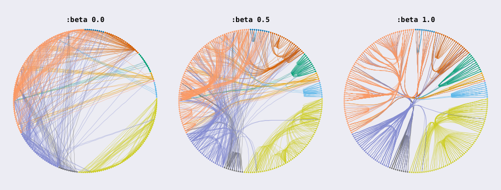
:::


## Dendrogram

A hierarchy as a tree of branches: from data with levels, or from hierarchical clustering, where the height of a
merge is the distance between the groups.


### From hierarchical data

World regions and their subregions, the tree drawn from the levels of the rows.

Source: R Graph Gallery - Dendrogram with ggraph; data-to-viz - Dendrogram ([1](https://r-graph-gallery.com/334-basic-dendrogram-with-ggraph.html), [2](https://www.data-to-viz.com/graph/dendrogram.html)). Data: World population by region, subregion and country, data-to-viz example dataset `11_SevCatOneNumNestedOneObsPerGroup` (Yan Holtz; Wikipedia); licence: MIT (data_to_viz repository).


```{=html}
<div class="data-table"><table class="table table-hover table-responsive clay-table"><thead><tr><th>region</th><th>subregion</th><th>country</th><th>population</th></tr></thead><tbody><tr><td>Asia</td><td>Southern Asia</td><td>Afghanistan</td><td>25500100</td></tr><tr><td>Europe</td><td>Northern Europe</td><td>Åland Islands</td><td>28502</td></tr><tr><td>Europe</td><td>Southern Europe</td><td>Albania</td><td>2821977</td></tr><tr><td>Africa</td><td>Northern Africa</td><td>Algeria</td><td>37900000</td></tr><tr><td>Oceania</td><td>Polynesia</td><td>American Samoa</td><td>55519</td></tr><tr><td>Europe</td><td>Southern Europe</td><td>Andorra</td><td>76246</td></tr><tr><td>Africa</td><td>Middle Africa</td><td>Angola</td><td>20609294</td></tr><tr><td>Americas</td><td>Caribbean</td><td>Anguilla</td><td>13452</td></tr><tr><td>Americas</td><td>Caribbean</td><td>Antigua and Barbuda</td><td>86295</td></tr><tr><td>Americas</td><td>South America</td><td>Argentina</td><td>40117096</td></tr><tr><td>Asia</td><td>Western Asia</td><td>Armenia</td><td>3024100</td></tr><tr><td>Americas</td><td>Caribbean</td><td>Aruba</td><td>101484</td></tr><tr><td>Oceania</td><td>Australia and New Zealand</td><td>Australia</td><td>23254142</td></tr><tr><td>Europe</td><td>Western Europe</td><td>Austria</td><td>8501502</td></tr><tr><td>Asia</td><td>Western Asia</td><td>Azerbaijan</td><td>9235100</td></tr><tr><td>Americas</td><td>Caribbean</td><td>Bahamas</td><td></td></tr><tr><td>Asia</td><td>Western Asia</td><td>Bahrain</td><td>1234571</td></tr><tr><td>Asia</td><td>Southern Asia</td><td>Bangladesh</td><td>152518015</td></tr><tr><td>Americas</td><td>Caribbean</td><td>Barbados</td><td>274200</td></tr><tr><td>Europe</td><td>Eastern Europe</td><td>Belarus</td><td>9465500</td></tr><tr><td>Europe</td><td>Western Europe</td><td>Belgium</td><td>11175653</td></tr><tr><td>Americas</td><td>Central America</td><td>Belize</td><td>312971</td></tr><tr><td>Africa</td><td>Western Africa</td><td>Benin</td><td>10323000</td></tr><tr><td>Americas</td><td>Northern America</td><td>Bermuda</td><td>64237</td></tr><tr><td>Asia</td><td>Southern Asia</td><td>Bhutan</td><td>740990</td></tr><tr><td>Americas</td><td>South America</td><td>Bolivia</td><td>10027254</td></tr><tr><td>Americas</td><td>Caribbean</td><td>Bonaire</td><td></td></tr><tr><td>Europe</td><td>Southern Europe</td><td>Bosnia and Herzegovina</td><td>3791622</td></tr><tr><td>Africa</td><td>Southern Africa</td><td>Botswana</td><td>2024904</td></tr><tr><td>Americas</td><td>South America</td><td>Brazil</td><td>201032714</td></tr><tr><td>Africa</td><td>Eastern Africa</td><td>British Indian Ocean Territory</td><td></td></tr><tr><td>Americas</td><td>Caribbean</td><td>British Virgin Islands</td><td>29537</td></tr><tr><td>Asia</td><td>South-Eastern Asia</td><td>Brunei</td><td>393162</td></tr><tr><td>Europe</td><td>Eastern Europe</td><td>Bulgaria</td><td>7282041</td></tr><tr><td>Africa</td><td>Western Africa</td><td>Burkina Faso</td><td>17322796</td></tr><tr><td>Africa</td><td>Eastern Africa</td><td>Burundi</td><td>10163000</td></tr><tr><td>Asia</td><td>South-Eastern Asia</td><td>Cambodia</td><td>15135000</td></tr><tr><td>Africa</td><td>Middle Africa</td><td>Cameroon</td><td>20386799</td></tr><tr><td>Americas</td><td>Northern America</td><td>Canada</td><td>35158304</td></tr><tr><td>Africa</td><td>Western Africa</td><td>Cape Verde</td><td>491875</td></tr><tr><td>Americas</td><td>Caribbean</td><td>Cayman Islands</td><td>55456</td></tr><tr><td>Africa</td><td>Middle Africa</td><td>Central African Republic</td><td>4616000</td></tr><tr><td>Africa</td><td>Middle Africa</td><td>Chad</td><td>12825000</td></tr><tr><td>Americas</td><td>South America</td><td>Chile</td><td>16634603</td></tr><tr><td>Asia</td><td>Eastern Asia</td><td>China</td><td>1361170000</td></tr><tr><td>Oceania</td><td>Australia and New Zealand</td><td>Christmas Island</td><td>2072</td></tr><tr><td>Oceania</td><td>Australia and New Zealand</td><td>Cocos (Keeling) Islands</td><td>550</td></tr><tr><td>Americas</td><td>South America</td><td>Colombia</td><td>47330000</td></tr><tr><td>Africa</td><td>Eastern Africa</td><td>Comoros</td><td>724300</td></tr><tr><td>Africa</td><td>Middle Africa</td><td>Republic of the Congo</td><td>4448000</td></tr><tr><td>Africa</td><td>Middle Africa</td><td>Democratic Republic of the Congo</td><td>67514000</td></tr><tr><td>Oceania</td><td>Polynesia</td><td>Cook Islands</td><td>14974</td></tr><tr><td>Americas</td><td>Central America</td><td>Costa Rica</td><td>4667096</td></tr><tr><td>Africa</td><td>Western Africa</td><td>Côte d'Ivoire</td><td></td></tr><tr><td>Europe</td><td>Southern Europe</td><td>Croatia</td><td>4290612</td></tr><tr><td>Americas</td><td>Caribbean</td><td>Cuba</td><td>11167325</td></tr><tr><td>Americas</td><td>Caribbean</td><td>Curaçao</td><td>150563</td></tr><tr><td>Asia</td><td>Western Asia</td><td>Cyprus</td><td>865878</td></tr><tr><td>Europe</td><td>Eastern Europe</td><td>Czech Republic</td><td>10512900</td></tr><tr><td>Europe</td><td>Northern Europe</td><td>Denmark</td><td>5623501</td></tr><tr><td>Africa</td><td>Eastern Africa</td><td>Djibouti</td><td>864618</td></tr><tr><td>Americas</td><td>Caribbean</td><td>Dominica</td><td>71293</td></tr><tr><td>Americas</td><td>Caribbean</td><td>Dominican Republic</td><td>9445281</td></tr><tr><td>Americas</td><td>South America</td><td>Ecuador</td><td>15617900</td></tr><tr><td>Africa</td><td>Northern Africa</td><td>Egypt</td><td>83661000</td></tr><tr><td>Americas</td><td>Central America</td><td>El Salvador</td><td>6340000</td></tr><tr><td>Africa</td><td>Middle Africa</td><td>Equatorial Guinea</td><td>1622000</td></tr><tr><td>Africa</td><td>Eastern Africa</td><td>Eritrea</td><td>6333000</td></tr><tr><td>Europe</td><td>Northern Europe</td><td>Estonia</td><td>1286540</td></tr><tr><td>Africa</td><td>Eastern Africa</td><td>Ethiopia</td><td>86613986</td></tr><tr><td>Americas</td><td>South America</td><td>Falkland Islands</td><td>2563</td></tr><tr><td>Europe</td><td>Northern Europe</td><td>Faroe Islands</td><td>48509</td></tr><tr><td>Oceania</td><td>Melanesia</td><td>Fiji</td><td>858038</td></tr><tr><td>Europe</td><td>Northern Europe</td><td>Finland</td><td>5445883</td></tr><tr><td>Europe</td><td>Western Europe</td><td>France</td><td>65806000</td></tr><tr><td>Americas</td><td>South America</td><td>French Guiana</td><td>229040</td></tr><tr><td>Oceania</td><td>Polynesia</td><td>French Polynesia</td><td>268270</td></tr><tr><td>Africa</td><td>Middle Africa</td><td>Gabon</td><td>1672000</td></tr><tr><td>Africa</td><td>Western Africa</td><td>Gambia</td><td></td></tr><tr><td>Asia</td><td>Western Asia</td><td>Georgia</td><td></td></tr><tr><td>Europe</td><td>Western Europe</td><td>Germany</td><td>80523700</td></tr><tr><td>Africa</td><td>Western Africa</td><td>Ghana</td><td>24658823</td></tr><tr><td>Europe</td><td>Southern Europe</td><td>Gibraltar</td><td>29752</td></tr><tr><td>Europe</td><td>Southern Europe</td><td>Greece</td><td>10815197</td></tr><tr><td>Americas</td><td>Northern America</td><td>Greenland</td><td>56370</td></tr><tr><td>Americas</td><td>Caribbean</td><td>Grenada</td><td>103328</td></tr><tr><td>Americas</td><td>Caribbean</td><td>Guadeloupe</td><td>403355</td></tr><tr><td>Oceania</td><td>Micronesia</td><td>Guam</td><td>159358</td></tr><tr><td>Americas</td><td>Central America</td><td>Guatemala</td><td>15438384</td></tr><tr><td>Europe</td><td>Northern Europe</td><td>Guernsey</td><td>62431</td></tr><tr><td>Africa</td><td>Western Africa</td><td>Guinea</td><td>10824200</td></tr><tr><td>Africa</td><td>Western Africa</td><td>Guinea-Bissau</td><td>1704000</td></tr><tr><td>Americas</td><td>South America</td><td>Guyana</td><td>784894</td></tr><tr><td>Americas</td><td>Caribbean</td><td>Haiti</td><td>10413211</td></tr><tr><td>Europe</td><td>Southern Europe</td><td>Vatican City</td><td>800</td></tr><tr><td>Americas</td><td>Central America</td><td>Honduras</td><td>8555072</td></tr><tr><td>Asia</td><td>Eastern Asia</td><td>Hong Kong</td><td>7184000</td></tr><tr><td>Europe</td><td>Eastern Europe</td><td>Hungary</td><td>9906000</td></tr><tr><td>Europe</td><td>Northern Europe</td><td>Iceland</td><td>325010</td></tr><tr><td>Asia</td><td>Southern Asia</td><td>India</td><td>1236670000</td></tr><tr><td>…</td><td>…</td><td>…</td><td>…</td></tr></tbody></table></div>
```


::: {.sourceClojure}
```clojure
(plot/render-image
 (plot/dendrogram (tree/from-levels (nu/dataset :world-population) {:hierarchy [:region :subregion]})
                  {:horizontal true :group-labels true :title "World regions and subregions"})
 {:width 650 :height 650})
```
:::


::: {.clay-image}

:::


### From clustering, coloured clusters, circular

Complete-linkage clustering of the standardized cars (fastmath `hclust`), cut into 3 clusters; the same tree
around a circle.

Source: R Graph Gallery - Basic dendrogram, custom colours, circular dendrogram, dendextend ([1](https://r-graph-gallery.com/29-basic-dendrogram.html), [2](https://r-graph-gallery.com/31-custom-colors-in-dendrogram.html), [3](https://r-graph-gallery.com/339-circular-dendrogram-with-ggraph.html), [4](https://r-graph-gallery.com/340-custom-your-dendrogram-with-dendextend.html)). Data: Motor Trend car road tests (1974), R datasets package `mtcars` (Henderson & Velleman 1981); licence: Part of R (GPL-2 | GPL-3).


::: {.sourceClojure}
```clojure
(def car-clustering (cl/hclust standardized {:method :complete}))
```
:::


::: {.sourceClojure}
```clojure
(def cars (mapv :model mtcars))
```
:::


::: {.sourceClojure}
```clojure
(plot/render-image
 (plot/dendrogram car-clustering {:leaf-names cars :k 3 :theme {:palette {:color :set1}}
                                  :title "mtcars: complete-linkage clustering, 3 clusters"})
 {:width 1000 :height 500})
```
:::


::: {.clay-image}
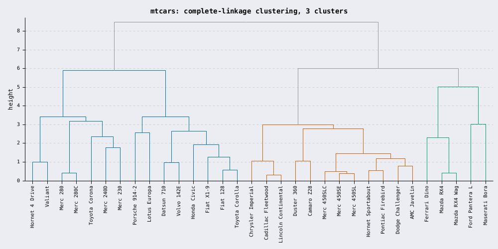
:::


::: {.sourceClojure}
```clojure
(plot/render-image
 (plot/dendrogram car-clustering {:leaf-names cars :k 3 :circular true :theme {:palette {:color :set1}}
                                  :title "The same clustering, circular"})
 {:width 700 :height 700})
```
:::


::: {.clay-image}
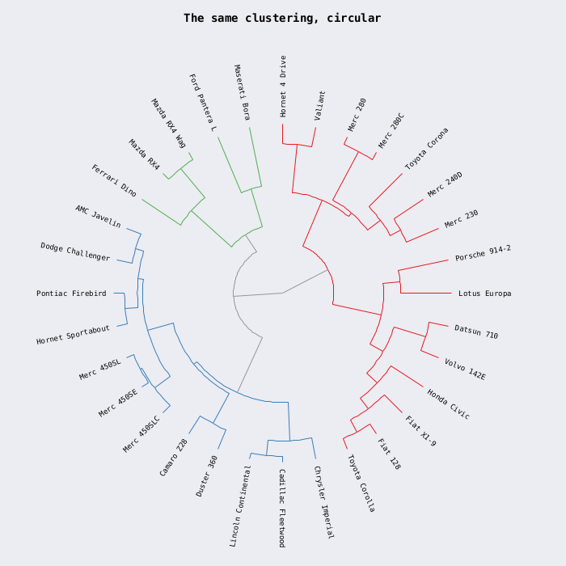
:::


## Clustered heatmap

Rows and columns of a heatmap ordered by clustering, their dendrograms beside it: similar cars and similar
variables come together.

Source: [R Graph Gallery - The heatmap function](https://r-graph-gallery.com/215-the-heatmap-function.html). Data: Motor Trend car road tests (1974), R datasets package `mtcars` (Henderson & Velleman 1981); licence: Part of R (GPL-2 | GPL-3).


::: {.sourceClojure}
```clojure
(plot/render-image
 (plot/clustered-heatmap (vec (for [[car row] (map vector cars standardized) [k v] (map vector mtcars-variables row)]
                                {:car car :variable (name k) :z v}))
                         {:row :car :col :variable :value :z
                          :scales {:color {:range :RColorBrewer/RdBu :midpoint 0 :reverse true :title "z-score"}}
                          :title "mtcars: cars and variables ordered by clustering"})
 {:width 900 :height 800})
```
:::


::: {.clay-image}
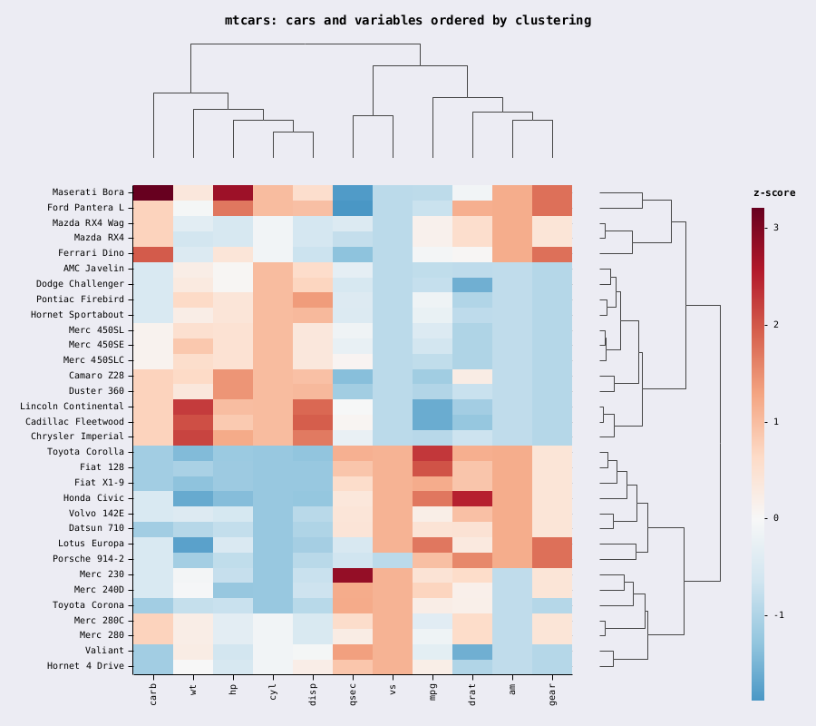
:::


## Circular plots

Ordinary charts in polar coordinates: the angle runs along a variable, the radius along another; `:start`,
`:direction`, `:inner` and `:span` shape the circle.


### Basic, customised, part of the circle

Air passengers by month around the circle, a ring per year: the default circle, then a hole, a start at 3 o'clock
counter-clockwise, and half a circle.

Source: R Graph Gallery - Basic circular plot, custom a track, part of the circular plot ([1](https://r-graph-gallery.com/224-basic-circular-plot.html), [2](https://r-graph-gallery.com/225-circular-plot-custom-a-track.html), [3](https://r-graph-gallery.com/230-draw-part-of-the-circular-plot-only.html)). Data: Monthly airline passengers, 1949-1960, R datasets package `AirPassengers` (Box & Jenkins 1976); licence: Part of R (GPL-2 | GPL-3).


::: {.sourceClojure}
```clojure
(def months ["Jan" "Feb" "Mar" "Apr" "May" "Jun" "Jul" "Aug" "Sep" "Oct" "Nov" "Dec"])
```
:::


::: {.sourceClojure}
```clojure
(plot/render-image
 (plot/arrange (vec (for [[coord title] [[{:kind :polar} "default"]
                                         [{:kind :polar :inner 0.3 :start 90 :direction :counter-clockwise} "hole, start, direction"]
                                         [{:kind :polar :span 180 :start -90} "half a circle"]]]
                      {:data air-passengers :mapping {:x :month :y :passengers :color :year}
                       :charts [(chart/scatter {:size 5})]
                       :coord coord
                       :scales {:x {:domain months}}
                       :legend false
                       :labels {:title title :x nil :y nil}}))
               {:columns 3})
 {:width 1000 :height 400})
```
:::


::: {.clay-image}
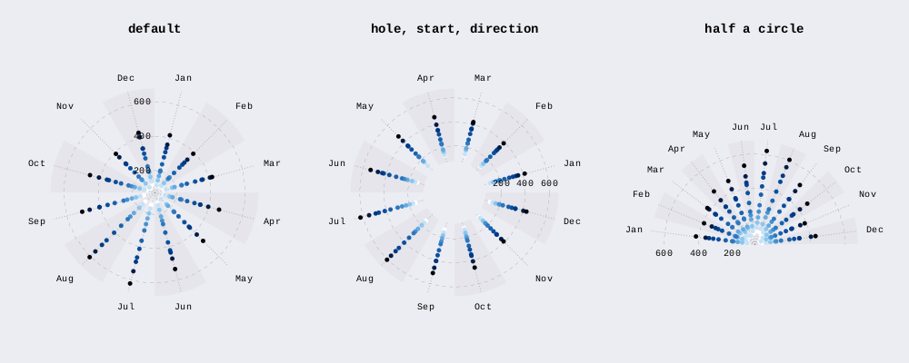
:::


### Chart types, several plots

Points, a line per year and bars of the monthly totals in the same circle, and one circular plot per period.

Source: R Graph Gallery - Plot types for circular plot, several circular plots in a figure ([1](https://r-graph-gallery.com/226-plot-types-for-circular-plot.html), [2](https://r-graph-gallery.com/229-several-circular-plots-in-a-figure.html)). Data: Monthly airline passengers, 1949-1960, R datasets package `AirPassengers` (Box & Jenkins 1976); licence: Part of R (GPL-2 | GPL-3).


::: {.sourceClojure}
```clojure
(def periods
  (mapv #(assoc % :period (cond (<= (long (:year %)) 1952) "1949-1952" (<= (long (:year %)) 1956) "1953-1956" :else "1957-1960"))
        air-passengers))
```
:::


```{=html}
<div class="data-table"><table class="table table-hover table-responsive clay-table"><thead><tr><th>date</th><th>year</th><th>month</th><th>passengers</th><th>period</th></tr></thead><tbody><tr><td>1949-01-01</td><td>1949</td><td>Jan</td><td>112</td><td>1949-1952</td></tr><tr><td>1949-02-01</td><td>1949</td><td>Feb</td><td>118</td><td>1949-1952</td></tr><tr><td>1949-03-01</td><td>1949</td><td>Mar</td><td>132</td><td>1949-1952</td></tr><tr><td>1949-04-01</td><td>1949</td><td>Apr</td><td>129</td><td>1949-1952</td></tr><tr><td>1949-05-01</td><td>1949</td><td>May</td><td>121</td><td>1949-1952</td></tr><tr><td>1949-06-01</td><td>1949</td><td>Jun</td><td>135</td><td>1949-1952</td></tr><tr><td>1949-07-01</td><td>1949</td><td>Jul</td><td>148</td><td>1949-1952</td></tr><tr><td>1949-08-01</td><td>1949</td><td>Aug</td><td>148</td><td>1949-1952</td></tr><tr><td>1949-09-01</td><td>1949</td><td>Sep</td><td>136</td><td>1949-1952</td></tr><tr><td>1949-10-01</td><td>1949</td><td>Oct</td><td>119</td><td>1949-1952</td></tr><tr><td>1949-11-01</td><td>1949</td><td>Nov</td><td>104</td><td>1949-1952</td></tr><tr><td>1949-12-01</td><td>1949</td><td>Dec</td><td>118</td><td>1949-1952</td></tr><tr><td>1950-01-01</td><td>1950</td><td>Jan</td><td>115</td><td>1949-1952</td></tr><tr><td>1950-02-01</td><td>1950</td><td>Feb</td><td>126</td><td>1949-1952</td></tr><tr><td>1950-03-01</td><td>1950</td><td>Mar</td><td>141</td><td>1949-1952</td></tr><tr><td>1950-04-01</td><td>1950</td><td>Apr</td><td>135</td><td>1949-1952</td></tr><tr><td>1950-05-01</td><td>1950</td><td>May</td><td>125</td><td>1949-1952</td></tr><tr><td>1950-06-01</td><td>1950</td><td>Jun</td><td>149</td><td>1949-1952</td></tr><tr><td>1950-07-01</td><td>1950</td><td>Jul</td><td>170</td><td>1949-1952</td></tr><tr><td>1950-08-01</td><td>1950</td><td>Aug</td><td>170</td><td>1949-1952</td></tr><tr><td>1950-09-01</td><td>1950</td><td>Sep</td><td>158</td><td>1949-1952</td></tr><tr><td>1950-10-01</td><td>1950</td><td>Oct</td><td>133</td><td>1949-1952</td></tr><tr><td>1950-11-01</td><td>1950</td><td>Nov</td><td>114</td><td>1949-1952</td></tr><tr><td>1950-12-01</td><td>1950</td><td>Dec</td><td>140</td><td>1949-1952</td></tr><tr><td>1951-01-01</td><td>1951</td><td>Jan</td><td>145</td><td>1949-1952</td></tr><tr><td>1951-02-01</td><td>1951</td><td>Feb</td><td>150</td><td>1949-1952</td></tr><tr><td>1951-03-01</td><td>1951</td><td>Mar</td><td>178</td><td>1949-1952</td></tr><tr><td>1951-04-01</td><td>1951</td><td>Apr</td><td>163</td><td>1949-1952</td></tr><tr><td>1951-05-01</td><td>1951</td><td>May</td><td>172</td><td>1949-1952</td></tr><tr><td>1951-06-01</td><td>1951</td><td>Jun</td><td>178</td><td>1949-1952</td></tr><tr><td>1951-07-01</td><td>1951</td><td>Jul</td><td>199</td><td>1949-1952</td></tr><tr><td>1951-08-01</td><td>1951</td><td>Aug</td><td>199</td><td>1949-1952</td></tr><tr><td>1951-09-01</td><td>1951</td><td>Sep</td><td>184</td><td>1949-1952</td></tr><tr><td>1951-10-01</td><td>1951</td><td>Oct</td><td>162</td><td>1949-1952</td></tr><tr><td>1951-11-01</td><td>1951</td><td>Nov</td><td>146</td><td>1949-1952</td></tr><tr><td>1951-12-01</td><td>1951</td><td>Dec</td><td>166</td><td>1949-1952</td></tr><tr><td>1952-01-01</td><td>1952</td><td>Jan</td><td>171</td><td>1949-1952</td></tr><tr><td>1952-02-01</td><td>1952</td><td>Feb</td><td>180</td><td>1949-1952</td></tr><tr><td>1952-03-01</td><td>1952</td><td>Mar</td><td>193</td><td>1949-1952</td></tr><tr><td>1952-04-01</td><td>1952</td><td>Apr</td><td>181</td><td>1949-1952</td></tr><tr><td>1952-05-01</td><td>1952</td><td>May</td><td>183</td><td>1949-1952</td></tr><tr><td>1952-06-01</td><td>1952</td><td>Jun</td><td>218</td><td>1949-1952</td></tr><tr><td>1952-07-01</td><td>1952</td><td>Jul</td><td>230</td><td>1949-1952</td></tr><tr><td>1952-08-01</td><td>1952</td><td>Aug</td><td>242</td><td>1949-1952</td></tr><tr><td>1952-09-01</td><td>1952</td><td>Sep</td><td>209</td><td>1949-1952</td></tr><tr><td>1952-10-01</td><td>1952</td><td>Oct</td><td>191</td><td>1949-1952</td></tr><tr><td>1952-11-01</td><td>1952</td><td>Nov</td><td>172</td><td>1949-1952</td></tr><tr><td>1952-12-01</td><td>1952</td><td>Dec</td><td>194</td><td>1949-1952</td></tr><tr><td>1953-01-01</td><td>1953</td><td>Jan</td><td>196</td><td>1953-1956</td></tr><tr><td>1953-02-01</td><td>1953</td><td>Feb</td><td>196</td><td>1953-1956</td></tr><tr><td>1953-03-01</td><td>1953</td><td>Mar</td><td>236</td><td>1953-1956</td></tr><tr><td>1953-04-01</td><td>1953</td><td>Apr</td><td>235</td><td>1953-1956</td></tr><tr><td>1953-05-01</td><td>1953</td><td>May</td><td>229</td><td>1953-1956</td></tr><tr><td>1953-06-01</td><td>1953</td><td>Jun</td><td>243</td><td>1953-1956</td></tr><tr><td>1953-07-01</td><td>1953</td><td>Jul</td><td>264</td><td>1953-1956</td></tr><tr><td>1953-08-01</td><td>1953</td><td>Aug</td><td>272</td><td>1953-1956</td></tr><tr><td>1953-09-01</td><td>1953</td><td>Sep</td><td>237</td><td>1953-1956</td></tr><tr><td>1953-10-01</td><td>1953</td><td>Oct</td><td>211</td><td>1953-1956</td></tr><tr><td>1953-11-01</td><td>1953</td><td>Nov</td><td>180</td><td>1953-1956</td></tr><tr><td>1953-12-01</td><td>1953</td><td>Dec</td><td>201</td><td>1953-1956</td></tr><tr><td>1954-01-01</td><td>1954</td><td>Jan</td><td>204</td><td>1953-1956</td></tr><tr><td>1954-02-01</td><td>1954</td><td>Feb</td><td>188</td><td>1953-1956</td></tr><tr><td>1954-03-01</td><td>1954</td><td>Mar</td><td>235</td><td>1953-1956</td></tr><tr><td>1954-04-01</td><td>1954</td><td>Apr</td><td>227</td><td>1953-1956</td></tr><tr><td>1954-05-01</td><td>1954</td><td>May</td><td>234</td><td>1953-1956</td></tr><tr><td>1954-06-01</td><td>1954</td><td>Jun</td><td>264</td><td>1953-1956</td></tr><tr><td>1954-07-01</td><td>1954</td><td>Jul</td><td>302</td><td>1953-1956</td></tr><tr><td>1954-08-01</td><td>1954</td><td>Aug</td><td>293</td><td>1953-1956</td></tr><tr><td>1954-09-01</td><td>1954</td><td>Sep</td><td>259</td><td>1953-1956</td></tr><tr><td>1954-10-01</td><td>1954</td><td>Oct</td><td>229</td><td>1953-1956</td></tr><tr><td>1954-11-01</td><td>1954</td><td>Nov</td><td>203</td><td>1953-1956</td></tr><tr><td>1954-12-01</td><td>1954</td><td>Dec</td><td>229</td><td>1953-1956</td></tr><tr><td>1955-01-01</td><td>1955</td><td>Jan</td><td>242</td><td>1953-1956</td></tr><tr><td>1955-02-01</td><td>1955</td><td>Feb</td><td>233</td><td>1953-1956</td></tr><tr><td>1955-03-01</td><td>1955</td><td>Mar</td><td>267</td><td>1953-1956</td></tr><tr><td>1955-04-01</td><td>1955</td><td>Apr</td><td>269</td><td>1953-1956</td></tr><tr><td>1955-05-01</td><td>1955</td><td>May</td><td>270</td><td>1953-1956</td></tr><tr><td>1955-06-01</td><td>1955</td><td>Jun</td><td>315</td><td>1953-1956</td></tr><tr><td>1955-07-01</td><td>1955</td><td>Jul</td><td>364</td><td>1953-1956</td></tr><tr><td>1955-08-01</td><td>1955</td><td>Aug</td><td>347</td><td>1953-1956</td></tr><tr><td>1955-09-01</td><td>1955</td><td>Sep</td><td>312</td><td>1953-1956</td></tr><tr><td>1955-10-01</td><td>1955</td><td>Oct</td><td>274</td><td>1953-1956</td></tr><tr><td>1955-11-01</td><td>1955</td><td>Nov</td><td>237</td><td>1953-1956</td></tr><tr><td>1955-12-01</td><td>1955</td><td>Dec</td><td>278</td><td>1953-1956</td></tr><tr><td>1956-01-01</td><td>1956</td><td>Jan</td><td>284</td><td>1953-1956</td></tr><tr><td>1956-02-01</td><td>1956</td><td>Feb</td><td>277</td><td>1953-1956</td></tr><tr><td>1956-03-01</td><td>1956</td><td>Mar</td><td>317</td><td>1953-1956</td></tr><tr><td>1956-04-01</td><td>1956</td><td>Apr</td><td>313</td><td>1953-1956</td></tr><tr><td>1956-05-01</td><td>1956</td><td>May</td><td>318</td><td>1953-1956</td></tr><tr><td>1956-06-01</td><td>1956</td><td>Jun</td><td>374</td><td>1953-1956</td></tr><tr><td>1956-07-01</td><td>1956</td><td>Jul</td><td>413</td><td>1953-1956</td></tr><tr><td>1956-08-01</td><td>1956</td><td>Aug</td><td>405</td><td>1953-1956</td></tr><tr><td>1956-09-01</td><td>1956</td><td>Sep</td><td>355</td><td>1953-1956</td></tr><tr><td>1956-10-01</td><td>1956</td><td>Oct</td><td>306</td><td>1953-1956</td></tr><tr><td>1956-11-01</td><td>1956</td><td>Nov</td><td>271</td><td>1953-1956</td></tr><tr><td>1956-12-01</td><td>1956</td><td>Dec</td><td>306</td><td>1953-1956</td></tr><tr><td>1957-01-01</td><td>1957</td><td>Jan</td><td>315</td><td>1957-1960</td></tr><tr><td>1957-02-01</td><td>1957</td><td>Feb</td><td>301</td><td>1957-1960</td></tr><tr><td>1957-03-01</td><td>1957</td><td>Mar</td><td>356</td><td>1957-1960</td></tr><tr><td>1957-04-01</td><td>1957</td><td>Apr</td><td>348</td><td>1957-1960</td></tr><tr><td>…</td><td>…</td><td>…</td><td>…</td><td>…</td></tr></tbody></table></div>
```


::: {.sourceClojure}
```clojure
(plot/render-image
 (plot/arrange
  [{:data air-passengers :mapping {:x :month :y :passengers}
    :charts [(chart/scatter {:size 4})] :coord {:kind :polar :inner 0.2} :scales {:x {:domain months}}
    :labels {:title "points" :x nil :y nil}}
   {:data air-passengers :mapping {:x :month :y :passengers :group :year}
    :charts [(chart/line {:order :data :color [70 130 180 150]})] :coord {:kind :polar :inner 0.2} :scales {:x {:domain months}}
    :labels {:title "a line per year" :x nil :y nil}}
   {:data air-passengers :mapping {:x :month :y :passengers}
    :charts [(chart/bar {:stat :sum})] :coord {:kind :polar :inner 0.2} :scales {:x {:domain months}}
    :labels {:title "bars: monthly totals" :x nil :y nil}}]
  {:columns 3})
 {:width 1000 :height 400})
```
:::


::: {.clay-image}
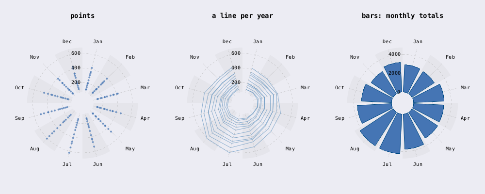
:::


::: {.sourceClojure}
```clojure
(plot/render-image
 {:data periods :mapping {:x :month :y :passengers :group :year :facet :period}
  :charts [(chart/line {:order :data})]
  :coord {:kind :polar :inner 0.2}
  :scales {:x {:domain months}}
  :labels {:title "One circular plot per period" :x nil :y nil}}
 {:width 1000 :height 420})
```
:::


::: {.clay-image}

:::


## Flow sunburst

Sequences of steps (website visits, here 2000 synthetic sessions) as rings from the centre: every step coloured by
its page wherever it occurs, `end` where a session stops.

Source: [data-to-viz - Sunburst](https://www.data-to-viz.com/graph/sunburst.html).


::: {.sourceClojure}
```clojure
(def pages ["home" "search" "product" "account" "cart" "help"])
```
:::


::: {.sourceClojure}
```clojure
(def visits
  "2000 sessions starting at home: each step to another page or the end (more likely the longer the session), at
  most 6 pages; a seeded random walk."
  (let [g (r/rng :mersenne 7)
        weights {"home" [0 5 3 2 0 1] "search" [1 2 6 0 1 1] "product" [1 2 2 1 4 1]
                 "account" [2 0 1 1 1 2] "cart" [0 0 2 2 0 1] "help" [2 2 0 2 0 1]}
        pick (fn [ws] (let [total (double (reduce + ws)) u (* total (r/drandom g))]
                        (loop [i 0 acc 0.0]
                          (let [acc (+ acc (double (ws i)))]
                            (if (or (< u acc) (= i (dec (count ws)))) i (recur (inc i) acc))))))]
    (vec (for [_ (range 2000)]
           {:sequence (str/join "-" (loop [path ["home"]]
                                      (if (or (= 6 (count path)) (< (r/drandom g) (* 0.12 (count path))))
                                        (conj path "end")
                                        (recur (conj path (pages (pick (weights (peek path)))))))))}))))
```
:::


```{=html}
<div class="data-table"><table class="table table-hover table-responsive clay-table"><thead><tr><th>sequence</th></tr></thead><tbody><tr><td>home-search-product-cart-help-account-end</td></tr><tr><td>home-product-end</td></tr><tr><td>home-account-help-account-end</td></tr><tr><td>home-search-product-cart-end</td></tr><tr><td>home-end</td></tr><tr><td>home-end</td></tr><tr><td>home-product-end</td></tr><tr><td>home-search-product-product-home-end</td></tr><tr><td>home-product-home-end</td></tr><tr><td>home-search-product-end</td></tr><tr><td>home-product-cart-account-end</td></tr><tr><td>home-end</td></tr><tr><td>home-end</td></tr><tr><td>home-search-home-search-search-end</td></tr><tr><td>home-search-end</td></tr><tr><td>home-search-product-cart-end</td></tr><tr><td>home-product-end</td></tr><tr><td>home-product-product-cart-product-end</td></tr><tr><td>home-search-end</td></tr><tr><td>home-search-end</td></tr><tr><td>home-help-end</td></tr><tr><td>home-end</td></tr><tr><td>home-end</td></tr><tr><td>home-search-end</td></tr><tr><td>home-search-end</td></tr><tr><td>home-search-search-end</td></tr><tr><td>home-search-search-product-end</td></tr><tr><td>home-search-home-account-product-end</td></tr><tr><td>home-search-product-cart-end</td></tr><tr><td>home-search-end</td></tr><tr><td>home-product-search-product-cart-product-end</td></tr><tr><td>home-help-account-cart-product-search-end</td></tr><tr><td>home-account-home-search-product-search-end</td></tr><tr><td>home-search-search-product-home-end</td></tr><tr><td>home-product-cart-account-home-end</td></tr><tr><td>home-search-end</td></tr><tr><td>home-search-search-home-search-end</td></tr><tr><td>home-product-home-search-end</td></tr><tr><td>home-search-cart-end</td></tr><tr><td>home-search-end</td></tr><tr><td>home-search-product-end</td></tr><tr><td>home-end</td></tr><tr><td>home-account-product-cart-help-end</td></tr><tr><td>home-product-search-search-end</td></tr><tr><td>home-product-home-help-end</td></tr><tr><td>home-product-end</td></tr><tr><td>home-end</td></tr><tr><td>home-account-end</td></tr><tr><td>home-account-account-account-end</td></tr><tr><td>home-help-help-search-end</td></tr><tr><td>home-product-cart-account-home-search-end</td></tr><tr><td>home-search-product-end</td></tr><tr><td>home-product-search-product-end</td></tr><tr><td>home-product-cart-end</td></tr><tr><td>home-account-help-account-end</td></tr><tr><td>home-search-product-cart-help-help-end</td></tr><tr><td>home-search-product-product-cart-end</td></tr><tr><td>home-product-home-product-end</td></tr><tr><td>home-search-end</td></tr><tr><td>home-product-home-end</td></tr><tr><td>home-end</td></tr><tr><td>home-account-home-product-product-cart-end</td></tr><tr><td>home-search-end</td></tr><tr><td>home-search-product-end</td></tr><tr><td>home-account-home-end</td></tr><tr><td>home-search-search-end</td></tr><tr><td>home-search-product-end</td></tr><tr><td>home-product-end</td></tr><tr><td>home-search-help-search-product-search-end</td></tr><tr><td>home-help-end</td></tr><tr><td>home-help-search-cart-end</td></tr><tr><td>home-end</td></tr><tr><td>home-search-home-help-end</td></tr><tr><td>home-product-search-search-product-search-end</td></tr><tr><td>home-product-end</td></tr><tr><td>home-product-cart-end</td></tr><tr><td>home-search-end</td></tr><tr><td>home-search-product-product-end</td></tr><tr><td>home-end</td></tr><tr><td>home-search-search-end</td></tr><tr><td>home-search-product-end</td></tr><tr><td>home-end</td></tr><tr><td>home-search-cart-product-help-home-end</td></tr><tr><td>home-product-help-account-end</td></tr><tr><td>home-help-help-end</td></tr><tr><td>home-product-cart-end</td></tr><tr><td>home-search-product-cart-account-end</td></tr><tr><td>home-search-end</td></tr><tr><td>home-product-end</td></tr><tr><td>home-search-search-search-product-end</td></tr><tr><td>home-end</td></tr><tr><td>home-end</td></tr><tr><td>home-search-help-help-end</td></tr><tr><td>home-search-product-end</td></tr><tr><td>home-product-search-end</td></tr><tr><td>home-account-product-home-product-end</td></tr><tr><td>home-search-product-cart-account-cart-end</td></tr><tr><td>home-product-cart-end</td></tr><tr><td>home-help-account-home-search-end</td></tr><tr><td>home-product-search-product-cart-account-end</td></tr><tr><td>…</td></tr></tbody></table></div>
```


::: {.sourceClojure}
```clojure
(plot/render-image
 (plot/sequences visits {:scales {:color {:domain (conj pages "end")}}
                         :title "2000 website visits: pages in order from the centre"})
 {:width 700 :height 650})
```
:::


::: {.clay-image}
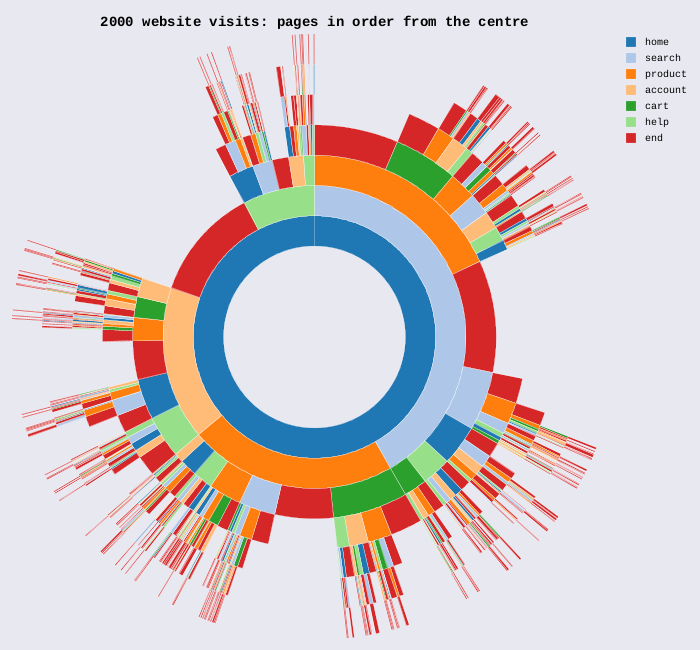
:::


## Caveats


- A network of many nodes and links becomes a hairball: filter weak links, or show the graph as an arc diagram or
  an adjacency heatmap instead.

- Order changes the reading of chord and arc diagrams: `:order :cluster` puts nodes with the same partners
  together; input order may scatter them.

- Weak links clutter chord and sankey diagrams; `:min-value` leaves them out (and the layout says how many).
- Sankey diagrams show flows that go one way: a flow back to an earlier node is a cycle the layout refuses.
- Widths and areas encode values: a band twice as wide is twice the flow, a sector twice as long twice the total.

Source: data-to-viz - Caveats: spaghetti plot, order your data ([1](https://www.data-to-viz.com/caveat/spaghetti.html), [2](https://www.data-to-viz.com/caveat/order_data.html)).


```{=html}
<div style="background-color:grey;height:2px;width:100%;"></div>
```


```{=html}
<div><pre><small><small>source: notebooks/use_cases/flow.clj</small></small></pre></div>
```