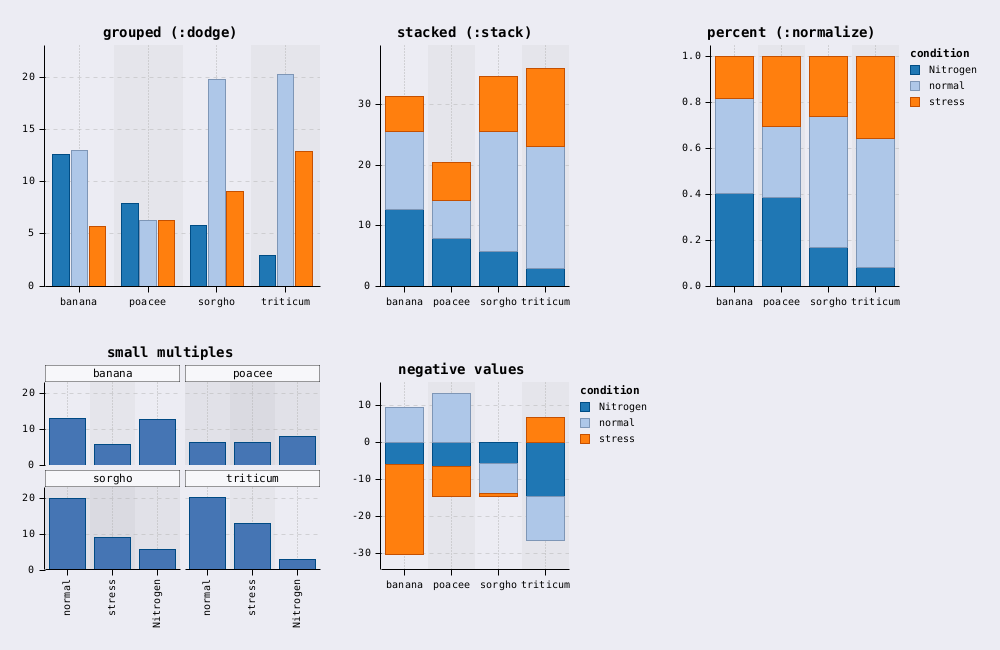
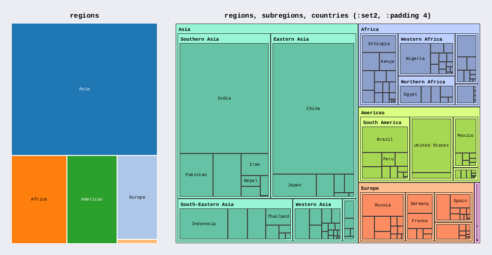
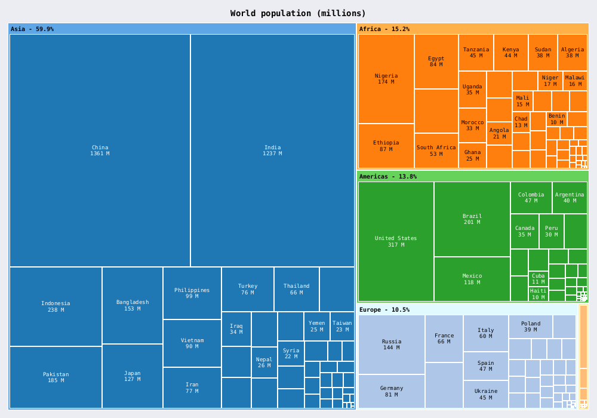
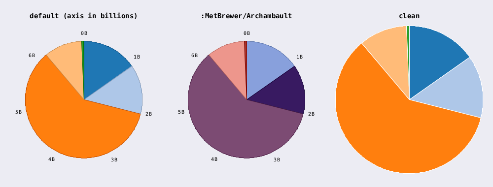
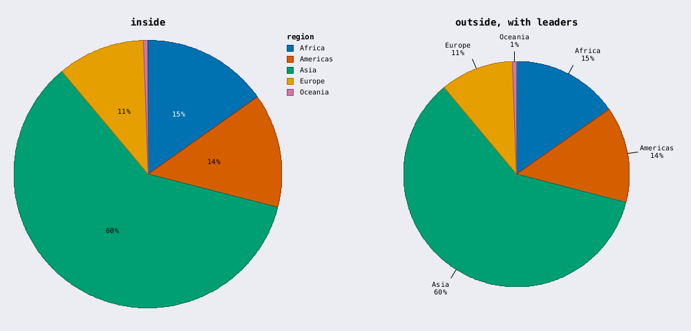
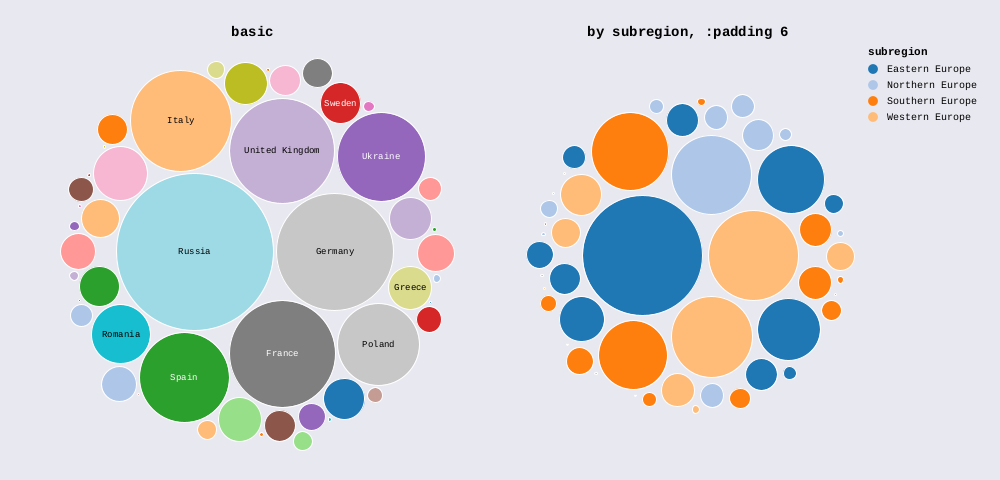
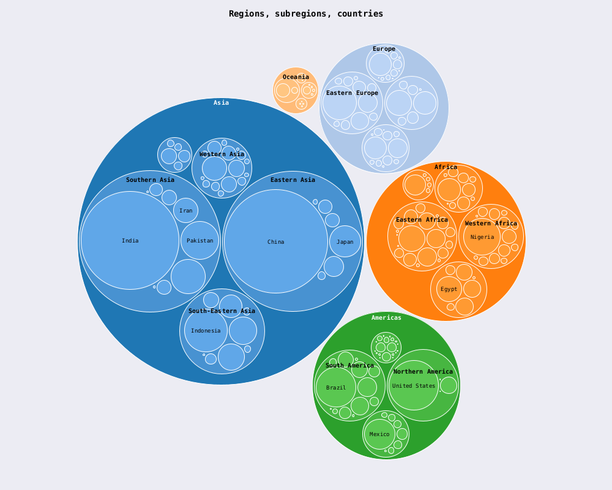
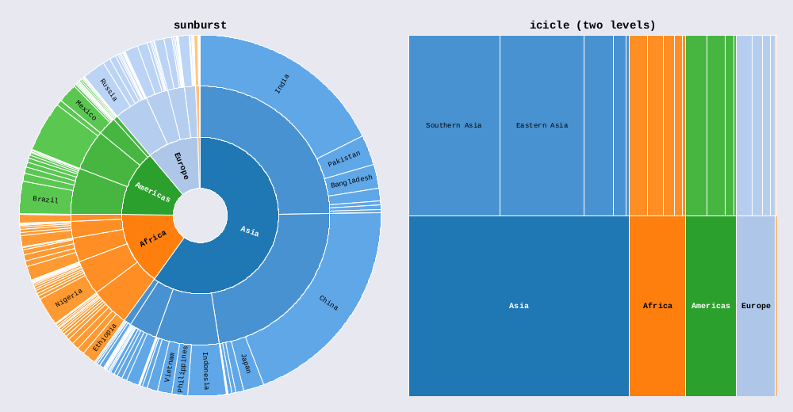
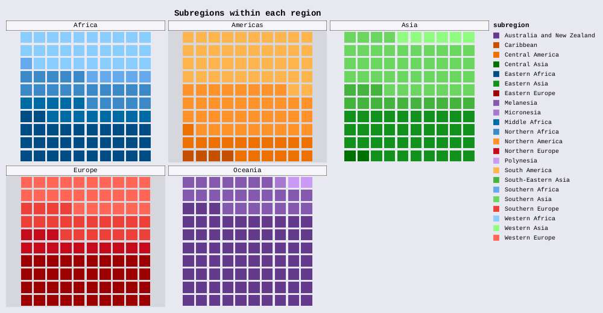
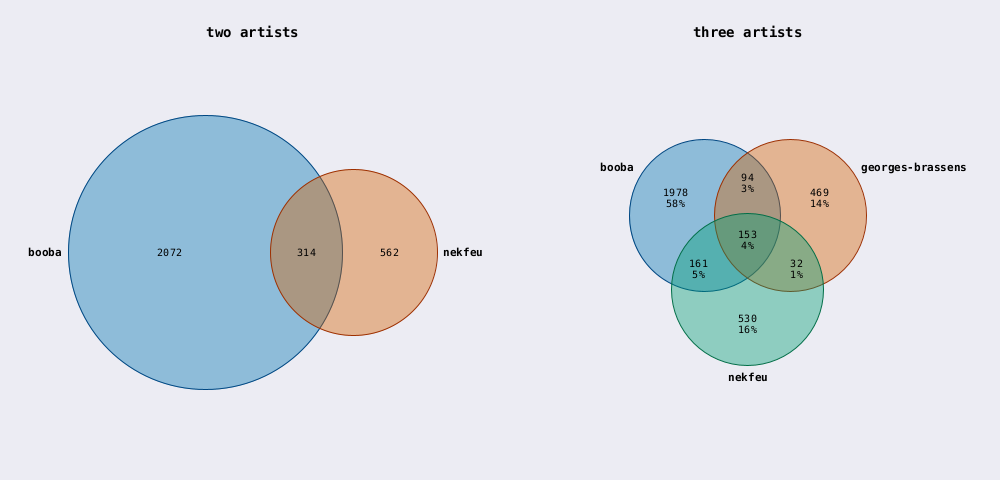

---
format:
  html:
    toc: true
    toc-location: right
    toc-depth: 4
    theme: cosmo
    include-in-header:
      text: |-
        <style>
        .data-table { width: fit-content; max-width: 100%; max-height: 15rem; overflow: auto; margin: 0 auto 1rem; }
        .data-table .table-responsive { overflow: visible; }
        .data-table table { font-size: 0.75rem; width: auto; margin: 0; }
        .data-table th, .data-table td { padding: 0.1rem 0.45rem !important; white-space: nowrap; }
        .data-table thead th { position: sticky; top: 0; background: var(--bs-body-bg, #fff); }
        </style>
code-block-background: true

---
<style></style><style>.printedClojure .sourceCode {
  background-color: transparent;
  border-style: none;
}
</style><style>.clay-limit-image-width .clay-image {max-width: 100%}
.clay-side-by-side .sourceCode {margin: 0}
.clay-side-by-side {margin: 1em 0}
</style>
<script src="https://code.jquery.com/jquery-3.6.0.min.js" type="text/javascript"></script><script src="https://code.jquery.com/ui/1.13.1/jquery-ui.min.js" type="text/javascript"></script>

# Part of a whole

How a whole splits into parts: grouped and stacked bars, treemaps, donuts and pies, circle packing, sunbursts,
waffles, Venn diagrams and UpSet plots (the [R Graph Gallery](https://r-graph-gallery.com/) part-of-a-whole pages,
the [data-to-viz](https://www.data-to-viz.com/) sunburst and the pie caveat).

Not here: dendrograms wait for hierarchical clustering in fastmath (backlog); the sunburst of flows belongs to the
Flow chapter.


::: {.sourceClojure}
```clojure
(ns use-cases.part-of-a-whole
  (:require [clojure2d.color :as c]
            [fastmath.core :as m]
            [fastmath.random :as r]
            [cljplot2.chart :as chart]
            [cljplot2.core :as plot]
            [cljplot2.data.sets :as sets]
            [notebook-utils :as nu]))
```
:::


::: {.sourceClojure}
```clojure
(def world
  "World population by region, subregion and country - the countries with a known population."
  (filterv :population (nu/dataset :world-population)))
```
:::


::: {.sourceClojure}
```clojure
(def europe (filterv #(= "Europe" (:region %)) world))
```
:::


::: {.sourceClojure}
```clojure
(def words (nu/dataset :artist-words))
```
:::


::: {.sourceClojure}
```clojure
(defn- share-label
  "Bar label: the part's name and its share of the whole."
  [{:keys [group share]}]
  (format "%s\n%.0f%%" (:color group) (* 100.0 (double share))))
```
:::


::: {.printedClojure}
```clojure
#'use-cases.part-of-a-whole/share-label

```
:::


::: {.sourceClojure}
```clojure
(defn- percent-label
  "Bar label: the share of the whole only."
  [{:keys [share]}]
  (format "%.0f%%" (* 100.0 (double share))))
```
:::


::: {.printedClojure}
```clojure
#'use-cases.part-of-a-whole/percent-label

```
:::


::: {.sourceClojure}
```clojure
(def pie-base
  "A pie of the regions' populations: stacked bars (`:stat :sum` over the countries of a region) in polar coordinates,
  one bar filling the circle."
  {:data world :mapping {:x :population :color :region} :coord {:kind :polar}
   :labels {:x nil :y nil}})
```
:::


## Grouped and stacked bars

Bars of groups within categories: side by side, on top of each other, scaled to the whole, or one panel per
category.


### Grouped, stacked, percent

R Graph Gallery's specie × condition values (seeded): `:dodge` compares the groups, `:stack` the totals, `:normalize`
the shares; facets give a panel per specie; negative values stack downward from 0.


::: {.sourceClojure}
```clojure
(def species-conditions
  (let [rng (r/rng :mersenne 42)]
    (vec (for [specie ["banana" "poacee" "sorgho" "triticum"]
               condition ["normal" "stress" "Nitrogen"]]
           {:specie specie :condition condition :value (m/abs (r/grandom rng 0.0 15.0))}))))
```
:::


::: {.sourceClojure}
```clojure
(def signed-conditions
  (let [rng (r/rng :mersenne 7)]
    (mapv #(assoc % :value (r/grandom rng 0.0 15.0)) species-conditions)))
```
:::


Source: [R Graph Gallery - Grouped and Stacked barplot](https://r-graph-gallery.com/stacked-barplot.html).


::: {.sourceClojure}
```clojure
(plot/render-image
 (plot/arrange
  (vec (concat
        (for [[title position legend?] [["grouped (:dodge)" :dodge false] ["stacked (:stack)" :stack false]
                                        ["percent (:normalize)" :normalize true]]]
          {:data species-conditions :mapping {:x :specie :y :value :color :condition} :legend legend?
           :charts [(chart/bar {:position position})]
           :labels {:title title :x nil :y nil}})
        [{:data species-conditions :mapping {:x :condition :y :value :facet :specie}
          :theme {:axis {:x {:label-rotation -90}}}
          :charts [(chart/bar)]
          :labels {:title "small multiples" :x nil :y nil}}
         {:data signed-conditions :mapping {:x :specie :y :value :color :condition}
          :charts [(chart/bar {:position :stack})]
          :labels {:title "negative values" :x nil :y nil}}]))
  {:columns 3})
 {:width 1000 :height 650})
```
:::


::: {.clay-image}

:::


### Likert scale

Survey answers as diverging stacked bars (seeded counts): disagreement to the left of 0, agreement to the right,
the neutral answers split half to each side (two `:group`s of one colour). `:negative-order :reverse` stacks the
negative side from the last answer, so the answers in their natural order diverge from the middle.


::: {.sourceClojure}
```clojure
(def answers ["Strongly disagree" "Disagree" "Neutral" "Agree" "Strongly agree"])
```
:::


::: {.sourceClojure}
```clojure
(def likert
  (let [rng (r/rng :mersenne 3)]
    (vec (for [q (range 1 6)
               [i answer] (map-indexed vector answers)
               :let [n (+ 5 (r/irandom rng 40))
                     sign ({0 -1.0 1 -1.0 3 1.0 4 1.0} i)]
               row (if sign
                     [{:question (str "Q" q) :answer answer :side "" :count (* sign n)}]
                     ;; the neutral answer: half on each side, two groups of one colour
                     [{:question (str "Q" q) :answer answer :side "-" :count (* -0.5 n)}
                      {:question (str "Q" q) :answer answer :side "+" :count (* 0.5 n)}])]
           row))))
```
:::


Source: [R Graph Gallery - Grouped and Stacked barplot (the Likert package)](https://r-graph-gallery.com/stacked-barplot.html).


::: {.sourceClojure}
```clojure
(plot/render-image
 {:data likert :mapping {:x :count :y :question :color :answer :group :side}
  :scales {:color {:domain answers
                   :range {"Strongly disagree" [178 24 43] "Disagree" [239 138 98] "Neutral" [200 200 200]
                           "Agree" [103 169 207] "Strongly agree" [33 102 172]}}
          :x {:formatter #(str (long (m/abs (double %))))}}
  :charts [(chart/bar {:position :stack :negative-order :reverse})]
  :labels {:title "Five questions, five answers" :x "answers" :y nil}}
 {:width 800 :height 380})
```
:::


::: {.clay-image}

:::


## Treemap

Nested rectangles, areas proportional to the value: the world's population by region, subregion and country.


### Basic, groups and subgroups

One level (regions) and three (regions → subregions → countries); `:padding` frames the groups, a theme palette
recolours the regions.

Source: R Graph Gallery - Treemap; data-to-viz - Treemap ([1](https://r-graph-gallery.com/treemap.html), [2](https://www.data-to-viz.com/graph/treemap.html)). Data: World population by region, subregion and country, data-to-viz example dataset `11_SevCatOneNumNestedOneObsPerGroup` (Yan Holtz; Wikipedia); licence: MIT (data_to_viz repository).


::: {.sourceClojure}
```clojure
(plot/render-image
 (plot/arrange
  [{:data world :mapping {:value :population :hierarchy [:region]} :charts [(chart/treemap)]
    :labels {:title "regions"}}
   {:data world :mapping {:value :population :hierarchy [:region :subregion :country]}
    :theme {:palette {:color :set2}}
    :charts [(chart/treemap {:padding 4 :border-color [60 60 60]})]
    :labels {:title "regions, subregions, countries (:set2, :padding 4)"}}]
  {:columns 2 :widths [1 2]})
 {:width 1000 :height 520})
```
:::


::: {.clay-image}

:::


### Annotated treemap

Label functions get the node's name, value, depth and shares: the countries with their population in millions.

Source: [R Graph Gallery - Treemap (annotations, labels and colors)](https://r-graph-gallery.com/treemap.html). Data: World population by region, subregion and country, data-to-viz example dataset `11_SevCatOneNumNestedOneObsPerGroup` (Yan Holtz; Wikipedia); licence: MIT (data_to_viz repository).


::: {.sourceClojure}
```clojure
(plot/render-image
 {:data world :mapping {:value :population :hierarchy [:region :country]}
  :charts [(chart/treemap {:leaf-labels #(format "%s\n%.0f M" (:name %) (/ (double (:value %)) 1e6))
                           :group-labels #(format "%s - %.1f%%" (:name %) (* 100.0 (double (:share %))))})]
  :labels {:title "World population (millions)"}}
 {:width 1000 :height 700})
```
:::


::: {.clay-image}

:::


## Donut

A ring of stacked shares: the regions' populations around a hole (`:inner` - the hole's radius as a fraction).


### Basic, labels, ring thickness

Source: R Graph Gallery - Donut chart; data-to-viz - Donut ([1](https://r-graph-gallery.com/doughnut-plot.html), [2](https://www.data-to-viz.com/graph/donut.html)). Data: World population by region, subregion and country, data-to-viz example dataset `11_SevCatOneNumNestedOneObsPerGroup` (Yan Holtz; Wikipedia); licence: MIT (data_to_viz repository).


::: {.sourceClojure}
```clojure
(plot/render-image
 (plot/arrange
  (vec (for [inner [0.3 0.7]]
         (assoc pie-base
                :coord {:kind :polar :inner inner}
                :scales {:x {:axis false}}
                :charts [(chart/bar {:position :stack :width 1.0 :value-label percent-label})]
                :labels {:title (str ":inner " inner) :x nil :y nil})))
  {:columns 2})
 {:width 1000 :height 450})
```
:::


::: {.clay-image}

:::


### Half donut

`:span 180` from `:start -90`: the circle shrinks to a half and fits its panel; outer labels name the parts.

Source: [data-to-viz - Donut (variations)](https://www.data-to-viz.com/graph/donut.html). Data: World population by region, subregion and country, data-to-viz example dataset `11_SevCatOneNumNestedOneObsPerGroup` (Yan Holtz; Wikipedia); licence: MIT (data_to_viz repository).


::: {.sourceClojure}
```clojure
(plot/render-image
 (assoc pie-base
        :coord {:kind :polar :inner 0.5 :span 180 :start -90}
        :legend false
        :charts [(chart/bar {:position :stack :width 1.0 :value-label share-label :label-position :outer})]
        :labels {:title "World population by region" :x nil :y nil})
 {:width 800 :height 420})
```
:::


::: {.clay-image}

:::


## Pie

A donut without its hole. data-to-viz: angles are hard to compare - see the caveat at the end.


### Basic, colours, a clean pie

The default pie shows its value axis around the circle - the cumulative population, here in billions; a palette
recolours it; `:axis false` cleans it up.

Source: [R Graph Gallery - Pie chart](https://r-graph-gallery.com/pie-plot.html). Data: World population by region, subregion and country, data-to-viz example dataset `11_SevCatOneNumNestedOneObsPerGroup` (Yan Holtz; Wikipedia); licence: MIT (data_to_viz repository).


::: {.sourceClojure}
```clojure
(plot/render-image
 (plot/arrange
  [(assoc pie-base :legend false :scales {:x {:formatter #(format "%.0fB" (/ (double %) 1e9))}}
          :charts [(chart/bar {:position :stack :width 1.0})] :labels {:title "default (axis in billions)" :x nil :y nil})
   (assoc pie-base :theme {:palette {:color :MetBrewer/Archambault}} :legend false
          :scales {:x {:formatter #(format "%.0fB" (/ (double %) 1e9))}}
          :charts [(chart/bar {:position :stack :width 1.0})] :labels {:title ":MetBrewer/Archambault" :x nil :y nil})
   (assoc pie-base :scales {:x {:axis false}} :legend false
          :charts [(chart/bar {:position :stack :width 1.0 :stroke-color :white :stroke-width 1})]
          :labels {:title "clean" :x nil :y nil})]
  {:columns 3})
 {:width 1000 :height 380})
```
:::


::: {.clay-image}

:::


### Slice labels

Label functions get each slice's value, count and share: shares inside the slices, or names and shares outside
with leader lines (`:label-position :outer` - the angle axis gives way, the circle makes room).

Source: [R Graph Gallery - Pie chart (labels)](https://r-graph-gallery.com/pie-plot.html). Data: World population by region, subregion and country, data-to-viz example dataset `11_SevCatOneNumNestedOneObsPerGroup` (Yan Holtz; Wikipedia); licence: MIT (data_to_viz repository).


::: {.sourceClojure}
```clojure
(plot/render-image
 (plot/arrange
  [(assoc pie-base :scales {:x {:axis false}}
          :charts [(chart/bar {:position :stack :width 1.0 :value-label percent-label})]
          :labels {:title "inside" :x nil :y nil})
   (assoc pie-base :legend false
          :charts [(chart/bar {:position :stack :width 1.0 :value-label share-label :label-position :outer
                               :label-leader true})]
          :labels {:title "outside, with leaders" :x nil :y nil})]
  {:columns 2})
 {:width 1000 :height 480})
```
:::


::: {.clay-image}

:::


## Circle packing

Circles with areas proportional to the value, nested in their groups' enclosing circles - a group's area isn't
proportional to its value (packing leaves gaps), compare circles within a group.


### One level

Europe's countries: a circle each (the palette's colours repeat - they only tell neighbours apart); leaves coloured
by their subregion; wider gaps (`:padding`, pixels).

Source: R Graph Gallery - Circular packing; data-to-viz - Circular packing ([1](https://r-graph-gallery.com/circle-packing.html), [2](https://www.data-to-viz.com/graph/circularpacking.html)). Data: World population by region, subregion and country, data-to-viz example dataset `11_SevCatOneNumNestedOneObsPerGroup` (Yan Holtz; Wikipedia); licence: MIT (data_to_viz repository).


::: {.sourceClojure}
```clojure
(plot/render-image
 (plot/arrange
  [{:data europe :mapping {:value :population :hierarchy [:country]} :legend false
    :charts [(chart/pack)] :labels {:title "basic"}}
   {:data europe :mapping {:value :population :hierarchy [:country] :color :subregion}
    :charts [(chart/pack {:padding 6 :leaf-labels false})] :labels {:title "by subregion, :padding 6"}}]
  {:columns 2})
 {:width 1000 :height 480})
```
:::


::: {.clay-image}

:::


### Several levels

Regions → subregions → countries: the regions' colours lighter at every level, group names under their circles'
tops.

Source: [R Graph Gallery - Circular packing (several levels)](https://r-graph-gallery.com/circle-packing.html). Data: World population by region, subregion and country, data-to-viz example dataset `11_SevCatOneNumNestedOneObsPerGroup` (Yan Holtz; Wikipedia); licence: MIT (data_to_viz repository).


::: {.sourceClojure}
```clojure
(plot/render-image
 {:data world :mapping {:value :population :hierarchy [:region :subregion :country]}
  :charts [(chart/pack)] :labels {:title "Regions, subregions, countries"}}
 {:width 1000 :height 800})
```
:::


::: {.clay-image}

:::


Hiding the regions (`:hidden-levels #{1}`) leaves the subregions floating - the layout stays the same.

Source: [R Graph Gallery - Circular packing (hide some levels)](https://r-graph-gallery.com/circle-packing.html). Data: World population by region, subregion and country, data-to-viz example dataset `11_SevCatOneNumNestedOneObsPerGroup` (Yan Holtz; Wikipedia); licence: MIT (data_to_viz repository).


::: {.sourceClojure}
```clojure
(plot/render-image
 {:data world :mapping {:value :population :hierarchy [:region :subregion :country]}
  :charts [(chart/pack {:hidden-levels #{1}})] :labels {:title "Regions hidden"}}
 {:width 1000 :height 800})
```
:::


::: {.clay-image}

:::


## Sunburst

The hierarchy as rings: a partition (an icicle in cartesian coordinates) under polar coordinates - regions inside,
subregions, then countries outward.

Source: [data-to-viz - Sunburst](https://www.data-to-viz.com/graph/sunburst.html). Data: World population by region, subregion and country, data-to-viz example dataset `11_SevCatOneNumNestedOneObsPerGroup` (Yan Holtz; Wikipedia); licence: MIT (data_to_viz repository).


::: {.sourceClojure}
```clojure
(plot/render-image
 (plot/arrange
  [{:data world :mapping {:value :population :hierarchy [:region :subregion :country]} :coord {:kind :polar :inner 0.15}
    :charts [(chart/partition)] :labels {:title "sunburst"}}
   {:data world :mapping {:value :population :hierarchy [:region :subregion]}
    :charts [(chart/partition)] :labels {:title "icicle (two levels)"}}]
  {:columns 2})
 {:width 1000 :height 520})
```
:::


::: {.clay-image}

:::


## Waffle

A grid of cells: by default 10 × 10, a cell per percent of the whole (largest-remainder rounding keeps the total at
100).


### Basic, shapes, colours, groups

The regions' shares; circle cells; a palette; subregions within each region (a facet per region, each region's
subregions in shades of one colour - 22 subregions are more than a palette's 20 colours).

Source: [R Graph Gallery - Waffle chart](https://r-graph-gallery.com/waffle.html). Data: World population by region, subregion and country, data-to-viz example dataset `11_SevCatOneNumNestedOneObsPerGroup` (Yan Holtz; Wikipedia); licence: MIT (data_to_viz repository).


::: {.sourceClojure}
```clojure
(plot/render-image
 (plot/arrange
  [{:data world :mapping {:color :region :value :population} :charts [(chart/waffle)] :labels {:title "regions"}}
   {:data world :mapping {:color :region :value :population} :theme {:palette {:color :dark2}}
    :charts [(chart/waffle {:shape :circle :gap 0.15})] :labels {:title "circles, :dark2"}}]
  {:columns 2})
 {:width 1000 :height 400})
```
:::


::: {.clay-image}

:::


Source: [R Graph Gallery - Waffle chart (groups and subgroups)](https://r-graph-gallery.com/waffle.html). Data: World population by region, subregion and country, data-to-viz example dataset `11_SevCatOneNumNestedOneObsPerGroup` (Yan Holtz; Wikipedia); licence: MIT (data_to_viz repository).


::: {.sourceClojure}
```clojure
(def subregion-colors
  "Each region's subregions in shades of the region's colour (darker to lighter)."
  (into {} (for [[base [_ subregions]] (map vector (c/palette :category10)
                                             (sort-by key (group-by :region (nu/dataset :world-population))))
                 :let [names (sort (distinct (map :subregion subregions)))]
                 [i subregion] (map-indexed vector names)]
             [subregion (c/brighten base (- (* 0.7 (double i)) 1.0))])))
```
:::


::: {.sourceClojure}
```clojure
(plot/render-image
 {:data world :mapping {:color :subregion :value :population :facet :region}
  :scales {:color {:range subregion-colors}}
  :charts [(chart/waffle {:gap 0.15})]
  :labels {:title "Subregions within each region"}}
 {:width 1000 :height 520})
```
:::


::: {.clay-image}

:::


## Venn diagram and UpSet

The words three French artists use in their songs: a word is in an artist's set when it appears in their lyrics.
data-to-viz: no more than three sets in a Venn diagram, a number in every region - the UpSet plot handles more.


### Two and three sets

Two artists: circle areas and the overlap proportional to the word counts. Three: the classic layout, counts and
shares from a label function.

Source: R Graph Gallery - Venn diagram; data-to-viz - Venn diagram ([1](https://r-graph-gallery.com/venn-diagram.html), [2](https://www.data-to-viz.com/graph/venn.html)). Data: Words in the songs of three French artists, data-to-viz example dataset `14_SeveralIndepLists` (Yan Holtz); licence: MIT (data_to_viz repository).


::: {.sourceClojure}
```clojure
(plot/render-image
 (plot/arrange
  [{:data words :mapping {:set :artist :item :word}
    :charts [(chart/venn {:sets ["booba" "nekfeu"]})] :labels {:title "two artists"}}
   {:data words :mapping {:set :artist :item :word}
    :charts [(chart/venn {:region-labels #(format "%d\n%.0f%%" (:size %) (* 100.0 (double (:share %))))})]
    :labels {:title "three artists"}}]
  {:columns 2})
 {:width 1000 :height 480})
```
:::


::: {.clay-image}

:::


### UpSet plot

Bars of the exact intersections (largest first) over a dot matrix of the sets in each: from
`cljplot2.data.sets/upset-rows` and `membership-rows`.

Source: [R Graph Gallery - Venn diagram (the UpSetR alternative)](https://r-graph-gallery.com/venn-diagram.html). Data: Words in the songs of three French artists, data-to-viz example dataset `14_SeveralIndepLists` (Yan Holtz); licence: MIT (data_to_viz repository).


::: {.sourceClojure}
```clojure
(plot/render-image
 (let [m {:set :artist :item :word}
       dots (sets/membership-rows words m)]
   (plot/arrange [{:data (sets/upset-rows words m) :mapping {:x :combination :y :size}
                   :scales {:x {:axis false}}
                   :charts [(chart/bar {:value-label true})] :labels {:title "Words shared by the artists" :x nil :y "words"}}
                  {:data dots :mapping {:x :combination :y :set}
                   :theme {:axis {:x {:label-rotation -45}}}
                   :charts [(chart/scatter {:size 12 :color [210 210 210]})
                            (chart/scatter {:data (filter :member? dots) :size 12 :color :black})]
                   :labels {:x nil :y nil}}]
                 {:columns 1 :heights [3 2]}))
 {:width 900 :height 650})
```
:::


::: {.clay-image}

:::


## Caveats


### The issue with pie charts

data-to-viz: three sets of five nearly equal values. As pies the differences hide in the angles; as bars they read
at once. (3D pies, exploded slices and legends far from the slices make it worse - not drawn here.)


::: {.sourceClojure}
```clojure
(def caveat-data
  {"data 1" [17 18 20 22 24] "data 2" [20 18 21 20 20] "data 3" [24 23 21 19 18]})
```
:::


::: {.sourceClojure}
```clojure
(defn- caveat-rows [values] (mapv (fn [part v] {:part part :value v}) ["a" "b" "c" "d" "e"] values))
```
:::


::: {.printedClojure}
```clojure
#'use-cases.part-of-a-whole/caveat-rows

```
:::


Source: [data-to-viz - The issue with pie chart](https://www.data-to-viz.com/caveat/pie.html).


::: {.sourceClojure}
```clojure
(plot/render-image
 (plot/arrange
  (vec (concat
        (for [[title values] caveat-data]
          {:data (caveat-rows values) :mapping {:x :value :color :part} :coord {:kind :polar} :scales {:x {:axis false}}
           :legend false :charts [(chart/bar {:position :stack :width 1.0})] :labels {:title title :x nil :y nil}})
        (for [[title values] caveat-data]
          {:data (caveat-rows values) :mapping {:x :part :y :value :color :part} :legend false
           :charts [(chart/bar)] :labels {:title title :x nil :y nil}})))
  {:columns 3})
 {:width 1000 :height 650})
```
:::


::: {.clay-image}

:::


### Other caveats


- Circle packing: only leaf areas follow the values - a group's circle also holds the gaps between its children.
- Treemaps: label at most three levels; deeper ones get too small to read (data-to-viz).
- Sunbursts and donuts compare angles, as pies do; outer rings exaggerate the deeper levels (their arcs are
  longer for the same share).


```{=html}
<div style="background-color:grey;height:2px;width:100%;"></div>
```


```{=html}
<div><pre><small><small>source: notebooks/use_cases/part_of_a_whole.clj</small></small></pre></div>
```