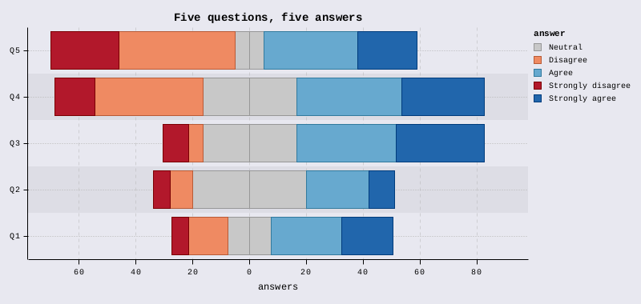
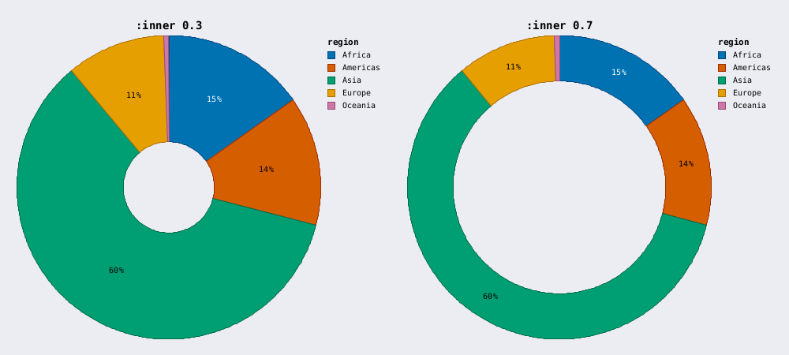
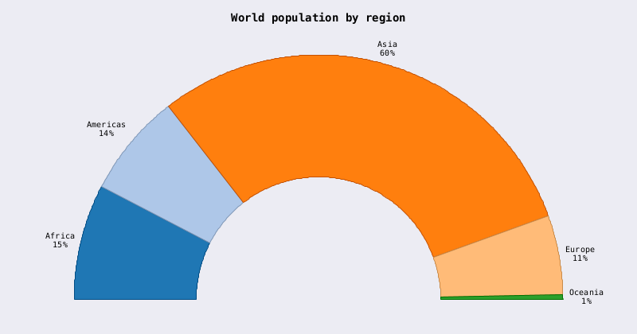
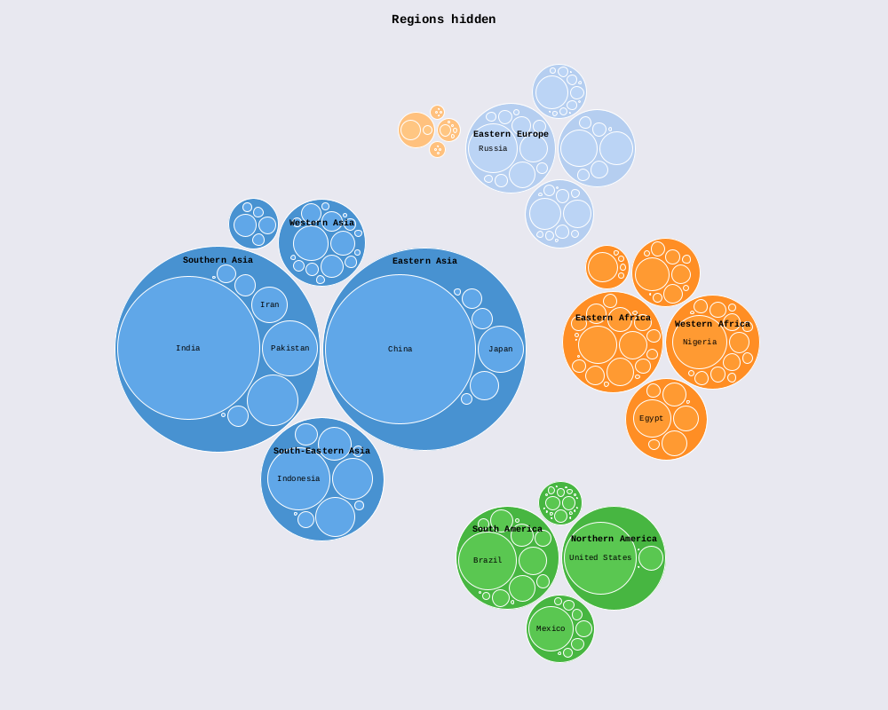
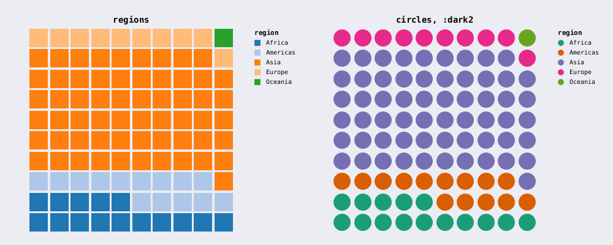
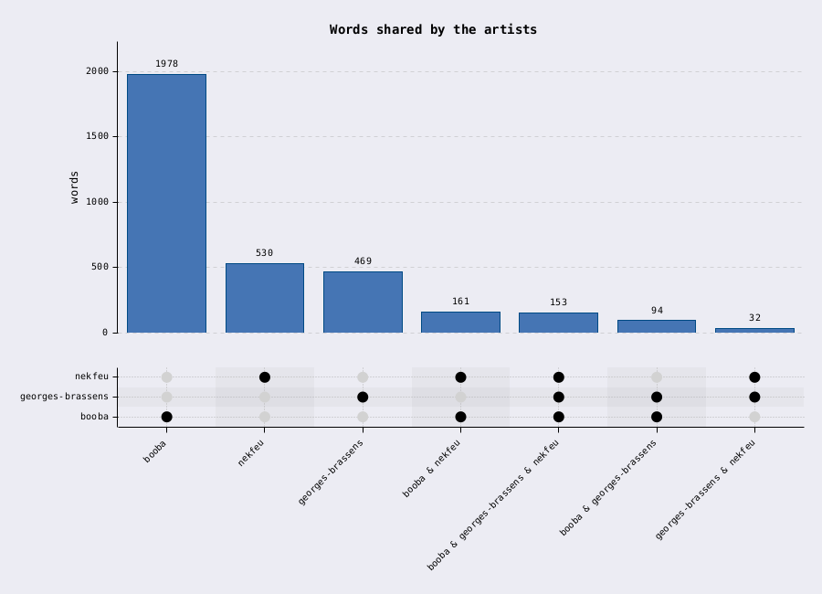
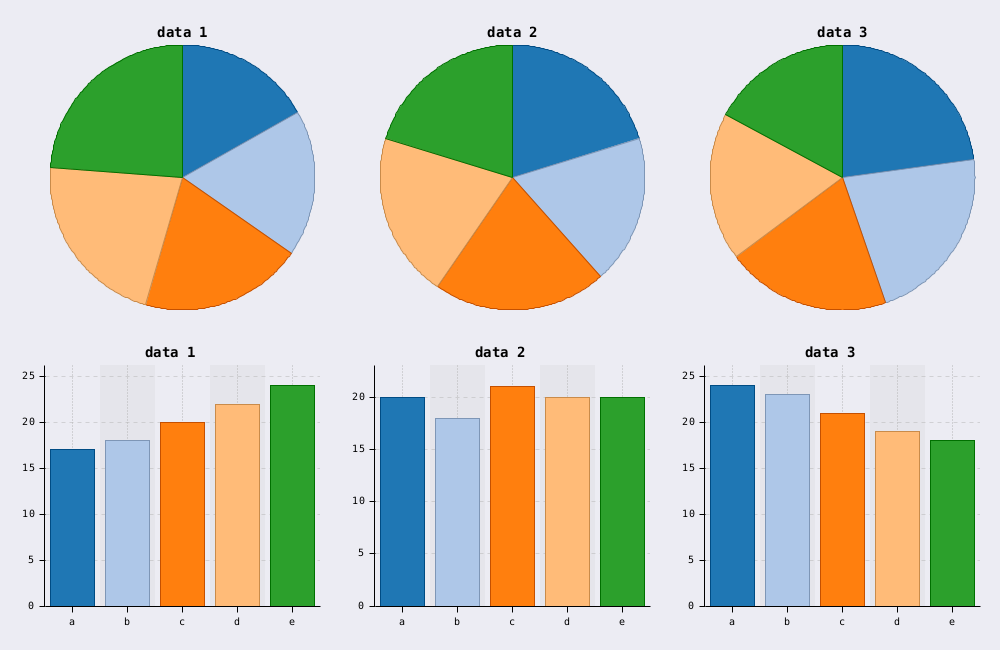

---
format:
  html:
    toc: true
    toc-location: right
    toc-depth: 4
    theme: cosmo
    include-in-header:
      text: |-
        <style>
        .data-table { width: fit-content; max-width: 100%; max-height: 15rem; overflow: auto; margin: 0 0 1rem 0; }
        .data-table .table-responsive { overflow: visible; }
        .data-table table { font-size: 0.75rem; width: auto; margin: 0; }
        .data-table th, .data-table td { padding: 0.1rem 0.45rem !important; white-space: nowrap; }
        .data-table thead th { position: sticky; top: 0; background: var(--bs-body-bg, #fff); }
        .options { margin: 0.5rem 0 1rem 0; }
        .options .option-card { margin: 0 0 0.9rem 0; border: 1px solid var(--bs-border-color, #dee2e6); border-radius: 0.375rem; overflow: hidden; }
        .options dt { display: flex; flex-wrap: wrap; align-items: baseline; gap: 0.1rem 1rem; margin: 0; padding: 0.4rem 0.75rem; background: #eef2f7; border-bottom: 1px solid var(--bs-border-color, #dee2e6); font-weight: normal; }
        .options dt > code { font-weight: 700; font-size: 1rem; background: none; padding: 0; }
        .options .option-default { font-size: 0.85rem; color: var(--bs-secondary-color, #6c757d); }
        .options dd { margin: 0; padding: 0.5rem 0.75rem; }
        .options .option-example { font-size: 0.85rem; padding: 0 0 0.45rem 0; margin-bottom: 0.45rem; border-bottom: 1px dashed var(--bs-border-color, #dee2e6); }
        .options .option-example code { background: none; padding: 0; }
        .options .option-text ul { margin: 0.3rem 0 0 0; padding-left: 1.25rem; }
        .options code, .mapping code { overflow-wrap: anywhere; }
        .mapping { margin: 0.5rem 0 1rem 0; padding: 0.5rem 0.75rem; border: 1px solid var(--bs-border-color, #dee2e6); border-left: 0.3rem solid #2780e3; border-radius: 0.375rem; background: #f5f8fc; }
        .mapping-title { font-weight: 700; margin-bottom: 0.25rem; }
        .mapping-hint { font-weight: normal; font-size: 0.85rem; color: var(--bs-secondary-color, #6c757d); }
        .mapping ul { margin: 0; padding-left: 1.25rem; }
        .mapping .required { font-size: 0.75rem; padding: 0 0.3rem; border: 1px solid currentColor; border-radius: 0.25rem; }
        .mapping-returns { margin-top: 0.25rem; }
        .mapping code { white-space: pre-wrap; }
        .shared { margin: 0.5rem 0 1rem 0; padding: 0.5rem 0.75rem; border: 1px solid var(--bs-border-color, #dee2e6); border-left: 0.3rem solid #6c757d; border-radius: 0.375rem; background: #f6f6f6; }
        .shared-title { font-weight: 700; margin-bottom: 0.25rem; }
        .shared-hint { font-weight: normal; font-size: 0.85rem; color: var(--bs-secondary-color, #6c757d); }
        .shared ul { margin: 0; padding-left: 1.25rem; }
        .shared code { overflow-wrap: anywhere; }
        </style>
code-block-background: true

---
<style></style><style>.printedClojure .sourceCode {
  background-color: transparent;
  border-style: none;
}
</style><style>.clay-limit-image-width .clay-image {max-width: 100%}
.clay-side-by-side .sourceCode {margin: 0}
.clay-side-by-side {margin: 1em 0}
</style>
<script src="https://code.jquery.com/jquery-3.6.0.min.js" type="text/javascript"></script><script src="https://code.jquery.com/ui/1.13.1/jquery-ui.min.js" type="text/javascript"></script>

# Part of a whole

How a whole splits into parts: grouped and stacked bars, treemaps, donuts and pies, circle packing, sunbursts,
waffles, Venn diagrams and UpSet plots (the [R Graph Gallery](https://r-graph-gallery.com/) part-of-a-whole pages,
the [data-to-viz](https://www.data-to-viz.com/) sunburst and the pie caveat).

Not here: dendrograms ([plot/dendrogram](reference.builders_trees.html#dendrograms)) and the sunburst of flows
belong to the [Flow](use_cases.flow.html#dendrogram) chapter.


::: {.sourceClojure}
```clojure
(ns use-cases.part-of-a-whole
  (:require [clojure2d.color :as c]
            [fastmath.core :as m]
            [fastmath.random :as r]
            [cljplot2.chart :as chart]
            [cljplot2.core :as plot]
            [cljplot2.theme :as theme]
            [cljplot2.data.sets :as sets]
            [notebook-utils :as nu]))
```
:::


::: {.sourceClojure}
```clojure
(def world
  "World population by region, subregion and country - the countries with a known population."
  (filterv :population (nu/dataset :world-population)))
```
:::


```{=html}
<div class="data-table"><table class="table table-hover table-responsive clay-table"><thead><tr><th>region</th><th>subregion</th><th>country</th><th>population</th></tr></thead><tbody><tr><td>Asia</td><td>Southern Asia</td><td>Afghanistan</td><td>25500100</td></tr><tr><td>Europe</td><td>Northern Europe</td><td>Åland Islands</td><td>28502</td></tr><tr><td>Europe</td><td>Southern Europe</td><td>Albania</td><td>2821977</td></tr><tr><td>Africa</td><td>Northern Africa</td><td>Algeria</td><td>37900000</td></tr><tr><td>Oceania</td><td>Polynesia</td><td>American Samoa</td><td>55519</td></tr><tr><td>Europe</td><td>Southern Europe</td><td>Andorra</td><td>76246</td></tr><tr><td>Africa</td><td>Middle Africa</td><td>Angola</td><td>20609294</td></tr><tr><td>Americas</td><td>Caribbean</td><td>Anguilla</td><td>13452</td></tr><tr><td>Americas</td><td>Caribbean</td><td>Antigua and Barbuda</td><td>86295</td></tr><tr><td>Americas</td><td>South America</td><td>Argentina</td><td>40117096</td></tr><tr><td>Asia</td><td>Western Asia</td><td>Armenia</td><td>3024100</td></tr><tr><td>Americas</td><td>Caribbean</td><td>Aruba</td><td>101484</td></tr><tr><td>Oceania</td><td>Australia and New Zealand</td><td>Australia</td><td>23254142</td></tr><tr><td>Europe</td><td>Western Europe</td><td>Austria</td><td>8501502</td></tr><tr><td>Asia</td><td>Western Asia</td><td>Azerbaijan</td><td>9235100</td></tr><tr><td>Asia</td><td>Western Asia</td><td>Bahrain</td><td>1234571</td></tr><tr><td>Asia</td><td>Southern Asia</td><td>Bangladesh</td><td>152518015</td></tr><tr><td>Americas</td><td>Caribbean</td><td>Barbados</td><td>274200</td></tr><tr><td>Europe</td><td>Eastern Europe</td><td>Belarus</td><td>9465500</td></tr><tr><td>Europe</td><td>Western Europe</td><td>Belgium</td><td>11175653</td></tr><tr><td>Americas</td><td>Central America</td><td>Belize</td><td>312971</td></tr><tr><td>Africa</td><td>Western Africa</td><td>Benin</td><td>10323000</td></tr><tr><td>Americas</td><td>Northern America</td><td>Bermuda</td><td>64237</td></tr><tr><td>Asia</td><td>Southern Asia</td><td>Bhutan</td><td>740990</td></tr><tr><td>Americas</td><td>South America</td><td>Bolivia</td><td>10027254</td></tr><tr><td>Europe</td><td>Southern Europe</td><td>Bosnia and Herzegovina</td><td>3791622</td></tr><tr><td>Africa</td><td>Southern Africa</td><td>Botswana</td><td>2024904</td></tr><tr><td>Americas</td><td>South America</td><td>Brazil</td><td>201032714</td></tr><tr><td>Americas</td><td>Caribbean</td><td>British Virgin Islands</td><td>29537</td></tr><tr><td>Asia</td><td>South-Eastern Asia</td><td>Brunei</td><td>393162</td></tr><tr><td>Europe</td><td>Eastern Europe</td><td>Bulgaria</td><td>7282041</td></tr><tr><td>Africa</td><td>Western Africa</td><td>Burkina Faso</td><td>17322796</td></tr><tr><td>Africa</td><td>Eastern Africa</td><td>Burundi</td><td>10163000</td></tr><tr><td>Asia</td><td>South-Eastern Asia</td><td>Cambodia</td><td>15135000</td></tr><tr><td>Africa</td><td>Middle Africa</td><td>Cameroon</td><td>20386799</td></tr><tr><td>Americas</td><td>Northern America</td><td>Canada</td><td>35158304</td></tr><tr><td>Africa</td><td>Western Africa</td><td>Cape Verde</td><td>491875</td></tr><tr><td>Americas</td><td>Caribbean</td><td>Cayman Islands</td><td>55456</td></tr><tr><td>Africa</td><td>Middle Africa</td><td>Central African Republic</td><td>4616000</td></tr><tr><td>Africa</td><td>Middle Africa</td><td>Chad</td><td>12825000</td></tr><tr><td>Americas</td><td>South America</td><td>Chile</td><td>16634603</td></tr><tr><td>Asia</td><td>Eastern Asia</td><td>China</td><td>1361170000</td></tr><tr><td>Oceania</td><td>Australia and New Zealand</td><td>Christmas Island</td><td>2072</td></tr><tr><td>Oceania</td><td>Australia and New Zealand</td><td>Cocos (Keeling) Islands</td><td>550</td></tr><tr><td>Americas</td><td>South America</td><td>Colombia</td><td>47330000</td></tr><tr><td>Africa</td><td>Eastern Africa</td><td>Comoros</td><td>724300</td></tr><tr><td>Africa</td><td>Middle Africa</td><td>Republic of the Congo</td><td>4448000</td></tr><tr><td>Africa</td><td>Middle Africa</td><td>Democratic Republic of the Congo</td><td>67514000</td></tr><tr><td>Oceania</td><td>Polynesia</td><td>Cook Islands</td><td>14974</td></tr><tr><td>Americas</td><td>Central America</td><td>Costa Rica</td><td>4667096</td></tr><tr><td>Europe</td><td>Southern Europe</td><td>Croatia</td><td>4290612</td></tr><tr><td>Americas</td><td>Caribbean</td><td>Cuba</td><td>11167325</td></tr><tr><td>Americas</td><td>Caribbean</td><td>Curaçao</td><td>150563</td></tr><tr><td>Asia</td><td>Western Asia</td><td>Cyprus</td><td>865878</td></tr><tr><td>Europe</td><td>Eastern Europe</td><td>Czech Republic</td><td>10512900</td></tr><tr><td>Europe</td><td>Northern Europe</td><td>Denmark</td><td>5623501</td></tr><tr><td>Africa</td><td>Eastern Africa</td><td>Djibouti</td><td>864618</td></tr><tr><td>Americas</td><td>Caribbean</td><td>Dominica</td><td>71293</td></tr><tr><td>Americas</td><td>Caribbean</td><td>Dominican Republic</td><td>9445281</td></tr><tr><td>Americas</td><td>South America</td><td>Ecuador</td><td>15617900</td></tr><tr><td>Africa</td><td>Northern Africa</td><td>Egypt</td><td>83661000</td></tr><tr><td>Americas</td><td>Central America</td><td>El Salvador</td><td>6340000</td></tr><tr><td>Africa</td><td>Middle Africa</td><td>Equatorial Guinea</td><td>1622000</td></tr><tr><td>Africa</td><td>Eastern Africa</td><td>Eritrea</td><td>6333000</td></tr><tr><td>Europe</td><td>Northern Europe</td><td>Estonia</td><td>1286540</td></tr><tr><td>Africa</td><td>Eastern Africa</td><td>Ethiopia</td><td>86613986</td></tr><tr><td>Americas</td><td>South America</td><td>Falkland Islands</td><td>2563</td></tr><tr><td>Europe</td><td>Northern Europe</td><td>Faroe Islands</td><td>48509</td></tr><tr><td>Oceania</td><td>Melanesia</td><td>Fiji</td><td>858038</td></tr><tr><td>Europe</td><td>Northern Europe</td><td>Finland</td><td>5445883</td></tr><tr><td>Europe</td><td>Western Europe</td><td>France</td><td>65806000</td></tr><tr><td>Americas</td><td>South America</td><td>French Guiana</td><td>229040</td></tr><tr><td>Oceania</td><td>Polynesia</td><td>French Polynesia</td><td>268270</td></tr><tr><td>Africa</td><td>Middle Africa</td><td>Gabon</td><td>1672000</td></tr><tr><td>Europe</td><td>Western Europe</td><td>Germany</td><td>80523700</td></tr><tr><td>Africa</td><td>Western Africa</td><td>Ghana</td><td>24658823</td></tr><tr><td>Europe</td><td>Southern Europe</td><td>Gibraltar</td><td>29752</td></tr><tr><td>Europe</td><td>Southern Europe</td><td>Greece</td><td>10815197</td></tr><tr><td>Americas</td><td>Northern America</td><td>Greenland</td><td>56370</td></tr><tr><td>Americas</td><td>Caribbean</td><td>Grenada</td><td>103328</td></tr><tr><td>Americas</td><td>Caribbean</td><td>Guadeloupe</td><td>403355</td></tr><tr><td>Oceania</td><td>Micronesia</td><td>Guam</td><td>159358</td></tr><tr><td>Americas</td><td>Central America</td><td>Guatemala</td><td>15438384</td></tr><tr><td>Europe</td><td>Northern Europe</td><td>Guernsey</td><td>62431</td></tr><tr><td>Africa</td><td>Western Africa</td><td>Guinea</td><td>10824200</td></tr><tr><td>Africa</td><td>Western Africa</td><td>Guinea-Bissau</td><td>1704000</td></tr><tr><td>Americas</td><td>South America</td><td>Guyana</td><td>784894</td></tr><tr><td>Americas</td><td>Caribbean</td><td>Haiti</td><td>10413211</td></tr><tr><td>Europe</td><td>Southern Europe</td><td>Vatican City</td><td>800</td></tr><tr><td>Americas</td><td>Central America</td><td>Honduras</td><td>8555072</td></tr><tr><td>Asia</td><td>Eastern Asia</td><td>Hong Kong</td><td>7184000</td></tr><tr><td>Europe</td><td>Eastern Europe</td><td>Hungary</td><td>9906000</td></tr><tr><td>Europe</td><td>Northern Europe</td><td>Iceland</td><td>325010</td></tr><tr><td>Asia</td><td>Southern Asia</td><td>India</td><td>1236670000</td></tr><tr><td>Asia</td><td>South-Eastern Asia</td><td>Indonesia</td><td>237641326</td></tr><tr><td>Asia</td><td>Southern Asia</td><td>Iran</td><td>77068000</td></tr><tr><td>Asia</td><td>Western Asia</td><td>Iraq</td><td>34035000</td></tr><tr><td>Europe</td><td>Northern Europe</td><td>Isle of Man</td><td>84497</td></tr><tr><td>Asia</td><td>Western Asia</td><td>Israel</td><td>8092700</td></tr><tr><td>Europe</td><td>Southern Europe</td><td>Italy</td><td>59829079</td></tr><tr><td>…</td><td>…</td><td>…</td><td>…</td></tr></tbody></table></div>
```


::: {.sourceClojure}
```clojure
(def europe (filterv #(= "Europe" (:region %)) world))
```
:::


```{=html}
<div class="data-table"><table class="table table-hover table-responsive clay-table"><thead><tr><th>region</th><th>subregion</th><th>country</th><th>population</th></tr></thead><tbody><tr><td>Europe</td><td>Northern Europe</td><td>Åland Islands</td><td>28502</td></tr><tr><td>Europe</td><td>Southern Europe</td><td>Albania</td><td>2821977</td></tr><tr><td>Europe</td><td>Southern Europe</td><td>Andorra</td><td>76246</td></tr><tr><td>Europe</td><td>Western Europe</td><td>Austria</td><td>8501502</td></tr><tr><td>Europe</td><td>Eastern Europe</td><td>Belarus</td><td>9465500</td></tr><tr><td>Europe</td><td>Western Europe</td><td>Belgium</td><td>11175653</td></tr><tr><td>Europe</td><td>Southern Europe</td><td>Bosnia and Herzegovina</td><td>3791622</td></tr><tr><td>Europe</td><td>Eastern Europe</td><td>Bulgaria</td><td>7282041</td></tr><tr><td>Europe</td><td>Southern Europe</td><td>Croatia</td><td>4290612</td></tr><tr><td>Europe</td><td>Eastern Europe</td><td>Czech Republic</td><td>10512900</td></tr><tr><td>Europe</td><td>Northern Europe</td><td>Denmark</td><td>5623501</td></tr><tr><td>Europe</td><td>Northern Europe</td><td>Estonia</td><td>1286540</td></tr><tr><td>Europe</td><td>Northern Europe</td><td>Faroe Islands</td><td>48509</td></tr><tr><td>Europe</td><td>Northern Europe</td><td>Finland</td><td>5445883</td></tr><tr><td>Europe</td><td>Western Europe</td><td>France</td><td>65806000</td></tr><tr><td>Europe</td><td>Western Europe</td><td>Germany</td><td>80523700</td></tr><tr><td>Europe</td><td>Southern Europe</td><td>Gibraltar</td><td>29752</td></tr><tr><td>Europe</td><td>Southern Europe</td><td>Greece</td><td>10815197</td></tr><tr><td>Europe</td><td>Northern Europe</td><td>Guernsey</td><td>62431</td></tr><tr><td>Europe</td><td>Southern Europe</td><td>Vatican City</td><td>800</td></tr><tr><td>Europe</td><td>Eastern Europe</td><td>Hungary</td><td>9906000</td></tr><tr><td>Europe</td><td>Northern Europe</td><td>Iceland</td><td>325010</td></tr><tr><td>Europe</td><td>Northern Europe</td><td>Isle of Man</td><td>84497</td></tr><tr><td>Europe</td><td>Southern Europe</td><td>Italy</td><td>59829079</td></tr><tr><td>Europe</td><td>Northern Europe</td><td>Jersey</td><td>97857</td></tr><tr><td>Europe</td><td>Northern Europe</td><td>Latvia</td><td>2014000</td></tr><tr><td>Europe</td><td>Western Europe</td><td>Liechtenstein</td><td>36842</td></tr><tr><td>Europe</td><td>Northern Europe</td><td>Lithuania</td><td>2950684</td></tr><tr><td>Europe</td><td>Western Europe</td><td>Luxembourg</td><td>537000</td></tr><tr><td>Europe</td><td>Southern Europe</td><td>Malta</td><td>416055</td></tr><tr><td>Europe</td><td>Eastern Europe</td><td>Moldova</td><td>3559500</td></tr><tr><td>Europe</td><td>Western Europe</td><td>Monaco</td><td>36136</td></tr><tr><td>Europe</td><td>Southern Europe</td><td>Montenegro</td><td>620029</td></tr><tr><td>Europe</td><td>Western Europe</td><td>Netherlands</td><td>16807300</td></tr><tr><td>Europe</td><td>Northern Europe</td><td>Norway</td><td>5077798</td></tr><tr><td>Europe</td><td>Eastern Europe</td><td>Poland</td><td>38533299</td></tr><tr><td>Europe</td><td>Southern Europe</td><td>Portugal</td><td>10562178</td></tr><tr><td>Europe</td><td>Eastern Europe</td><td>Republic of Kosovo</td><td>1733842</td></tr><tr><td>Europe</td><td>Eastern Europe</td><td>Romania</td><td>20121641</td></tr><tr><td>Europe</td><td>Eastern Europe</td><td>Russia</td><td>143500000</td></tr><tr><td>Europe</td><td>Southern Europe</td><td>San Marino</td><td>32509</td></tr><tr><td>Europe</td><td>Southern Europe</td><td>Serbia</td><td>7181505</td></tr><tr><td>Europe</td><td>Eastern Europe</td><td>Slovakia</td><td>5412008</td></tr><tr><td>Europe</td><td>Southern Europe</td><td>Slovenia</td><td>2061405</td></tr><tr><td>Europe</td><td>Southern Europe</td><td>Spain</td><td>46704314</td></tr><tr><td>Europe</td><td>Northern Europe</td><td>Svalbard and Jan Mayen</td><td>2655</td></tr><tr><td>Europe</td><td>Northern Europe</td><td>Sweden</td><td>9625444</td></tr><tr><td>Europe</td><td>Western Europe</td><td>Switzerland</td><td>8085300</td></tr><tr><td>Europe</td><td>Eastern Europe</td><td>Ukraine</td><td>45461627</td></tr><tr><td>Europe</td><td>Northern Europe</td><td>United Kingdom</td><td>63705000</td></tr></tbody></table></div>
```


::: {.sourceClojure}
```clojure
(def words (nu/dataset :artist-words))
```
:::


```{=html}
<div class="data-table"><table class="table table-hover table-responsive clay-table"><thead><tr><th>artist</th><th>song</th><th>word</th></tr></thead><tbody><tr><td>booba</td><td>113</td><td>paroles.net</td></tr><tr><td>booba</td><td>113</td><td>above</td></tr><tr><td>booba</td><td>113</td><td>lyrics</td></tr><tr><td>booba</td><td>113</td><td>function</td></tr><tr><td>booba</td><td>113</td><td>var</td></tr><tr><td>booba</td><td>113</td><td>opts</td></tr><tr><td>booba</td><td>113</td><td>artist</td></tr><tr><td>booba</td><td>113</td><td>booba</td></tr><tr><td>booba</td><td>113</td><td>song</td></tr><tr><td>booba</td><td>113</td><td>113</td></tr><tr><td>booba</td><td>113</td><td>adunit_id</td></tr><tr><td>booba</td><td>113</td><td>39383816</td></tr><tr><td>booba</td><td>113</td><td>div_id</td></tr><tr><td>booba</td><td>113</td><td>cf_async_</td></tr><tr><td>booba</td><td>113</td><td>math.floor</td></tr><tr><td>booba</td><td>113</td><td>math.random</td></tr><tr><td>booba</td><td>113</td><td>999999999</td></tr><tr><td>booba</td><td>113</td><td>document.write</td></tr><tr><td>booba</td><td>113</td><td>div</td></tr><tr><td>booba</td><td>113</td><td>id</td></tr><tr><td>booba</td><td>113</td><td>opts.div_id</td></tr><tr><td>booba</td><td>113</td><td>div</td></tr><tr><td>booba</td><td>113</td><td>var</td></tr><tr><td>booba</td><td>113</td><td>function</td></tr><tr><td>booba</td><td>113</td><td>cf.showasyncad</td></tr><tr><td>booba</td><td>113</td><td>opts</td></tr><tr><td>booba</td><td>113</td><td>if</td></tr><tr><td>booba</td><td>113</td><td>typeof</td></tr><tr><td>booba</td><td>113</td><td>window.cf</td></tr><tr><td>booba</td><td>113</td><td>undefined</td></tr><tr><td>booba</td><td>113</td><td>else</td></tr><tr><td>booba</td><td>113</td><td>cf_async</td></tr><tr><td>booba</td><td>113</td><td>0</td></tr><tr><td>booba</td><td>113</td><td>var</td></tr><tr><td>booba</td><td>113</td><td>r</td></tr><tr><td>booba</td><td>113</td><td>document.createelement</td></tr><tr><td>booba</td><td>113</td><td>script</td></tr><tr><td>booba</td><td>113</td><td>document.getelementsbytagname</td></tr><tr><td>booba</td><td>113</td><td>script</td></tr><tr><td>booba</td><td>113</td><td>0</td></tr><tr><td>booba</td><td>113</td><td>r.async</td></tr><tr><td>booba</td><td>113</td><td>0</td></tr><tr><td>booba</td><td>113</td><td>r.src</td></tr><tr><td>booba</td><td>113</td><td>srv.clickfuse.com</td></tr><tr><td>booba</td><td>113</td><td>showads</td></tr><tr><td>booba</td><td>113</td><td>showad.js</td></tr><tr><td>booba</td><td>113</td><td>r.readystate</td></tr><tr><td>booba</td><td>113</td><td>r.onreadystatechange</td></tr><tr><td>booba</td><td>113</td><td>function</td></tr><tr><td>booba</td><td>113</td><td>if</td></tr><tr><td>booba</td><td>113</td><td>loaded</td></tr><tr><td>booba</td><td>113</td><td>r.readystate</td></tr><tr><td>booba</td><td>113</td><td>complete</td></tr><tr><td>booba</td><td>113</td><td>r.readystate</td></tr><tr><td>booba</td><td>113</td><td>r.onreadystatechange</td></tr><tr><td>booba</td><td>113</td><td>null</td></tr><tr><td>booba</td><td>113</td><td>r.onload</td></tr><tr><td>booba</td><td>113</td><td>s.parentnode.insertbefore</td></tr><tr><td>booba</td><td>113</td><td>r</td></tr><tr><td>booba</td><td>a-la-folie</td><td>paroles.net</td></tr><tr><td>booba</td><td>a-la-folie</td><td>above</td></tr><tr><td>booba</td><td>a-la-folie</td><td>lyrics</td></tr><tr><td>booba</td><td>a-la-folie</td><td>function</td></tr><tr><td>booba</td><td>a-la-folie</td><td>var</td></tr><tr><td>booba</td><td>a-la-folie</td><td>opts</td></tr><tr><td>booba</td><td>a-la-folie</td><td>artist</td></tr><tr><td>booba</td><td>a-la-folie</td><td>booba</td></tr><tr><td>booba</td><td>a-la-folie</td><td>song</td></tr><tr><td>booba</td><td>a-la-folie</td><td>c3</td></tr><tr><td>booba</td><td>a-la-folie</td><td>80</td></tr><tr><td>booba</td><td>a-la-folie</td><td>folie</td></tr><tr><td>booba</td><td>a-la-folie</td><td>adunit_id</td></tr><tr><td>booba</td><td>a-la-folie</td><td>39383816</td></tr><tr><td>booba</td><td>a-la-folie</td><td>div_id</td></tr><tr><td>booba</td><td>a-la-folie</td><td>cf_async_</td></tr><tr><td>booba</td><td>a-la-folie</td><td>math.floor</td></tr><tr><td>booba</td><td>a-la-folie</td><td>math.random</td></tr><tr><td>booba</td><td>a-la-folie</td><td>999999999</td></tr><tr><td>booba</td><td>a-la-folie</td><td>document.write</td></tr><tr><td>booba</td><td>a-la-folie</td><td>div</td></tr><tr><td>booba</td><td>a-la-folie</td><td>id</td></tr><tr><td>booba</td><td>a-la-folie</td><td>opts.div_id</td></tr><tr><td>booba</td><td>a-la-folie</td><td>div</td></tr><tr><td>booba</td><td>a-la-folie</td><td>var</td></tr><tr><td>booba</td><td>a-la-folie</td><td>function</td></tr><tr><td>booba</td><td>a-la-folie</td><td>cf.showasyncad</td></tr><tr><td>booba</td><td>a-la-folie</td><td>opts</td></tr><tr><td>booba</td><td>a-la-folie</td><td>if</td></tr><tr><td>booba</td><td>a-la-folie</td><td>typeof</td></tr><tr><td>booba</td><td>a-la-folie</td><td>window.cf</td></tr><tr><td>booba</td><td>a-la-folie</td><td>undefined</td></tr><tr><td>booba</td><td>a-la-folie</td><td>else</td></tr><tr><td>booba</td><td>a-la-folie</td><td>cf_async</td></tr><tr><td>booba</td><td>a-la-folie</td><td>0</td></tr><tr><td>booba</td><td>a-la-folie</td><td>var</td></tr><tr><td>booba</td><td>a-la-folie</td><td>r</td></tr><tr><td>booba</td><td>a-la-folie</td><td>document.createelement</td></tr><tr><td>booba</td><td>a-la-folie</td><td>script</td></tr><tr><td>booba</td><td>a-la-folie</td><td>document.getelementsbytagname</td></tr><tr><td>booba</td><td>a-la-folie</td><td>script</td></tr><tr><td>…</td><td>…</td><td>…</td></tr></tbody></table></div>
```


::: {.sourceClojure}
```clojure
(defn- share-label
  "Bar label: the part's name and its share of the whole."
  [{:keys [group share]}]
  (format "%s\n%.0f%%" (:color group) (* 100.0 (double share))))
```
:::


::: {.printedClojure}
```clojure
#'use-cases.part-of-a-whole/share-label

```
:::


::: {.sourceClojure}
```clojure
(defn- percent-label
  "Bar label: the share of the whole only."
  [{:keys [share]}]
  (format "%.0f%%" (* 100.0 (double share))))
```
:::


::: {.printedClojure}
```clojure
#'use-cases.part-of-a-whole/percent-label

```
:::


::: {.sourceClojure}
```clojure
(def pie-base
  "A pie of the regions' populations: stacked bars (`:stat :sum` over the countries of a region) in polar coordinates,
  one bar filling the circle."
  {:data world :mapping {:x :population :color :region} :coord {:kind :polar}
   :labels {:x nil :y nil}})
```
:::


## Grouped and stacked bars

Bars of groups within categories: side by side, on top of each other, scaled to the whole, or one panel per
category.


### Grouped, stacked, percent

R Graph Gallery's specie × condition values (seeded): the [bar](reference.charts_bars.html#bar-charts) `:position`
`:dodge` compares the groups, `:stack` the totals, `:normalize` the shares; facets give a panel per specie; negative
values stack downward from 0.


::: {.sourceClojure}
```clojure
(def species-conditions
  (let [rng (r/rng :mersenne 42)]
    (vec (for [specie ["banana" "poacee" "sorgho" "triticum"]
               condition ["normal" "stress" "Nitrogen"]]
           {:specie specie :condition condition :value (m/abs (r/grandom rng 0.0 15.0))}))))
```
:::


```{=html}
<div class="data-table"><table class="table table-hover table-responsive clay-table"><thead><tr><th>specie</th><th>condition</th><th>value</th></tr></thead><tbody><tr><td>banana</td><td>normal</td><td>12.98753118740483</td></tr><tr><td>banana</td><td>stress</td><td>5.725231989522489</td></tr><tr><td>banana</td><td>Nitrogen</td><td>12.645716020150854</td></tr><tr><td>poacee</td><td>normal</td><td>6.307882857557909</td></tr><tr><td>poacee</td><td>stress</td><td>6.263621843623318</td></tr><tr><td>poacee</td><td>Nitrogen</td><td>7.91611933200255</td></tr><tr><td>sorgho</td><td>normal</td><td>19.794355706724204</td></tr><tr><td>sorgho</td><td>stress</td><td>9.08575671154771</td></tr><tr><td>sorgho</td><td>Nitrogen</td><td>5.768495976140531</td></tr><tr><td>triticum</td><td>normal</td><td>20.252350507800234</td></tr><tr><td>triticum</td><td>stress</td><td>12.85698849270932</td></tr><tr><td>triticum</td><td>Nitrogen</td><td>2.918969173565409</td></tr></tbody></table></div>
```


::: {.sourceClojure}
```clojure
(def signed-conditions
  (let [rng (r/rng :mersenne 7)]
    (mapv #(assoc % :value (r/grandom rng 0.0 15.0)) species-conditions)))
```
:::


```{=html}
<div class="data-table"><table class="table table-hover table-responsive clay-table"><thead><tr><th>specie</th><th>condition</th><th>value</th></tr></thead><tbody><tr><td>banana</td><td>normal</td><td>9.382189899124405</td></tr><tr><td>banana</td><td>stress</td><td>-24.51793328255497</td></tr><tr><td>banana</td><td>Nitrogen</td><td>-5.892325972500123</td></tr><tr><td>poacee</td><td>normal</td><td>13.299663662619894</td></tr><tr><td>poacee</td><td>stress</td><td>-8.044527511551388</td></tr><tr><td>poacee</td><td>Nitrogen</td><td>-6.583994175487013</td></tr><tr><td>sorgho</td><td>normal</td><td>-8.103386430143448</td></tr><tr><td>sorgho</td><td>stress</td><td>-0.8745605201438365</td></tr><tr><td>sorgho</td><td>Nitrogen</td><td>-5.694966412694762</td></tr><tr><td>triticum</td><td>normal</td><td>-11.825287735415104</td></tr><tr><td>triticum</td><td>stress</td><td>6.628546441815814</td></tr><tr><td>triticum</td><td>Nitrogen</td><td>-14.81123541225753</td></tr></tbody></table></div>
```


Source: [R Graph Gallery - Grouped and Stacked barplot](https://r-graph-gallery.com/stacked-barplot.html).


::: {.sourceClojure}
```clojure
(plot/render-image
 (plot/arrange
  (vec (concat
        (for [[title position legend?] [["grouped (:dodge)" :dodge false] ["stacked (:stack)" :stack false]
                                        ["percent (:normalize)" :normalize true]]]
          {:data species-conditions :mapping {:x :specie :y :value :color :condition} :legend legend?
           :charts [(chart/bar {:position position})]
           :labels {:title title :x nil :y nil}})
        [{:data species-conditions :mapping {:x :condition :y :value :facet :specie}
          :theme {:axis {:x {:label-rotation -90}}}
          :charts [(chart/bar)]
          :labels {:title "small multiples" :x nil :y nil}}
         {:data signed-conditions :mapping {:x :specie :y :value :color :condition}
          :charts [(chart/bar {:position :stack})]
          :labels {:title "negative values" :x nil :y nil}}]))
  {:columns 3})
 {:width 1000 :height 650})
```
:::


::: {.clay-image}

:::


### Likert scale

Survey answers as diverging stacked bars (seeded counts): disagreement to the left of 0, agreement to the right,
the neutral answers split half to each side (two `:group`s of one colour). `:negative-order :reverse` stacks the
negative side from the last answer, so the answers in their natural order diverge from the middle.


::: {.sourceClojure}
```clojure
(def answers ["Strongly disagree" "Disagree" "Neutral" "Agree" "Strongly agree"])
```
:::


::: {.sourceClojure}
```clojure
(def likert
  (let [rng (r/rng :mersenne 3)]
    (vec (for [q (range 1 6)
               [i answer] (map-indexed vector answers)
               :let [n (+ 5 (r/irandom rng 40))
                     sign ({0 -1.0 1 -1.0 3 1.0 4 1.0} i)]
               row (if sign
                     [{:question (str "Q" q) :answer answer :side "" :count (* sign n)}]
                     ;; the neutral answer: half on each side, two groups of one colour
                     [{:question (str "Q" q) :answer answer :side "-" :count (* -0.5 n)}
                      {:question (str "Q" q) :answer answer :side "+" :count (* 0.5 n)}])]
           row))))
```
:::


```{=html}
<div class="data-table"><table class="table table-hover table-responsive clay-table"><thead><tr><th>question</th><th>answer</th><th>side</th><th>count</th></tr></thead><tbody><tr><td>Q1</td><td>Strongly disagree</td><td></td><td>-6.0</td></tr><tr><td>Q1</td><td>Disagree</td><td></td><td>-14.0</td></tr><tr><td>Q1</td><td>Neutral</td><td>-</td><td>-7.5</td></tr><tr><td>Q1</td><td>Neutral</td><td>+</td><td>7.5</td></tr><tr><td>Q1</td><td>Agree</td><td></td><td>25.0</td></tr><tr><td>Q1</td><td>Strongly agree</td><td></td><td>18.0</td></tr><tr><td>Q2</td><td>Strongly disagree</td><td></td><td>-6.0</td></tr><tr><td>Q2</td><td>Disagree</td><td></td><td>-8.0</td></tr><tr><td>Q2</td><td>Neutral</td><td>-</td><td>-20.0</td></tr><tr><td>Q2</td><td>Neutral</td><td>+</td><td>20.0</td></tr><tr><td>Q2</td><td>Agree</td><td></td><td>22.0</td></tr><tr><td>Q2</td><td>Strongly agree</td><td></td><td>9.0</td></tr><tr><td>Q3</td><td>Strongly disagree</td><td></td><td>-9.0</td></tr><tr><td>Q3</td><td>Disagree</td><td></td><td>-5.0</td></tr><tr><td>Q3</td><td>Neutral</td><td>-</td><td>-16.5</td></tr><tr><td>Q3</td><td>Neutral</td><td>+</td><td>16.5</td></tr><tr><td>Q3</td><td>Agree</td><td></td><td>35.0</td></tr><tr><td>Q3</td><td>Strongly agree</td><td></td><td>31.0</td></tr><tr><td>Q4</td><td>Strongly disagree</td><td></td><td>-14.0</td></tr><tr><td>Q4</td><td>Disagree</td><td></td><td>-38.0</td></tr><tr><td>Q4</td><td>Neutral</td><td>-</td><td>-16.5</td></tr><tr><td>Q4</td><td>Neutral</td><td>+</td><td>16.5</td></tr><tr><td>Q4</td><td>Agree</td><td></td><td>37.0</td></tr><tr><td>Q4</td><td>Strongly agree</td><td></td><td>29.0</td></tr><tr><td>Q5</td><td>Strongly disagree</td><td></td><td>-24.0</td></tr><tr><td>Q5</td><td>Disagree</td><td></td><td>-41.0</td></tr><tr><td>Q5</td><td>Neutral</td><td>-</td><td>-5.0</td></tr><tr><td>Q5</td><td>Neutral</td><td>+</td><td>5.0</td></tr><tr><td>Q5</td><td>Agree</td><td></td><td>33.0</td></tr><tr><td>Q5</td><td>Strongly agree</td><td></td><td>21.0</td></tr></tbody></table></div>
```


Source: [R Graph Gallery - Grouped and Stacked barplot (the Likert package)](https://r-graph-gallery.com/stacked-barplot.html).


::: {.sourceClojure}
```clojure
(plot/render-image
 {:data likert :mapping {:x :count :y :question :color :answer :group :side}
  :scales {:color {:domain answers
                   :range {"Strongly disagree" [178 24 43] "Disagree" [239 138 98] "Neutral" [200 200 200]
                           "Agree" [103 169 207] "Strongly agree" [33 102 172]}}
          :x {:formatter #(str (long (m/abs (double %))))}}
  :charts [(chart/bar {:position :stack :negative-order :reverse})]
  :labels {:title "Five questions, five answers" :x "answers" :y nil}}
 {:width 800 :height 380})
```
:::


::: {.clay-image}

:::


## Treemap

Nested rectangles, areas proportional to the value: the world's population by region, subregion and country.


### Basic, groups and subgroups

One level (regions) and three (regions → subregions → countries); [treemap](reference.charts_shares_sets.html#treemaps)
`:gap` frames the groups, `:stroke-color` outlines the cells, a theme palette recolours the regions.

Source: R Graph Gallery - Treemap; data-to-viz - Treemap ([1](https://r-graph-gallery.com/treemap.html), [2](https://www.data-to-viz.com/graph/treemap.html)). Data: World population by region, subregion and country, data-to-viz example dataset `11_SevCatOneNumNestedOneObsPerGroup` (Yan Holtz; Wikipedia); licence: MIT (data_to_viz repository).


::: {.sourceClojure}
```clojure
(plot/render-image
 (plot/arrange
  [{:data world :mapping {:value :population :hierarchy [:region]} :charts [(chart/treemap)]
    :labels {:title "regions"}}
   {:data world :mapping {:value :population :hierarchy [:region :subregion :country]}
    :theme {:palette {:color :set2}}
    :charts [(chart/treemap {:gap 4 :stroke-color [60 60 60]})]
    :labels {:title "regions, subregions, countries (:set2, :gap 4)"}}]
  {:columns 2 :widths [1 2]})
 {:width 1000 :height 520})
```
:::


::: {.clay-image}

:::


### Annotated treemap

Label functions (`:leaf-labels`, `:group-labels`) get the node's name, value, depth and shares: the countries with
their population in millions.

Source: [R Graph Gallery - Treemap (annotations, labels and colors)](https://r-graph-gallery.com/treemap.html). Data: World population by region, subregion and country, data-to-viz example dataset `11_SevCatOneNumNestedOneObsPerGroup` (Yan Holtz; Wikipedia); licence: MIT (data_to_viz repository).


::: {.sourceClojure}
```clojure
(plot/render-image
 {:data world :mapping {:value :population :hierarchy [:region :country]}
  :charts [(chart/treemap {:leaf-labels #(format "%s\n%.0f M" (:name %) (/ (double (:value %)) 1e6))
                           :group-labels #(format "%s - %.1f%%" (:name %) (* 100.0 (double (:share %))))})]
  :labels {:title "World population (millions)"}}
 {:width 1000 :height 700})
```
:::


::: {.clay-image}

:::


## Donut

A ring of stacked shares: the regions' populations around a hole (`:inner` - the hole's radius as a fraction).


### Basic, labels, ring thickness

Source: R Graph Gallery - Donut chart; data-to-viz - Donut ([1](https://r-graph-gallery.com/doughnut-plot.html), [2](https://www.data-to-viz.com/graph/donut.html)). Data: World population by region, subregion and country, data-to-viz example dataset `11_SevCatOneNumNestedOneObsPerGroup` (Yan Holtz; Wikipedia); licence: MIT (data_to_viz repository).


::: {.sourceClojure}
```clojure
(plot/render-image
 (plot/arrange
  (vec (for [inner [0.3 0.7]]
         (assoc pie-base
                :coord {:kind :polar :inner inner}
                :scales {:x {:axis false}}
                :charts [(chart/bar {:position :stack :width 1.0 :value-label percent-label})]
                :labels {:title (str ":inner " inner) :x nil :y nil})))
  {:columns 2})
 {:width 1000 :height 450})
```
:::


::: {.clay-image}

:::


### Half donut

`:span 180` from `:start -90`: the circle shrinks to a half and fits its panel; outer labels name the parts.

Source: [data-to-viz - Donut (variations)](https://www.data-to-viz.com/graph/donut.html). Data: World population by region, subregion and country, data-to-viz example dataset `11_SevCatOneNumNestedOneObsPerGroup` (Yan Holtz; Wikipedia); licence: MIT (data_to_viz repository).


::: {.sourceClojure}
```clojure
(plot/render-image
 (assoc pie-base
        :coord {:kind :polar :inner 0.5 :span 180 :start -90}
        :legend false
        :charts [(chart/bar {:position :stack :width 1.0 :value-label share-label :label-position :outer})]
        :labels {:title "World population by region" :x nil :y nil})
 {:width 800 :height 420})
```
:::


::: {.clay-image}

:::


## Pie

A donut without its hole. data-to-viz: angles are hard to compare - see the caveat at the end.


### Basic, colours, a clean pie

The default pie shows its value axis around the circle - the cumulative population, here in billions; a palette
recolours it; `:axis false` cleans it up.

Source: [R Graph Gallery - Pie chart](https://r-graph-gallery.com/pie-plot.html). Data: World population by region, subregion and country, data-to-viz example dataset `11_SevCatOneNumNestedOneObsPerGroup` (Yan Holtz; Wikipedia); licence: MIT (data_to_viz repository).


::: {.sourceClojure}
```clojure
(plot/render-image
 (plot/arrange
  [(assoc pie-base :legend false :scales {:x {:formatter #(format "%.0fB" (/ (double %) 1e9))}}
          :charts [(chart/bar {:position :stack :width 1.0})] :labels {:title "default (axis in billions)" :x nil :y nil})
   (assoc pie-base :theme {:palette {:color :MetBrewer/Archambault}} :legend false
          :scales {:x {:formatter #(format "%.0fB" (/ (double %) 1e9))}}
          :charts [(chart/bar {:position :stack :width 1.0})] :labels {:title ":MetBrewer/Archambault" :x nil :y nil})
   (assoc pie-base :scales {:x {:axis false}} :legend false
          :charts [(chart/bar {:position :stack :width 1.0 :stroke-color :white :stroke-width 1})]
          :labels {:title "clean" :x nil :y nil})]
  {:columns 3})
 {:width 1000 :height 380})
```
:::


::: {.clay-image}

:::


### Slice labels

Label functions get each slice's value, count and share: shares inside the slices, or names and shares outside
with leader lines (`:label-position :outer` - the angle axis gives way, the circle makes room).

Source: [R Graph Gallery - Pie chart (labels)](https://r-graph-gallery.com/pie-plot.html). Data: World population by region, subregion and country, data-to-viz example dataset `11_SevCatOneNumNestedOneObsPerGroup` (Yan Holtz; Wikipedia); licence: MIT (data_to_viz repository).


::: {.sourceClojure}
```clojure
(plot/render-image
 (plot/arrange
  [(assoc pie-base :scales {:x {:axis false}}
          :charts [(chart/bar {:position :stack :width 1.0 :value-label percent-label})]
          :labels {:title "inside" :x nil :y nil})
   (assoc pie-base :legend false
          :charts [(chart/bar {:position :stack :width 1.0 :value-label share-label :label-position :outer
                               :label-leader true})]
          :labels {:title "outside, with leaders" :x nil :y nil})]
  {:columns 2})
 {:width 1000 :height 480})
```
:::


::: {.clay-image}

:::


## Circle packing

Circles with areas proportional to the value, nested in their groups' enclosing circles - a group's area isn't
proportional to its value (packing leaves gaps), compare circles within a group.


### One level

Europe's countries: a circle each (the palette's colours repeat - they only tell neighbours apart); leaves coloured
by their subregion; wider gaps ([pack](reference.charts_shares_sets.html#circle-packing) `:gap`, pixels; `:leaf-labels false`
hides the names).

Source: R Graph Gallery - Circular packing; data-to-viz - Circular packing ([1](https://r-graph-gallery.com/circle-packing.html), [2](https://www.data-to-viz.com/graph/circularpacking.html)). Data: World population by region, subregion and country, data-to-viz example dataset `11_SevCatOneNumNestedOneObsPerGroup` (Yan Holtz; Wikipedia); licence: MIT (data_to_viz repository).


::: {.sourceClojure}
```clojure
(plot/render-image
 (plot/arrange
  [{:data europe :mapping {:value :population :hierarchy [:country]} :legend false
    :charts [(chart/pack)] :labels {:title "basic"}}
   {:data europe :mapping {:value :population :hierarchy [:country] :color :subregion}
    :charts [(chart/pack {:gap 6 :leaf-labels false})] :labels {:title "by subregion, :gap 6"}}]
  {:columns 2})
 {:width 1000 :height 480})
```
:::


::: {.clay-image}

:::


### Several levels

Regions → subregions → countries: the regions' colours lighter at every level, group names under their circles'
tops.

Source: [R Graph Gallery - Circular packing (several levels)](https://r-graph-gallery.com/circle-packing.html). Data: World population by region, subregion and country, data-to-viz example dataset `11_SevCatOneNumNestedOneObsPerGroup` (Yan Holtz; Wikipedia); licence: MIT (data_to_viz repository).


::: {.sourceClojure}
```clojure
(plot/render-image
 {:data world :mapping {:value :population :hierarchy [:region :subregion :country]}
  :charts [(chart/pack)] :labels {:title "Regions, subregions, countries"}}
 {:width 1000 :height 800})
```
:::


::: {.clay-image}

:::


Hiding the regions (`:hidden-levels #{1}`) leaves the subregions floating - the layout stays the same.

Source: [R Graph Gallery - Circular packing (hide some levels)](https://r-graph-gallery.com/circle-packing.html). Data: World population by region, subregion and country, data-to-viz example dataset `11_SevCatOneNumNestedOneObsPerGroup` (Yan Holtz; Wikipedia); licence: MIT (data_to_viz repository).


::: {.sourceClojure}
```clojure
(plot/render-image
 {:data world :mapping {:value :population :hierarchy [:region :subregion :country]}
  :charts [(chart/pack {:hidden-levels #{1}})] :labels {:title "Regions hidden"}}
 {:width 1000 :height 800})
```
:::


::: {.clay-image}

:::


## Sunburst

The hierarchy as rings: a [partition](reference.charts_shares_sets.html#icicles-and-sunbursts) (an icicle in cartesian coordinates) under polar coordinates - regions inside,
subregions, then countries outward.

Source: [data-to-viz - Sunburst](https://www.data-to-viz.com/graph/sunburst.html). Data: World population by region, subregion and country, data-to-viz example dataset `11_SevCatOneNumNestedOneObsPerGroup` (Yan Holtz; Wikipedia); licence: MIT (data_to_viz repository).


::: {.sourceClojure}
```clojure
(plot/render-image
 (plot/arrange
  [{:data world :mapping {:value :population :hierarchy [:region :subregion :country]} :coord {:kind :polar :inner 0.15}
    :charts [(chart/partition)] :labels {:title "sunburst"}}
   {:data world :mapping {:value :population :hierarchy [:region :subregion]}
    :charts [(chart/partition)] :labels {:title "icicle (two levels)"}}]
  {:columns 2})
 {:width 1000 :height 520})
```
:::


::: {.clay-image}

:::


## Waffle

A grid of cells: by default 10 × 10, a cell per percent of the whole (largest-remainder rounding keeps the total at
100).


### Basic, shapes, colours, groups

The regions' shares; circle cells ([waffle](reference.charts_shares_sets.html#waffle-charts) `:cell-shape`, `:gap` - a
fraction of a cell); a palette; subregions within each region (a facet per region, each region's
subregions in shades of its colour in the default palette - 22 subregions are more than its 14 colours).

Source: [R Graph Gallery - Waffle chart](https://r-graph-gallery.com/waffle.html). Data: World population by region, subregion and country, data-to-viz example dataset `11_SevCatOneNumNestedOneObsPerGroup` (Yan Holtz; Wikipedia); licence: MIT (data_to_viz repository).


::: {.sourceClojure}
```clojure
(plot/render-image
 (plot/arrange
  [{:data world :mapping {:color :region :value :population} :charts [(chart/waffle)] :labels {:title "regions"}}
   {:data world :mapping {:color :region :value :population} :theme {:palette {:color :dark2}}
    :charts [(chart/waffle {:cell-shape :circle :gap 0.15})] :labels {:title "circles, :dark2"}}]
  {:columns 2})
 {:width 1000 :height 400})
```
:::


::: {.clay-image}

:::


Source: [R Graph Gallery - Waffle chart (groups and subgroups)](https://r-graph-gallery.com/waffle.html). Data: World population by region, subregion and country, data-to-viz example dataset `11_SevCatOneNumNestedOneObsPerGroup` (Yan Holtz; Wikipedia); licence: MIT (data_to_viz repository).


::: {.sourceClojure}
```clojure
(def subregion-colors
  "Each region's subregions in shades of the region's colour in the default palette (darker to lighter)."
  (into {} (for [[base [_ subregions]] (map vector theme/default-palette
                                             (sort-by key (group-by :region world)))
                 :let [names (sort (distinct (map :subregion subregions)))]
                 [i subregion] (map-indexed vector names)]
             [subregion (c/brighten base (- (* 0.7 (double i)) 1.0))])))
```
:::


::: {.sourceClojure}
```clojure
(plot/render-image
 {:data world :mapping {:color :subregion :value :population :facet :region}
  :scales {:color {:range subregion-colors}}
  :charts [(chart/waffle {:gap 0.15})]
  :labels {:title "Subregions within each region"}}
 {:width 1000 :height 520})
```
:::


::: {.clay-image}

:::


## Venn diagram and UpSet

The words three French artists use in their songs: a word is in an artist's set when it appears in their lyrics.
data-to-viz: no more than three sets in a Venn diagram, a number in every region - the UpSet plot handles more.


### Two and three sets

Two artists (the [venn](reference.charts_shares_sets.html#venn-diagrams) `:sets`): circle areas and the overlap
proportional to the word counts. Three: the classic layout, counts and shares from a label function
(`:region-labels`).

Source: R Graph Gallery - Venn diagram; data-to-viz - Venn diagram ([1](https://r-graph-gallery.com/venn-diagram.html), [2](https://www.data-to-viz.com/graph/venn.html)). Data: Words in the songs of three French artists, data-to-viz example dataset `14_SeveralIndepLists` (Yan Holtz); licence: MIT (data_to_viz repository).


::: {.sourceClojure}
```clojure
(plot/render-image
 (plot/arrange
  [{:data words :mapping {:set :artist :item :word}
    :charts [(chart/venn {:sets ["booba" "nekfeu"]})] :labels {:title "two artists"}}
   {:data words :mapping {:set :artist :item :word}
    :charts [(chart/venn {:region-labels #(format "%d\n%.0f%%" (:size %) (* 100.0 (double (:share %))))})]
    :labels {:title "three artists"}}]
  {:columns 2})
 {:width 1000 :height 480})
```
:::


::: {.clay-image}

:::


### UpSet plot

Bars of the exact intersections (largest first) over a dot matrix of the sets in each: from
`cljplot2.data.sets/upset-rows` and `membership-rows`.

Source: [R Graph Gallery - Venn diagram (the UpSetR alternative)](https://r-graph-gallery.com/venn-diagram.html). Data: Words in the songs of three French artists, data-to-viz example dataset `14_SeveralIndepLists` (Yan Holtz); licence: MIT (data_to_viz repository).


::: {.sourceClojure}
```clojure
(plot/render-image
 (let [m {:set :artist :item :word}
       dots (sets/membership-rows words m)]
   (plot/arrange [{:data (sets/upset-rows words m) :mapping {:x :combination :y :size}
                   :scales {:x {:axis false}}
                   :charts [(chart/bar {:value-label true})] :labels {:title "Words shared by the artists" :x nil :y "words"}}
                  {:data dots :mapping {:x :combination :y :set}
                   :theme {:axis {:x {:label-rotation -45}}}
                   :charts [(chart/scatter {:size 12 :color [210 210 210]})
                            (chart/scatter {:data (filter :member dots) :size 12 :color :black})]
                   :labels {:x nil :y nil}}]
                 {:columns 1 :heights [3 2]}))
 {:width 900 :height 650})
```
:::


::: {.clay-image}

:::


## Caveats


### The issue with pie charts

data-to-viz: three sets of five nearly equal values. As pies the differences hide in the angles; as bars they read
at once. (3D pies, exploded slices and legends far from the slices make it worse - not drawn here.)


::: {.sourceClojure}
```clojure
(def caveat-data
  {"data 1" [17 18 20 22 24] "data 2" [20 18 21 20 20] "data 3" [24 23 21 19 18]})
```
:::


```{=html}
<div class="data-table"><table class="table table-hover table-responsive clay-table"><thead><tr><th>data 1</th><th>data 2</th><th>data 3</th></tr></thead><tbody><tr><td>17</td><td>20</td><td>24</td></tr><tr><td>18</td><td>18</td><td>23</td></tr><tr><td>20</td><td>21</td><td>21</td></tr><tr><td>22</td><td>20</td><td>19</td></tr><tr><td>24</td><td>20</td><td>18</td></tr></tbody></table></div>
```


::: {.sourceClojure}
```clojure
(defn- caveat-rows [values] (mapv (fn [part v] {:part part :value v}) ["a" "b" "c" "d" "e"] values))
```
:::


::: {.printedClojure}
```clojure
#'use-cases.part-of-a-whole/caveat-rows

```
:::


Source: [data-to-viz - The issue with pie chart](https://www.data-to-viz.com/caveat/pie.html).


::: {.sourceClojure}
```clojure
(plot/render-image
 (plot/arrange
  (vec (concat
        (for [[title values] caveat-data]
          {:data (caveat-rows values) :mapping {:x :value :color :part} :coord {:kind :polar} :scales {:x {:axis false}}
           :legend false :charts [(chart/bar {:position :stack :width 1.0})] :labels {:title title :x nil :y nil}})
        (for [[title values] caveat-data]
          {:data (caveat-rows values) :mapping {:x :part :y :value :color :part} :legend false
           :charts [(chart/bar)] :labels {:title title :x nil :y nil}})))
  {:columns 3})
 {:width 1000 :height 650})
```
:::


::: {.clay-image}

:::


### Other caveats


- Circle packing: only leaf areas follow the values - a group's circle also holds the gaps between its children.
- Treemaps: label at most three levels; deeper ones get too small to read (data-to-viz).
- Sunbursts and donuts compare angles, as pies do; outer rings exaggerate the deeper levels (their arcs are
  longer for the same share).


```{=html}
<div style="background-color:grey;height:2px;width:100%;"></div>
```


```{=html}
<div><pre><small><small>source: notebooks/use_cases/part_of_a_whole.clj</small></small></pre></div>
```