---
format:
  html:
    toc: true
    toc-location: right
    toc-depth: 4
    theme: cosmo
    include-in-header:
      text: |-
        <style>
        .data-table { width: fit-content; max-width: 100%; max-height: 15rem; overflow: auto; margin: 0 auto 1rem; }
        .data-table .table-responsive { overflow: visible; }
        .data-table table { font-size: 0.75rem; width: auto; margin: 0; }
        .data-table th, .data-table td { padding: 0.1rem 0.45rem !important; white-space: nowrap; }
        .data-table thead th { position: sticky; top: 0; background: var(--bs-body-bg, #fff); }
        </style>
code-block-background: true

---
<style></style><style>.printedClojure .sourceCode {
  background-color: transparent;
  border-style: none;
}
</style><style>.clay-limit-image-width .clay-image {max-width: 100%}
.clay-side-by-side .sourceCode {margin: 0}
.clay-side-by-side {margin: 1em 0}
</style>
<script src="https://code.jquery.com/jquery-3.6.0.min.js" type="text/javascript"></script><script src="https://code.jquery.com/ui/1.13.1/jquery-ui.min.js" type="text/javascript"></script>

# Ranking

Values of categories, compared and ordered: bars, lollipops, circular bars, parallel coordinates and radar charts
(the [R Graph Gallery](https://r-graph-gallery.com/) ranking pages - barplot, lollipop, circular barplot, spider,
parallel - and the [data-to-viz](https://www.data-to-viz.com/caveats.html) caveats).

Bars are a strip chart: the levels sit on the categorical axis - `{:x :country :y :value}` draws vertical bars,
`{:x :value :y :country}` horizontal ones (`:level-axis` decides when both or neither axis is categorical). Order
comes from the data (levels in first-appearance order: left to right, bottom to top) or an explicit `:domain`.


::: {.sourceClojure}
```clojure
(ns use-cases.ranking
  (:require [clojure.string :as str]
            [fastmath.random :as r]
            [fastmath.stats :as stats]
            [cljplot2.chart :as chart]
            [cljplot2.core :as plot]
            [cljplot2.data.levels :as levels]
            [notebook-utils :as nu]))
```
:::


::: {.sourceClojure}
```clojure
(def weapons
  "Weapon exports per country - the rows with a value."
  (filterv :value (nu/dataset :weapons)))
```
:::


::: {.sourceClojure}
```clojure
(def top-20 (vec (take 20 (sort-by :value > weapons))))
```
:::


::: {.sourceClojure}
```clojure
(def top-10 (vec (take 10 top-20)))
```
:::


::: {.sourceClojure}
```clojure
(defn- ascending
  "Countries of `rows` in increasing value - as the domain of horizontal bars the largest one ends on top."
  [rows]
  (mapv :country (sort-by :value rows)))
```
:::


::: {.printedClojure}
```clojure
#'use-cases.ranking/ascending

```
:::


::: {.sourceClojure}
```clojure
(defn- alphabetical
  "`rows` in reverse alphabetical order - horizontal bars stack levels upward, so A reads first from the top."
  [rows]
  (reverse (sort-by :country rows)))
```
:::


::: {.printedClojure}
```clojure
#'use-cases.ranking/alphabetical

```
:::


::: {.sourceClojure}
```clojure
(def iris (nu/dataset :iris))
```
:::


::: {.sourceClojure}
```clojure
(def mtcars (nu/dataset :mtcars))
```
:::


::: {.sourceClojure}
```clojure
(def diamonds (nu/dataset :diamonds))
```
:::


::: {.sourceClojure}
```clojure
(def cuts ["Fair" "Good" "Very Good" "Premium" "Ideal"])
```
:::


::: {.sourceClojure}
```clojure
(def clarities ["I1" "SI2" "SI1" "VS2" "VS1" "VVS2" "VVS1" "IF"])
```
:::


## Barplot

A bar per category: its length is the value (`:stat :sum` of the rows of a level - one row gives its value), a
mean, a median, or a count of rows.


### Basic barplot

Twenty long country names read best on horizontal bars: the countries on `:y`.

Source: R Graph Gallery - Basic barplot with ggplot2; data-to-viz - Barplot ([1](https://r-graph-gallery.com/218-basic-barplots-with-ggplot2.html), [2](https://www.data-to-viz.com/graph/barplot.html)). Data: Weapon exports by country, data-to-viz example dataset `7_OneCatOneNum` (Yan Holtz); licence: MIT (data_to_viz repository).


::: {.sourceClojure}
```clojure
(plot/render-image
 {:data (rseq top-20)
  :mapping {:x :value :y :country}
  :charts [(chart/bar)]
  :labels {:title "Weapon exports, top 20 countries" :x "exports" :y nil}}
 {:width 800 :height 500})
```
:::


::: {.clay-image}
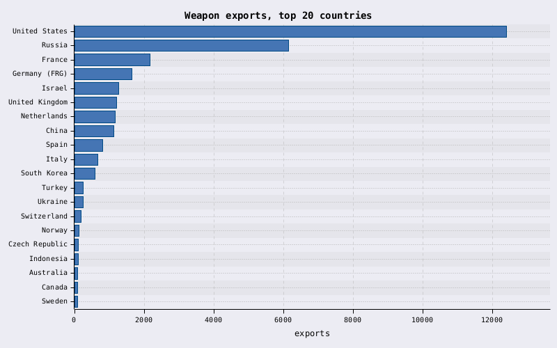
:::


### Colour, outline and width

`:color` fills, `:stroke-color` / `:stroke-width` outline (default: the fill darkened), `:width` - the share of
the band a bar takes.

Source: R Graph Gallery - Basic barplot with ggplot2; Custom barplot layout ([1](https://r-graph-gallery.com/218-basic-barplots-with-ggplot2.html), [2](https://r-graph-gallery.com/210-custom-barplot-layout.html)). Data: Weapon exports by country, data-to-viz example dataset `7_OneCatOneNum` (Yan Holtz); licence: MIT (data_to_viz repository).


::: {.sourceClojure}
```clojure
(plot/render-image
 (plot/arrange
  (vec (for [[title opts] [[":color" {:color [215 48 39]}]
                           [":stroke-color, :stroke-width" {:color :white :stroke-color [33 102 172] :stroke-width 2}]
                           [":width 0.4" {:width 0.4}]]]
         {:data top-10
          :mapping {:x :country :y :value}
          :theme {:axis {:x {:label-rotation -90}}}
          :charts [(chart/bar opts)]
          :labels {:title title :x nil :y nil}}))
  {:columns 3})
 {:width 1000 :height 400})
```
:::


::: {.clay-image}

:::


### Horizontal and vertical bars

The mapping orients the bars: the countries on `:x` - vertical bars (tick labels turned -45°), on `:y` - horizontal
ones, which keep long labels readable.

Source: R Graph Gallery - Barplot; data-to-viz - Barplot ([1](https://r-graph-gallery.com/barplot.html), [2](https://www.data-to-viz.com/graph/barplot.html)). Data: Weapon exports by country, data-to-viz example dataset `7_OneCatOneNum` (Yan Holtz); licence: MIT (data_to_viz repository).


::: {.sourceClojure}
```clojure
(plot/render-image
 (plot/arrange
  [{:data top-10 :mapping {:x :country :y :value}
    :theme {:axis {:x {:label-rotation -45}}}
    :charts [(chart/bar)]
    :labels {:title "{:x :country :y :value}" :x nil :y "exports"}}
   {:data (rseq top-10) :mapping {:x :value :y :country}
    :charts [(chart/bar)]
    :labels {:title "{:x :value :y :country}" :x "exports" :y nil}}]
  {:columns 2})
 {:width 1000 :height 450})
```
:::


::: {.clay-image}

:::


### Order by value

Levels follow the data (the first level at the bottom of horizontal bars); an explicit `:y` `:domain` orders them

- here by value, so the ranking reads from the top.

Source: [R Graph Gallery - Reorder a variable with ggplot2](https://r-graph-gallery.com/267-reorder-a-variable-in-ggplot2.html). Data: Weapon exports by country, data-to-viz example dataset `7_OneCatOneNum` (Yan Holtz); licence: MIT (data_to_viz repository).


::: {.sourceClojure}
```clojure
(plot/render-image
 (plot/arrange
  [{:data (alphabetical top-20) :mapping {:x :value :y :country}
    :charts [(chart/bar)]
    :labels {:title "Alphabetical (data order)" :x "exports" :y nil}}
   {:data top-20 :mapping {:x :value :y :country}
    :scales {:y {:domain (ascending top-20)}}
    :charts [(chart/bar)]
    :labels {:title "By value (:domain)" :x "exports" :y nil}}]
  {:columns 2})
 {:width 1000 :height 500})
```
:::


::: {.clay-image}

:::


### Variable width

`:varwidth true` - bar widths by the square root of the number of rows (as box plots), `:n-label` writes the
counts: mean fuel economy per number of cylinders, 11, 7 and 14 cars. The cylinder counts are numbers, declared
categorical with `levels/categorical`.

Source: [R Graph Gallery - Barplot with variable width](https://r-graph-gallery.com/81-barplot-with-variable-width.html). Data: Motor Trend car road tests (1974), R datasets package `mtcars` (Henderson & Velleman 1981); licence: Part of R (GPL-2 | GPL-3).


::: {.sourceClojure}
```clojure
(plot/render-image
 {:data mtcars
  :mapping {:x (levels/categorical :cyl) :y :mpg}
  :charts [(chart/bar {:stat :mean :varwidth true :n-label true})]
  :labels {:title "Mean fuel economy, widths by the number of cars" :x "cylinders" :y "mean miles per gallon"}}
 {:width 800 :height 400})
```
:::


::: {.clay-image}

:::


### Error bars

`chart/extent` with the bars' mapping takes the same slots: mean bars with ± one standard deviation.

Source: [R Graph Gallery - Barplot with error bars](https://r-graph-gallery.com/4-barplot-with-error-bar.html). Data: Edgar Anderson's iris measurements, R datasets package `iris` (Anderson 1935; Fisher 1936); licence: Part of R (GPL-2 | GPL-3).


::: {.sourceClojure}
```clojure
(plot/render-image
 (plot/arrange
  (vec (for [k [:sepal-length :petal-length]]
         {:data iris :mapping {:x :species :y k}
          :charts [(chart/bar {:stat :mean :color [120 160 200]})
                   (chart/extent {:method :stddev :center :none :color [40 40 40] :line-width 1.5})]
          :labels {:title (str "Mean " (name k) " ± sd") :x nil :y "cm"}}))
  {:columns 2})
 {:width 900 :height 400})
```
:::


::: {.clay-image}
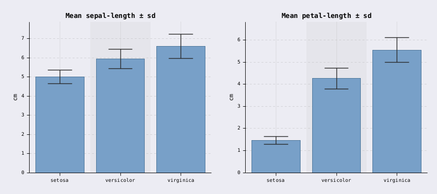
:::


### Black-and-white bars

Patterns tell groups apart without colour: `:pattern` maps a variable to the theme's pattern set (a legend
included); a literal `:pattern` textures every bar. Histograms, densities, areas, ribbons, rects, boxes,
violins, treemaps and candlesticks take patterns too.

Source: [R Graph Gallery - Black and white barchart](https://r-graph-gallery.com/368-black-and-white-barchart.html). Data: Prices and attributes of round cut diamonds, R ggplot2 package `diamonds` (Wickham et al.); licence: MIT (ggplot2).


::: {.sourceClojure}
```clojure
(plot/render-image
 (plot/arrange
  [{:data (filter #(#{"Fair" "Good" "Ideal"} (:cut %)) diamonds)
    :mapping {:x :clarity :pattern :cut}
    :scales {:x {:domain clarities} :pattern {:domain ["Fair" "Good" "Ideal"]}}
    :charts [(chart/bar {:stat :count :color :white :stroke-color :black :pattern-color :black})]
    :labels {:title "Diamonds per clarity, :pattern by cut" :x nil :y "count"}}
   {:data top-10 :mapping {:x :country :y :value}
    :theme {:axis {:x {:label-rotation -90}}}
    :charts [(chart/bar {:color :white :stroke-color :black :pattern :hatch :pattern-color :black})]
    :labels {:title "A literal :pattern :hatch" :x nil :y "exports"}}]
  {:columns 2 :widths [3 2]})
 {:width 1000 :height 450})
```
:::


::: {.clay-image}

:::


### Value labels

`:value-label true` writes each bar's length past its end - above vertical bars, beside horizontal ones.

Source: [R Graph Gallery - Barplot with number of observations](https://r-graph-gallery.com/37-barplot-with-number-of-observation.html). Data: Weapon exports by country, data-to-viz example dataset `7_OneCatOneNum` (Yan Holtz); licence: MIT (data_to_viz repository).


::: {.sourceClojure}
```clojure
(plot/render-image
 (plot/arrange
  [{:data top-10 :mapping {:x :country :y :value}
    :theme {:axis {:x {:label-rotation -45}}}
    :charts [(chart/bar {:value-label true})]
    :labels {:title "Vertical" :x nil :y "exports"}}
   {:data (rseq top-10) :mapping {:x :value :y :country}
    :charts [(chart/bar {:value-label true})]
    :labels {:title "Horizontal" :x "exports" :y nil}}]
  {:columns 2})
 {:width 1000 :height 450})
```
:::


::: {.clay-image}
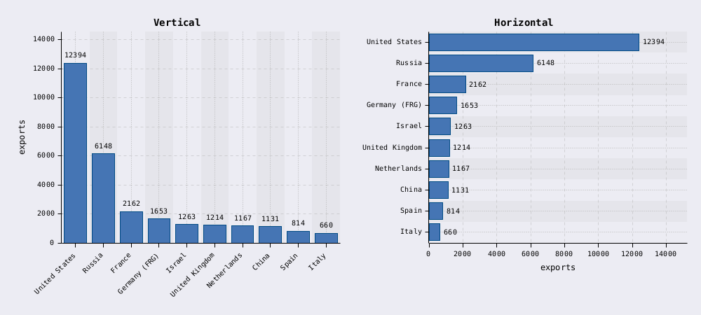
:::


### Grouped bars

A second categorical variable on `:color` dodges the bars inside each band (the default with two or more groups
per level).

Source: [R Graph Gallery - Grouped, stacked and percent stacked barplot](https://r-graph-gallery.com/48-grouped-barplot-with-ggplot2.html). Data: Prices and attributes of round cut diamonds, R ggplot2 package `diamonds` (Wickham et al.); licence: MIT (ggplot2).


::: {.sourceClojure}
```clojure
(plot/render-image
 {:data diamonds
  :mapping {:x :clarity :color :cut}
  :scales {:x {:domain clarities} :color {:domain cuts}}
  :charts [(chart/bar {:stat :count})]
  :labels {:title "Diamonds per clarity and cut" :x "clarity" :y "count"}}
 {:width 900 :height 450})
```
:::


::: {.clay-image}

:::


### Stacked bars

`:position :stack` piles the groups up, `:normalize` scales every stack to 1 (shares).

Source: [R Graph Gallery - Grouped, stacked and percent stacked barplot](https://r-graph-gallery.com/48-grouped-barplot-with-ggplot2.html). Data: Prices and attributes of round cut diamonds, R ggplot2 package `diamonds` (Wickham et al.); licence: MIT (ggplot2).


::: {.sourceClojure}
```clojure
(plot/render-image
 (plot/arrange
  (vec (for [p [:stack :normalize]]
         {:data diamonds
          :mapping {:x :clarity :color :cut}
          :scales {:x {:domain clarities} :color {:domain cuts}}
          :charts [(chart/bar {:stat :count :position p})]
          :labels {:title (str ":position " p) :x "clarity"}}))
  {:columns 2})
 {:width 1000 :height 450})
```
:::


::: {.clay-image}
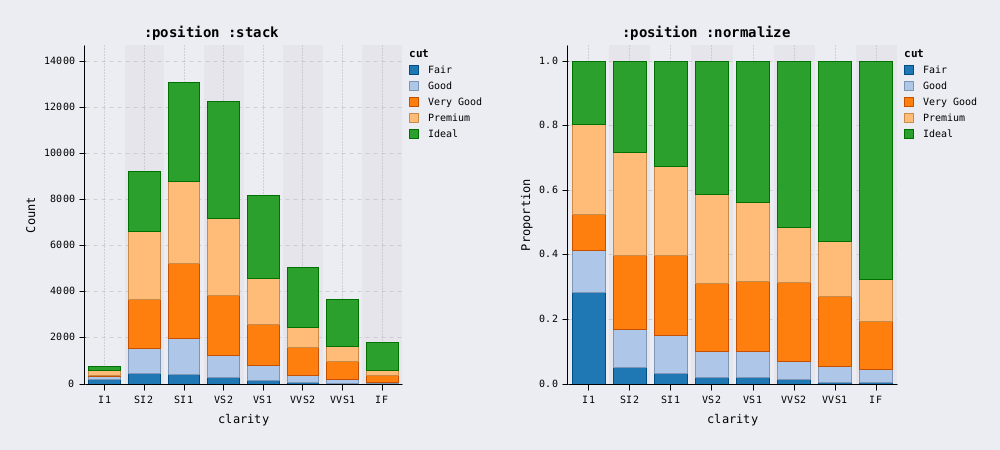
:::


### Mirrored bars

`:mirror` turns the second level of a two-level variable the other way: back-to-back bars, with value tick labels
as magnitudes. Answers for and against eight proposals, stacked by how sure people were: the mirror on `:group`
(for / against), four colours - two blues, two reds - on `:color`.


::: {.sourceClojure}
```clojure
(def votes
  "Seeded answers to eight proposals: people for and against, sure or leaning."
  (let [rng (r/rng :mersenne 5)]
    (vec (for [i (range 8)
               :let [support (+ 20 (r/irandom rng 60))]
               [answer share] [["for" support] ["against" (- 100 support)]]
               [certainty f] [["sure" 0.6] ["leaning" 0.4]]]
           {:proposal (str "proposal " (inc i)) :answer answer :certainty certainty
            :answer-certainty (str answer ", " certainty) :people (long (* f share 12))}))))
```
:::


Source: [R Graph Gallery - Barplot (back-to-back bars)](https://r-graph-gallery.com/barplot.html).


::: {.sourceClojure}
```clojure
(plot/render-image
 {:data votes
  :mapping {:x :proposal :y :people :color :answer-certainty :group :answer}
  :scales {:color {:domain ["for, sure" "for, leaning" "against, sure" "against, leaning"]
                   :range {"for, sure" [8 69 148] "for, leaning" [107 174 214]
                           "against, sure" [165 15 21] "against, leaning" [251 106 74]}}}
  :charts [(chart/bar {:mirror :group :position :stack})]
  :labels {:title "For (up) and against (down), sure and leaning" :x nil :y "people"}}
 {:width 900 :height 450})
```
:::


::: {.clay-image}
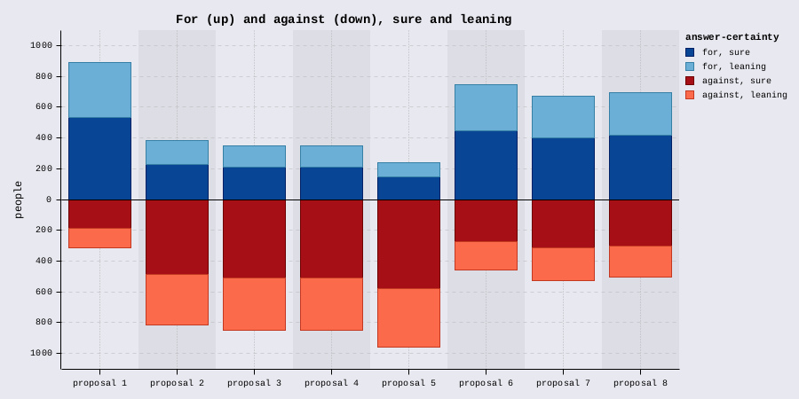
:::


### Economist-style labelled bars

No axes - the labels carry the values: name and value inside the bar at its base when they fit (a text chart at
x = 0, in white), else just past the bar's end. Whether a label fits is estimated here: about 7 pixels per
character against the bar's share of a 700 pixel panel.

Source: [R Graph Gallery - Horizontal barplot with labels (The Economist style)](https://r-graph-gallery.com/web-horizontal-barplot-with-labels-the-economist.html). Data: Weapon exports by country, data-to-viz example dataset `7_OneCatOneNum` (Yan Holtz); licence: MIT (data_to_viz repository).


::: {.sourceClojure}
```clojure
(let [rows (mapv #(assoc % :label (str (:country %) "  " (:value %))) top-10)
      longest (double (reduce max (map :value rows)))
      fits? (fn [{:keys [value label]}] (> (* 700.0 (/ (double value) longest)) (+ 12.0 (* 7.0 (count label)))))
      text (fn [rows x anchor color] (chart/text {:data rows :mapping {:x x :y :country :label :label}
                                                  :anchor anchor :offset [6 0] :color color}))]
  (plot/render-image
   {:data rows
    :mapping {:x :value :y :country}
    :scales {:y {:domain (ascending rows) :axis false} :x {:axis false}}
    :theme {:panel {:grid {:x :none :y :none :bands-fill :none}}}
    :charts [(chart/bar {:color [0 104 139] :stroke-color :none :width 0.7})
             (text (filterv fits? rows) (constantly 0) [:left :middle] :white)
             (text (filterv (complement fits?) rows) :value [:left :middle] [0 104 139])]
    :labels {:title {:text "Weapon exports\nTop 10 countries, value of exports" :align [:left :middle]} :x nil :y nil}}
   {:width 800 :height 450}))
```
:::


::: {.clay-image}
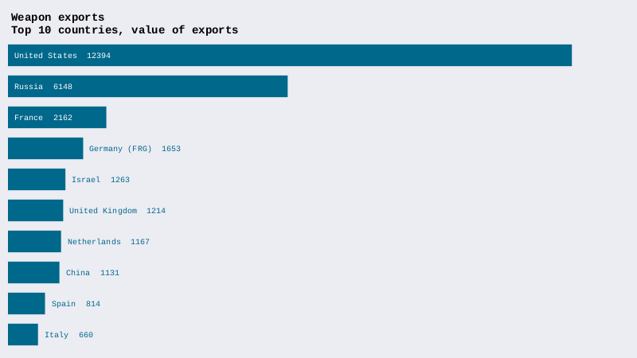
:::


## Lollipop and dot plots

A thin stem and a point carry the value with less ink than a bar: `chart/segment` from the baseline under a
`chart/scatter`.


### Lollipop

Stems from 0 (`(chart/segment {:xend 0})`), styled stems and markers, and a baseline at the mean - stems grow
both ways.

Source: R Graph Gallery - Basic lollipop plot; Custom lollipop chart; data-to-viz - Lollipop ([1](https://r-graph-gallery.com/300-basic-lollipop-plot.html), [2](https://r-graph-gallery.com/301-custom-lollipop-chart.html), [3](https://www.data-to-viz.com/graph/lollipop.html)). Data: Weapon exports by country, data-to-viz example dataset `7_OneCatOneNum` (Yan Holtz); licence: MIT (data_to_viz repository).


::: {.sourceClojure}
```clojure
(let [mean (stats/mean (map :value top-20))
      base {:data top-20 :mapping {:x :value :y :country} :scales {:y {:domain (ascending top-20)}}}]
  (plot/render-image
   (plot/arrange
    [(assoc base :charts [(chart/segment {:xend 0}) (chart/scatter)]
            :labels {:title "Basic" :x "exports" :y nil})
     (assoc base :charts [(chart/segment {:xend 0 :color [150 150 150] :width 2})
                          (chart/scatter {:size 9 :color [215 48 39] :shape \s})]
            :labels {:title "Styled stems and markers" :x "exports" :y nil})
     (assoc base :charts [(chart/rule {:x mean :dash :dashed})
                          (chart/segment {:xend mean :color [150 150 150]})
                          (chart/scatter {:size 7 :color [33 102 172]})]
            :labels {:title "Baseline at the mean" :x "exports" :y nil})]
    {:columns 3})
   {:width 1000 :height 500}))
```
:::


::: {.clay-image}
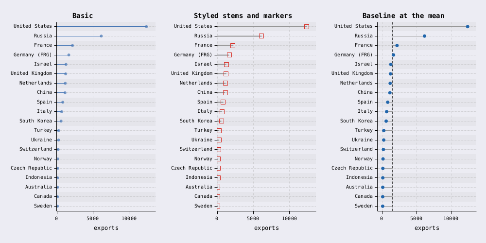
:::


### Cleveland dot plot and dumbbell

Two values per item: dots alone (Cleveland), or joined by a segment from one to the other (dumbbell), ordered by
the second value.


::: {.sourceClojure}
```clojure
(def scores
  "Seeded scores of twelve teams in two seasons."
  (let [rng (r/rng :mersenne 11)]
    (vec (for [i (range 12)
               :let [v1 (+ 30 (r/irandom rng 50))]]
           {:team (str "team " (char (+ 65 i))) :season-1 v1 :season-2 (+ v1 -15 (r/irandom rng 35))}))))
```
:::


Source: [R Graph Gallery - Lollipop chart with 2 values](https://r-graph-gallery.com/303-lollipop-plot-with-2-values.html).


::: {.sourceClojure}
```clojure
(let [order (mapv :team (sort-by :season-2 scores))
      dots (fn [k color] (chart/scatter {:mapping {:x k :y :team} :size 8 :color color}))]
  (plot/render-image
   (plot/arrange
    [{:data scores :scales {:y {:domain order}}
      :charts [(dots :season-2 [33 102 172])]
      :labels {:title "Cleveland dot plot: season 2" :x "score" :y nil}}
     {:data scores :scales {:y {:domain order}}
      :charts [(chart/segment {:mapping {:x :season-1 :xend :season-2 :y :team} :color [170 170 170] :width 2})
               (dots :season-1 [150 150 150]) (dots :season-2 [33 102 172])]
      :labels {:title "Dumbbell: season 1 (grey) to season 2 (blue)" :x "score" :y nil}}]
    {:columns 2})
   {:width 1000 :height 450}))
```
:::


::: {.clay-image}
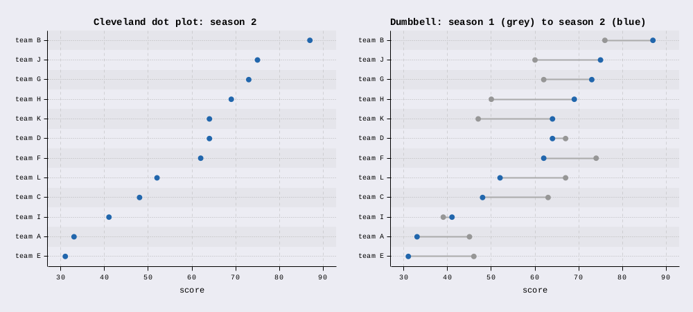
:::


### Conditional colour and highlight

A derived column colours the lollipops above and below a threshold; a level map keeps one country in colour and
greys the rest.

Source: [R Graph Gallery - Lollipop chart with conditional color](https://r-graph-gallery.com/302-lollipop-chart-with-conditional-color.html). Data: Weapon exports by country, data-to-viz example dataset `7_OneCatOneNum` (Yan Holtz); licence: MIT (data_to_viz repository).


::: {.sourceClojure}
```clojure
(let [mean (stats/mean (map :value top-20))
      rows (mapv #(assoc % :side (if (> (double (:value %)) mean) "above the mean" "below the mean")
                         :highlight (if (= "Germany (FRG)" (:country %)) "Germany (FRG)" "others"))
                 top-20)
      base {:data rows :scales {:y {:domain (ascending rows)}}}]
  (plot/render-image
   (plot/arrange
    [(assoc base :mapping {:x :value :y :country :color :side}
            :charts [(chart/segment {:xend mean}) (chart/scatter {:size 7})]
            :labels {:title "Above / below the mean" :x "exports" :y nil})
     (assoc base :mapping {:x :value :y :country :color :highlight}
            :scales (assoc (:scales base) :color {:range {"Germany (FRG)" [215 48 39] "others" [190 190 190]}})
            :charts [(chart/segment {:xend 0}) (chart/scatter {:size 7})]
            :labels {:title "One country highlighted" :x "exports" :y nil})]
    {:columns 2})
   {:width 1000 :height 500}))
```
:::


::: {.clay-image}

:::


### Lollipop with subgroups

Items of five groups, coloured by group and ordered by value inside each group.


::: {.sourceClojure}
```clojure
(def products
  "Seeded sales of six products in each of five shops."
  (let [rng (r/rng :mersenne 17)]
    (vec (for [shop ["North" "South" "East" "West" "Centre"] i (range 6)]
           {:shop shop :product (str shop " " (inc i)) :sales (+ 10 (r/irandom rng 90))}))))
```
:::


Source: [data-to-viz - Lollipop (subgroups)](https://www.data-to-viz.com/graph/lollipop.html).


::: {.sourceClojure}
```clojure
(let [order (mapv :product (sort-by (juxt :shop :sales) products))]
  (plot/render-image
   {:data products
    :mapping {:x :sales :y :product :color :shop}
    :scales {:y {:domain order}}
    :charts [(chart/segment {:xend 0}) (chart/scatter {:size 7})]
    :labels {:title "Sales of six products per shop" :x "sales" :y nil}}
   {:width 800 :height 700}))
```
:::


::: {.clay-image}

:::


## Circular barplot

Bars in polar coordinates: with `:coord {:kind :polar}` the horizontal axis goes around the circle - the levels
on `:x` - and the vertical one along the radius; `:inner` leaves a hole.


### Circular barplot: labels, order, gaps

Ordered bars with labels along their angle (`:rotation :radial`), and gaps between groups - blank levels in an
explicit domain, their tick labels hidden by a formatter.


::: {.sourceClojure}
```clojure
(def shop-groups
  "Seeded values of items in three groups."
  (let [rng (r/rng :mersenne 12)]
    (vec (for [[g n] [["A" 6] ["B" 5] ["C" 7]] i (range n)]
           {:group g :item (str g (inc i)) :value (+ 10 (r/irandom rng 90))}))))
```
:::


Source: R Graph Gallery - Basic circular barplot; Labels; Circular barplot with groups; data-to-viz - Circular barplot ([1](https://r-graph-gallery.com/295-basic-circular-barplot.html), [2](https://r-graph-gallery.com/296-add-labels-to-circular-barplot.html), [3](https://r-graph-gallery.com/297-circular-barplot-with-groups.html), [4](https://www.data-to-viz.com/graph/circularbarplot.html)). Data: Weapon exports by country, data-to-viz example dataset `7_OneCatOneNum` (Yan Holtz); licence: MIT (data_to_viz repository).


::: {.sourceClojure}
```clojure
(let [levels (vec (mapcat (fn [g] (concat (map :item (filter #(= g (:group %)) shop-groups)) [(str "_" g)])) ["A" "B" "C"]))]
  (plot/render-image
   (plot/arrange
    [{:data top-20 :mapping {:x :country :y :value}
      :coord {:kind :polar :inner 0.3}
      :scales {:x {:domain (ascending top-20) :axis false} :y {:axis false :domain [0 26000]}}
      :charts [(chart/bar {:color [33 102 172] :stroke-color :none})
               (chart/text {:mapping {:x :country :y :value :label :country} :rotation :radial :size 8})]
      :labels {:title "Ordered, radial labels" :x nil :y nil}}
     {:data shop-groups :mapping {:x :item :y :value :color :group}
      :coord {:kind :polar :inner 0.2}
      :scales {:x {:domain levels :formatter (fn [v] (if (= \_ (first (str v))) "" (str v)))}}
      :charts [(chart/bar)]
      :labels {:title "Gaps between groups" :x nil :y nil}}]
    {:columns 2})
   {:width 1000 :height 500}))
```
:::


::: {.clay-image}

:::


### Stacked and dodged circular bars

The bar positions work around the circle too.


::: {.sourceClojure}
```clojure
(def parts
  "Seeded values of three parts of twelve items."
  (let [rng (r/rng :mersenne 23)]
    (vec (for [i (range 12) part ["x" "y" "z"]]
           {:item (str "item " (inc i)) :part part :value (+ 5 (r/irandom rng 30))}))))
```
:::


Source: [R Graph Gallery - Circular stacked barplot](https://r-graph-gallery.com/299-circular-stacked-barplot.html).


::: {.sourceClojure}
```clojure
(plot/render-image
 (plot/arrange
  (vec (for [p [:stack :dodge]]
         {:data parts :mapping {:x :item :y :value :color :part}
          :coord {:kind :polar :inner 0.15}
          :charts [(chart/bar {:position p})]
          :labels {:title (str ":position " p) :x nil :y nil}}))
  {:columns 2})
 {:width 1000 :height 500})
```
:::


::: {.clay-image}

:::


### Circular lollipop

Segments and points in polar coordinates: the levels on the angle (`:x`), the values on the radius - on a log
scale (stems from 50), so the small values don't crowd the centre.

Source: [R Graph Gallery - Circular barplot](https://r-graph-gallery.com/circular-barplot.html). Data: Weapon exports by country, data-to-viz example dataset `7_OneCatOneNum` (Yan Holtz); licence: MIT (data_to_viz repository).


::: {.sourceClojure}
```clojure
(let [order (rseq (ascending top-20))]
  (plot/render-image
   {:data top-20 :mapping {:x :country :y :value}
    :coord {:kind :polar :start -9}
    :scales {:x {:domain (vec order)} :y {:kind :log}}
    :charts [(chart/segment {:yend 50 :color [150 150 150]}) (chart/scatter {:size 8 :color [215 48 39]})]
    :labels {:title "Weapon exports, top 20" :x nil :y nil}}
   {:width 600 :height 600}))
```
:::


::: {.clay-image}
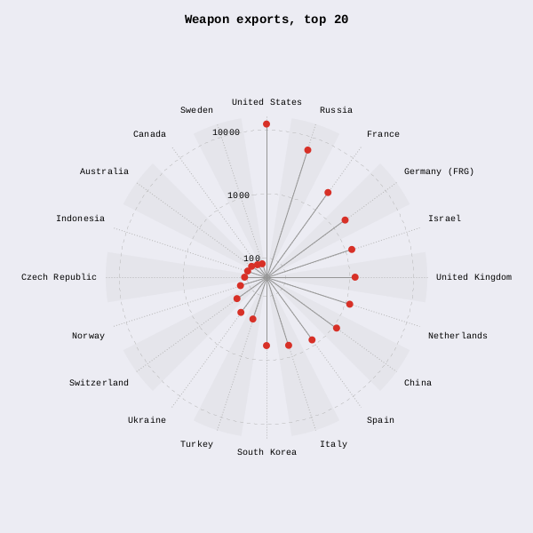
:::


## Parallel coordinates

Each row a line across one axis per variable (`chart/parallel` over `:variables`); every axis has its own scale
in the variable's units, drawn by the chart.


::: {.sourceClojure}
```clojure
(def iris-variables [:sepal-length :sepal-width :petal-length :petal-width])
```
:::


### Parallel coordinates: groups, highlight, vertical

Lines coloured by species; a level map greys all but one species; `:flip true` stacks the axes vertically.

Source: R Graph Gallery - Parallel coordinates chart with ggally; data-to-viz - Parallel coordinates ([1](https://r-graph-gallery.com/parallel-plot-ggally.html), [2](https://www.data-to-viz.com/graph/parallel.html)). Data: Edgar Anderson's iris measurements, R datasets package `iris` (Anderson 1935; Fisher 1936); licence: Part of R (GPL-2 | GPL-3).


::: {.sourceClojure}
```clojure
(plot/render-image
 (plot/arrange
  [{:data iris :mapping {:color :species}
    :charts [(chart/parallel {:variables iris-variables})]
    :labels {:title "By species" :x nil}}
   {:data iris :mapping {:color :species}
    :scales {:color {:range {"setosa" [190 190 190 120] "versicolor" [190 190 190 120] "virginica" [215 48 39 220]}}}
    :charts [(chart/parallel {:variables iris-variables})]
    :labels {:title "Virginica highlighted" :x nil}}
   {:data iris :mapping {:color :species} :flip true
    :charts [(chart/parallel {:variables iris-variables})]
    :labels {:title "Vertical (:flip true)" :x nil}}]
  {:columns 2})
 {:width 1000 :height 800})
```
:::


::: {.clay-image}
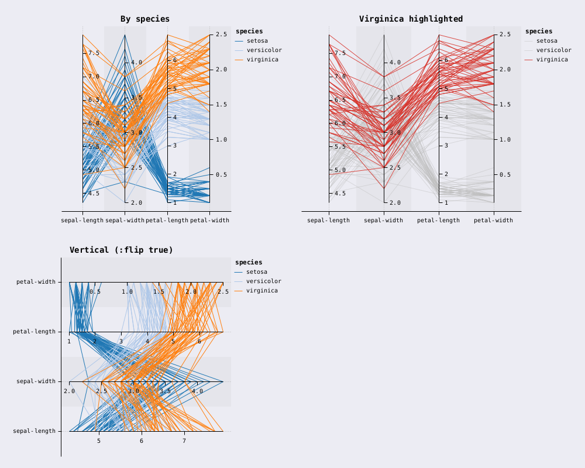
:::


### Smooth connections

`:curve :smooth` joins the axes with curves that meet every axis flat, at its value, and never overshoot;
`:smoothness` (0..1) moves the bend toward the axes.

Source: [R Graph Gallery - Parallel plot](https://r-graph-gallery.com/parallel-plot.html). Data: Edgar Anderson's iris measurements, R datasets package `iris` (Anderson 1935; Fisher 1936); licence: Part of R (GPL-2 | GPL-3).


::: {.sourceClojure}
```clojure
(plot/render-image
 (plot/arrange
  (vec (for [[title opts] [["Straight" {}] [":curve :smooth" {:curve :smooth}]]]
         {:data (take-nth 3 iris) :mapping {:color :species} :legend false
          :charts [(chart/parallel (merge {:variables iris-variables} opts))]
          :labels {:title title :x nil}}))
  {:columns 2})
 {:width 1000 :height 400})
```
:::


::: {.clay-image}

:::


### Scaling

`:scaling` - per variable `(v - offset) / scale`: `:std` (mean, sd), `:robust` (median, R's `mad`),
`:uniminmax` (every axis 0..1, the default), `:globalminmax` (the values as they are, one scale).

Source: [R Graph Gallery - Parallel coordinates chart with ggally (scaling)](https://r-graph-gallery.com/parallel-plot-ggally.html). Data: Edgar Anderson's iris measurements, R datasets package `iris` (Anderson 1935; Fisher 1936); licence: Part of R (GPL-2 | GPL-3).


::: {.sourceClojure}
```clojure
(plot/render-image
 (plot/arrange
  (vec (for [scaling [:std :robust :uniminmax :globalminmax]]
         {:data iris :mapping {:color :species} :legend false
          :charts [(chart/parallel {:variables iris-variables :scaling scaling :width 0.5})]
          :labels {:title (str ":scaling " scaling) :x nil}}))
  {:columns 2})
 {:width 1000 :height 700})
```
:::


::: {.clay-image}

:::


### Axis order

The axes follow `:variables`: neighbours are compared, so the order changes what the chart shows.

Source: [data-to-viz - Parallel coordinates (axis order)](https://www.data-to-viz.com/graph/parallel.html). Data: Edgar Anderson's iris measurements, R datasets package `iris` (Anderson 1935; Fisher 1936); licence: Part of R (GPL-2 | GPL-3).


::: {.sourceClojure}
```clojure
(plot/render-image
 (plot/arrange
  (vec (for [[title vs] [["Measured order" iris-variables]
                          ["Sepal width beside the petals" [:sepal-width :petal-length :sepal-length :petal-width]]]]
         {:data iris :mapping {:color :species} :legend false
          :charts [(chart/parallel {:variables vs})]
          :labels {:title title :x nil}}))
  {:columns 2})
 {:width 1000 :height 400})
```
:::


::: {.clay-image}
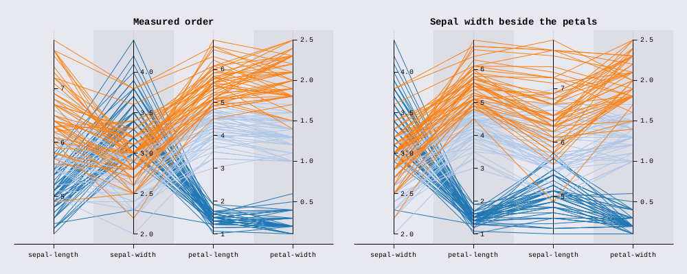
:::


## Radar

A radar (spider) chart is `chart/parallel` in polar coordinates: variables on angles, values along the spokes,
each row a closed polygon - filled with `:fill`.


::: {.sourceClojure}
```clojure
(def car-variables [:mpg :hp :wt :qsec :drat :disp])
```
:::


::: {.sourceClojure}
```clojure
(def four-cars (filterv #(#{"Mazda RX4" "Merc 240D" "Lotus Europa" "Cadillac Fleetwood"} (:model %)) mtcars))
```
:::


::: {.sourceClojure}
```clojure
(def car-limits
  "Every variable's range over all 32 cars."
  (into {} (map (fn [k] [k [(reduce min (map k mtcars)) (reduce max (map k mtcars))]])) car-variables))
```
:::


### Radar: groups and limits

Four cars filled; the same cars on axes fixed to the range of all cars (`:limits`); all cars by cylinders on
standardized axes.

Source: R Graph Gallery - Basic radar chart; Radar chart with several individuals ([1](https://r-graph-gallery.com/142-basic-radar-chart.html), [2](https://r-graph-gallery.com/143-spider-chart-with-saveral-individuals.html)). Data: Motor Trend car road tests (1974), R datasets package `mtcars` (Henderson & Velleman 1981); licence: Part of R (GPL-2 | GPL-3).


::: {.sourceClojure}
```clojure
(plot/render-image
 (plot/arrange
  [(plot/arrange
    [{:data four-cars :mapping {:color :model} :coord {:kind :polar} :legend false
      :charts [(chart/parallel {:variables car-variables :fill :color :width 2})]
      :labels {:title "Four cars, their own ranges" :x nil}}
     {:data four-cars :mapping {:color :model} :coord {:kind :polar}
      :charts [(chart/parallel {:variables car-variables :fill :color :width 2 :limits car-limits})]
      :labels {:title "Ranges of all 32 cars (:limits)" :x nil}}]
    {:columns 2 :widths [2 3]})
   {:data (map #(assoc % :cylinders (str (long (:cyl %)))) mtcars) :mapping {:color :cylinders} :coord {:kind :polar}
    :charts [(chart/parallel {:variables car-variables :scaling :std})]
    :labels {:title "All cars by cylinders (:std)" :x nil}}]
  {:columns 1 :heights [1 1]})
 {:width 1000 :height 800})
```
:::


::: {.clay-image}
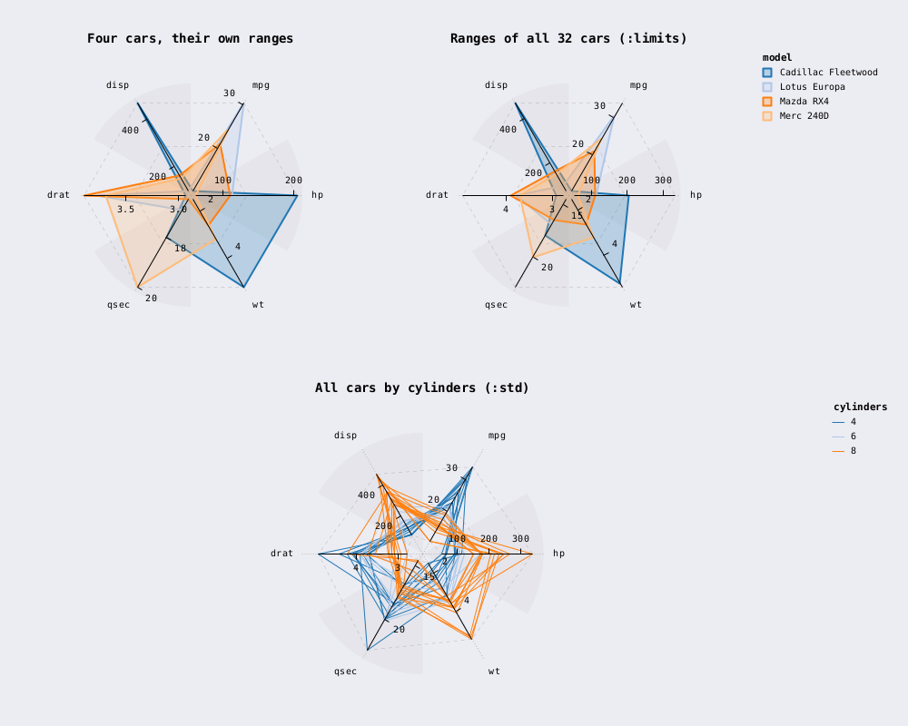
:::


### Variables as rings

With `:flip true` the variables become rings and the values angles: every flower is a line from ring to ring -
the species separate on the petal rings and mix on sepal width.

Source: [R Graph Gallery - Spider / radar chart](https://r-graph-gallery.com/spider-or-radar-chart.html). Data: Edgar Anderson's iris measurements, R datasets package `iris` (Anderson 1935; Fisher 1936); licence: Part of R (GPL-2 | GPL-3).


::: {.sourceClojure}
```clojure
(plot/render-image
 {:data iris :mapping {:color :species}
  :coord {:kind :polar :inner 0.25} :flip true
  :scales {:color {:range {"setosa" [27 158 119 110] "versicolor" [217 95 2 110] "virginica" [117 112 179 110]}}}
  :charts [(chart/parallel {:variables iris-variables :width 0.8})]
  :labels {:title "150 iris flowers across four rings" :x nil}}
 {:width 750 :height 700})
```
:::


::: {.clay-image}

:::


## Bump

A bump chart shows ranks over time - see [Evolution - Bump chart](use_cases.evolution.html#bump-chart)
(`levels/rank-rows`, monotone lines, end labels).


## Caveats


### Order the data

Unordered categories make the reader sort them; ordered by value, the ranking is read at a glance - here all 38
countries with a value, as lollipops on a log scale (exports from 2 to 12394; the stems start at 1, as log 0 is
undefined).

Source: [data-to-viz - Order your data](https://www.data-to-viz.com/caveat/order_data.html). Data: Weapon exports by country, data-to-viz example dataset `7_OneCatOneNum` (Yan Holtz); licence: MIT (data_to_viz repository).


::: {.sourceClojure}
```clojure
(plot/render-image
 (plot/arrange
  (vec (for [[title y-scale] [["Alphabetical" {}] ["Ordered by value" {:domain (ascending weapons)}]]]
         {:data (alphabetical weapons) :mapping {:x :value :y :country}
          :scales {:x {:kind :log} :y y-scale}
          :theme {:axis {:y {:label-gap 1}}}
          :charts [(chart/segment {:xend 1 :color [150 150 150]}) (chart/scatter {:size 5 :color [33 102 172]})]
          :labels {:title title :x "exports (log scale)" :y nil}}))
  {:columns 2})
 {:width 1000 :height 800})
```
:::


::: {.clay-image}

:::


### Barplot or histogram

A barplot shows a value per category; a histogram shows how one numeric variable is distributed - bins of a
continuous axis, no gaps.

Source: data-to-viz - Barplot; Histogram ([1](https://www.data-to-viz.com/graph/barplot.html), [2](https://www.data-to-viz.com/graph/histogram.html)). Data: Prices and attributes of round cut diamonds, R ggplot2 package `diamonds` (Wickham et al.); licence: MIT (ggplot2).


::: {.sourceClojure}
```clojure
(plot/render-image
 (plot/arrange
  [{:data diamonds :mapping {:x :cut} :scales {:x {:domain cuts}}
    :charts [(chart/bar {:stat :count})] :labels {:title "Barplot: diamonds per cut" :x nil :y "count"}}
   {:data diamonds :mapping {:x :price}
    :charts [(chart/histogram)] :labels {:title "Histogram: diamond prices" :x "price, USD"}}]
  {:columns 2})
 {:width 1000 :height 400})
```
:::


::: {.clay-image}

:::


### Radar: the order of the axes

The same car in two axis orders: the polygon's shape and area change with the order, though the values don't.

Source: [data-to-viz - Spider chart caveats](https://www.data-to-viz.com/caveat/spider.html). Data: Motor Trend car road tests (1974), R datasets package `mtcars` (Henderson & Velleman 1981); licence: Part of R (GPL-2 | GPL-3).


::: {.sourceClojure}
```clojure
(plot/render-image
 (plot/arrange
  (vec (for [vs [car-variables [:mpg :wt :hp :drat :qsec :disp]]]
         {:data (filter #(= "Mazda RX4" (:model %)) mtcars) :coord {:kind :polar}
          :charts [(chart/parallel {:variables vs :fill :color :width 2 :limits car-limits})]
          :labels {:title (str "Mazda RX4: " (str/join " " (map name vs))) :x nil}}))
  {:columns 2})
 {:width 1000 :height 500})
```
:::


::: {.clay-image}

:::


### Circular bars exaggerate the outer ones

Around a circle an outer bar is longer than an inner bar of the same value, and the angle of each bar hides its
length: the straight bars compare honestly.

Source: [data-to-viz - Circular barplot y axis](https://www.data-to-viz.com/caveat/circular_bar_yaxis.html). Data: Weapon exports by country, data-to-viz example dataset `7_OneCatOneNum` (Yan Holtz); licence: MIT (data_to_viz repository).


::: {.sourceClojure}
```clojure
(plot/render-image
 (plot/arrange
  [{:data top-10 :mapping {:x :country :y :value} :scales {:x {:domain (ascending top-10)}}
    :coord {:kind :polar :inner 0.2}
    :charts [(chart/bar)] :labels {:title "Circular" :x nil :y nil}}
   {:data top-10 :mapping {:x :country :y :value} :scales {:x {:domain (ascending top-10)}}
    :theme {:axis {:x {:label-rotation -45}}}
    :charts [(chart/bar)] :labels {:title "Straight" :x nil :y "exports"}}]
  {:columns 2})
 {:width 1000 :height 500})
```
:::


::: {.clay-image}
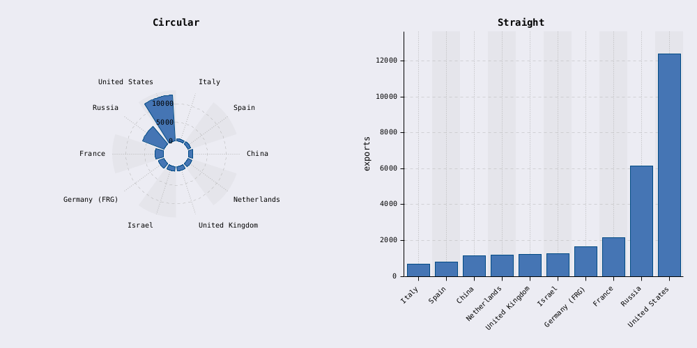
:::


```{=html}
<div style="background-color:grey;height:2px;width:100%;"></div>
```


```{=html}
<div><pre><small><small>source: notebooks/use_cases/ranking.clj</small></small></pre></div>
```