---
format:
  html:
    toc: true
    toc-location: right
    toc-depth: 4
    theme: cosmo
    include-in-header:
      text: |-
        <style>
        .data-table { width: fit-content; max-width: 100%; max-height: 15rem; overflow: auto; margin: 0 0 1rem 0; }
        .data-table .table-responsive { overflow: visible; }
        .data-table table { font-size: 0.75rem; width: auto; margin: 0; }
        .data-table th, .data-table td { padding: 0.1rem 0.45rem !important; white-space: nowrap; }
        .data-table thead th { position: sticky; top: 0; background: var(--bs-body-bg, #fff); }
        .options { margin: 0.5rem 0 1rem 0; }
        .options .option-card { margin: 0 0 0.9rem 0; border: 1px solid var(--bs-border-color, #dee2e6); border-radius: 0.375rem; overflow: hidden; }
        .options dt { display: flex; flex-wrap: wrap; align-items: baseline; gap: 0.1rem 1rem; margin: 0; padding: 0.4rem 0.75rem; background: #eef2f7; border-bottom: 1px solid var(--bs-border-color, #dee2e6); font-weight: normal; }
        .options dt > code { font-weight: 700; font-size: 1rem; background: none; padding: 0; }
        .options .option-default { font-size: 0.85rem; color: var(--bs-secondary-color, #6c757d); }
        .options dd { margin: 0; padding: 0.5rem 0.75rem; }
        .options .option-example { font-size: 0.85rem; padding: 0 0 0.45rem 0; margin-bottom: 0.45rem; border-bottom: 1px dashed var(--bs-border-color, #dee2e6); }
        .options .option-example code { background: none; padding: 0; }
        .options .option-text ul { margin: 0.3rem 0 0 0; padding-left: 1.25rem; }
        .options code, .mapping code { overflow-wrap: anywhere; }
        .mapping { margin: 0.5rem 0 1rem 0; padding: 0.5rem 0.75rem; border: 1px solid var(--bs-border-color, #dee2e6); border-left: 0.3rem solid #2780e3; border-radius: 0.375rem; background: #f5f8fc; }
        .mapping-title { font-weight: 700; margin-bottom: 0.25rem; }
        .mapping-hint { font-weight: normal; font-size: 0.85rem; color: var(--bs-secondary-color, #6c757d); }
        .mapping ul { margin: 0; padding-left: 1.25rem; }
        .mapping .required { font-size: 0.75rem; padding: 0 0.3rem; border: 1px solid currentColor; border-radius: 0.25rem; }
        </style>
code-block-background: true

---
<style></style><style>.printedClojure .sourceCode {
  background-color: transparent;
  border-style: none;
}
</style><style>.clay-limit-image-width .clay-image {max-width: 100%}
.clay-side-by-side .sourceCode {margin: 0}
.clay-side-by-side {margin: 1em 0}
</style>
<script src="https://code.jquery.com/jquery-3.6.0.min.js" type="text/javascript"></script><script src="https://code.jquery.com/ui/1.13.1/jquery-ui.min.js" type="text/javascript"></script>

# Ranking

Values of categories, compared and ordered: bars, lollipops, circular bars, parallel coordinates and radar charts
(the [R Graph Gallery](https://r-graph-gallery.com/) ranking pages - barplot, lollipop, circular barplot, spider,
parallel - and the [data-to-viz](https://www.data-to-viz.com/caveats.html) caveats).

Bars are a strip chart: the levels sit on the categorical axis - `{:x :country :y :value}` draws vertical bars,
`{:x :value :y :country}` horizontal ones (`:level-axis` decides when both or neither axis is categorical). Order
comes from the data (levels in first-appearance order: left to right, bottom to top), the band scale's `:order-by`
(a statistic of each level's rows, `:descending` reverses it; see [Order and
direction](reference.scales_axes_coords.html#order-and-direction)) or an explicit `:domain`.


::: {.sourceClojure}
```clojure
(ns use-cases.ranking
  (:require [clojure.string :as str]
            [fastmath.random :as r]
            [fastmath.stats :as stats]
            [cljplot2.chart :as chart]
            [cljplot2.core :as plot]
            [cljplot2.data.levels :as levels]
            [notebook-utils :as nu]))
```
:::


::: {.sourceClojure}
```clojure
(def weapons
  "Weapon exports per country - the rows with a value."
  (filterv :value (nu/dataset :weapons)))
```
:::


```{=html}
<div class="data-table"><table class="table table-hover table-responsive clay-table"><thead><tr><th>country</th><th>value</th></tr></thead><tbody><tr><td>United States</td><td>12394</td></tr><tr><td>Russia</td><td>6148</td></tr><tr><td>Germany (FRG)</td><td>1653</td></tr><tr><td>France</td><td>2162</td></tr><tr><td>United Kingdom</td><td>1214</td></tr><tr><td>China</td><td>1131</td></tr><tr><td>Netherlands</td><td>1167</td></tr><tr><td>Italy</td><td>660</td></tr><tr><td>Israel</td><td>1263</td></tr><tr><td>Ukraine</td><td>240</td></tr><tr><td>Spain</td><td>814</td></tr><tr><td>Sweden</td><td>83</td></tr><tr><td>Switzerland</td><td>186</td></tr><tr><td>Canada</td><td>87</td></tr><tr><td>South Korea</td><td>587</td></tr><tr><td>Belarus</td><td>23</td></tr><tr><td>Norway</td><td>134</td></tr><tr><td>Turkey</td><td>244</td></tr><tr><td>South Africa</td><td>74</td></tr><tr><td>Czech Republic</td><td>110</td></tr><tr><td>Poland</td><td>3</td></tr><tr><td>Belgium</td><td>12</td></tr><tr><td>Australia</td><td>97</td></tr><tr><td>Brazil</td><td>45</td></tr><tr><td>Finland</td><td>58</td></tr><tr><td>Japan</td><td>2</td></tr><tr><td>Slovakia</td><td>22</td></tr><tr><td>Denmark</td><td>12</td></tr><tr><td>Austria</td><td>22</td></tr><tr><td>Jordan</td><td>77</td></tr><tr><td>UAE</td><td>72</td></tr><tr><td>Unknown supplier(s)</td><td>7</td></tr><tr><td>Indonesia</td><td>102</td></tr><tr><td>Iran</td><td>10</td></tr><tr><td>Portugal</td><td>56</td></tr><tr><td>India</td><td>56</td></tr><tr><td>Serbia</td><td>2</td></tr><tr><td>Others</td><td>77</td></tr></tbody></table></div>
```


::: {.sourceClojure}
```clojure
(def top-20 (vec (take 20 (sort-by :value > weapons))))
```
:::


```{=html}
<div class="data-table"><table class="table table-hover table-responsive clay-table"><thead><tr><th>country</th><th>value</th></tr></thead><tbody><tr><td>United States</td><td>12394</td></tr><tr><td>Russia</td><td>6148</td></tr><tr><td>France</td><td>2162</td></tr><tr><td>Germany (FRG)</td><td>1653</td></tr><tr><td>Israel</td><td>1263</td></tr><tr><td>United Kingdom</td><td>1214</td></tr><tr><td>Netherlands</td><td>1167</td></tr><tr><td>China</td><td>1131</td></tr><tr><td>Spain</td><td>814</td></tr><tr><td>Italy</td><td>660</td></tr><tr><td>South Korea</td><td>587</td></tr><tr><td>Turkey</td><td>244</td></tr><tr><td>Ukraine</td><td>240</td></tr><tr><td>Switzerland</td><td>186</td></tr><tr><td>Norway</td><td>134</td></tr><tr><td>Czech Republic</td><td>110</td></tr><tr><td>Indonesia</td><td>102</td></tr><tr><td>Australia</td><td>97</td></tr><tr><td>Canada</td><td>87</td></tr><tr><td>Sweden</td><td>83</td></tr></tbody></table></div>
```


::: {.sourceClojure}
```clojure
(def top-10 (vec (take 10 top-20)))
```
:::


```{=html}
<div class="data-table"><table class="table table-hover table-responsive clay-table"><thead><tr><th>country</th><th>value</th></tr></thead><tbody><tr><td>United States</td><td>12394</td></tr><tr><td>Russia</td><td>6148</td></tr><tr><td>France</td><td>2162</td></tr><tr><td>Germany (FRG)</td><td>1653</td></tr><tr><td>Israel</td><td>1263</td></tr><tr><td>United Kingdom</td><td>1214</td></tr><tr><td>Netherlands</td><td>1167</td></tr><tr><td>China</td><td>1131</td></tr><tr><td>Spain</td><td>814</td></tr><tr><td>Italy</td><td>660</td></tr></tbody></table></div>
```


::: {.sourceClojure}
```clojure
(defn- level-value
  "A country's value - the `:value` of its one row: the score of a band scale's `:order-by` (ascending - on
  horizontal bars the largest ends on top)."
  [rows]
  (:value (first rows)))
```
:::


::: {.printedClojure}
```clojure
#'use-cases.ranking/level-value

```
:::


::: {.sourceClojure}
```clojure
(def iris (nu/dataset :iris))
```
:::


```{=html}
<div class="data-table"><table class="table table-hover table-responsive clay-table"><thead><tr><th>sepal-length</th><th>sepal-width</th><th>petal-length</th><th>petal-width</th><th>species</th></tr></thead><tbody><tr><td>5.1</td><td>3.5</td><td>1.4</td><td>0.2</td><td>setosa</td></tr><tr><td>4.9</td><td>3</td><td>1.4</td><td>0.2</td><td>setosa</td></tr><tr><td>4.7</td><td>3.2</td><td>1.3</td><td>0.2</td><td>setosa</td></tr><tr><td>4.6</td><td>3.1</td><td>1.5</td><td>0.2</td><td>setosa</td></tr><tr><td>5</td><td>3.6</td><td>1.4</td><td>0.2</td><td>setosa</td></tr><tr><td>5.4</td><td>3.9</td><td>1.7</td><td>0.4</td><td>setosa</td></tr><tr><td>4.6</td><td>3.4</td><td>1.4</td><td>0.3</td><td>setosa</td></tr><tr><td>5</td><td>3.4</td><td>1.5</td><td>0.2</td><td>setosa</td></tr><tr><td>4.4</td><td>2.9</td><td>1.4</td><td>0.2</td><td>setosa</td></tr><tr><td>4.9</td><td>3.1</td><td>1.5</td><td>0.1</td><td>setosa</td></tr><tr><td>5.4</td><td>3.7</td><td>1.5</td><td>0.2</td><td>setosa</td></tr><tr><td>4.8</td><td>3.4</td><td>1.6</td><td>0.2</td><td>setosa</td></tr><tr><td>4.8</td><td>3</td><td>1.4</td><td>0.1</td><td>setosa</td></tr><tr><td>4.3</td><td>3</td><td>1.1</td><td>0.1</td><td>setosa</td></tr><tr><td>5.8</td><td>4</td><td>1.2</td><td>0.2</td><td>setosa</td></tr><tr><td>5.7</td><td>4.4</td><td>1.5</td><td>0.4</td><td>setosa</td></tr><tr><td>5.4</td><td>3.9</td><td>1.3</td><td>0.4</td><td>setosa</td></tr><tr><td>5.1</td><td>3.5</td><td>1.4</td><td>0.3</td><td>setosa</td></tr><tr><td>5.7</td><td>3.8</td><td>1.7</td><td>0.3</td><td>setosa</td></tr><tr><td>5.1</td><td>3.8</td><td>1.5</td><td>0.3</td><td>setosa</td></tr><tr><td>5.4</td><td>3.4</td><td>1.7</td><td>0.2</td><td>setosa</td></tr><tr><td>5.1</td><td>3.7</td><td>1.5</td><td>0.4</td><td>setosa</td></tr><tr><td>4.6</td><td>3.6</td><td>1</td><td>0.2</td><td>setosa</td></tr><tr><td>5.1</td><td>3.3</td><td>1.7</td><td>0.5</td><td>setosa</td></tr><tr><td>4.8</td><td>3.4</td><td>1.9</td><td>0.2</td><td>setosa</td></tr><tr><td>5</td><td>3</td><td>1.6</td><td>0.2</td><td>setosa</td></tr><tr><td>5</td><td>3.4</td><td>1.6</td><td>0.4</td><td>setosa</td></tr><tr><td>5.2</td><td>3.5</td><td>1.5</td><td>0.2</td><td>setosa</td></tr><tr><td>5.2</td><td>3.4</td><td>1.4</td><td>0.2</td><td>setosa</td></tr><tr><td>4.7</td><td>3.2</td><td>1.6</td><td>0.2</td><td>setosa</td></tr><tr><td>4.8</td><td>3.1</td><td>1.6</td><td>0.2</td><td>setosa</td></tr><tr><td>5.4</td><td>3.4</td><td>1.5</td><td>0.4</td><td>setosa</td></tr><tr><td>5.2</td><td>4.1</td><td>1.5</td><td>0.1</td><td>setosa</td></tr><tr><td>5.5</td><td>4.2</td><td>1.4</td><td>0.2</td><td>setosa</td></tr><tr><td>4.9</td><td>3.1</td><td>1.5</td><td>0.2</td><td>setosa</td></tr><tr><td>5</td><td>3.2</td><td>1.2</td><td>0.2</td><td>setosa</td></tr><tr><td>5.5</td><td>3.5</td><td>1.3</td><td>0.2</td><td>setosa</td></tr><tr><td>4.9</td><td>3.6</td><td>1.4</td><td>0.1</td><td>setosa</td></tr><tr><td>4.4</td><td>3</td><td>1.3</td><td>0.2</td><td>setosa</td></tr><tr><td>5.1</td><td>3.4</td><td>1.5</td><td>0.2</td><td>setosa</td></tr><tr><td>5</td><td>3.5</td><td>1.3</td><td>0.3</td><td>setosa</td></tr><tr><td>4.5</td><td>2.3</td><td>1.3</td><td>0.3</td><td>setosa</td></tr><tr><td>4.4</td><td>3.2</td><td>1.3</td><td>0.2</td><td>setosa</td></tr><tr><td>5</td><td>3.5</td><td>1.6</td><td>0.6</td><td>setosa</td></tr><tr><td>5.1</td><td>3.8</td><td>1.9</td><td>0.4</td><td>setosa</td></tr><tr><td>4.8</td><td>3</td><td>1.4</td><td>0.3</td><td>setosa</td></tr><tr><td>5.1</td><td>3.8</td><td>1.6</td><td>0.2</td><td>setosa</td></tr><tr><td>4.6</td><td>3.2</td><td>1.4</td><td>0.2</td><td>setosa</td></tr><tr><td>5.3</td><td>3.7</td><td>1.5</td><td>0.2</td><td>setosa</td></tr><tr><td>5</td><td>3.3</td><td>1.4</td><td>0.2</td><td>setosa</td></tr><tr><td>7</td><td>3.2</td><td>4.7</td><td>1.4</td><td>versicolor</td></tr><tr><td>6.4</td><td>3.2</td><td>4.5</td><td>1.5</td><td>versicolor</td></tr><tr><td>6.9</td><td>3.1</td><td>4.9</td><td>1.5</td><td>versicolor</td></tr><tr><td>5.5</td><td>2.3</td><td>4</td><td>1.3</td><td>versicolor</td></tr><tr><td>6.5</td><td>2.8</td><td>4.6</td><td>1.5</td><td>versicolor</td></tr><tr><td>5.7</td><td>2.8</td><td>4.5</td><td>1.3</td><td>versicolor</td></tr><tr><td>6.3</td><td>3.3</td><td>4.7</td><td>1.6</td><td>versicolor</td></tr><tr><td>4.9</td><td>2.4</td><td>3.3</td><td>1</td><td>versicolor</td></tr><tr><td>6.6</td><td>2.9</td><td>4.6</td><td>1.3</td><td>versicolor</td></tr><tr><td>5.2</td><td>2.7</td><td>3.9</td><td>1.4</td><td>versicolor</td></tr><tr><td>5</td><td>2</td><td>3.5</td><td>1</td><td>versicolor</td></tr><tr><td>5.9</td><td>3</td><td>4.2</td><td>1.5</td><td>versicolor</td></tr><tr><td>6</td><td>2.2</td><td>4</td><td>1</td><td>versicolor</td></tr><tr><td>6.1</td><td>2.9</td><td>4.7</td><td>1.4</td><td>versicolor</td></tr><tr><td>5.6</td><td>2.9</td><td>3.6</td><td>1.3</td><td>versicolor</td></tr><tr><td>6.7</td><td>3.1</td><td>4.4</td><td>1.4</td><td>versicolor</td></tr><tr><td>5.6</td><td>3</td><td>4.5</td><td>1.5</td><td>versicolor</td></tr><tr><td>5.8</td><td>2.7</td><td>4.1</td><td>1</td><td>versicolor</td></tr><tr><td>6.2</td><td>2.2</td><td>4.5</td><td>1.5</td><td>versicolor</td></tr><tr><td>5.6</td><td>2.5</td><td>3.9</td><td>1.1</td><td>versicolor</td></tr><tr><td>5.9</td><td>3.2</td><td>4.8</td><td>1.8</td><td>versicolor</td></tr><tr><td>6.1</td><td>2.8</td><td>4</td><td>1.3</td><td>versicolor</td></tr><tr><td>6.3</td><td>2.5</td><td>4.9</td><td>1.5</td><td>versicolor</td></tr><tr><td>6.1</td><td>2.8</td><td>4.7</td><td>1.2</td><td>versicolor</td></tr><tr><td>6.4</td><td>2.9</td><td>4.3</td><td>1.3</td><td>versicolor</td></tr><tr><td>6.6</td><td>3</td><td>4.4</td><td>1.4</td><td>versicolor</td></tr><tr><td>6.8</td><td>2.8</td><td>4.8</td><td>1.4</td><td>versicolor</td></tr><tr><td>6.7</td><td>3</td><td>5</td><td>1.7</td><td>versicolor</td></tr><tr><td>6</td><td>2.9</td><td>4.5</td><td>1.5</td><td>versicolor</td></tr><tr><td>5.7</td><td>2.6</td><td>3.5</td><td>1</td><td>versicolor</td></tr><tr><td>5.5</td><td>2.4</td><td>3.8</td><td>1.1</td><td>versicolor</td></tr><tr><td>5.5</td><td>2.4</td><td>3.7</td><td>1</td><td>versicolor</td></tr><tr><td>5.8</td><td>2.7</td><td>3.9</td><td>1.2</td><td>versicolor</td></tr><tr><td>6</td><td>2.7</td><td>5.1</td><td>1.6</td><td>versicolor</td></tr><tr><td>5.4</td><td>3</td><td>4.5</td><td>1.5</td><td>versicolor</td></tr><tr><td>6</td><td>3.4</td><td>4.5</td><td>1.6</td><td>versicolor</td></tr><tr><td>6.7</td><td>3.1</td><td>4.7</td><td>1.5</td><td>versicolor</td></tr><tr><td>6.3</td><td>2.3</td><td>4.4</td><td>1.3</td><td>versicolor</td></tr><tr><td>5.6</td><td>3</td><td>4.1</td><td>1.3</td><td>versicolor</td></tr><tr><td>5.5</td><td>2.5</td><td>4</td><td>1.3</td><td>versicolor</td></tr><tr><td>5.5</td><td>2.6</td><td>4.4</td><td>1.2</td><td>versicolor</td></tr><tr><td>6.1</td><td>3</td><td>4.6</td><td>1.4</td><td>versicolor</td></tr><tr><td>5.8</td><td>2.6</td><td>4</td><td>1.2</td><td>versicolor</td></tr><tr><td>5</td><td>2.3</td><td>3.3</td><td>1</td><td>versicolor</td></tr><tr><td>5.6</td><td>2.7</td><td>4.2</td><td>1.3</td><td>versicolor</td></tr><tr><td>5.7</td><td>3</td><td>4.2</td><td>1.2</td><td>versicolor</td></tr><tr><td>5.7</td><td>2.9</td><td>4.2</td><td>1.3</td><td>versicolor</td></tr><tr><td>6.2</td><td>2.9</td><td>4.3</td><td>1.3</td><td>versicolor</td></tr><tr><td>5.1</td><td>2.5</td><td>3</td><td>1.1</td><td>versicolor</td></tr><tr><td>5.7</td><td>2.8</td><td>4.1</td><td>1.3</td><td>versicolor</td></tr><tr><td>…</td><td>…</td><td>…</td><td>…</td><td>…</td></tr></tbody></table></div>
```


::: {.sourceClojure}
```clojure
(def mtcars (nu/dataset :mtcars))
```
:::


```{=html}
<div class="data-table"><table class="table table-hover table-responsive clay-table"><thead><tr><th>model</th><th>mpg</th><th>cyl</th><th>disp</th><th>hp</th><th>drat</th><th>wt</th><th>qsec</th><th>vs</th><th>am</th><th>gear</th><th>carb</th></tr></thead><tbody><tr><td>Mazda RX4</td><td>21</td><td>6</td><td>160</td><td>110</td><td>3.9</td><td>2.62</td><td>16.46</td><td>0</td><td>1</td><td>4</td><td>4</td></tr><tr><td>Mazda RX4 Wag</td><td>21</td><td>6</td><td>160</td><td>110</td><td>3.9</td><td>2.875</td><td>17.02</td><td>0</td><td>1</td><td>4</td><td>4</td></tr><tr><td>Datsun 710</td><td>22.8</td><td>4</td><td>108</td><td>93</td><td>3.85</td><td>2.32</td><td>18.61</td><td>1</td><td>1</td><td>4</td><td>1</td></tr><tr><td>Hornet 4 Drive</td><td>21.4</td><td>6</td><td>258</td><td>110</td><td>3.08</td><td>3.215</td><td>19.44</td><td>1</td><td>0</td><td>3</td><td>1</td></tr><tr><td>Hornet Sportabout</td><td>18.7</td><td>8</td><td>360</td><td>175</td><td>3.15</td><td>3.44</td><td>17.02</td><td>0</td><td>0</td><td>3</td><td>2</td></tr><tr><td>Valiant</td><td>18.1</td><td>6</td><td>225</td><td>105</td><td>2.76</td><td>3.46</td><td>20.22</td><td>1</td><td>0</td><td>3</td><td>1</td></tr><tr><td>Duster 360</td><td>14.3</td><td>8</td><td>360</td><td>245</td><td>3.21</td><td>3.57</td><td>15.84</td><td>0</td><td>0</td><td>3</td><td>4</td></tr><tr><td>Merc 240D</td><td>24.4</td><td>4</td><td>146.7</td><td>62</td><td>3.69</td><td>3.19</td><td>20</td><td>1</td><td>0</td><td>4</td><td>2</td></tr><tr><td>Merc 230</td><td>22.8</td><td>4</td><td>140.8</td><td>95</td><td>3.92</td><td>3.15</td><td>22.9</td><td>1</td><td>0</td><td>4</td><td>2</td></tr><tr><td>Merc 280</td><td>19.2</td><td>6</td><td>167.6</td><td>123</td><td>3.92</td><td>3.44</td><td>18.3</td><td>1</td><td>0</td><td>4</td><td>4</td></tr><tr><td>Merc 280C</td><td>17.8</td><td>6</td><td>167.6</td><td>123</td><td>3.92</td><td>3.44</td><td>18.9</td><td>1</td><td>0</td><td>4</td><td>4</td></tr><tr><td>Merc 450SE</td><td>16.4</td><td>8</td><td>275.8</td><td>180</td><td>3.07</td><td>4.07</td><td>17.4</td><td>0</td><td>0</td><td>3</td><td>3</td></tr><tr><td>Merc 450SL</td><td>17.3</td><td>8</td><td>275.8</td><td>180</td><td>3.07</td><td>3.73</td><td>17.6</td><td>0</td><td>0</td><td>3</td><td>3</td></tr><tr><td>Merc 450SLC</td><td>15.2</td><td>8</td><td>275.8</td><td>180</td><td>3.07</td><td>3.78</td><td>18</td><td>0</td><td>0</td><td>3</td><td>3</td></tr><tr><td>Cadillac Fleetwood</td><td>10.4</td><td>8</td><td>472</td><td>205</td><td>2.93</td><td>5.25</td><td>17.98</td><td>0</td><td>0</td><td>3</td><td>4</td></tr><tr><td>Lincoln Continental</td><td>10.4</td><td>8</td><td>460</td><td>215</td><td>3</td><td>5.424</td><td>17.82</td><td>0</td><td>0</td><td>3</td><td>4</td></tr><tr><td>Chrysler Imperial</td><td>14.7</td><td>8</td><td>440</td><td>230</td><td>3.23</td><td>5.345</td><td>17.42</td><td>0</td><td>0</td><td>3</td><td>4</td></tr><tr><td>Fiat 128</td><td>32.4</td><td>4</td><td>78.7</td><td>66</td><td>4.08</td><td>2.2</td><td>19.47</td><td>1</td><td>1</td><td>4</td><td>1</td></tr><tr><td>Honda Civic</td><td>30.4</td><td>4</td><td>75.7</td><td>52</td><td>4.93</td><td>1.615</td><td>18.52</td><td>1</td><td>1</td><td>4</td><td>2</td></tr><tr><td>Toyota Corolla</td><td>33.9</td><td>4</td><td>71.1</td><td>65</td><td>4.22</td><td>1.835</td><td>19.9</td><td>1</td><td>1</td><td>4</td><td>1</td></tr><tr><td>Toyota Corona</td><td>21.5</td><td>4</td><td>120.1</td><td>97</td><td>3.7</td><td>2.465</td><td>20.01</td><td>1</td><td>0</td><td>3</td><td>1</td></tr><tr><td>Dodge Challenger</td><td>15.5</td><td>8</td><td>318</td><td>150</td><td>2.76</td><td>3.52</td><td>16.87</td><td>0</td><td>0</td><td>3</td><td>2</td></tr><tr><td>AMC Javelin</td><td>15.2</td><td>8</td><td>304</td><td>150</td><td>3.15</td><td>3.435</td><td>17.3</td><td>0</td><td>0</td><td>3</td><td>2</td></tr><tr><td>Camaro Z28</td><td>13.3</td><td>8</td><td>350</td><td>245</td><td>3.73</td><td>3.84</td><td>15.41</td><td>0</td><td>0</td><td>3</td><td>4</td></tr><tr><td>Pontiac Firebird</td><td>19.2</td><td>8</td><td>400</td><td>175</td><td>3.08</td><td>3.845</td><td>17.05</td><td>0</td><td>0</td><td>3</td><td>2</td></tr><tr><td>Fiat X1-9</td><td>27.3</td><td>4</td><td>79</td><td>66</td><td>4.08</td><td>1.935</td><td>18.9</td><td>1</td><td>1</td><td>4</td><td>1</td></tr><tr><td>Porsche 914-2</td><td>26</td><td>4</td><td>120.3</td><td>91</td><td>4.43</td><td>2.14</td><td>16.7</td><td>0</td><td>1</td><td>5</td><td>2</td></tr><tr><td>Lotus Europa</td><td>30.4</td><td>4</td><td>95.1</td><td>113</td><td>3.77</td><td>1.513</td><td>16.9</td><td>1</td><td>1</td><td>5</td><td>2</td></tr><tr><td>Ford Pantera L</td><td>15.8</td><td>8</td><td>351</td><td>264</td><td>4.22</td><td>3.17</td><td>14.5</td><td>0</td><td>1</td><td>5</td><td>4</td></tr><tr><td>Ferrari Dino</td><td>19.7</td><td>6</td><td>145</td><td>175</td><td>3.62</td><td>2.77</td><td>15.5</td><td>0</td><td>1</td><td>5</td><td>6</td></tr><tr><td>Maserati Bora</td><td>15</td><td>8</td><td>301</td><td>335</td><td>3.54</td><td>3.57</td><td>14.6</td><td>0</td><td>1</td><td>5</td><td>8</td></tr><tr><td>Volvo 142E</td><td>21.4</td><td>4</td><td>121</td><td>109</td><td>4.11</td><td>2.78</td><td>18.6</td><td>1</td><td>1</td><td>4</td><td>2</td></tr></tbody></table></div>
```


::: {.sourceClojure}
```clojure
(def diamonds (nu/dataset :diamonds))
```
:::


```{=html}
<div class="data-table"><table class="table table-hover table-responsive clay-table"><thead><tr><th>carat</th><th>cut</th><th>color</th><th>clarity</th><th>depth</th><th>table</th><th>price</th><th>x</th><th>y</th><th>z</th></tr></thead><tbody><tr><td>0.23</td><td>Ideal</td><td>E</td><td>SI2</td><td>61.5</td><td>55</td><td>326</td><td>3.95</td><td>3.98</td><td>2.43</td></tr><tr><td>0.21</td><td>Premium</td><td>E</td><td>SI1</td><td>59.8</td><td>61</td><td>326</td><td>3.89</td><td>3.84</td><td>2.31</td></tr><tr><td>0.23</td><td>Good</td><td>E</td><td>VS1</td><td>56.9</td><td>65</td><td>327</td><td>4.05</td><td>4.07</td><td>2.31</td></tr><tr><td>0.29</td><td>Premium</td><td>I</td><td>VS2</td><td>62.4</td><td>58</td><td>334</td><td>4.2</td><td>4.23</td><td>2.63</td></tr><tr><td>0.31</td><td>Good</td><td>J</td><td>SI2</td><td>63.3</td><td>58</td><td>335</td><td>4.34</td><td>4.35</td><td>2.75</td></tr><tr><td>0.24</td><td>Very Good</td><td>J</td><td>VVS2</td><td>62.8</td><td>57</td><td>336</td><td>3.94</td><td>3.96</td><td>2.48</td></tr><tr><td>0.24</td><td>Very Good</td><td>I</td><td>VVS1</td><td>62.3</td><td>57</td><td>336</td><td>3.95</td><td>3.98</td><td>2.47</td></tr><tr><td>0.26</td><td>Very Good</td><td>H</td><td>SI1</td><td>61.9</td><td>55</td><td>337</td><td>4.07</td><td>4.11</td><td>2.53</td></tr><tr><td>0.22</td><td>Fair</td><td>E</td><td>VS2</td><td>65.1</td><td>61</td><td>337</td><td>3.87</td><td>3.78</td><td>2.49</td></tr><tr><td>0.23</td><td>Very Good</td><td>H</td><td>VS1</td><td>59.4</td><td>61</td><td>338</td><td>4</td><td>4.05</td><td>2.39</td></tr><tr><td>0.3</td><td>Good</td><td>J</td><td>SI1</td><td>64</td><td>55</td><td>339</td><td>4.25</td><td>4.28</td><td>2.73</td></tr><tr><td>0.23</td><td>Ideal</td><td>J</td><td>VS1</td><td>62.8</td><td>56</td><td>340</td><td>3.93</td><td>3.9</td><td>2.46</td></tr><tr><td>0.22</td><td>Premium</td><td>F</td><td>SI1</td><td>60.4</td><td>61</td><td>342</td><td>3.88</td><td>3.84</td><td>2.33</td></tr><tr><td>0.31</td><td>Ideal</td><td>J</td><td>SI2</td><td>62.2</td><td>54</td><td>344</td><td>4.35</td><td>4.37</td><td>2.71</td></tr><tr><td>0.2</td><td>Premium</td><td>E</td><td>SI2</td><td>60.2</td><td>62</td><td>345</td><td>3.79</td><td>3.75</td><td>2.27</td></tr><tr><td>0.32</td><td>Premium</td><td>E</td><td>I1</td><td>60.9</td><td>58</td><td>345</td><td>4.38</td><td>4.42</td><td>2.68</td></tr><tr><td>0.3</td><td>Ideal</td><td>I</td><td>SI2</td><td>62</td><td>54</td><td>348</td><td>4.31</td><td>4.34</td><td>2.68</td></tr><tr><td>0.3</td><td>Good</td><td>J</td><td>SI1</td><td>63.4</td><td>54</td><td>351</td><td>4.23</td><td>4.29</td><td>2.7</td></tr><tr><td>0.3</td><td>Good</td><td>J</td><td>SI1</td><td>63.8</td><td>56</td><td>351</td><td>4.23</td><td>4.26</td><td>2.71</td></tr><tr><td>0.3</td><td>Very Good</td><td>J</td><td>SI1</td><td>62.7</td><td>59</td><td>351</td><td>4.21</td><td>4.27</td><td>2.66</td></tr><tr><td>0.3</td><td>Good</td><td>I</td><td>SI2</td><td>63.3</td><td>56</td><td>351</td><td>4.26</td><td>4.3</td><td>2.71</td></tr><tr><td>0.23</td><td>Very Good</td><td>E</td><td>VS2</td><td>63.8</td><td>55</td><td>352</td><td>3.85</td><td>3.92</td><td>2.48</td></tr><tr><td>0.23</td><td>Very Good</td><td>H</td><td>VS1</td><td>61</td><td>57</td><td>353</td><td>3.94</td><td>3.96</td><td>2.41</td></tr><tr><td>0.31</td><td>Very Good</td><td>J</td><td>SI1</td><td>59.4</td><td>62</td><td>353</td><td>4.39</td><td>4.43</td><td>2.62</td></tr><tr><td>0.31</td><td>Very Good</td><td>J</td><td>SI1</td><td>58.1</td><td>62</td><td>353</td><td>4.44</td><td>4.47</td><td>2.59</td></tr><tr><td>0.23</td><td>Very Good</td><td>G</td><td>VVS2</td><td>60.4</td><td>58</td><td>354</td><td>3.97</td><td>4.01</td><td>2.41</td></tr><tr><td>0.24</td><td>Premium</td><td>I</td><td>VS1</td><td>62.5</td><td>57</td><td>355</td><td>3.97</td><td>3.94</td><td>2.47</td></tr><tr><td>0.3</td><td>Very Good</td><td>J</td><td>VS2</td><td>62.2</td><td>57</td><td>357</td><td>4.28</td><td>4.3</td><td>2.67</td></tr><tr><td>0.23</td><td>Very Good</td><td>D</td><td>VS2</td><td>60.5</td><td>61</td><td>357</td><td>3.96</td><td>3.97</td><td>2.4</td></tr><tr><td>0.23</td><td>Very Good</td><td>F</td><td>VS1</td><td>60.9</td><td>57</td><td>357</td><td>3.96</td><td>3.99</td><td>2.42</td></tr><tr><td>0.23</td><td>Very Good</td><td>F</td><td>VS1</td><td>60</td><td>57</td><td>402</td><td>4</td><td>4.03</td><td>2.41</td></tr><tr><td>0.23</td><td>Very Good</td><td>F</td><td>VS1</td><td>59.8</td><td>57</td><td>402</td><td>4.04</td><td>4.06</td><td>2.42</td></tr><tr><td>0.23</td><td>Very Good</td><td>E</td><td>VS1</td><td>60.7</td><td>59</td><td>402</td><td>3.97</td><td>4.01</td><td>2.42</td></tr><tr><td>0.23</td><td>Very Good</td><td>E</td><td>VS1</td><td>59.5</td><td>58</td><td>402</td><td>4.01</td><td>4.06</td><td>2.4</td></tr><tr><td>0.23</td><td>Very Good</td><td>D</td><td>VS1</td><td>61.9</td><td>58</td><td>402</td><td>3.92</td><td>3.96</td><td>2.44</td></tr><tr><td>0.23</td><td>Good</td><td>F</td><td>VS1</td><td>58.2</td><td>59</td><td>402</td><td>4.06</td><td>4.08</td><td>2.37</td></tr><tr><td>0.23</td><td>Good</td><td>E</td><td>VS1</td><td>64.1</td><td>59</td><td>402</td><td>3.83</td><td>3.85</td><td>2.46</td></tr><tr><td>0.31</td><td>Good</td><td>H</td><td>SI1</td><td>64</td><td>54</td><td>402</td><td>4.29</td><td>4.31</td><td>2.75</td></tr><tr><td>0.26</td><td>Very Good</td><td>D</td><td>VS2</td><td>60.8</td><td>59</td><td>403</td><td>4.13</td><td>4.16</td><td>2.52</td></tr><tr><td>0.33</td><td>Ideal</td><td>I</td><td>SI2</td><td>61.8</td><td>55</td><td>403</td><td>4.49</td><td>4.51</td><td>2.78</td></tr><tr><td>0.33</td><td>Ideal</td><td>I</td><td>SI2</td><td>61.2</td><td>56</td><td>403</td><td>4.49</td><td>4.5</td><td>2.75</td></tr><tr><td>0.33</td><td>Ideal</td><td>J</td><td>SI1</td><td>61.1</td><td>56</td><td>403</td><td>4.49</td><td>4.55</td><td>2.76</td></tr><tr><td>0.26</td><td>Good</td><td>D</td><td>VS2</td><td>65.2</td><td>56</td><td>403</td><td>3.99</td><td>4.02</td><td>2.61</td></tr><tr><td>0.26</td><td>Good</td><td>D</td><td>VS1</td><td>58.4</td><td>63</td><td>403</td><td>4.19</td><td>4.24</td><td>2.46</td></tr><tr><td>0.32</td><td>Good</td><td>H</td><td>SI2</td><td>63.1</td><td>56</td><td>403</td><td>4.34</td><td>4.37</td><td>2.75</td></tr><tr><td>0.29</td><td>Premium</td><td>F</td><td>SI1</td><td>62.4</td><td>58</td><td>403</td><td>4.24</td><td>4.26</td><td>2.65</td></tr><tr><td>0.32</td><td>Very Good</td><td>H</td><td>SI2</td><td>61.8</td><td>55</td><td>403</td><td>4.35</td><td>4.42</td><td>2.71</td></tr><tr><td>0.32</td><td>Good</td><td>H</td><td>SI2</td><td>63.8</td><td>56</td><td>403</td><td>4.36</td><td>4.38</td><td>2.79</td></tr><tr><td>0.25</td><td>Very Good</td><td>E</td><td>VS2</td><td>63.3</td><td>60</td><td>404</td><td>4</td><td>4.03</td><td>2.54</td></tr><tr><td>0.29</td><td>Very Good</td><td>H</td><td>SI2</td><td>60.7</td><td>60</td><td>404</td><td>4.33</td><td>4.37</td><td>2.64</td></tr><tr><td>0.24</td><td>Very Good</td><td>F</td><td>SI1</td><td>60.9</td><td>61</td><td>404</td><td>4.02</td><td>4.03</td><td>2.45</td></tr><tr><td>0.23</td><td>Ideal</td><td>G</td><td>VS1</td><td>61.9</td><td>54</td><td>404</td><td>3.93</td><td>3.95</td><td>2.44</td></tr><tr><td>0.32</td><td>Ideal</td><td>I</td><td>SI1</td><td>60.9</td><td>55</td><td>404</td><td>4.45</td><td>4.48</td><td>2.72</td></tr><tr><td>0.22</td><td>Premium</td><td>E</td><td>VS2</td><td>61.6</td><td>58</td><td>404</td><td>3.93</td><td>3.89</td><td>2.41</td></tr><tr><td>0.22</td><td>Premium</td><td>D</td><td>VS2</td><td>59.3</td><td>62</td><td>404</td><td>3.91</td><td>3.88</td><td>2.31</td></tr><tr><td>0.3</td><td>Ideal</td><td>I</td><td>SI2</td><td>61</td><td>59</td><td>405</td><td>4.3</td><td>4.33</td><td>2.63</td></tr><tr><td>0.3</td><td>Premium</td><td>J</td><td>SI2</td><td>59.3</td><td>61</td><td>405</td><td>4.43</td><td>4.38</td><td>2.61</td></tr><tr><td>0.3</td><td>Very Good</td><td>I</td><td>SI1</td><td>62.6</td><td>57</td><td>405</td><td>4.25</td><td>4.28</td><td>2.67</td></tr><tr><td>0.3</td><td>Very Good</td><td>I</td><td>SI1</td><td>63</td><td>57</td><td>405</td><td>4.28</td><td>4.32</td><td>2.71</td></tr><tr><td>0.3</td><td>Good</td><td>I</td><td>SI1</td><td>63.2</td><td>55</td><td>405</td><td>4.25</td><td>4.29</td><td>2.7</td></tr><tr><td>0.35</td><td>Ideal</td><td>I</td><td>VS1</td><td>60.9</td><td>57</td><td>552</td><td>4.54</td><td>4.59</td><td>2.78</td></tr><tr><td>0.3</td><td>Premium</td><td>D</td><td>SI1</td><td>62.6</td><td>59</td><td>552</td><td>4.23</td><td>4.27</td><td>2.66</td></tr><tr><td>0.3</td><td>Ideal</td><td>D</td><td>SI1</td><td>62.5</td><td>57</td><td>552</td><td>4.29</td><td>4.32</td><td>2.69</td></tr><tr><td>0.3</td><td>Ideal</td><td>D</td><td>SI1</td><td>62.1</td><td>56</td><td>552</td><td>4.3</td><td>4.33</td><td>2.68</td></tr><tr><td>0.42</td><td>Premium</td><td>I</td><td>SI2</td><td>61.5</td><td>59</td><td>552</td><td>4.78</td><td>4.84</td><td>2.96</td></tr><tr><td>0.28</td><td>Ideal</td><td>G</td><td>VVS2</td><td>61.4</td><td>56</td><td>553</td><td>4.19</td><td>4.22</td><td>2.58</td></tr><tr><td>0.32</td><td>Ideal</td><td>I</td><td>VVS1</td><td>62</td><td>55.3</td><td>553</td><td>4.39</td><td>4.42</td><td>2.73</td></tr><tr><td>0.31</td><td>Very Good</td><td>G</td><td>SI1</td><td>63.3</td><td>57</td><td>553</td><td>4.33</td><td>4.3</td><td>2.73</td></tr><tr><td>0.31</td><td>Premium</td><td>G</td><td>SI1</td><td>61.8</td><td>58</td><td>553</td><td>4.35</td><td>4.32</td><td>2.68</td></tr><tr><td>0.24</td><td>Premium</td><td>E</td><td>VVS1</td><td>60.7</td><td>58</td><td>553</td><td>4.01</td><td>4.03</td><td>2.44</td></tr><tr><td>0.24</td><td>Very Good</td><td>D</td><td>VVS1</td><td>61.5</td><td>60</td><td>553</td><td>3.97</td><td>4</td><td>2.45</td></tr><tr><td>0.3</td><td>Very Good</td><td>H</td><td>SI1</td><td>63.1</td><td>56</td><td>554</td><td>4.29</td><td>4.27</td><td>2.7</td></tr><tr><td>0.3</td><td>Premium</td><td>H</td><td>SI1</td><td>62.9</td><td>59</td><td>554</td><td>4.28</td><td>4.24</td><td>2.68</td></tr><tr><td>0.3</td><td>Premium</td><td>H</td><td>SI1</td><td>62.5</td><td>57</td><td>554</td><td>4.29</td><td>4.25</td><td>2.67</td></tr><tr><td>0.3</td><td>Good</td><td>H</td><td>SI1</td><td>63.7</td><td>57</td><td>554</td><td>4.28</td><td>4.26</td><td>2.72</td></tr><tr><td>0.26</td><td>Very Good</td><td>F</td><td>VVS2</td><td>59.2</td><td>60</td><td>554</td><td>4.19</td><td>4.22</td><td>2.49</td></tr><tr><td>0.26</td><td>Very Good</td><td>E</td><td>VVS2</td><td>59.9</td><td>58</td><td>554</td><td>4.15</td><td>4.23</td><td>2.51</td></tr><tr><td>0.26</td><td>Very Good</td><td>D</td><td>VVS2</td><td>62.4</td><td>54</td><td>554</td><td>4.08</td><td>4.13</td><td>2.56</td></tr><tr><td>0.26</td><td>Very Good</td><td>D</td><td>VVS2</td><td>62.8</td><td>60</td><td>554</td><td>4.01</td><td>4.05</td><td>2.53</td></tr><tr><td>0.26</td><td>Very Good</td><td>E</td><td>VVS1</td><td>62.6</td><td>59</td><td>554</td><td>4.06</td><td>4.09</td><td>2.55</td></tr><tr><td>0.26</td><td>Very Good</td><td>E</td><td>VVS1</td><td>63.4</td><td>59</td><td>554</td><td>4</td><td>4.04</td><td>2.55</td></tr><tr><td>0.26</td><td>Very Good</td><td>D</td><td>VVS1</td><td>62.1</td><td>60</td><td>554</td><td>4.03</td><td>4.12</td><td>2.53</td></tr><tr><td>0.26</td><td>Ideal</td><td>E</td><td>VVS2</td><td>62.9</td><td>58</td><td>554</td><td>4.02</td><td>4.06</td><td>2.54</td></tr><tr><td>0.38</td><td>Ideal</td><td>I</td><td>SI2</td><td>61.6</td><td>56</td><td>554</td><td>4.65</td><td>4.67</td><td>2.87</td></tr><tr><td>0.26</td><td>Good</td><td>E</td><td>VVS1</td><td>57.9</td><td>60</td><td>554</td><td>4.22</td><td>4.25</td><td>2.45</td></tr><tr><td>0.24</td><td>Premium</td><td>G</td><td>VVS1</td><td>62.3</td><td>59</td><td>554</td><td>3.95</td><td>3.92</td><td>2.45</td></tr><tr><td>0.24</td><td>Premium</td><td>H</td><td>VVS1</td><td>61.2</td><td>58</td><td>554</td><td>4.01</td><td>3.96</td><td>2.44</td></tr><tr><td>0.24</td><td>Premium</td><td>H</td><td>VVS1</td><td>60.8</td><td>59</td><td>554</td><td>4.02</td><td>4</td><td>2.44</td></tr><tr><td>0.24</td><td>Premium</td><td>H</td><td>VVS2</td><td>60.7</td><td>58</td><td>554</td><td>4.07</td><td>4.04</td><td>2.46</td></tr><tr><td>0.32</td><td>Premium</td><td>I</td><td>SI1</td><td>62.9</td><td>58</td><td>554</td><td>4.35</td><td>4.33</td><td>2.73</td></tr><tr><td>0.7</td><td>Ideal</td><td>E</td><td>SI1</td><td>62.5</td><td>57</td><td>2757</td><td>5.7</td><td>5.72</td><td>3.57</td></tr><tr><td>0.86</td><td>Fair</td><td>E</td><td>SI2</td><td>55.1</td><td>69</td><td>2757</td><td>6.45</td><td>6.33</td><td>3.52</td></tr><tr><td>0.7</td><td>Ideal</td><td>G</td><td>VS2</td><td>61.6</td><td>56</td><td>2757</td><td>5.7</td><td>5.67</td><td>3.5</td></tr><tr><td>0.71</td><td>Very Good</td><td>E</td><td>VS2</td><td>62.4</td><td>57</td><td>2759</td><td>5.68</td><td>5.73</td><td>3.56</td></tr><tr><td>0.78</td><td>Very Good</td><td>G</td><td>SI2</td><td>63.8</td><td>56</td><td>2759</td><td>5.81</td><td>5.85</td><td>3.72</td></tr><tr><td>0.7</td><td>Good</td><td>E</td><td>VS2</td><td>57.5</td><td>58</td><td>2759</td><td>5.85</td><td>5.9</td><td>3.38</td></tr><tr><td>0.7</td><td>Good</td><td>F</td><td>VS1</td><td>59.4</td><td>62</td><td>2759</td><td>5.71</td><td>5.76</td><td>3.4</td></tr><tr><td>0.96</td><td>Fair</td><td>F</td><td>SI2</td><td>66.3</td><td>62</td><td>2759</td><td>6.27</td><td>5.95</td><td>4.07</td></tr><tr><td>0.73</td><td>Very Good</td><td>E</td><td>SI1</td><td>61.6</td><td>59</td><td>2760</td><td>5.77</td><td>5.78</td><td>3.56</td></tr><tr><td>0.8</td><td>Premium</td><td>H</td><td>SI1</td><td>61.5</td><td>58</td><td>2760</td><td>5.97</td><td>5.93</td><td>3.66</td></tr><tr><td>…</td><td>…</td><td>…</td><td>…</td><td>…</td><td>…</td><td>…</td><td>…</td><td>…</td><td>…</td></tr></tbody></table></div>
```


::: {.sourceClojure}
```clojure
(def cuts ["Fair" "Good" "Very Good" "Premium" "Ideal"])
```
:::


::: {.sourceClojure}
```clojure
(def clarities ["I1" "SI2" "SI1" "VS2" "VS1" "VVS2" "VVS1" "IF"])
```
:::


## Barplot

A bar per category: its length is the value (`:stat :sum` of the rows of a level - one row gives its value), a
mean, a median, or a count of rows.


### Basic barplot

Twenty long country names read best on horizontal bars: the countries on `:y`.

Source: R Graph Gallery - Basic barplot with ggplot2; data-to-viz - Barplot ([1](https://r-graph-gallery.com/218-basic-barplots-with-ggplot2.html), [2](https://www.data-to-viz.com/graph/barplot.html)). Data: Weapon exports by country, data-to-viz example dataset `7_OneCatOneNum` (Yan Holtz); licence: MIT (data_to_viz repository).


::: {.sourceClojure}
```clojure
(plot/render-image
 {:data (rseq top-20)
  :mapping {:x :value :y :country}
  :charts [(chart/bar)]
  :labels {:title "Weapon exports, top 20 countries" :x "exports" :y nil}}
 {:width 800 :height 500})
```
:::


::: {.clay-image}

:::


### Colour, outline and width

`:color` fills, `:stroke-color` / `:stroke-width` outline (default: the fill darkened), `:width` - the share of
the band a bar takes.

Source: R Graph Gallery - Basic barplot with ggplot2; Custom barplot layout ([1](https://r-graph-gallery.com/218-basic-barplots-with-ggplot2.html), [2](https://r-graph-gallery.com/210-custom-barplot-layout.html)). Data: Weapon exports by country, data-to-viz example dataset `7_OneCatOneNum` (Yan Holtz); licence: MIT (data_to_viz repository).


::: {.sourceClojure}
```clojure
(plot/render-image
 (plot/arrange
  (vec (for [[title opts] [[":color" {:color [215 48 39]}]
                           [":stroke-color, :stroke-width" {:color :white :stroke-color [33 102 172] :stroke-width 2}]
                           [":width 0.4" {:width 0.4}]]]
         {:data top-10
          :mapping {:x :country :y :value}
          :theme {:axis {:x {:label-rotation -90}}}
          :charts [(chart/bar opts)]
          :labels {:title title :x nil :y nil}}))
  {:columns 3})
 {:width 1000 :height 400})
```
:::


::: {.clay-image}
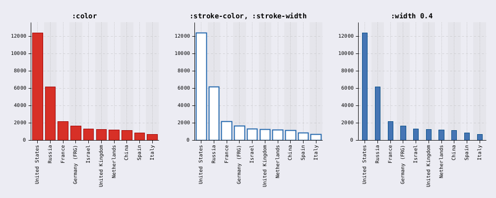
:::


### Horizontal and vertical bars

The mapping orients the bars: the countries on `:x` - vertical bars (tick labels turned -45°), on `:y` - horizontal
ones, which keep long labels readable.

Source: R Graph Gallery - Barplot; data-to-viz - Barplot ([1](https://r-graph-gallery.com/barplot.html), [2](https://www.data-to-viz.com/graph/barplot.html)). Data: Weapon exports by country, data-to-viz example dataset `7_OneCatOneNum` (Yan Holtz); licence: MIT (data_to_viz repository).


::: {.sourceClojure}
```clojure
(plot/render-image
 (plot/arrange
  [{:data top-10 :mapping {:x :country :y :value}
    :theme {:axis {:x {:label-rotation -45}}}
    :charts [(chart/bar)]
    :labels {:title "{:x :country :y :value}" :x nil :y "exports"}}
   {:data (rseq top-10) :mapping {:x :value :y :country}
    :charts [(chart/bar)]
    :labels {:title "{:x :value :y :country}" :x "exports" :y nil}}]
  {:columns 2})
 {:width 1000 :height 450})
```
:::


::: {.clay-image}
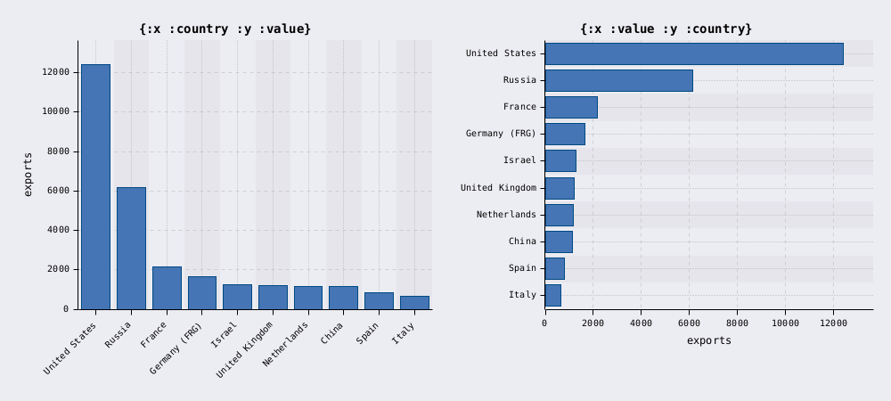
:::


### Order by value

Levels follow the data (the first level at the bottom of horizontal bars - `:reverse true` turns the axis, so the
alphabetical data reads from the top); `:order-by` orders them by value, so the ranking reads from the top.

Source: [R Graph Gallery - Reorder a variable with ggplot2](https://r-graph-gallery.com/267-reorder-a-variable-in-ggplot2.html). Data: Weapon exports by country, data-to-viz example dataset `7_OneCatOneNum` (Yan Holtz); licence: MIT (data_to_viz repository).


::: {.sourceClojure}
```clojure
(plot/render-image
 (plot/arrange
  [{:data (sort-by :country top-20) :mapping {:x :value :y :country}
    :scales {:y {:reverse true}}
    :charts [(chart/bar)]
    :labels {:title "Alphabetical (data order, :reverse)" :x "exports" :y nil}}
   {:data top-20 :mapping {:x :value :y :country}
    :scales {:y {:order-by level-value}}
    :charts [(chart/bar)]
    :labels {:title "By value (:order-by)" :x "exports" :y nil}}]
  {:columns 2})
 {:width 1000 :height 500})
```
:::


::: {.clay-image}
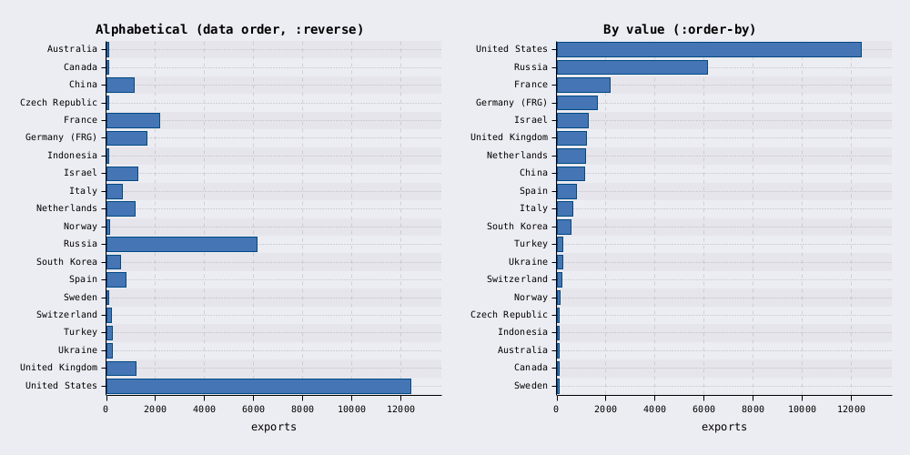
:::


### Variable width

`:varwidth true` - bar widths by the square root of the number of rows (as box plots), `:n-label` writes the
counts: mean fuel economy per number of cylinders, 11, 7 and 14 cars. The cylinder counts are numbers, declared
categorical with `levels/categorical`.

Source: [R Graph Gallery - Barplot with variable width](https://r-graph-gallery.com/81-barplot-with-variable-width.html). Data: Motor Trend car road tests (1974), R datasets package `mtcars` (Henderson & Velleman 1981); licence: Part of R (GPL-2 | GPL-3).


::: {.sourceClojure}
```clojure
(plot/render-image
 {:data mtcars
  :mapping {:x (levels/categorical :cyl) :y :mpg}
  :charts [(chart/bar {:stat :mean :varwidth true :n-label true})]
  :labels {:title "Mean fuel economy, widths by the number of cars" :x "cylinders" :y "mean miles per gallon"}}
 {:width 800 :height 400})
```
:::


::: {.clay-image}
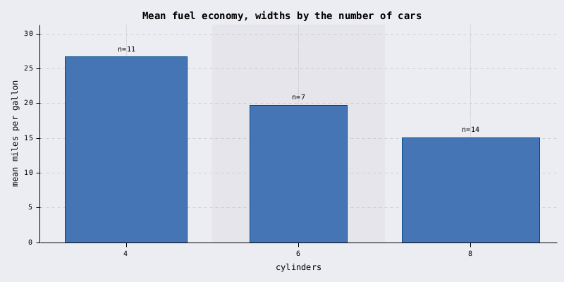
:::


### Error bars

[`chart/extent`](reference.charts_per_level.html#extent) with the bars' mapping takes the same slots: mean bars with ± one standard deviation.

Source: [R Graph Gallery - Barplot with error bars](https://r-graph-gallery.com/4-barplot-with-error-bar.html). Data: Edgar Anderson's iris measurements, R datasets package `iris` (Anderson 1935; Fisher 1936); licence: Part of R (GPL-2 | GPL-3).


::: {.sourceClojure}
```clojure
(plot/render-image
 (plot/arrange
  (vec (for [k [:sepal-length :petal-length]]
         {:data iris :mapping {:x :species :y k}
          :charts [(chart/bar {:stat :mean :color [120 160 200]})
                   (chart/extent {:method :stddev :center :none :color [40 40 40] :line-width 1.5})]
          :labels {:title (str "Mean " (name k) " ± sd") :x nil :y "cm"}}))
  {:columns 2})
 {:width 900 :height 400})
```
:::


::: {.clay-image}

:::


### Black-and-white bars

Patterns tell groups apart without colour: `:pattern` maps a variable to the theme's pattern set (a legend
included); a literal `:pattern` textures every bar. Histograms, densities, areas, ribbons, smooth bands, rects,
boxes, violins, candlesticks, treemaps, partitions, packs, waffles and radar fills take patterns too.

Source: [R Graph Gallery - Black and white barchart](https://r-graph-gallery.com/368-black-and-white-barchart.html). Data: Prices and attributes of round cut diamonds, R ggplot2 package `diamonds` (Wickham et al.); licence: MIT (ggplot2).


::: {.sourceClojure}
```clojure
(plot/render-image
 (plot/arrange
  [{:data (filter #(#{"Fair" "Good" "Ideal"} (:cut %)) diamonds)
    :mapping {:x :clarity :pattern :cut}
    :scales {:x {:domain clarities} :pattern {:domain ["Fair" "Good" "Ideal"]}}
    :charts [(chart/bar {:stat :count :color :white :stroke-color :black :pattern-color :black})]
    :labels {:title "Diamonds per clarity, :pattern by cut" :x nil :y "count"}}
   {:data top-10 :mapping {:x :country :y :value}
    :theme {:axis {:x {:label-rotation -90}}}
    :charts [(chart/bar {:color :white :stroke-color :black :pattern :hatch :pattern-color :black})]
    :labels {:title "A literal :pattern :hatch" :x nil :y "exports"}}]
  {:columns 2 :widths [3 2]})
 {:width 1000 :height 450})
```
:::


::: {.clay-image}
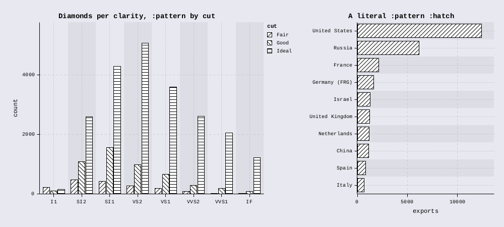
:::


### Value labels

`:value-label true` writes each bar's length past its end - above vertical bars, beside horizontal ones.

Source: [R Graph Gallery - Barplot with number of observations](https://r-graph-gallery.com/37-barplot-with-number-of-observation.html). Data: Weapon exports by country, data-to-viz example dataset `7_OneCatOneNum` (Yan Holtz); licence: MIT (data_to_viz repository).


::: {.sourceClojure}
```clojure
(plot/render-image
 (plot/arrange
  [{:data top-10 :mapping {:x :country :y :value}
    :theme {:axis {:x {:label-rotation -45}}}
    :charts [(chart/bar {:value-label true})]
    :labels {:title "Vertical" :x nil :y "exports"}}
   {:data (rseq top-10) :mapping {:x :value :y :country}
    :charts [(chart/bar {:value-label true})]
    :labels {:title "Horizontal" :x "exports" :y nil}}]
  {:columns 2})
 {:width 1000 :height 450})
```
:::


::: {.clay-image}

:::


### Grouped bars

A second categorical variable on `:color` dodges the bars inside each band (the default with two or more groups
per level).

Source: [R Graph Gallery - Grouped, stacked and percent stacked barplot](https://r-graph-gallery.com/48-grouped-barplot-with-ggplot2.html). Data: Prices and attributes of round cut diamonds, R ggplot2 package `diamonds` (Wickham et al.); licence: MIT (ggplot2).


::: {.sourceClojure}
```clojure
(plot/render-image
 {:data diamonds
  :mapping {:x :clarity :color :cut}
  :scales {:x {:domain clarities} :color {:domain cuts}}
  :charts [(chart/bar {:stat :count})]
  :labels {:title "Diamonds per clarity and cut" :x "clarity" :y "count"}}
 {:width 900 :height 450})
```
:::


::: {.clay-image}
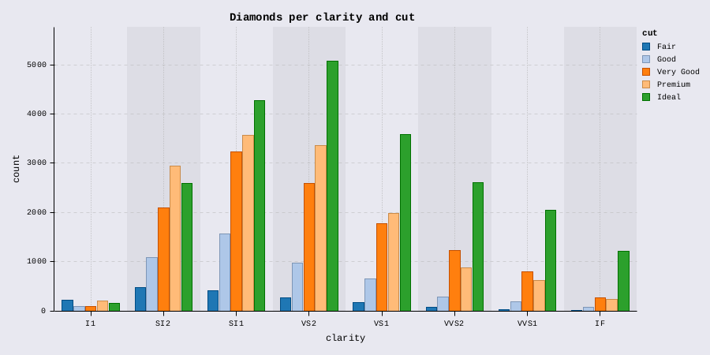
:::


### Stacked bars

`:position :stack` piles the groups up, `:normalize` scales every stack to 1 (shares).

Source: [R Graph Gallery - Grouped, stacked and percent stacked barplot](https://r-graph-gallery.com/48-grouped-barplot-with-ggplot2.html). Data: Prices and attributes of round cut diamonds, R ggplot2 package `diamonds` (Wickham et al.); licence: MIT (ggplot2).


::: {.sourceClojure}
```clojure
(plot/render-image
 (plot/arrange
  (vec (for [p [:stack :normalize]]
         {:data diamonds
          :mapping {:x :clarity :color :cut}
          :scales {:x {:domain clarities} :color {:domain cuts}}
          :charts [(chart/bar {:stat :count :position p})]
          :labels {:title (str ":position " p) :x "clarity"}}))
  {:columns 2})
 {:width 1000 :height 450})
```
:::


::: {.clay-image}

:::


### Mirrored bars

The [bar](reference.charts_bars.html#bar) `:mirror` turns the second level of a two-level variable the other way: back-to-back bars, with value tick labels
as magnitudes. Answers for and against eight proposals, stacked by how sure people were: the mirror on `:group`
(for / against), four colours - two blues, two reds - on `:color`.


::: {.sourceClojure}
```clojure
(def votes
  "Seeded answers to eight proposals: people for and against, sure or leaning."
  (let [rng (r/rng :mersenne 5)]
    (vec (for [i (range 8)
               :let [support (+ 20 (r/irandom rng 60))]
               [answer share] [["for" support] ["against" (- 100 support)]]
               [certainty f] [["sure" 0.6] ["leaning" 0.4]]]
           {:proposal (str "proposal " (inc i)) :answer answer :certainty certainty
            :answer-certainty (str answer ", " certainty) :people (long (* f share 12))}))))
```
:::


```{=html}
<div class="data-table"><table class="table table-hover table-responsive clay-table"><thead><tr><th>proposal</th><th>answer</th><th>certainty</th><th>answer-certainty</th><th>people</th></tr></thead><tbody><tr><td>proposal 1</td><td>for</td><td>sure</td><td>for, sure</td><td>532</td></tr><tr><td>proposal 1</td><td>for</td><td>leaning</td><td>for, leaning</td><td>355</td></tr><tr><td>proposal 1</td><td>against</td><td>sure</td><td>against, sure</td><td>187</td></tr><tr><td>proposal 1</td><td>against</td><td>leaning</td><td>against, leaning</td><td>124</td></tr><tr><td>proposal 2</td><td>for</td><td>sure</td><td>for, sure</td><td>230</td></tr><tr><td>proposal 2</td><td>for</td><td>leaning</td><td>for, leaning</td><td>153</td></tr><tr><td>proposal 2</td><td>against</td><td>sure</td><td>against, sure</td><td>489</td></tr><tr><td>proposal 2</td><td>against</td><td>leaning</td><td>against, leaning</td><td>326</td></tr><tr><td>proposal 3</td><td>for</td><td>sure</td><td>for, sure</td><td>208</td></tr><tr><td>proposal 3</td><td>for</td><td>leaning</td><td>for, leaning</td><td>139</td></tr><tr><td>proposal 3</td><td>against</td><td>sure</td><td>against, sure</td><td>511</td></tr><tr><td>proposal 3</td><td>against</td><td>leaning</td><td>against, leaning</td><td>340</td></tr><tr><td>proposal 4</td><td>for</td><td>sure</td><td>for, sure</td><td>208</td></tr><tr><td>proposal 4</td><td>for</td><td>leaning</td><td>for, leaning</td><td>139</td></tr><tr><td>proposal 4</td><td>against</td><td>sure</td><td>against, sure</td><td>511</td></tr><tr><td>proposal 4</td><td>against</td><td>leaning</td><td>against, leaning</td><td>340</td></tr><tr><td>proposal 5</td><td>for</td><td>sure</td><td>for, sure</td><td>144</td></tr><tr><td>proposal 5</td><td>for</td><td>leaning</td><td>for, leaning</td><td>96</td></tr><tr><td>proposal 5</td><td>against</td><td>sure</td><td>against, sure</td><td>576</td></tr><tr><td>proposal 5</td><td>against</td><td>leaning</td><td>against, leaning</td><td>384</td></tr><tr><td>proposal 6</td><td>for</td><td>sure</td><td>for, sure</td><td>446</td></tr><tr><td>proposal 6</td><td>for</td><td>leaning</td><td>for, leaning</td><td>297</td></tr><tr><td>proposal 6</td><td>against</td><td>sure</td><td>against, sure</td><td>273</td></tr><tr><td>proposal 6</td><td>against</td><td>leaning</td><td>against, leaning</td><td>182</td></tr><tr><td>proposal 7</td><td>for</td><td>sure</td><td>for, sure</td><td>403</td></tr><tr><td>proposal 7</td><td>for</td><td>leaning</td><td>for, leaning</td><td>268</td></tr><tr><td>proposal 7</td><td>against</td><td>sure</td><td>against, sure</td><td>316</td></tr><tr><td>proposal 7</td><td>against</td><td>leaning</td><td>against, leaning</td><td>211</td></tr><tr><td>proposal 8</td><td>for</td><td>sure</td><td>for, sure</td><td>417</td></tr><tr><td>proposal 8</td><td>for</td><td>leaning</td><td>for, leaning</td><td>278</td></tr><tr><td>proposal 8</td><td>against</td><td>sure</td><td>against, sure</td><td>302</td></tr><tr><td>proposal 8</td><td>against</td><td>leaning</td><td>against, leaning</td><td>201</td></tr></tbody></table></div>
```


Source: [R Graph Gallery - Barplot (back-to-back bars)](https://r-graph-gallery.com/barplot.html).


::: {.sourceClojure}
```clojure
(plot/render-image
 {:data votes
  :mapping {:x :proposal :y :people :color :answer-certainty :group :answer}
  :scales {:color {:domain ["for, sure" "for, leaning" "against, sure" "against, leaning"]
                   :range {"for, sure" [8 69 148] "for, leaning" [107 174 214]
                           "against, sure" [165 15 21] "against, leaning" [251 106 74]}}}
  :charts [(chart/bar {:mirror :group :position :stack})]
  :labels {:title "For (up) and against (down), sure and leaning" :x nil :y "people"}}
 {:width 900 :height 450})
```
:::


::: {.clay-image}

:::


### Economist-style labelled bars

No axes - the labels carry the values: name and value inside the bar at its base when they fit (a text chart at
x = 0, in white), else just past the bar's end. Whether a label fits is estimated here: about 7 pixels per
character against the bar's share of a 700 pixel panel.

Source: [R Graph Gallery - Horizontal barplot with labels (The Economist style)](https://r-graph-gallery.com/web-horizontal-barplot-with-labels-the-economist.html). Data: Weapon exports by country, data-to-viz example dataset `7_OneCatOneNum` (Yan Holtz); licence: MIT (data_to_viz repository).


::: {.sourceClojure}
```clojure
(let [rows (mapv #(assoc % :label (str (:country %) "  " (:value %))) top-10)
      longest (double (reduce max (map :value rows)))
      fits? (fn [{:keys [value label]}] (> (* 700.0 (/ (double value) longest)) (+ 12.0 (* 7.0 (count label)))))
      text (fn [rows x anchor color] (chart/text {:data rows :mapping {:x x :y :country :label :label}
                                                  :anchor anchor :offset [6 0] :color color}))]
  (plot/render-image
   {:data rows
    :mapping {:x :value :y :country}
    :scales {:y {:order-by level-value :axis false} :x {:axis false}}
    :theme {:panel {:grid {:x :none :y :none :bands-fill :none}}}
    :charts [(chart/bar {:color [0 104 139] :stroke-color :none :width 0.7})
             (text (filterv fits? rows) (constantly 0) [:left :middle] :white)
             (text (filterv (complement fits?) rows) :value [:left :middle] [0 104 139])]
    :labels {:title {:text "Weapon exports\nTop 10 countries, value of exports" :align [:left :middle]} :x nil :y nil}}
   {:width 800 :height 450}))
```
:::


::: {.clay-image}

:::


## Lollipop and dot plots

A thin stem and a point carry the value with less ink than a bar:
[`chart/segment`](reference.charts_points_lines.html#line-segments) from the baseline under a `chart/scatter`.


### Lollipop

Stems from 0 (`(chart/segment {:xend 0})`), styled stems and markers, and a baseline at the mean - stems grow
both ways.

Source: R Graph Gallery - Basic lollipop plot; Custom lollipop chart; data-to-viz - Lollipop ([1](https://r-graph-gallery.com/300-basic-lollipop-plot.html), [2](https://r-graph-gallery.com/301-custom-lollipop-chart.html), [3](https://www.data-to-viz.com/graph/lollipop.html)). Data: Weapon exports by country, data-to-viz example dataset `7_OneCatOneNum` (Yan Holtz); licence: MIT (data_to_viz repository).


::: {.sourceClojure}
```clojure
(let [mean (stats/mean (map :value top-20))
      base {:data top-20 :mapping {:x :value :y :country} :scales {:y {:order-by level-value}}}]
  (plot/render-image
   (plot/arrange
    [(assoc base :charts [(chart/segment {:xend 0}) (chart/scatter)]
            :labels {:title "Basic" :x "exports" :y nil})
     (assoc base :charts [(chart/segment {:xend 0 :color [150 150 150] :line-width 2})
                          (chart/scatter {:size 9 :color [215 48 39] :shape \s})]
            :labels {:title "Styled stems and markers" :x "exports" :y nil})
     (assoc base :charts [(chart/rule {:x mean :dash :dashed})
                          (chart/segment {:xend mean :color [150 150 150]})
                          (chart/scatter {:size 7 :color [33 102 172]})]
            :labels {:title "Baseline at the mean" :x "exports" :y nil})]
    {:columns 3})
   {:width 1000 :height 500}))
```
:::


::: {.clay-image}

:::


### Cleveland dot plot and dumbbell

Two values per item: dots alone (Cleveland), or joined by a segment from one to the other (dumbbell), ordered by
the second value.


::: {.sourceClojure}
```clojure
(def scores
  "Seeded scores of twelve teams in two seasons."
  (let [rng (r/rng :mersenne 11)]
    (vec (for [i (range 12)
               :let [v1 (+ 30 (r/irandom rng 50))]]
           {:team (str "team " (char (+ 65 i))) :season-1 v1 :season-2 (+ v1 -15 (r/irandom rng 35))}))))
```
:::


```{=html}
<div class="data-table"><table class="table table-hover table-responsive clay-table"><thead><tr><th>team</th><th>season-1</th><th>season-2</th></tr></thead><tbody><tr><td>team A</td><td>45</td><td>33</td></tr><tr><td>team B</td><td>76</td><td>87</td></tr><tr><td>team C</td><td>63</td><td>48</td></tr><tr><td>team D</td><td>67</td><td>64</td></tr><tr><td>team E</td><td>46</td><td>31</td></tr><tr><td>team F</td><td>74</td><td>62</td></tr><tr><td>team G</td><td>62</td><td>73</td></tr><tr><td>team H</td><td>50</td><td>69</td></tr><tr><td>team I</td><td>39</td><td>41</td></tr><tr><td>team J</td><td>60</td><td>75</td></tr><tr><td>team K</td><td>47</td><td>64</td></tr><tr><td>team L</td><td>67</td><td>52</td></tr></tbody></table></div>
```


Source: [R Graph Gallery - Lollipop chart with 2 values](https://r-graph-gallery.com/303-lollipop-plot-with-2-values.html).


::: {.sourceClojure}
```clojure
(let [by-season-2 {:y {:order-by #(:season-2 (first %))}}
      dots (fn [k color] (chart/scatter {:mapping {:x k :y :team} :size 8 :color color}))]
  (plot/render-image
   (plot/arrange
    [{:data scores :scales by-season-2
      :charts [(dots :season-2 [33 102 172])]
      :labels {:title "Cleveland dot plot: season 2" :x "score" :y nil}}
     {:data scores :scales by-season-2
      :charts [(chart/segment {:mapping {:x :season-1 :xend :season-2 :y :team} :color [170 170 170] :line-width 2})
               (dots :season-1 [150 150 150]) (dots :season-2 [33 102 172])]
      :labels {:title "Dumbbell: season 1 (grey) to season 2 (blue)" :x "score" :y nil}}]
    {:columns 2})
   {:width 1000 :height 450}))
```
:::


::: {.clay-image}

:::


### Conditional colour and highlight

A derived column colours the lollipops above and below a threshold; a level map keeps one country in colour and
greys the rest.

Source: [R Graph Gallery - Lollipop chart with conditional color](https://r-graph-gallery.com/302-lollipop-chart-with-conditional-color.html). Data: Weapon exports by country, data-to-viz example dataset `7_OneCatOneNum` (Yan Holtz); licence: MIT (data_to_viz repository).


::: {.sourceClojure}
```clojure
(let [mean (stats/mean (map :value top-20))
      rows (mapv #(assoc % :side (if (> (double (:value %)) mean) "above the mean" "below the mean")
                         :highlight (if (= "Germany (FRG)" (:country %)) "Germany (FRG)" "others"))
                 top-20)
      base {:data rows :scales {:y {:order-by level-value}}}]
  (plot/render-image
   (plot/arrange
    [(assoc base :mapping {:x :value :y :country :color :side}
            :charts [(chart/segment {:xend mean}) (chart/scatter {:size 7})]
            :labels {:title "Above / below the mean" :x "exports" :y nil})
     (assoc base :mapping {:x :value :y :country :color :highlight}
            :scales (assoc (:scales base) :color {:range {"Germany (FRG)" [215 48 39] "others" [190 190 190]}})
            :charts [(chart/segment {:xend 0}) (chart/scatter {:size 7})]
            :labels {:title "One country highlighted" :x "exports" :y nil})]
    {:columns 2})
   {:width 1000 :height 500}))
```
:::


::: {.clay-image}
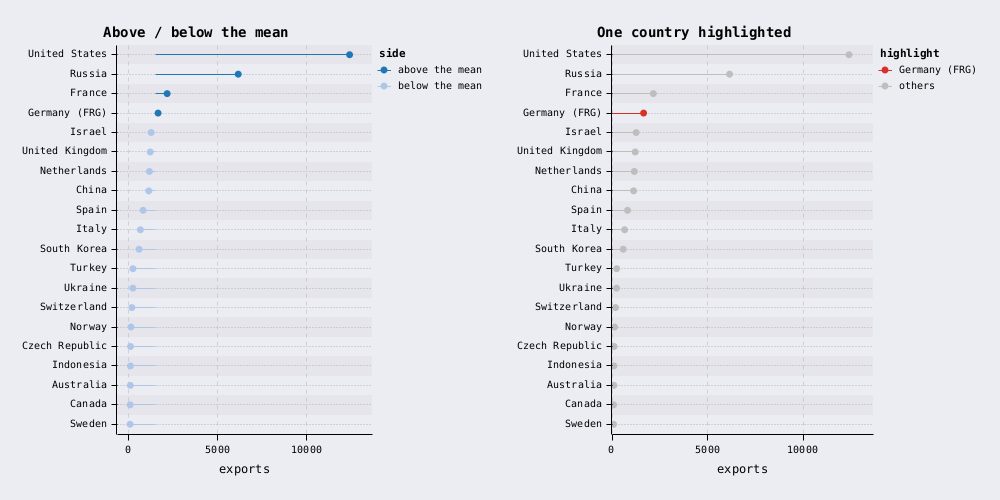
:::


### Lollipop with subgroups

Items of five groups, coloured by group and ordered by value inside each group.


::: {.sourceClojure}
```clojure
(def products
  "Seeded sales of six products in each of five shops."
  (let [rng (r/rng :mersenne 17)]
    (vec (for [shop ["North" "South" "East" "West" "Centre"] i (range 6)]
           {:shop shop :product (str shop " " (inc i)) :sales (+ 10 (r/irandom rng 90))}))))
```
:::


```{=html}
<div class="data-table"><table class="table table-hover table-responsive clay-table"><thead><tr><th>shop</th><th>product</th><th>sales</th></tr></thead><tbody><tr><td>North</td><td>North 1</td><td>92</td></tr><tr><td>North</td><td>North 2</td><td>66</td></tr><tr><td>North</td><td>North 3</td><td>39</td></tr><tr><td>North</td><td>North 4</td><td>15</td></tr><tr><td>North</td><td>North 5</td><td>37</td></tr><tr><td>North</td><td>North 6</td><td>82</td></tr><tr><td>South</td><td>South 1</td><td>48</td></tr><tr><td>South</td><td>South 2</td><td>92</td></tr><tr><td>South</td><td>South 3</td><td>24</td></tr><tr><td>South</td><td>South 4</td><td>19</td></tr><tr><td>South</td><td>South 5</td><td>33</td></tr><tr><td>South</td><td>South 6</td><td>49</td></tr><tr><td>East</td><td>East 1</td><td>37</td></tr><tr><td>East</td><td>East 2</td><td>78</td></tr><tr><td>East</td><td>East 3</td><td>71</td></tr><tr><td>East</td><td>East 4</td><td>18</td></tr><tr><td>East</td><td>East 5</td><td>90</td></tr><tr><td>East</td><td>East 6</td><td>19</td></tr><tr><td>West</td><td>West 1</td><td>13</td></tr><tr><td>West</td><td>West 2</td><td>47</td></tr><tr><td>West</td><td>West 3</td><td>83</td></tr><tr><td>West</td><td>West 4</td><td>28</td></tr><tr><td>West</td><td>West 5</td><td>28</td></tr><tr><td>West</td><td>West 6</td><td>65</td></tr><tr><td>Centre</td><td>Centre 1</td><td>40</td></tr><tr><td>Centre</td><td>Centre 2</td><td>60</td></tr><tr><td>Centre</td><td>Centre 3</td><td>50</td></tr><tr><td>Centre</td><td>Centre 4</td><td>53</td></tr><tr><td>Centre</td><td>Centre 5</td><td>65</td></tr><tr><td>Centre</td><td>Centre 6</td><td>50</td></tr></tbody></table></div>
```


Source: [data-to-viz - Lollipop (subgroups)](https://www.data-to-viz.com/graph/lollipop.html).


::: {.sourceClojure}
```clojure
(let [order (mapv :product (sort-by (juxt :shop :sales) products))]
  (plot/render-image
   {:data products
    :mapping {:x :sales :y :product :color :shop}
    :scales {:y {:domain order}}
    :charts [(chart/segment {:xend 0}) (chart/scatter {:size 7})]
    :labels {:title "Sales of six products per shop" :x "sales" :y nil}}
   {:width 800 :height 700}))
```
:::


::: {.clay-image}
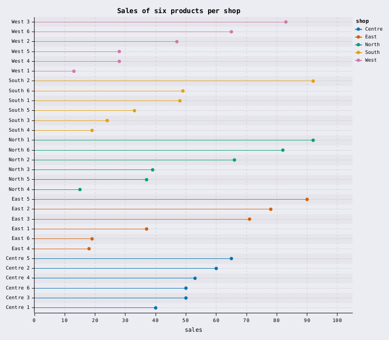
:::


## Circular barplot

Bars in polar coordinates: with `:coord {:kind :polar}` the horizontal axis goes around the circle - the levels
on `:x` - and the vertical one along the radius; `:inner` leaves a hole.


### Circular barplot: labels, order, gaps

Ordered bars with labels along their angle (`:rotation :radial`), and gaps between groups - blank levels in an
explicit domain, their tick labels hidden by a formatter.


::: {.sourceClojure}
```clojure
(def shop-groups
  "Seeded values of items in three groups."
  (let [rng (r/rng :mersenne 12)]
    (vec (for [[g n] [["A" 6] ["B" 5] ["C" 7]] i (range n)]
           {:group g :item (str g (inc i)) :value (+ 10 (r/irandom rng 90))}))))
```
:::


```{=html}
<div class="data-table"><table class="table table-hover table-responsive clay-table"><thead><tr><th>group</th><th>item</th><th>value</th></tr></thead><tbody><tr><td>A</td><td>A1</td><td>46</td></tr><tr><td>A</td><td>A2</td><td>23</td></tr><tr><td>A</td><td>A3</td><td>39</td></tr><tr><td>A</td><td>A4</td><td>62</td></tr><tr><td>A</td><td>A5</td><td>28</td></tr><tr><td>A</td><td>A6</td><td>40</td></tr><tr><td>B</td><td>B1</td><td>51</td></tr><tr><td>B</td><td>B2</td><td>14</td></tr><tr><td>B</td><td>B3</td><td>12</td></tr><tr><td>B</td><td>B4</td><td>20</td></tr><tr><td>B</td><td>B5</td><td>43</td></tr><tr><td>C</td><td>C1</td><td>66</td></tr><tr><td>C</td><td>C2</td><td>78</td></tr><tr><td>C</td><td>C3</td><td>35</td></tr><tr><td>C</td><td>C4</td><td>70</td></tr><tr><td>C</td><td>C5</td><td>85</td></tr><tr><td>C</td><td>C6</td><td>81</td></tr><tr><td>C</td><td>C7</td><td>67</td></tr></tbody></table></div>
```


Source: R Graph Gallery - Basic circular barplot; Labels; Circular barplot with groups; data-to-viz - Circular barplot ([1](https://r-graph-gallery.com/295-basic-circular-barplot.html), [2](https://r-graph-gallery.com/296-add-labels-to-circular-barplot.html), [3](https://r-graph-gallery.com/297-circular-barplot-with-groups.html), [4](https://www.data-to-viz.com/graph/circularbarplot.html)). Data: Weapon exports by country, data-to-viz example dataset `7_OneCatOneNum` (Yan Holtz); licence: MIT (data_to_viz repository).


::: {.sourceClojure}
```clojure
(let [levels (vec (mapcat (fn [g] (concat (map :item (filter #(= g (:group %)) shop-groups)) [(str "_" g)])) ["A" "B" "C"]))]
  (plot/render-image
   (plot/arrange
    [{:data top-20 :mapping {:x :country :y :value}
      :coord {:kind :polar :inner 0.3}
      :scales {:x {:order-by level-value :axis false} :y {:axis false :domain [0 26000]}}
      :charts [(chart/bar {:color [33 102 172] :stroke-color :none})
               (chart/text {:mapping {:x :country :y :value :label :country} :rotation :radial :size 8})]
      :labels {:title "Ordered, radial labels" :x nil :y nil}}
     {:data shop-groups :mapping {:x :item :y :value :color :group}
      :coord {:kind :polar :inner 0.2}
      :scales {:x {:domain levels :formatter (fn [v] (if (= \_ (first (str v))) "" (str v)))}}
      :charts [(chart/bar)]
      :labels {:title "Gaps between groups" :x nil :y nil}}]
    {:columns 2})
   {:width 1000 :height 500}))
```
:::


::: {.clay-image}
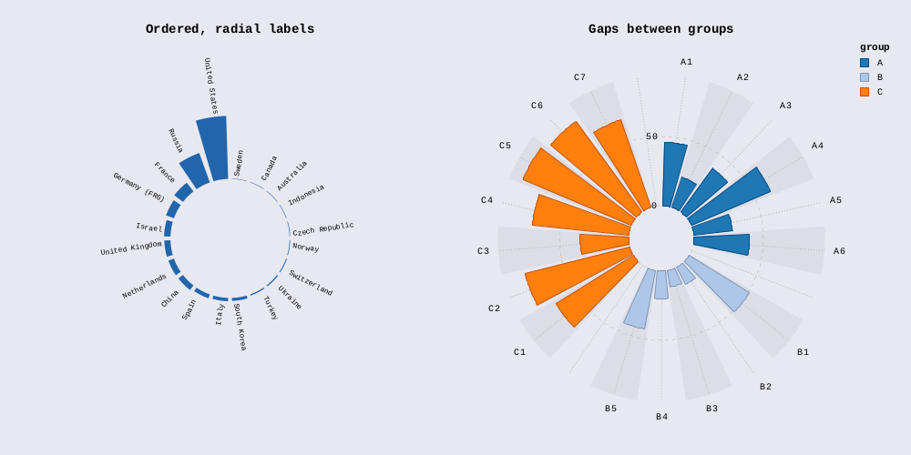
:::


### Stacked and dodged circular bars

The bar positions work around the circle too.


::: {.sourceClojure}
```clojure
(def parts
  "Seeded values of three parts of twelve items."
  (let [rng (r/rng :mersenne 23)]
    (vec (for [i (range 12) part ["x" "y" "z"]]
           {:item (str "item " (inc i)) :part part :value (+ 5 (r/irandom rng 30))}))))
```
:::


```{=html}
<div class="data-table"><table class="table table-hover table-responsive clay-table"><thead><tr><th>item</th><th>part</th><th>value</th></tr></thead><tbody><tr><td>item 1</td><td>x</td><td>17</td></tr><tr><td>item 1</td><td>y</td><td>31</td></tr><tr><td>item 1</td><td>z</td><td>21</td></tr><tr><td>item 2</td><td>x</td><td>17</td></tr><tr><td>item 2</td><td>y</td><td>13</td></tr><tr><td>item 2</td><td>z</td><td>14</td></tr><tr><td>item 3</td><td>x</td><td>20</td></tr><tr><td>item 3</td><td>y</td><td>13</td></tr><tr><td>item 3</td><td>z</td><td>31</td></tr><tr><td>item 4</td><td>x</td><td>7</td></tr><tr><td>item 4</td><td>y</td><td>10</td></tr><tr><td>item 4</td><td>z</td><td>13</td></tr><tr><td>item 5</td><td>x</td><td>23</td></tr><tr><td>item 5</td><td>y</td><td>29</td></tr><tr><td>item 5</td><td>z</td><td>5</td></tr><tr><td>item 6</td><td>x</td><td>6</td></tr><tr><td>item 6</td><td>y</td><td>34</td></tr><tr><td>item 6</td><td>z</td><td>33</td></tr><tr><td>item 7</td><td>x</td><td>17</td></tr><tr><td>item 7</td><td>y</td><td>7</td></tr><tr><td>item 7</td><td>z</td><td>21</td></tr><tr><td>item 8</td><td>x</td><td>31</td></tr><tr><td>item 8</td><td>y</td><td>12</td></tr><tr><td>item 8</td><td>z</td><td>20</td></tr><tr><td>item 9</td><td>x</td><td>29</td></tr><tr><td>item 9</td><td>y</td><td>31</td></tr><tr><td>item 9</td><td>z</td><td>13</td></tr><tr><td>item 10</td><td>x</td><td>22</td></tr><tr><td>item 10</td><td>y</td><td>12</td></tr><tr><td>item 10</td><td>z</td><td>26</td></tr><tr><td>item 11</td><td>x</td><td>34</td></tr><tr><td>item 11</td><td>y</td><td>30</td></tr><tr><td>item 11</td><td>z</td><td>17</td></tr><tr><td>item 12</td><td>x</td><td>32</td></tr><tr><td>item 12</td><td>y</td><td>9</td></tr><tr><td>item 12</td><td>z</td><td>17</td></tr></tbody></table></div>
```


Source: [R Graph Gallery - Circular stacked barplot](https://r-graph-gallery.com/299-circular-stacked-barplot.html).


::: {.sourceClojure}
```clojure
(plot/render-image
 (plot/arrange
  (vec (for [p [:stack :dodge]]
         {:data parts :mapping {:x :item :y :value :color :part}
          :coord {:kind :polar :inner 0.15}
          :charts [(chart/bar {:position p})]
          :labels {:title (str ":position " p) :x nil :y nil}}))
  {:columns 2})
 {:width 1000 :height 500})
```
:::


::: {.clay-image}
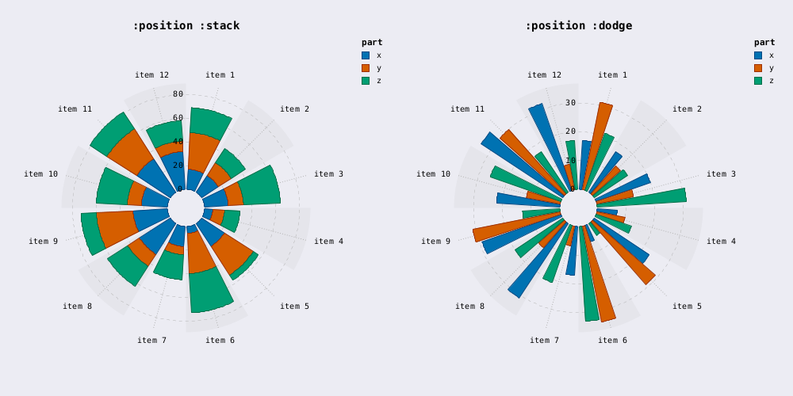
:::


### Circular lollipop

Segments and points in polar coordinates: the levels on the angle (`:x`), the values on the radius - on a log
scale (stems from 50), so the small values don't crowd the centre.

Source: [R Graph Gallery - Circular barplot](https://r-graph-gallery.com/circular-barplot.html). Data: Weapon exports by country, data-to-viz example dataset `7_OneCatOneNum` (Yan Holtz); licence: MIT (data_to_viz repository).


::: {.sourceClojure}
```clojure
(plot/render-image
 {:data top-20 :mapping {:x :country :y :value}
  :coord {:kind :polar :start -9}
  :scales {:x {:order-by level-value :descending true} :y {:kind :log}}
  :charts [(chart/segment {:yend 50 :color [150 150 150]}) (chart/scatter {:size 8 :color [215 48 39]})]
  :labels {:title "Weapon exports, top 20" :x nil :y nil}}
 {:width 600 :height 600})
```
:::


::: {.clay-image}

:::


## Parallel coordinates

Each row a line across one axis per variable ([`chart/parallel`](reference.charts_multivariate_3d.html#parallel)
over `:variables`); every axis has its own scale
in the variable's units, drawn by the chart.


::: {.sourceClojure}
```clojure
(def iris-variables [:sepal-length :sepal-width :petal-length :petal-width])
```
:::


### Parallel coordinates: groups, highlight, vertical

Lines coloured by species; a level map greys all but one species; `:flip true` stacks the axes vertically.

Source: R Graph Gallery - Parallel coordinates chart with ggally; data-to-viz - Parallel coordinates ([1](https://r-graph-gallery.com/parallel-plot-ggally.html), [2](https://www.data-to-viz.com/graph/parallel.html)). Data: Edgar Anderson's iris measurements, R datasets package `iris` (Anderson 1935; Fisher 1936); licence: Part of R (GPL-2 | GPL-3).


::: {.sourceClojure}
```clojure
(plot/render-image
 (plot/arrange
  [{:data iris :mapping {:color :species}
    :charts [(chart/parallel {:variables iris-variables})]
    :labels {:title "By species" :x nil}}
   {:data iris :mapping {:color :species}
    :scales {:color {:range {"setosa" [190 190 190 120] "versicolor" [190 190 190 120] "virginica" [215 48 39 220]}}}
    :charts [(chart/parallel {:variables iris-variables})]
    :labels {:title "Virginica highlighted" :x nil}}
   {:data iris :mapping {:color :species} :flip true
    :charts [(chart/parallel {:variables iris-variables})]
    :labels {:title "Vertical (:flip true)" :x nil}}]
  {:columns 2})
 {:width 1000 :height 800})
```
:::


::: {.clay-image}

:::


### Smooth connections

`:curve :smooth` joins the axes with curves that meet every axis flat, at its value, and never overshoot;
`:smoothness` (0..1) moves the bend toward the axes.

Source: [R Graph Gallery - Parallel plot](https://r-graph-gallery.com/parallel-plot.html). Data: Edgar Anderson's iris measurements, R datasets package `iris` (Anderson 1935; Fisher 1936); licence: Part of R (GPL-2 | GPL-3).


::: {.sourceClojure}
```clojure
(plot/render-image
 (plot/arrange
  (vec (for [[title opts] [["Straight" {}] [":curve :smooth" {:curve :smooth}]]]
         {:data (take-nth 3 iris) :mapping {:color :species} :legend false
          :charts [(chart/parallel (merge {:variables iris-variables} opts))]
          :labels {:title title :x nil}}))
  {:columns 2})
 {:width 1000 :height 400})
```
:::


::: {.clay-image}
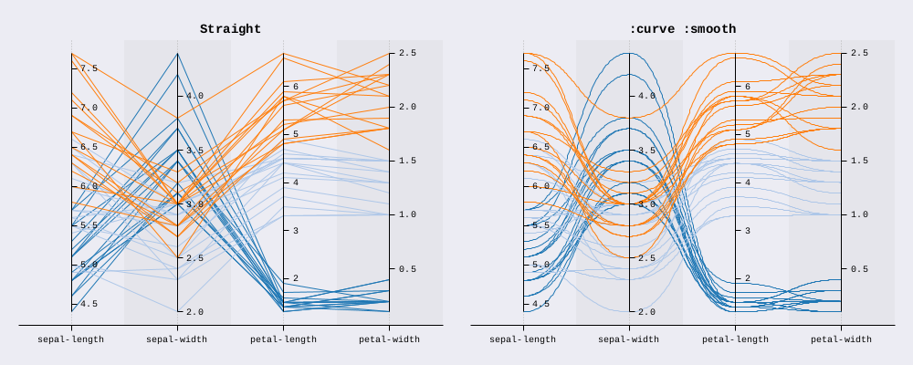
:::


### Scaling

`:scaling` - per variable `(v - offset) / scale`: `:std` (mean, sd), `:robust` (median, R's `mad`),
`:uniminmax` (every axis 0..1, the default), `:globalminmax` (the values as they are, one scale).

Source: [R Graph Gallery - Parallel coordinates chart with ggally (scaling)](https://r-graph-gallery.com/parallel-plot-ggally.html). Data: Edgar Anderson's iris measurements, R datasets package `iris` (Anderson 1935; Fisher 1936); licence: Part of R (GPL-2 | GPL-3).


::: {.sourceClojure}
```clojure
(plot/render-image
 (plot/arrange
  (vec (for [scaling [:std :robust :uniminmax :globalminmax]]
         {:data iris :mapping {:color :species} :legend false
          :charts [(chart/parallel {:variables iris-variables :scaling scaling :line-width 0.5})]
          :labels {:title (str ":scaling " scaling) :x nil}}))
  {:columns 2})
 {:width 1000 :height 700})
```
:::


::: {.clay-image}
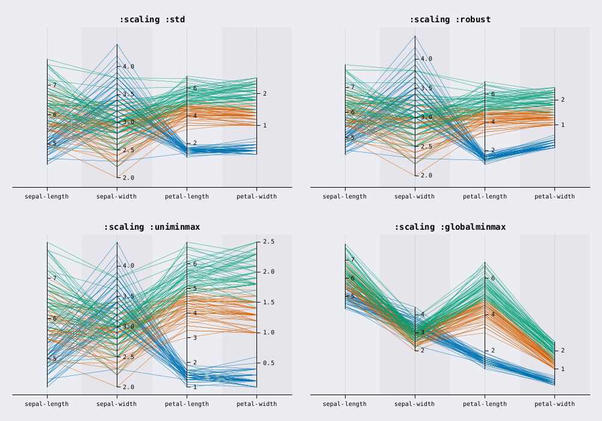
:::


### Axis order

The axes follow `:variables`: neighbours are compared, so the order changes what the chart shows.

Source: [data-to-viz - Parallel coordinates (axis order)](https://www.data-to-viz.com/graph/parallel.html). Data: Edgar Anderson's iris measurements, R datasets package `iris` (Anderson 1935; Fisher 1936); licence: Part of R (GPL-2 | GPL-3).


::: {.sourceClojure}
```clojure
(plot/render-image
 (plot/arrange
  (vec (for [[title vs] [["Measured order" iris-variables]
                          ["Sepal width beside the petals" [:sepal-width :petal-length :sepal-length :petal-width]]]]
         {:data iris :mapping {:color :species} :legend false
          :charts [(chart/parallel {:variables vs})]
          :labels {:title title :x nil}}))
  {:columns 2})
 {:width 1000 :height 400})
```
:::


::: {.clay-image}

:::


## Radar

A radar (spider) chart is `chart/parallel` in polar coordinates: variables on angles, values along the spokes,
each row a closed polygon - filled with `:fill`.


::: {.sourceClojure}
```clojure
(def car-variables [:mpg :hp :wt :qsec :drat :disp])
```
:::


::: {.sourceClojure}
```clojure
(def four-cars (filterv #(#{"Mazda RX4" "Merc 240D" "Lotus Europa" "Cadillac Fleetwood"} (:model %)) mtcars))
```
:::


```{=html}
<div class="data-table"><table class="table table-hover table-responsive clay-table"><thead><tr><th>model</th><th>mpg</th><th>cyl</th><th>disp</th><th>hp</th><th>drat</th><th>wt</th><th>qsec</th><th>vs</th><th>am</th><th>gear</th><th>carb</th></tr></thead><tbody><tr><td>Mazda RX4</td><td>21</td><td>6</td><td>160</td><td>110</td><td>3.9</td><td>2.62</td><td>16.46</td><td>0</td><td>1</td><td>4</td><td>4</td></tr><tr><td>Merc 240D</td><td>24.4</td><td>4</td><td>146.7</td><td>62</td><td>3.69</td><td>3.19</td><td>20</td><td>1</td><td>0</td><td>4</td><td>2</td></tr><tr><td>Cadillac Fleetwood</td><td>10.4</td><td>8</td><td>472</td><td>205</td><td>2.93</td><td>5.25</td><td>17.98</td><td>0</td><td>0</td><td>3</td><td>4</td></tr><tr><td>Lotus Europa</td><td>30.4</td><td>4</td><td>95.1</td><td>113</td><td>3.77</td><td>1.513</td><td>16.9</td><td>1</td><td>1</td><td>5</td><td>2</td></tr></tbody></table></div>
```


::: {.sourceClojure}
```clojure
(def car-limits
  "Every variable's range over all 32 cars."
  (into {} (map (fn [k] [k [(reduce min (map k mtcars)) (reduce max (map k mtcars))]])) car-variables))
```
:::


### Radar: groups and limits

Four cars filled; the same cars on axes fixed to the range of all cars (`:limits`); all cars by cylinders on
standardized axes.

Source: R Graph Gallery - Basic radar chart; Radar chart with several individuals ([1](https://r-graph-gallery.com/142-basic-radar-chart.html), [2](https://r-graph-gallery.com/143-spider-chart-with-saveral-individuals.html)). Data: Motor Trend car road tests (1974), R datasets package `mtcars` (Henderson & Velleman 1981); licence: Part of R (GPL-2 | GPL-3).


::: {.sourceClojure}
```clojure
(plot/render-image
 (plot/arrange
  [(plot/arrange
    [{:data four-cars :mapping {:color :model} :coord {:kind :polar} :legend false
      :charts [(chart/parallel {:variables car-variables :fill :color :line-width 2})]
      :labels {:title "Four cars, their own ranges" :x nil}}
     {:data four-cars :mapping {:color :model} :coord {:kind :polar}
      :charts [(chart/parallel {:variables car-variables :fill :color :line-width 2 :limits car-limits})]
      :labels {:title "Ranges of all 32 cars (:limits)" :x nil}}]
    {:columns 2 :widths [2 3]})
   {:data (map #(assoc % :cylinders (str (long (:cyl %)))) mtcars) :mapping {:color :cylinders} :coord {:kind :polar}
    :charts [(chart/parallel {:variables car-variables :scaling :std})]
    :labels {:title "All cars by cylinders (:std)" :x nil}}]
  {:columns 1 :heights [1 1]})
 {:width 1000 :height 800})
```
:::


::: {.clay-image}

:::


### Variables as rings

With `:flip true` the variables become rings and the values angles: every flower is a line from ring to ring -
the species separate on the petal rings and mix on sepal width.

Source: [R Graph Gallery - Spider / radar chart](https://r-graph-gallery.com/spider-or-radar-chart.html). Data: Edgar Anderson's iris measurements, R datasets package `iris` (Anderson 1935; Fisher 1936); licence: Part of R (GPL-2 | GPL-3).


::: {.sourceClojure}
```clojure
(plot/render-image
 {:data iris :mapping {:color :species}
  :coord {:kind :polar :inner 0.25} :flip true
  :scales {:color {:range {"setosa" [27 158 119 110] "versicolor" [217 95 2 110] "virginica" [117 112 179 110]}}}
  :charts [(chart/parallel {:variables iris-variables :line-width 0.8})]
  :labels {:title "150 iris flowers across four rings" :x nil}}
 {:width 750 :height 700})
```
:::


::: {.clay-image}
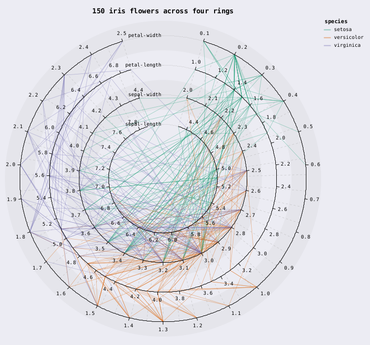
:::


## Bump

A bump chart shows ranks over time - see [Evolution - Bump chart](use_cases.evolution.html#bump-chart)
(`levels/rank-rows`, monotone lines, end labels).


## Caveats


### Order the data

Unordered categories make the reader sort them; ordered by value, the ranking is read at a glance - here all 38
rows with a value (36 countries, "Others" and "Unknown supplier(s)"), as lollipops on a log scale (exports from 2 to 12394; the stems start at 1, as log 0 is
undefined).

Source: [data-to-viz - Order your data](https://www.data-to-viz.com/caveat/order_data.html). Data: Weapon exports by country, data-to-viz example dataset `7_OneCatOneNum` (Yan Holtz); licence: MIT (data_to_viz repository).


::: {.sourceClojure}
```clojure
(plot/render-image
 (plot/arrange
  (vec (for [[title y-scale] [["Alphabetical" {:reverse true}] ["Ordered by value" {:order-by level-value}]]]
         {:data (sort-by :country weapons) :mapping {:x :value :y :country}
          :scales {:x {:kind :log} :y y-scale}
          :theme {:axis {:y {:label-gap 1}}}
          :charts [(chart/segment {:xend 1 :color [150 150 150]}) (chart/scatter {:size 5 :color [33 102 172]})]
          :labels {:title title :x "exports (log scale)" :y nil}}))
  {:columns 2})
 {:width 1000 :height 800})
```
:::


::: {.clay-image}
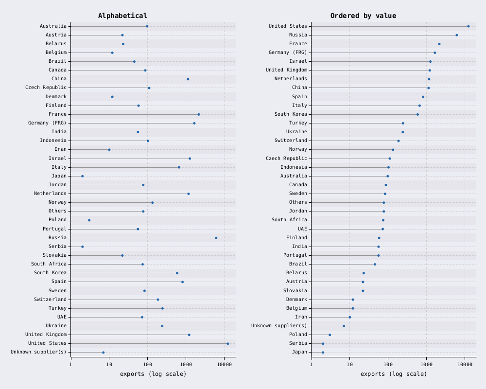
:::


### Barplot or histogram

A barplot shows a value per category; a histogram shows how one numeric variable is distributed - bins of a
continuous axis, no gaps.

Source: data-to-viz - Barplot; Histogram ([1](https://www.data-to-viz.com/graph/barplot.html), [2](https://www.data-to-viz.com/graph/histogram.html)). Data: Prices and attributes of round cut diamonds, R ggplot2 package `diamonds` (Wickham et al.); licence: MIT (ggplot2).


::: {.sourceClojure}
```clojure
(plot/render-image
 (plot/arrange
  [{:data diamonds :mapping {:x :cut} :scales {:x {:domain cuts}}
    :charts [(chart/bar {:stat :count})] :labels {:title "Barplot: diamonds per cut" :x nil :y "count"}}
   {:data diamonds :mapping {:x :price}
    :charts [(chart/histogram)] :labels {:title "Histogram: diamond prices" :x "price, USD"}}]
  {:columns 2})
 {:width 1000 :height 400})
```
:::


::: {.clay-image}
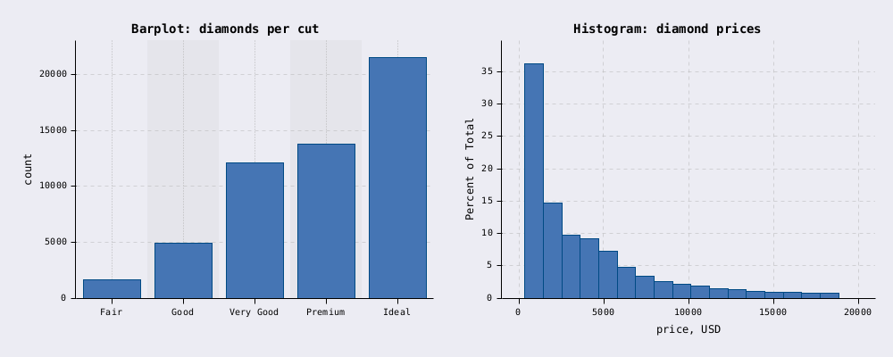
:::


### Radar: the order of the axes

The same car in two axis orders: the polygon's shape and area change with the order, though the values don't.

Source: [data-to-viz - Spider chart caveats](https://www.data-to-viz.com/caveat/spider.html). Data: Motor Trend car road tests (1974), R datasets package `mtcars` (Henderson & Velleman 1981); licence: Part of R (GPL-2 | GPL-3).


::: {.sourceClojure}
```clojure
(plot/render-image
 (plot/arrange
  (vec (for [vs [car-variables [:mpg :wt :hp :drat :qsec :disp]]]
         {:data (filter #(= "Mazda RX4" (:model %)) mtcars) :coord {:kind :polar}
          :charts [(chart/parallel {:variables vs :fill :color :line-width 2 :limits car-limits})]
          :labels {:title (str "Mazda RX4: " (str/join " " (map name vs))) :x nil}}))
  {:columns 2})
 {:width 1000 :height 500})
```
:::


::: {.clay-image}
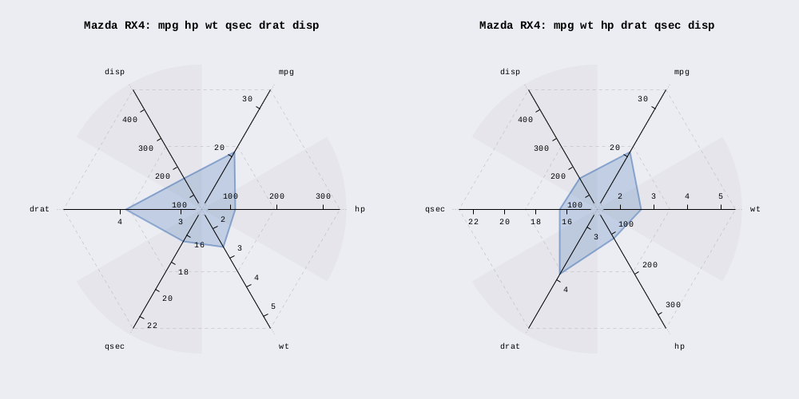
:::


### Circular bars exaggerate the outer ones

Around a circle an outer bar is longer than an inner bar of the same value, and the angle of each bar hides its
length: the straight bars compare honestly.

Source: [data-to-viz - Circular barplot y axis](https://www.data-to-viz.com/caveat/circular_bar_yaxis.html). Data: Weapon exports by country, data-to-viz example dataset `7_OneCatOneNum` (Yan Holtz); licence: MIT (data_to_viz repository).


::: {.sourceClojure}
```clojure
(plot/render-image
 (plot/arrange
  [{:data top-10 :mapping {:x :country :y :value} :scales {:x {:order-by level-value}}
    :coord {:kind :polar :inner 0.2}
    :charts [(chart/bar)] :labels {:title "Circular" :x nil :y nil}}
   {:data top-10 :mapping {:x :country :y :value} :scales {:x {:order-by level-value}}
    :theme {:axis {:x {:label-rotation -45}}}
    :charts [(chart/bar)] :labels {:title "Straight" :x nil :y "exports"}}]
  {:columns 2})
 {:width 1000 :height 500})
```
:::


::: {.clay-image}

:::


```{=html}
<div style="background-color:grey;height:2px;width:100%;"></div>
```


```{=html}
<div><pre><small><small>source: notebooks/use_cases/ranking.clj</small></small></pre></div>
```